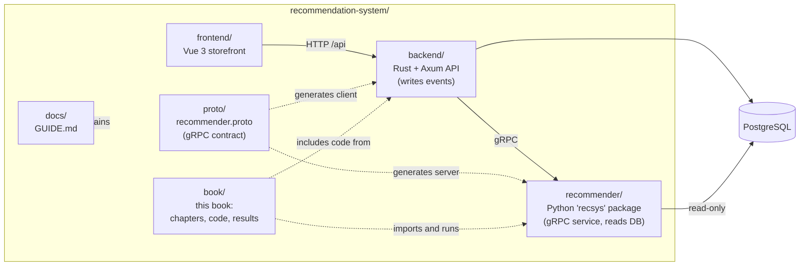
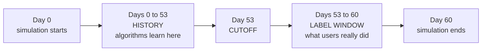

# Preface

Open the Shopee app on a Tuesday evening. Before you type a single letter, the home screen already shows you forty products. A phone case that fits the phone you bought last month. A bag of cat food, because you spent ten minutes on pet products last week. A flash-sale kettle from a shop in Surabaya that other people with your browsing habits seem to like. Nobody wrote those forty slots by hand. Behind that screen, a pipeline of software looked at hundreds of millions of products, discarded almost all of them in a few milliseconds, scored the survivors one by one, and shuffled the winners so that the page did not look like a wall of identical phone cases.

That pipeline is a **recommender system**. This book teaches you how one works by building one: first the simplest possible version, a list of the most popular items, and then, chapter by chapter, every idea that turns that list into a modern multi-stage system. At the end you will be able to read the architecture diagram of a large marketplace and recognise every box on it, because you have built a small version of each one.

## Who this book is for

The book is written for **mid-level software engineers**. You are comfortable reading Python, you know what a REST API and a SQL join are, and you have shipped production code. You do not need a machine-learning background. When a chapter needs a piece of mathematics, such as a logarithm, a dot product or a gradient, it explains the piece the first time it appears and then uses it with a tiny worked example whose numbers are small enough to check by hand.

You do *not* need to be a data scientist, and you do not need a GPU. Everything runs on a laptop in minutes. If you are a backend or frontend engineer who has been asked to "add recommendations" to a product, this book is aimed squarely at you. If you are already a machine-learning practitioner, the later chapters, on feature engineering, learning to rank, re-ranking and the serving architecture, are where you will find the most that is new, because they connect modelling decisions to the engineering around them.

Two promises shape everything that follows:

1. **Every algorithm is explained step by step.** You will see the intuition, the formula, a worked example, and then the real code that implements it.
2. **Every number in the text comes from a program you can run.** No result in this book was typed by hand. Each chapter has a companion script; its output is pasted into the book directly from a file captured when the script ran. If you re-run the script you will get the same numbers, because all random seeds are fixed.

## The shape of the book

The book follows the historical and practical path of the field. Early chapters are simple and fast; later chapters add machinery, but only when the earlier approach has shown its limits on the same data.

Here is the route in words.

**Part 1 — Foundations (Chapters 1–2).** Chapter 1 frames the problem and introduces the data we will use throughout: what a recommender observes, what it never sees, and why the data is sparse and lopsided. Chapter 2 is about measurement. Before comparing algorithms we need a ruler, so we derive precision, recall, average precision and NDCG, and we learn why a *time-based* train/test split is the only honest way to evaluate a recommender.

**Part 2 — Single-model recommenders (Chapters 3–7).** These are the classic algorithms, each a complete recommender on its own.

- *Chapter 3, popularity baselines.* Recommend what everyone likes. Simple, strong, and the number every later method has to beat.
- *Chapter 4, content-based filtering.* Recommend items that look like the ones you liked, using the words in their titles.
- *Chapter 5, collaborative filtering.* Recommend what people similar to you liked, or what is bought together with what you viewed.
- *Chapter 6, matrix factorisation.* Compress the giant user-by-item table into short vectors of "taste" numbers.
- *Chapter 7, embeddings and two-tower retrieval.* Learn those vectors with a neural network and search them fast with approximate nearest-neighbour indexes.

**Part 3 — The multi-stage system (Chapters 8–12).** Here the book changes gears. Real marketplaces do not run one model; they run a funnel. A cheap, broad stage fetches a few hundred **candidates**; an expensive, precise stage **ranks** them; a final stage **re-ranks** for diversity and business rules.

- *Chapter 8, candidate generation.* Combine several retrievers and understand the recall ceiling.
- *Chapter 9, feature engineering.* Build the signals the ranker will see, and learn why a leaked future signal can make a model look brilliant and be worthless.
- *Chapter 10, learning to rank.* Gradient-boosted trees, LambdaMART, feature importance and SHAP explanations.
- *Chapter 11, re-ranking, diversity and business rules.* MMR, caps, exploration.
- *Chapter 12, cold start, context and bias.* What to do for new users and new items, and how logged data lies to you through position bias and feedback loops.

**Part 4 — Production (Chapters 13–14).** Chapter 13 stops talking about notebooks and walks through a working web application: a Vue storefront, a Rust API, a Postgres database and the Python recommender as a gRPC microservice. You will follow a single click from the browser to the database and back into a changed home page. Chapter 14 then asks what changes when the same design must serve tens of millions of users: streaming logs, feature stores, deep rankers, A/B testing and monitoring.

The appendices collect the quiz answers (Appendix A), a glossary (Appendix B), the exact commands to reproduce every result and figure (Appendix C) and the bibliography.

### Suggested reading paths

- **Read straight through.** Each chapter reuses the data, the evaluation harness and sometimes the code of earlier chapters. This is the intended path and takes the longest.
- **Just want the production system?** Skim Chapter 1 for the data, read Chapter 2 for the metrics, then jump to Chapters 8, 10 and 13. Whenever a term is unfamiliar, look it up in the glossary.
- **Already know the classic algorithms?** Skim Chapters 3–7 for the results tables and start properly at Chapter 8.

## What is in the repository

The book lives inside the repository of a complete working project. The repository contains the book, the code the book teaches, and the application that uses it.



*Figure: The repository at a glance. Solid arrows are runtime calls; dotted arrows are build-time or documentation relationships.*

Each directory has one job:

| Directory | What it holds | Where it appears in the book |
|---|---|---|
| `recommender/` | The Python package `recsys`: the marketplace simulator, candidate retrievers, feature builders, the LightGBM ranker, the re-ranker and the gRPC service | Chapters 1–3 and 8–13 |
| `book/code/` | One companion script per algorithm chapter, plus `common.py` shared by all of them | Every chapter |
| `book/results/` | The captured output (`.txt`) and metrics (`.json`) of those scripts | Every `output` block |
| `backend/` | The Rust and Axum API: authentication, catalogue, cart, checkout, event logging, the gRPC client | Chapter 13 |
| `frontend/` | The Vue 3 storefront with the "Why this?" explanations and the live event log | Chapter 13 |
| `proto/` | `recommender.proto`, the single file that defines the contract between Rust and Python | Chapter 13 |
| `docs/` | `GUIDE.md`, a plain-language walkthrough of the running application | Chapter 13 |
| `book/` | The chapters, charts, screenshots and build tooling for the PDF you are reading | – |

Two design decisions in the project deserve a mention now because they recur throughout. First, **Rust writes all user behaviour to Postgres, and Python only reads it** (through a connection opened in read-only mode). The recommender can therefore never corrupt the data it learns from. Second, **recommendations are computed on request**: when you load the home page the recommender fetches fresh candidates, builds features and scores them, so a click you made five seconds ago can already change what you see. The model itself is retrained periodically rather than on every request. Chapter 13 shows exactly how.

## Setting up

You can read the book without running anything, but you will learn more if you run the scripts, change a number and watch what happens. Every chapter ends with a quiz that includes one hands-on exercise of exactly that kind.

### What you need

| Tool | Used for |
|---|---|
| [`uv`](https://docs.astral.sh/uv/) | Python environments for `recommender/` and `book/` |
| Node.js and `npm` | The Vue frontend, and the `mermaid` and `katex` libraries used to render diagrams and math in the PDF |
| PostgreSQL | Only for the live application of Chapter 13. Listening on `localhost:5432`, user `postgres`, password `postgres` |
| Rust toolchain (`cargo`) | Only for the backend |
| `protoc` | Only to compile the gRPC contract for Rust |

The algorithm chapters (1–12) need **only `uv`**. Postgres, Rust and Node are needed only when you want to run the full web application.

### Companion scripts and the book tooling

Clone the repository, then from the repository root run:

```bash
cd book && uv sync && uv run playwright install chromium && npm i
```

`uv sync` installs Python dependencies, including the `recsys` package from `../recommender` in editable mode, so the scripts import the same code the chapters show. The `playwright install` step downloads a headless Chromium, which is used both to render the PDF and to take the screenshots. `npm i` fetches `mermaid` and `katex`.

Every companion script runs from the `book/` directory:

```bash
uv run python code/ch01_explore.py
```

To regenerate every result file in order, use `uv run python tools/run_all.py`. Appendix C lists all commands, including those that rebuild the figures and the PDF.

### The web application

For Chapter 13 you need the three services running. The authoritative, step-by-step instructions are in `docs/GUIDE.md`, section "Run it". In outline:

1. Create the database and apply the schema: `createdb marketplace`, copy `backend/.env.example` to `backend/.env`, then `cargo run -- migrate` inside `backend/`.
2. Fill the database with the simulated marketplace: `uv run recsys seed-db --yes` inside `recommender/`.
3. Start three terminals: `uv run recsys serve` (Python, port 50051), `cargo run` (Rust, port 8080) and `npm run dev` (Vue, port 5173).

Then open `http://localhost:5173`. The seed data includes demo accounts such as `user43@demo.test` with the password `password`; the login page lists the others.

::: tip
Do the setup for the web application *after* you have finished Chapter 8 or so, not before. The early chapters are far easier to follow when you are not also debugging a database connection.
:::

## The running example: a simulated marketplace

Real marketplace logs are private, and public datasets are either small, old or missing the signals that matter (positions, dwell time, sellers, stock). So this book uses a **simulated marketplace** that ships with the repository. It is designed to behave like a regional e-commerce platform, and because we wrote the simulator, we also know the hidden truth that generated the behaviour. That is a luxury real engineers never have, and Chapter 1 uses it to explain why logged data is only a distorted shadow of what users actually want.

The default simulation, which every chapter uses, is configured in `recommender/recsys/simulate.py` with these parameters: 1,500 users, 2,500 items, 150 shops and 60 days of activity, with all random seeds fixed. The first lines printed by the Chapter 1 script confirm the resulting table sizes:

```output
file: results/ch01_explore.txt
lines: 2-9
```

Beyond sheer size, the simulator reproduces the patterns that make recommendation interesting:

- **Popularity is lopsided.** A small share of items attracts a large share of interactions (a *long tail*), exactly as in a real store.
- **Tastes are personal.** Each user has hidden preferences for categories, price range and brands.
- **Time matters.** Traffic is higher on weekends and around paydays (the 25th through the 1st of each month), and the simulated window contains the **9.9 mega-sale**, a day on which traffic and orders spike. Chapter 1 quantifies these effects and charts them.
- **Behaviour is a funnel.** Users see *impressions*, some become *clicks*, fewer become *add-to-carts*, fewer still become *orders*. Some items get *hidden* and some purchases are *returned*.
- **Stock runs out and new items appear.** Sellers list products during the window and some sell out, which creates the cold-start and availability problems of Chapter 12.

### One time split for the whole book

The most important convention in the book is a fixed point in time called the **cutoff**. The simulated marketplace covers 60 days. We pick **day 53 as the cutoff** and apply one rule everywhere:

> Every algorithm may learn from, and compute features from, events that happened **before** the cutoff. It is then judged on what users actually did in the **7 days after** it.



*Figure: The time split used by every companion script. Nothing from the label window is ever visible during training or feature building.*

This mirrors how a deployed recommender lives: at any moment it knows the past and must predict the near future. A random split of events into train and test would let a model peek at the future and quietly inflate its score; Chapter 2 shows why, and Chapter 9 shows a deliberate demonstration of how large the inflation can be.

The shared file `book/code/common.py` enforces the split. It loads the simulated tables, defines the cutoff, builds the history and the labels, and provides a single `evaluate` function that every method calls. Because every chapter uses the same data and the same ruler, the numbers are directly comparable across chapters, and in Chapter 14 we line up every method from every chapter in one leaderboard.

## How each chapter is organised

Chapters 1 to 14 follow the same template, so you always know where you are:

1. **An opening story** set in a Shopee-like scenario, and a short list of what you will learn.
2. **Intuition**, using an everyday analogy before any formula.
3. **The algorithm**: the formulas, numbered steps, and a worked example small enough to do with a pencil.
4. **Code walkthrough**: real code from the repository, explained piece by piece.
5. **Run it**: the command to execute and its captured output.
6. **Results**: charts and an interpretation tied to the actual numbers.
7. **Pitfalls and production practice**: what goes wrong, and how large systems handle it.
8. **Summary** and **Quiz**.

### Visual and typographic conventions

Source code is pulled directly from the files it describes, so what you read is what runs. Program output appears in a grey block, like this:

```output
file: results/ch01_explore.txt
lines: 2-4
```

Output blocks are always copied from a captured results file and never edited. If a number appears in a paragraph, it is also in an output block or in the matching JSON file under `book/results/`.

Diagrams are flowcharts or sequence diagrams with a caption beginning "Figure". Charts and screenshots are numbered by chapter. Mathematics is typeset in the usual way: inline like $a \cdot b$ and displayed when it deserves a line of its own:

$$
\text{NDCG@}K = \frac{\text{DCG@}K}{\text{IDCG@}K}
$$

Do not worry if that formula is unfamiliar. Chapter 2 builds it from nothing.

Four kinds of callout boxes break up the text. They look like this in the PDF:

**"Did you know?" boxes** (blue) carry a verifiable fact from the research literature or the history of the field, with its source named at the bottom of the box and listed in the bibliography. Every chapter has at least two of them.

::: tip
**A tip** is a practical shortcut or a habit that will save you time.
:::

::: warning
**A warning** marks a mistake that is easy to make and expensive to discover, such as evaluating on data the model has already seen.
:::

::: try
**A "Try it yourself" box** suggests a small experiment: change one parameter in a script, re-run it and compare. These are the best way to turn reading into understanding.
:::

Finally, every chapter ends with a **quiz** of eight to ten questions: multiple choice, short answer, a code-reading question, a calculation and one hands-on exercise that modifies a companion script. Answers with short explanations are in Appendix A. Try to answer before you look; the effort of retrieving an answer is what makes it stick.

## A note on scale and honesty

This book builds a recommender for a marketplace with a few thousand products. The company whose name appears in the title serves vastly more, and its internal systems are not public. Where we describe how large platforms do things, we rely on published papers and say so; we do not invent internal numbers. Chapter 14 is explicit about which parts of our small system carry over unchanged to large scale (the funnel, the point-in-time discipline, the evaluation mindset) and which parts must be rebuilt (the data plumbing, the retrieval index, the model size, the testing process).

We also report results honestly. In a few places a simpler method beats a fancier one on this particular dataset, or a well-known improvement is smaller than the textbooks suggest. When that happens the book says so and explains why, because learning to read results sceptically is at least as valuable as learning any single algorithm.

With the map in hand, turn the page. Chapter 1 begins where every recommender project begins: with the data, and with an honest look at what it can and cannot tell us.
