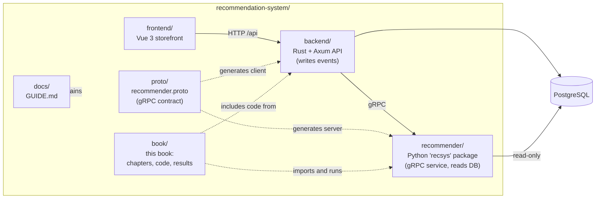
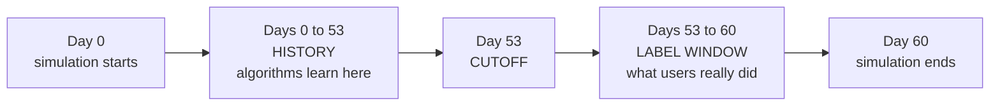

# Preface

Open the Shopee app on a Tuesday evening. Before you type a letter, the home screen already shows forty products: a phone case for the phone you bought last month, cat food because you browsed pet products last week, a flash-sale kettle. Nobody wrote those slots by hand. A pipeline looked at millions of products, discarded almost all of them in milliseconds, scored the survivors, and shuffled the winners so the page did not look like a wall of identical phone cases.

That pipeline is a **recommender system**. This book teaches how one works by building one: first a list of the most popular items, then, chapter by chapter, every idea that turns that list into a modern multi-stage system.

## Who this book is for

The book is written for **mid-level software engineers**: you read Python comfortably, know REST and SQL, and have shipped production code. No machine-learning background is needed; each piece of mathematics is explained the first time it appears and used on a tiny worked example. Everything runs on a laptop in minutes, with no GPU.

Two promises shape everything that follows:

1. **Every algorithm is explained step by step.** You will see the intuition, the formula, a worked example, and then the real code that implements it.
2. **Every number in the text comes from a program you can run.** No result in this book was typed by hand. Each chapter has a companion script; its output is pasted into the book directly from a file captured when the script ran. If you re-run the script you will get the same numbers, because all random seeds are fixed.

## The shape of the book

The book follows the historical and practical path of the field. Each chapter adds machinery only after the previous approach has shown its limits on the same data.

- **Foundations (Chapters 1–2).** The problem, the data, and the ruler: precision, recall, NDCG and time-based evaluation.
- **Single-model recommenders (Chapters 3–7).** Popularity, content-based filtering, collaborative filtering, matrix factorisation, and embeddings with two-tower retrieval.
- **The multi-stage system (Chapters 8–12).** Real marketplaces run a funnel: a cheap stage fetches a few hundred **candidates**, a precise stage **ranks** them, and a final stage **re-ranks** for diversity and business rules. These chapters cover candidate generation, feature engineering, learning to rank, re-ranking, and cold start, context and bias.
- **Production (Chapters 13–14).** A working Vue, Rust, Postgres and Python gRPC application in which you follow one click end to end, then what changes at tens of millions of users.

The appendices hold quiz answers, a glossary, reproduction commands and the bibliography.

## What is in the repository

The book lives inside the repository of a complete working project. The repository contains the book, the code the book teaches, and the application that uses it.



*Figure: The repository at a glance. Solid arrows are runtime calls; dotted arrows are build-time or documentation relationships.*

Each directory has one job:

| Directory | What it holds | Where it appears in the book |
|---|---|---|
| `recommender/` | The Python package `recsys`: the marketplace simulator, candidate retrievers, feature builders, the LightGBM ranker, the re-ranker and the gRPC service | Chapters 1–3 and 8–13 |
| `book/code/` | One companion script per algorithm chapter, plus `common.py` shared by all of them | Every chapter |
| `book/results/` | The captured output (`.txt`) and metrics (`.json`) of those scripts | Every `output` block |
| `backend/` | The Rust and Axum API: authentication, catalogue, cart, checkout, event logging, the gRPC client | Chapter 13 |
| `frontend/` | The Vue 3 storefront with the "Why this?" explanations and the live event log | Chapter 13 |
| `proto/` | `recommender.proto`, the single file that defines the contract between Rust and Python | Chapter 13 |
| `docs/` | `GUIDE.md`, a plain-language walkthrough of the running application | Chapter 13 |
| `book/` | The chapters, charts, screenshots and build tooling for the PDF you are reading | – |

Two design decisions recur throughout. **Rust writes all user behaviour to Postgres; Python only reads it**, through a read-only connection. And **recommendations are computed on request**, so a click made five seconds ago can already change the home page, while the model is retrained periodically.

## Setting up

You can read the book without running anything, but you will learn more if you change a number and watch what happens.

### What you need

| Tool | Used for |
|---|---|
| [`uv`](https://docs.astral.sh/uv/) | Python environments for `recommender/` and `book/` |
| Node.js and `npm` | The Vue frontend, and the `mermaid` and `katex` libraries used to render diagrams and math in the PDF |
| PostgreSQL | Only for the live application of Chapter 13. Listening on `localhost:5432`, user `postgres`, password `postgres` |
| Rust toolchain (`cargo`) | Only for the backend |
| `protoc` | Only to compile the gRPC contract for Rust |

The algorithm chapters (1–12) need **only `uv`**. Postgres, Rust and Node are needed only when you want to run the full web application.

### Companion scripts and the book tooling

Clone the repository, then from the repository root run:

```bash
cd book && uv sync && uv run playwright install chromium && npm i
```

`uv sync` installs Python dependencies, including the `recsys` package from `../recommender` in editable mode, so the scripts import the same code the chapters show. The `playwright install` step downloads a headless Chromium, which is used both to render the PDF and to take the screenshots. `npm i` fetches `mermaid` and `katex`.

Every companion script runs from the `book/` directory:

```bash
uv run python code/ch01_explore.py
```

To regenerate every result file in order, use `uv run python tools/run_all.py`. Appendix C lists all commands, including those that rebuild the figures and the PDF.

### The web application

For Chapter 13 you need the three services running. The authoritative, step-by-step instructions are in `docs/GUIDE.md`, section "Run it". In outline:

1. Create the database and apply the schema: `createdb marketplace`, copy `backend/.env.example` to `backend/.env`, then `cargo run -- migrate` inside `backend/`.
2. Fill the database with the simulated marketplace: `uv run recsys seed-db --yes` inside `recommender/`.
3. Start three terminals: `uv run recsys serve` (Python, port 50051), `cargo run` (Rust, port 8080) and `npm run dev` (Vue, port 5173).

Then open `http://localhost:5173`. The seed data includes demo accounts such as `user43@demo.test` with the password `password`; the login page lists the others.

## The running example: a simulated marketplace

Real marketplace logs are private and public datasets lack positions, dwell time and stock, so the book uses a **simulated marketplace** shipped with the repository. Because we wrote the simulator we also know the hidden truth behind the behaviour, which Chapter 1 uses to show how logged data distorts what users want.

The default simulation, configured in `recommender/recsys/simulate.py`, has 1,500 users, 2,500 items, 150 shops and 60 days of activity, with fixed seeds. The Chapter 1 script confirms the table sizes:

```output
file: results/ch01_explore.txt
lines: 2-9
```

Beyond sheer size, the simulator reproduces the patterns that make recommendation interesting:

- **Popularity is lopsided.** A small share of items attracts a large share of interactions (a *long tail*), exactly as in a real store.
- **Tastes are personal.** Each user has hidden preferences for categories, price range and brands.
- **Time matters.** Traffic is higher on weekends and around paydays (the 25th through the 1st of each month), and the simulated window contains the **9.9 mega-sale**, a day on which traffic and orders spike. Chapter 1 quantifies these effects and charts them.
- **Behaviour is a funnel.** Users see *impressions*, some become *clicks*, fewer become *add-to-carts*, fewer still become *orders*. Some items get *hidden* and some purchases are *returned*.
- **Stock runs out and new items appear.** Sellers list products during the window and some sell out, which creates the cold-start and availability problems of Chapter 12.

### One time split for the whole book

The most important convention in the book is a fixed point in time called the **cutoff**. The simulated marketplace covers 60 days. We pick **day 53 as the cutoff** and apply one rule everywhere:

> Every algorithm may learn from, and compute features from, events that happened **before** the cutoff. It is then judged on what users actually did in the **7 days after** it.



*Figure: The time split used by every companion script. Nothing from the label window is ever visible during training or feature building.*

The shared file `book/code/common.py` enforces the split and provides one `evaluate` function, so numbers are comparable across chapters.

## How each chapter is organised

Chapters 1 to 14 follow the same template, so you always know where you are:

1. **An opening story** set in a Shopee-like scenario, and a short list of what you will learn.
2. **Intuition**, using an everyday analogy before any formula.
3. **The algorithm**: the formulas, numbered steps, and a worked example small enough to do with a pencil.
4. **Code walkthrough**: real code from the repository, explained piece by piece.
5. **Run it**: the command to execute and its captured output.
6. **Results**: charts and an interpretation tied to the actual numbers.
7. **Pitfalls and production practice**: what goes wrong, and how large systems handle it.
8. **Summary** and **Quiz**.

### Visual and typographic conventions

Code is pulled directly from the repository files, and output blocks are copied from captured results files. Any number in a paragraph also appears in an output block or a JSON file under `book/results/`. Inline math looks like $a \cdot b$; Chapter 2 builds NDCG from nothing.

Four kinds of callout boxes break up the text. They look like this in the PDF:

**"Did you know?" boxes** (blue) carry a verifiable fact from the research literature or the history of the field, with its source named at the bottom of the box and listed in the bibliography. Every chapter has at least two of them.

::: tip
**A tip** is a practical shortcut or a habit that will save you time.
:::

::: warning
**A warning** marks a mistake that is easy to make and expensive to discover, such as evaluating on data the model has already seen.
:::

::: try
**A "Try it yourself" box** suggests a small experiment: change one parameter in a script, re-run it and compare. These are the best way to turn reading into understanding.
:::

Finally, every chapter ends with a **quiz** of eight to ten questions: multiple choice, short answer, a code-reading question, a calculation and one hands-on exercise that modifies a companion script. Answers with short explanations are in Appendix A. Try to answer before you look; the effort of retrieving an answer is what makes it stick.

## A note on scale

Where we describe how large platforms work we rely on published papers and invent no internal numbers. When a simple method beats a fancier one on this dataset, the book says so and explains why.

With the map in hand, turn the page. Chapter 1 begins where every recommender project begins: with the data, and with an honest look at what it can and cannot tell us.
