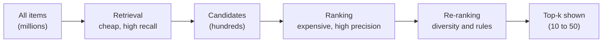
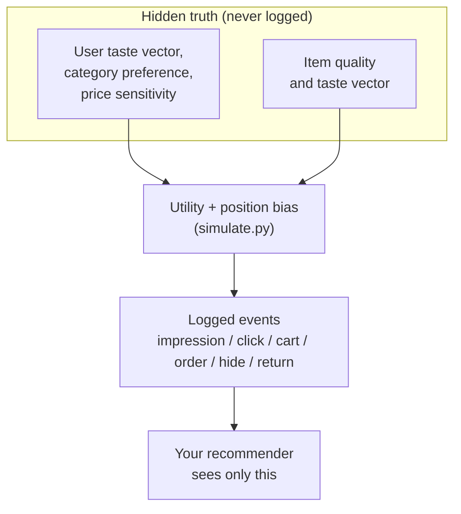

# What a Recommender Does

## The Monday-morning problem

It is 08:55 on a Monday and Rina, a product manager at a marketplace not unlike Shopee, is staring at a dashboard. Her platform lists millions of products. Her buyers open the app, swipe for ninety seconds, and leave. Some of them leave happy, with a phone case in their cart. Most of them leave empty-handed, because the thing they would have loved was number 48,213 in a list nobody scrolled to.

Her engineering lead says the sentence that starts every recommender project: "We need to show each person the right things." Rina asks the question that matters: *what are the things, who is the person, and how will we know we got it right?* This chapter answers those questions before any modelling code, and introduces the simulated marketplace used in every experiment in this book.

**What you'll learn**

- How to frame "recommendation" as two separate jobs, *retrieval* and *ranking*, and why personalisation is the point of both.
- The difference between explicit and implicit feedback, and why e-commerce almost always lives on the implicit kind.
- What the *simulator's hidden truth* is, why the data you log is only a shadow of it, and why a real platform never sees the truth.
- The seven raw tables of the book's marketplace and the six event types that fill the `events` table.
- How to measure sparsity, the long tail, per-user activity and time effects (paydays, the 8.8 and 9.9 mega-sales) with real numbers from the companion script `ch01_explore.py`.

## Intuition: the shop assistant who remembers you

Imagine two shop assistants in a physical market. The first stands at the entrance and shouts, "Today's best sellers are over here!" every time anyone walks in. The second watches who comes in. When you arrive she remembers that last week you bought cat food, that you looked at a ceramic mug for a long time, and that you ignored the sneakers table twice. She says: "The new cat-food brand arrived, and we have mugs on sale." Neither assistant is lying. But the second one is *personalising*: her output depends on who you are and what you have done.

A recommender system is the second assistant, automated and multiplied by a few million customers. It has three ingredients, and it helps to name them now because the whole book is a variation on them:

1. **Users**: people (or accounts) who act.
2. **Items**: the things that can be shown, clicked, bought.
3. **Interactions**: the record of who did what to which item, and when.

Here are all three for one shopper, **Sari**, in one tiny moment:

| Ingredient | In Sari's moment |
|---|---|
| User | Sari (account #1) |
| Item | a 2 kg bag of cat food (item #17) |
| Interaction | "Sari clicked item #17 at 10:03" |

A *recommender system* (or *recommender*) is a program that looks at the interactions it has recorded and, for each user, picks the few items to show.

The assistant's brain has to solve a problem that sounds easy and is brutal in practice: given a user and a very large set of items, produce a short ordered list that the user is likely to value. "Short" matters because screens are small. "Ordered" matters because people do not scroll. "Likely to value" matters because we have to turn a fuzzy human notion into something a computer can optimise.

She also does not compare you against *every product in the market*. She first walks along the shelves and grabs thirty plausible things in a quick, rough pass. Only then does she think carefully about which one to show first, second and third. This two-step habit is exactly what every large recommender does, and the next section gives the two steps their proper names.

## The algorithm: framing the problem

### Retrieval and ranking

A recommender needs a way to say "how good is item $i$ for user $u$?" in a form a computer can sort. The simplest form is a **score**: one number per user-item pair, where a bigger number means "show this earlier". If Sari's scores are 0.9 for the cat-food bag, 0.5 for a mug and 0.2 for sneakers, her list is cat food, mug, sneakers. Every method in this book is a different way of producing that number.

Formally, let $U$ be the set of users and $I$ the set of items (so $|I|$ reads as "how many items there are"). We want a scoring function

$$
s(u, i) \in \mathbb{R}
$$

which reads: "give me a user and an item, and I return one real number" ($\mathbb{R}$ is just "any ordinary number"). We want it such that, for each user $u$, sorting items by $s(u,\cdot)$ puts the ones $u$ would value first.

Why not simply score every item every time? If $|I|$ were 2,500, as in this book's marketplace, we could: score every item for every request. If $|I|$ is 100 million, as on a major marketplace, it is impossible. A good scoring model needs real time per item, and the app has a **latency budget**: the time the shopper is willing to wait, a few hundred milliseconds. A few hundred milliseconds divided by 100 million items leaves no time to think about any of them.

So production systems split the work into stages, like the assistant who grabs thirty things and then chooses:

- **Retrieval** (also called *candidate generation*) is the quick, cheap first pass. It reduces millions of items to a few hundred **candidates**: the items that will be considered further. It may be wrong about the order and may even include junk, but it must not *miss* items the user would have loved, because nothing downstream can bring them back. We call this property **high recall**: of all the items the user would love, the candidate pile contains most of them. If Sari would love the cat-food bag and retrieval leaves it on the shelf, no later stage can rescue it.
- **Ranking** is the slow, careful second pass. It takes those few hundred candidates and scores each one with a richer model that uses many **features** (facts about the user, the item and their relationship: the item's price, Sari's city, how many cat products she clicked last week). It decides the final order. We want **high precision** here: the items at the top of the final list should really be good ones, not merely plausible ones.
- **Re-ranking** (chapter 11) applies business rules and diversity on top: no five identical phone cases in a row.



*Figure: the funnel shared by every large recommender. Chapters 3 to 7 build retrievers, chapters 9 and 10 build the ranker, chapter 11 the re-ranker.*

This funnel is the skeleton of the book. Chapters 3 to 7 are about producing *a* score, with progressively smarter methods, and we will evaluate each of them as if it alone had to do the whole job. From chapter 8 onwards we put them together the way real systems do. If a stage name is unfamiliar when you meet it later, come back to this figure.

### Personalisation

A **non-personalised** recommender returns the same list to everyone ("most popular this week"), like the first assistant shouting at the door. A **personalised** one changes the list depending on the user, like the second assistant. A non-personalised method is also called a **baseline**: a simple reference that any cleverer method must beat to be worth building. Popularity baselines are more competitive than newcomers expect (chapter 3), so personalisation must win where it matters: where the popular choice is wrong for this person.

"Right" can mean different things. It can be the user's answer (items I would enjoy), the business's answer (orders, revenue) or the ecosystem's answer (a healthy spread of sellers, not only giants). In this book behaviour is the signal, which merges the first two.

### Explicit versus implicit feedback

How does a system learn what a user likes? There are two families of signal. Think of a restaurant. Asking a guest to fill in a review card is one way. Watching what they actually order and leave on the plate is the other.

**Explicit feedback** is a deliberate statement: a 1-to-5 star rating, a thumbs-up, a "not interested" tap. It is the review card. It is clean, because the user meant it. It is also rare. Most people never rate anything, and those who do are not representative of those who do not.

**Implicit feedback** is the by-product of normal behaviour, with no extra effort from the user: an item was shown, clicked, kept in view for 40 seconds, added to a cart, bought. It is watching what the guest orders. It is abundant, because every visit generates it. It is also **noisy** (mixed with accidents and random habits) and ambiguous. A click may be curiosity or an accident. A missing click does not mean dislike; the user may never have seen the item. A purchase is a strong yes, but it is also biased towards cheap, convenient and heavily promoted items.

Each logged action is called an **event**: one line in the app's log, such as "at 10:03, Sari clicked item #17". For Sari buying cat food, the events could be:

| Time | Event type | What it means |
|---|---|---|
| 10:03 | `impression` | the app showed the bag to Sari |
| 10:03 | `click` | she opened its page |
| 10:04 | `add_to_cart` | she put it in her cart |
| 10:09 | `order` | she paid |

Each kind of event is an **event type**. The first four are the positive ones; two more are negative and appear below.

On a marketplace, implicit feedback dominates, and the simulator logs exactly the kinds of events a real app would. A stronger action deserves more credit than a weaker one, so we assign each a **weight** (a strength score), defined in `schema.py`:

$$
w(\text{click}) = 1,\qquad w(\text{add\_to\_cart}) = 3,\qquad w(\text{order}) = 5.
$$

Here $w(\cdot)$ is read "the weight of this event type": a click is worth 1 point, an add to cart 3, an order 5. A user who clicked an item twice, added it to the cart once and later bought it has an **interaction strength** (the total points) of $2\cdot 1 + 1\cdot 3 + 1\cdot 5 = 10$ for that item. Hand-sized, but this is precisely how the interaction matrix of chapters 5 and 6 is built from raw events. Without weights, a casual click and an actual purchase would count the same.

Two event types are *negative*: `hide` (the user tapped "not interested") and `return` (the user bought it and sent it back). They are rare, but one `hide` says more about dislike than a thousand silent impressions.

### Hidden truth versus logged data

Here is a subtle point that separates a data scientist from someone who merely runs scikit-learn (a popular Python machine-learning library). Behind every real log there is a **truth** you never observe: what the user *really* prefers, how good each item *really* is, how price-sensitive each buyer *really* is. Statisticians call such unobserved quantities **latent** (hidden). The log is a lossy shadow of that truth, filtered through what you chose to show. Think of the way a shadow on a wall tells you the outline of an object but not its colour.

Because our marketplace is simulated, we get to do something real platforms cannot: we write the truth down ourselves. Each simulated user has three hidden properties:

- a **taste vector**: a short list of numbers saying how strongly the user leans towards each kind of product, for example (cat and pet 0.9, electronics 0.1, fashion 0.4, ...; these numbers are only illustrative);
- a **sparse category preference**: "sparse" means mostly zeros. A user really cares about only a few categories and is indifferent to the rest;
- a **price sensitivity**: how strongly a high price puts this buyer off.

Each item has a hidden **quality** (how good it is, regardless of who looks) and its own taste vector, so that user and item can be compared. Then the simulator generates **sessions** (a *session* is one visit to the app, from opening it to leaving), shows twelve items per session, and lets a **utility** decide whether each shown item is clicked, carted or bought. The utility is one number that says "how attractive is this item to this user right now", made by adding pluses and subtracting minuses.

To turn that number into a chance, the simulator uses the **logistic sigmoid**, written $\sigma$: a function that squeezes any number into the range 0 to 1. A very negative input gives a probability near 0, an input of 0 gives exactly 0.5, and a very positive input gives a probability near 1. With $\text{pos}$ the slot the item was shown in (0 is the top), the click probability is

$$
P(\text{click}) = \sigma\bigl(\text{utility}(u,i) - 4.2 - 0.12\cdot \text{pos}\bigr).
$$

In words: start from the utility, subtract 4.2 (most shown items are never clicked, so a click needs a good reason), subtract a little more for each slot further down the screen, and squash the result into a probability.

The utility is a sum of readable terms: taste match, category preference, an "intent" bonus when the item is in the category the user came for, item quality, a price-fit penalty scaled by the user's price sensitivity, the effective discount, free shipping, same-city shipping, a bonus for re-buying a consumable (something used up, like cat food), and a heavy penalty for a durable item the user already owns (you do not buy a second fridge).

**Worked example.** Suppose Sari's utility for the cat-food bag is $3.0$. Then:

| Slot (`pos`) | Argument of $\sigma$ | $P(\text{click})$ |
|---|---|---|
| 0 (top) | $3.0 - 4.2 - 0 = -1.2$ | $\sigma(-1.2) \approx 0.231$ |
| 5 | $3.0 - 4.2 - 0.6 = -1.8$ | $\sigma(-1.8) \approx 0.142$ |

Same item, same user, but moving it from the top slot to the sixth costs it about 39% of its click probability ($0.231 \to 0.142$). This is **position bias**: people click what is near the top more, regardless of quality. Because the simulator logs the `position` of every event, we will be able to study and correct it in chapter 12. A utility of $5.0$ in the top slot gives $\sigma(0.8)\approx 0.690$; a utility of $1.0$ gives $\sigma(-3.2)\approx 0.039$. The utility mostly decides *whether* you click, and the position nudges the probability up or down.

The crucial design rule is written in the docstring (the explanatory comment at the top) of `schema.py`: *the latent variables are never written to disk*. Only what an app would log leaves the simulator. Every algorithm in this book has to rediscover the truth from the shadow, exactly as it would in production. And because we know the truth, we also know the data is *learnable*: when a method fails, we can reasonably suspect the method rather than a pure-noise dataset.



*Figure: the simulator keeps the truth private. The recommender sees only the logged events and the catalog tables.*

::: fact
Collaborative filtering began with *explicit* ratings and a hint of the implicit. In the GroupLens system for Usenet news (1994), a rating was a number from 1 to 5, optionally accompanied by the number of seconds the reader spent on the article, a time signal the authors recorded but their rating servers did not yet use. Thirty years later, time on page (our `dwell_sec`) is one of the standard implicit signals.

Source: Resnick et al., ACM CSCW, 1994
:::

### Time: the calendar is a feature of the world

Marketplace traffic is not **stationary**, meaning it is not the same every day. People shop more on weekends, more right after payday, and enormously on mega-sale days. Online marketplaces in Southeast Asia run "double date" campaigns (9.9, 10.10, 11.11 and so on), where the month number equals the day number. A recommender has to cope with the fact that on those days user behaviour changes: more discounts, more clicks, higher **conversion** (the share of visits or clicks that end in a purchase).

The simulator reproduces this with a small, readable function, `_day_weights`. A **weight** here is a "how busy is this day" score. Every day starts with weight $1$. Then the weight is multiplied by $1.2$ on Saturdays and Sundays, by $1.4$ on payday days (the 25th through the 1st of the next month) and by $3.0$ on a "double date" sale day, which it detects as *month equals day*. Finally the weights are **normalised**, meaning divided by their total so they sum to one. They then become a **probability distribution over days**: the chance that a randomly chosen session falls on each day. For example, three days with raw weights 1, 1 and 3 become 0.2, 0.2 and 0.6, so the third day receives 60% of the sessions. In this 60-day window starting 1 August 2026, that means the 8.8 sale (8 August) and the 9.9 sale (9 September) both occur. The module docstring only mentions 9.9, but the rule `d.month == d.day` fires for any double date, which is why 8.8 is also boosted.

**Worked example.** A Saturday sale day (such as 8 August) has raw weight $1.2\times3.0=3.6$ against $1.0$ for an ordinary Wednesday, before normalisation. It is expected to be 3.6 times as busy.

### The raw tables

The simulator generates the seven raw tables defined in `recommender/recsys/schema.py`. A *table* is a grid of rows and columns, like a spreadsheet sheet, stored in a database. This file is deliberately "the single source of truth": the simulator writes it, the Postgres loader (the code that copies the data into a Postgres database) reads it, and the feature builder (the code that turns raw tables into numbers for models) checks against it. The tables fall into three groups:

| Group | Tables | One row is... |
|---|---|---|
| Catalog | `categories`, `shops`, `items` | a leaf category (a lowest-level category such as "phone cases", with none below it), a seller, a product listing |
| People | `users` | a buyer account |
| Behaviour | `sessions`, `searches`, `events` | an app visit, a submitted search query, one user action on one item |

The phrase "one row is..." has a name: the table's **grain**. It states what one row stands for. We come back to why it matters in the code walkthrough.

`events` is the main interaction log, and it is the table the rest of this book leans on. Its columns are `event_id`, `ts` (timestamp), `user_id`, `session_id`, `item_id`, `event_type`, `position`, `dwell_sec` and `price_paid`. Four of those deserve a comment.

- `event_type` takes one of six values: `impression`, `click`, `add_to_cart`, `order`, `hide`, `return`.
- `position` records the slot, so we can study position bias.
- `dwell_sec` is filled only on clicks: seconds spent on the product page ("dwell" means "stayed"). A long stay hints at real interest.
- `price_paid` is filled only on orders, after discounts.

The **impression** is the least glamorous and most important event. It says "this item was shown to this user in this slot". Without impressions you cannot compute a **click-through rate** (CTR: clicks divided by impressions), because you do not know the denominator (the bottom number of the fraction). Imagine a shopkeeper who counts how many people bought a cake but never counts how many saw it in the window: she cannot tell a popular cake from one that sat in the window all day. You also cannot distinguish "ignored" from "never seen".

### Sparsity and the long tail

Two statistical facts shape every method in the next chapters.

**Sparsity.** *Sparse* means "mostly empty". Arrange users as rows and items as columns, like a spreadsheet. Each cell holds the interaction strength between a user and an item. Here is a tiny version with 3 users and 4 items:

| | cat food | mug | sneakers | phone case |
|---|---|---|---|---|
| Sari | 10 | 1 | . | . |
| Budi | . | . | 3 | . |
| Rina | . | . | . | . |

Only 3 of the 12 cells are filled (a dot means "never touched"). In real catalogs almost every cell is empty. We measure this as **density**, the fraction of non-empty cells; here it is $3/12 = 25\%$.

$$
\text{density} = \frac{\text{non-zero cells}}{|U_{\text{active}}|\cdot|I_{\text{active}}|}, \qquad \text{sparsity} = 1 - \text{density}.
$$

Now a realistic-sized illustration: a store with 1,000 users and 10,000 items where the users have between them produced 50,000 distinct user-item interactions has density $50{,}000 / 10{,}000{,}000 = 0.5\%$. Reading the formula: the top is the count of filled cells, the bottom is the number of all cells ($1{,}000 \times 10{,}000$). Sparsity is the leftover, 99.5%. The practical problem: most algorithms in the later chapters must infer a user's taste from a handful of filled cells in a mostly empty row, like guessing someone's favourite food after seeing three meals. That is why **collaborative filtering** (chapter 5: recommending what similar users liked) needs neighbours and **matrix factorisation** (chapter 6) compresses the matrix into low-dimensional vectors (short lists of numbers per user and per item).

**The long tail.** Interactions are not spread evenly across items. Imagine five items with 90, 5, 3, 1 and 1 interactions out of 100: one item takes 90% of the attention. A few items are extremely popular; most are rarely touched. Sort the items by interaction count and the resulting curve drops steeply and then runs along the floor for a long time: a "head" (the popular few) and a "tail" (the many rarely touched ones). A useful summary is the share of all interactions that the top $p\%$ of items receive. The more concentrated the share, the more a popularity baseline wins by default, and the harder it is to make a recommender that visibly beats it.

The tail is where personalisation pays: it holds the products matching unusual tastes, and sellers who never get a chance. Without personalisation, a tail item has almost no way to reach the one person who would love it.

::: fact
The idea that the "tail" of a popularity distribution is economically meaningful was popularised by Chris Anderson's article "The Long Tail" in *Wired* in October 2004. He argued that online retail, free of shelf-space limits, can profit by serving niche products that in aggregate rival the hits. Whether the tail is really where the money is remains debated, but the vocabulary of head and tail is now standard in recommender work.

Source: Anderson, Wired, 2004
:::

## Code walkthrough

We will read three pieces of real code: the schema helper that prints the data contract, the simulator's configuration, and the day-weight function that implements the calendar.

### The schema as a data contract

`schema.py` models tables with two tiny frozen dataclasses. A **dataclass** is a Python class that mainly holds named fields, and *frozen* means its values cannot be changed after creation, so the contract cannot be altered by accident. A `Column` is a name, a type label and a human description. A `Table` is a name, a grain, and an ordered tuple of columns.

```include
path: recommender/recsys/schema.py
symbol: Table
```

The word **grain** matters: for `events`, one row is one user action on one item, and every later aggregate is a `GROUP BY` (SQL's "bucket the rows by this key, then count or add inside each bucket") over it. If you wrongly treat a table as one row per user-item pair when it is really one row per action, a user who clicked twice is silently counted twice. A wrong grain silently double-counts.

The `describe` function turns the contract into a printable report, which is what `uv run recsys schema` shows:

```include
path: recommender/recsys/schema.py
symbol: describe
```

`describe` prints each raw table with its grain, then the features (the numbers prepared for models, from chapter 9 on) grouped by feature group, so documentation changes whenever the schema does.

### Configuring the world

Everything about the simulated world is controlled by one frozen dataclass:

```include
path: recommender/recsys/simulate.py
symbol: SimConfig
```

Six numbers define the experiment: 1,500 users, 2,500 items, 150 shops, 60 days from 1 August 2026, and a seed of 7. The **seed** is the starting number of the random number generator. A computer's "random" numbers are really a fixed sequence that starts wherever the seed says; with the same seed the simulator generates the same world, byte for byte, like replaying a recorded game. That is how every result in this book is *reproducible*: if you re-run a script you get the same numbers I quote.

### The calendar

The function below is the whole time model:

```include
path: recommender/recsys/simulate.py
symbol: _day_weights
```

`payday` is true for day-of-month at least 25 or exactly 1; `sale` is true when `d.month == d.day`. Weights are multiplied in by boolean masks (arrays of true/false flags, one per day, that switch a multiplier on or off), then normalised. The flags are returned because the session loop reuses them: on sale days the effective discount rises by 0.2 and order probability gets a bonus, so time changes behaviour, not only traffic.

We do not paste the long body of `simulate()`: it builds the catalog and users, then for each session picks a day, a **surface** (the screen where items are shown: `home_feed` or `search`) and an intent category (what the user came to look for), shows 12 items, computes the utility, and samples the events (draws random outcomes with the probabilities computed). Search for `utility =` to read it.

## Run it

The companion script `book/code/ch01_explore.py` loads the simulated tables through the shared helper `common.load_tables()` (seed 7, cached: computed once and reused) and prints six summaries. Run it from the `book/` directory:

```bash
cd book
uv run python code/ch01_explore.py
```

Its captured output is below. Every number I quote in this chapter comes from here or from the matching `ch01_explore.json`.

```output
file: results/ch01_explore.txt
```

## Results: reading the shape of the data

### Size and funnel

The world has 25 categories, 150 shops, 2,500 items, 1,500 users, 19,455 sessions, 8,680 searches and 276,378 events: small by industry standards, big enough for the effects we care about.

Next comes the **event funnel**: how many events survive each step from showing to buying. Of 276,378 events, 233,460 are impressions; 24,726 are clicks, which is 10.59% of impressions: the **click-through rate** (CTR), meaning that about one shown item in ten is clicked. Of those clicks, 42.95% are followed by an add-to-cart (10,619 events). Of those cart additions, 55.17% are followed by an order (5,858 events). Compounding the three rates (multiplying them: 0.1059 × 0.4295 × 0.5517) gives 2.51% of impressions that end in an order. Meanwhile, 1,594 `hide` events (0.68% of impressions) and 121 `return` events (0.05%) are the rare negatives.

The funnel is the first reason that "predict a click" is not the same job as "predict a purchase". If we only optimise for clicks we would favour cheap, attention-grabbing items; the ranker in chapter 10 therefore trains on **graded** labels (labels with levels: click 1, cart 2, order 3, a different scale from the interaction weights above), so that an order counts more than a click.

Notice, too, how few positive events there are for a system that shows over two hundred thousand impressions. Training a ranker is a **rare-event problem**: the thing we want to predict happens seldom, so there is little signal to learn from. We pay attention to it throughout: when we say "positives" in later chapters (examples of things the user did want), we mean these few tens of thousands of rows.

### Time

The "Events per day" block shows the calendar at work. Two kinds of average appear below. The **median** is the middle value when you sort the days (half the days are below it, half above), and it ignores spikes. The **mean** is the ordinary average, which spikes pull upwards. On ordinary days, the median is 347 clicks. On payday days, the mean rises to 488 clicks. On weekends, the mean is 496 clicks per day against 376 on weekdays. The two double-date sales stand out dramatically: 1,386 clicks and 405 orders on 2026-08-08, and 1,262 clicks and 410 orders on 2026-09-09.


The payday windows lift the bars moderately; the sale days are spikes of almost four times the ordinary level for clicks (1,386 against 347).

### Concentration: the long tail in numbers

The popularity block counts every click, add-to-cart and order per item. The top 1% of items (25 of them) receive 12.5% of all interactions. The top 10% (250 items) receive 50.3%, and the top 20% (500 items) receive 68.6%. At the other extreme, 317 of the 2,500 items have *zero* interactions, which is over one in eight of the catalog. In other words, if you ranked the shelves of this shop by how often customers touched them, the first 250 shelves would account for half of all the touching.


The left panel is the classic head-and-tail curve. The right panel, a cumulative share, tells the same story: the further the red curve bows away from the dotted diagonal, the more concentrated the interactions. Half the interaction volume comes from only a tenth of the catalog. This is realistic: marketplaces typically have a small number of items that everyone looks at, and a very large number of items that almost nobody does. It is also *kind to popularity baselines*, which we will exploit and then try to beat.

The 317 zero-interaction items are the **cold-start** items of chapter 12. *Cold start* means "the system has no history for this item (or user) yet", so it has nothing to learn from. Only content features (facts like category and price), boosts (extra points added by hand) and exploration (showing something deliberately to gather data) can surface them.

### Sparsity

Before the **time cutoff** (the moment we freeze the world: recommendations may use only data from before it; chapter 2 explains why), 1,408 users and 2,120 items have at least one interaction. They are connected by 18,256 non-zero cells in the user-by-item matrix, so the density is 0.612% and the sparsity is 99.388%. In other words, a typical active user has touched only a very small fraction of the items they could have, and the rest of their row is unknown. The matrix is small enough to hold in memory, but the same shape at real scale (hundreds of millions of users, hundreds of millions of items) is the reason that every method in the next chapters has to be designed for a mostly empty matrix.

### Users are not equal either

The final block shows how many clicks each user made before the cutoff. A **percentile** answers "what value do $p\%$ of users stay at or below?": the 90th percentile is the click count that 90% of users do not exceed. The **quartiles** are the 25th, 50th and 75th percentiles; the median is the 50th. The median user clicked 11 items; the quartiles are 5 and 20 (25% of users clicked 5 or fewer, 75% clicked 20 or fewer); the 90th percentile is 31 and the 99th is 56. The mean is 14.2 clicks, the maximum is 106, and 92 users have no clicks at all. Those 92 users are the **cold-start users**: newcomers the system knows nothing about. For them, the best we can do is show popular or trending items, or use context such as city or device tier. We will see how the live app does this for anonymous visitors on its home page in chapter 13.

::: fact
Recommendations are not a side feature at large streaming services. Netflix's engineers reported that their recommender system influences choice for about 80% of the hours streamed on the service, with the remaining 20% coming from search. The number was published in an article on the algorithms and business value of the Netflix recommender system.

Source: Gomez-Uribe et al., ACM Transactions on Management Information Systems, 2015
:::

## Pitfalls and how it is done in production

**Mistaking the log for the truth.** The log is a sample of what the system *chose to show*. An item never shown has no clicks, which says nothing about whether people would click it. This is **exposure bias**: the data over-represents whatever the system already chose to show. Production teams log impressions with position and surface so models can account for it.

**Treating all events as equal.** One impression is not one order. The weights 1 / 3 / 5 used in this book are arbitrary but sensible; in production the weights, or the choice of a *primary* objective such as orders or revenue, are a product decision that should be revisited when the business changes.

**How production differs.** Large marketplaces log the same event types through a stream (a continuous pipe of events; Kafka is a popular tool for that), with validation, de-duplication (removing repeated copies of the same event), a warehouse (a big database for analysis and training) and a feature store (a fast lookup of prepared features, used when serving live requests). Impressions are costly at scale, so many platforms log them client-side (from the user's app rather than the server) in batches, as our Vue frontend does (chapter 13).

::: tip
Before building any model, spend an hour with a notebook and the raw tables. Print table sizes, the event funnel, the distribution of events per user and per item, and a time series of events per day. These five checks catch the majority of data bugs, and they set honest expectations for what a model can achieve.
:::

::: warning
Never compute click-through rate as clicks divided by *users* or *sessions*. CTR needs the number of **impressions** as the denominator. If your system does not log impressions, you cannot tell a popular item from an item that was merely shown very often.
:::

::: try
Open `book/code/ch01_explore.py` and find the loop `for pct in (1, 10, 20)`. Change the tuple to `(1, 5, 10, 50)`, re-run the script and compare the shares. Then look at `common.history()`, which builds the point-in-time view of the data that the rest of the book will use.
:::

## Summary

- A recommender turns a very large set of items into a short, ordered, personalised list; to be tractable it splits the work into cheap, high-recall *retrieval* and expensive, high-precision *ranking*, with *re-ranking* on top.
- Explicit feedback (ratings) is clean but rare; implicit feedback (impressions, clicks, carts, orders) is abundant but noisy, and absence of a click is not dislike.
- The simulator holds a hidden truth (tastes, quality, price sensitivity) and logs only what an app would see. Your methods must rediscover the truth from the logs.
- The marketplace has seven raw tables; `events` is the main log, and its grain is one action on one item. Impressions are essential as CTR denominators.
- The funnel runs 233,460 impressions to 24,726 clicks (10.59%), 10,619 carts and 5,858 orders; the matrix is 99.388% sparse.
- Popularity is heavily concentrated: the top 10% of items collect 50.3% of interactions, and 317 items have none.
- Time matters: weekends, paydays and the 8.8 and 9.9 sales change traffic volume and conversion, which is why we split by time and window features.
- 92 users have no clicks before the cutoff; every real system needs a cold-start fallback.

## Quiz

**Q1.1** Which statement best describes the *retrieval* stage of a two-stage recommender?

A. It orders 20 items with a large model using hundreds of features.
B. It cheaply narrows millions of items to a few hundred candidates, favouring recall.
C. It enforces diversity and business rules on the final list.
D. It computes the A/B test result.

**Q1.2** Which of the following is an example of *implicit* feedback?

A. A user rates a product 4 out of 5 stars.
B. A user writes a text review.
C. A user spends 40 seconds on a product page and adds it to the cart.
D. A user taps a thumbs-up on a recommendation.

**Q1.3** In this book's simulator, why is it important that the latent tastes and item qualities are *not* written to the output tables?

A. It saves disk space.
B. It forces recommenders to learn from the same kind of data a real app logs, while the truth stays available for reasoning about what is learnable.
C. Latent variables cannot be stored in pandas DataFrames.
D. Postgres rejects floating-point columns.

**Q1.4** In one or two sentences, explain why an `impression` event is needed to compute a click-through rate, and what goes wrong if the system logs only clicks.

**Q1.5** Explain what *sparsity* means for a user-by-item interaction matrix and name one consequence for the design of recommendation algorithms.

**Q1.6** Read the `_day_weights` function above. What is the raw (pre-normalisation) weight of a Saturday on which a double-date sale falls, such as 8 August 2026, and of a Sunday that is a payday but not a sale? Why does the function return the `payday` and `sale` flags in addition to the probabilities?

**Q1.7** Using the funnel rates from the chapter (click-through rate 10.59%, click-to-cart 42.95%, cart-to-order 55.17%), how many orders would you expect from 10,000 impressions? Round to the nearest whole number.

**Q1.8** A marketplace has 1,000 active users and 10,000 active items, and 50,000 distinct user-item pairs have at least one interaction. What are the density and sparsity of the matrix, as percentages?

**Q1.9** *Hands-on.* In `book/code/ch01_explore.py`, change the loop `for pct in (1, 10, 20)` to `for pct in (1, 5, 10, 50)` and re-run the script. What share of all interactions does the top 50% of items receive, and what does that tell you about the bottom half of the catalog? Also state what you would expect the share of the top 5% to be relative to the top 1% and the top 10%.

**Q1.10** A colleague proposes treating every impression that was not clicked as a "dislike" label for training. Give two reasons this is a risky assumption on a marketplace app.
