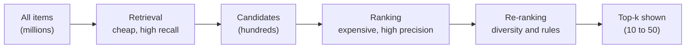
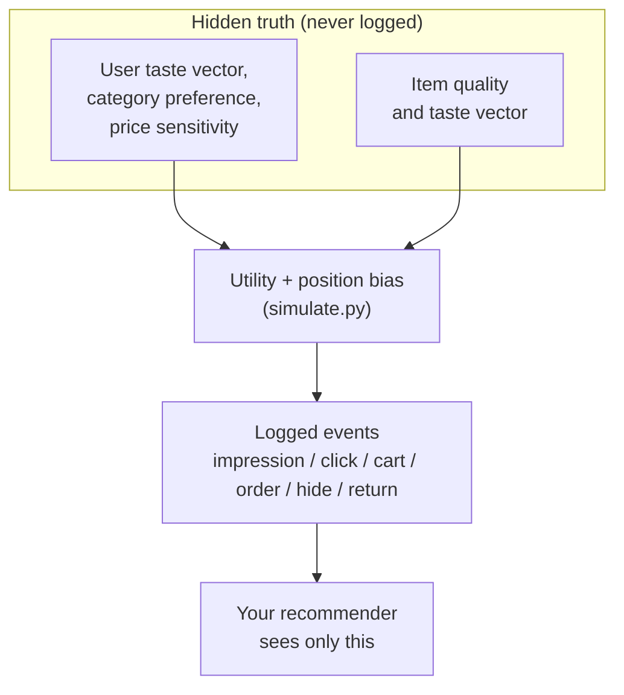
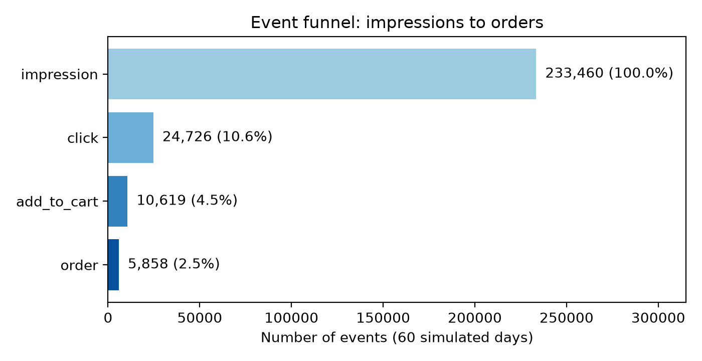
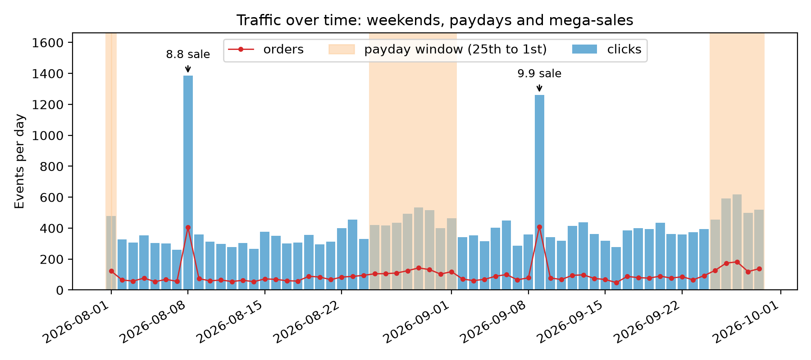
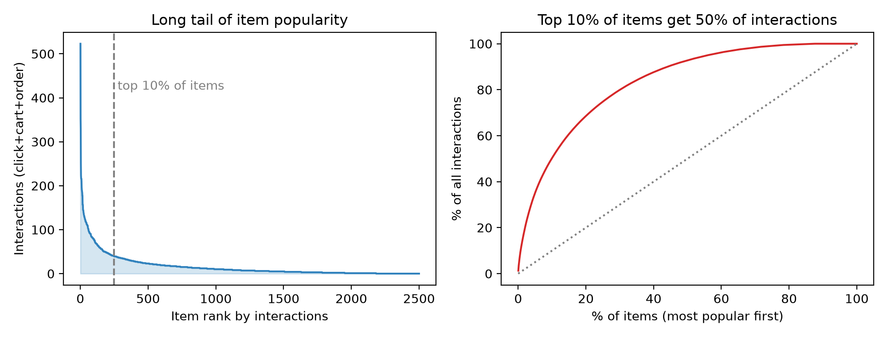

# What a Recommender Does

## The Monday-morning problem

It is 08:55 on a Monday and Rina, a product manager at a marketplace not unlike Shopee, is staring at a dashboard. Her platform lists millions of products. Her buyers open the app, swipe for ninety seconds, and leave. Some of them leave happy, with a phone case in their cart. Most of them leave empty-handed, because the thing they would have loved was number 48,213 in a list nobody scrolled to.

Her engineering lead says the sentence that starts every recommender project: "We need to show each person the right things." Rina nods. Then she asks the question that actually matters: *what are the "things", who is the "person", and how will we know whether we got it right?*

This chapter answers those three questions before we write a single line of modelling code. A recommender system is a data product, and every algorithm in the following thirteen chapters is only as good as the problem statement and the data underneath it. We will meet the simulated marketplace that powers every experiment in this book, look at the raw tables an app really logs, and learn to read the shape of that data: how sparse it is, how unequal, and how much it breathes with the calendar.

**What you'll learn**

- How to frame "recommendation" as two separate jobs, *retrieval* and *ranking*, and why personalisation is the point of both.
- The difference between explicit and implicit feedback, and why e-commerce almost always lives on the implicit kind.
- What the *simulator's hidden truth* is, why the data you log is only a shadow of it, and why a real platform never sees the truth.
- The seven raw tables of the book's marketplace and the six event types that fill the `events` table.
- How to measure sparsity, the long tail, per-user activity and time effects (paydays, the 8.8 and 9.9 mega-sales) with real numbers from the companion script `ch01_explore.py`.

## Intuition: the shop assistant who remembers you

Imagine two shop assistants in a physical market. The first stands at the entrance and shouts, "Today's best sellers are over here!" every time anyone walks in. The second watches who comes in. When you arrive she remembers that last week you bought cat food, that you looked at a ceramic mug for a long time, and that you ignored the sneakers table twice. She says: "The new cat-food brand arrived, and we have mugs on sale." Neither assistant is lying. But the second one is *personalising*: her output depends on who you are and what you have done.

A recommender system is the second assistant, automated and multiplied by a few million customers. It has three ingredients, and it helps to name them now because the whole book is a variation on them:

1. **Users**: people (or accounts) who act.
2. **Items**: the things that can be shown, clicked, bought.
3. **Interactions**: the record of who did what to which item, and when.

The assistant's brain has to solve a problem that sounds easy and is brutal in practice: given a user and a very large set of items, produce a short ordered list that the user is likely to value. "Short" matters because screens are small. "Ordered" matters because people do not scroll. "Likely to value" matters because we have to turn a fuzzy human notion into something a computer can optimise.

There is one more piece of the analogy worth keeping. The second assistant does not compare you against *every product in the market* when you walk in. That would take forever. Instinctively she first narrows the market to maybe thirty things that could plausibly interest you ("cat things, kitchen things, trending things") and only then decides the order in which to show them. That is exactly the two-stage structure that every large-scale recommender uses, and we will formalise it next.

## The algorithm: framing the problem

### Retrieval and ranking

Formally, let $U$ be the set of users and $I$ the set of items. We want a scoring function

$$
s(u, i) \in \mathbb{R}
$$

such that, for each user $u$, sorting items by $s(u,\cdot)$ puts the ones $u$ would value first. If $|I|$ were 2,500, as in this book's marketplace, we could simply score every item for every request. If $|I|$ is 100 million, as on a major marketplace, scoring everything with an expensive model within a latency budget of a few hundred milliseconds is out of the question.

So production systems split the work:

- **Retrieval** (also called *candidate generation*) is a cheap, high-recall step. It reduces millions of items to a few hundred *candidates*. It may be wrong about the order and even include junk, but it must not *miss* items the user would have loved, because nothing downstream can bring them back.
- **Ranking** is an expensive, high-precision step. It takes those few hundred candidates and scores each one with a rich model that uses many features about the user, the item and their relationship. It decides the final order.
- **Re-ranking** (chapter 11) applies business rules and diversity on top: no five identical phone cases in a row.



*Figure: the funnel shared by every large recommender. Chapters 3 to 7 build retrievers, chapters 9 and 10 build the ranker, chapter 11 the re-ranker.*

This funnel is the skeleton of the book. Chapters 3 to 7 are about producing *a* score, with progressively smarter methods, and we will evaluate each of them as if it alone had to do the whole job. From chapter 8 onwards we put them together the way real systems do.

### Personalisation, and what "right" means

A **non-personalised** recommender returns the same list to everyone: "most popular this week". A **personalised** recommender conditions on the user. Non-personalised baselines are far more competitive than newcomers expect (chapter 3 will show it with numbers), so the goal of personalisation is not to win every comparison but to win where it matters: for the users and moments where the popular choice is wrong.

What is "right"? There are at least three defensible answers, and they pull in different directions:

- *The user's answer*: items I would actually enjoy or need.
- *The business's answer*: items that lead to orders, revenue or retention.
- *The ecosystem's answer*: a healthy spread of sellers and products, not only the top 1%.

In this book the training signal is behaviour (clicks, carts, orders) so the user's and the business's answers are mostly merged. We will return to the ecosystem in chapters 11 and 14.

### Explicit versus implicit feedback

How does a system learn what a user likes? There are two families of signal.

**Explicit feedback** is a deliberate statement: a 1-to-5 star rating, a thumbs-up, a "not interested" tap. It is clean, because the user meant it. It is also rare. Most people never rate anything, and those who do are not representative of those who do not.

**Implicit feedback** is the by-product of normal behaviour: an item was shown, clicked, kept in view for 40 seconds, added to a cart, bought. It is abundant, because every session generates it. It is also noisy and ambiguous. A click may be curiosity or an accident. A missing click does not mean dislike; the user may never have seen the item. A purchase is a strong yes, but it is also biased towards cheap, convenient and heavily promoted items.

On a marketplace, implicit feedback dominates, and the simulator logs exactly the kinds of events a real app would. We assign graded strengths to them, defined in `schema.py`:

$$
w(\text{click}) = 1,\qquad w(\text{add\_to\_cart}) = 3,\qquad w(\text{order}) = 5.
$$

A user who clicked an item twice, added it to the cart once and later bought it has an interaction strength of $2\cdot 1 + 1\cdot 3 + 1\cdot 5 = 10$ for that item. Hand-sized, but this is precisely how the interaction matrix of chapters 5 and 6 is built from raw events.

Two more event types are *negative* signals: `hide` (the "not interested" button on the home feed) and `return` (the item was sent back). They are rare in the logs, but rare does not mean unimportant. One `hide` tells you more about dislike than a thousand silent impressions.

### Hidden truth versus logged data

Here is a subtle point that separates a data scientist from someone who merely runs scikit-learn. Behind every real log there is a **truth** you never observe: what the user *really* prefers, how good each item *really* is, how price-sensitive each buyer *really* is. The log is a lossy shadow of that truth, filtered through what you chose to show.

Because our marketplace is simulated, we get to do something real platforms cannot. The simulator holds the truth explicitly: each user has a latent taste vector, a sparse category preference, a price sensitivity; each item has a latent quality and a taste vector. Then it generates sessions, shows twelve items per session, and lets a *utility* decide whether each shown item is clicked, carted or bought. In prose, with $\sigma$ the logistic sigmoid and $\text{pos}$ the slot the item was shown in (0 is the top), the click probability is

$$
P(\text{click}) = \sigma\bigl(\text{utility}(u,i) - 4.2 - 0.12\cdot \text{pos}\bigr).
$$

The utility is a sum of readable terms: taste match, category preference, an "intent" bonus when the item is in the category the user came for, item quality, a price-fit penalty scaled by the user's price sensitivity, the effective discount, free shipping, same-city shipping, a bonus for re-buying a consumable, and a heavy penalty for a durable item the user already owns.

**Worked example.** Suppose utility is $3.0$. Then:

| Slot (`pos`) | Argument of $\sigma$ | $P(\text{click})$ |
|---|---|---|
| 0 (top) | $3.0 - 4.2 - 0 = -1.2$ | $\sigma(-1.2) \approx 0.231$ |
| 5 | $3.0 - 4.2 - 0.6 = -1.8$ | $\sigma(-1.8) \approx 0.142$ |

Same item, same user, but moving it from the top slot to the sixth costs it about 39% of its click probability. This is **position bias**, and because the simulator logs the `position` of every event, we will be able to study and correct it in chapter 12. A utility of $5.0$ in the top slot gives $\sigma(0.8)\approx 0.690$; a utility of $1.0$ gives $\sigma(-3.2)\approx 0.039$. The utility mostly decides *whether* you click, and the position nudges the probability up or down.

The crucial design rule is written in the docstring of `schema.py`: *the latent variables are never written to disk*. Only what an app would log leaves the simulator. Every algorithm in this book has to rediscover the truth from the shadow, exactly as it would in production. And because we know the truth, we also know the data is *learnable*: when a method fails, we can reasonably suspect the method rather than a pure-noise dataset.



*Figure: the simulator keeps the truth private. The recommender sees only the logged events and the catalog tables.*

::: fact
Collaborative filtering began with *explicit* ratings and a hint of the implicit. In the GroupLens system for Usenet news (1994), a rating was a number from 1 to 5, optionally accompanied by the number of seconds the reader spent on the article, a time signal the authors recorded but their rating servers did not yet use. Thirty years later, time on page (our `dwell_sec`) is one of the standard implicit signals.

Source: Resnick et al., ACM CSCW, 1994
:::

### Time: the calendar is a feature of the world

Marketplace traffic is not stationary. People shop more on weekends, more right after payday, and enormously on mega-sale days. Online marketplaces in Southeast Asia run "double date" campaigns (9.9, 10.10, 11.11 and so on), and a platform's recommender has to cope with the fact that on those days user behaviour changes: more discounts, more clicks, higher conversion.

The simulator reproduces this with a small, readable function, `_day_weights`. Every day starts with weight $1$. Then the weight is multiplied by $1.2$ on Saturdays and Sundays, by $1.4$ on payday days (the 25th through the 1st of the next month) and by $3.0$ on a "double date" sale day, which it detects as *month equals day*. Finally the weights are normalised to sum to one so that they become a probability distribution over days. In this 60-day window starting 1 August 2026, that means the 8.8 sale (8 August) and the 9.9 sale (9 September) both occur. The module docstring only mentions 9.9, but the rule `d.month == d.day` fires for any double date, which is why 8.8 is also boosted.

**Worked example.** Take three days and their raw weights before normalisation:

- an ordinary Wednesday: $1.0$
- Saturday the 29th (weekend and payday): $1.2 \times 1.4 = 1.68$
- Saturday, 8 August (weekend and sale): $1.2 \times 3.0 = 3.6$

Their normalised shares are the raw weight divided by the sum over all 60 days. A simple consequence: the sale day gets $3.6$ times the traffic budget of an ordinary day *before* sampling noise, and the code boosts discounts by 0.2 and conversion on those days too, so the extra clicks are more likely to become orders.

Why does this matter for recommenders? Because any model trained on this data will *see* these spikes. If you evaluate on a week that contains a sale and train on weeks that do not, the numbers will be strangely good or strangely bad and you will wonder why. Time is also the reason why chapter 2 insists on time-based splits.

### The raw tables

The simulator generates the seven raw tables defined in `recommender/recsys/schema.py`. This file is deliberately "the single source of truth": the simulator writes it, the Postgres loader reads it, and the feature builder checks against it. The tables fall into three groups:

| Group | Tables | One row is... |
|---|---|---|
| Catalog | `categories`, `shops`, `items` | a leaf category, a seller, a product listing |
| People | `users` | a buyer account |
| Behaviour | `sessions`, `searches`, `events` | an app visit, a submitted query, one user action on one item |

`events` is the main interaction log, and it is the table the rest of this book leans on. Its columns are `event_id`, `ts`, `user_id`, `session_id`, `item_id`, `event_type`, `position`, `dwell_sec` and `price_paid`. Four of those deserve a comment.

- `event_type` takes one of six values: `impression`, `click`, `add_to_cart`, `order`, `hide`, `return`.
- `position` records the slot, so we can study position bias.
- `dwell_sec` is filled only on clicks: seconds spent on the product page.
- `price_paid` is filled only on orders, after discounts.

The **impression** is the least glamorous and most important event. It says "this item was shown to this user in this slot". Without impressions you cannot compute a click-through rate, because you do not know the denominator, and you cannot distinguish "ignored" from "never seen".

### Sparsity and the long tail

Two statistical facts shape every method in the next chapters.

**Sparsity.** Arrange users as rows and items as columns. Each cell holds the interaction strength between a user and an item. In real catalogs almost every cell is empty. We measure this as *density*, the fraction of non-empty cells:

$$
\text{density} = \frac{\text{non-zero cells}}{|U_{\text{active}}|\cdot|I_{\text{active}}|}, \qquad \text{sparsity} = 1 - \text{density}.
$$

A hand-sized illustration: a store with 1,000 users and 10,000 items where the users have between them produced 50,000 distinct user-item interactions has density $50{,}000 / 10{,}000{,}000 = 0.5\%$. Most algorithms in the later chapters must infer a user's taste from a handful of filled cells in a mostly empty row. That is why **collaborative filtering** (chapter 5) needs neighbours and **matrix factorisation** (chapter 6) compresses the matrix into low-dimensional vectors.

**The long tail.** Interactions are not spread evenly across items. A few items are extremely popular; most are rarely touched. Sort the items by interaction count and the resulting curve drops steeply and then runs along the floor for a long time: a "head" and a "tail". A useful summary is the share of all interactions that the top $p\%$ of items receive. The more concentrated the share, the more a popularity baseline wins by default, and the harder it is to make a recommender that visibly beats it.

The tail is also where personalisation pays. A system that only ever recommends the head sends every user to the same few products. The tail contains the products that match unusual tastes, and sellers whose products never get a chance.

::: fact
The idea that the "tail" of a popularity distribution is economically meaningful was popularised by Chris Anderson's article "The Long Tail" in *Wired* in October 2004. He argued that online retail, free of shelf-space limits, can profit by serving niche products that in aggregate rival the hits. Whether the tail is really where the money is remains debated, but the vocabulary of head and tail is now standard in recommender work.

Source: Anderson, Wired, 2004
:::

## Code walkthrough

We will read three pieces of real code: the schema helper that prints the data contract, the simulator's configuration, and the day-weight function that implements the calendar.

### The schema as a data contract

`schema.py` models tables with two tiny frozen dataclasses. A `Column` is a name, a type label and a human description. A `Table` is a name, a grain, and an ordered tuple of columns.

```include
path: recommender/recsys/schema.py
symbol: Column
```

```include
path: recommender/recsys/schema.py
symbol: Table
```

The word **grain** is worth underlining. The most common modelling mistake in data work is to forget what one row represents. For `events`, one row is "one user action on one item", not one session, not one user. Every aggregate you compute later (a click count per user, a CTR per item) is a `GROUP BY` over this grain, and getting the grain wrong silently double-counts.

The `describe` function turns the contract into a printable report, which is what `uv run recsys schema` shows:

```include
path: recommender/recsys/schema.py
symbol: describe
```

It first walks `RAW_TABLES` and prints each table with the grain and one line per column. It then prints the features (the model inputs of chapter 9) grouped by feature group. Having one function that prints the schema keeps documentation honest: when someone adds a column, the report changes automatically.

The same `events` shape also exists in the real database. This is the Postgres definition used by the Rust backend (we will build the full system in chapter 13):

```include
path: backend/migrations/0001_init.sql
region: events_table
```

Notice how the two worlds line up: the same column names, and a `CHECK` constraint that restricts `event_type` to the same six values. The SQL adds `surface` (where on the app the item was shown), which the live app logs and the simulator does not.

### Configuring the world

Everything about the simulated world is controlled by one frozen dataclass:

```include
path: recommender/recsys/simulate.py
symbol: SimConfig
```

Six numbers define the experiment: 1,500 users, 2,500 items, 150 shops, 60 days from 1 August 2026, and a seed of 7. The seed is the most important: with the same seed the simulator generates the same world, byte for byte. That is how every result in this book is *reproducible*: if you re-run a script you get the same numbers I quote.

### The calendar

The function below is the whole time model:

```include
path: recommender/recsys/simulate.py
symbol: _day_weights
```

Read it line by line. `days` is a `DatetimeIndex` of 60 consecutive dates. `payday` is a boolean array that is true when the day-of-month is at least 25 or exactly 1. `sale` is true when `d.month == d.day`, the "double date" rule. Then a weight vector of ones is multiplied in place by the three factors using boolean-mask indexing. Finally the function returns three things: the normalised probabilities and the two flags. The flags are returned because the simulator uses them again deeper in the session loop: on a sale day the effective discount is increased by 0.2, and the order probability gets a sale bonus. Time shows up in the *behaviour*, not only in the *volume* of traffic.

We deliberately do not paste the long body of `simulate()` here. Its structure is easy to summarise: build the catalog; build users with latent tastes; for each session choose a day (using these weights), choose a surface (home feed or search) and an intent category; show 12 items; compute the utility for each shown item; sample impression, click, add-to-cart, order, hide and return events with probabilities driven by the utility. If you want to read it, open `recommender/recsys/simulate.py` and search for `utility =`.

## Run it

The companion script `book/code/ch01_explore.py` loads the simulated tables through the shared helper `common.load_tables()` (seed 7, cached) and prints six summaries. Run it from the `book/` directory:

```bash
cd book
uv run python code/ch01_explore.py
```

Its captured output is below. Every number I quote in this chapter comes from here or from the matching `ch01_explore.json`.

```output
file: results/ch01_explore.txt
```

## Results: reading the shape of the data

### How big is the world?

The first block lists the table sizes: 25 categories, 150 shops, 2,500 items, 1,500 users, 19,455 sessions, 8,680 searches and 276,378 events. That is a small marketplace by industry standards, but large enough for the effects we care about and small enough to train every model in this book on a laptop in seconds or minutes. The event count is dominated by impressions, as we are about to see.

### The funnel

Next comes the event funnel. Of 276,378 events, 233,460 are impressions; 24,726 are clicks, which is 10.59% of impressions: the **click-through rate** (CTR). Of those clicks, 42.95% are followed by an add-to-cart (10,619 events). Of those cart additions, 55.17% are followed by an order (5,858 events). Compounding the three rates gives 2.51% of impressions that end in an order. Meanwhile, 1,594 `hide` events (0.68% of impressions) and 121 `return` events (0.05%) are the rare negatives.



The funnel is the first reason that "predict a click" is not the same job as "predict a purchase". If we only optimise for clicks we would favour cheap, attention-grabbing items; the ranker in chapter 10 therefore trains on **graded** labels (click 1, cart 2, order 3), so that an order counts more than a click.

Notice, too, how few positive events there are for a system that shows over two hundred thousand impressions. Training a ranker is a rare-event problem. We pay attention to it throughout: when we say "positives" in later chapters, we mean these few tens of thousands of rows.

### Time

The "Events per day" block shows the calendar at work. On ordinary days, the median is 347 clicks. On payday days, the mean rises to 488 clicks. On weekends, the mean is 496 clicks per day against 376 on weekdays. The two double-date sales stand out dramatically: 1,386 clicks and 405 orders on 2026-08-08, and 1,262 clicks and 410 orders on 2026-09-09.



Look at the shapes in the chart. The payday windows (the 25th through the 1st) lift the bars by a noticeable but moderate amount. The sale days are spikes of almost four times the ordinary level for clicks (1,386 against 347), and orders on those days (405 and 410) are several times anything else in the window. The line of orders is also visibly steadier than the clicks on ordinary days, because a sale day multiplies the order probability as well as the traffic.

There is a modelling lesson in the chart. Suppose you trained on August and evaluated on the last week of September, which sits inside a payday window. A model that learns "popular items are the ones with many clicks per day" will be contaminated by the 8.8 and 9.9 spikes. Chapter 3 will deal with this by **decaying** the importance of old interactions, and chapter 9 by computing windowed features at each *cutoff*.

### Concentration: the long tail in numbers

The popularity block counts every click, add-to-cart and order per item. The top 1% of items (25 of them) receive 12.5% of all interactions. The top 10% (250 items) receive 50.3%, and the top 20% (500 items) receive 68.6%. At the other extreme, 317 of the 2,500 items have *zero* interactions, which is over one in eight of the catalog.



The left panel is the classic head-and-tail curve. The right panel, a cumulative share, tells the same story: the further the red curve bows away from the dotted diagonal, the more concentrated the interactions. Half the interaction volume comes from only a tenth of the catalog. This is realistic: marketplaces typically have a small number of items that everyone looks at, and a very large number of items that almost nobody does. It is also *kind to popularity baselines*, which we will exploit and then try to beat.

The 317 items with no interactions at all are the **cold-start** items of chapter 12. No collaborative method can recommend an item that nobody has touched. Only content features, new-item boosts and exploration can.

### Sparsity

Before the time cutoff, 1,408 users and 2,120 items have at least one interaction. They are connected by 18,256 non-zero cells in the user-by-item matrix, so the density is 0.612% and the sparsity is 99.388%. In other words, a typical active user has touched only a very small fraction of the items they could have, and the rest of their row is unknown. The matrix is small enough to hold in memory, but the same shape at real scale (hundreds of millions of users, hundreds of millions of items) is the reason that every method in the next chapters has to be designed for a mostly empty matrix.

### Users are not equal either

The final block shows how many clicks each user made before the cutoff. The median user clicked 11 items; the quartiles are 5 and 20; the 90th percentile is 31 and the 99th is 56. The mean is 14.2 clicks, the maximum is 106, and 92 users have no clicks at all. Those 92 users are the **cold-start users**. For them, the best we can do is show popular or trending items, or use context such as city or device tier. We will see how the live app does this for anonymous visitors on its home page in chapter 13.

The practical consequences: a few heavy users contribute disproportionately to training data and can dominate a naive model; a small group of users has no history at all; and, for the majority in the middle, only about a dozen clicks must be enough to say something personal. That is not much, which is why the signals in later chapters (category affinity, recency, co-visitation) have to be informative from very little evidence.

::: fact
Recommendations are not a side feature at large streaming services. Netflix's engineers reported that their recommender system influences choice for about 80% of the hours streamed on the service, with the remaining 20% coming from search. The number was published in an article on the algorithms and business value of the Netflix recommender system.

Source: Gomez-Uribe et al., ACM Transactions on Management Information Systems, 2015
:::

## What the data teaches us before we model anything

Let us pull the numbers together and say what each one commits us to.

1. **Implicit feedback, heavily skewed to impressions**: use impressions as denominators for CTR and as "shown but not clicked" negatives; never treat "not clicked" as "disliked".
2. **A funnel with strong drop-offs**: model several outcomes, or grade the labels.
3. **A 99.4% sparse matrix**: methods must share statistical strength (neighbours, factors, content features) across users and items.
4. **A long tail with a heavy head**: popularity is a strong baseline, and any improvement must be measured against it honestly.
5. **A calendar**: split by time, window the features, and be careful about what a "typical week" is.
6. **Many cold items and some cold users**: ensure every layer has a fallback.

## Pitfalls and how it is done in production

**Mistaking the log for the truth.** Your log is a sample from what the system *chose to show*. An item that was never shown has no clicks, which says nothing about whether people would have clicked it. This **selection bias** (also called exposure bias) is invisible in a table of clicks. Production teams log impressions *with* position and surface precisely so that later models can account for what the user actually saw.

**Counting the wrong grain.** If a click on an item appears once in `events` and again in a derived table, a naive join will double-count. Always state the grain of each table in the schema, as `schema.py` does, and check row counts after joins.

**Treating all events as equal.** One impression is not one order. The weights 1 / 3 / 5 used in this book are arbitrary but sensible; in production the weights, or the choice of a *primary* objective such as orders or revenue, are a product decision that should be revisited when the business changes.

**Ignoring time zones and "late" data.** The simulator generates naive UTC timestamps, and the database loader in `recsys/db.py` converts all datetimes to naive UTC for the same reason. Mixed time zones produce silent off-by-hours errors, especially around midnight and around paydays.

**Optimising an offline metric until it stops meaning anything.** The hidden truth in a simulator is a luxury. In production you only ever have logs, which is why chapter 2 is about measurement, and chapter 14 about A/B testing.

**How production differs.** A large marketplace logs these same event types, but at a very different volume and with a stricter pipeline: events are published to a stream (a message bus such as Kafka), validated against a schema, de-duplicated, stored in a data warehouse for training, and aggregated into a feature store for serving. Impressions are particularly expensive to log at scale, because a single home page might show dozens of items to hundreds of millions of users. Many platforms therefore sample impressions or log them client-side in batches, as the Vue frontend of our own app does. We will read that code in chapter 13.

::: tip
Before building any model, spend an hour with a notebook and the raw tables. Print table sizes, the event funnel, the distribution of events per user and per item, and a time series of events per day. These five checks catch the majority of data bugs, and they set honest expectations for what a model can achieve.
:::

::: warning
Never compute click-through rate as clicks divided by *users* or *sessions*. CTR needs the number of **impressions** as the denominator. If your system does not log impressions, you cannot tell a popular item from an item that was merely shown very often.
:::

::: try
Open `book/code/ch01_explore.py` and find the loop `for pct in (1, 10, 20)`. Change the tuple to `(1, 5, 10, 50)`, re-run the script and compare the shares. Then look at `common.history()`, which builds the point-in-time view of the data that the rest of the book will use.
:::

## Summary

- A recommender turns a very large set of items into a short, ordered, personalised list; to be tractable it splits the work into cheap, high-recall *retrieval* and expensive, high-precision *ranking*, with *re-ranking* on top.
- Explicit feedback (ratings) is clean but rare; implicit feedback (impressions, clicks, carts, orders) is abundant but noisy, and absence of a click is not dislike.
- The simulator holds a hidden truth (tastes, quality, price sensitivity) and logs only what an app would see. Your methods must rediscover the truth from the logs.
- The marketplace has seven raw tables; `events` is the main log, and its grain is one action on one item. Impressions are essential as CTR denominators.
- The funnel runs 233,460 impressions to 24,726 clicks (10.59%), 10,619 carts and 5,858 orders; the matrix is 99.388% sparse.
- Popularity is heavily concentrated: the top 10% of items collect 50.3% of interactions, and 317 items have none.
- Time matters: weekends, paydays and the 8.8 and 9.9 sales change traffic volume and conversion, which is why we split by time and window features.
- 92 users have no clicks before the cutoff; every real system needs a cold-start fallback.

## Quiz

**Q1.1** Which statement best describes the *retrieval* stage of a two-stage recommender?

A. It orders 20 items with a large model using hundreds of features.
B. It cheaply narrows millions of items to a few hundred candidates, favouring recall.
C. It enforces diversity and business rules on the final list.
D. It computes the A/B test result.

**Q1.2** Which of the following is an example of *implicit* feedback?

A. A user rates a product 4 out of 5 stars.
B. A user writes a text review.
C. A user spends 40 seconds on a product page and adds it to the cart.
D. A user taps a thumbs-up on a recommendation.

**Q1.3** In this book's simulator, why is it important that the latent tastes and item qualities are *not* written to the output tables?

A. It saves disk space.
B. It forces recommenders to learn from the same kind of data a real app logs, while the truth stays available for reasoning about what is learnable.
C. Latent variables cannot be stored in pandas DataFrames.
D. Postgres rejects floating-point columns.

**Q1.4** In one or two sentences, explain why an `impression` event is needed to compute a click-through rate, and what goes wrong if the system logs only clicks.

**Q1.5** Explain what *sparsity* means for a user-by-item interaction matrix and name one consequence for the design of recommendation algorithms.

**Q1.6** Read the `_day_weights` function above. What is the raw (pre-normalisation) weight of a Saturday on which a double-date sale falls, such as 8 August 2026, and of a Sunday that is a payday but not a sale? Why does the function return the `payday` and `sale` flags in addition to the probabilities?

**Q1.7** Using the funnel rates from the chapter (click-through rate 10.59%, click-to-cart 42.95%, cart-to-order 55.17%), how many orders would you expect from 10,000 impressions? Round to the nearest whole number.

**Q1.8** A marketplace has 1,000 active users and 10,000 active items, and 50,000 distinct user-item pairs have at least one interaction. What are the density and sparsity of the matrix, as percentages?

**Q1.9** *Hands-on.* In `book/code/ch01_explore.py`, change the loop `for pct in (1, 10, 20)` to `for pct in (1, 5, 10, 50)` and re-run the script. What share of all interactions does the top 50% of items receive, and what does that tell you about the bottom half of the catalog? Also state what you would expect the share of the top 5% to be relative to the top 1% and the top 10%.

**Q1.10** A colleague proposes treating every impression that was not clicked as a "dislike" label for training. Give two reasons this is a risky assumption on a marketplace app.
