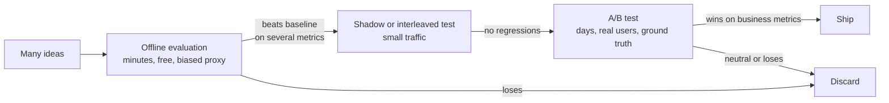
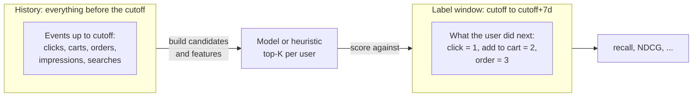
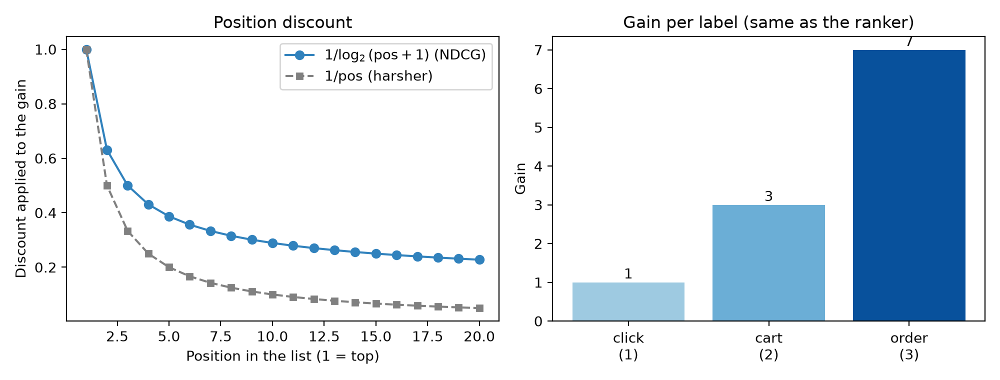

# Measuring success

It is a Monday morning at a marketplace company, and two engineers are arguing in front of a dashboard. Dina has just finished a new ranking model for the home feed. On her laptop it "looks great": the top items for her own test account are all things she would click. Raka, who owns the checkout funnel, is not convinced. Last quarter a different "obviously better" model went live, conversions dipped for a week, and nobody could say whether the model was at fault, the weekend sale was, or the dip was just noise.

Both of them are right to worry. A recommender is not a function with a single correct output, like a sorting routine. There is no unit test that says "these ten items are the right ones for user 43". What we have instead is **behaviour**: what people did after we showed them something. Measuring success means turning that messy behaviour into numbers that are honest enough to make decisions with, cheap enough to compute a hundred times a day, and well-behaved enough that a higher number really means a better product.

This chapter builds that measuring stick. Every later chapter in this book ends with a results table produced by the same code, so it is worth understanding exactly what that code does, and where it can mislead you.

## What you'll learn

- The difference between **offline** and **online** evaluation, and why you need both.
- Why a **time-based split** is the only honest way to evaluate a recommender, and how a random split quietly leaks the future.
- How to compute **precision@K**, **recall@K** and **average precision** by hand, and what each one rewards.
- How **DCG** and **NDCG** are derived step by step, and why the repo uses gains of 1, 3 and 7 for click, add-to-cart and order.
- What **coverage** and **candidate recall** measure, and why a recommender can look "accurate" while being useless.
- How `recommender/recsys/evaluate.py` implements all of this in about forty lines of pandas, line by line.

## Intuition: grading an exam you did not write the answers to

Imagine you are a teacher who wants to know whether a student has learned algebra. You would never hand out an exam, let the student see the answer key, and then grade the same exam. You would hold back questions the student has not seen. And you would not use a *fortune-telling* exam where the questions are pulled from next year's syllabus either; the exam has to match the knowledge you could reasonably have had at the time.

Evaluating a recommender follows the same rules, with one twist: the "answer key" is the future. We freeze the world at a moment in time (the **cutoff**), build recommendations using only what was known before it, and then look at what users actually did *after* it. If our top-20 list contains the cat-food bag the user later ordered, we score points; if it contained forty phone cases she never touched, we do not.

Three things follow immediately from this analogy:

1. **The student must not see the answer key.** Anything computed from data after the cutoff, including statistics such as "this item's click rate this week", is forbidden when we produce recommendations. This is *leakage*, and it is the number-one cause of recommender results that look wonderful offline and collapse in production.
2. **Different questions deserve different weights.** Predicting an order is worth more than predicting a click; getting the best item to slot 1 is worth more than getting it to slot 18. A metric that treats all hits equally throws away information.
3. **One exam is never enough.** A class can ace the algebra test and still not know geometry. A recommender can have a high accuracy score and show every user the same twenty bestsellers. We need metrics that look at different failure modes: accuracy, ranking quality, breadth, and the ceiling imposed by earlier pipeline stages.

## Offline versus online evaluation

There are two places to measure a recommender, and they answer different questions.

**Online evaluation** means putting the model in front of real users and watching what happens. The standard tool is the **A/B test**: randomly split users into a control group (the old model) and a treatment group (the new one), then compare business metrics, such as click-through rate $\text{CTR} = \frac{\text{clicks}}{\text{impressions}}$, conversion rate, orders per session, or gross merchandise value (GMV) per user. Online results are the ground truth. They capture everything: novelty effects, page layout, latency, the fact that users react to what they are shown. But they are slow (days or weeks to reach statistical significance), expensive (a bad model hurts real revenue while you learn it is bad), and you can only run a handful of experiments at a time.

**Offline evaluation** replays history. You take logged behaviour, pretend it is the day before something happened, produce recommendations, and score them against what happened next. It is fast (minutes), free, repeatable, and you can test a hundred variants in an afternoon. Its weakness is that history only contains what users did in response to the *old* system's choices. Items that the old system never showed have no clicks; a model that would surface them gets no credit. Offline numbers are a **proxy**.

The practical workflow used almost everywhere, including in the system we build in this book, is a funnel:



*Figure: Offline evaluation filters many ideas cheaply; only the survivors pay for an online experiment.*

Offline metrics are for **rejecting bad ideas quickly** and for choosing between close variants. They are not a promise of business impact. A good offline result is necessary, rarely sufficient.

::: fact
When Netflix ran its famous prize competition for movie-rating prediction, the target was a proxy: lowering the root mean squared error (RMSE) of predicted star ratings by 10% was meant to stand in for "better recommendations". The winning team's blend of hundreds of models did cross the line, yet Netflix reported that the additional accuracy gains it measured offline did not seem to justify the engineering effort needed to put that ensemble into production. A great offline score is not the same thing as a great product.

Source: Amatriain & Basilico, Netflix Technology Blog, 2012
:::

## Time-based splits, and why random splits leak

Machine-learning tutorials usually say "shuffle your data and hold out 20% for testing". For recommenders this advice is dangerous. Suppose we have 60 days of events and we shuffle them into 80% train and 20% test. A click on day 52 might land in the training set while a click by the same user on day 14 lands in the test set. The model then "predicts" day 14 using knowledge of day 52. Concretely it can learn:

- **Popularity from the future.** An item that exploded on the 9.9 sale is a bestseller *because of* clicks that happen after the test event.
- **User taste from the future.** If a user switched from phones to cat food in week 7, a model trained on week 7 "predicts" her week-3 clicks by memorising where she ended up.
- **Session leakage.** Clicks inside one session are strongly correlated (people browse similar items in a row). Splitting a session across train and test makes the test set a near-copy of the training set.

In production you can never see the future, so a model that depends on it fails the first day it runs. The fix is to respect the arrow of time.

### The split used in this book

The repo uses a **rolling-origin time split**. Pick a cutoff $t_c$. Everything strictly before $t_c$ is *history*; the next $H = 7$ days are the *label window*; and the model is scored on how well it predicted that window.



*Figure: Features and candidates come only from history; labels come only from the label window after the cutoff.*

For the evaluation numbers in this book, the companion scripts fix the dataset end to the last simulated day, set the cutoff 7 days before it, and use the final week as the label window. For *training* a ranker (chapter 10) we need a second, earlier split, so that the training labels sit entirely before the evaluation cutoff:

| Purpose | History ends at | Label window |
|---|---|---|
| Train the ranker | end − 14 days | end − 14 days to end − 7 days |
| Evaluate | end − 7 days | end − 7 days to end |
| Serve (production) | now | the future, unobserved |

This is exactly the diagram in the docstring of `recommender/recsys/pipeline.py`. The model never trains on the week it is later judged on.

### A tiny worked example of a leak

Take one user, Rina, and five events:

| Day | What Rina did |
|---|---|
| 3 | Clicked cat food A |
| 11 | Clicked cat litter B |
| 12 | Ordered cat food A |
| 13 | Clicked cat toy C |
| 14 | Ordered cat toy C |

With a **random** split, suppose days 12 and 14 land in training and day 13 in test. The test question is "will Rina click cat toy C?", but the training set already contains her order of C on day 14. The model has seen the answer. With a **time** split at day 12, history is days 3 and 11, the label window is days 12 to 14, and the labels are: cat food A → 3 (order), cat toy C → 3 (order, which outranks the click on day 13 because we keep the maximum per user and item). The model must guess these two orders knowing only that Rina clicked on cat food and cat litter. That is the situation of a live system, and that is what we score.

### The same rule applies to features

Splitting events correctly is only half of it. If you compute a feature such as "this item's orders in the last 7 days" for a training row at the cutoff, it must be computed from events before the cutoff, not from "the last 7 days up to today". Chapter 9 calls this **point-in-time correctness** and shows the class, `History.at`, that enforces it in this repo. For now, remember the one-sentence rule: *at prediction time $t$, you may only use data with timestamp $< t$*.

## What we are measuring: labels and ranked lists

Before the formulas, let us fix vocabulary. For a given user $u$ and cutoff $t_c$, the recommender produces a **ranked list** of items $r_1, r_2, \dots, r_K$, best first. We compare it with what the user actually did during the label window. The repo derives a graded **label** for every (user, item) pair the user touched:

| Behaviour in label window | Label |
|---|---|
| Clicked the item | 1 |
| Added the item to the cart | 2 |
| Ordered the item | 3 |
| Nothing | (not in the label table) |

If the user did several things with the same item (click, then cart, then order) we keep the strongest, using the maximum. The function that does this is `data.labels`:

```include
path: recommender/recsys/data.py
symbol: labels
```

Note that this function returns *only* pairs with a positive label. Users who did nothing in the label window simply do not appear. They cannot be scored (there is nothing to find) and are excluded from every average below. That choice is easy to forget and it matters: the numbers are averages over *users who came back and did something*.

Let us call the items with a positive label the user's **future positives**, and let $R$ be their number. Everything that follows is about how well the ranked list captures them.

## The algorithm: ranking metrics from the ground up

### Precision@K and recall@K

The two most basic questions about a top-$K$ list are:

- **Precision@K**: of the $K$ items we showed, what fraction did the user engage with?
- **Recall@K**: of the things the user engaged with, what fraction did we show?

$$
\text{precision@}K = \frac{|\text{hits in top } K|}{K}, \qquad
\text{recall@}K = \frac{|\text{hits in top } K|}{R}
$$

A "hit" is a list item that is a future positive. For one user these are just a count divided by a different number. Precision cares about *waste* (every slot is expensive screen space), recall cares about *coverage of what the user wanted*. In a marketplace with thousands of items per category, and users who engage with a handful in a week, precision values are naturally tiny; recall is easier to read and is what this book reports most often. When $K$ is fixed and large relative to $R$, precision and recall carry the same information up to scaling, which is why we mostly show recall.

Both ignore **order** inside the top $K$: finding a hit at slot 1 or slot 20 gives the same score. On a real page that is wrong, since slot 1 is seen by nearly everyone and slot 20 requires scrolling. We need position-aware metrics.

### Average precision (AP)

**Average precision** rewards putting hits early. Walk down the list; every time you land on a hit at position $k$, record the precision at that cut-off $P@k$. Then average those values over *all* the user's future positives:

$$
\text{AP@}K = \frac{1}{R}\sum_{k=1}^{K} P@k \cdot \mathbb{1}[\text{item at } k \text{ is a hit}]
$$

Hand-sized example. A list of three items has hits at positions 2 and 3, and the user has $R=2$ future positives. Then $P@2 = 1/2$ and $P@3 = 2/3$, so

$$
\text{AP} = \frac{1}{2}\left(\frac{1}{2} + \frac{2}{3}\right) = 0.583.
$$

If the same two hits had been at positions 1 and 2, we would get $\frac{1}{2}(1 + 1) = 1$. Dividing by $R$ (not by the number of hits) also penalises hits that never appear at all: every missing positive contributes zero to the sum yet still counts in the denominator. AP is binary, though: an order and a click are the same "hit". For graded, revenue-flavoured relevance we use DCG.

### Cumulative gain, and the discount

Let $\text{rel}_i$ be the label (0, 1, 2 or 3) of the item at rank $i$, counting ranks from 1. The most naive graded score just adds them up:

$$
\text{CG@}K = \sum_{i=1}^{K} \text{rel}_i
$$

Two problems. First, a label of 3 is not merely "three times" a click: an order is a far stronger and more valuable signal. We fix this by converting the label to a **gain** that grows exponentially:

$$
g(\text{rel}) = 2^{\text{rel}} - 1 \quad\Rightarrow\quad g(0)=0,\; g(1)=1,\; g(2)=3,\; g(3)=7 .
$$

These are exactly the numbers in the `GAIN` dictionary of `evaluate.py`, and the same ones the LightGBM ranker uses as its `label_gain` in chapter 10, so training and evaluation agree on what "good" means.

Second, CG does not care about order. We fix that with a **position discount**: an item at rank $i$ is worth less the further down it sits. The classic choice is

$$
d(i) = \frac{1}{\log_2(i+1)}
$$

so $d(1)=1$, $d(2)=0.63$, $d(3)=0.5$, and the discount keeps shrinking, slowly. Putting both fixes together gives **discounted cumulative gain**:

$$
\text{DCG@}K = \sum_{i=1}^{K} \frac{2^{\text{rel}_i}-1}{\log_2(i+1)}
$$

Why a logarithm? The intuition: the drop between slots 1 and 2 is big, the drop between slots 19 and 20 is negligible, because most users never reach them. A $1/i$ discount would be much harsher and effectively ignores everything below the first few slots. The logarithm is a convention, not a law of nature, but it is the one the field converged on. The left panel of the figure below shows the two curves, and the right panel shows the gains used by this repo.



### Normalising: NDCG

DCG is not comparable across users. A user with one future click has a maximum possible DCG of 1; a user with five future orders has a maximum far higher. To average over users we need a common scale. The fix is to divide by the **ideal DCG** (IDCG): the DCG of the best possible ordering of that user's future positives, namely sorted by gain, highest first.

$$
\text{NDCG@}K = \frac{\text{DCG@}K}{\text{IDCG@}K} \in [0, 1]
$$

An NDCG of 1 means "you listed every future positive, best first". A score of 0 means you found none. The final reported number is the mean NDCG over all evaluated users.

Note the subtlety in the ideal list: it contains *every* future positive the user has, including items that no recommender could have found (for instance an item that was out of stock at the cutoff, or one the user discovered via a friend's link). That makes NDCG@K honest: it is measured against the user's real behaviour, not against what was recommendable.

::: fact
The DCG family of measures was introduced by Järvelin and Kekäläinen in a 2002 paper on evaluating information-retrieval systems with graded relevance. They proposed cumulating the gain a user receives down a ranked list and discounting items by their rank, precisely so that retrieving a highly relevant document early counts for more than retrieving it late. Two decades later, nearly every search and recommender leaderboard still reports NDCG.

Source: Järvelin & Kekäläinen, ACM Transactions on Information Systems, 2002
:::

### Coverage

Accuracy metrics are averages over users, so a recommender can score well by showing nearly the same popular items to everyone. **Catalog coverage** measures breadth:

$$
\text{coverage@}K = \frac{|\bigcup_{u} \text{top-}K(u)|}{|\text{recommendable items}|}
$$

It answers: of all items we are allowed to recommend, what fraction ever appears in some user's top $K$? A recommender with 3% coverage ignores 97% of the catalogue. For a marketplace that is not just aesthetics: sellers whose items are never shown never sell, and a catalogue that cannot be discovered stops growing. Coverage is *not* a quality score on its own, as we will see: a random recommender has perfect coverage and terrible accuracy. Use it as a **guardrail** next to the accuracy metrics.

### Candidate recall: the ceiling

Production recommenders, including ours, are **multi-stage**: a cheap first stage picks a few hundred *candidates* out of thousands (or millions) of items, and a smarter second stage orders them. The second stage can only reorder what the first stage provides, so

$$
\text{candidate recall} = \frac{|\text{future positives that appear in the candidate set}|}{R}
$$

(averaged over users) is an **upper bound** on the recall of the final ranking. If candidate generation never retrieves the item the user buys, no ranker, however clever, can put it at slot 1. When a new ranker disappoints, check this number first: you may be trying to tune a model that has nothing to choose from. Chapter 8 is about raising it.

## Code walkthrough: `recsys/evaluate.py`

The whole evaluation module is short enough to read in one sitting. Start with `metrics`:

```include
path: recommender/recsys/evaluate.py
symbol: metrics
```

It takes two frames. `recs` holds `user_id, item_id` rows in display order; `labels` is the table from `data.labels`. We go through it in four moves.

**Move 1: number the recommendations (the first lines of the body).** `recs.groupby("user_id").head(k)` keeps only each user's first $k$ rows, which is why the contract says "rank order": position is *derived from row order*. If you pass an unsorted frame you will silently score a random list. `cumcount()` then numbers each user's rows `0, 1, 2, …` into a `pos` column. Positions are zero-based in the code, which is why the discount reads `np.log2(pos + 2)`: for the one-based rank $i$ in the formula, $\log_2(i+1) = \log_2(\text{pos} + 2)$.

**Move 2: attach recommendations to labels (the merge).** `labels.merge(recs, ..., how="left")` starts from the *labels*, not from the recommendations. Every future positive survives the merge; its `pos` is filled in if we recommended it and is `NaN` if we did not. This is the trick that makes the denominators right: the number of rows per user is the number of future positives $R$, and `count()` of `pos` (which ignores `NaN`) is the number of hits. Therefore:

- `n_pos = ("label", "size")`, `n_hit = ("pos", "count")`, and `recall = n_hit / n_pos` averaged over users. A user for whom we recommend nothing gets recall 0 rather than being dropped, so a method cannot improve its score by skipping hard users.
- `order_recall` does the same restricted to rows with label 3, the items the user actually ordered. It is the closest of the three metrics to revenue. Users with no orders in the label window are not part of its average, which is why `order_recall` is based on fewer users than `recall`.

**Move 3: DCG.** `found` keeps only the hits, then `GAIN[label] / log2(pos + 2)` is summed per user. `GAIN = {1: 1.0, 2: 3.0, 3: 7.0}` is the table $2^{\text{rel}}-1$ from above.

**Move 4: IDCG and the ratio.** The ideal list is built from the same labels: sort each user's labels by gain descending, keep the first $k$, number them, and discount them identically. Dividing the DCG (re-indexed so users with no hits get 0) by IDCG and averaging gives NDCG. Note that `ideal_gains.groupby("user_id").head(k)` cuts the ideal list at $k$ too: a user with thirty future positives has an IDCG over only the best twenty at $K=20$, so a perfect score is still reachable.

Now the ceiling check:

```include
path: recommender/recsys/evaluate.py
symbol: candidate_recall
```

This is the same left-merge idea. `found=1` is attached to every candidate row; after the left merge from labels, `found` is `NaN` for positives that are not in the candidate set, and the per-user mean of `found.notna()` is exactly the fraction of that user's positives that are in the candidates. Notice there is no `k` here: candidates are a set, not a ranked list.

The chapters that follow do not call `evaluate.metrics` directly. They go through one shared helper in `book/code/common.py`, so that every method is scored by identical code:

```include
path: book/code/common.py
symbol: evaluate
```

It reports recall at 5, 10, 20 and 50, order recall at 20, NDCG at 20, and coverage at 20, where the denominator is the number of items that were listed and in stock at the cutoff (`available_items()`). Because every chapter's script calls this same function, a number in chapter 6 can be compared with a number in chapter 3 without footnotes.

::: tip
When you write your own evaluator, test it on a hand-made list where you know the answer; the companion script for this chapter does exactly that. The classic bugs are off-by-one ranks (starting at 0 versus 1), a discount of $\log_2(i)$ instead of $\log_2(i+1)$ (which divides by zero at rank 1), and ideal lists that forget to include positives the system could not have recommended.
:::

## Run it

The companion script `book/code/ch02_metrics.py` builds a ten-item list whose outcome we control, and prints every intermediate value so you can follow the arithmetic with a pencil. Run it from the `book/` directory:

```bash
cd book
uv run python code/ch02_metrics.py
```

The first block shows the list with each item's label (what the user later did with it), its gain, the discount, and the discounted gain:

```output
file: results/ch02_metrics.txt
lines: 2-13
```

Item B was ordered (label 3, gain 7), G was added to the cart (label 2, gain 3), and D and J were clicked (label 1, gain 1 each). Everything else was ignored. A small warning about the header: the column printed as `1/log2(pos+2)` uses the zero-based position of the code, so the first row shows $1/\log_2 2 = 1$. Reading the table as ranks starting from 1, it is the same $1/\log_2(i+1)$ of the formulas.

Notice how much the discount matters. B sits at rank 2, where its gain of 7.0 is multiplied by 0.6309 to give 4.4165: that single item contributes more than all the others together. Had B been at rank 1 it would contribute the full 7.0.

### Precision and recall at every cut-off

The user has five future positives in total, including a fifth item, `Z`, that our list never contained:

```output
file: results/ch02_metrics.txt
lines: 15-27
```

Follow one row: at $k=4$ we have shown items A to D, of which B and D are hits, so precision is $2/4 = 0.500$ and recall is $2/5 = 0.400$. Two patterns are visible. Recall only goes up (more slots can only add hits), maxing out at 0.800 because `Z` is never recommended. Precision zigzags: it jumps whenever a hit lands (positions 2, 4, 7, 10) and decays in between. That zigzag is exactly what average precision averages.

### Average precision

```output
file: results/ch02_metrics.txt
lines: 29-34
```

The four hits are at ranks 2, 4, 7 and 10, with precisions 0.5000, 0.5000, 0.4286 and 0.4000, summing to 1.8286. Divide by the *five* future positives (not by four hits), and AP is 0.3657. The fifth positive, `Z`, pulls the score down by contributing a zero.

### DCG, IDCG and NDCG

```output
file: results/ch02_metrics.txt
lines: 36-45
```

The ideal ordering of the user's five positives is by gain: the order (label 3), then the two add-to-carts (label 2: item G from our list, plus `Z`, which we never recommended), then the two clicks (label 1). Its terms are $7.0000$, $1.8928$, $1.5000$, $0.4307$ and $0.3869$, which sum to an IDCG of 11.2103. Our list achieved a DCG of 6.1362, so

$$
\text{NDCG} = \frac{6.1362}{11.2103} = 0.5474 .
$$

We found most of the value (we got the order at rank 2 and a cart at rank 7) but lost some because `Z` was missing and because B was not first.

### Order matters: the same hits, a worse list

Now the experiment that justifies NDCG. Keep exactly the same four hits, but move the ordered item B from rank 2 down to rank 10, with the other hits at ranks 2, 5 and 8:

```output
file: results/ch02_metrics.txt
lines: 47-48
```

The set of recommended items is the same, so recall@10 does not change (0.800). But NDCG falls from 0.5474 to 0.3684. A recall-only dashboard would call these two lists identical; a shopper who must scroll to the bottom to find the thing she wants would not.

## Results: what does a random recommender score?

Finally, we pipe a deliberately useless method through the shared `evaluate` helper: for every user in the label set, draw 50 items uniformly at random from the in-stock catalogue.

```output
file: results/ch02_metrics.txt
lines: 50-55
```

This is the **floor** of every table in the book. Several things are worth pausing on.

First, the evaluation population: 947 users had at least one positive in the final week, and 2311 items were available at the cutoff. If you pick 20 items out of 2311 for one user with a single positive, the chance of hitting it is $20/2311 \approx 0.0087$. The measured recall@20 is 0.0069, the same order of magnitude, as expected for a method with no information. The random recommender also finds 0.0212 of positives at recall@50, rising with $K$ as expected, while NDCG@20 is only 0.0026: random hits land at random depths, and a hit at rank 15 earns very little.

Second, coverage@20 is 1.0. Random sampling touches every item in the catalogue, so it has *perfect* breadth, yet the worst accuracy possible. This is the reason coverage is a guardrail and never a target: you can always raise it by adding noise.

Third, every future method must beat these numbers by a wide margin to be taken seriously. When a clever model in chapter 7 scores 0.05 NDCG, the right reaction is not "that is tiny" but "how much better is that than the 0.0026 floor, and than a one-line popularity baseline?". The baseline question is the subject of the next chapter.

::: fact
Offline evaluators often speed up their metrics by ranking each test positive against a small random sample of items (say 100) instead of the whole catalogue. Krichene and Rendle showed that such **sampled metrics** are inconsistent with the exact ones: they do not even preserve the ordering of recommenders in expectation, so "model A beats model B" under sampling can be false on the full catalogue. Their advice is to avoid sampling when you can afford the full computation, which is exactly what `evaluate.py` does.

Source: Krichene & Rendle, KDD, 2020
:::

### The same metrics inside the application

The metrics are not just a lab exercise. When the recommender service trains a model it evaluates it with the same `metrics` function and stores the results; the "How it works" page of the web application shows them next to the feature importances.


The table in the screenshot has one row per method, the same columns as the offline lab, and below it the candidate-recall ceiling from this chapter. Its values differ from the figures in this book because the app trains on the live database at the moment you click "Retrain", whereas the book's scripts use a fixed simulation, a fixed cutoff and fixed seeds so you can reproduce them exactly. Treat the app page as a way to see the *shape* of the idea: a handful of methods, ranked by NDCG, with a ceiling above them.

## Pitfalls, and how it is done in production

**Leakage through features, not only events.** The split above keeps labels out of the history, but a careless feature (for example the item's all-time order count, computed on today's database) quietly reintroduces the future. Chapter 9 demonstrates a model whose offline NDCG more than doubles because of one leaky column, and then falls apart in honest evaluation. If an offline number looks too good, assume leakage until proven otherwise.

**Noise.** Our label window is one week and 947 users, so metrics wobble. A difference in the third decimal place between two methods is probably noise. Production teams report confidence intervals (bootstrap over users), average several cutoffs or several training seeds, and set a threshold for what counts as a real win. Chapter 10 does this explicitly for ranker ablations.

**Survivorship.** Metrics are averaged over users with at least one future positive. If a change makes the recommender better for loyal users and worse for people who never come back, you will not see it here. Slice the metric by cohort: new versus returning users, by city, by device tier, by activity level (chapter 12).

**The logging bias hidden behind "labels".** A click happens only on what the old system chose to show, and higher slots get more clicks regardless of quality. Offline labels therefore reward models that imitate the old system. Techniques such as inverse-propensity weighting, exploration traffic, and counterfactual evaluation exist for this reason (chapters 11 and 12); the A/B test remains the final arbiter.

**Optimising a single metric.** NDCG says nothing about diversity, freshness, fairness to small sellers, or the price of what you are pushing. Production teams keep a dashboard of **guardrail metrics** next to the primary one: coverage, share of impressions going to new items, category diversity (chapter 11), latency and error rate. A model that lifts NDCG 2% while collapsing catalogue coverage is not an improvement.

**Offline-online gaps.** Offline gains do not always transfer to production. Typical culprits are a different traffic mix, the model's effect on the logging policy (feedback loops), changes in UI, and latency. The conservative practice is to treat offline evaluation as a gate (do not ship what loses offline) and A/B testing as the verdict. We return to experimentation, with a worked significance calculation, in chapter 14.

**Production practice in short.** Keep one evaluation harness and one definition of each metric; run it automatically on every training job (the service in this repo does exactly that and stores the result next to the model file); version the dataset and cutoff; log the metrics together with the model version so a regression in production can be matched to a model change; and compare every new method against the *previous production model* and a trivial baseline, not against nothing.

::: warning
Never tune on the evaluation week. If you try forty hyperparameter settings and report the best score on the same labels, you have fitted the exam. Keep a separate validation window for tuning (the training split in this repo plays that role) and touch the final evaluation window once.
:::

::: try
Open `book/code/ch02_metrics.py` and change the `rel` list so that the ordered item B sits in position 1 instead of 2 (swap the first two labels). Predict the new NDCG before you run the script, then run it and check. How much of the improvement came from the discount?
:::

## Summary

- Offline evaluation replays history to reject bad ideas cheaply; online A/B testing is the ground truth. Use offline as a gate, not as a promise.
- Always split by **time**: build candidates and features from events before the cutoff, take labels from the following 7 days. Random splits leak the future.
- Labels are graded: click 1, add to cart 2, order 3, with the strongest behaviour per (user, item) kept; only users with at least one positive are scored.
- Precision@K measures waste, recall@K measures how much of what the user wanted you found, and AP adds sensitivity to where the hits sit.
- DCG converts labels to gains $2^{rel}-1$ (1, 3, 7), discounts by $1/\log_2(i+1)$, and NDCG divides by the ideal DCG so scores of different users are comparable. Moving a hit from rank 2 to rank 10 cut NDCG from 0.5474 to 0.3684 while recall stayed put.
- Coverage is a guardrail, not a goal: a random recommender has perfect coverage and the worst accuracy. Candidate recall is the ceiling on any ranker built on top of a candidate set.
- `evaluate.py` merges labels **left** onto recommendations so every future positive counts in the denominator, and a method that returns nothing for a user is scored 0 for that user.

## Quiz

**Q2.1** A team evaluates a recommender by randomly shuffling all events and holding out 20% for testing. Which statement best describes the main flaw of this setup?

A. It makes the training set too small to learn anything.  
B. Test events can be earlier than training events, so the model can learn from the future.  
C. It produces precision values that are always higher than recall values.  
D. It prevents the use of graded labels such as click, cart and order.

**Q2.2** Two recommenders return exactly the same ten items for a user, but recommender X places the ordered item first and recommender Y places it last. Which metric will distinguish them?

A. recall@10  
B. precision@10  
C. NDCG@10  
D. catalogue coverage

**Q2.3** In this book's setup, which statement about *candidate recall* is correct?

A. It is always lower than the recall of the final ranking.  
B. It is an upper bound on the recall that any ranker built on those candidates can reach.  
C. It measures how many different items the system recommends across all users.  
D. It can be raised only by training a better ranker.

**Q2.4** In the average precision formula, why do we divide by the total number of future positives $R$ instead of the number of hits?

**Q2.5** `evaluate.metrics` merges `labels` with `recs` using `how="left"` starting from the labels. Explain what would change if the merge started from `recs` instead (an inner join between the two frames).

**Q2.6** Look at the two statements in the included `metrics` function that build `found` and `dcg` (the ones using `dropna(subset=["pos"])` and `np.log2(... + 2)`). What does `dropna(subset=["pos"])` remove, and why is the constant `+ 2` used rather than `+ 1`?

**Q2.7** A user's top-3 list has relevance labels `[0, 1, 3]` at ranks 1, 2, 3 (gains 0, 1, 7). The user's only future positives are those two items. Compute DCG@3, IDCG@3 and NDCG@3, to three decimals.

**Q2.8** The same user has $R = 4$ future positives, and a top-5 list hits two of them, at ranks 1 and 3. Compute precision@5 and recall@5.

**Q2.9** Why should a team look at coverage and at candidate recall in addition to NDCG when they compare two ranking models? Give one failure that each of the two metrics would reveal and NDCG would not.

**Q2.10** *Hands-on.* In `book/code/ch02_metrics.py`, replace the random recommender at the end of the script so that every user receives the same fixed 50 items (for example the first 50 item ids returned by `common.available_items()`). Run the script. What should coverage@20 become, approximately, and what does that tell you about the relationship between coverage and accuracy?
