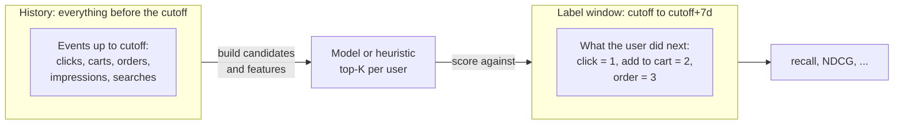

# Measuring success

It is a Monday morning at a marketplace company, and two engineers are arguing in front of a dashboard. Dina has just finished a new ranking model for the home feed. On her laptop it "looks great": the top items for her own test account are all things she would click. Raka, who owns the checkout funnel, is not convinced. Last quarter a different "obviously better" model went live, conversions dipped for a week, and nobody could say whether the model was at fault, the weekend sale was, or the dip was just noise.

Both of them are right to worry. A recommender has no single correct output, and no unit test says "these ten items are right for user 43". What we have is **behaviour**: what people did after we showed them something. Measuring success means turning that behaviour into numbers that are honest enough to decide with, cheap enough to compute a hundred times a day, and well-behaved enough that a higher number really means a better product. Every later chapter ends with a results table produced by the same code, so it is worth understanding exactly what that code does, and where it can mislead you.

## What you'll learn

- The difference between **offline** and **online** evaluation, and why you need both.
- Why a **time-based split** is the only honest way to evaluate a recommender, and how a random split quietly leaks the future.
- How to compute **precision@K**, **recall@K** and **average precision** by hand, and what each one rewards.
- How **DCG** and **NDCG** are derived step by step, and why the repo uses gains of 1, 3 and 7 for click, add-to-cart and order.
- What **coverage** and **candidate recall** measure, and why a recommender can look "accurate" while being useless.
- How `recommender/recsys/evaluate.py` implements all of this in about forty lines of pandas, line by line.

## Intuition: grading an exam you did not write the answers to

Imagine you are a teacher who wants to know whether a student has learned algebra. You would never hand out an exam, let the student see the answer key, and then grade the same exam. You would hold back questions the student has not seen. And you would not use a *fortune-telling* exam where the questions are pulled from next year's syllabus either; the exam has to match the knowledge you could reasonably have had at the time.

Evaluating a recommender follows the same rules, with one twist: the "answer key" is the future. We freeze the world at a moment in time (the **cutoff**), build recommendations using only what was known before it, and then look at what users actually did *after* it. If our top-20 list contains the cat-food bag the user later ordered, we score points; if it contained forty phone cases she never touched, we do not.

Two things follow. First, **the student must not see the answer key**: anything computed from data after the cutoff is forbidden when we produce recommendations. This is *leakage*, the number-one cause of results that look wonderful offline and collapse in production. Second, **one exam is never enough**: a recommender can score well on accuracy and still show every user the same twenty bestsellers, so we need metrics for accuracy, ranking quality, breadth, and the ceiling imposed by earlier pipeline stages. Different answers also deserve different weights: an order is worth more than a click, and slot 1 more than slot 18.

## Offline versus online evaluation

There are two places to measure a recommender, and they answer different questions.

**Online evaluation** means putting the model in front of real users and watching what happens. The standard tool is the **A/B test**: randomly split users into a control group (the old model) and a treatment group (the new one), then compare business metrics, such as click-through rate $\text{CTR} = \frac{\text{clicks}}{\text{impressions}}$, conversion rate, orders per session, or gross merchandise value (GMV) per user. Online results are the ground truth. They capture everything: novelty effects, page layout, latency, the fact that users react to what they are shown. But they are slow (days or weeks to reach statistical significance), expensive (a bad model hurts real revenue while you learn it is bad), and you can only run a handful of experiments at a time.

**Offline evaluation** replays history. You take logged behaviour, pretend it is the day before something happened, produce recommendations, and score them against what happened next. It is fast (minutes), free, repeatable, and you can test a hundred variants in an afternoon. Its weakness is that history only contains what users did in response to the *old* system's choices. Items that the old system never showed have no clicks; a model that would surface them gets no credit. Offline numbers are a **proxy**.

In practice offline evaluation is a cheap filter in front of a few expensive online experiments: ideas that lose offline are discarded, and only the survivors get an A/B test. Offline metrics are for **rejecting bad ideas quickly** and for choosing between close variants. A good offline result is necessary, rarely sufficient.

::: fact
When Netflix ran its famous prize competition for movie-rating prediction, the target was a proxy: lowering the root mean squared error (RMSE) of predicted star ratings by 10% was meant to stand in for "better recommendations". The winning team's blend of hundreds of models did cross the line, yet Netflix reported that the additional accuracy gains it measured offline did not seem to justify the engineering effort needed to put that ensemble into production. A great offline score is not the same thing as a great product.

Source: Amatriain & Basilico, Netflix Technology Blog, 2012
:::

## Time-based splits, and why random splits leak

Machine-learning tutorials usually say "shuffle your data and hold out 20% for testing". For recommenders this advice is dangerous. Suppose we have 60 days of events and we shuffle them into 80% train and 20% test. A click on day 52 might land in the training set while a click by the same user on day 14 lands in the test set. The model then "predicts" day 14 using knowledge of day 52. Concretely it can learn:

- **Popularity from the future.** An item that exploded on the 9.9 sale is a bestseller *because of* clicks that happen after the test event.
- **User taste from the future.** If a user switched from phones to cat food in week 7, a model trained on week 7 "predicts" her week-3 clicks by memorising where she ended up.
- **Session leakage.** Clicks inside one session are strongly correlated (people browse similar items in a row). Splitting a session across train and test makes the test set a near-copy of the training set.

In production you can never see the future, so a model that depends on it fails the first day it runs. The fix is to respect the arrow of time.

### The split used in this book

The repo uses a **rolling-origin time split**. Pick a cutoff $t_c$. Everything strictly before $t_c$ is *history*; the next $H = 7$ days are the *label window*; and the model is scored on how well it predicted that window.



*Figure: Features and candidates come only from history; labels come only from the label window after the cutoff.*

For the evaluation numbers in this book, the companion scripts fix the dataset end to the last simulated day, set the cutoff 7 days before it, and use the final week as the label window. For *training* a ranker (chapter 10) we need a second, earlier split, so that the training labels sit entirely before the evaluation cutoff:

| Purpose | History ends at | Label window |
|---|---|---|
| Train the ranker | end − 14 days | end − 14 days to end − 7 days |
| Evaluate | end − 7 days | end − 7 days to end |
| Serve (production) | now | the future, unobserved |

This is exactly the diagram in the docstring of `recommender/recsys/pipeline.py`. The model never trains on the week it is later judged on.

### A tiny worked example of a leak

Suppose Rina clicks toy C on day 13 and orders it on day 14. A **random** split may put day 14 in training and day 13 in test, so "will Rina click toy C?" is asked of a model that has already seen her order of C. A **time** split at day 12 forces the model to guess from her earlier clicks only, as a live system must.

### The same rule applies to features

Splitting events correctly is only half of it: a feature such as "this item's orders in the last 7 days" must be computed from events before the cutoff, not "up to today". Chapter 9 calls this **point-in-time correctness**. The rule: *at prediction time $t$, you may only use data with timestamp $< t$*.

## What we are measuring: labels and ranked lists

Before the formulas, let us fix vocabulary. For a given user $u$ and cutoff $t_c$, the recommender produces a **ranked list** of items $r_1, r_2, \dots, r_K$, best first. We compare it with what the user actually did during the label window. The repo derives a graded **label** for every (user, item) pair the user touched:

| Behaviour in label window | Label |
|---|---|
| Clicked the item | 1 |
| Added the item to the cart | 2 |
| Ordered the item | 3 |
| Nothing | (not in the label table) |

If the user did several things with the same item we keep the strongest (the maximum); this is done by `data.labels` in `recommender/recsys/data.py`. It returns *only* pairs with a positive label, so users who did nothing in the label window never appear: they cannot be scored and are excluded from every average below. The numbers are averages over *users who came back and did something*.

Let us call the items with a positive label the user's **future positives**, and let $R$ be their number. Everything that follows is about how well the ranked list captures them.

## The algorithm: ranking metrics from the ground up

### Precision@K and recall@K

The two most basic questions about a top-$K$ list are:

- **Precision@K**: of the $K$ items we showed, what fraction did the user engage with?
- **Recall@K**: of the things the user engaged with, what fraction did we show?

$$
\text{precision@}K = \frac{|\text{hits in top } K|}{K}, \qquad
\text{recall@}K = \frac{|\text{hits in top } K|}{R}
$$

A "hit" is a list item that is a future positive. For one user these are just a count divided by a different number. Precision cares about *waste* (every slot is expensive screen space), recall cares about *coverage of what the user wanted*. In a marketplace with thousands of items per category, and users who engage with a handful in a week, precision values are naturally tiny; recall is easier to read and is what this book reports most often. When $K$ is fixed and large relative to $R$, precision and recall carry the same information up to scaling, which is why we mostly show recall.

Both ignore **order** inside the top $K$: finding a hit at slot 1 or slot 20 gives the same score. On a real page that is wrong, since slot 1 is seen by nearly everyone and slot 20 requires scrolling. We need position-aware metrics.

### Average precision (AP)

**Average precision** rewards putting hits early. Walk down the list; every time you land on a hit at position $k$, record the precision at that cut-off $P@k$. Then average those values over *all* the user's future positives:

$$
\text{AP@}K = \frac{1}{R}\sum_{k=1}^{K} P@k \cdot \mathbb{1}[\text{item at } k \text{ is a hit}]
$$

Hand-sized example. A list of three items has hits at positions 2 and 3, and the user has $R=2$ future positives. Then $P@2 = 1/2$ and $P@3 = 2/3$, so

$$
\text{AP} = \frac{1}{2}\left(\frac{1}{2} + \frac{2}{3}\right) = 0.583.
$$

With hits at positions 1 and 2 instead we would get $\frac{1}{2}(1 + 1) = 1$. Dividing by $R$ (not by the number of hits) penalises positives that never appear. AP is binary, though: an order and a click are the same "hit", so for graded relevance we use DCG.

### Cumulative gain, and the discount

Let $\text{rel}_i$ be the label (0, 1, 2 or 3) of the item at rank $i$, counting ranks from 1. The most naive graded score just adds them up:

$$
\text{CG@}K = \sum_{i=1}^{K} \text{rel}_i
$$

Two problems. First, a label of 3 is not merely "three times" a click: an order is a far stronger and more valuable signal. We fix this by converting the label to a **gain** that grows exponentially:

$$
g(\text{rel}) = 2^{\text{rel}} - 1 \quad\Rightarrow\quad g(0)=0,\; g(1)=1,\; g(2)=3,\; g(3)=7 .
$$

These are exactly the numbers in the `GAIN` dictionary of `evaluate.py`, and the same ones the LightGBM ranker uses as its `label_gain` in chapter 10, so training and evaluation agree on what "good" means.

Second, CG does not care about order. We fix that with a **position discount**: an item at rank $i$ is worth less the further down it sits. The classic choice is

$$
d(i) = \frac{1}{\log_2(i+1)}
$$

so $d(1)=1$, $d(2)=0.63$, $d(3)=0.5$, and the discount keeps shrinking, slowly. Putting both fixes together gives **discounted cumulative gain**:

$$
\text{DCG@}K = \sum_{i=1}^{K} \frac{2^{\text{rel}_i}-1}{\log_2(i+1)}
$$

Why a logarithm? The drop between slots 1 and 2 is big, between slots 19 and 20 negligible, because most users never reach them; a $1/i$ discount would be far harsher. The logarithm is a convention, not a law of nature, but it is the one the field converged on. The figure below shows both curves, and the gains this repo uses.


### Normalising: NDCG

DCG is not comparable across users. A user with one future click has a maximum possible DCG of 1; a user with five future orders has a maximum far higher. To average over users we need a common scale. The fix is to divide by the **ideal DCG** (IDCG): the DCG of the best possible ordering of that user's future positives, namely sorted by gain, highest first.

$$
\text{NDCG@}K = \frac{\text{DCG@}K}{\text{IDCG@}K} \in [0, 1]
$$

An NDCG of 1 means "you listed every future positive, best first". A score of 0 means you found none. The final reported number is the mean NDCG over all evaluated users.

Note the subtlety in the ideal list: it contains *every* future positive the user has, including items that no recommender could have found (for instance an item that was out of stock at the cutoff, or one the user discovered via a friend's link). That makes NDCG@K honest: it is measured against the user's real behaviour, not against what was recommendable.

::: fact
The DCG family of measures was introduced by Järvelin and Kekäläinen in a 2002 paper on evaluating information-retrieval systems with graded relevance. They proposed cumulating the gain a user receives down a ranked list and discounting items by their rank, precisely so that retrieving a highly relevant document early counts for more than retrieving it late. Two decades later, nearly every search and recommender leaderboard still reports NDCG.

Source: Järvelin & Kekäläinen, ACM Transactions on Information Systems, 2002
:::

### Coverage

Accuracy metrics are averages over users, so a recommender can score well by showing nearly the same popular items to everyone. **Catalog coverage** measures breadth:

$$
\text{coverage@}K = \frac{|\bigcup_{u} \text{top-}K(u)|}{|\text{recommendable items}|}
$$

Of all items we are allowed to recommend, what fraction ever appears in some user's top $K$? For a marketplace this is not just aesthetics: sellers whose items are never shown never sell. Coverage is *not* a quality score on its own (a random recommender has perfect coverage and terrible accuracy), so use it as a **guardrail** next to the accuracy metrics.

### Candidate recall: the ceiling

Production recommenders, including ours, are **multi-stage**: a cheap first stage picks a few hundred *candidates* out of thousands (or millions) of items, and a smarter second stage orders them. The second stage can only reorder what the first stage provides, so

$$
\text{candidate recall} = \frac{|\text{future positives that appear in the candidate set}|}{R}
$$

(averaged over users) is an **upper bound** on the recall of the final ranking: if candidate generation never retrieves the item the user buys, no ranker can put it at slot 1. When a new ranker disappoints, check this number first. Chapter 8 is about raising it.

## Code walkthrough: `recsys/evaluate.py`

The whole evaluation module is short enough to read in one sitting. Start with `metrics`:

```include
path: recommender/recsys/evaluate.py
symbol: metrics
```

It takes two frames. `recs` holds `user_id, item_id` rows in display order; `labels` is the table from `data.labels`. We go through it in four moves.

**Move 1: number the recommendations.** `recs.groupby("user_id").head(k)` keeps each user's first $k$ rows, so position is *derived from row order*: an unsorted frame silently scores a random list. `cumcount()` numbers rows `0, 1, 2, …` into `pos`. Positions are zero-based, hence the discount `np.log2(pos + 2)` for the one-based rank $i$ of the formula, $\log_2(i+1)$.

**Move 2: attach recommendations to labels (the merge).** `labels.merge(recs, ..., how="left")` starts from the *labels*, so every future positive survives the merge, with `pos` filled in if we recommended it and `NaN` otherwise. That makes the denominators right: rows per user is $R$, and `count()` of `pos` (which ignores `NaN`) is the number of hits. A user for whom we recommend nothing gets recall 0 rather than being dropped, so a method cannot improve its score by skipping hard users. `order_recall` does the same for label-3 rows only, the closest metric to revenue; its average covers only users who ordered.

**Move 3: DCG.** `found` keeps only the hits, then `GAIN[label] / log2(pos + 2)` is summed per user. `GAIN = {1: 1.0, 2: 3.0, 3: 7.0}` is the table $2^{\text{rel}}-1$ from above.

**Move 4: IDCG and the ratio.** The ideal list is built from the same labels: sort each user's labels by gain descending, keep the first $k$, and discount them identically. DCG (users with no hits get 0) divided by IDCG, averaged over users, is NDCG. Because the ideal list is cut at $k$ too, a perfect score stays reachable for users with more than $k$ positives.

Now the ceiling check:

```include
path: recommender/recsys/evaluate.py
symbol: candidate_recall
```

This is the same left-merge idea: after the merge, `found` is `NaN` for positives missing from the candidate set, so the per-user mean of `found.notna()` is the fraction of that user's positives that are candidates. There is no `k`: candidates are a set, not a ranked list.

The chapters that follow call a shared helper, `evaluate` in `book/code/common.py`, which wraps `metrics` and reports recall at 5, 10, 20 and 50, order recall, NDCG at 20, and coverage at 20 (distinct recommended items divided by the items in stock at the cutoff). Every method is scored by identical code, so a number in chapter 6 compares with one in chapter 3 without footnotes.

## Run it

The companion script `book/code/ch02_metrics.py` builds a ten-item list whose outcome we control, and prints every intermediate value so you can follow the arithmetic with a pencil. Run it from the `book/` directory:

```bash
cd book
uv run python code/ch02_metrics.py
```

The first block shows the list with each item's label (what the user later did with it), its gain, the discount, and the discounted gain:

```output
file: results/ch02_metrics.txt
lines: 2-13
```

Item B was ordered (label 3, gain 7), G was added to the cart (label 2, gain 3), and D and J were clicked (label 1, gain 1 each). Note that the column header `1/log2(pos+2)` uses the code's zero-based position; as a one-based rank it is the $1/\log_2(i+1)$ of the formulas.

### Precision and recall at every cut-off

The user has five future positives in total, including a fifth item, `Z`, that our list never contained:

```output
file: results/ch02_metrics.txt
lines: 15-27
```

Follow one row: at $k=4$ we have shown items A to D, of which B and D are hits, so precision is $2/4 = 0.500$ and recall is $2/5 = 0.400$. Two patterns are visible. Recall only goes up (more slots can only add hits), maxing out at 0.800 because `Z` is never recommended. Precision zigzags: it jumps whenever a hit lands (positions 2, 4, 7, 10) and decays in between. That zigzag is exactly what average precision averages.

### Average precision

```output
file: results/ch02_metrics.txt
lines: 29-34
```

The four hits are at ranks 2, 4, 7 and 10, with precisions 0.5000, 0.5000, 0.4286 and 0.4000, summing to 1.8286. Divide by the *five* future positives (not by four hits), and AP is 0.3657. The fifth positive, `Z`, pulls the score down by contributing a zero.

### DCG, IDCG and NDCG

```output
file: results/ch02_metrics.txt
lines: 36-45
```

The ideal ordering of the user's five positives is by gain: the order (label 3), then the two add-to-carts (label 2: item G from our list, plus `Z`, which we never recommended), then the two clicks (label 1). Its terms are $7.0000$, $1.8928$, $1.5000$, $0.4307$ and $0.3869$, which sum to an IDCG of 11.2103. Our list achieved a DCG of 6.1362, so

$$
\text{NDCG} = \frac{6.1362}{11.2103} = 0.5474 .
$$

We found most of the value (we got the order at rank 2 and a cart at rank 7) but lost some because `Z` was missing and because B was not first.

### Order matters: the same hits, a worse list

Now the experiment that justifies NDCG. Keep exactly the same four hits, but move the ordered item B from rank 2 down to rank 10, with the other hits at ranks 2, 5 and 8:

```output
file: results/ch02_metrics.txt
lines: 47-48
```

The set of recommended items is the same, so recall@10 does not change (0.800). But NDCG falls from 0.5474 to 0.3684. A recall-only dashboard would call these two lists identical; a shopper who must scroll to the bottom to find the thing she wants would not.

## Results: what does a random recommender score?

Finally, we pipe a deliberately useless method through the shared `evaluate` helper: for every user in the label set, draw 50 items uniformly at random from the in-stock catalogue.

```output
file: results/ch02_metrics.txt
lines: 50-55
```

This is the **floor** of every table in the book. Several things are worth pausing on.

First, the evaluation population: 947 users had at least one positive in the final week, and 2311 items were available at the cutoff. If you pick 20 items out of 2311 for one user with a single positive, the chance of hitting it is $20/2311 \approx 0.0087$. That is the value we expect for recall@20 from a method with no information (almost all positives, about 99.85%, are items that were in stock at the cutoff, so the expected value is barely lower). The measured 0.0069 is a single random draw: most users have only a few positives, so each user's recall is 0 or a small fraction, and the mean over 947 users is noisy. It will move a little between random seeds, but it will always hover around 0.0087. The random recommender also finds 0.0212 of positives at recall@50, rising with $K$ as expected, while NDCG@20 is only 0.0026: random hits land at random depths, and a hit at rank 15 earns very little.

Second, coverage@20 is 1.0: random sampling touches every item, so it has *perfect* breadth and the worst accuracy possible, which is why coverage is a guardrail and never a target.

Third, every later method must beat these numbers by a wide margin, and also beat a one-line popularity baseline, the subject of the next chapter.

::: fact
Offline evaluators often speed up their metrics by ranking each test positive against a small random sample of items (say 100) instead of the whole catalogue. Krichene and Rendle showed that such **sampled metrics** are inconsistent with the exact ones: they do not even preserve the ordering of recommenders in expectation, so "model A beats model B" under sampling can be false on the full catalogue. Their advice is to avoid sampling when you can afford the full computation, which is exactly what `evaluate.py` does.

Source: Krichene & Rendle, KDD, 2020
:::

### The same metrics inside the application

The recommender service evaluates each trained model with the same `metrics` function and stores the results; the "How it works" page shows them.


Its values differ from this book's because the app trains on the live database when you click "Retrain", whereas the book's scripts use a fixed simulation, cutoff and seeds. Look at the *shape*: a few methods ranked by NDCG, with a ceiling above them.

## Pitfalls, and how it is done in production

**Leakage through features, not only events.** The split above keeps labels out of the history, but a careless feature (for example the item's all-time order count, computed on today's database) quietly reintroduces the future. Chapter 9 demonstrates a model whose offline NDCG more than doubles because of one leaky column, and then falls apart in honest evaluation. If an offline number looks too good, assume leakage until proven otherwise.

**Noise and survivorship.** Our label window is one week and 947 users, so a difference in the third decimal place between two methods is probably noise; production teams report bootstrap confidence intervals and average several cutoffs or seeds (chapter 10 does this for ablations). Metrics also only cover users with at least one future positive, so slice them by cohort (new versus returning, city, activity level; chapter 12).

**Logging bias.** A click happens only on what the old system chose to show, and higher slots get more clicks regardless of quality, so offline labels reward models that imitate the old system. Inverse-propensity weighting and exploration traffic exist for this reason (chapters 11 and 12); the A/B test remains the final arbiter.

**Optimising a single metric.** NDCG says nothing about diversity, freshness, fairness to small sellers, or the price of what you are pushing. Production teams keep a dashboard of **guardrail metrics** next to the primary one: coverage, share of impressions going to new items, category diversity (chapter 11), latency and error rate. A model that lifts NDCG 2% while collapsing catalogue coverage is not an improvement.

**Production practice in short.** Keep one evaluation harness and one definition of each metric; run it on every training job (the service in this repo stores the result next to the model file); version the dataset and cutoff; and compare every new method against the *previous production model* and a trivial baseline.

## Summary

- Offline evaluation replays history to reject bad ideas cheaply; online A/B testing is the ground truth. Use offline as a gate, not as a promise.
- Always split by **time**: build candidates and features from events before the cutoff, take labels from the following 7 days. Random splits leak the future.
- Labels are graded: click 1, add to cart 2, order 3, with the strongest behaviour per (user, item) kept; only users with at least one positive are scored.
- Precision@K measures waste, recall@K measures how much of what the user wanted you found, and AP adds sensitivity to where the hits sit.
- DCG converts labels to gains $2^{rel}-1$ (1, 3, 7), discounts by $1/\log_2(i+1)$, and NDCG divides by the ideal DCG so scores of different users are comparable. Moving a hit from rank 2 to rank 10 cut NDCG from 0.5474 to 0.3684 while recall stayed put.
- Coverage is a guardrail, not a goal: a random recommender has perfect coverage and the worst accuracy. Candidate recall is the ceiling on any ranker built on top of a candidate set.
- `evaluate.py` merges labels **left** onto recommendations, so missed positives still count and empty lists score 0.

## Quiz

**Q2.1** A team evaluates a recommender by randomly shuffling all events and holding out 20% for testing. Which statement best describes the main flaw of this setup?

A. It makes the training set too small to learn anything.  
B. Test events can be earlier than training events, so the model can learn from the future.  
C. It produces precision values that are always higher than recall values.  
D. It prevents the use of graded labels such as click, cart and order.

**Q2.2** Two recommenders return exactly the same ten items for a user, but recommender X places the ordered item first and recommender Y places it last. Which metric will distinguish them?

A. recall@10  
B. precision@10  
C. NDCG@10  
D. catalogue coverage

**Q2.3** In this book's setup, which statement about *candidate recall* is correct?

A. It is always lower than the recall of the final ranking.  
B. It is an upper bound on the recall that any ranker built on those candidates can reach.  
C. It measures how many different items the system recommends across all users.  
D. It can be raised only by training a better ranker.

**Q2.4** In the average precision formula, why do we divide by the total number of future positives $R$ instead of the number of hits?

**Q2.5** `evaluate.metrics` merges `labels` with `recs` using `how="left"` starting from the labels. Explain what would change if the merge started from `recs` instead (an inner join between the two frames).

**Q2.6** Look at the two statements in the included `metrics` function that build `found` and `dcg` (the ones using `dropna(subset=["pos"])` and `np.log2(... + 2)`). What does `dropna(subset=["pos"])` remove, and why is the constant `+ 2` used rather than `+ 1`?

**Q2.7** A user's top-3 list has relevance labels `[0, 1, 3]` at ranks 1, 2, 3 (gains 0, 1, 7). The user's only future positives are those two items. Compute DCG@3, IDCG@3 and NDCG@3, to three decimals.

**Q2.8** The same user has $R = 4$ future positives, and a top-5 list hits two of them, at ranks 1 and 3. Compute precision@5 and recall@5.

**Q2.9** Why look at coverage and candidate recall in addition to NDCG when comparing two ranking models? Give one failure each would reveal that NDCG would not.

**Q2.10** *Hands-on.* In `book/code/ch02_metrics.py`, change the random recommender at the end so that every user receives the same fixed 50 items (for example the first 50 ids from `common.available_items()`). What should coverage@20 become, and what does that say about coverage versus accuracy?
