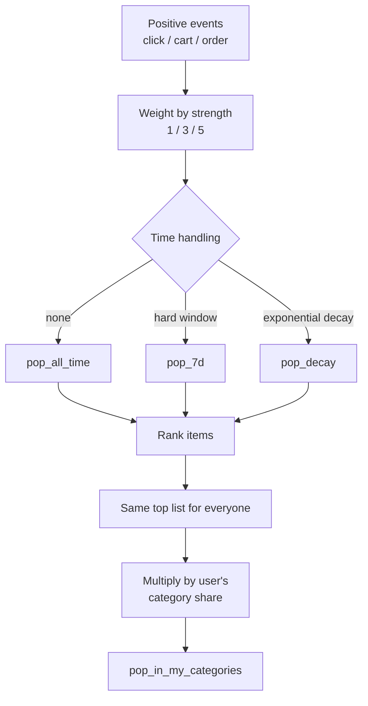
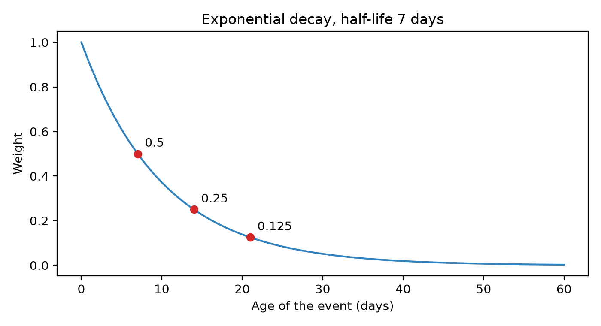
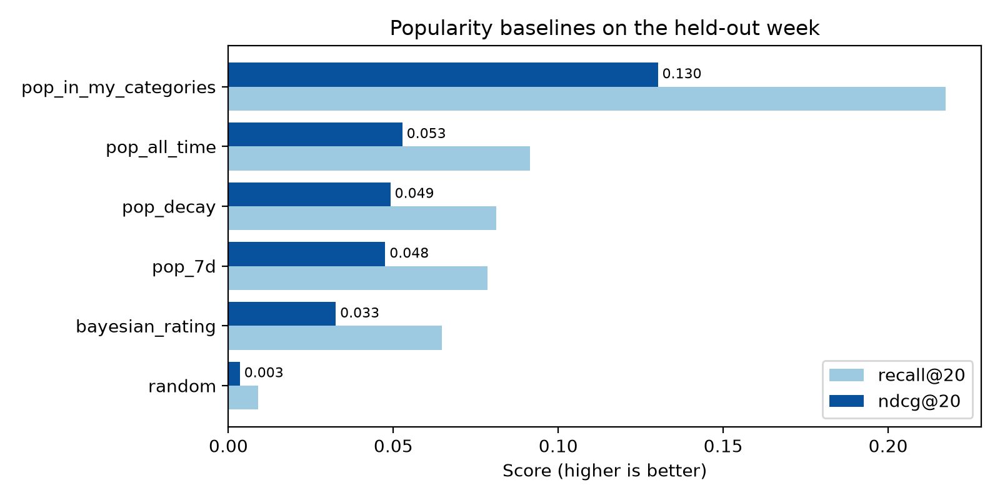
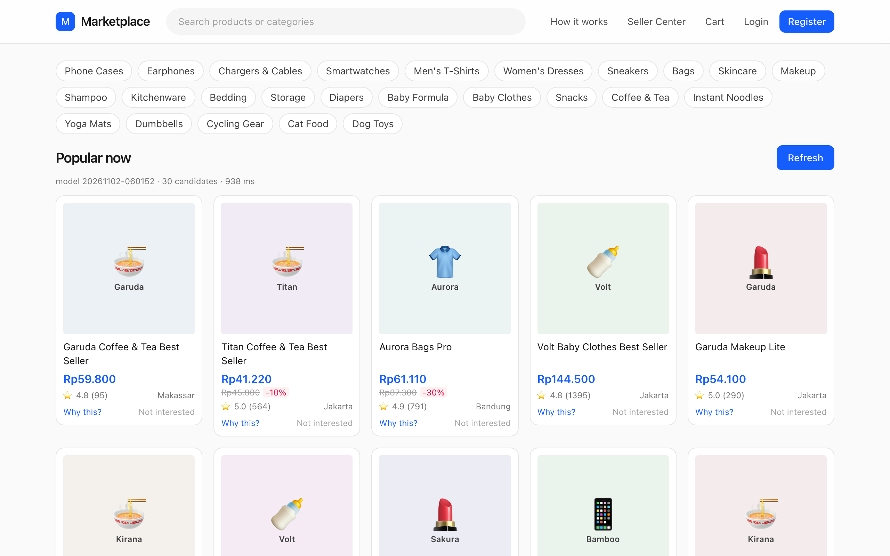
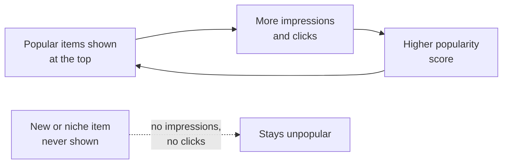

# Popularity baselines

It is the Monday after a payday, and Dewi, a product manager at a Shopee-like marketplace, has a problem. The new home feed is two weeks from launch, the machine-learning team is still arguing about embeddings, and the CEO has just asked a simple question: "If we ship *nothing clever*, what does the home page show?" Dewi's answer is the one every recommender project starts with: show what everyone else is buying. A single SQL query, a `GROUP BY item_id ORDER BY count(*) DESC LIMIT 20`, and the page is no longer empty.

That query is the oldest recommender in the world. It is also the one every serious system keeps around forever, as the cold-start fallback, as a candidate source, as a feature, and above all as the **yardstick**. If a fancy model cannot beat "show the bestsellers", it is not a model, it is an expensive way to be wrong. In this chapter we build a family of popularity baselines, from pure random to "popular in the categories *you* like", measure them all on the same data with the same metrics from Chapter 2, and learn the small bits of maths (exponential decay, Bayesian shrinkage) that reappear all through the rest of the book.

**What you'll learn**

- Why a baseline comes first, and what a "good" baseline looks like.
- Global, windowed, and time-decayed popularity, including the half-life maths behind decay.
- The Bayesian average (and its generalisation `_smoothed` in this repository) for not trusting small samples.
- How a tiny amount of personalisation, "popular in the categories you like", more than doubles ndcg@20 over the best global list.
- What popularity bias is, why coverage collapses, and what production systems do about it.

## Intuition: the shelf at the front of the shop

Imagine a neighbourhood bookstore. The owner knows nothing about you the first time you walk in, so what does she do? She puts the bestsellers on the table right by the door. She does not need to know your taste: a book that hundreds of other people bought is a decent bet for a stranger. That table is a **global popularity recommender**: one ranking, the same for everyone.

Now notice what a clever shopkeeper adds over time.

1. **She forgets slowly.** A book that sold 500 copies last year but only two last week is not on the table any more. That is *time decay*: recent sales count more than old ones. A shop that never forgets ends up decorating the front table with last season's hits.
2. **She does not trust tiny samples.** A book with a perfect five-star score from one reviewer, the author's cousin, should not beat a book with 4.7 stars from two thousand readers. That is *shrinkage*, or the Bayesian average: when evidence is thin, lean on what you know about books in general.
3. **She notices who you are.** Once you say you like cooking, she walks you to the cookbook shelf, and *there* she again points at the bestsellers. She did not use any sophisticated model of your taste; she just intersected "what you like" with "what is popular". That is **personalised popularity**, and it is the bridge from this chapter to the rest of the book.

Every one of those moves has a precise numeric form. None of them needs more than a pandas `groupby`. And yet, as we will see in the results, the third move alone gets a score 2.5 times higher than the plain bestseller table.



*Figure: Every popularity baseline starts from the same weighted positive events and differs only in how it treats time and whether it looks at the user.*

## The algorithm: five ways to count

All five methods below are, at heart, one idea: *add up evidence, sort, take the top.* They differ in what counts as evidence. We keep the evaluation identical for all of them: they score every in-stock item for each of the evaluation users, take the 50 best, and are judged on the week after the cutoff (Chapter 2 explains why that split is honest).

### Step 0: Turning events into weights

The marketplace logs many event types, but only three are *positive* signals: a click, an add-to-cart and an order. The repository gives them strengths in `schema.EVENT_WEIGHT`: click = 1, add-to-cart = 3, order = 5. A purchase is five times more telling than a click. `History.interactions()` is where that happens: it filters the event log down to those three types, attaches the weight `w`, and carries along `age_days`, the number of days between the event and the cutoff.

Everything in this chapter reads from that one table. Let $w_e$ be the weight of event $e$, and $a_e$ its age in days.

### Method 1: Global popularity

The simplest scoring rule is to sum the weights for each item over all history:

$$
\text{pop}(i) = \sum_{e \,:\, \text{item}(e)=i} w_e .
$$

Sort descending and you have a bestseller list. Its virtue is that it is trivial, robust, and it needs no user information, so it works for visitors who have never logged in. Its vice is that it is blind to time: an item that was a monster hit six weeks ago and is dead today still sits near the top.

### Method 2: A hard time window

The standard fix is to count only recent events. For a window of $W$ days:

$$
\text{pop}_W(i) = \sum_{e \,:\, \text{item}(e)=i,\; a_e < W} w_e .
$$

With $W=7$ this is the "trending this week" list, and it is exactly what `candidates.item_popularity(hist, 7)` computes. The window is a blunt tool: an event 6.9 days old counts fully, one 7.1 days old counts for nothing. There is also a statistical price. Fewer events means a noisier count: if an item sells ten units a week, the weekly count fluctuates a lot just by chance.

### Method 3: Exponential time decay

Instead of a cliff we can use a smooth slope. Every event loses value as it ages, and the usual choice is exponential decay controlled by a **half-life** $h$: the age at which an event is worth half as much as a fresh one.

$$
d(a) = 2^{-a/h} = e^{-\lambda a}, \qquad \lambda = \frac{\ln 2}{h}.
$$

The two forms are the same function. The first is easier to reason about (every $h$ days the weight halves); the second is the one calculus likes. With $h = 7$ days, the repository's `HALF_LIFE_DAYS`, we get $\lambda = 0.693/7 \approx 0.099$ per day. The decayed popularity is

$$
\text{pop}_{\text{decay}}(i) = \sum_{e \,:\, \text{item}(e)=i} w_e \cdot 2^{-a_e/h}.
$$

Let us sanity check that the shape is what we claim. At age 0 the weight is 1. At age 7 it is $2^{-1} = 0.5$. At 14 it is $2^{-2} = 0.25$, at 21 it is $0.125$. After a month it is about 5%, and an event from the start of the history is worth almost nothing. The script prints these numbers, and the chart plots them.

Why exponential? Three reasons make it the default in production systems.

- **It is memoryless.** The relative value of two events depends only on the *gap* between them, not on when you look. Re-scoring tomorrow multiplies every score by the same constant, so the ranking does not change.
- **It updates incrementally.** You do not need to store every event. Keep one number per item, $S$, and the time of its last update. When a new event with weight $w$ arrives at time $t$, set $S \leftarrow S \cdot 2^{-(t - t_{\text{last}})/h} + w$. One multiply and one add: this is how streaming "trending" counters are implemented at scale.
- **One intuitive knob.** "Half-life of one week" is a sentence a product manager can argue with. If you know how fast interest in your category fades, you can compute $h$ directly. Want an event to be worth 10% after 30 days? Solve $2^{-30/h} = 0.1$, so $h = 30 \ln 2 / \ln 10 \approx 9.0$ days.

### A tiny worked example

Take two items and a toy history. Item A got three clicks recently: two yesterday and one three days ago. Item B was a hit three weeks ago, with five clicks all 20 days ago. All clicks have weight 1. The toy numbers below are invented for illustration; the real ones come later.

| Method | Item A | Item B | Winner |
|---|---|---|---|
| All-time: sum of weights | 3 | 5 | B |
| 7-day window | 3 | 0 | A |
| Decay, $h=7$ | $2 \times 0.906 + 0.743 = 2.55$ | $5 \times 2^{-20/7} = 5 \times 0.138 = 0.69$ | A |

All-time says B because it never forgets. The 7-day window says A, but only because B fell off the cliff; if B's clicks had been 6 days old it would have counted them fully. Decay gives a gentle answer: A wins because its evidence is fresher, yet B is not zero, so if it keeps getting clicks it will climb back. This smoothness is the reason decay shows up in half the candidate generators in the repository.

### Method 4: The Bayesian average (not trusting small samples)

So far we ranked by *demand*. Another popular signal is *quality*: the average star rating. But averages lie when the sample is small. A product with a single 5-star rating has an average of 5.0, higher than a bestseller with 4.8 from thousands of buyers. We want a score that starts at the *global* mean when there is no evidence and gradually moves to the item's own mean as evidence piles up.

Let $R$ be an item's average rating, $v$ its number of ratings, $C$ the average rating of all items, and $m$ a **prior strength**: how many ratings of "imaginary evidence" at the global mean we add. The Bayesian average is

$$
\text{WR} = \frac{v}{v+m}\, R + \frac{m}{v+m}\, C .
$$

Read it as a weighted mix. The weight on the item's own average, $v/(v+m)$, is 0 when $v = 0$ and tends to 1 as $v$ grows. The weight on the global mean is the remainder. When $v = m$ it is a 50/50 blend, so $m$ is "the number of ratings at which we trust the item as much as the prior".

An equivalent view makes the idea reusable. Multiply the numerator out: $R \cdot v$ is the total stars, so

$$
\text{WR} = \frac{\text{(total stars)} + m \cdot C}{v + m}.
$$

In words: *pretend every item received $m$ extra ratings, all equal to the global mean.* The general shape "(numerator + prior × strength) ÷ (denominator + strength)" works for any ratio, not only star ratings. Click-through rate is clicks ÷ impressions, conversion is orders ÷ clicks, return rate is returns ÷ orders. The repository wraps it in one tiny function, `features._smoothed`, and uses it many times in Chapter 9.

Here is a quick hand-sized check. An item has $v = 20$ ratings averaging $R = 4.8$. The global mean is $C = 4.0$ and the prior strength is $m = 100$. Then

$$
\text{WR} = \tfrac{20}{120}\cdot 4.8 + \tfrac{100}{120}\cdot 4.0 = 0.8 + 3.33 = 4.13 .
$$

The item looks great (4.8), but twenty ratings is not much, so the estimate stays close to the prior. The same arithmetic works on a conversion rate. If an item was shown 10 times and clicked 3 times, the raw CTR is 30%. With a global CTR of 5% and a strength of 50 pseudo-impressions, the smoothed CTR is $(3 + 0.05 \cdot 50)/(10 + 50) = 5.5/60 = 9.2\%$. An item with 1,000 impressions and 50 clicks has a raw CTR of 5%, and the smoothed value is $(50 + 2.5)/1050 = 5.0\%$, essentially unchanged. The rule is automatic: small samples are shrunk hard, large samples barely move.

::: fact
**The "Top 250" is a Bayesian average.** IMDb publicly documents the formula it uses to rank its Top 250 films: weighted rating = (v ÷ (v+m)) × R + (m ÷ (v+m)) × C, where R is the title's mean rating, v its number of ratings, m the minimum ratings required to be listed (currently 25,000), and C the mean rating across all titles. IMDb itself calls this "a true Bayesian estimate". It is exactly the formula in this section.

Source: IMDb, IMDb Help Center, 2026
:::

### Method 5: Popular in the categories *you* like

The first four methods return the *same list for every user*. The last one adds the smallest imaginable dose of personalisation. It uses two ingredients that the repository already computes.

1. **Category affinity** $s_{u,c}$: the share of user $u$'s (decayed) activity, clicks, carts, orders *and* searches, that falls in category $c$. It sums to 1 over categories for each user, and is produced by `candidates.category_affinity`.
2. **Normalised popularity within a category**: for item $i$ in category $c(i)$,

$$
\tilde p(i) = \frac{\text{pop}_7(i)}{\max_{j \in c(i)} \text{pop}_7(j)} \in [0,1].
$$

The best item of each category gets 1, the rest are fractions of it. The final score multiplies them:

$$
\text{score}(u, i) = s_{u,\,c(i)} \cdot \tilde p(i).
$$

Why normalise within the category? Without it, a huge category such as Snacks would drown out everything else. With it, every category has the same "ceiling", and the user's affinity decides *which categories' stars* appear. A tiny extra term (a millionth of the global popularity) breaks ties and gives users with *no* history, who have all-zero affinity, the plain `pop_7d` list as a fallback.

Worked example: suppose Sari spends 60% of her activity on Cat Food, 30% on Dog Toys and 10% on Skincare. The best-selling cat-food item scores $0.6 \times 1 = 0.6$, the second-best, with 80% of the leader's popularity, scores $0.6 \times 0.8 = 0.48$. The best dog toy scores $0.3$. The best skincare item scores only $0.1$, so it will not appear until all cat-food items with $\tilde p > 0.5$ and several dog toys are placed first. Her feed is mostly pet items, ordered by how popular each is *within its shelf*.

::: fact
**Popularity bias is not a bug in your implementation; it is a documented property of recommenders.** Abdollahpouri and colleagues showed on a movie dataset that many recommendation algorithms concentrate their output on popular items, even for users whose taste is mostly niche, and they quantified this as a "bias disparity" between what users want and what they get.

Source: Abdollahpouri et al., RMSE Workshop at RecSys, 2019
:::

## Code walkthrough

The repository already contains the building blocks. We will read them first, then the script that wraps them in an evaluation.

### The interaction table

Everything starts from `History.interactions()`. Remember that a `History` object is the event log *cut off at a moment in time*, so nothing after the cutoff can leak in (Chapter 9 revisits this in depth).

```include
path: recommender/recsys/data.py
symbol: History.interactions
```

It keeps only event types that appear in `EVENT_WEIGHT` and adds the weight column `w`. The `age_days` column is attached when the `History` is built. Everything below is a different reduction of these rows.

### Time decay in one line

```include
path: recommender/recsys/candidates.py
symbol: _decay
```

That is the entire half-life formula: `0.5 ** (age_days / HALF_LIFE_DAYS)`. Because it is applied to a whole pandas Series, it works on millions of events at once, with no Python loop. The constant `HALF_LIFE_DAYS = 7.0` is declared at the top of `candidates.py`. Notice that the function is private (leading underscore) but used by several retrievers: `recent` multiplies each interaction's weight by it, and `category_affinity` uses it for both clicks and searches. The same curve therefore expresses "how long does interest last" everywhere in the first stage.

### Hard-window popularity

```include
path: recommender/recsys/candidates.py
symbol: item_popularity
```

Three operations: take positive interactions, keep rows with `age_days < window_days`, sum weights per item. Note the strict `<`: an event aged exactly `window_days` is *excluded*. The function returns a `pd.Series` indexed by `item_id`, and items with no events in the window are simply absent, so callers must `fillna(0)`. The "trending" retriever (with a 3-day window), the category-popular retriever (7 days) and `similar_items` all call it, so the whole system shares *one* definition of "popular" and only the window changes.

### Smoothing

```include
path: recommender/recsys/features.py
symbol: _smoothed
```

Again a one-liner, and again exactly the formula: `(num + prior * strength) / (den + strength)`. Map the Bayesian average onto it by setting `num` to total stars, `den` to the number of ratings, `prior` to $C$ and `strength` to $m$. Elsewhere in `features.py` it is called with different strengths: 20 pseudo-impressions for a user's CTR, 50 for an item's CTR, 20 for conversion and 10 for return rate. These values are tuned by feel, not learned; the smaller the typical denominator for a statistic, the smaller the strength you can afford.

### The experiment script

The companion script `book/code/ch03_popularity.py` builds all six scorers over the same items and users, then evaluates them with `common.evaluate`, the shared function that makes results comparable across chapters. Two small helpers do the bookkeeping. `per_item` aligns any per-item Series to the fixed array of available items, with zeros for items without events:

```include
path: book/code/ch03_popularity.py
symbol: per_item
```

and `recs_from_scores` turns a score matrix into the top 50 rows per user. A one-dimensional score vector means "same list for everyone", so it is broadcast across users:

```include
path: book/code/ch03_popularity.py
symbol: recs_from_scores
```

The `kind="stable"` sort matters. Many items have identical scores (zero, typically), and an unstable sort could return a different tie order on each run, which would make results irreproducible. With a stable sort, ties are broken by item order, so the output is deterministic.

Now the scorers themselves. The first three are nearly one-liners (they sit at module level in the script):

```include
path: book/code/ch03_popularity.py
region: ch03_scores
```

The decayed variant repeats the `_decay` formula inline instead of importing the private helper, so that the chapter's script is self-contained. The Bayesian average operates on the catalogue's `rating_avg` and `rating_count` columns:

```include
path: book/code/ch03_popularity.py
region: ch03_bayes
```

Two choices are worth discussing. The prior strength $m$ is set to the *mean number of ratings per item*, a common heuristic: at an average-sized sample, the evidence and the prior count equally. The global mean $C$ is weighted by $v$, so it is the mean over all *ratings*, not the mean of item means. Both are cheap to compute and need no tuning.

Finally the personalised version. It builds a user × category matrix `A` from `category_affinity`, an item-wise matrix `P` of within-category normalised popularity, and multiplies them:

```include
path: book/code/ch03_popularity.py
region: ch03_personal
```

`A` has one row per evaluation user and one column per category; `P` has one row per category and one column per item, and is non-zero only where the item belongs to the row's category. The matrix product therefore gives, for each user and item, exactly $s_{u,c(i)}\,\tilde p(i)$. The trailing term is the tie-breaker described earlier.

::: tip
When you write your own baseline, make it return a *score per item*, never a pre-sorted list. Scores can be combined, normalised, and fed to a ranker later, as the repository does by keeping each retriever's score as a ranking feature. A sorted list throws that information away.
:::

## Run it

From the `book/` directory, with the dependencies installed (see the Preface):

```bash
cd book
uv run python code/ch03_popularity.py
```

The script prints three groups of output. First, the Bayesian-average setup and four sample rows showing the shrinkage in action:

```output
file: results/ch03_popularity.txt
lines: 2-12
```

Then the main table: one row per method, evaluated on the same users, the same label week and the same metric code:

```output
file: results/ch03_popularity.txt
lines: 14-22
```

Finally the top five items of each global method and the decay weights at a few ages:

```output
file: results/ch03_popularity.txt
lines: 24-58
```

The script also writes `results/ch03_popularity.json`, which the figure script reads to draw the two charts below.

## Results

### The decay curve



The curve confirms the arithmetic. The printed weights agree with it: 0.9057 after one day, 0.7430 after three, exactly 0.5000 after seven, 0.2500 after fourteen and 0.1250 after twenty-one. By the 30-day mark the weight has fallen to 0.0513, and an event 53 days old, the oldest in the history here, is worth only 0.0053 of a fresh one. This means that, for ranking purposes, decay with a one-week half-life behaves like a soft window of roughly two to three weeks.

### The leaderboard



Read the main table row by row. We focus on ndcg@20 (the single number that rewards putting hits near the top) and recall@20 (how many of the user's held-out interactions we found in 20 slots).

**Random is the floor.** `random` reaches ndcg@20 of 0.0035 and recall@20 of 0.0090. Nothing in this chapter is allowed to score lower, and anything that does is broken. Its coverage is 1.0000: every item gets recommended to somebody. We will return to the oddity that the *worst* method has the *best* coverage.

**Global popularity is already roughly fourteen to fifteen times better than random in ndcg@20.** `pop_all_time` scores ndcg@20 0.0527 and recall@20 0.0914, `pop_7d` scores 0.0475 and 0.0786 and `pop_decay` lands in between with 0.0491 and 0.0813. The gap between random and the cheapest sensible method is far bigger than the gaps among the sensible ones. Most of the achievable "easy" value lives in simply knowing which items people want.

**All-time slightly beats the 7-day window, which is the opposite of what intuition suggests.** Many practitioners expect "trending" to win. It does not here, and the reason is a property of *this data*: in the simulator, each item has a fixed hidden quality, so an item's hidden quality does not change and an item that was popular a month ago is still popular. Under stable popularity, more history means less noise, and the 53-day count is a better estimate of the same underlying number than a one-week count is. The decay variant sits between the two for exactly that reason: its effective window is longer than seven days but still downweights the old.

There is a second place to look. At deeper cut-offs the decayed list is much closer to the all-time list: recall@50 is 0.1557 for `pop_decay` and 0.1575 for `pop_all_time`, while the hard window falls to 0.1335. A smooth slope keeps the long tail of evidence that a cliff discards.

::: warning
Do not take "all-time beats 7-day" as a law of nature. It says that the *simulated* catalogue has stationary popularity. On a real marketplace, flash sales, viral products, seasonal categories (Ramadan, 9.9, 11.11) make popularity drift, and the windowed or decayed list typically wins. The lesson is to **measure on your own data**, and to treat the window or half-life as a hyperparameter tuned on a validation week.
:::

**Quality is not demand.** `bayesian_rating` has ndcg@20 0.0325 and recall@20 0.0648: about nine times better than random, but clearly worse than every demand-based method. Look at the sample rows printed by the script. Item 892 has a stated average of 4.4 but zero ratings, and the Bayesian score is 4.324, the global mean $C$. Item 1840, also 4.4, with 34 ratings, moves to 4.343: a small step away from the prior. Item 610, with a 5.0 average and 2718 ratings, ends at 4.975: with that many ratings the evidence swamps the prior ($m = 105.2$). That is shrinkage working as designed, but a *good rating* is not a *reason to click*. People buy what they need. A very well-rated niche product is only relevant to the few users who need it, and the same ranking is shown to everyone. Bayesian ratings belong in a feature set or a "top rated" shelf, not as a home feed ranker.

It is also worth noticing the placeholders hiding in raw data. The first printed row has `rating_avg` 4.5 with zero ratings: a default value written to every new item. Without smoothing, every unrated item would carry a fictitious 4.5, which would look *better* than most real products. The Bayesian average silently repairs this by treating zero ratings as "no information".

**A little personalisation goes a long way.** `pop_in_my_categories` reaches ndcg@20 of 0.1302 and recall@20 of 0.2173. Compared with the best global list that is a factor of about 2.5 in ndcg, and recall@50 climbs to 0.3529 versus 0.1575. Order recall@20, which only counts held-out *orders* (the strongest signal), is 0.3050 versus 0.1202. We did not train anything. The only new information is "which categories does this user touch", and it moves the metric from "mediocre" to "decent". This is the most important number of the chapter: *knowing even a coarse user preference matters more than any amount of refinement of the global list.*

Notice the 21 evaluation users, out of 947, who had no category signal at all and fell back to plain `pop_7d`. That is about 2% of users, and the fallback means they still get a sensible page rather than an empty one: the same graceful degradation the production system relies on when a new visitor arrives.

### What the app shows

The anonymous home page of the running marketplace is a popularity recommender. The Rust API forwards a request with user id 0 to the Python service, which has no history to work from and so draws all its candidates from the trending list, in other words, `item_popularity` over the most recent days. (The model then re-orders those candidates, which Chapters 8 to 10 explain.)



The heading says "Popular now", and the cards are the same for every anonymous visitor. When you log in as a demo buyer, the same endpoint returns a personalised list; the difference between those two screens is the difference between `pop_7d` and `pop_in_my_categories` in the table above, plus everything the following chapters add.

## Pitfalls and how it is done in production

### Popularity is self-reinforcing

The most important problem is not accuracy, it is the **feedback loop**. If you show the same twenty items to everybody, people click those twenty items (because those are the ones they can see), the click counts for those items grow, and next week they are even more "popular". Items outside the list cannot gain evidence, no matter how good they are. Economists call it the Matthew effect; recommender folks call it popularity bias.



*Figure: The popularity feedback loop. Exposure produces clicks, clicks produce score, and score decides exposure; items outside the loop cannot enter it.*

The table makes it visible. The three global methods all have coverage@20 of 0.0087: across 947 users, they recommend the *same twenty items*. The personalised method, at 0.2164, touches roughly twenty-five times as many distinct items, and random, at 1.0000, touches them all. Look at the top five lists printed above, too: the first four items are the same for `pop_all_time` and `pop_7d`, and item 2381 ("Garuda Makeup Lite") is first in all three. This is the effect we are warning about.

Production systems address it in layers, none of which is a baseline's job but all of which build on one:

- **Personalisation** (the rest of this book) reduces the dominance of a single global list.
- **Exploration**: reserve a few slots for items with little data, and show them often enough to measure. Chapter 11 introduces ε-greedy and Thompson sampling.
- **Position-bias correction** so that "was clicked" is not mistaken for "is relevant" when the item was merely put at position 1 (Chapter 12).
- **Calibrated or diversified re-ranking** such as MMR, so the top 20 is not twenty near-duplicates (Chapter 11).
- **Normalising by exposure**: use click-through rate with smoothing instead of raw click counts, so that items are rewarded for *conversion per view*, not for how often they were placed on the page. This is where `_smoothed` comes back in.

### Choosing the window and half-life

Both the window $W$ and the half-life $h$ are hyperparameters. Too short and you chase noise: a flash sale of one hour determines the entire list. Too long and you serve yesterday's news. Reasonable defaults depend on the *velocity* of the category. Fashion, electronics and food move at different speeds; some marketplaces use one half-life per top-level category. The cheap way to choose is to try three values (say 3, 7, 14 days) on a held-out week, which is exactly what the hands-on exercise below asks you to do.

### Do not mix scales

Two numbers that look alike can mean very different things. `pop_7d` sums weights over seven days. `pop_decay` sums weights over fifty-three days but discounts them. Their absolute values are not comparable, and neither is comparable to a rating in $[1, 5]$. If you ever blend baselines (say, 0.7 × popularity + 0.3 × rating) normalise each to $[0,1]$ first, for example by dividing by the maximum in its category as `pop_in_my_categories` does. A cleaner solution, and the one the repository eventually adopts, is to feed each score to a learned ranker as a separate feature and let it find the weights.

### Count users, not just events

A single enthusiastic shopper who clicks the same product 40 times inflates its popularity by 40. Some systems therefore count *distinct users* instead of events, or cap each user's contribution to an item. Our baseline sums raw event weights for simplicity, which also makes it vulnerable to bots and to seller-run click farms, a reason real platforms filter suspicious traffic before it reaches the counters.

### Popularity as a candidate source and as a feature

The baselines in this chapter are not museum pieces. In the production design of this repository they survive in three roles:

1. **Fallback**: the "trending" retriever supplies candidates to users with no history, and the Rust API's fallback query (top items by recent orders) serves the home page when the Python service is down.
2. **Candidate source**: "popular in the categories you like" is the `catpop` retriever of Chapter 8, nearly the same code as method 5.
3. **Feature**: the ranker receives smoothed popularity, CTR and conversion of each item as columns, and decides how much to trust them.

::: tip
Keep your baselines running in production, even when a better model exists. A baseline shown to a small percentage of traffic (a "holdout") tells you whether the model still earns its keep, and gives you a safe fallback when something breaks.
:::

## Summary

- A popularity recommender sums weighted positive events per item and sorts. It is cheap, robust, needs no user data, and defines the bar every other method must clear.
- A hard window counts only recent events; exponential decay with half-life $h$ gives each event weight $2^{-a/h}$, so evidence fades smoothly and scores can be updated incrementally with one multiply and one add.
- The Bayesian average $\frac{v}{v+m}R + \frac{m}{v+m}C$ shrinks small samples toward the global mean. The repository generalises it as `_smoothed(num, den, prior, strength)` for CTR, conversion and return rate.
- On this data all-time popularity slightly beat the 7-day window, because simulated popularity is stable. Which window wins depends on how fast real popularity drifts, so tune it on held-out data.
- Ranking by rating alone loses to ranking by demand: quality is not the same as relevance.
- Multiplying category affinity by within-category popularity lifted ndcg@20 from about 0.05 to 0.13 with no model training, the clearest argument for personalisation.
- Global popularity gives every user the same few items (coverage 0.0087) and feeds a self-reinforcing loop; later chapters add personalisation, exploration and diversity to counter it.

## Quiz

**Q3.1** Why does `pop_all_time` slightly beat `pop_7d` on this book's simulated data?

A. The 7-day window contains no clicks.
B. Simulated item popularity is stable, so a longer history gives a less noisy estimate of the same quantity.
C. `pop_7d` uses a different evaluation week.
D. Decay is not applied to `pop_all_time`, and decay always hurts.

**Q3.2** An item has a catalogue rating of 4.4 but `rating_count = 0`. What is its Bayesian-average score?

A. 4.4, because the item's own rating is always used.
B. 0, because there is no evidence.
C. The global mean rating $C$, because with $v=0$ all the weight goes to the prior.
D. The mean of $m$ and $C$.

**Q3.3** The three global popularity methods all have `coverage@20 = 0.0087`. What does that mean?

A. They fail for 99% of the users.
B. Every user receives the same 20 items, so the methods only ever recommend a tiny part of the catalogue.
C. They recommend an item once every 115 requests.
D. The metric is broken, since coverage must exceed recall.

**Q3.4** In your own words, show how `features._smoothed(num, den, prior, strength)` reproduces the Bayesian average of an item's star rating. State what you pass as each of the four arguments.

**Q3.5** Explain the popularity feedback loop in two or three sentences and name one technique from this chapter or the next that weakens it.

**Q3.6** Read the code below. For an interaction whose `age_days` is exactly `7.0`, does it contribute to the result? What is the weight of the surviving interactions, and what would you change to count events from the last 7 *and* the 8th day?

```include
path: recommender/recsys/candidates.py
symbol: item_popularity
```

**Q3.7** Numeric. With a half-life of 7 days, compute the decayed popularity score of an item that has these events (weights from the repository: click = 1, add-to-cart = 3, order = 5): an order 7 days ago, a click 14 days ago and an add-to-cart 3 days ago. Use $2^{-3/7} \approx 0.743$.

**Q3.8** Numeric. An item has $v = 20$ ratings averaging $R = 4.8$. The global mean rating is $C = 4.0$ and the prior strength is $m = 100$. What is the Bayesian average? What would it be with $v = 400$ ratings and the same average?

**Q3.9** Short answer. You want an event to be worth exactly 25% of a fresh one after 10 days. What half-life do you need? Then explain in one sentence why a *smaller* half-life makes the recommender react faster but also noisier.

**Q3.10** Hands-on exercise. Open `book/code/ch03_popularity.py` and change `HALF_LIFE = 7.0` to 2.0, then to 30.0, running `uv run python code/ch03_popularity.py` each time (afterwards restore the file and the results with `git checkout code/ch03_popularity.py results/`). Compare the `pop_decay` row's ndcg@20 with the `pop_7d` and `pop_all_time` rows each time. What do you observe as the half-life becomes very short and very long, and does it match the explanation given in the Results section?
