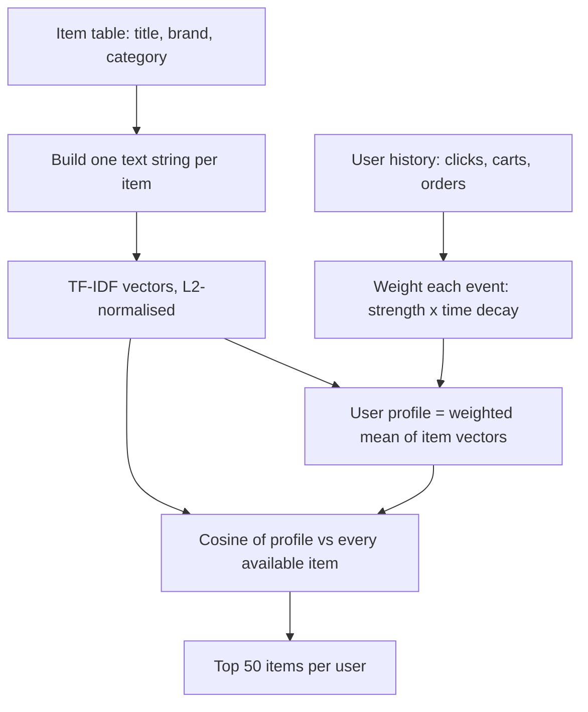
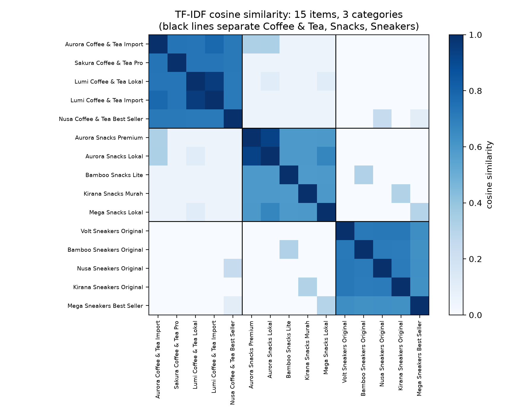
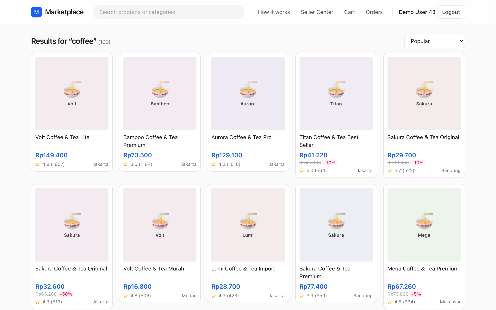

# Content-based filtering

It is the week before the 9.9 sale and Sari, a product manager on the marketplace's discovery team, is staring at a dashboard with one number she does not like. Every day a few hundred new products are listed by sellers: a ceramic coffee dripper from a shop in Bandung, a pair of sneakers from a brand nobody has searched for yet, a cat-food bundle that went live ten minutes ago. None of them has a single click. The popularity baselines from the previous chapter cannot see them, because popularity is *history*, and these products have none. Yet a buyer who spent last week browsing pour-over coffee gear would very probably love that dripper.

What Sari needs is a recommender that looks at what an item *is*, not only at who touched it. If the dripper's title says "coffee" and the buyer has been clicking on coffee things, the two can be matched without a single interaction on the new product. That idea is **content-based filtering**.

**What you'll learn**

- How to turn an item's text and metadata into a numeric vector, and why we weight words with TF-IDF instead of just counting them.
- What cosine similarity measures, and why it is the default distance for sparse text vectors.
- How to build a user profile as a decay-weighted average of the item vectors the user touched, and how to score every item against it.
- How the companion script `ch04_content.py` performs on the simulated marketplace, and why it beats global popularity but not category-aware popularity.
- Where content-based methods shine (cold start) and where they fail (over-specialisation, shallow metadata).

## Intuition: the librarian who never watches the readers

Imagine a librarian who is not allowed to look at the lending records. She cannot say "people who borrowed this also borrowed that". All she may do is read the covers: the title, the subject shelf, the author. When you hand her three novels you enjoyed, she walks to the shelves, finds books whose covers *sound like* the three you gave her, and hands them over.

That librarian is a content-based recommender. She has two skills:

1. She can describe every book as a short list of descriptive words (an **item representation**).
2. She can summarise your taste as a list of the same kind of words (a **user profile**), and compare the two lists.

Notice what she does not need: other readers. That is both the superpower and the weakness: a book that arrived this morning is recommendable at once, but she will keep walking you to the crime shelf forever.

In our marketplace the "covers" are the `title`, `brand` and category (plus parent category) columns of the `items` table.

The chapter's pipeline looks like this:



*Figure: The content-based pipeline. Item vectors are computed once; user profiles are recomputed from the latest history.*

Everything here is cheap, deterministic and explainable, which is why content-based scoring remains a workhorse for "similar items" widgets and cold-start fallbacks.

## The algorithm

### Step 1: item representation as text

The simplest, and surprisingly effective, way to represent an item is to glue its descriptive fields into one string and treat that string as a short document. In the companion script this is one line:

```include
path: book/code/ch04_content.py
region: item_text
```

An item titled "Volt Skincare Lokal" in category "Skincare" with brand "Volt" and parent category "Beauty" becomes the document `Volt Skincare Lokal Skincare Volt Beauty`. Note that category and brand words are repeated on purpose: titles in this simulator are short, and repeating the structured fields lets them count more than once.

Next we turn each document into a vector. The naive way is a **bag of words**: count how many times each vocabulary word appears.

### Step 2: TF-IDF weighting

Bag-of-words has an obvious flaw. The word "home" appears in every item of the category "Home & Living" (and in the parent-category text of each one), so it tells us almost nothing about *which* home item a buyer wants, while the word "sneakers" is specific and carries much more information. We want rare words to count more than common words.

**TF-IDF** (term frequency–inverse document frequency) does exactly that. For a term $t$ in document $d$ out of a collection of $N$ documents:

$$
\text{tfidf}(t, d) = \text{tf}(t, d) \times \text{idf}(t)
$$

where $\text{tf}(t,d)$ is the number of times $t$ occurs in $d$, and the inverse document frequency downweights terms that occur in many documents. The version used by scikit-learn's `TfidfVectorizer`, which our script uses, is the *smoothed* one:

$$
\text{idf}(t) = \ln\frac{1 + N}{1 + \text{df}(t)} + 1
$$

with $\text{df}(t)$ the number of documents that contain $t$. The "+1" terms keep the logarithm finite and guarantee that even a term present in every document keeps a small positive weight.

Finally each document vector $\mathbf{x}_d$ is **L2-normalised** to unit length:

$$
\hat{\mathbf{x}}_d = \frac{\mathbf{x}_d}{\lVert \mathbf{x}_d \rVert_2}
$$

so that a long title does not automatically look more important than a short one.

### Step 3: cosine similarity

To compare two vectors we measure the angle between them rather than the distance between their tips:

$$
\cos(\mathbf{a}, \mathbf{b}) = \frac{\mathbf{a} \cdot \mathbf{b}}{\lVert \mathbf{a} \rVert \, \lVert \mathbf{b} \rVert}
$$

Because TF-IDF vectors have no negative entries, cosine lies between 0 (no shared terms at all) and 1 (identical direction). When both vectors are already unit length, as ours are after step 2, the denominator is 1 and **cosine similarity is simply the dot product**. That is why the script can compute the similarity of every pair of items with one sparse matrix multiplication, `X @ X.T`.

Why angle and not Euclidean distance? A text repeated twice gives a vector twice as long but pointing the same way; cosine correctly calls it identical.

### Step 4: the user profile

Items now live in a vector space. A user is described by what they did to items, so the natural profile is a **weighted average of the vectors of the items they interacted with**. Two kinds of weight apply to each event:

- **Strength.** In this repo a click counts 1, an add-to-cart 3 and an order 5 (`EVENT_WEIGHT` in `recommender/recsys/schema.py`). Buying something is stronger evidence of taste than glancing at it.
- **Recency.** Taste drifts; a click from last week matters more than a click from last month. We apply exponential decay with a half-life $h$ of 7 days: an event of age $a$ days is multiplied by $2^{-a/h}$.

Writing $w_e$ for the strength of event $e$, $a_e$ for its age and $\hat{\mathbf{x}}_{i(e)}$ for the vector of the item it touched, the profile is

$$
\mathbf{p}_u = \frac{\sum_{e \in E_u} w_e \, 2^{-a_e/h} \, \hat{\mathbf{x}}_{i(e)}}{\sum_{e \in E_u} w_e \, 2^{-a_e/h}},
\qquad
\hat{\mathbf{p}}_u = \frac{\mathbf{p}_u}{\lVert \mathbf{p}_u \rVert_2}.
$$

The denominator makes it a proper average, so a user with 100 events does not get a bigger vector than a user with 5. The decay function is the same one the repo already uses for its "recently viewed" retriever:

```include
path: recommender/recsys/candidates.py
symbol: _decay
```

### Step 5: scoring and ranking

For every available item $j$, the score for user $u$ is

$$
\text{score}(u, j) = \hat{\mathbf{p}}_u \cdot \hat{\mathbf{x}}_j .
$$

Sort descending and keep the top 50 per user. Users with no history have an all-zero profile; the script breaks their ties with a tiny popularity term so they get the `pop_7d` list.

### A worked example by hand

Let us run the whole thing on a toy catalogue of four items, small enough to check with a pocket calculator. The vocabulary has four words and each item has just a few of them:

| Item | Text | aurora | coffee | sneakers | volt |
|---|---|---|---|---|---|
| A | `aurora coffee` | 1 | 1 | 0 | 0 |
| B | `volt coffee` | 0 | 1 | 0 | 1 |
| C | `aurora sneakers` | 1 | 0 | 1 | 0 |
| D | `volt sneakers sneakers` | 0 | 0 | 2 | 1 |

Every word occurs in exactly two of the four items, so $\text{idf} = \ln(5/3) + 1 \approx 1.511$ for all of them and cancels out after normalisation. After L2 normalisation:

- A $= (0.707,\ 0.707,\ 0,\ 0)$ and B $= (0,\ 0.707,\ 0,\ 0.707)$ and C $= (0.707,\ 0,\ 0.707,\ 0)$ (coordinates in the order aurora, coffee, sneakers, volt).
- D has raw TF-IDF $(0,\ 0,\ 2\cdot1.511,\ 1.511)$, length $1.511\sqrt{5}$, so $\hat{\mathbf{x}}_D = (0,\ 0,\ 0.894,\ 0.447)$. The word repeated twice dominates the vector.

Cosine similarities follow directly. A and B share only "coffee": $0.707 \times 0.707 = 0.5$. A and C share only "aurora": also 0.5. A and D share nothing: 0. C and D share "sneakers": $0.707 \times 0.894 = 0.632$.

Now a user clicked item A today (strength 1, age 0) and ordered item C seven days ago (strength 5, decay $2^{-7/7} = 0.5$). The effective weights are $1 \times 1 = 1$ and $5 \times 0.5 = 2.5$, sum 3.5. The profile is

$$
\mathbf{p} = \frac{1 \cdot \mathbf{x}_A + 2.5 \cdot \mathbf{x}_C}{3.5} = (0.707,\ 0.202,\ 0.505,\ 0),
$$

and after normalisation $\hat{\mathbf{p}} = (0.793,\ 0.226,\ 0.566,\ 0)$. The scores are A 0.721, B 0.160, C 0.961 and D 0.506. C wins because it carries both of the user's strongest words; D outranks B because the sneakers signal is strong while B shares only the weak "coffee" signal. (A and C are already seen; a production system filters them out, the simple baseline here does not.)


## Code walkthrough

The full script is `book/code/ch04_content.py`; the snippets below are included straight from it and run top to bottom.

### Preparing the item text

The script starts by loading the shared simulated data through `common.py`, so every algorithm in the book sees exactly the same history, cutoff and eval users. It then joins each item to its category and parent category names and builds the text:

```include
path: book/code/ch04_content.py
region: data_prep
```

Then the text column is built:

```include
path: book/code/ch04_content.py
region: item_text
```

Note that `hist` is `History.at(tables, CUTOFF)`: only the data visible at the cutoff. Items listed after the cutoff do not exist for this model, which keeps the evaluation honest.

### Fitting TF-IDF

```include
path: book/code/ch04_content.py
region: tfidf
```

`fit_transform` does three jobs at once: it learns the vocabulary and the document frequencies, computes the IDF for each word, and returns a sparse matrix `X` with one L2-normalised row per item. `item_row` maps an item id to its row number so we can look items up later. Keeping the matrix sparse matters: with a real vocabulary of tens of thousands of words, a dense matrix would be unmanageable, but each item only touches a handful of columns.

### Building profiles with sparse algebra

This is the heart of the script, and it avoids any Python loop over users:

```include
path: book/code/ch04_content.py
region: profile_build
```

The last line of the profile construction is the normalisation step:

```include
path: book/code/ch04_content.py
region: profile_norm
```

`hist.interactions()` returns the click, add-to-cart and order events with a column `w` holding the strength weight:

```include
path: recommender/recsys/data.py
symbol: History.interactions
```

The script multiplies `w` by the decay factor to get the effective weight `s`, then sums the effective weight per (user, item) pair. These sums fill a sparse **user × item weight matrix** `W`. Then the formula for the profile becomes pure matrix algebra:

- `W @ X` computes, for every user, $\sum_e s_e\,\hat{\mathbf{x}}_{i(e)}$, a weighted sum of item vectors.
- `sp.diags(1 / wsum)` divides each user's row by their total weight, giving the weighted average.
- `normalize(...)` rescales each profile to unit length, so the final dot product is a true cosine.
- `np.where(wsum > 0, wsum, 1)` is a guard: a user with no positive events has `wsum == 0`, and dividing by zero would produce `inf`. Replacing zero by one leaves their all-zero row at zero.

### Scoring, tie-breaking and evaluation

```include
path: book/code/ch04_content.py
region: scoring
```

`profile @ Xa.T` produces the full user × available-item score matrix in one product. Only items that are in stock at the cutoff (`avail`) are scored. The popularity tie-break is scaled to $10^{-6}$ so it can only separate scores that are otherwise equal: it decides among cold users (all zeros) and among near-duplicate items, but never overrides a real content difference. The final `argsort` picks the top 50 per user, and `common.evaluate` computes exactly the same metrics used for all other chapters.

## Run it

From the `book/` directory:

```bash
uv run python code/ch04_content.py
```

The script first prints the vocabulary statistics and IDF extremes:

```output
file: results/ch04_content.txt
lines: 8-21
```

The documents are short (4.8 non-zero terms per item) and the vocabulary is just 64 terms, because the simulator builds titles from a template; a real marketplace has millions of words, model numbers and typos. The IDF ranking behaves as theory promises: "living" and "home" have the lowest weights, near 2.86, while "sneakers", "shampoo" and "skincare" have the highest, around 4.5 to 4.7.

## Results

### What the profiles look like

```output
file: results/ch04_content.txt
lines: 26-32
```

Of the 947 eval users, 919 have a usable profile; 28 have no positive history and fall back to the popularity tie-break. For user 894 the strongest term is "diapers" (0.809), followed by "baby" and "mother" (both 0.301): a parent buying baby supplies, and the profile is directly readable by a human.

### How well does it rank?

```output
file: results/ch04_content.txt
lines: 34-37
```

Chapter 3 reported `pop_7d` at 0.0475 and `pop_in_my_categories` at 0.1302 on the same labels.

Three conclusions:

1. **Content-based beats global popularity.** The NDCG@20 of `content_tfidf` is 0.0909 against 0.0475 for `pop_7d`, nearly double. Personal taste, even from category-and-brand words alone, carries real information.
2. **It loses to category-aware popularity.** `pop_in_my_categories` scores 0.1302, clearly above our 0.0909. Why? Both methods exploit the same fact: users shop within categories. But `pop_in_my_categories` also ranks *inside* the category by popularity, which separates good items from poor ones. Our TF-IDF vector contains only category and brand words, so every item of a category looks almost the same, and the choice among them is a coin flip (decided only by the $10^{-6}$ popularity tie-break).
3. **Coverage is excellent.** `coverage@20` of 0.9892 means that nearly the whole in-stock catalogue shows up in somebody's top 20, against 0.0087 for popularity, which recommends the same few dozen items to everyone. Content-based methods are a natural antidote to the "rich get richer" effect we met in chapter 3. The coverage figure is slightly inflated by the random-ish choice among near-ties, but the direction is real.

### Nearest neighbours and the "cosine = 1.0" lesson

```output
file: results/ch04_content.txt
lines: 39-47
```

Look at the first query. "Aurora Coffee & Tea Import" has a nearest neighbour with cosine **1.000**: a different item (id 2399) with exactly the same title and category. The next ones, 0.953, differ only in the suffix "Lokal", "Lite" or "Premium", which contributes almost nothing.

This is a teaching point, not a bug. Identical text gives identical vectors, so no content-based method can tell the items apart; a content-only recommender will happily fill the top 5 slots with copies of the same product. Telling them apart needs *behavioural* signals such as price, rating and popularity.

The heat map shows the cosine between 15 items, five from each of three categories:



Items of the same category are similar; items of different categories are not. Numbers confirm it:

```output
file: results/ch04_content.txt
lines: 62-65
```

The rows and columns are Coffee & Tea, Snacks and Sneakers. The mean similarity between two different items of the same category is 0.752, 0.633 and 0.681 on the diagonal; off-diagonal it is at most 0.084. The faint squares off the diagonal come from shared brand words such as "Aurora".

::: fact
**TF-IDF is over fifty years old.** The idea of weighting a term by the inverse of how many documents contain it was published by Karen Spärck Jones in 1972, as "a statistical interpretation of term specificity". It has been used in search engines and recommender systems ever since, and it is still a strong baseline today.

Source: Spärck Jones, Journal of Documentation, 1972
:::

::: fact
**Pandora's "Music Genome" is content-based filtering done by hand.** Pandora's founders assembled a team of musicologists who analysed and classified songs on roughly 400 attributes, such as vocal style or rhythm, and used those attribute vectors to find songs similar to ones a listener liked, instead of relying on other listeners' histories.

Source: Westergren, NPR interview, 2011
:::

### The same idea inside the app



The app already contains a tiny content-based component: the backend matches the typed query against product titles and category names (an `ILIKE` filter in `backend/src/catalog.rs`), and the "Popular" ordering is not content-based at all. The profile approach of this chapter replaces the typed query with a *query built from the user's own behaviour*.

## Pitfalls and how it is done in production

### Over-specialisation

The librarian who only reads covers keeps recommending more of the same. Our profile for user 894 is dominated by "diapers", so the recommendations will be diaper-adjacent; if that user needs a stroller next, no word overlap suggests it. The system has no **serendipity**.

Mitigations: blend with collaborative signals such as co-visitation (chapter 5), re-rank for diversity with MMR and category caps (chapter 11), and reserve a few slots for exploration.

### Shallow metadata, noisy text

Content-based methods are only as good as the content. Here titles come from a template; real seller titles are stuffed with keywords ("MURAH!!! Best Seller Sneakers Pria Wanita Original 100%"), misspell brands and mix languages. Production systems clean titles, extract structured attributes, and increasingly replace TF-IDF with learned text and image embeddings (chapter 7).

### The cold-start strength

A brand-new item has no clicks, so popularity, co-visitation and matrix factorisation (chapters 3, 5, 6) cannot recommend it. But its title, brand and category exist from the first second, so a content-based scorer can place it in front of the right buyers *immediately*; we revisit this in chapter 12. A new *user* with a single click is similarly served: one click already yields a non-zero profile. Remember that content tells the system *where to show* an item; only real clicks tell it *whether the item is good*.

### Scalability and tuning

Item vectors are computed offline and stored in an approximate-nearest-neighbour index (chapter 7); the profile is looked up at request time. Tune the half-life, the event weights and the text recipe on the same time-split evaluation as everything else; you will vary the half-life in the hands-on exercise.

### How this fits the repo's ranking system

The content-based score is not a retriever in the final repo pipeline; the four retrievers are `recent`, `covisit`, `catpop` and `global_trending`. Content knowledge enters the ranker differently: as *features* such as `uc_click_share_30d` (the share of the user's clicks that fall in the item's category) and `item_price_vs_category` (price divided by the category median), defined in `schema.py` and computed in `features.py`. That is a common production pattern. A cheap content score becomes one input among many into a learned ranker, rather than the whole recommender. The ranker then learns, from data, how much to trust content relative to popularity or recency.

## Summary

- Content-based filtering represents every item by its own attributes (text, category, brand) and recommends items that resemble what the user already liked.
- TF-IDF weights words by term frequency times inverse document frequency, so specific words ("sneakers") matter more than generic ones ("home"); L2 normalisation makes cosine similarity equal to a dot product.
- A user profile is the weighted average of the vectors of items the user touched, with weights equal to event strength times exponential time decay (half-life 7 days here).
- On the simulated marketplace the method reaches an NDCG@20 of 0.0909, almost twice the 0.0475 of `pop_7d`, but below the 0.1302 of `pop_in_my_categories`, because category and brand words cannot separate items inside a category.
- Coverage is very high (0.9892 versus 0.0087 for popularity), but near-duplicate titles have cosine similarity exactly 1.0, so content alone cannot tell copies apart; behavioural signals must.
- The main strength is cold start (new items and new users can be scored immediately); the main weakness is over-specialisation, as the method never suggests anything unlike the history.
- In the repo's final system, content signals are used as ranker features rather than as a standalone retriever.

## Quiz

**Q4.1** Why does TF-IDF multiply the term frequency by an *inverse* document frequency?

A. To make long documents score higher than short ones.
B. To give more weight to terms that appear in few documents and less to terms that appear in many.
C. To make all vectors orthogonal to each other.
D. To remove stop-words from the vocabulary automatically.

**Q4.2** After TF-IDF vectors are L2-normalised, which statement about cosine similarity is correct?

A. It equals the Euclidean distance between the two vectors.
B. It equals the dot product of the two vectors.
C. It can be negative for any two items.
D. It depends on how many words each item's text contains.

**Q4.3** A seller lists a new item at 09:00 and nobody has clicked it yet. Which method can still recommend it at 09:01?

A. Global popularity over the last 7 days.
B. Item-to-item co-visitation counted from sessions.
C. A content-based scorer that uses the item's title, brand and category.
D. A recommender using only past orders.

**Q4.4** In the results, two different items have a cosine similarity of exactly 1.000. What does this tell you about their text, and why is it a problem for a content-only recommender?

**Q4.5** Explain "over-specialisation" in content-based filtering and name two ways to reduce it.

**Q4.6** Read this line from the script:

```include
path: book/code/ch04_content.py
region: profile_norm
```

What would go wrong without `np.where(wsum > 0, wsum, 1)`, and what would the profile row of a user with no positive events be after the line runs?

**Q4.7** A user clicked item A today (strength 1, age 0 days) and added item B to the cart 14 days ago (strength 3). With a half-life of 7 days, what fraction of the final profile's total weight comes from item A? (Give the answer to three decimals.)

**Q4.8** Two items have unit-length vectors $\mathbf{a} = (0.6,\ 0.8,\ 0)$ and $\mathbf{b} = (0.8,\ 0,\ 0.6)$. Compute their cosine similarity.

**Q4.9** *Hands-on.* In `book/code/ch04_content.py`, change `HALF_LIFE = 7.0` to `1.0`, run the script, and then repeat with `30.0`. Compare the `ndcg@20` and `recall@20` in the results table with the baseline of 0.0909 and 0.1378. What do you expect to observe about how quickly the profile should forget, and does the outcome match? (Restore the value afterwards.)

