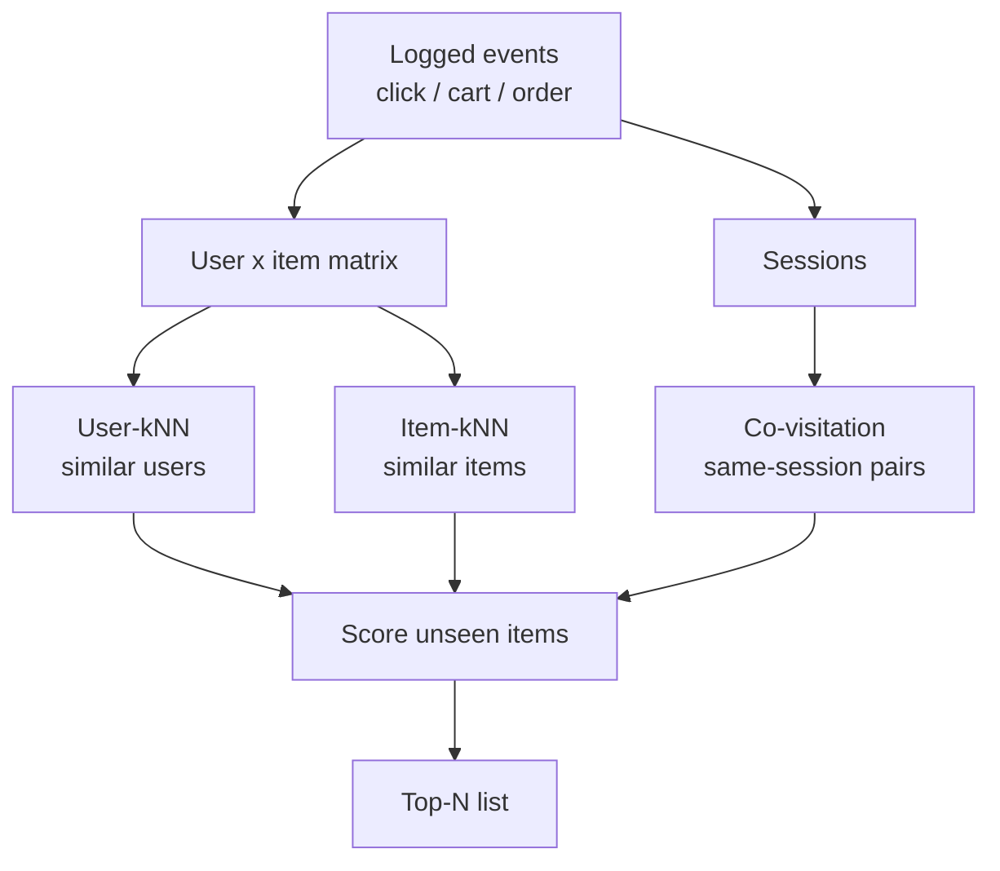
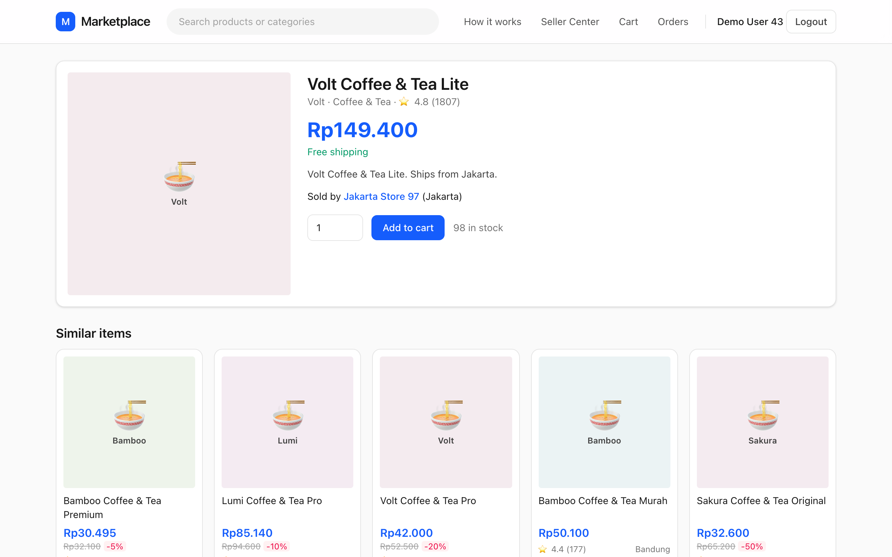
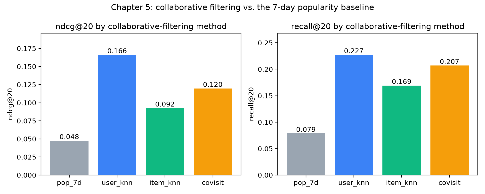

# Collaborative filtering

## Nobody wrote the word "coffee" on that card

It is a Tuesday evening and a buyer in Surabaya opens the product page of a coffee-and-tea gift set. She has not searched for anything. She is not going to read the description carefully either. What she wants to know, within about two seconds, is: *is there something better than this?* Underneath the product photo, a row titled "Similar items" fills up with five other coffee and tea listings. Nobody on the engineering team wrote a rule saying "coffee-set X goes with coffee-sets Y and Z". Nobody labelled the products either. The row is there because, over the last thirty days, many other shoppers who looked at this product in the same browsing session also looked at those five.

That is the central trick of **collaborative filtering** (CF): *the crowd already did the labelling for you*. Every click, cart and order is a vote. If you never look at a single title, price or photo, but you know who touched what and when, you can still say a surprising amount about which items belong together and which people share tastes.

In Chapter 4 we did the opposite. Content-based filtering needed text, categories and brands, and it recommended things that *looked* like what the user had already seen. Collaborative filtering ignores what items are and looks only at the pattern of behaviour. This is why it surfaces items a content model would never connect, and also why it fails in a very particular way when behaviour data is thin.

This chapter builds four collaborative methods on the same simulated marketplace and the same evaluation as the previous chapters, so you can compare their numbers directly with the popularity baseline from Chapter 3:

- **User-kNN**: find the users most like you and recommend what they liked.
- **Item-kNN**: find the items most like the ones you liked, where "like" means "touched by the same people".
- **Session co-visitation**: items that show up together *inside one browsing session*. This is what the app's "Similar items" row uses, and it is one of the four candidate retrievers of the production pipeline in this repository.
- A look at **scalability**: why the Amazon item-to-item design became the industry default, and what it costs.

**What you'll learn**

- How a user–item interaction matrix is built from implicit events, and why event weights matter.
- The mechanics of user-kNN and item-kNN, with cosine and Jaccard similarity worked out by hand.
- How the repo's `covisitation_matrix` works, why it normalises each row, and how a user's recent items turn it into personal recommendations.
- How to read real results: why user-kNN wins on ndcg here, why item-kNN has the best coverage, and what padding tells you about a method's limits.
- What changes when the catalogue grows from two thousand to tens of millions of items.

## The intuition: asking people with similar taste

Think about how you pick a restaurant in a new city. You could read the menu (content-based). Or you could ask a friend whose taste you trust: "You liked that ramen place and the little cafe near the station, what else should I try?" The second approach does not need you to explain *why* you like the ramen place. It only needs your friend to have visited some of the same places you did. The overlap in history is the signal; the friend's *other* visits are the recommendations.

That is **user-based collaborative filtering**, the original form. It was the idea behind early Usenet recommenders in the 1990s, and it is easy to explain to a product manager: "customers like you also bought…".

Now flip the direction. Instead of asking which *people* are similar, ask which *items* are similar, where two items are similar if the same people interacted with both. If everyone who bought a French press also bought a bag of coarse-ground coffee, those two items are neighbours, even if their titles share no words. When a user shows interest in the French press, we look up its neighbours and offer the coffee. This is **item-based collaborative filtering**. The roles are swapped, and, as we will see, that swap is what makes it practical at scale.

The third variant changes what "together" means. In user-kNN and item-kNN, two items are connected if the same *person* touched both, possibly months apart. In **session co-visitation**, two items are connected only if they were touched during the same *browsing session*, typically within minutes of each other. That is a much sharper signal of "these two are being compared right now": a shopper choosing between three phone cases looks at all three in one sitting. A shopper who bought a phone case in March and a mug in April has told us almost nothing about whether cases and mugs relate.



*Figure: Three ways to turn the same event log into recommendations. The first two read the whole-history matrix; the third reads session boundaries.*

Before we write any code, two cautions that will come back in the results. First, collaborative filtering only knows about items that someone has interacted with. A brand-new listing has no column in the matrix and will never be recommended by CF alone (we return to this in Chapter 12). Second, popularity leaks in everywhere: popular items have more interactions, so they have more neighbours, more co-visits and higher scores. Much of the engineering in this chapter is about keeping that effect under control.

## The algorithm

### The interaction matrix

Everything starts with a matrix $R$ with one row per user and one column per item. Cell $R_{ui}$ holds how strongly user $u$ interacted with item $i$. Our logs are implicit: nobody rated anything with stars. The repo converts event types into strengths using `schema.EVENT_WEIGHT`: a click counts 1, an add-to-cart 3 and an order 5. Summing over all of a user's events on an item gives the cell value. If you clicked an item twice and carted it once, $R_{ui} = 1 + 1 + 3 = 5$.

Three properties of $R$ shape every decision that follows:

1. It is **sparse**. A user touches a few dozen items out of thousands. We will see the actual density when we run the script.
2. It is **non-negative**. We observe interest but never explicit dislike (the `hide` event is handled elsewhere, as a hard filter). Absence of a click does not mean "dislikes"; it usually means "never saw it".
3. It is **built at a cutoff**. Only events before the cutoff go in. Evaluation then looks at what users did *after* the cutoff, so the model never sees the answers (Chapter 2).

### User-kNN

The name stands for *k nearest neighbours*. For a target user $u$:

1. Compute the similarity between $u$ and every other user $v$. The classic choice is **cosine similarity** between their rows of $R$:

$$\operatorname{sim}(u,v) = \frac{\sum_i R_{ui}\,R_{vi}}{\sqrt{\sum_i R_{ui}^2}\;\sqrt{\sum_i R_{vi}^2}}$$

2. Keep the $k$ users with the highest similarity, excluding $u$ themselves. These are the neighbours $N_k(u)$.
3. Score each item by summing the neighbours' interaction strengths, weighted by how similar each neighbour is:

$$\hat r_{ui} = \sum_{v \in N_k(u)} \operatorname{sim}(u,v)\; R_{vi}$$

4. Remove items the user is not allowed to see (out of stock, already hidden) and return the top $N$ by score.

**A tiny worked example.** Three items $A, B, C$ and three existing users. The numbers in each row are $(R_{vA}, R_{vB}, R_{vC})$:

| user | A | B | C |
|---|---|---|---|
| $u_1$ | 1 | 1 | 0 |
| $u_2$ | 1 | 3 | 0 |
| $u_3$ | 0 | 1 | 1 |

A new target user $t$ has a click on $A$ and a heavier interaction with $C$, say $(1, 0, 2)$. We want to know whether to recommend $B$.

- $\operatorname{sim}(t,u_1) = \frac{1\cdot1 + 0\cdot1 + 2\cdot 0}{\sqrt5\,\sqrt2} = \frac{1}{3.162} = 0.316$
- $\operatorname{sim}(t,u_2) = \frac{1\cdot1}{\sqrt5\,\sqrt{10}} = \frac{1}{7.071} = 0.141$
- $\operatorname{sim}(t,u_3) = \frac{2\cdot 1}{\sqrt5\,\sqrt2} = \frac{2}{3.162} = 0.632$

With $k=3$ all three are neighbours, and

$$\hat r_{tB} = 0.316\cdot 1 + 0.141\cdot 3 + 0.632\cdot 1 = 1.372$$

Item $B$ is the only item $t$ has not touched, so it is our recommendation. Notice who contributed most: $u_3$, the neighbour who shares the order on $C$, has the largest similarity even though their only evidence for $B$ is a single click. The ordered item dominates because weights enter the cosine too.

### Cosine versus Jaccard

Cosine uses the *strengths*. **Jaccard similarity** throws them away and only asks who showed up:

$$J(X,Y) = \frac{|X \cap Y|}{|X \cup Y|}$$

where $X$ and $Y$ are the *sets* of users (for item similarity) or items (for user similarity) with any interaction. Take items $A$ and $B$ from the table above. The users who touched $A$ are $\{u_1,u_2\}$ and the users who touched $B$ are $\{u_1,u_2,u_3\}$. The intersection has 2 users and the union has 3, so $J(A,B)=2/3 = 0.667$. For $B$ and $C$: the intersection is $\{u_3\}$, the union is $\{u_1,u_2,u_3\}$, so $J(B,C) = 1/3 = 0.333$.

When does the choice matter? Jaccard is the right tool when your signal is genuinely binary ("bought / did not buy" or "was in the same session / was not") or when a few extremely heavy users would otherwise dominate with huge counts. Cosine is the better default when your weights carry information, as ours do: an order is worth five clicks. Both measures are symmetric, both range from 0 to 1 on non-negative data, and both are blind to *how popular* an item is, which turns out to be both a blessing and a curse.

### Item-kNN

Item-kNN is the same machinery applied to the columns of $R$. Define the similarity of items $i$ and $j$ as the cosine of their columns:

$$\operatorname{sim}(i,j) = \frac{\sum_u R_{ui}\,R_{uj}}{\sqrt{\sum_u R_{ui}^2}\;\sqrt{\sum_u R_{uj}^2}}$$

and score a candidate item for user $u$ by summing its similarity to everything the user has touched, weighted by how strongly they touched it:

$$\hat r_{ui} = \sum_{j} \operatorname{sim}(i,j)\; R_{uj}$$

Using the same toy matrix, the columns over users $(u_1,u_2,u_3)$ are $A=(1,1,0)$, $B=(1,3,1)$ and $C=(0,0,1)$. Then:

- $\operatorname{sim}(A,B) = \frac{1+3}{\sqrt2\,\sqrt{11}} = \frac{4}{4.690} = 0.853$
- $\operatorname{sim}(B,C) = \frac{1}{\sqrt{11}\cdot 1} = 0.302$
- $\operatorname{sim}(A,C) = 0$, since nobody touched both.

For the target $t=(1,0,2)$ over $(A,B,C)$ the score for $B$ is $0.853\cdot 1 + 0.302\cdot 2 = 1.457$. Same ordering conclusion as before, different arithmetic and, importantly, a different *shape* of computation. In user-kNN you compare the target against every user at request time. In item-kNN the item–item table does not depend on the target at all, so you compute it once, ahead of time, and a request is only a lookup of the neighbours of the handful of items the user touched.

### Session co-visitation

Co-visitation drops the user as the unit of grouping and uses the **session** instead. The steps are:

1. Keep only positive events from a recent window (30 days in this repo).
2. Within each session, keep one weight per item: the strongest event that happened to it.
3. For every ordered pair of different items $(a, b)$ that share a session, add up $b$'s weight over all the sessions where both appeared.
4. **Normalise per source item**, so that the outgoing weights of every item $a$ sum to 1:

$$w(a \to b) = \frac{\sum_{s \ni a,b} \omega_{s,b}}{\sum_{c \neq a}\sum_{s \ni a,c} \omega_{s,c}}$$

where $\omega_{s,b}$ is the strength of item $b$ in session $s$.

**Worked example.** Three sessions: $S_1$ has a click on $A$ and a click on $B$; $S_2$ has a click on $A$, an add-to-cart on $B$ and a click on $C$; $S_3$ has a click on $A$ and a click on $C$. Look at the row for $A$. The raw sum for $B$ is $1 + 3 = 4$ (a click in $S_1$, a cart in $S_2$). The raw sum for $C$ is $1 + 1 = 2$. The total is 6, so $w(A\to B) = 4/6 = 0.667$ and $w(A \to C) = 2/6 = 0.333$.

Normalising per *source* has two consequences. It stops very popular source items from producing huge numbers that swamp everything else: whatever $A$'s popularity, its row sums to 1. And it makes the matrix **asymmetric**: $w(A\to B)$ is not $w(B \to A)$. People who look at a phone case often also look at the phone, but people who look at the phone seldom look at that specific case, and a symmetric measure would hide that.

To personalise, take the user's most recent items as *seeds*, each with a recency score from a time-decayed sum (half-life of 7 days, the same decay as Chapter 3). The score of a candidate $b$ is $\sum_{a \in \text{seeds}} \text{recent}(u,a)\cdot w(a\to b)$. If a user's seed $A$ has recency score 0.8, then in the toy example $B$ gets $0.8 \times 0.667 = 0.533$ and $C$ gets $0.8\times0.333=0.267$.

::: fact
**Did you know?** In 2003 Amazon engineers Greg Linden, Brent Smith and Jeremy York described the item-to-item collaborative filtering algorithm behind Amazon.com's recommendations: instead of comparing a customer with millions of other customers, they compare *items*, and they build the expensive similar-items table offline. The online step then only looks up similar items for the titles the user has purchased or rated, so it scales independently of catalogue size and of the number of customers. The paper contrasts this with traditional collaborative filtering, whose online computation grows with both.

Source: Linden et al., IEEE Internet Computing, 2003
:::

::: fact
**Did you know?** The word "collaborative" in collaborative filtering goes back to 1994. The GroupLens project (Resnick and colleagues at MIT and the University of Minnesota) built a system that predicted how much readers would like Usenet netnews articles, based on the heuristic that people who agreed in the past will probably agree again. Users entered ratings, rating servers called "Better Bit Bureaus" correlated them, and the predicted scores were displayed in the news reader. That is user-kNN in its original habitat.

Source: Resnick et al., CSCW, 1994
:::

::: fact
**Did you know?** The user-based approach was the default for years, but in 2001 Sarwar, Karypis, Konstan and Riedl compared it to item-based methods and reported that item-based algorithms provided dramatically better performance than user-based algorithms, while also providing better quality than the best available user-based algorithms (on the data sets they tested). That paper helped move the field's attention from "similar users" to "similar items".

Source: Sarwar et al., WWW, 2001
:::

## Code walkthrough

All numbers in this chapter come from `book/code/ch05_cf.py`. It uses the shared setup from `book/code/common.py`: the same simulated data, the same cutoff, the same evaluation. First the matrix. The helper turns the positive events from the history into a sparse user × item matrix of summed `EVENT_WEIGHT` values:

```include
path: book/code/common.py
symbol: interaction_matrix
```

`pos["w"]` is the per-event weight (1, 3 or 5), the `groupby` sums it per user and item, and the `csr_matrix` constructor places each sum at the right row and column. The two `pd.Index` objects translate between real user and item ids and matrix positions.

For cosine we need unit-length rows, because the cosine of two vectors is just their dot product once both are scaled to length 1:

```include
path: book/code/ch05_cf.py
symbol: row_normalise
```

The `np.maximum(norm, 1e-12)` guards against dividing by zero for users or items whose row is empty. After this, "similarity of everyone to everyone" becomes a single matrix product.

### User-kNN, step by step

The following excerpts from `main()` are the entire user-kNN model. The variable `R` is the dense user × item matrix and `R_eval` the rows of the evaluation users:

```include
path: book/code/ch05_cf.py
region: user_knn_sim
```

Then, inside the loop over $k$:

```include
path: book/code/ch05_cf.py
region: user_knn_topk
```

Read it as the four algorithm steps. The matrix product computes all cosines at once. `argpartition` finds the indices of the $k$ largest similarities per row *without* sorting the entire row (it is linear, not $n \log n$). The next two lines build a matrix `w` that holds the similarity at the neighbour positions and zero elsewhere. And `w @ R` is exactly the formula $\hat r_{ui} = \sum_{v\in N_k(u)} \operatorname{sim}(u,v) R_{vi}$ for all users and items in one go. The script also sets the diagonal entry of each evaluation user to zero so that users are not their own nearest neighbour; forgetting this would let every user "recommend" their own history to themselves, which scores beautifully and means nothing.

### Item-kNN, step by step

Item-kNN is shorter because the heavy lifting is the same product, applied to columns:

```include
path: book/code/ch05_cf.py
region: item_knn_sim
```

and the scoring line:

```include
path: book/code/ch05_cf.py
region: item_knn_score
```

`R.T` swaps rows and columns, so `Cn @ Cn.T` is the item–item cosine table `S`. Zeroing the diagonal stops an item from being its own best neighbour. The last line is the scoring formula for every user at once. In production you would never materialise a dense table like this, and we come back to that under scalability; here it is fine because the catalogue is small enough to hold in memory.

### The repo's co-visitation matrix

Now the piece that runs inside the real system. The function lives in `recommender/recsys/candidates.py`:

```include
path: recommender/recsys/candidates.py
symbol: covisitation_matrix
```

Walk through it line by line. `hist.interactions()` returns the positive events (click, cart, order) with their weights `w` and their age in days. The next line keeps only events newer than `COVISIT_WINDOW_DAYS` (30). Taking `["w"].max()` per `(session_id, item_id)` collapses repeated actions on the same item within a session into the single strongest one, so a shopper who refreshed the page ten times does not count ten times. The self-merge on `session_id` creates every pair of items in the same session (a *self-join*); the `!=` filter removes the trivial pairs of an item with itself. Summing `w_b` per ordered pair gives the raw co-occurrence mass, and the final `transform("sum")` divides by the total outgoing mass of the source item, which is the normalisation from the algorithm section.

The self-join is the part to remember when thinking about cost: a session with $n$ items produces $n(n-1)$ rows. Short sessions are cheap, but a single bot with 5,000 items in one session would produce about twenty-five million rows. We come back to it in the pitfalls.

Turning the matrix into per-user candidates is the job of `covisit`:

```include
path: recommender/recsys/candidates.py
symbol: covisit
```

`top_seeds` picks each user's ten most relevant recent items (`N_SEEDS`). The merge pairs every seed with its outgoing row of the matrix, the product `cand_recent_score * w` weights each suggestion by how much the seed matters to the user, and the group-by sums contributions when several seeds point to the same candidate. Finally `_top_per_user` keeps the best 40 (`N_COVISIT`). Two seeds pointing at the same candidate reinforce each other, which is the right behaviour: an item co-visited with *both* of the things you looked at is a better bet than one co-visited with only one.

The seeds come from `recent`, which uses the decay helper from Chapter 3. Here is that decay function once more, since everything above depends on it:

```include
path: recommender/recsys/candidates.py
symbol: _decay
```

An event $t$ days old counts $0.5^{t/7}$ of a fresh one, so last week's clicks are worth half of today's.

### Where the product page gets its row

The "Similar items" row from the opening story is not a different algorithm. The gRPC method `SimilarItems` calls `pipeline.similar_items`, which reads one row of the same co-visitation matrix:

```include
path: recommender/recsys/pipeline.py
symbol: similar_items
```

The first half builds the co-visitation row for the page's item: rows where `item_id_a == item_id`, restricted to in-stock items, sorted by weight. The second half is a fallback for rarely seen items: if co-visitation produces fewer than `k` neighbours, fill the remaining slots with the most popular in-stock items of the *same category*. The result carries a `source` label (`covisit` or `same_category`) so that the frontend and the log can tell which mechanism produced each card.



Notice that the row shows coffee-and-tea products from several brands. That is exactly the "I am comparing alternatives" behaviour that same-session co-visits capture, and a purely popularity-based fallback would never produce it.

## Run it

From the `book/` directory:

```bash
uv run python code/ch05_cf.py
```

First, the setup the script prints about the data:

```output
file: results/ch05_cf.txt
lines: 2-5
```

The matrix is tiny in density terms: out of every thousand possible user–item cells, only a handful hold a number. Almost every evaluation user has some history before the cutoff; the few that do not receive the 7-day popularity list so that every user always gets a full list.

Next, the user-kNN sweep over the neighbourhood size $k$, with an example of what a neighbourhood looks like:

```output
file: results/ch05_cf.txt
lines: 7-13
```

And item-kNN, with the nearest items of one concrete item, then the co-visitation summary and how much popularity padding each method needed:

```output
file: results/ch05_cf.txt
lines: 15-29
```

Finally the summary table, evaluated on the top 50 per user, with the metrics from Chapter 2:

```output
file: results/ch05_cf.txt
lines: 31-37
```

## Results

The headline picture: every collaborative method beats the popularity baseline by a wide margin.



### Reading the table

Start with the baseline. `pop_7d` gets ndcg@20 of 0.0475 and recall@20 of 0.0786. It recommends the same few items to everyone, and its coverage@20 is 0.0087: only about twenty distinct items out of 2,311 recommendable ones. User-kNN lifts ndcg@20 to 0.1662, about three and a half times the baseline, and recall@20 from 0.0786 to 0.2273. Even the weakest of the three collaborative methods, item-kNN at 0.0925, is nearly double popularity on ndcg.

**User-kNN is the winner on ndcg here.** With 50 neighbours it reaches 0.1662 ndcg@20 and 0.3456 order_recall@20, the recall computed only on orders, which are the strongest signal. The sweep above shows that $k$ matters: from 10 to 100 neighbours ndcg@20 climbs from 0.1456 to 0.1702, and recall@20 from 0.1740 to 0.2419, with diminishing returns. In the simulator, tastes are driven by category preference, so people with overlapping histories really do share what they will do next. With only 1,408 users in the matrix, scanning every user is cheap, which also means that this experiment does not show the thing that makes user-kNN painful at scale (more on that below).

A caveat on how to read the sweep. The $k=100$ row is better than the $k=50$ row we put in the main table. The main table uses a fixed default of $k=50$; tuning $k$ against the *evaluation* users would be mild leakage; in a real project you would choose it on a separate validation period. The curve is also informative as a shape: it rises quickly and then flattens, which is the typical behaviour.

**Item-kNN is weaker on ranking, stronger on breadth.** Its ndcg@20 is 0.0925, but its coverage@20 is 0.8399 against user-kNN's 0.4158: item-kNN spreads its recommendations over a very large part of the catalogue. That is partly good (long-tail exposure, Chapter 1) and partly a symptom of noise, as the example shows:

The most similar items to item 1769, 'Sakura Earphones Original', include 'Volt Instant Noodles Lokal' at cosine 0.538 and 'Sakura Instant Noodles Pro' at 0.497. Earphones and noodles have nothing to do with each other. The cosine looks high because both items have few interactions and a couple of users happened to touch both. The mean non-zero similarity in the table is just 0.0772, while the maximum is 1.000: somewhere in the table there are two items whose columns point in exactly the same direction, almost certainly because the same single user is the only one who ever touched both. Such pairs are statistically meaningless and are the reason production item-kNN systems apply **support thresholds** or **shrinkage**: ignore pairs with fewer than a minimum number of common users, or multiply the similarity by $n_{ij}/(n_{ij}+\lambda)$ where $n_{ij}$ is the number of common users.

**Co-visitation sits in the middle on ndcg and wins on one metric.** It reaches 0.1197 ndcg@20, but its recall@50 is 0.3220, the highest of any method in the table (user-kNN has 0.3163). That is the pattern you want from a *retriever*: it may not order its top 5 as well as the best method, but a wider list catches slightly more of what the user eventually wants. Its recall@5 is 0.0795 against 0.1230 for user-kNN, which is exactly the ordering weakness. In the production pipeline the ordering is the ranker's job; the retriever just needs to bring the right items to the table. Chapter 8 measures this on all four retrievers.

### Padding: the honest part

The padding lines tell you how often a method had nothing to say:

- user-kNN and item-kNN each had 29 evaluation users without any model score (essentially the users with no usable history before the cutoff), plus one partially padded user, and 3.1% of all slots were filled with the 7-day popularity list.
- Co-visitation had 30 users with no score and 117 who were partially padded, so 8.6% of the slots came from the popularity fallback.

Co-visitation pads more because it requires a user's *recent* items to have been co-visited with something inside the 30-day window. Items with no sessions in common with others produce no neighbours. This is a general feature of co-visitation: it is high-precision but low-coverage per user, and the fallback layer matters. The repo handles it by never using co-visitation alone: the `trending` and `catpop` retrievers cover the gaps, and the ranker sees all four scores.

A useful discipline when you read any CF result: before comparing two methods, check how many users each could actually serve. A method that serves 90% of users with good lists and pads the rest with popular items can look better than it is, or worse, depending on how popular the fallback is.

## Pitfalls and how it is done in production

### Scalability: why item-to-item won

Count what each approach does at request time. User-kNN must compare the target to all $U$ users: on the order of $U \times I$ operations for dense vectors, or more carefully $U$ sparse dot products. With 1,408 users that takes milliseconds. With tens of millions of users it is impossible per request, and the common workarounds (sampling users, clustering them, reducing dimensions) all give up quality.

Item-kNN moves the expense offline. The item–item table is computed in a batch job, for example nightly, and stored as a map from each item to its top-$m$ neighbours (typically 50–200). At request time the system looks up the neighbour lists of the few items in the user's history and merges them. The work depends on the number of items the *user* touched, not on the catalogue or the user base. This is the property the Amazon paper highlights, and it is why so much of industry lives with "also viewed" tables.

The offline computation still needs care. The naive item–item product has cost proportional to the number of item pairs. In practice you exploit sparsity: only pairs with at least one common user matter, you cap the history length per user, and you can sample users who touched blockbuster items. In our dense NumPy script the table is 2,120 × 2,120; with ten million items it would be a hundred trillion cells, which is out of the question, and the production table is a sparse top-$m$ list instead.

Co-visitation has the same shape, and the repo stores only pairs that actually occurred: 13,632 of them, as the output above shows. The cost driver, as mentioned, is the session self-join. In production you would cap items per session (say, the most recent 50) and window the data, which the repo does with `COVISIT_WINDOW_DAYS`.

### Popularity bias and "gray sheep"

Every CF method inherits the popularity skew of the log. Popular items appear in many neighbour lists, so they are recommended often, so they get more clicks, which reinforces the skew. Normalisation (cosine, per-row normalisation in co-visitation) damps it but does not remove it. Chapter 12 covers this feedback loop in depth. The reverse problem is the **gray sheep**: users whose taste does not overlap much with anyone else's. For them, neighbourhood methods produce weak signals, and the popularity padding we measured above takes over.

### Cold start

A new item has no column in $R$ and no session pairs. A new user has an empty row. Collaborative filtering has nothing to offer either of them. This is why the repo's candidate stage combines four retrievers rather than relying on one, why `similar_items` falls back to same-category popularity, and why Chapter 4's content-based approach remains useful for fresh listings.

### Implicit feedback is not preference

A click means "the title or photo caught my eye", not "I like this". Weights (click 1, cart 3, order 5) are an attempt to separate the casual from the committed, but they are a hand-set guess. Two traps to avoid. First, treating *absence* of a click as a negative: in an implicit matrix the zeros are mostly "unseen". Chapter 6 revisits this when we introduce confidence weighting. Second, mixing time scales: an order from a year ago and a click from this morning both land in the same cell unless you decay them, as the repo's `recent` retriever does.

### Evaluation traps specific to CF

- **Self-similarity.** If you forget to remove the user's own row from their neighbour list (the diagonal fix in the script), the model recommends the user's own history. The numbers look excellent and the model is worthless.
- **Recommending what the user already has.** In a marketplace a user may legitimately re-buy consumables, but for durable goods you should filter out items already ordered. The final pipeline does this in the re-ranking stage (Chapter 11).
- **Tuning on the test users.** The neighbourhood size $k$, the shrinkage constant and the number of seeds are hyperparameters. Tune them on a validation window before the evaluation window.

### What production systems actually do

Few large systems run pure user-kNN. The typical modern stack uses co-visitation or item-to-item tables, plus learned embeddings (Chapters 6 and 7), as **retrievers**: cheap, high-recall sources of a few hundred candidates per user. A learned ranker then orders the union (Chapters 9 and 10). The collaborative signal does not disappear; it becomes a *feature*. In this repo, `cand_covisit_score` is one of the columns the ranker sees, so the model can learn when to trust co-visitation (for a user with fresh seeds) and when not to.

::: tip
When you build a co-visitation table for real traffic, keep the raw counts and the normalised weights as separate columns. Normalised weights are what you rank by, but a pair with a weight of 0.5 backed by two sessions is far less trustworthy than one backed by two thousand. A minimum-count threshold, applied before normalisation, is the cheapest quality upgrade you can make.
:::

::: warning
Do not compare methods on lists of different length or with different padding. If one method silently falls back to popularity for a third of its users, its metrics are partly the popularity baseline's. Always report how often the fallback fired, as the script does.
:::

::: try
Open `book/code/ch05_cf.py`, find the line `for k in (10, 25, 50, 100):` and change the neighbourhood sizes. Re-run it and look at the ndcg@20 column. How far can you push $k$ before the curve stops improving? See Quiz question Q5.10 for the full exercise.
:::

## Summary

- Collaborative filtering recommends from the pattern of behaviour alone: no titles, prices or categories are needed, which lets it connect items a content model would not.
- Implicit feedback becomes a sparse user × item matrix by weighting events (click 1, cart 3, order 5) and summing per cell; the zeros mean "unseen", not "disliked".
- User-kNN scores items by the similarity-weighted votes of the $k$ nearest users; item-kNN scores them by similarity to the items the user already touched; both rest on cosine (or Jaccard when only presence matters).
- On this simulated marketplace all three methods beat 7-day popularity (ndcg@20 0.0475) by a wide margin: user-kNN 0.1662, co-visitation 0.1197, item-kNN 0.0925. Item-kNN gives the broadest coverage (0.8399) but its similarities are noisy where few users overlap.
- Session co-visitation is item-to-item CF with sessions as the grouping unit; the repo normalises each source item's outgoing weights to sum to 1, which damps popular items and makes the matrix asymmetric.
- Co-visitation has the best recall@50 of all methods in the table (0.3220), which is what a retriever needs, but leans on popularity padding for users with little recent history (8.6% of slots).
- Item-to-item designs scale because the expensive table is computed offline and the online step depends only on the size of one user's history.
- In production, collaborative signals are retrievers and ranker features, not the final word on ordering.

## Quiz

**Q5.1** In user-based collaborative filtering, which assumption does the recommendation rest on?

A. Items with similar titles are liked by the same people.
B. Users who interacted with many of the same items in the past will probably like similar items in the future.
C. Popular items are always better than unpopular ones.
D. A user's taste does not change over time.

**Q5.2** Why does the Amazon-style item-to-item design scale to catalogues and customer bases of tens of millions, while classic user-kNN does not?

A. It uses a more accurate similarity measure.
B. It needs no interaction data at all.
C. It precomputes the expensive similar-items table offline, so the online lookup depends only on the number of items in the user's history.
D. It stores a full dense user × item matrix in memory for fast access.

**Q5.3** Which situation is the best fit for Jaccard similarity rather than cosine similarity on the raw weighted matrix?

A. The matrix cells hold carefully tuned weights where an order is worth five clicks and you want them to matter.
B. The signal is binary (a pair is "in the same session" or not) and heavy users should not dominate through large counts.
C. You want a similarity that is not symmetric.
D. You need to compare vectors of different dimensions.

**Q5.4** Explain in two or three sentences why `covisitation_matrix` divides each pair's weight by the total outgoing weight of the source item. What would happen to the candidate lists if it did not?

**Q5.5** In the results, item-kNN's closest items to 'Sakura Earphones Original' include noodles. Give the likely cause and name one fix that production systems use.

**Q5.6** (Code reading.) In `covisitation_matrix`, the line `per_session = pos.groupby(["session_id", "item_id"], as_index=False)["w"].max()` is executed before the self-merge. What does it do, and what would change if `.max()` were replaced by `.sum()`?

**Q5.7** (Numeric.) Item $X$ was touched by three users with strengths $(2, 0, 1)$ over users $(u_1,u_2,u_3)$; item $Y$ with strengths $(1, 1, 0)$. Compute the cosine similarity of $X$ and $Y$, and the Jaccard similarity of the sets of users who touched them. Give both to three decimal places.

**Q5.8** (Numeric.) A user has two seed items. Seed $A$ has recency score 0.5 and seed $E$ has recency score 1.0. In the co-visitation matrix, $w(A \to C) = 0.3$ and $w(E \to C) = 0.4$. What is the candidate score of item $C$ for this user, using the formula in `covisit`?

**Q5.9** Based on the results table, which statement is correct?

A. user_knn has the highest ndcg@20 and also the highest coverage@20.
B. item_knn has the highest coverage@20, but lower ndcg@20 than both user_knn and covisit.
C. covisit has the highest recall@5.
D. pop_7d beats item_knn on ndcg@20.

**Q5.10** (Hands-on.) In `book/code/ch05_cf.py`, change the neighbourhood sweep `for k in (10, 25, 50, 100):` to `for k in (50, 100, 200, 400):` and run the script from a scratch copy (so you do not overwrite the committed results). Compare the ndcg@20 and recall@20 printed for each $k$. What do you observe about the effect of increasing $k$ beyond 100, and why?
