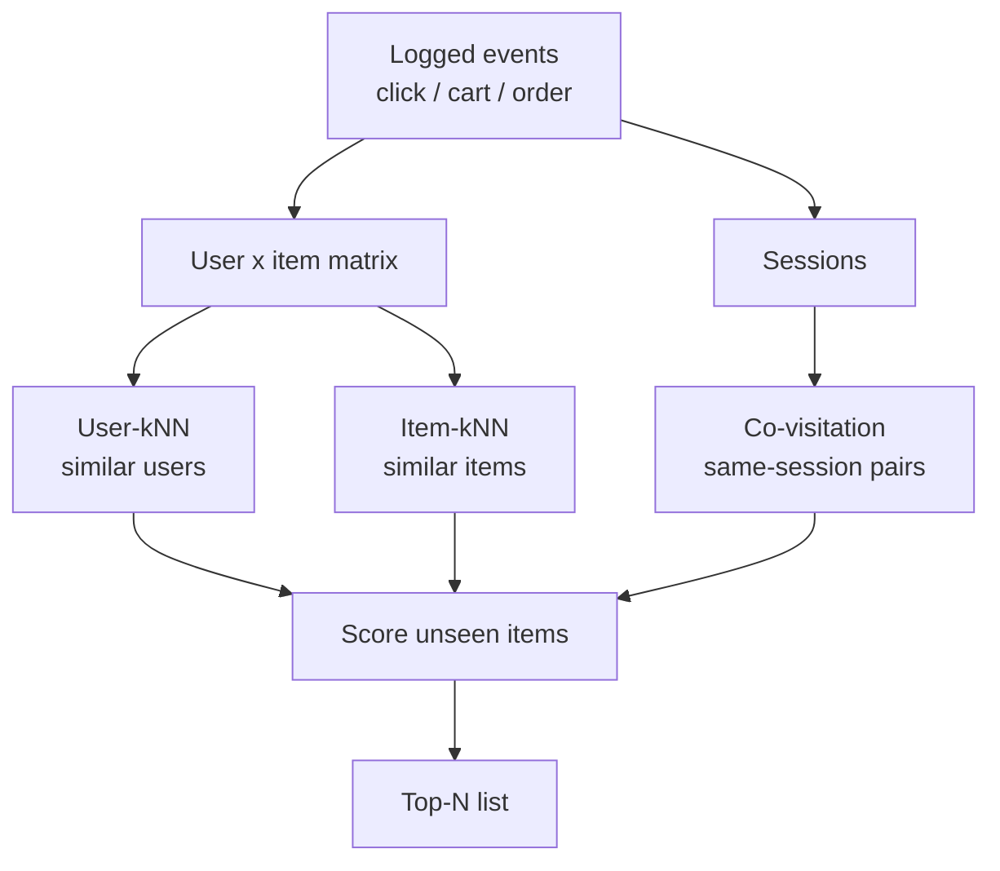

# Collaborative filtering

## Nobody wrote the word "coffee" on that card

It is a Tuesday evening and a buyer in Surabaya opens the product page of a coffee-and-tea gift set. Underneath the photo, a "Similar items" row fills with five other coffee and tea listings. Nobody wrote a rule saying "set X goes with sets Y and Z", and nobody labelled the products. The row is there because, over the last thirty days, many shoppers who looked at this product in the same browsing session also looked at those five.

That is the central trick of **collaborative filtering** (CF): *the crowd already did the labelling for you*. Every click, cart and order is a vote. If you never look at a single title, price or photo, but you know who touched what and when, you can still say a surprising amount about which items belong together and which people share tastes.

Chapter 4's content-based filtering needed text, categories and brands. Collaborative filtering looks only at the pattern of behaviour, so it connects items a content model never would, and fails in its own way when behaviour data is thin. We build four methods on the same simulated marketplace and evaluation as Chapter 3, so numbers compare directly with the **popularity baseline** (the simplest recommender: show everyone the items most clicked lately; any smarter method must beat it). The four are user-kNN, item-kNN, session co-visitation (what the app's "Similar items" row uses, and one of the repo's four **retrievers**, the cheap first-stage components that pull a few hundred plausible candidates out of thousands of items), and a look at scalability (what happens when the shop grows 1,000 times bigger).

**What you'll learn**

- How a user–item matrix is built from implicit events.
- User-kNN and item-kNN, with cosine and Jaccard worked out by hand.
- How the repo's `covisitation_matrix` works and why it normalises each row.
- How to read real results: ndcg, coverage and popularity padding.
- Why item-to-item designs scale.

### Words we will use

Four everyday words carry most of this chapter. Here they are in one place, with the shopper Sari and her cat-food shop as the running example.

| Word | Plain meaning | Example |
|---|---|---|
| **Event** | One logged action: a click, an add-to-cart, or an order. | Sari clicks a 2 kg bag of cat food. |
| **Implicit feedback** | Taste we *infer* from what people do, because nobody typed "I like this" or gave stars. | Ordering is a stronger "like" than a click. |
| **Session** | One sitting in the shop: a burst of events by one visitor, usually within minutes. | Sari compares three cat-food brands in one evening. |
| **Neighbour** | Something (a user or an item) whose behaviour pattern looks like another's. | Two shoppers who clicked almost the same items. |

Later we also use **ndcg**, **recall** and **coverage**. They are explained when we first read results, in "Reading the table".

## The intuition: asking people with similar taste

Think about picking a restaurant in a new city. You could read the menu (content-based), or ask a friend: "You liked that ramen place, what else should I try?" That needs no explanation of *why* you like it, only some overlap in visited places; the friend's *other* visits are the recommendations.

That is **user-based collaborative filtering**, the original form. It was the idea behind early Usenet recommenders in the 1990s (Usenet was an early internet discussion board where people read and posted articles), and it is easy to explain to a product manager: "customers like you also bought…".

Now flip the direction. Instead of asking which *people* are similar, ask which *items* are similar, where two items are similar if the same people interacted with both. If everyone who bought a French press also bought a bag of coarse-ground coffee, those two items are neighbours, even if their titles share no words. When a user shows interest in the French press, we look up its neighbours and offer the coffee. This is **item-based collaborative filtering**. The roles are swapped, and, as we will see, that swap is what makes it practical at scale.

The third variant changes what "together" means. In user-kNN and item-kNN, two items are connected if the same *person* touched both, possibly months apart. In **session co-visitation**, two items are connected only if they were touched during the same *browsing session*, typically within minutes of each other. That is a much sharper signal of "these two are being compared right now": a shopper choosing between three phone cases looks at all three in one sitting. A shopper who bought a phone case in March and a mug in April has told us almost nothing about whether cases and mugs relate.



*Figure: Three ways to turn the same event log into recommendations. The first two read the whole-history matrix; the third reads session boundaries.*

## The algorithm

### The interaction matrix

A **matrix** is just a table of numbers: one row per user, one column per item. We call it $R$. The cell $R_{ui}$ (row of user $u$, column of item $i$) says how strongly that user interacted with that item. A zero means "no recorded interaction".

Our logs are **implicit**: nobody rated anything with stars, so we turn event types into strengths. The repo does this with `schema.EVENT_WEIGHT`: a click counts 1, an add-to-cart 3 and an order 5. A cell is the sum over all of the user's events on that item. If you clicked an item twice and carted it once, $R_{ui} = 1 + 1 + 3 = 5$.

Here is a tiny matrix with Sari and two other shoppers, three items:

| | cat food | cat toy | phone case |
|---|---|---|---|
| Sari | 5 | 1 | 0 |
| Budi | 3 | 0 | 1 |
| Dewi | 0 | 0 | 5 |

Sari ordered cat food (5) and clicked a toy (1). Budi put cat food in his cart (3) and clicked a phone case (1). Dewi ordered a phone case. Read a **row** to see one person's taste; read a **column** to see who is interested in one item. User-kNN works with rows, item-kNN with columns.

Three properties matter:

- $R$ is **sparse**: almost all cells are zero, because a user touches a few dozen items out of thousands. In our data the real matrix has 1,408 users × 2,120 items and only 0.612% of cells are non-zero (see "Run it"). Sparse is why we store only the non-zero cells.
- $R$ is **non-negative**: a zero usually means "never saw it", not "dislikes it". A missing click is not a complaint.
- $R$ is **built at a cutoff**: we only count events before a frozen date, so the evaluation never sees the answers (Chapter 2).

### User-kNN

**User-kNN in one sentence:** find the shoppers whose history looks most like yours, then recommend what *they* liked and you have not seen. The name stands for *k nearest neighbours*: "the $k$ most similar users", where $k$ is a number we choose (say 50).

Think of asking a few friends with taste like yours for restaurant tips, and counting the closest friend's opinion more than a distant one's. That is the whole algorithm: *find similar people, weight their votes by how similar they are, add up*.

To make "similar" precise we need a number. The standard one is **cosine similarity**. Picture each user's row as a list of numbers. Cosine similarity asks: *do these two lists have the same proportions?* It ignores how much someone shops overall. A light shopper with a row $(1,1,0)$ and a heavy shopper with $(2,2,0)$ like the same things in the same proportions, so their cosine similarity is 1 (the maximum). Two shoppers with no item in common get 0. Without this "ignore the volume" property, heavy shoppers would look similar to everyone.

For a target user $u$:

1. Compute the similarity between $u$ and every other user $v$ with cosine similarity of their rows of $R$:

$$\operatorname{sim}(u,v) = \frac{\sum_i R_{ui}\,R_{vi}}{\sqrt{\sum_i R_{ui}^2}\;\sqrt{\sum_i R_{vi}^2}}$$

   In words: the top ($\sum_i$ means "add up over all items $i$") multiplies the two users' strengths item by item and adds them. Items only one of them touched contribute 0, so only shared items count. The bottom divides by the "length" of each row (square each number, add, take the square root), which removes the volume effect described above.

2. Keep the $k$ users with the highest similarity, excluding $u$ themselves. These are the neighbours $N_k(u)$.
3. Score each item by summing the neighbours' interaction strengths, weighted by how similar each neighbour is:

$$\hat r_{ui} = \sum_{v \in N_k(u)} \operatorname{sim}(u,v)\; R_{vi}$$

   Here $\hat r_{ui}$ ("r-hat") is the predicted score for user $u$ on item $i$, the sum runs over the neighbours $v$, and $R_{vi}$ is how strongly neighbour $v$ touched item $i$. A very similar neighbour's vote counts a lot; a barely similar one's counts little.

4. Remove items the user is not allowed to see (out of stock, already hidden) and return the top $N$ by score.

**A tiny worked example.** Three items $A, B, C$ and three existing users. The numbers in each row are $(R_{vA}, R_{vB}, R_{vC})$:

| user | A | B | C |
|---|---|---|---|
| $u_1$ | 1 | 1 | 0 |
| $u_2$ | 1 | 3 | 0 |
| $u_3$ | 0 | 1 | 1 |

A new target user $t$ has a click on $A$ and a heavier interaction with $C$, say $(1, 0, 2)$. We want to know whether to recommend $B$. First the similarities. Take $u_1 = (1,1,0)$ as a walk-through of the formula: the top is $1\cdot1 + 0\cdot1 + 2\cdot0 = 1$ (only item $A$ is shared). The length of $t$ is $\sqrt{1^2+0^2+2^2}=\sqrt5$ and the length of $u_1$ is $\sqrt{1+1+0}=\sqrt2$. Dividing gives:

- $\operatorname{sim}(t,u_1) = \frac{1\cdot1 + 0\cdot1 + 2\cdot 0}{\sqrt5\,\sqrt2} = \frac{1}{3.162} = 0.316$
- $\operatorname{sim}(t,u_2) = \frac{1\cdot1}{\sqrt5\,\sqrt{10}} = \frac{1}{7.071} = 0.141$
- $\operatorname{sim}(t,u_3) = \frac{2\cdot 1}{\sqrt5\,\sqrt2} = \frac{2}{3.162} = 0.632$

With $k=3$ all three are neighbours, and

$$\hat r_{tB} = 0.316\cdot 1 + 0.141\cdot 3 + 0.632\cdot 1 = 1.372$$

Item $B$ is the only item $t$ has not touched, so it is our recommendation. Check the sum in words: each neighbour's vote for $B$ (their $R_{vB}$: 1, 3 and 1) is multiplied by how similar they are to $t$ (0.316, 0.141 and 0.632), then added. Notice who contributed most: $u_3$, the neighbour who shares the order on $C$, has the largest similarity, so even though their evidence for $B$ is a single click, their vote adds 0.632. $u_2$ loves $B$ (strength 3) but looks quite different from $t$, so the vote is shrunk to $0.141 \times 3 = 0.423$. The ordered item dominates because weights enter the cosine too.

### Cosine versus Jaccard

Cosine uses the *strengths*. **Jaccard similarity** is a simpler alternative that throws strengths away and only asks *who showed up*: of everyone who touched either item, what fraction touched both? Think of two guest lists for two parties: the Jaccard score is the number of people invited to both, divided by the number invited to at least one.

$$J(X,Y) = \frac{|X \cap Y|}{|X \cup Y|}$$

Here $X$ and $Y$ are *sets* (a set is just a collection with no counts). For item similarity they are the users with any interaction; for user similarity they are the items. $X \cap Y$ ("intersection") means members of *both* sets; $X \cup Y$ ("union") means members of *either*; the bars $|\cdot|$ count the members. Take items $A$ and $B$ from the table above. The users who touched $A$ are $\{u_1,u_2\}$ and the users who touched $B$ are $\{u_1,u_2,u_3\}$. The intersection has 2 users and the union has 3, so $J(A,B)=2/3 = 0.667$. For $B$ and $C$: the intersection is $\{u_3\}$, the union is $\{u_1,u_2,u_3\}$, so $J(B,C) = 1/3 = 0.333$.

Jaccard suits genuinely binary signals ("in the same session or not"), and it protects against heavy users: someone who clicked an item 500 times counts the same as someone who clicked it once. Cosine is the better default when weights carry information, as ours do: an order is worth five clicks. Both are symmetric (the similarity of $A$ to $B$ equals that of $B$ to $A$) and blind to how popular an item is.

### Item-kNN

**Item-kNN in one sentence:** look at the items the user already touched, find the items that are most often touched by the *same people*, and recommend those. It is the same machinery as user-kNN, rotated by 90 degrees: compare columns instead of rows. Two items are neighbours if their columns look alike, meaning the same users interacted with both.

Think of a shop assistant who has noticed over the years that customers who buy a French press nearly always come back for coarse-ground coffee. She does not know anything about either product; she only remembers who bought what. When you pick up the press, she points to the coffee. Item-kNN *is* that memory, written as a table.

Define the similarity of items $i$ and $j$ as the cosine of their columns:

$$\operatorname{sim}(i,j) = \frac{\sum_u R_{ui}\,R_{uj}}{\sqrt{\sum_u R_{ui}^2}\;\sqrt{\sum_u R_{uj}^2}}$$

(same formula as before, but now the sum runs over *users* $u$ instead of items), and score a candidate item $i$ for user $u$ by summing its similarity to everything the user has touched, weighted by how strongly they touched it:

$$\hat r_{ui} = \sum_{j} \operatorname{sim}(i,j)\; R_{uj}$$

Here $j$ runs over the items the user has touched, $\operatorname{sim}(i,j)$ says how related the candidate $i$ is to each of them, and $R_{uj}$ says how much the user cares about each.

Using the same toy matrix, the columns over users $(u_1,u_2,u_3)$ are $A=(1,1,0)$, $B=(1,3,1)$ and $C=(0,0,1)$. Then:

- $\operatorname{sim}(A,B) = \frac{1+3}{\sqrt2\,\sqrt{11}} = \frac{4}{4.690} = 0.853$
- $\operatorname{sim}(B,C) = \frac{1}{\sqrt{11}\cdot 1} = 0.302$
- $\operatorname{sim}(A,C) = 0$, since nobody touched both.

For the target $t=(1,0,2)$ over $(A,B,C)$ the score for $B$ is $0.853\cdot 1 + 0.302\cdot 2 = 1.457$: the click on $A$ contributes $0.853 \times 1$ and the heavier interest in $C$ contributes $0.302 \times 2$. The shape of the computation differs from user-kNN: there you compare the target against every user at request time, whereas the item–item table does not depend on the target, so it is computed once ahead of time and a request is a lookup of the neighbours of the few items the user touched.

### Session co-visitation

**Co-visitation in one sentence:** count how often two items were looked at in the same *session*, and recommend items that often appear together with what you are looking at now. It drops the user as the unit of grouping and uses the session instead. Think of a shop assistant who tidies up at closing time and notes which products customers handled during the same visit; "co-visitation" is just "visited together".

Imagine three sessions about phone shopping, all just clicks: $S_1 = \{\text{case}, \text{phone}\}$, $S_2=\{\text{phone}, \text{charger}\}$, $S_3=\{\text{phone}, \text{cable}\}$. The phone appears next to three different things; the case appears only next to the phone. We want a rule that captures this, and the next steps build it.

The steps are:

1. Keep only positive events (click, cart, order) from a recent window (30 days in this repo), because old habits are weaker evidence.
2. Within each session, keep one weight per item: the strongest event that happened to it. Refreshing a page ten times should not count ten times.
3. For every *ordered* pair of different items $(a, b)$ that share a session ("ordered" means $(a,b)$ and $(b,a)$ are two separate pairs), add up $b$'s weight over all the sessions where both appeared.
4. **Normalise per source item**: divide so that the outgoing weights of every item $a$ sum to 1. In plain words: turn raw counts into *shares*, "of everything that gets looked at next to $a$, what share is $b$?":

$$w(a \to b) = \frac{\sum_{s \ni a,b} \omega_{s,b}}{\sum_{c \neq a}\sum_{s \ni a,c} \omega_{s,c}}$$

Symbols: $s$ is a session; $s \ni a,b$ means "sessions that contain both $a$ and $b$"; $\omega_{s,b}$ ("omega") is the strength of item $b$ in session $s$ (1 click, 3 cart, 5 order); $c$ is any other item. The top is $b$'s total weight next to $a$; the bottom is the total over *all* items next to $a$.

**Worked example.** Three sessions: $S_1$ has a click on $A$ and a click on $B$; $S_2$ has a click on $A$, an add-to-cart on $B$ and a click on $C$; $S_3$ has a click on $A$ and a click on $C$. Look at the row for $A$. The raw sum for $B$ is $1 + 3 = 4$ (a click in $S_1$, a cart in $S_2$). The raw sum for $C$ is $1 + 1 = 2$. The total is 6, so $w(A\to B) = 4/6 = 0.667$ and $w(A \to C) = 2/6 = 0.333$.

**Why normalise per source?** Without it, a very popular item $a$ would have large raw counts to everything and would swamp the rankings. Dividing makes every row sum to 1, so every item gets the same "budget of attention" to split among its neighbours. It also makes the matrix **asymmetric** ($w(a\to b) \neq w(b\to a)$). Check it on the phone sessions: the case's row has only the phone, so $w(\text{case}\to\text{phone}) = 1$. The phone's row splits among three items, so $w(\text{phone}\to\text{case}) = 1/3 = 0.333$. That matches life: people who view a phone case nearly always also view a phone, but people who view a phone mostly do not look at that case.

To personalise, take the user's most recent items as **seeds** (starting points: "what has this person been looking at lately?"), each with a **recency score** from a time-decayed sum. Decay means older events count less; with a *half-life* of 7 days, an event loses half its weight every 7 days (the same decay as Chapter 3). The score of a candidate $b$ is $\sum_{a \in \text{seeds}} \text{recent}(u,a)\cdot w(a\to b)$: for each seed, multiply its recency score by the seed's weight toward $b$, then add up over the seeds. If a user's seed $A$ has recency score 0.8, then in the toy example $B$ gets $0.8 \times 0.667 = 0.533$ and $C$ gets $0.8\times0.333=0.267$.

::: fact
**Did you know?** In 2003 Amazon engineers Greg Linden, Brent Smith and Jeremy York described the item-to-item collaborative filtering algorithm behind Amazon.com's recommendations: instead of comparing a customer with millions of other customers, they compare *items*, and they build the expensive similar-items table offline. The online step then only looks up similar items for the titles the user has purchased or rated, so it scales independently of catalogue size and of the number of customers. The paper contrasts this with traditional collaborative filtering, whose online computation grows with both.

Source: Linden et al., IEEE Internet Computing, 2003
:::

::: fact
**Did you know?** The word "collaborative" in collaborative filtering goes back to 1994. The GroupLens project (Resnick and colleagues at MIT and the University of Minnesota) built a system that predicted how much readers would like Usenet netnews articles, based on the heuristic that people who agreed in the past will probably agree again. Users entered ratings, rating servers called "Better Bit Bureaus" correlated them, and the predicted scores were displayed in the news reader. That is user-kNN in its original habitat.

Source: Resnick et al., CSCW, 1994
:::

::: fact
**Did you know?** The user-based approach was the default for years, but in 2001 Sarwar, Karypis, Konstan and Riedl compared it to item-based methods and reported that item-based algorithms provided dramatically better performance than user-based algorithms, while also providing better quality than the best available user-based algorithms (on the data sets they tested). That paper helped move the field's attention from "similar users" to "similar items".

Source: Sarwar et al., WWW, 2001
:::

## Code walkthrough

All numbers in this chapter come from `book/code/ch05_cf.py`. It uses the shared setup from `book/code/common.py`: the same simulated data, the same cutoff, the same evaluation. First the matrix. The helper turns the positive events from the history into a **sparse matrix** (a format that stores only the non-zero cells and their positions, instead of millions of zeros) of user × item values, each the sum of `EVENT_WEIGHT`s:

```include
path: book/code/common.py
symbol: interaction_matrix
```

`pos["w"]` is the per-event weight (1, 3 or 5). The `groupby` is the "sum all events of the same user and item" step from the algorithm section, and the `csr_matrix` constructor (CSR = *compressed sparse row*, one particular sparse format) places each sum at the right row and column. The two `pd.Index` objects are translation tables between real user and item ids (which can be any numbers) and matrix positions (0, 1, 2, …).

For cosine we need unit-length rows. "Unit length" means we divide each row by its own length so that the length becomes 1; for example the row $(3,4)$ has length $\sqrt{9+16}=5$, so it becomes $(0.6, 0.8)$. The cosine of two such rows is then just their **dot product** (multiply matching entries, add them up), which is much cheaper than the full formula:

```include
path: book/code/ch05_cf.py
symbol: row_normalise
```

The `np.maximum(norm, 1e-12)` guards against dividing by zero for users or items whose row is empty (an all-zero row has length 0). After this, "similarity of everyone to everyone" becomes a single **matrix product**, a standard operation computers do very fast: entry $(u,v)$ of the result is the dot product of the row of $u$ with the row of $v$.

### User-kNN, step by step

The following excerpts from `main()` are the entire user-kNN model. The variable `R` is the dense user × item matrix and `R_eval` the rows of the evaluation users:

```include
path: book/code/ch05_cf.py
region: user_knn_sim
```

Then, inside the loop over $k$:

```include
path: book/code/ch05_cf.py
region: user_knn_topk
```

Read it as the four algorithm steps. The matrix product computes all cosines at once. `argpartition` finds the indices of the $k$ largest similarities per row *without* sorting the entire row (it is linear, not $n \log n$: to find the top 50 of 1,408 you do not need to order all 1,408). The next two lines build a matrix `w` that holds the similarity at the neighbour positions and zero elsewhere. And `w @ R` is exactly the formula $\hat r_{ui} = \sum_{v\in N_k(u)} \operatorname{sim}(u,v) R_{vi}$ for all users and items in one go: `@` is matrix multiplication, which performs "multiply each neighbour's row by their weight and add them" for every user. The script also sets the diagonal entry of each evaluation user to zero. The diagonal is each user's similarity to *themselves*, which is always the maximum, 1; leaving it in would make every user their own nearest neighbour and "recommend" their own history to themselves, which scores beautifully and means nothing.

### Item-kNN, step by step

Item-kNN is shorter because the heavy lifting is the same product, applied to columns:

```include
path: book/code/ch05_cf.py
region: item_knn_sim
```

and the scoring line:

```include
path: book/code/ch05_cf.py
region: item_knn_score
```

`R.T` swaps rows and columns (the *transpose*), so `Cn @ Cn.T` is the item–item cosine table `S` (all 2,120 × 2,120 pairs), with the diagonal zeroed so no item is its own neighbour. The scoring line applies the formula $\hat r_{ui} = \sum_j \operatorname{sim}(i,j) R_{uj}$ to every user at once. This table is **dense** (every pair stored, even if similarity is 0), fine for our small shop. Production never materialises a dense table like this (see scalability).

### The repo's co-visitation matrix

Now the piece that runs inside the real system. The function lives in `recommender/recsys/candidates.py`:

```include
path: recommender/recsys/candidates.py
symbol: covisitation_matrix
```

Walk through it line by line. `hist.interactions()` returns the positive events (click, cart, order) with their weights `w` and their age in days. The next line keeps only events newer than `COVISIT_WINDOW_DAYS` (30). Taking `["w"].max()` per `(session_id, item_id)` collapses repeated actions on the same item within a session into the single strongest one, so a shopper who refreshed the page ten times does not count ten times. The next step is a **self-join**: the table of events is joined to *itself* on `session_id`, which pairs every event in a session with every other event of the same session. This is how "all pairs of items in one session" are made; the `!=` filter removes the trivial pairs of an item with itself. Summing `w_b` per ordered pair gives the raw co-occurrence mass (the 4 and 2 from the worked example), and the final `transform("sum")` computes each source item's total outgoing mass and divides by it (turning 4 and 2 into 0.667 and 0.333), which is the normalisation from the algorithm section.

The self-join is the cost driver: a session with $n$ items produces $n(n-1)$ rows (each of the $n$ items pairs with the other $n-1$), so a bot with 5,000 items in one session would produce about twenty-five million.

Turning the matrix into per-user candidates is the job of `covisit`:

```include
path: recommender/recsys/candidates.py
symbol: covisit
```

`top_seeds` picks each user's ten most relevant recent items (`N_SEEDS`). The merge pairs every seed with its outgoing row of the matrix (the same "look up the neighbours" step as in the toy example), the product `cand_recent_score * w` weights each suggestion by how much the seed matters to the user (the $0.8 \times 0.667$ step), and the group-by sums contributions when several seeds point to the same candidate. Finally `_top_per_user` keeps the best 40 (`N_COVISIT`). Two seeds pointing at the same candidate reinforce each other, which is the right behaviour: an item co-visited with *both* of the things you looked at is a better bet than one co-visited with only one.

The seeds come from `recent`, which weights each event by `_decay`: an event $t$ days old counts $0.5^{t/7}$ of a fresh one (Chapter 3). A 7-day-old event counts $0.5^1 = 0.5$, a 14-day-old one $0.5^2 = 0.25$.

### Where the product page gets its row

The "Similar items" row from the opening story is not a different algorithm. The gRPC method `SimilarItems` calls `pipeline.similar_items`, which reads one row of the same co-visitation matrix:

```include
path: recommender/recsys/pipeline.py
symbol: similar_items
```

The first half builds the co-visitation row for the page's item: rows where `item_id_a == item_id`, restricted to in-stock items, sorted by weight. The second half is a **fallback** for rarely seen items (a plan B used when the main method has too little data): if co-visitation produces fewer than `k` neighbours, fill the remaining slots with the most popular in-stock items of the *same category*. The result carries a `source` label (`covisit` or `same_category`) so that the frontend and the log can tell which mechanism produced each card.


## Run it

From the `book/` directory:

```bash
uv run python code/ch05_cf.py
```

The setup:

```output
file: results/ch05_cf.txt
lines: 2-5
```

Next, the user-kNN sweep over the neighbourhood size $k$, with an example of what a neighbourhood looks like:

```output
file: results/ch05_cf.txt
lines: 7-13
```

Item-kNN, with the nearest items of one concrete item:

```output
file: results/ch05_cf.txt
lines: 15-20
```

Co-visitation, and how much popularity padding each method needed:

```output
file: results/ch05_cf.txt
lines: 22-29
```

Finally the summary table, evaluated on the top 50 per user:

```output
file: results/ch05_cf.txt
lines: 31-37
```

## Results

The headline picture: every collaborative method beats the popularity baseline by a wide margin. Before reading numbers, a quick reminder of the three metrics (Chapter 3 has the full story). Each recommender produces a top-20 list per shopper; we then look at what the shopper *really* did after the cutoff.

- **recall@20**: of the items the shopper later interacted with, what fraction appeared in our top 20? Missing nothing = 1, missing everything = 0. (Imagine 4 true items; we caught 1 of them: recall 0.25.)
- **ndcg@20**: like recall, but it also rewards putting the right item *near the top*. A hit at rank 1 is worth more than a hit at rank 20. Scale 0 to 1, higher is better.
- **coverage@20**: what share of the catalogue appears in anyone's list. Low coverage means the same few items go to everybody.


### Reading the table

The baseline `pop_7d` (recommend the most popular items of the last 7 days to everyone) gets ndcg@20 of 0.0475 and recall@20 of 0.0786; its coverage@20 of 0.0087 means only about twenty distinct items out of 2,311 ever appear. User-kNN lifts ndcg@20 to 0.1662, about three and a half times the baseline. Even the weakest method, item-kNN at 0.0925, nearly doubles it.

**User-kNN wins on ndcg.** With 50 neighbours it reaches 0.1662 ndcg@20 and 0.3456 order_recall@20 (recall on orders only, the strongest signal). The sweep shows diminishing returns: more neighbours help, but each extra batch helps less; from 10 to 100 neighbours ndcg@20 climbs from 0.1456 to 0.1702. In the simulator tastes follow category preference, so users with overlapping histories do share what they do next. With only 1,408 users, scanning all of them is cheap, so this experiment hides what makes user-kNN painful at scale. (We use a fixed $k=50$; tuning $k$ on the evaluation users would be mild **leakage**, meaning information from the test sneaks into the choices we make, which makes the score look better than it would on new data.)

**Item-kNN is weaker on ranking, stronger on breadth.** Its ndcg@20 is 0.0925, but its coverage@20 is 0.8399 against user-kNN's 0.4158: item-kNN spreads its recommendations over a very large part of the catalogue. That is partly good (long-tail exposure, Chapter 1: giving rarely clicked items a chance) and partly a symptom of noise, as the example shows:

The nearest items to item 1769, 'Sakura Earphones Original', include 'Volt Instant Noodles Lokal' at cosine 0.538. Earphones and noodles are unrelated; both items have few interactions and a couple of users happened to touch both. When an item has only two or three fans, a single shared fan makes the cosine look high: a weak coincidence looks like a strong link. The mean non-zero similarity is just 0.0772 but the maximum is 1.000, almost certainly two items touched by one and the same user. Production item-kNN therefore applies **support thresholds** or **shrinkage**. A support threshold ignores pairs with too few common users (for example, fewer than 5). Shrinkage multiplies the similarity by $n_{ij}/(n_{ij}+\lambda)$, where $n_{ij}$ is the number of users who touched both items and $\lambda$ ("lambda") is a constant you choose. With an illustrative $\lambda=4$, a pair backed by one shared user is multiplied by $1/5 = 0.2$ (cut by 80%), whereas a pair backed by 20 shared users is multiplied by $20/24 = 0.83$ (barely changed). Weak evidence is shrunk toward zero; strong evidence survives.

**Co-visitation sits in the middle on ndcg and wins on one metric.** It reaches 0.1197 ndcg@20, but its recall@50 is 0.3220, the highest of any method in the table (user-kNN has 0.3163). That is the pattern you want from a *retriever*: it may not order its top 5 as well as the best method, but a wider list catches slightly more of what the user eventually wants. Its recall@5 is 0.0795 against 0.1230 for user-kNN, which is exactly the ordering weakness. In the production pipeline the ordering is the **ranker's** job (a second-stage model that re-orders the retrievers' candidates); the retriever just needs to bring the right items to the table. Chapter 8 measures this on all four retrievers.

### Padding: the honest part

**Padding** means filling empty slots in a list with something safe, here the 7-day popularity list, when the model has nothing to say. It happens for users with no history before the cutoff (the model has no row to compare) or too little. Reporting how much padding each method needed keeps the comparison honest: a method that quietly leaned on popularity for 40% of its slots would look better than it is. The padding lines tell you how often a method had nothing to say:

- user-kNN and item-kNN each had 29 evaluation users without any model score (essentially the users with no usable history before the cutoff), plus one partially padded user, and 3.1% of all slots were filled with the 7-day popularity list.
- Co-visitation had 30 users with no score and 117 who were partially padded, so 8.6% of the slots came from the popularity fallback.

Co-visitation pads more because it needs a user's *recent* items to have been co-visited inside the 30-day window: high precision, low per-user coverage. The repo never uses it alone; `trending` and `catpop` cover the gaps and the ranker sees all four scores.

## Pitfalls and how it is done in production

### Scalability: why item-to-item won

Count what each approach does at request time (**online**, while the shopper waits, as opposed to **offline**, a batch job run beforehand). User-kNN must compare the target to all $U$ users: on the order of $U \times I$ operations for dense vectors (users times items), or more carefully $U$ sparse dot products. With 1,408 users that takes milliseconds. With tens of millions of users it is impossible per request, and the common workarounds (sampling users, clustering them, reducing dimensions) all give up quality.

Item-kNN moves the expense offline. The item–item table is computed in a **batch job** (a program that runs on a schedule, for example nightly, with nobody waiting) and stored as a map from each item to its top-$m$ neighbours (typically 50–200). At request time the system looks up the neighbour lists of the few items in the user's history and merges them. The work depends on the number of items the *user* touched, not on the catalogue or the user base. This is the property the Amazon paper highlights, and it is why so much of industry lives with "also viewed" tables.

The offline computation still needs care: you exploit sparsity (only pairs with a common user matter), cap history per user and sample blockbuster items. In our dense script the table is 2,120 × 2,120; with ten million items it would be a hundred trillion cells ($10^7 \times 10^7 = 10^{14}$), so production stores a sparse top-$m$ list.

Co-visitation has the same shape, and the repo stores only pairs that actually occurred: 13,632 of them, as the output above shows. The cost driver, as mentioned, is the session self-join. In production you would cap items per session (say, the most recent 50) and window the data, which the repo does with `COVISIT_WINDOW_DAYS`.

### Popularity bias and gray sheep

Popular items appear in many neighbour lists, get recommended more, and collect more clicks, which makes them appear even more (a feedback loop called **popularity bias**); normalisation damps this but does not remove it (Chapter 12). Users whose taste overlaps with nobody (the **gray sheep**, a user with unusual taste who matches no group) get weak neighbourhood signals, and popularity padding takes over.

### Evaluation traps

- **Self-similarity.** Forgetting to remove the user's own row from their neighbour list makes the model recommend the user's own history: excellent numbers, worthless model.
- **Tuning on the test users.** The neighbourhood size $k$, the shrinkage constant and the number of seeds should be tuned on a **validation window** (a separate slice of time held out just for choosing settings) before the evaluation window, so the final test stays untouched.
- **Cold start.** A *new* item has no column in $R$ and no session pairs, and a new user has an empty row, so CF has nothing to say (Chapter 12). This is why the repo combines four retrievers.

### What production systems actually do

Few large systems run pure user-kNN. Co-visitation or item-to-item tables, plus learned **embeddings** (compact number-lists that represent users and items; Chapters 6 and 7), act as cheap high-recall **retrievers** ("recall" here means they rarely miss good items); a learned ranker orders the union (Chapters 9 and 10). Here `cand_covisit_score` is one of the ranker's input columns.

::: tip
When you build a co-visitation table for real traffic, keep the raw counts and the normalised weights as separate columns. Normalised weights are what you rank by, but a pair with a weight of 0.5 backed by two sessions is far less trustworthy than one backed by two thousand. A minimum-count threshold, applied before normalisation, is the cheapest quality upgrade you can make.
:::

::: try
Open `book/code/ch05_cf.py`, find the line `for k in (10, 25, 50, 100):` and change the neighbourhood sizes. Re-run it and look at the ndcg@20 column. How far can you push $k$ before the curve stops improving? See Quiz question Q5.10 for the full exercise.
:::

## Summary

- Collaborative filtering recommends from behaviour alone, so it connects items a content model would not; zeros in the implicit matrix mean "unseen", not "disliked".
- User-kNN uses the similarity-weighted votes of the $k$ nearest users; item-kNN uses similarity to items the user touched; both rest on cosine (or Jaccard for binary signals).
- All three beat 7-day popularity (ndcg@20 0.0475): user-kNN 0.1662, co-visitation 0.1197, item-kNN 0.0925. Item-kNN has the broadest coverage (0.8399) but noisy similarities where few users overlap.
- Session co-visitation is item-to-item CF with sessions as the grouping unit; the repo normalises each source item's outgoing weights to sum to 1, which damps popular items and makes the matrix asymmetric.
- Co-visitation has the best recall@50 of all methods in the table (0.3220), which is what a retriever needs, but leans on popularity padding for users with little recent history (8.6% of slots).
- Item-to-item designs scale because the expensive table is computed offline and the online step depends only on the size of one user's history.
- In production, collaborative signals are retrievers and ranker features, not the final word on ordering.

## Quiz

**Q5.1** In user-based collaborative filtering, which assumption does the recommendation rest on?

A. Items with similar titles are liked by the same people.
B. Users who interacted with many of the same items in the past will probably like similar items in the future.
C. Popular items are always better than unpopular ones.
D. A user's taste does not change over time.

**Q5.2** Why does the Amazon-style item-to-item design scale to catalogues and customer bases of tens of millions, while classic user-kNN does not?

A. It uses a more accurate similarity measure.
B. It needs no interaction data at all.
C. It precomputes the expensive similar-items table offline, so the online lookup depends only on the number of items in the user's history.
D. It stores a full dense user × item matrix in memory for fast access.

**Q5.3** Which situation is the best fit for Jaccard similarity rather than cosine similarity on the raw weighted matrix?

A. The matrix cells hold carefully tuned weights where an order is worth five clicks and you want them to matter.
B. The signal is binary (a pair is "in the same session" or not) and heavy users should not dominate through large counts.
C. You want a similarity that is not symmetric.
D. You need to compare vectors of different dimensions.

**Q5.4** Explain in two or three sentences why `covisitation_matrix` divides each pair's weight by the total outgoing weight of the source item. What would happen to the candidate lists if it did not?

**Q5.5** In the results, item-kNN's closest items to 'Sakura Earphones Original' include noodles. Give the likely cause and name one fix that production systems use.

**Q5.6** (Code reading.) In `covisitation_matrix`, the line `per_session = pos.groupby(["session_id", "item_id"], as_index=False)["w"].max()` is executed before the self-merge. What does it do, and what would change if `.max()` were replaced by `.sum()`?

**Q5.7** (Numeric.) Item $X$ was touched by three users with strengths $(2, 0, 1)$ over users $(u_1,u_2,u_3)$; item $Y$ with strengths $(1, 1, 0)$. Compute the cosine similarity of $X$ and $Y$, and the Jaccard similarity of the sets of users who touched them. Give both to three decimal places.

**Q5.8** (Numeric.) A user has two seed items. Seed $A$ has recency score 0.5 and seed $E$ has recency score 1.0. In the co-visitation matrix, $w(A \to C) = 0.3$ and $w(E \to C) = 0.4$. What is the candidate score of item $C$ for this user, using the formula in `covisit`?

**Q5.9** Based on the results table, which statement is correct?

A. user_knn has the highest ndcg@20 and also the highest coverage@20.
B. item_knn has the highest coverage@20, but lower ndcg@20 than both user_knn and covisit.
C. covisit has the highest recall@5.
D. pop_7d beats item_knn on ndcg@20.

**Q5.10** (Hands-on.) In `book/code/ch05_cf.py`, change the neighbourhood sweep `for k in (10, 25, 50, 100):` to `for k in (50, 100, 200, 400):` and run the script from a scratch copy (so you do not overwrite the committed results). Compare the ndcg@20 and recall@20 printed for each $k$. What do you observe about the effect of increasing $k$ beyond 100, and why?
