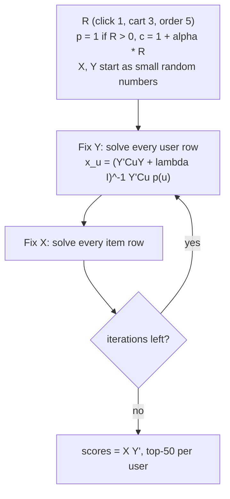

# Matrix factorisation

## The shopper nobody resembles

Rina has clicked a ceramic pour-over set, a hand grinder and paper filters, plus, on a slow Tuesday, wired earphones. The user-based recommender from the previous chapter looks for neighbours who clicked the *same* items, and in a catalogue of two thousand products almost nobody did. This is the sparsity problem of Chapter 1: neighbourhood methods compare raw rows of an almost empty matrix, so two shoppers with the same taste but no shared SKU have cosine zero.

Matrix factorisation asks instead: *what small set of hidden tastes could explain all these clicks at once?* Each shopper becomes a short vector of taste strengths, each product a short vector of "how much of each taste I contain", and a pair's score is their dot product. We build it in plain numpy so nothing hides behind a library call.

**What you'll learn**

- What a *latent factor* is, and why compressing a giant sparse matrix into two thin matrices produces useful recommendations.
- How the classic explicit-rating factorisation (the one that powered the Netflix Prize era) is trained with stochastic gradient descent, and why it is a poor fit for clicks.
- How implicit-feedback ALS reframes clicks as *preference plus confidence*, and how to derive its closed-form per-row solve from scratch.
- How BPR optimises ranking directly with a pairwise loss, with its gradient worked out by hand.
- How to read the loss curves, tune `factors`, `reg`, `alpha`, `lr`, and compare both models against the baselines from Chapters 3 and 5 on exactly the same labels.

## Intuition: the taste dimensions nobody wrote down

Imagine describing your regulars to a new barista. You would not hand over a spreadsheet with a tick per menu item; you would say "Dewi likes strong and black, Bayu likes sweet and milky". A few phrases summarise hundreds of purchases and *predict* behaviour.

Matrix factorisation automates exactly that summarising step. Those phrases ("strong-and-black", "sweet and milky") are the **latent factors**: dimensions of taste that nobody labelled in advance, discovered because they make the purchase data easier to explain. The word *latent* just means hidden. The algorithm does not know what a factor means; it only knows that giving every user a value on factor 1 and every item a value on factor 1 lets it reconstruct the click matrix better.

A toy example makes the mechanics concrete. Suppose there are only two factors, and by luck we can name them: factor A is "gadget-ness" and factor B is "kitchen-and-food-ness". Every product has a value on each factor, and so does every shopper:

| | factor A (gadget) | factor B (kitchen) |
|---|---|---|
| **Items** | | |
| wired earphones | 1.0 | 0.0 |
| power bank | 0.9 | 0.1 |
| instant noodles | 0.0 | 1.0 |
| coffee grinder | 0.4 | 0.8 |
| **Users** | | |
| Gadget lover | 1.2 | 0.2 |
| Foodie | 0.1 | 1.1 |

The score is the dot product: for the gadget lover and the earphones, $1.2 \times 1.0 + 0.2 \times 0.0 = 1.20$; for the foodie and the noodles, $0.1 \times 0.0 + 1.1 \times 1.0 = 1.10$. Ranked, the gadget lover gets earphones (1.20), power bank (1.10), coffee grinder (0.64), noodles (0.20); the foodie gets noodles, grinder, power bank. The grinder is a *bridge* with a bit of both tastes, which a neighbourhood method cannot express. The foodie also never needs to click the *same* noodles as anyone else: clicks on peanuts, cooking oil and a rice cooker land the vector near $(0.1, 1.1)$, so every item with a large factor B scores high. The unit of transfer is the factor, not the product.

The second idea is **low rank**. A click matrix with $m$ users and $n$ items has $m \times n$ cells. A factorisation with $f$ factors replaces it with two matrices that hold only $(m + n) \times f$ numbers. In this chapter's data that is the difference between roughly three million cells ($1408 \times 2120 = 2{,}984{,}960$) and $(1408 + 2120) \times 32 = 112{,}896$ parameters. Squeezing that much information through a narrow bottleneck *forces* the model to find the regularities in the data, which is why compression and generalisation are, here, the same thing.

## The algorithm

We will walk through three models in increasing order of relevance to this repository: classic explicit factorisation (to see the shape of the idea), implicit ALS (the workhorse for click data), and BPR (the ranking-aware alternative).

### Step zero: set up the notation

Let $R$ be the $m \times n$ matrix of interactions. In our book $R_{ui}$ is the summed event weight of user $u$ on item $i$: a click counts 1, an add-to-cart 3 and an order 5, which is `schema.EVENT_WEIGHT` from Chapter 1, so a user who clicked and then bought has $R_{ui} = 6$. Cells with no interaction are zero, but, as we will see, *zero does not mean dislike*.

The model assigns every user a vector $x_u \in \mathbb{R}^f$ and every item a vector $y_i \in \mathbb{R}^f$, stored as rows of two matrices $X$ (users by factors) and $Y$ (items by factors). The predicted score is

$$\hat{r}_{ui} = x_u \cdot y_i = \sum_{k=1}^{f} x_{uk}\, y_{ik}.$$

Training means choosing $X$ and $Y$. The three methods differ only in *what loss they minimise*.

### Explicit factorisation and Funk's SGD

Suppose, for a moment, that we had star ratings, the setting of the Netflix Prize. Only the cells in the observed set $\mathcal{K}$ carry information, and we want predictions that match them while keeping the vectors small, to avoid memorising noise:

$$\mathcal{L} = \sum_{(u,i) \in \mathcal{K}} \left( r_{ui} - x_u \cdot y_i \right)^2 + \lambda \left( \lVert x_u \rVert^2 + \lVert y_i \rVert^2 \right).$$

Write the prediction error $e_{ui} = r_{ui} - x_u \cdot y_i$. Differentiating one term with respect to $x_u$ gives $-2\, e_{ui}\, y_i + 2\lambda x_u$, and similarly for $y_i$. Folding the constant 2 into the learning rate $\gamma$, one step of stochastic gradient descent on one observed rating is:

$$x_u \leftarrow x_u + \gamma \left( e_{ui}\, y_i - \lambda x_u \right), \qquad y_i \leftarrow y_i + \gamma \left( e_{ui}\, x_u - \lambda y_i \right).$$

Notice how sensible this update is. If the model under-predicts ($e_{ui} > 0$), the user vector moves *toward* the item vector and the item vector toward the user vector, so their dot product grows. If it over-predicts, they move apart.

**Worked example 1: one SGD step.** Let $x_u = (2.0, 1.0)$, $y_i = (1.5, 0.5)$, $r_{ui} = 5$, $\gamma = 0.05$, $\lambda = 0$. The prediction is $3.5$, so $e = 1.5$. Then $x_u' = (2.1125, 1.0375)$ and, using the old $x_u$, $y_i' = (1.65, 0.575)$. The new prediction is $2.1125 \times 1.65 + 1.0375 \times 0.575 \approx 4.08$. The error shrank from 1.5 to about 0.92 in a single step. Repeat that for millions of observed ratings, several times over, and the vectors settle. This is essentially the procedure that Simon Funk published during the Netflix Prize, and it is the reason you will hear the method called "Funk SVD", although it is not a true singular value decomposition: a true SVD needs every cell present, and here we deliberately ignore the empty ones.

::: fact
**Skipping the empty cells.** When Simon Funk described his approach in December 2006, the Netflix training data was a matrix of roughly 500,000 users by 17,000 movies, about 8.5 billion cells, of which only one in eighty-five held a rating. His key trick was to skip the empty cells entirely and run gradient descent on the observed ones, which let a laptop make a full training pass over 100 million ratings in seconds.

Source: Funk, "Netflix Update: Try This at Home" (sifter.org blog), 2006
:::

### Why explicit factorisation is a poor fit for clicks

Implicit feedback has **no observed negatives**: if Rina did not click the gaming mouse, she may dislike it or may never have seen it. Fitting only nonzero cells lets predictions drift upward; treating zeros as ratings of 0 claims most of the catalogue is hated. And the numbers mean something else: a weight of 6 (click plus order) expresses *confidence*, not the size of a preference.

Hu, Koren and Volinsky resolved both problems with one reframing. Split every cell into two quantities:

- A binary **preference** $p_{ui} = 1$ if $R_{ui} > 0$, and $0$ otherwise.
- A **confidence** $c_{ui} = 1 + \alpha R_{ui}$.

The preference answers "did this user show any interest?". The confidence answers "how much should the loss care about getting this cell right?". Observed cells with a lot of evidence get large confidence; unobserved cells keep the floor value $c = 1$: we still *weakly* believe they are zeros, because on a huge catalogue most unseen things really are uninteresting, but we believe it far less than we believe a purchase.

The new loss runs over **all** $m \times n$ cells:

$$\mathcal{L}_{\text{ALS}} = \sum_{u,i} c_{ui} \left( p_{ui} - x_u \cdot y_i \right)^2 + \lambda \left( \sum_u \lVert x_u \rVert^2 + \sum_i \lVert y_i \rVert^2 \right).$$

Because it sums over every cell, SGD would have to touch three million terms per epoch even though only 18,256 are non-trivial. The trick of the next section is that a different optimiser can exploit exactly that imbalance.

::: fact
**A confidence-weighted factor model with a linear-time solver.** Hu, Koren and Volinsky's ICDM 2008 paper proposed treating implicit data as indications of positive and negative preference "associated with vastly varying confidence levels", together with an optimisation procedure whose cost scales linearly with the size of the data. They applied it to a recommender for television shows.

Source: Hu et al., ICDM, 2008
:::

### ALS: deriving the closed-form solve

The loss $\mathcal{L}_{\text{ALS}}$ is not convex in $(X, Y)$ jointly, because it contains the product $x_u \cdot y_i$. But fix one side and it becomes a perfectly ordinary weighted least-squares problem in the other. That observation gives the algorithm its name: **alternating least squares**. Hold $Y$ fixed and solve for every user vector exactly; then hold $X$ fixed and solve for every item vector exactly; repeat.

Take a single user $u$ with $Y$ fixed. The only terms that involve $x_u$ are

$$J(x_u) = \sum_{i} c_{ui} \left( p_{ui} - x_u \cdot y_i \right)^2 + \lambda \lVert x_u \rVert^2 .$$

Set the gradient to zero:

$$\frac{\partial J}{\partial x_u} = -2 \sum_i c_{ui} \left( p_{ui} - x_u \cdot y_i \right) y_i + 2\lambda x_u = 0 .$$

Expand $x_u \cdot y_i = y_i^{\top} x_u$ and gather the terms that contain $x_u$:

$$\Bigl( \sum_i c_{ui}\, y_i y_i^{\top} + \lambda I \Bigr) x_u = \sum_i c_{ui}\, p_{ui}\, y_i .$$

In matrix form, with $C^u$ the diagonal matrix of user $u$'s confidences over all items, and $p(u)$ the vector of their preferences:

$$\boxed{\; x_u = \left( Y^{\top} C^u Y + \lambda I \right)^{-1} Y^{\top} C^u\, p(u) \;}$$

This is the closed-form solve. The matrix in brackets is $f \times f$, symmetric and, thanks to $\lambda I$, positive definite, so the solution is unique and each such solve can only *decrease* the loss, never increase it. That is why the training curve we will see later falls monotonically with no learning-rate tuning at all. Item vectors follow by symmetry: swap the roles of users and items and use the columns of $C$ and $P$.

#### The Gram-matrix trick

Computing $Y^{\top} C^u Y$ naively costs $O(f^2 n)$ per user, since $C^u$ has $n$ diagonal entries. With $n = 2120$ items and 1408 users that is a lot of wasted work, because almost all of those entries equal 1. Hu et al. split the matrix:

$$Y^{\top} C^u Y = Y^{\top} Y + Y^{\top} \left( C^u - I \right) Y .$$

The first term, the **Gram matrix** $Y^{\top}Y$, does not depend on the user, so it is computed once per sweep. The second term has non-zero entries only for the $n_u$ items the user actually touched (where $c_{ui} - 1 = \alpha R_{ui} > 0$), so it costs $O(f^2 n_u)$. Likewise the right-hand side collapses to a sum over the user's touched items because $p_{ui} = 0$ elsewhere. The total cost of a sweep is therefore proportional to the number of *observed* cells, not to $m \times n$, which is what makes ALS practical on real data.

**Worked example 2: one ALS solve by hand.** Take $f = 1$ factor, item factors $y = (1, 2, 3)$, a user who touched items 1 and 2 with $R = (1, 2)$ (item 3 untouched), $\alpha = 2$, $\lambda = 0.5$. Then $p = (1,1,0)$ and $c = (3,5,1)$. The Gram term is $Y^{\top}Y = 14$, the correction is $Y^{\top}(C-I)Y = 2\cdot1 + 4\cdot4 = 18$, so the left side is $14 + 18 + 0.5 = 32.5$ (summing $c\,y^2 + \lambda$ directly gives the same). The right side is $\sum c\,p\,y = 3 + 10 = 13$, so $x_u = 13/32.5 = 0.4$ and the predictions are $(0.4, 0.8, 1.2)$. With one factor the model cannot satisfy everyone, which is why real models use 32; the structure to remember is that one user is a small weighted ridge regression over the items they touched.



*Figure: One ALS training run. Each box in the loop is an exact least-squares solve, so there is no learning rate to tune.*

### BPR: optimise the ordering, not the values

ALS minimises squared error on 0/1 targets. But we never show a user a 0/1 prediction; we show a *ranked list*. Rendle and colleagues asked: why not optimise the ranking directly? The training data becomes **triples** $(u, i, j)$ where $i$ is an item user $u$ interacted with and $j$ is one they did not. The model should score $i$ above $j$.

Let the gap be $\hat{x}_{uij} = x_u \cdot y_i - x_u \cdot y_j = x_u \cdot (y_i - y_j)$. Squash it with the logistic function $\sigma(z) = 1/(1 + e^{-z})$ to get the model's probability of ordering the pair correctly. The BPR objective maximises the log of that probability over sampled triples, with L2 regularisation coming from a Gaussian prior on the parameters, which is the "Bayesian" in the name:

$$\mathcal{L}_{\text{BPR}} = - \sum_{(u,i,j)} \ln \sigma\bigl( \hat{x}_{uij} \bigr) + \lambda \lVert \Theta \rVert^2 .$$

This is a smooth, differentiable stand-in for AUC, the probability that a random positive outranks a random negative for the same user.

The gradient is pleasantly short. Since $\frac{d}{dz} \ln \sigma(z) = 1 - \sigma(z) = \sigma(-z)$, and $\hat{x}_{uij}$ is linear in each vector:

$$\frac{\partial \hat{x}_{uij}}{\partial x_u} = y_i - y_j, \qquad \frac{\partial \hat{x}_{uij}}{\partial y_i} = x_u, \qquad \frac{\partial \hat{x}_{uij}}{\partial y_j} = -x_u .$$

So one ascent step with learning rate $\eta$ and $s = \sigma(-\hat{x}_{uij})$ is

$$x_u \mathrel{+}= \eta \bigl( s\, (y_i - y_j) - \lambda x_u \bigr), \quad y_i \mathrel{+}= \eta \bigl( s\, x_u - \lambda y_i \bigr), \quad y_j \mathrel{+}= \eta \bigl( -s\, x_u - \lambda y_j \bigr).$$

The scalar $s$ is the key. When the pair is already ordered correctly by a wide margin, $\hat{x}_{uij}$ is large, $s \approx 0$, and the triple barely changes anything. When the pair is wrong or tied, $s$ is near $0.5$ or higher and the update is large. The model spends its effort on the pairs it currently gets wrong, which is the same intuition as the LambdaMART gradients you will meet in Chapter 10.

**Worked example 3: one BPR step.** Let $x_u = (0.5, -0.2)$, $y_i = (1.0, 0.5)$ (clicked), $y_j = (0.2, 1.0)$ (random), $\eta = 0.1$, $\lambda = 0$. The difference is $y_i - y_j = (0.8, -0.5)$, so the gap is $0.5 \cdot 0.8 + (-0.2)(-0.5) = 0.5$. Then $\sigma(0.5) \approx 0.6225$, the loss is $-\ln 0.6225 \approx 0.474$ and $s = 0.3775$. The updates are $x_u \approx (0.5302, -0.2189)$, $y_i \approx (1.0189, 0.4924)$ and $y_j \approx (0.1811, 1.0076)$. The new gap is about $0.557$ and the loss about $0.453$: one tiny step moved the pair the right way.

One practical detail. At initialisation all vectors are close to zero, so every gap is close to 0 and $\sigma(0) = 0.5$, meaning every triple has loss $-\ln 0.5 = \ln 2 \approx 0.693$. When you train BPR, a loss that *starts* near 0.693 is a good sign that the code is wired correctly.

### Hyperparameters in one place

- `factors` $f$: too low underfits (tastes cannot be separated), too high overfits and slows training.
- `reg` $\lambda$: too low memorises sparse users, too high shrinks every score toward 0.
- `alpha` $\alpha$ (ALS): too low makes observed and unobserved cells look alike; too high lets one click dominate and collapses recommendations onto popular items.
- `iters` / `epochs`: stop when the loss plateaus; BPR also needs a sensible `lr` (too high oscillates) and enough sampled negatives.

Our scripts use `factors = 32`, `reg = 0.1`, `alpha = 20`, 15 iterations for ALS; and `lr = 0.05`, `reg = 0.01`, 30 epochs, one negative for BPR. These are defaults, not tuned optima.

## Code walkthrough

All code lives in `book/code/ch06_mf.py`. It trains both models on the very same user-by-item matrix as Chapters 3 and 5 and hands the scores to the shared evaluation helper. We start with the matrix.

### Building the interaction matrix

```include
path: book/code/common.py
symbol: interaction_matrix
```

`hist.interactions()` returns one row per positive event (click, cart or order) with its weight, taken straight from the `EVENT_WEIGHT` dictionary. The groupby sums them per user-item pair, so a user who clicked an item twice and bought it once has $R = 1 + 1 + 5 = 7$. We then map raw ids to dense row and column positions with `pd.Index.get_indexer` and build a CSR sparse matrix. The two returned indexes are essential later: they translate "row 17" back into "user 61".

The ch06 script densifies this with `.toarray()`: 1408 users by 2120 items of float64 is only a few tens of megabytes, so it is fine for a teaching script. At production scale you never do this.

### ALS: the whole algorithm in one function

```include
path: book/code/ch06_mf.py
symbol: als_implicit
```

Read the function top to bottom, and match each piece to the derivation.

- `P` and `C` are the preference and confidence matrices; `X` and `Y` start as small Gaussian noise (all-zero would keep every solve identical).
- `solve(fixed, conf, pref)` is the closed-form solve for every row of one side. `gram = fixed.T @ fixed` is $Y^{\top}Y$, computed once per sweep: that line *is* the Hu-Koren-Volinsky trick.
- Per row, `nz` finds the touched items, `A = gram + Fn.T @ ((cu - 1.0)[:, None] * Fn) + eye` is $Y^{\top}Y + Y^{\top}(C^u - I)Y + \lambda I$, and `b` is $Y^{\top}C^u p(u)$. `np.linalg.solve(A, b)` avoids forming an inverse.

The main loop then calls `solve(Y, C, P)` for the users and `solve(X, C.T, P.T)` for the items. Transposing $C$ and $P$ is all it takes to reuse the same function for the other side. After each sweep the code records the full objective with dense numpy operations, `(C * err**2).sum() + reg * (...)`, which is the loss plotted later.

One honest caveat: `C` and `err` here are dense. They are fine for a lab with three million cells but not for millions of users. Production ALS keeps $R$ sparse throughout and never builds $C$.

### BPR: sampling, gap and the three gradients

```include
path: book/code/ch06_mf.py
symbol: bpr
```

The function maps to the BPR equations one-to-one.

- `np.nonzero(pos_mask)` lists every positive pair; one epoch visits each once in mini-batches of 256. `j` is a uniform random item, redrawn up to five times if it is a real positive.
- `gap` is $\hat{x}_{uij}$ for the batch; `sig = 1.0 / (1.0 + np.exp(gap))` is $\sigma(-\text{gap})$, the step multiplier $s$; `np.log1p(np.exp(-gap))` accumulates the loss.
- `gu`, `gi`, `gj` are the three gradients (the minus sign on `gj` pushes the negative away). `np.add.at` is needed because a user can appear several times in a batch.

### From scores to a top-50 list

```include
path: book/code/dense_recs.py
symbol: scores_to_recs
```

Both models produce a dense `users × items` score matrix, `X[users] @ Y[items].T`; this helper turns it into the top-50 lists `common.evaluate` expects, padding users without usable history with 7-day popularity. It does not remove items the user already touched; that filter belongs to Chapter 11.

## Run it

From the `book/` directory:

```bash
uv run python code/ch06_mf.py
```

The run takes a couple of seconds because the matrix is tiny. ALS first. Each line prints the full objective after one alternating sweep:

```output
file: results/ch06_mf.txt
lines: 6-22
```

And then the opening and closing epochs of BPR. The loss reported is the mean of $-\ln\sigma(\text{gap})$ over the epoch's sampled triples, so it is a training-time quantity, not a ranking score:

```output
file: results/ch06_mf.txt
lines: 24-36
```

```output
file: results/ch06_mf.txt
lines: 45-55
```

Finally, how many evaluation users had no usable vector and how the two models score on the held-out week:

```output
file: results/ch06_mf.txt
lines: 57-65
```

## Results

### Reading the loss curves


The ALS loss falls on **every** iteration, as the derivation promised: from 225190.5 at iteration 1 to 147262.9 at iteration 2, 120478.2 at iteration 5, and 111911.5 then 111705.9 at iterations 14 and 15 (about 0.2% apart). The curve has flattened, so 15 iterations is past the knee.


The BPR curve starts at 0.6937, essentially $\ln 2 \approx 0.693$: at initialisation every gap is near zero. Almost nothing happens for five epochs (0.6530 at epoch 5) because tiny vectors give tiny gradients; then the loss drops fast (0.4835 at epoch 10, 0.2937 at epoch 15) and reaches 0.1094 by epoch 30. It was **still falling** at epoch 30, so the model is not converged.

### Ranking quality against everything so far

Training loss is not ranking quality, so we evaluate both models on the same held-out week and metrics as earlier chapters (the ch06 rows are in the table above). For comparison, the Chapter 5 methods and the best Chapter 3 baseline on identical labels:

```output
file: results/ch05_cf.txt
lines: 31-37
```

```output
file: results/ch03_popularity.txt
lines: 22-22
```

A few conclusions follow directly from the numbers.

**1. Factorisation crushes popularity.** ALS has ndcg@20 0.1581 against 0.0475 for `pop_7d`, more than three times higher.

**2. ALS beats BPR here, but not conclusively.** ALS gets 0.1581 ndcg@20 and 0.2715 recall@20; BPR gets 0.1379 and 0.2218. BPR's loss was still falling and it has more knobs, so read this as "with these defaults ALS is better and cheaper".

**3. ALS does not beat user-kNN on ndcg.** User-kNN with 50 neighbours reaches 0.1662, and even `pop_in_my_categories` reaches 0.1302, close to BPR's 0.1379. On a small catalogue, neighbourhood and category signals are strong baselines.

**4. The metrics disagree informatively.** ALS has higher recall@20 (0.2715 vs 0.2273) and order_recall@20 (0.4122 vs 0.3456) than user-kNN but lower ndcg@20. It finds more of the right items and sorts them less sharply, which is why a candidate generator is judged by recall and a ranker by ndcg.

**5. Coverage and cold users.** Coverage@20 is 0.5431 for ALS and 0.4267 for BPR against 0.0087 for `pop_7d`. But 28 evaluation users had no vector (no pre-cutoff interactions) and were padded with 7-day popularity, about 3.0% of slots: factorisation cannot score a user it has never seen (Chapter 12).

::: fact
**A million dollars for ten percent.** The Netflix Prize launched in October 2006 and asked the world to improve Netflix's rating-prediction accuracy by 10%. It was awarded in September 2009 to the team "BellKor's Pragmatic Chaos", whose winning submission improved the existing system by 10.06%, reported as arriving less than half an hour before the contest deadline. The team's published description of its method highlighted two families of techniques: neighbourhood models and latent-factor models of the kind in this chapter.

Source: Sarno, Los Angeles Times, 2009
:::

::: fact
**Optimising the ranking directly.** In their 2009 UAI paper, Rendle and colleagues noted that popular methods for item recommendation from implicit feedback, such as matrix factorisation and adaptive k-nearest-neighbour, "are designed for the item prediction task of personalized ranking" yet "none of them is directly optimized for ranking". Their BPR-Opt criterion, derived as a maximum posterior estimator, is trained with stochastic gradient descent using bootstrap sampling and can be applied to both model families.

Source: Rendle et al., UAI, 2009
:::

## Pitfalls and how it is done in production

**Tuning on your test set.** Sweeping `alpha`, `factors` and `reg` against the evaluation labels fits the evaluation data. Tune on an earlier validation window and evaluate once on the test week; we left the defaults un-tuned for this reason.

**Unobserved is not negative.** ALS gives blanks weight 1 and BPR samples blanks uniformly, but a great item the user never saw is still penalised. Production systems use *exposure-aware* negatives (items shown but ignored, i.e. `impression` events, which this repo logs) and popularity-weighted sampling, since uniform sampling picks rare items as negatives far more often than popular ones.

**Dense matrices do not scale.** Our code builds dense $C$, $P$ and error matrices. At Shopee scale production keeps $R$ sparse, processes users in GPU-sized blocks and shards $X$ and $Y$; the open-source `implicit` library and Spark MLlib implement the sparse form.

**Fold-in.** With $Y$ frozen, a user's vector is a closed-form solve, recomputable in well under a millisecond from their latest clicks, so a nightly-trained model can still react to fresh behaviour (compare this repo's on-request design).

**Dot product, not distance.** Vector length matters for $x_u \cdot y_i$; ANN libraries need a maximum-inner-product variant (Chapter 7).

**Where it sits in this repository.** The recommender service does not use ALS or BPR today: its sources are the four retrievers of Chapter 8 and its ranker is LightGBM (Chapter 10). A natural extension is to train ALS during retrain and use the dot product as an extra candidate source and as a ranker feature (see the checklist in Chapter 14).

## Summary

- Matrix factorisation gives each user and item a short vector of **latent factors** and scores a pair by their dot product, compressing about three million cells into roughly a hundred thousand parameters.
- Explicit factorisation (Funk SVD) fits observed ratings by SGD; it is a poor fit for clicks, where blanks are not zeros and weights express confidence.
- **Implicit ALS** splits each cell into preference $p = 1[R > 0]$ and confidence $c = 1 + \alpha R$ and minimises the weighted squared error over all cells.
- With one side fixed each row has a closed-form solve, $x_u = (Y^{\top}C^uY + \lambda I)^{-1}Y^{\top}C^u p(u)$; the Gram trick makes a sweep cost proportional to observed cells, and the loss falls on every iteration.
- **BPR** pushes a clicked item above a random one, with gradient scaled by $\sigma(-\text{gap})$; a healthy run starts near $\ln 2 \approx 0.693$.
- ALS reached ndcg@20 of 0.1581 and BPR 0.1379 against 0.0475 for `pop_7d`; user-kNN's 0.1662 is still higher, although ALS has higher recall@20, so factorisation is a retrieval model, not a sharp ranker.
- 28 evaluation users had no vector and needed popularity padding; the lasting value of factors is the representation, which Chapter 7 takes further.

## Quiz

**Q6.1** In a factorisation model with 32 factors, what is a *latent factor*?

- A. A column of the raw interaction matrix, such as the clicks on one product.
- B. One of the learned dimensions of the user and item vectors; it is not given a name in advance and is discovered because it helps reconstruct the interactions.
- C. A hyperparameter chosen by cross-validation, such as the learning rate.
- D. A feature such as price or category that the seller types in when creating the product.

**Q6.2** In the Hu-Koren-Volinsky implicit ALS model, what roles do $p_{ui}$ and $c_{ui}$ play?

- A. $p_{ui}$ is the predicted score and $c_{ui}$ is the true rating.
- B. $p_{ui}$ is a binary "showed interest" target and $c_{ui} = 1 + \alpha R_{ui}$ says how much the loss should care about getting that cell right.
- C. $p_{ui}$ is the popularity of the item and $c_{ui}$ is the category of the item.
- D. $p_{ui}$ is the learning rate and $c_{ui}$ is the regularisation strength.

**Q6.3** Why is the Gram-matrix trick $Y^{\top}C^uY = Y^{\top}Y + Y^{\top}(C^u - I)Y$ important for ALS?

- A. It makes the loss convex in $X$ and $Y$ jointly, so ALS always finds the global minimum.
- B. It removes the need for regularisation.
- C. $Y^{\top}Y$ can be computed once per sweep and shared by all users, so the per-user cost depends only on the items that user touched rather than on the whole catalogue.
- D. It allows ALS to handle explicit star ratings.

**Q6.4** Explain in two or three sentences why treating every empty cell as a true rating of 0 is a bad idea for click data, and how implicit ALS softens this.

**Q6.5** BPR training loss in this chapter starts at about 0.693 in epoch 1. Why is that the value you expect when the vectors are nearly zero?

**Q6.6** (Calculation) One user has touched two items. A single-factor model has item factors $y = (2, 1)$ for those two items (and no other items). The user's raw interaction weights are $R = (1, 3)$. Use $\alpha = 4$ and $\lambda = 1$. Compute the user's factor $x_u$ with the ALS closed-form solve (both items have preference 1).

**Q6.7** (Calculation) In BPR, suppose for one triple $\hat{x}_{uij} = -\ln 3 \approx -1.0986$. Compute $\sigma(\hat{x}_{uij})$, the loss $-\ln \sigma(\hat{x}_{uij})$ and the gradient multiplier $s = \sigma(-\hat{x}_{uij})$. Is the triple ordered correctly? Will the update be large or small?

**Q6.8** (Code reading) In the `bpr` function shown in the walkthrough, look at `sig = 1.0 / (1.0 + np.exp(gap))` and at `gu`, `gi` and `gj`. What does `sig` equal mathematically, why does it multiply all three gradients, and why does `gj` carry a negative sign?

**Q6.9** ALS has a higher recall@20 than user-kNN (0.2715 against 0.2273) but a lower ndcg@20 (0.1581 against 0.1662). What does the difference between the two metrics tell you about what each method does well? Where in a multi-stage system would you therefore use ALS?

**Q6.10** (Hands-on) Open `book/code/ch06_mf.py`. In `main()`, change the ALS call to `als_implicit(R, alpha=1.0)`, and in a second run to `als_implicit(R, factors=8)`. Run the script after each change. Write down the `ndcg@20` for `als_implicit` and the final ALS loss each time, and compare them with the results in this chapter. State which change you expect to hurt more and why, then check. What does this experiment suggest about validating hyperparameters on the same labels you report?
