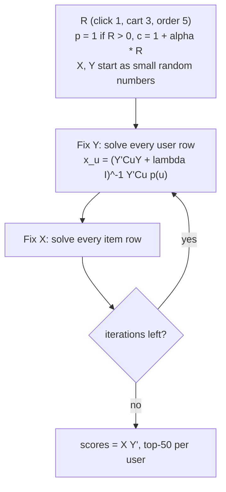
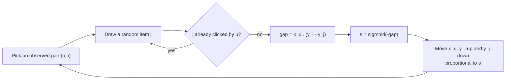
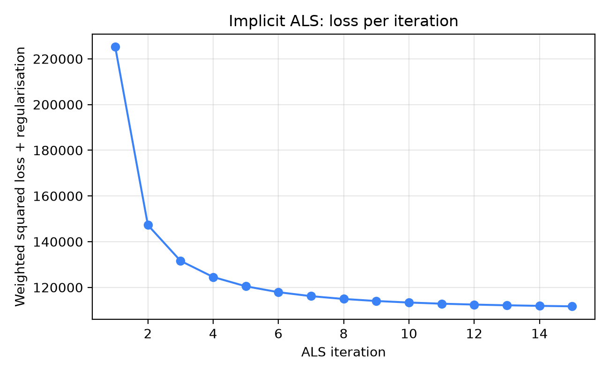
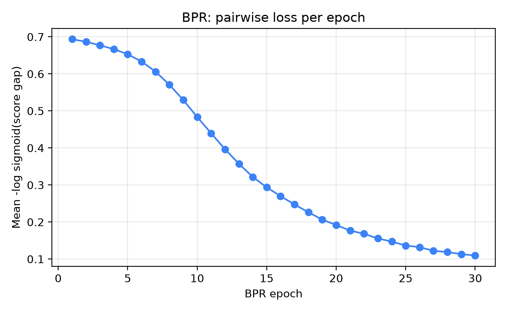

# Matrix factorisation

## The shopper nobody resembles

Rina has been on the marketplace for three weeks. She has clicked a ceramic pour-over coffee set, a hand grinder, a pack of unbleached paper filters, and, on a slow Tuesday, a pair of wired earphones. Then she opens the home page and the user-based recommender from the previous chapter goes looking for her "neighbours": other shoppers whose click history overlaps with hers. It finds two. One of them clicked the earphones and nothing else. The other clicked the grinder and a gaming mouse. The recommendations that come back are thin, and they are thin for a structural reason: the whole method hinges on two people having touched the *same* items, and in a catalogue of two thousand products almost nobody has.

This is the sparsity problem we met in Chapter 1, and neighbourhood methods are the most exposed to it. They compare two raw rows of a matrix that is almost entirely empty. Two shoppers can love the same kind of thing (slow coffee, small gadgets, minimalist stationery) without ever having clicked the same SKU, and the cosine between their rows will be zero.

Matrix factorisation attacks the problem from a different angle. Instead of comparing rows of raw clicks, it asks: *what small set of hidden tastes could explain all these clicks at once?* Each shopper becomes a short vector of taste strengths, each product becomes a short vector of "how much of each taste do I contain", and the score for a pair is just their dot product. Two shoppers with no products in common can still end up with nearly the same taste vector, because the products they did click were built from the same ingredients.

This chapter is the first with real linear algebra, and it is also the first method in the book that we train by optimisation instead of counting. We will build it in plain numpy so that nothing is hidden behind a library call.

**What you'll learn**

- What a *latent factor* is, and why compressing a giant sparse matrix into two thin matrices produces useful recommendations.
- How the classic explicit-rating factorisation (the one that powered the Netflix Prize era) is trained with stochastic gradient descent, and why it is a poor fit for clicks.
- How implicit-feedback ALS reframes clicks as *preference plus confidence*, and how to derive its closed-form per-row solve from scratch.
- How BPR optimises ranking directly with a pairwise loss, with its gradient worked out by hand.
- How to read the loss curves, tune `factors`, `reg`, `alpha`, `lr`, and compare both models against the baselines from Chapters 3 and 5 on exactly the same labels.

## Intuition: the taste dimensions nobody wrote down

Imagine you run a small coffee shop and you want to describe your regulars to a new barista. You would not hand over a spreadsheet with one column per menu item and a tick for every purchase. You would say things like "Dewi is a strong-and-black person, Bayu likes sweet and milky, Sari will try anything seasonal". Three or four phrases summarise a few hundred purchases, and they *predict* behaviour: when the new seasonal drink arrives, you know who to offer it to.

Matrix factorisation automates exactly that summarising step. Those phrases ("strong-and-black", "sweet and milky") are the **latent factors**: dimensions of taste that nobody labelled in advance, discovered because they make the purchase data easier to explain. The word *latent* just means hidden. The algorithm does not know what a factor means; it only knows that giving every user a value on factor 1 and every item a value on factor 1 lets it reconstruct the click matrix better.

A toy example makes the mechanics concrete. Suppose there are only two factors, and by luck we can name them: factor A is "gadget-ness" and factor B is "kitchen-and-food-ness". Every product has a value on each factor, and so does every shopper:

| | factor A (gadget) | factor B (kitchen) |
|---|---|---|
| **Items** | | |
| wired earphones | 1.0 | 0.0 |
| power bank | 0.9 | 0.1 |
| instant noodles | 0.0 | 1.0 |
| coffee grinder | 0.4 | 0.8 |
| **Users** | | |
| Gadget lover | 1.2 | 0.2 |
| Foodie | 0.1 | 1.1 |

The score for a user and an item is the dot product of their two vectors, multiply matching entries and add. For the gadget lover and the earphones that is $1.2 \times 1.0 + 0.2 \times 0.0 = 1.20$. For the gadget lover and the noodles it is $1.2 \times 0.0 + 0.2 \times 1.0 = 0.20$. The full set of scores, which is the little worked example we will reuse to see *what the model recommends*, comes out like this:

| | earphones | power bank | noodles | coffee grinder |
|---|---|---|---|---|
| Gadget lover | 1.20 | 1.10 | 0.20 | 0.64 |
| Foodie | 0.12 | 0.20 | 1.10 | 0.92 |

Read the rows as ranked lists. The gadget lover gets earphones, then power bank, then the grinder, then noodles. The foodie gets noodles, then the grinder, then the power bank. The coffee grinder lands in the middle for both people, because it is a *bridge*: it has a bit of both tastes. A neighbourhood method has no natural way to express "this item is part gadget, part kitchen". A factor model gets it for free from two numbers.

Here is the part that matters for sparsity. Notice that the foodie never needs to have clicked the *same* noodles as someone else. If the foodie's vector is learned from clicks on dry-roast peanuts, cooking oil and a rice cooker, it will land near $(0.1, 1.1)$, and every other item with a large factor B will score high. The unit of transfer is the factor, not the individual product.

The second idea is **low rank**. A click matrix with $m$ users and $n$ items has $m \times n$ cells. A factorisation with $f$ factors replaces it with two matrices that hold only $(m + n) \times f$ numbers. In this chapter's data that is the difference between roughly three million cells ($1408 \times 2120 = 2{,}984{,}960$) and $(1408 + 2120) \times 32 = 112{,}896$ parameters. Squeezing that much information through a narrow bottleneck *forces* the model to find the regularities in the data, which is why compression and generalisation are, here, the same thing.

## The algorithm

We will walk through three models in increasing order of relevance to this repository: classic explicit factorisation (to see the shape of the idea), implicit ALS (the workhorse for click data), and BPR (the ranking-aware alternative).

### Step zero: set up the notation

Let $R$ be the $m \times n$ matrix of interactions. In our book $R_{ui}$ is the summed event weight of user $u$ on item $i$: a click counts 1, an add-to-cart 3 and an order 5, which is `schema.EVENT_WEIGHT` from Chapter 1, so a user who clicked and then bought has $R_{ui} = 6$. Cells with no interaction are zero, but, as we will see, *zero does not mean dislike*.

The model assigns every user a vector $x_u \in \mathbb{R}^f$ and every item a vector $y_i \in \mathbb{R}^f$, stored as rows of two matrices $X$ (users by factors) and $Y$ (items by factors). The predicted score is

$$\hat{r}_{ui} = x_u \cdot y_i = \sum_{k=1}^{f} x_{uk}\, y_{ik}.$$

Training means choosing $X$ and $Y$. The three methods differ only in *what loss they minimise*.

### Explicit factorisation and Funk's SGD

Suppose, for a moment, that we had star ratings, the setting of the Netflix Prize. Only the cells in the observed set $\mathcal{K}$ carry information, and we want predictions that match them while keeping the vectors small, to avoid memorising noise:

$$\mathcal{L} = \sum_{(u,i) \in \mathcal{K}} \left( r_{ui} - x_u \cdot y_i \right)^2 + \lambda \left( \lVert x_u \rVert^2 + \lVert y_i \rVert^2 \right).$$

Write the prediction error $e_{ui} = r_{ui} - x_u \cdot y_i$. Differentiating one term with respect to $x_u$ gives $-2\, e_{ui}\, y_i + 2\lambda x_u$, and similarly for $y_i$. Folding the constant 2 into the learning rate $\gamma$, one step of stochastic gradient descent on one observed rating is:

$$x_u \leftarrow x_u + \gamma \left( e_{ui}\, y_i - \lambda x_u \right), \qquad y_i \leftarrow y_i + \gamma \left( e_{ui}\, x_u - \lambda y_i \right).$$

Notice how sensible this update is. If the model under-predicts ($e_{ui} > 0$), the user vector moves *toward* the item vector and the item vector toward the user vector, so their dot product grows. If it over-predicts, they move apart.

**Worked example 1: one SGD step.** Let $x_u = (2.0,\ 1.0)$, $y_i = (1.5,\ 0.5)$, true rating $r_{ui} = 5$, learning rate $\gamma = 0.05$ and, to keep the arithmetic readable, $\lambda = 0$.

1. Prediction: $2.0 \times 1.5 + 1.0 \times 0.5 = 3.5$.
2. Error: $e = 5 - 3.5 = 1.5$.
3. New user vector: $x_u' = (2.0 + 0.05 \cdot 1.5 \cdot 1.5,\ 1.0 + 0.05 \cdot 1.5 \cdot 0.5) = (2.1125,\ 1.0375)$.
4. New item vector, using the *old* $x_u$: $y_i' = (1.5 + 0.05 \cdot 1.5 \cdot 2.0,\ 0.5 + 0.05 \cdot 1.5 \cdot 1.0) = (1.65,\ 0.575)$.
5. New prediction: $2.1125 \times 1.65 + 1.0375 \times 0.575 \approx 4.08$.

The error shrank from 1.5 to about 0.92 in a single step. Repeat that for millions of observed ratings, several times over, and the vectors settle. This is essentially the procedure that Simon Funk published during the Netflix Prize, and it is the reason you will hear the method called "Funk SVD", although it is not a true singular value decomposition: a true SVD needs every cell present, and here we deliberately ignore the empty ones.

::: fact
**Skipping the empty cells.** When Simon Funk described his approach in December 2006, the Netflix training data was a matrix of roughly 500,000 users by 17,000 movies, about 8.5 billion cells, of which only one in eighty-five held a rating. His key trick was to skip the empty cells entirely and run gradient descent on the observed ones, which let a laptop make a full training pass over 100 million ratings in seconds.

Source: Funk, "Netflix Update: Try This at Home" (sifter.org blog), 2006
:::

### Why explicit factorisation is a poor fit for clicks

Implicit feedback has **no observed negatives**: if Rina did not click the gaming mouse, she may dislike it or may never have seen it. Fitting only nonzero cells lets predictions drift upward; treating zeros as ratings of 0 claims most of the catalogue is hated. And the numbers mean something else: a weight of 6 (click plus order) expresses *confidence*, not the size of a preference.

Hu, Koren and Volinsky resolved both problems with one reframing. Split every cell into two quantities:

- A binary **preference** $p_{ui} = 1$ if $R_{ui} > 0$, and $0$ otherwise.
- A **confidence** $c_{ui} = 1 + \alpha R_{ui}$.

The preference answers "did this user show any interest?". The confidence answers "how much should the loss care about getting this cell right?". Observed cells with a lot of evidence get large confidence; unobserved cells keep the floor value $c = 1$: we still *weakly* believe they are zeros, because on a huge catalogue most unseen things really are uninteresting, but we believe it far less than we believe a purchase.

The new loss runs over **all** $m \times n$ cells:

$$\mathcal{L}_{\text{ALS}} = \sum_{u,i} c_{ui} \left( p_{ui} - x_u \cdot y_i \right)^2 + \lambda \left( \sum_u \lVert x_u \rVert^2 + \sum_i \lVert y_i \rVert^2 \right).$$

Because it sums over every cell, SGD would have to touch three million terms per epoch even though only 18,256 are non-trivial. The trick of the next section is that a different optimiser can exploit exactly that imbalance.

::: fact
**A confidence-weighted factor model with a linear-time solver.** Hu, Koren and Volinsky's ICDM 2008 paper proposed treating implicit data as indications of positive and negative preference "associated with vastly varying confidence levels", together with an optimisation procedure whose cost scales linearly with the size of the data. They applied it to a recommender for television shows.

Source: Hu et al., ICDM, 2008
:::

### ALS: deriving the closed-form solve

The loss $\mathcal{L}_{\text{ALS}}$ is not convex in $(X, Y)$ jointly, because it contains the product $x_u \cdot y_i$. But fix one side and it becomes a perfectly ordinary weighted least-squares problem in the other. That observation gives the algorithm its name: **alternating least squares**. Hold $Y$ fixed and solve for every user vector exactly; then hold $X$ fixed and solve for every item vector exactly; repeat.

Take a single user $u$ with $Y$ fixed. The only terms that involve $x_u$ are

$$J(x_u) = \sum_{i} c_{ui} \left( p_{ui} - x_u \cdot y_i \right)^2 + \lambda \lVert x_u \rVert^2 .$$

Set the gradient to zero:

$$\frac{\partial J}{\partial x_u} = -2 \sum_i c_{ui} \left( p_{ui} - x_u \cdot y_i \right) y_i + 2\lambda x_u = 0 .$$

Expand $x_u \cdot y_i = y_i^{\top} x_u$ and gather the terms that contain $x_u$:

$$\Bigl( \sum_i c_{ui}\, y_i y_i^{\top} + \lambda I \Bigr) x_u = \sum_i c_{ui}\, p_{ui}\, y_i .$$

In matrix form, with $C^u$ the diagonal matrix of user $u$'s confidences over all items, and $p(u)$ the vector of their preferences:

$$\boxed{\; x_u = \left( Y^{\top} C^u Y + \lambda I \right)^{-1} Y^{\top} C^u\, p(u) \;}$$

This is the closed-form solve. The matrix in brackets is $f \times f$, symmetric and, thanks to $\lambda I$, positive definite, so the solution is unique and each such solve can only *decrease* the loss, never increase it. That is why the training curve we will see later falls monotonically with no learning-rate tuning at all. Item vectors follow by symmetry: swap the roles of users and items and use the columns of $C$ and $P$.

#### The Gram-matrix trick

Computing $Y^{\top} C^u Y$ naively costs $O(f^2 n)$ per user, since $C^u$ has $n$ diagonal entries. With $n = 2120$ items and 1408 users that is a lot of wasted work, because almost all of those entries equal 1. Hu et al. split the matrix:

$$Y^{\top} C^u Y = Y^{\top} Y + Y^{\top} \left( C^u - I \right) Y .$$

The first term, the **Gram matrix** $Y^{\top}Y$, does not depend on the user, so it is computed once per sweep. The second term has non-zero entries only for the $n_u$ items the user actually touched (where $c_{ui} - 1 = \alpha R_{ui} > 0$), so it costs $O(f^2 n_u)$. Likewise the right-hand side collapses to a sum over the user's touched items because $p_{ui} = 0$ elsewhere. The total cost of a sweep is therefore proportional to the number of *observed* cells, not to $m \times n$, which is what makes ALS practical on real data.

**Worked example 2: one ALS solve by hand.** To keep numbers tiny we use $f = 1$ factor, so every vector is a scalar. A user has touched two items with $R = 1$ and $R = 2$. Item factors are $y = (1, 2, 3)$ for items 1, 2, 3, and item 3 is *not* touched. Take $\alpha = 2$ and $\lambda = 0.5$.

1. Preferences: $p = (1, 1, 0)$.
2. Confidences: $c = 1 + 2R = (3, 5, 1)$.
3. Gram term: $Y^{\top}Y = 1 + 4 + 9 = 14$.
4. Correction term: $Y^{\top}(C - I)Y = 2 \cdot 1^2 + 4 \cdot 2^2 = 2 + 16 = 18$ (the untouched item contributes $c - 1 = 0$).
5. Left side: $14 + 18 + 0.5 = 32.5$. As a check, summing $c\, y^2 + \lambda$ directly gives $3 \cdot 1 + 5 \cdot 4 + 1 \cdot 9 + 0.5 = 32.5$. The Gram split saved us nothing here, but with 2,000 items it would save almost everything.
6. Right side: $\sum c\, p\, y = 3 \cdot 1 \cdot 1 + 5 \cdot 1 \cdot 2 + 1 \cdot 0 \cdot 3 = 13$.
7. Solution: $x_u = 13 / 32.5 = 0.4$.

Predictions follow: $0.4 \times (1, 2, 3) = (0.4,\ 0.8,\ 1.2)$ for the three items. The two touched items have targets of 1 but only reach 0.4 and 0.8. With $\lambda$ small and one factor the model cannot satisfy everyone, and the untouched item 3 is *predicted high* because its factor is large. In a real model with 32 dimensions and a dozen touched items per user, the extra freedom lets the fit be much tighter. The lesson to take from the arithmetic is the structure: a single user is a small ridge regression whose rows are the items they touched.



*Figure: One ALS training run. Each box in the loop is an exact least-squares solve, so there is no learning rate to tune.*

### BPR: optimise the ordering, not the values

ALS minimises squared error on 0/1 targets. But we never show a user a 0/1 prediction; we show a *ranked list*. Rendle and colleagues asked: why not optimise the ranking directly? The training data becomes **triples** $(u, i, j)$ where $i$ is an item user $u$ interacted with and $j$ is one they did not. The model should score $i$ above $j$.

Let the gap be $\hat{x}_{uij} = x_u \cdot y_i - x_u \cdot y_j = x_u \cdot (y_i - y_j)$. Squash it with the logistic function $\sigma(z) = 1/(1 + e^{-z})$ to get the model's probability of ordering the pair correctly. The BPR objective maximises the log of that probability over sampled triples, with L2 regularisation coming from a Gaussian prior on the parameters, which is the "Bayesian" in the name:

$$\mathcal{L}_{\text{BPR}} = - \sum_{(u,i,j)} \ln \sigma\bigl( \hat{x}_{uij} \bigr) + \lambda \lVert \Theta \rVert^2 .$$

This is a smooth, differentiable stand-in for AUC, the probability that a random positive outranks a random negative for the same user.

The gradient is pleasantly short. Since $\frac{d}{dz} \ln \sigma(z) = 1 - \sigma(z) = \sigma(-z)$, and $\hat{x}_{uij}$ is linear in each vector:

$$\frac{\partial \hat{x}_{uij}}{\partial x_u} = y_i - y_j, \qquad \frac{\partial \hat{x}_{uij}}{\partial y_i} = x_u, \qquad \frac{\partial \hat{x}_{uij}}{\partial y_j} = -x_u .$$

So one ascent step with learning rate $\eta$ and $s = \sigma(-\hat{x}_{uij})$ is

$$x_u \mathrel{+}= \eta \bigl( s\, (y_i - y_j) - \lambda x_u \bigr), \quad y_i \mathrel{+}= \eta \bigl( s\, x_u - \lambda y_i \bigr), \quad y_j \mathrel{+}= \eta \bigl( -s\, x_u - \lambda y_j \bigr).$$

The scalar $s$ is the key. When the pair is already ordered correctly by a wide margin, $\hat{x}_{uij}$ is large, $s \approx 0$, and the triple barely changes anything. When the pair is wrong or tied, $s$ is near $0.5$ or higher and the update is large. The model spends its effort on the pairs it currently gets wrong, which is the same intuition as the LambdaMART gradients you will meet in Chapter 10.

**Worked example 3: one BPR step.** Let $x_u = (0.5, -0.2)$, $y_i = (1.0, 0.5)$ (clicked), $y_j = (0.2, 1.0)$ (random), $\eta = 0.1$, $\lambda = 0$. The difference is $y_i - y_j = (0.8, -0.5)$, so the gap is $0.5 \cdot 0.8 + (-0.2)(-0.5) = 0.5$. Then $\sigma(0.5) \approx 0.6225$, the loss is $-\ln 0.6225 \approx 0.474$ and $s = 0.3775$. The updates are $x_u \approx (0.5302, -0.2189)$, $y_i \approx (1.0189, 0.4924)$ and $y_j \approx (0.1811, 1.0076)$. The new gap is about $0.557$ and the loss about $0.453$: one tiny step moved the pair the right way.

One practical detail. At initialisation all vectors are close to zero, so every gap is close to 0 and $\sigma(0) = 0.5$, meaning every triple has loss $-\ln 0.5 = \ln 2 \approx 0.693$. When you train BPR, a loss that *starts* near 0.693 is a good sign that the code is wired correctly.



*Figure: The BPR inner loop. The step size automatically shrinks for pairs the model already ranks correctly.*

### Hyperparameters in one place

- `factors` $f$: too low underfits (tastes cannot be separated), too high overfits and slows training.
- `reg` $\lambda$: too low memorises sparse users, too high shrinks every score toward 0.
- `alpha` $\alpha$ (ALS): too low makes observed and unobserved cells look alike; too high lets one click dominate and collapses recommendations onto popular items.
- `iters` / `epochs`: stop when the loss plateaus; BPR also needs a sensible `lr` (too high oscillates) and enough sampled negatives.

Our scripts use `factors = 32`, `reg = 0.1`, `alpha = 20`, 15 iterations for ALS; and `lr = 0.05`, `reg = 0.01`, 30 epochs, one negative for BPR. These are defaults, not tuned optima.

## Code walkthrough

All code lives in `book/code/ch06_mf.py`. It trains both models on the very same user-by-item matrix as Chapters 3 and 5 and hands the scores to the shared evaluation helper. We start with the matrix.

### Building the interaction matrix

```include
path: book/code/common.py
symbol: interaction_matrix
```

`hist.interactions()` returns one row per positive event (click, cart or order) with its weight, taken straight from the `EVENT_WEIGHT` dictionary. The groupby sums them per user-item pair, so a user who clicked an item twice and bought it once has $R = 1 + 1 + 5 = 7$. We then map raw ids to dense row and column positions with `pd.Index.get_indexer` and build a CSR sparse matrix. The two returned indexes are essential later: they translate "row 17" back into "user 61".

The ch06 script densifies this with `.toarray()`: 1408 users by 2120 items of float64 is only a few tens of megabytes, so it is fine for a teaching script. At production scale you never do this.

### ALS: the whole algorithm in one function

```include
path: book/code/ch06_mf.py
symbol: als_implicit
```

Read the function top to bottom, and match each piece to the derivation.

- `P = (R > 0)` and `C = 1.0 + alpha * R` are the preference and confidence matrices, exactly as defined above.
- `X` and `Y` start as small Gaussian noise (standard deviation 0.1). Starting at exactly zero would be a bug: all vectors would be identical and the solves would stay symmetric.
- The inner function `solve(fixed, conf, pref)` is the closed-form solve for **every row** of one side. `gram = fixed.T @ fixed` is the Gram matrix $Y^{\top}Y$, computed once per sweep and reused for every row; that line *is* the Hu-Koren-Volinsky trick.
- For each row, `nz = np.flatnonzero(conf[r] > 1.0)` finds the touched items. `Fn = fixed[nz]` stacks their vectors, and `cu = conf[r, nz]` holds their confidences.
- `A = gram + Fn.T @ ((cu - 1.0)[:, None] * Fn) + eye` is $Y^{\top}Y + Y^{\top}(C^u - I)Y + \lambda I$. The `(cu - 1.0)` factor is the diagonal of $C^u - I$.
- `b = Fn.T @ (cu * pref[r, nz])` is $Y^{\top} C^u p(u)$.
- `np.linalg.solve(A, b)` solves the linear system. We never form an explicit inverse; that is both faster and numerically safer.

The main loop then calls `solve(Y, C, P)` for the users and `solve(X, C.T, P.T)` for the items. Transposing $C$ and $P$ is all it takes to reuse the same function for the other side. After each sweep the code records the full objective with dense numpy operations, `(C * err**2).sum() + reg * (...)`, which is the loss plotted later.

One honest caveat: `C` and `err` here are dense. They are fine for a lab with three million cells but not for millions of users. Production ALS keeps $R$ sparse throughout and never builds $C$.

### BPR: sampling, gap and the three gradients

```include
path: book/code/ch06_mf.py
symbol: bpr
```

The function maps to the BPR equations one-to-one.

- `users, items = np.nonzero(pos_mask)` lists every observed positive pair. One *epoch* visits every positive once, in a fresh random order, in mini-batches of 256.
- `j = rng.integers(0, n_i, len(b))` draws one uniform random item per positive. The `for _retry` loop rejects the ones that happen to be real positives and redraws, up to five times. This is a cheap approximation of "sample from unobserved items".
- `gap = (xu * (yi - yj)).sum(1)` is $\hat{x}_{uij}$ for the whole batch at once.
- `sig = 1.0 / (1.0 + np.exp(gap))` is $\sigma(-\hat{x}_{uij}) = s$. The comment in the source says the same: this is $1 - \sigma(\text{gap})$, which equals $-\partial\,\text{loss}/\partial\,\text{gap}$.
- `total += np.log1p(np.exp(-gap)).sum()` accumulates the loss $-\ln\sigma(\text{gap}) = \ln(1 + e^{-\text{gap}})$. Using `log1p` avoids losing precision when the exponent is tiny.
- `gu`, `gi`, `gj` are the three gradients. The minus sign on `gj` is the push-away from the negative.
- `np.add.at(X, u, lr * gu)` applies the updates. `np.add.at` rather than `X[u] += ...` matters: the same user can appear several times in a batch, and plain fancy-indexed assignment would silently keep only one of the updates.

### From scores to a top-50 list

```include
path: book/code/dense_recs.py
symbol: scores_to_recs
```

Both factor models produce a dense `users × items` score matrix, `X[users] @ Y[items].T`. This shared helper turns it into the "top 50 per user" format that `common.evaluate` expects. Only scores above zero count as "the model has an opinion". A user with no usable history (nobody to build a vector from) falls back to 7-day popularity, and the helper reports how often that happened. We will see the numbers in the output below.

Notice what the helper does *not* do: it does not remove items the user already touched. Chapter 11 is where filters such as "already bought" belong; here we want the pure model.

## Run it

From the `book/` directory:

```bash
uv run python code/ch06_mf.py
```

The run takes a couple of seconds because the matrix is tiny. ALS first. Each line prints the full objective after one alternating sweep:

```output
file: results/ch06_mf.txt
lines: 6-22
```

And then the opening and closing epochs of BPR. The loss reported is the mean of $-\ln\sigma(\text{gap})$ over the epoch's sampled triples, so it is a training-time quantity, not a ranking score:

```output
file: results/ch06_mf.txt
lines: 24-36
```

```output
file: results/ch06_mf.txt
lines: 45-55
```

Finally, how many evaluation users had no usable vector and how the two models score on the held-out week:

```output
file: results/ch06_mf.txt
lines: 57-65
```

::: try
Open `book/code/ch06_mf.py`, change `alpha=20.0` in the `als_implicit` signature to `alpha=1.0`, run it again, and compare the `als_implicit` row with the one above. The hands-on exercise at the end of the chapter asks you to predict what you will see.
:::

## Results

### Reading the loss curves



The ALS curve is the classic shape of an alternating optimiser. Iteration 1 ends at 225190.5. A single further sweep brings it down to 147262.9 (a drop of about a third), and by iteration 5 it is at 120478.2. After that, each iteration buys very little: iteration 14 ends at 111911.5 and iteration 15 at 111705.9, a change of roughly 0.2%. Two things are worth noticing. The loss falls on **every** single iteration, as our derivation promised: each exact solve cannot raise the objective. And the curve is flattening, so 15 iterations is sensibly past the knee. Running 50 would cost three times the time for a change you could not see on the chart.



The BPR curve starts at 0.6937, essentially $\ln 2 \approx 0.693$: at initialisation every gap is near zero. Almost nothing happens for five epochs (0.6530 at epoch 5) because tiny vectors give tiny gradients; then the loss drops fast (0.4835 at epoch 10, 0.2937 at epoch 15) and reaches 0.1094 by epoch 30. It was **still falling** at epoch 30, so the model is not converged.

### Ranking quality against everything so far

Training loss is not ranking quality, so we evaluate both models on the same held-out week and metrics as earlier chapters (the ch06 rows are in the table above). For comparison, the Chapter 5 methods and the best Chapter 3 baseline on identical labels:

```output
file: results/ch05_cf.txt
lines: 31-37
```

```output
file: results/ch03_popularity.txt
lines: 22-22
```

A few conclusions follow directly from the numbers.

**1. Factorisation crushes global popularity.** Implicit ALS has an ndcg@20 of 0.1581, against 0.0475 for `pop_7d`: more than three times higher. Every personalised method in this book beats the popularity row, and that gap is the whole reason recommenders exist.

**2. ALS beats BPR here, but the comparison is not final.** ALS reaches 0.1581 ndcg@20 and a recall@20 of 0.2715; BPR gets 0.1379 and 0.2218. We have just seen BPR's loss still decreasing, and it also has more moving parts (learning rate, sampling, number of epochs). The honest summary is "with these defaults, ALS is better and cheaper", not "ALS is always better than BPR". In published comparisons BPR's strength is on datasets where optimising order matters more than reconstructing values.

**3. ALS is not the winner of the neighbourhood methods.** User-kNN with 50 neighbours has a higher ndcg@20 (0.1662) than ALS (0.1581), and even the humble `pop_in_my_categories` baseline from Chapter 3 reaches 0.1302, not far below BPR's 0.1379. A well-tuned neighbourhood method on a catalogue this small is a strong baseline, and category affinity alone captures a lot of what the factors are learning.

**4. But the metrics disagree in an informative way.** ALS has a *higher* recall@20 (0.2715) than user-kNN (0.2273), and a higher order_recall@20 (0.4122 against 0.3456), yet a *lower* ndcg@20. Recall@20 counts how many of the user's future items appear anywhere in the top 20. NDCG additionally rewards putting them near the top. ALS therefore finds more of the right items but sorts them less sharply than user-kNN does. That pattern is typical of a retrieval-style model and it is exactly why the later chapters add a ranking stage on top: a candidate generator should be judged by recall, a ranker by ndcg.

**5. Coverage is a quiet strength.** Both models recommend a far more varied set of items than popularity: coverage@20 of 0.5431 for ALS and 0.4267 for BPR, compared with 0.0087 for `pop_7d`. User-kNN reaches 0.4158, so ALS covers more of the catalogue while also achieving higher recall.

**6. Cold users still need a fallback.** 28 of the evaluation users had no model scores at all, because they have no interactions before the cutoff and therefore no learned vector. They were filled with 7-day popularity, which accounts for about 3.0% of the recommendation slots. Matrix factorisation cannot score a user it has never seen; that is the cold-start theme of Chapter 12.

::: fact
**A million dollars for ten percent.** The Netflix Prize launched in October 2006 and asked the world to improve Netflix's rating-prediction accuracy by 10%. It was awarded in September 2009 to the team "BellKor's Pragmatic Chaos", whose winning submission improved the existing system by 10.06%, reported as arriving less than half an hour before the contest deadline. The team's published description of its method highlighted two families of techniques: neighbourhood models and latent-factor models of the kind in this chapter.

Source: Sarno, Los Angeles Times, 2009
:::

::: fact
**Optimising the ranking directly.** In their 2009 UAI paper, Rendle and colleagues noted that popular methods for item recommendation from implicit feedback, such as matrix factorisation and adaptive k-nearest-neighbour, "are designed for the item prediction task of personalized ranking" yet "none of them is directly optimized for ranking". Their BPR-Opt criterion, derived as a maximum posterior estimator, is trained with stochastic gradient descent using bootstrap sampling and can be applied to both model families.

Source: Rendle et al., UAI, 2009
:::

### What the factors buy you

Factorisation is not a magic upgrade over neighbourhood methods on a small catalogue; user-kNN keeps its ndcg edge. What it gives is a **compact, learnable representation** of every user and item that can be indexed by approximate nearest-neighbour search (Chapter 7), fed to a ranker as a feature (Chapter 10) or extended with side information. In a multi-stage system the question is whether an ALS source raises the recall of the union (Chapter 8).

## Pitfalls and how it is done in production

**Tuning on your test set.** Sweeping `alpha`, `factors` and `reg` against the evaluation labels fits the evaluation data. Tune on an earlier validation window and evaluate once on the test week; we left the defaults un-tuned for this reason.

**Treating unobserved as negative.** ALS gives unobserved cells weight 1 and observed cells a larger weight, which is a soft version of the assumption, but it is still an assumption. A great item the user never saw is penalised during training. Uniform negative sampling in BPR has the same flaw: a random unclicked item could be a hidden favourite. Production systems mitigate it with *exposure-aware* negatives (items that were shown but ignored, the `impression` events) and with popularity-weighted sampling. This repository logs impressions precisely so that such negatives are available.

**Dense matrices do not scale.** Our teaching code builds dense $C$, $P$ and error matrices. At Shopee scale there are hundreds of millions of users and tens of millions of items, and nothing about that matrix is dense. Production implementations keep $R$ in compressed sparse form, process users in blocks that fit on a GPU, and shard $X$ and $Y$ across machines. The open-source `implicit` library and Spark's MLlib implement exactly the sparse form of the algorithm you just read.

**Fold-in for new activity.** With $Y$ frozen, a user's vector is a closed-form solve, so it can be recomputed in under a millisecond from their latest clicks, which is how nightly-trained models get fresh signals (compare this repository's on-request design).

**Dot product, not distance.** Predictions use $x_u \cdot y_i$, so vector length matters; ANN libraries need a maximum-inner-product variant (Chapter 7).

**Where it sits in this repository.** The Python recommender service in this repo does not use ALS or BPR today; its candidate sources are the four retrievers from Chapter 8 and its ranker is LightGBM (Chapter 10). A natural, low-risk extension is to train an ALS model offline during retrain, store the user and item vectors, and use their dot product as an additional candidate source and as a *feature* for the ranker. Chapter 14 lists that in the "what to build next" checklist. Nothing in the service would need to change shape: `Store.snapshot()` already exposes everything the training function needs.

## Summary

- Matrix factorisation gives every user and item a short vector of **latent factors**, and scores a pair with their dot product. It compresses a sparse matrix of three million cells into roughly a hundred thousand parameters and generalises across items nobody co-clicked.
- Classic explicit factorisation (Funk SVD) minimises squared error on observed ratings by SGD. It is not appropriate for clicks, because empty cells are not ratings of 0 and non-empty cells measure confidence rather than preference.
- **Implicit ALS** splits each cell into a binary preference $p = 1[R > 0]$ and a confidence $c = 1 + \alpha R$, and minimises the confidence-weighted squared error over *all* cells.
- With one side fixed, each row has a closed-form solve, $x_u = (Y^{\top}C^uY + \lambda I)^{-1}Y^{\top}C^u p(u)$. Precomputing the Gram matrix $Y^{\top}Y$ makes a sweep cost proportional to the observed cells, and every solve can only decrease the loss.
- **BPR** trains on triples (user, clicked item, random item) to push the clicked item's score above the other, with gradient scaled by $\sigma(-\text{gap})$. It optimises ordering directly; a healthy run starts near $\ln 2 \approx 0.693$.
- On this book's data, ALS reached ndcg@20 of 0.1581 and BPR 0.1379, far above `pop_7d` at 0.0475. ALS had higher recall@20 than user-kNN, but user-kNN's 0.1662 ndcg@20 was still higher: factorisation is a retrieval model, not a sharp ranker.
- Users without history get no vector at all: 28 evaluation users needed popularity padding, which is why cold start is a separate problem.
- The real value of factors is the *representation*: it can be indexed, reused as a ranker feature, and extended, which is where Chapter 7 takes it next.

## Quiz

**Q6.1** In a factorisation model with 32 factors, what is a *latent factor*?

- A. A column of the raw interaction matrix, such as the clicks on one product.
- B. One of the learned dimensions of the user and item vectors; it is not given a name in advance and is discovered because it helps reconstruct the interactions.
- C. A hyperparameter chosen by cross-validation, such as the learning rate.
- D. A feature such as price or category that the seller types in when creating the product.

**Q6.2** In the Hu-Koren-Volinsky implicit ALS model, what roles do $p_{ui}$ and $c_{ui}$ play?

- A. $p_{ui}$ is the predicted score and $c_{ui}$ is the true rating.
- B. $p_{ui}$ is a binary "showed interest" target and $c_{ui} = 1 + \alpha R_{ui}$ says how much the loss should care about getting that cell right.
- C. $p_{ui}$ is the popularity of the item and $c_{ui}$ is the category of the item.
- D. $p_{ui}$ is the learning rate and $c_{ui}$ is the regularisation strength.

**Q6.3** Why is the Gram-matrix trick $Y^{\top}C^uY = Y^{\top}Y + Y^{\top}(C^u - I)Y$ important for ALS?

- A. It makes the loss convex in $X$ and $Y$ jointly, so ALS always finds the global minimum.
- B. It removes the need for regularisation.
- C. $Y^{\top}Y$ can be computed once per sweep and shared by all users, so the per-user cost depends only on the items that user touched rather than on the whole catalogue.
- D. It allows ALS to handle explicit star ratings.

**Q6.4** Explain in two or three sentences why treating every empty cell as a true rating of 0 is a bad idea for click data, and how implicit ALS softens this.

**Q6.5** BPR training loss in this chapter starts at about 0.693 in epoch 1. Why is that the value you expect when the vectors are nearly zero?

**Q6.6** (Calculation) One user has touched two items. A single-factor model has item factors $y = (2, 1)$ for those two items (and no other items). The user's raw interaction weights are $R = (1, 3)$. Use $\alpha = 4$ and $\lambda = 1$. Compute the user's factor $x_u$ with the ALS closed-form solve (both items have preference 1).

**Q6.7** (Calculation) In BPR, suppose for one triple $\hat{x}_{uij} = -\ln 3 \approx -1.0986$. Compute $\sigma(\hat{x}_{uij})$, the loss $-\ln \sigma(\hat{x}_{uij})$ and the gradient multiplier $s = \sigma(-\hat{x}_{uij})$. Is the triple ordered correctly? Will the update be large or small?

**Q6.8** (Code reading) In the `bpr` function shown in the walkthrough, look at `sig = 1.0 / (1.0 + np.exp(gap))` and at `gu`, `gi` and `gj`. What does `sig` equal mathematically, why does it multiply all three gradients, and why does `gj` carry a negative sign?

**Q6.9** ALS has a higher recall@20 than user-kNN (0.2715 against 0.2273) but a lower ndcg@20 (0.1581 against 0.1662). What does the difference between the two metrics tell you about what each method does well? Where in a multi-stage system would you therefore use ALS?

**Q6.10** (Hands-on) Open `book/code/ch06_mf.py`. In `main()`, change the ALS call to `als_implicit(R, alpha=1.0)`, and in a second run to `als_implicit(R, factors=8)`. Run the script after each change. Write down the `ndcg@20` for `als_implicit` and the final ALS loss each time, and compare them with the results in this chapter. State which change you expect to hurt more and why, then check. What does this experiment suggest about validating hyperparameters on the same labels you report?
