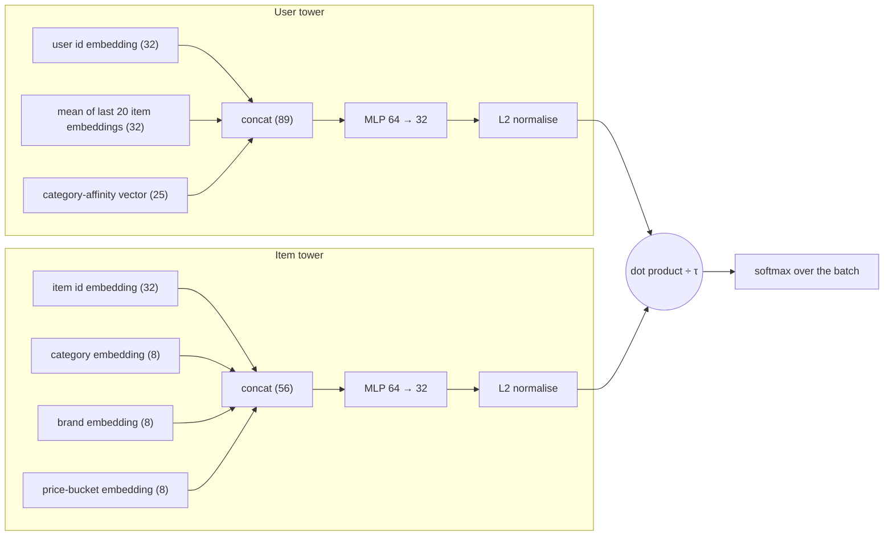

# Embeddings and two-tower retrieval

It is 9.9 sale night and the marketplace team is watching a dashboard. Item-to-item co-visitation, the retriever you met in Chapter 5, has been serving the "similar items" strip for months, and it is good at one thing: telling you what people who looked at *this* phone also looked at. But Dewi, the newest engineer on the team, has a different complaint. A user who spent the whole week browsing running shoes, a sports watch and an electrolyte drink opens the home page and sees phone cases. "The system knows nothing about what she *is*," says Dewi. "It only knows which product pages she touched. There is no notion of a taste that connects shoes, watches and electrolyte powder."

What Dewi wants is a *representation*: a short list of numbers for every user and every item, learned so that "fits this user" turns into a single arithmetic operation. If the numbers are good, the sports-minded user lands near sports items even when none of those exact items ever co-occurred with her history. And if the operation is cheap, the team can score millions of items without a heavy ranker. That is the promise of **embeddings** and the **two-tower model**, the architecture family that large-scale retrieval systems such as YouTube's (see the fact box below) are built on.

In this chapter we build one from scratch in PyTorch on the same simulated marketplace as every other chapter, train it, and evaluate it against the popularity baseline. The result is not what the textbooks make you expect: the model that follows the recipe faithfully scores *below* the trivial "popular in the last 7 days" baseline. Finding out why, and fixing it with a one-line correction from a real production paper, is the most instructive part of the chapter. We finish by building an approximate nearest-neighbour index (IVF) with nothing but numpy, so you see why retrieval over a huge catalogue does not need to touch every item.

**What you'll learn**

- What an embedding is, and why "closeness in a vector space" is a useful replacement for hand-written similarity rules.
- How a two-tower model is wired: a user tower, an item tower, a dot product, and why the split matters for serving.
- How the in-batch softmax loss with a temperature trains the towers, and why in-batch negatives are biased against popular items.
- How the logQ correction removes that bias, and what it did to our offline numbers.
- How approximate nearest-neighbour search (IVF from scratch; HNSW, ScaNN and FAISS in the real world) trades recall for speed.
- How to read a PCA picture of embeddings without over-interpreting it.

## Intuition: from names to coordinates

Think about how a good bookshop assistant works. She does not memorise a table of "customers who bought X also bought Y". She has a *map in her head*: cookbooks on one side of the shop, thrillers on the other, with "food memoirs" somewhere between. A new customer walks in, says two sentences about what she likes, and the assistant places her on the map. Recommending is then just "walk to the nearest shelf that hasn't been picked over".

An **embedding** is that map made explicit. Every user and every item becomes a point in a vector space, say 32 dimensions. Nobody tells the model what the dimensions mean. Training pushes users towards the items they interact with and away from items they ignore, and the coordinates that make this possible are the embedding. Matrix factorisation (Chapter 6) already produced such vectors: one row of $P$ per user, one row of $Q$ per item. So what is new?

Three things.

1. **The vectors are computed by a function, not looked up in a table.** In matrix factorisation each item has a free parameter vector. An item with no interactions gets no vector. In a two-tower model, the item vector is the *output of a small neural network* whose inputs include side information: category, brand, price bucket. A new item with a known category and brand gets a sensible vector on its first day. The same goes for users: the user tower can read the last items a user touched and their category affinities, so the vector reacts to what she did five minutes ago, as long as the history features are fresh when you compute them.
2. **The loss is a ranking-flavoured softmax, not a squared error.** We will not predict a rating. We will ask: among all items in this batch, which one did the user actually interact with? That is a classification problem, and it scales.
3. **Serving is a nearest-neighbour lookup.** Because the final score is a dot product between a user vector and an item vector, and the item vectors do not depend on the user, we can compute every item vector once, put them in an index, and answer "top 50 items for this user" without a neural network forward pass per item.

::: fact
**Vectors that do arithmetic.** The 2013 Google paper on efficient word-vector training recalls an earlier finding: with simple algebra on word vectors, vector("King") − vector("Man") + vector("Woman") gives a vector closest to the vector for "Queen". Nobody programmed that regularity into the vectors. Recommender embeddings follow the same idea with items and users in place of words.

Source: Mikolov et al., arXiv, 2013
:::

## The two-tower architecture

A *tower* is just a function that turns raw inputs into a vector. The two-tower model has two of them that never see each other's inputs.



*Figure: The two towers of our model. The only place the user side and the item side meet is the final dot product.*

The **user tower** concatenates a learned user-id embedding (32 numbers), the *mean* of the embeddings of the last 20 items the user interacted with (32, from the same item-id table the item tower uses), and the 25-dimensional category-affinity vector from `recsys.candidates.category_affinity`; a two-layer MLP maps these 89 numbers to 32. The **item tower** concatenates the item-id embedding (32), category (8), brand (8) and price-bucket (8, the quintile of price relative to the category median) embeddings; another MLP maps these 56 numbers to 32.

Both outputs are **L2-normalised**, so the dot product of a user vector and an item vector is exactly their *cosine similarity*, between $-1$ and $1$. This stops the model inflating the norm of popular items and bounds the score, which is what lets us talk about a temperature next.

Why two towers rather than one network that sees user and item together? A joint (*cross*) model can learn interactions such as "this user likes cheap items *only* in Beauty" and is usually more accurate, but it must run once per (user, item) pair: feasible for 2,311 items, not for 50 million. The two-tower design gives up expressive interactions to gain the ability to precompute and index one side, the right trade for stage one, because the ranker of Chapters 9 and 10 re-scores the survivors with all the cross features you like.

::: fact
**Two stages at YouTube.** The 2016 YouTube paper splits its recommender into two networks: candidate generation, which winnows a huge corpus to hundreds of videos, and ranking, which scores them. Candidate generation is posed as extreme multiclass classification over millions of videos using learned user and video embeddings. Because scoring millions of videos within tens of milliseconds needs an approximate scheme that is sublinear in the corpus size, serving reduces to a nearest-neighbour search in the dot-product space. The structure of this book's system follows the same split.

Source: Covington et al., RecSys, 2016
:::

## The algorithm: training with an in-batch softmax

### Step by step

Training data are positive pairs: a user and an item the user interacted with before the cutoff (click, cart or order, from `common.interaction_matrix` and `History.interactions`). We have no labelled negatives; "the user did not click" is not the same as "the user dislikes it". The standard trick is to manufacture negatives for free from the batch itself.

1. Sample a batch of $B$ positive pairs $(u_1, i_1), \dots, (u_B, i_B)$.
2. Run the user tower on every $u_b$ to get $\mathbf{u}_b$, and the item tower on every $i_b$ to get $\mathbf{v}_b$. Both are unit vectors.
3. Build the $B \times B$ matrix of scaled scores $s_{bj} = \mathbf{u}_b \cdot \mathbf{v}_j / \tau$, where $\tau$ is the **temperature**.
4. Row $b$ is a $B$-way classification problem: the right answer is column $b$ (the item that user actually touched); the other $B-1$ items in the batch are treated as negatives.
5. Minimise the cross-entropy of that classification, averaged over the batch:

$$
\mathcal{L} = -\frac{1}{B}\sum_{b=1}^{B} \log \frac{\exp(s_{bb})}{\sum_{j=1}^{B} \exp(s_{bj})}
$$

This is the **sampled softmax** idea: the full softmax over the whole catalogue would be the right objective but is far too expensive, so we approximate the denominator with the other items in the batch.

### The temperature

Because cosines live in $[-1, 1]$, the raw gap between a good item (0.8) and a mediocre one (0.3) is tiny to a softmax: $e^{0.8}$ versus $e^{0.3}$ is a ratio of about 1.6. Dividing by a small $\tau$ stretches the scale. With $\tau = 0.05$, as in our script, the same gap becomes 16 logit units and the softmax becomes decisive. A low temperature makes the loss care about getting the *top* of the ranking right and punishes hard negatives severely; a high temperature spreads probability more evenly and learns more gently. It is a hyperparameter you tune, usually between 0.05 and 0.2.

### A worked example with hand-sized numbers

Take $B = 3$ and, to keep arithmetic friendly, $\tau = 0.5$. Suppose user 1's cosines with the three batch items are $0.8, 0.3, 0.1$, and item 1 is her true positive.

- Scaled logits: $1.6,\ 0.6,\ 0.2$.
- Exponentials: $4.95,\ 1.82,\ 1.22$, sum $\approx 8.00$.
- Probability of the right item: $4.95 / 8.00 \approx 0.62$. Loss $= -\ln 0.62 \approx 0.48$.

If training moves her cosine with item 1 to $0.9$, the probability rises to about $0.67$ and the loss falls. The gradient pulls $\mathbf{u}_1$ towards $\mathbf{v}_1$ and pushes it away from $\mathbf{v}_2, \mathbf{v}_3$; since every item is a positive for some rows and a negative for others, item vectors are pulled and pushed throughout training.

### The hidden bias: who ends up as a negative?

A batch is a random sample of positive pairs, so an item appears in it in proportion to its interaction count. An item with 2% of all interactions is the positive of roughly one row in fifty, and a *negative* in every other row; a rare item is almost never in the batch. Popular items are therefore over-represented as negatives relative to a uniformly random catalogue item, and the model learns "popular items are usually the wrong answer", shifting their scores down. But at serving time we score every item uniformly, so the learned popularity penalty is a systematic error that suppresses best-sellers that are genuinely relevant to many users.

### The logQ correction

Yi et al. described the fix at Google: subtract from each logit the log of the probability that the item is drawn into the batch. If $q_j$ is the sampling probability of item $j$, define the corrected logit

$$
s^{c}_{bj} = \frac{\mathbf{u}_b \cdot \mathbf{v}_j}{\tau} - \log q_j
$$

and use $s^c$ in the softmax. The intuition: an item that is often drawn as a negative ($q_j$ large, $\log q_j$ close to zero) gets a small boost; a rarely drawn item ($\log q_j$ very negative) gets a large boost. This exactly cancels the extra pushing-down that popular items would otherwise receive, so the dot product itself learns "fit", not "fit minus a popularity tax". In the paper the frequencies are estimated online from a stream; in our offline script we use the empirical item frequencies among training pairs.

Numeric version of the same example: let item 1 be popular ($q = 0.5$) and items 2 and 3 rarer ($q = 0.25$). Then $-\log q = 0.69,\ 1.39,\ 1.39$, the corrected logits are $2.29,\ 1.99,\ 1.59$, and the probability of the true item falls from $0.62$ to about $0.45$ (loss from $0.48$ to $0.80$). The model must now separate the positive more cleanly in cosine space instead of leaning on popularity. At serving time the $-\log q$ term is dropped.

::: fact
**Correcting sampling bias in YouTube retrieval.** Yi et al. consider two-tower retrieval models trained with in-batch negatives, the items sampled in a random batch. They argue that this batch loss is subject to sampling bias which can severely restrict performance, particularly under a power-law item distribution. They propose an algorithm that estimates item frequency from streaming data without a fixed item vocabulary, and apply the bias-corrected approach to Neural Deep Retrieval, a YouTube system that retrieves from a corpus of tens of millions of videos.

Source: Yi et al., RecSys, 2019
:::

## Code walkthrough

All code below is from `book/code/ch07_two_tower.py`, which trains four variants (10 or 30 epochs, with and without logQ) and then runs the ANN demo.

### The towers

```include
path: book/code/ch07_two_tower.py
symbol: Towers
```

Read this class in four parts.

- **Embedding tables.** `user_emb` has one 32-dimensional row per user; `item_emb` has one row per item *plus one extra* row used as padding (`padding_idx=n_items`), so users with fewer than 20 items in their history can share a fixed-width tensor. `cat_emb`, `brand_emb` and `price_emb` are small 8-dimensional tables. Note that `item_emb` is **shared**: the item tower looks up an item's own row, and the user tower looks up the rows of the user's history items from the same table. Sharing means the vector for "running shoe A" has one meaning across both towers.
- **The MLPs.** `user_mlp` takes `32 + 32 + n_cats` inputs (32 for the user id, 32 for the history mean, 25 for the affinity), which is the 89 in the diagram. `item_mlp` takes `32 + 8 + 8 + 8 = 56`. Each is `Linear → ReLU → Linear` with a 64-wide hidden layer and a 32-wide output.
- **`user_vec` and `item_vec`.** In `user_vec`, `mask` is 1 where a history slot holds a real item and 0 where it holds padding; the embeddings are masked before summing and divided by the number of real items (clamped at 1 so an empty history divides by 1). Without the mask, padding would drag every short-history user towards the same "empty" direction. The mean is concatenated with the user-id embedding and the affinities, passed through the MLP and normalised with `F.normalize`. `item_vec` is simpler: concatenate four embeddings, MLP, normalise. Crucially it takes only item attributes, with no user input, which is what lets us compute the vectors for the whole catalogue once, offline, and store them.

### The training loop

The training function is nested inside `main`; the build supports nested symbols, so we can show it on its own.

```include
path: book/code/ch07_two_tower.py
symbol: main.train
```

Walk through the inner loop.

1. `perm = torch.randperm(...)` shuffles the positive pairs each epoch; `b` is a slice of 512 of them (`BATCH`).
2. `h = t_hist[u].clone()` fetches each user's last-20-items matrix, and the next line, `h[h == i[:, None]] = model.pad`, **blanks out the target item inside its own user's history**. Without it the user tower would see the answer it is supposed to predict, the same kind of leakage you will study in Chapter 9. The model would reach a low training loss by copying, and then fail on the held-out week where no such shortcut exists.
3. `uv` and `iv` are the user and item vectors for the batch. `logits = uv @ iv.T / TEMP` is the $B \times B$ matrix $s_{bj}$ of the algorithm.
4. `if logq:` subtracts `log_q[i][None, :]`, where `log_q` was computed at the top of `train` as `log(count / total)` of each item among training pairs. Broadcasting subtracts $\log q_j$ from column $j$. That one line is the entire logQ correction.
5. The `same` mask handles duplicates: if two users in a batch clicked the same item, that column would be a "negative" that is really a positive, so those off-diagonal entries are set to $-10^9$ and vanish from the softmax.
6. `F.cross_entropy(logits, torch.arange(len(b)))` is the loss above (the correct column for row $b$ is $b$), followed by an Adam step with learning rate $10^{-3}$.

When the loop ends, `train` switches to eval mode and computes the item vectors for the whole catalogue and the user vectors for the evaluation users.

### Scoring and evaluation

Scoring (`main.evaluate_variant` in the script) is a single matrix product, `uv_eval @ V.T`, of 947 evaluation users against the in-stock items. Users with no history before the cutoff get no model scores and are padded with 7-day popularity, because the model has "no opinion". Then `common.evaluate` computes the metrics every chapter uses: recall@K, order recall, NDCG@20 and coverage@20.

### The ANN index, from scratch

The second half of the script has no deep learning in it. IVF, the *inverted file index*, needs only a clustering routine.

```include
path: book/code/ch07_two_tower.py
symbol: kmeans
```

This is Lloyd's k-means with a small trick. Finding the nearest centroid by Euclidean distance is `argmax(x @ cent.T - 0.5 * ||cent||²)`: expanding $\|x - c\|^2 = \|x\|^2 - 2x\cdot c + \|c\|^2$, the $\|x\|^2$ term is the same for every centroid and can be dropped, and flipping the sign turns "minimise" into "maximise". One matrix multiplication assigns all points at once. Then each centroid moves to the mean of its points, and we repeat for 20 iterations.

## Approximate nearest neighbours

### Why brute force stops working

Brute force computes the dot product of the query with every item vector and keeps the top $K$. For our 2,311 in-stock items that is trivial; for 50 million items it is about $50\text{M} \times 32 \approx 1.6$ billion multiply-adds per request, far beyond a latency budget of tens of milliseconds. But we do not need the *exact* top 50, since the ranker re-scores everything anyway; we only need a candidate list containing *most* of the true neighbours.

### IVF in four steps

1. **Train.** Run k-means on the item vectors to get $C$ centroids ($C = 32$ here). Assign every item to its nearest centroid. The set of items for one centroid is its *inverted list* (the "inverted file" in the name).
2. **Query: choose clusters.** For a query vector $\mathbf{q}$, score it against the $C$ centroids (cheap: $C$ dot products) and keep the `n_probe` best.
3. **Query: scan.** Concatenate the inverted lists of those clusters and compute exact dot products only on those items.
4. **Return the best $K$** among the scanned items.

The cost is $C + n_{\text{probe}} \cdot N / C$ dot products on average, instead of $N$. For $N = 2{,}311$ and $C = 32$, probing 4 clusters scans about $4 \times 72 \approx 289$ items plus 32 centroids, versus 2,311. The price is that a true neighbour sitting in a cluster you did not probe is lost; that is where *recall versus brute force* comes from.

Picture two clouds of four items each, around $(1, 1)$ and $(5, 5)$. A query at $(1.5, 1.2)$ with `n_probe = 1` scans only the first cloud and is exact. A query at $(3, 3)$ has neighbours in both clouds, so probing one loses some; that boundary effect is what more probes repair.

### The demo in code

The IVF query loop is written inline in `main`. For each query it scores the centroids, picks the top `n_probe`, gathers their members and ranks only those exactly:

```include
path: book/code/ch07_two_tower.py
region: ivf_search
```

The `probe` line is the cluster choice (`cent @ qi`, only 32 dot products), `cand` concatenates the inverted lists, `top` is the exact re-rank on the scanned items, and the last two lines record recall against the brute-force answer `ex` and the number of items scanned. Below we show what the loop prints, with 400 evaluation users as queries.

We run the ANN demo on the spec model (`two_tower`); index quality depends on the geometry of the vectors, not on recommendation quality.

::: fact
**Graph indexes.** Besides cluster-based indexes such as IVF, approximate nearest-neighbour search can use proximity graphs. HNSW (Hierarchical Navigable Small World graphs) incrementally builds a multi-layer structure of proximity graphs over nested subsets of the stored vectors. Starting the search from the upper layer lets the algorithm exploit scale separation between links, and the authors report logarithmic complexity scaling.

Source: Malkov et al., IEEE TPAMI, 2020
:::

Graph indexes are not the only option. The FAISS library, described by Johnson et al. (2021), provides optimised designs for brute-force, approximate and product-quantisation search on GPUs; their paper reports building a k-NN graph over 1 billion vectors in under 12 hours on four GPUs. Guo et al. (2020) target maximum inner product search with an *anisotropic* quantisation loss, which penalises the error that matters for inner-product ranking rather than plain reconstruction error; Google's ScaNN library is built around this line of work. Our 2,311-item demo needs none of this, but these are the names to search for when the catalogue outgrows a single matrix product.

## Run it

```bash
cd book
uv run python code/ch07_two_tower.py
```

The script is deterministic (all seeds fixed) and takes a few minutes on a laptop CPU.

```output
file: results/ch07_two_tower.txt
lines: 3-5
```

We have 18,256 distinct (user, item) positive pairs from before the cutoff and 1,500 users. Before blaming a model for a weak score, the script also runs diagnostics (consistent index mappings, history strictly before the cutoff, non-empty affinity vectors, out-of-stock items excluded); all pass. Then training starts.

```output
file: results/ch07_two_tower.txt
lines: 13-17
```

The loss of the spec model falls steadily from 6.8075 to 5.1991, so optimisation works. The sanity line tells us that for 14.7% of the *training* pairs, the true item ranks in the user's top 20 out of 2,495 items, far above chance (about 0.8%), so the model has learned real structure. The logQ run's loss is not comparable, because its logits include the extra $-\log q_j$ term.

## Results

```output
file: results/ch07_two_tower.txt
lines: 38-47
```

Here is the table that surprised us. Read it row by row.

**The spec model underperforms popularity.** `two_tower` reaches an NDCG@20 of 0.0361, below the 7-day popularity baseline's 0.0475. Its recall@20 of 0.0818 is roughly on par with `pop_7d` (0.0786), and its recall@50 is better (0.1932 vs. 0.1335), so it does retrieve useful items deeper in the list, but it ranks the right ones low. On order recall, which counts only items that were actually bought, it is behind: 0.0912 against 0.1066. Training for 30 epochs (`two_tower_30ep`) does not help: NDCG@20 of 0.0357, and the loss keeps dropping, so more optimisation is not the answer.

The `coverage@20` column gives away the cause. The spec model recommends a very wide spread of the catalogue, with coverage@20 of 0.9766, and `pop_7d` only 0.0087, since it shows everyone nearly the same few items. The spec model has learned *not* to recommend popular items, exactly the pathology the logQ section predicted. In this marketplace popularity is a strong and legitimate signal, as the `pop_7d` row shows: one shared list of a few items beats the model's NDCG. A model that deliberately avoids popular items throws away its best prior.

**The logQ correction fixes it.** `two_tower_logq`, identical in every respect except for the one subtraction line, reaches NDCG@20 of 0.1053, more than double the popularity baseline's 0.0475, and roughly three times the uncorrected model's 0.0361. Recall@20 jumps from 0.0818 to 0.1766 and order recall from 0.0912 to 0.2243. Coverage drops to 0.4344: the corrected model concentrates on a more reasonable subset, still far broader than the popularity baseline's 0.0087, yet no longer scattering recommendations across the whole catalogue. That is the trade-off you want in a retriever: personalised *and* aware of popularity.

**More epochs are not the cure either way.** With the correction, 30 epochs gives an NDCG@20 of 0.0982, slightly *lower* than the 10-epoch 0.1053, the usual start of overfitting with only 18,256 training pairs. Evaluate on a time-held-out set at several epoch counts and stop early.

An honest caveat: these are single-seed numbers on one simulated marketplace. The gap between the spec and corrected models (about three times in NDCG) is large enough to trust the direction, but we do not claim `two_tower_logq` beats `two_tower_logq_30ep` robustly. Chapter 10 shows how to quantify seed noise.

### What the embeddings look like

Next, the item vectors from the spec model, squashed from 32 dimensions to two with PCA (singular value decomposition of the centred matrix, in numpy).


```output
file: results/ch07_two_tower.txt
lines: 58-58
```

The model was never given the parent category, only leaf category, brand and price bucket, yet items cluster by parent: Pets sit in the upper right, Sports form an island on the lower right, Mother & Baby a cloud on the left, and categories with similar shoppers overlap in the middle. But be careful: two components explain only 30.6% of the variance, so roughly 70% of the structure is invisible here, and points that look close in 2-D may be far apart in 32-D. PCA is a sanity check, not a measurement.

### The recall-versus-speed trade-off

```output
file: results/ch07_two_tower.txt
lines: 49-56
```


The 32 clusters have between 24 and 127 items (median 68), uneven as k-means clusters usually are. Probing a single cluster scans just 3.3% of the items and already recovers 0.729 of the exact top 20. Two clusters bring recall to 0.899 at 6.3% of the work, four to 0.975 at 12.5%, and eight to 0.995 at 24.9%; at 16 probes, half the catalogue, recall is 1.000. The first few probes buy almost all of the recall, which is why production systems rarely probe more than a few percent of their clusters.

The times column needs care: at 2,311 items brute force costs only 0.140 ms per query, and Python overhead dominates the IVF timings. The *shape* is what transfers to a catalogue of millions: work grows with the share of items scanned while recall saturates quickly, so extrapolate from the "share scanned" column, not the milliseconds.

## Pitfalls and how it is done in production

**Training-serving skew.** The user tower consumes the last 20 items and the affinity vector. In production a feature pipeline must produce identical features online and offline; a small mismatch in how "last 20 items" is defined silently degrades the model (Chapter 9 treats point-in-time correctness).

**Embeddings drift; rebuild indexes together.** An item vector from model version 17 and a user vector from version 18 live in unrelated spaces, so the user tower and the item index ship as one versioned unit, and the index is rebuilt offline whenever the model changes.

**Popularity bias hides in many places.** Any non-uniform negative sampling, or a training set that over-represents hot items, produces the same effect. The cures are similar: reweight, correct the logits, or mix in uniformly sampled negatives.

**False negatives.** Our `same`-item mask removes the obvious case, but an item can still appear as a "negative" for a user who would have loved it and simply never saw it; large batches make this more likely. Hard negative mining (items the user was shown but ignored) needs the same care.

**Cold start is only half solved.** A new item gets a sensible vector from its category, brand and price bucket, but its item-id embedding is untrained noise. Teams either drop the id embedding below an interaction threshold or hash rare ids into shared buckets. Chapter 12 returns to cold start.

**Choosing an index.** IVF is the easy baseline and is cheap to build and update. HNSW usually gives better recall at the same latency but uses more memory and handles deletions awkwardly; product quantisation compresses vectors. At our scale a single matrix product is the right answer: do not add an ANN dependency before brute force actually hurts.

**How this repo does it.** The Shopee-style system of the later chapters has no two-tower stage. Its first stage is four hand-written retrievers combined in Chapter 8, and the LightGBM ranker of Chapter 10 does the heavy lifting, a sensible choice for 2,495 items. A learned retriever earns its place when the catalogue outgrows rule-based retrievers or when you want candidates beyond what co-visitation reaches; Chapter 14 shows where it would slot in. Measure it by its marginal recall over the existing sources, not by NDCG alone.

## Summary

- An embedding is a learned vector; closeness replaces hand-written similarity rules, and side information gives new items and users meaningful vectors.
- A two-tower model computes user and item vectors with separate networks; the score is their dot product (cosine after L2 normalisation).
- The in-batch softmax treats the other items in a batch as negatives; the temperature $\tau$ scales the cosines, and a small $\tau$ sharpens the softmax.
- In-batch negatives are drawn in proportion to popularity, so the loss pushes popular items down: the spec model scored an NDCG@20 of 0.0361, below the 7-day popularity baseline's 0.0475.
- Subtracting $\log q_j$ from the logits (Yi et al., 2019) lifted NDCG@20 to 0.1053 and recall@20 from 0.0818 to 0.1766; longer training did not help.
- Item vectors do not depend on the user, so they can be precomputed and indexed; IVF scans only a few k-means clusters per query, and scanning 12.5% of the items kept 0.975 of the brute-force top 20.
- At this catalogue size brute force is enough; ANN, versioned indexes and cold-start handling matter at production scale.

## Quiz

**Q7.1** What does lowering the temperature $\tau$ in the in-batch softmax do?

A. It makes the softmax flatter, so all items in the batch are treated alike.\
B. It stretches the gaps between cosine scores, so the loss focuses on getting the top of the ranking right and punishes hard negatives more.\
C. It increases the dimensionality of the embeddings.\
D. It removes popular items from the batch.

**Q7.2** Why do in-batch negatives bias a two-tower model against popular items?

A. Popular items have longer titles, which confuses the item tower.\
B. Popular items are always out of stock.\
C. Items enter the batch in proportion to their interaction count, so popular items appear as negatives for many other users' rows and are pushed down more.\
D. The L2 normalisation gives popular items a smaller norm.

**Q7.3** Why does the two-tower design allow approximate nearest-neighbour search at serving time?

A. Because item vectors depend only on item attributes, so they can be precomputed once and indexed, and the user-item score is an inner product.\
B. Because the user tower runs on the GPU.\
C. Because the temperature is always 1 at serving.\
D. Because the item tower takes the user's history as input.

**Q7.4** In one or two sentences, explain what the logQ correction subtracts from each logit, and why subtracting it removes the popularity penalty.

**Q7.5** Our IVF demo measures "recall@20 versus brute force" rather than NDCG. What question does that metric answer, and why is it the right one for an ANN index?

**Q7.6** Read this line from the training loop:

```include
path: book/code/ch07_two_tower.py
region: leak_mask
```

What does it do, and what would likely happen to training loss and to evaluation results if it were removed?

**Q7.7** An item catalogue has 10,000,000 items. You build an IVF index with 4,096 clusters (assume equal-sized clusters) and probe 16 clusters per query. Roughly how many dot products does one query need (centroid scoring plus scanning), and what fraction of brute force is that?

**Q7.8** Two items have sampling probabilities $q = 0.04$ and $q = 0.0004$. By how much does the logQ correction raise the logit of the rarer item relative to the more popular one?

**Q7.9** Hands-on. In `book/code/ch07_two_tower.py`, change `TEMP = 0.05` to `TEMP = 0.2`, run the script, and compare the `two_tower` and `two_tower_logq` rows (ndcg@20 and coverage@20) with the table in this chapter. Then repeat with `TEMP = 0.02`. State what you observe about the effect of temperature and whether the logQ correction still helps. (The script overwrites `results/ch07_two_tower.*`; restore them with `git checkout book/results` afterwards.)
