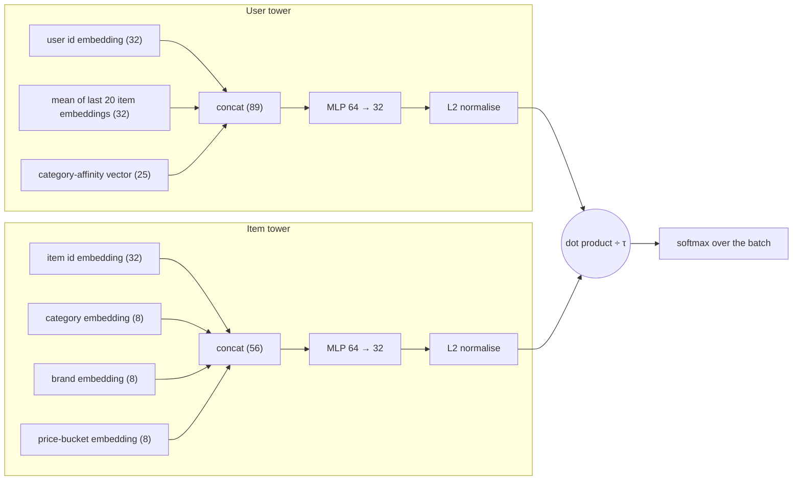
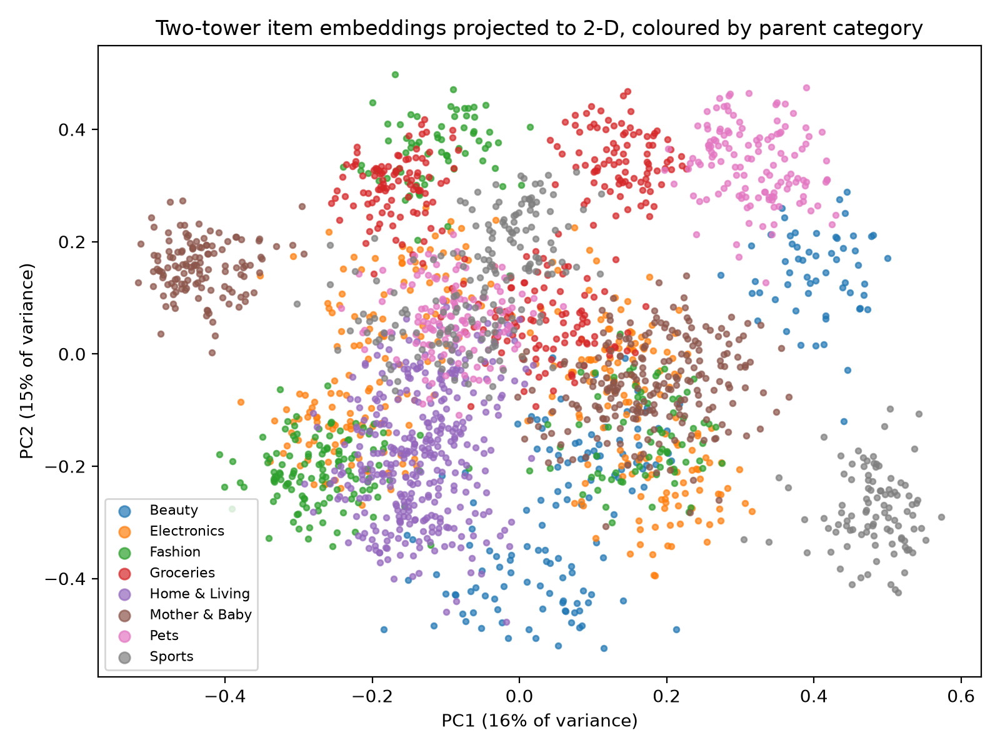
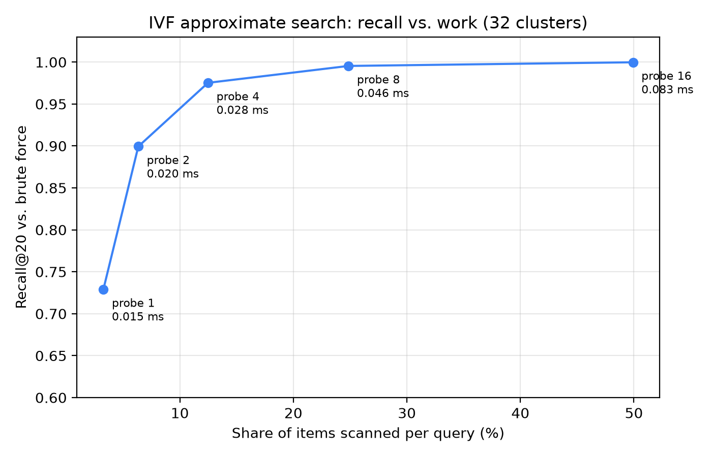

# Embeddings and two-tower retrieval

It is 9.9 sale night and the marketplace team is watching a dashboard. Item-to-item co-visitation, the retriever you met in Chapter 5, has been serving the "similar items" strip for months, and it is good at one thing: telling you what people who looked at *this* phone also looked at. But Dewi, the newest engineer on the team, has a different complaint. A user who spent the whole week browsing running shoes, a sports watch and an electrolyte drink opens the home page and sees phone cases. "The system knows nothing about what she *is*," says Dewi. "It only knows which product pages she touched. There is no notion of a taste that connects shoes, watches and electrolyte powder."

What Dewi wants is a *representation*: a short list of numbers for every user and every item, learned so that "fits this user" turns into a single arithmetic operation. If the numbers are good, the sports-minded user lands near sports items even when none of those exact items ever co-occurred with her history. And if the operation is cheap, the team can score millions of items without a heavy ranker. That is the promise of **embeddings** and the **two-tower model**, the architecture that sits behind the first stage of YouTube, Pinterest, Alibaba and, in some form, almost every large marketplace.

In this chapter we build one from scratch in PyTorch on the same simulated marketplace as every other chapter, train it, and evaluate it against the popularity baseline. The result is not what the textbooks make you expect: the model that follows the recipe faithfully scores *below* the trivial "popular in the last 7 days" baseline. Finding out why, and fixing it with a one-line correction from a real production paper, is the most instructive part of the chapter. We finish by building an approximate nearest-neighbour index (IVF) with nothing but numpy, so you see why retrieval over a huge catalogue does not need to touch every item.

**What you'll learn**

- What an embedding is, and why "closeness in a vector space" is a useful replacement for hand-written similarity rules.
- How a two-tower model is wired: a user tower, an item tower, a dot product, and why the split matters for serving.
- How the in-batch softmax loss with a temperature trains the towers, and why in-batch negatives are biased against popular items.
- How the logQ correction removes that bias, and what it did to our offline numbers.
- How approximate nearest-neighbour search (IVF from scratch; HNSW, ScaNN and FAISS in the real world) trades recall for speed.
- How to read a PCA picture of embeddings without over-interpreting it.

## Intuition: from names to coordinates

Think about how a good bookshop assistant works. She does not memorise a table of "customers who bought X also bought Y". She has a *map in her head*: cookbooks on one side of the shop, thrillers on the other, with "food memoirs" somewhere between. A new customer walks in, says two sentences about what she likes, and the assistant places her on the map. Recommending is then just "walk to the nearest shelf that hasn't been picked over".

An **embedding** is that map made explicit. Every user and every item becomes a point in a vector space, say 32 dimensions. Nobody tells the model what the dimensions mean. Training pushes users towards the items they interact with and away from items they ignore, and the coordinates that make this possible are the embedding. Matrix factorisation (Chapter 6) already produced such vectors: one row of $P$ per user, one row of $Q$ per item. So what is new?

Three things.

1. **The vectors are computed by a function, not looked up in a table.** In matrix factorisation each item has a free parameter vector. An item with no interactions gets no vector. In a two-tower model, the item vector is the *output of a small neural network* whose inputs include side information: category, brand, price bucket. A new item with a known category and brand gets a sensible vector on its first day. The same goes for users: the user tower can read the last items a user touched and their category affinities, so the vector reacts to what she did five minutes ago, as long as the history features are fresh when you compute them.
2. **The loss is a ranking-flavoured softmax, not a squared error.** We will not predict a rating. We will ask: among all items in this batch, which one did the user actually interact with? That is a classification problem, and it scales.
3. **Serving is a nearest-neighbour lookup.** Because the final score is a dot product between a user vector and an item vector, and the item vectors do not depend on the user, we can compute every item vector once, put them in an index, and answer "top 50 items for this user" without a neural network forward pass per item.

::: fact
**Vectors that do arithmetic.** The paper that popularised word embeddings reported that the vector for "King", minus the vector for "Man", plus the vector for "Woman", lands closest to the vector for "Queen". Nobody programmed that regularity; it fell out of training a simple model to predict neighbouring words on a large corpus. Recommender embeddings are the same idea with items and users in place of words.

Source: Mikolov et al., ICLR Workshop, 2013
:::

## The two-tower architecture

A *tower* is just a function that turns raw inputs into a vector. The two-tower model has two of them that never see each other's inputs.



*Figure: The two towers of our model. The only place the user side and the item side meet is the final dot product.*

Our towers come straight from the chapter's companion script. The **user tower** concatenates three things: a learned embedding for the user id (32 numbers), the *mean* of the embeddings of the last 20 items the user interacted with (another 32, using the same item-id table as the item tower), and the 25-dimensional category-affinity vector from `recsys.candidates.category_affinity`, the same signal the repo's retriever uses. A two-layer MLP maps the 89 numbers to 32. The **item tower** concatenates the item-id embedding (32), a category embedding (8), a brand embedding (8) and a price-bucket embedding (8), where the bucket is the quintile of price relative to the category median. Another MLP maps those 56 numbers to 32.

Both outputs are **L2-normalised**: scaled to length 1. After that, the dot product of a user vector and an item vector is exactly their *cosine similarity*, a number between $-1$ and $1$. Normalisation matters for two practical reasons. It stops the model from "cheating" by inflating the norm of popular items, and it makes the dot product bounded, which is what lets us talk about a temperature in the next section.

Why two towers rather than one big network that sees user and item together? A joint network (a *cross* model) can learn arbitrary interactions, such as "this user likes cheap items *only* in Beauty", and is usually more accurate. But it must be run once per (user, item) pair. For 2,311 items that is feasible; for 50 million it is not. The two-tower design is a deliberate trade: give up expressive interactions, gain the ability to precompute and index one side. In a multi-stage system that is exactly the right trade for stage one, because stage two (the ranker of Chapters 9 and 10) re-scores the survivors with all the cross features you like.

::: fact
**Two stages at YouTube.** The 2016 YouTube paper describes a recommender split into candidate generation and ranking. Candidate generation treats recommendation as extreme multiclass classification, learns user and video embeddings, and at serving time reduces the problem to a nearest-neighbour search over the video vectors, because scoring millions of videos with a full network per request is too slow. The structure of this book's system follows the same split.

Source: Covington et al., RecSys, 2016
:::

## The algorithm: training with an in-batch softmax

### Step by step

Training data are positive pairs: a user and an item the user interacted with before the cutoff (click, cart or order, from `common.interaction_matrix` and `History.interactions`). We have no labelled negatives; "the user did not click" is not the same as "the user dislikes it". The standard trick is to manufacture negatives for free from the batch itself.

1. Sample a batch of $B$ positive pairs $(u_1, i_1), \dots, (u_B, i_B)$.
2. Run the user tower on every $u_b$ to get $\mathbf{u}_b$, and the item tower on every $i_b$ to get $\mathbf{v}_b$. Both are unit vectors.
3. Build the $B \times B$ matrix of scaled scores $s_{bj} = \mathbf{u}_b \cdot \mathbf{v}_j / \tau$, where $\tau$ is the **temperature**.
4. Row $b$ is a $B$-way classification problem: the right answer is column $b$ (the item that user actually touched); the other $B-1$ items in the batch are treated as negatives.
5. Minimise the cross-entropy of that classification, averaged over the batch:

$$
\mathcal{L} = -\frac{1}{B}\sum_{b=1}^{B} \log \frac{\exp(s_{bb})}{\sum_{j=1}^{B} \exp(s_{bj})}
$$

This is the **sampled softmax** idea: the full softmax over the whole catalogue would be the right objective but is far too expensive, so we approximate the denominator with the other items in the batch.

### The temperature

Because cosines live in $[-1, 1]$, the raw gap between a good item (0.8) and a mediocre one (0.3) is tiny to a softmax: $e^{0.8}$ versus $e^{0.3}$ is a ratio of about 1.6. Dividing by a small $\tau$ stretches the scale. With $\tau = 0.05$, as in our script, the same gap becomes 16 logit units and the softmax becomes decisive. A low temperature makes the loss care about getting the *top* of the ranking right and punishes hard negatives severely; a high temperature spreads probability more evenly and learns more gently. It is a hyperparameter you tune, usually between 0.05 and 0.2.

### A worked example with hand-sized numbers

Take $B = 3$ and, to keep arithmetic friendly, $\tau = 0.5$. Suppose user 1's cosines with the three batch items are $0.8, 0.3, 0.1$, and item 1 is her true positive.

- Scaled logits: $1.6,\ 0.6,\ 0.2$.
- Exponentials: $4.95,\ 1.82,\ 1.22$, sum $\approx 8.00$.
- Probability of the right item: $4.95 / 8.00 \approx 0.62$. Loss $= -\ln 0.62 \approx 0.48$.

If training moves her cosine with item 1 to $0.9$, the logit becomes $1.8$, $e^{1.8} \approx 6.05$, the probability rises to about $0.67$ and the loss falls. The gradient pushes $\mathbf{u}_1$ towards $\mathbf{v}_1$ and away from $\mathbf{v}_2, \mathbf{v}_3$ at the same time. Because every item is the positive for some rows and a negative for others, the item vectors are pulled and pushed all through training.

### The hidden bias: who ends up as a negative?

Now ask how often a particular item appears as a *negative* in a batch. A batch is a random sample of positive pairs, so an item shows up in the batch in proportion to how many interactions it has. If one item accounts for 2% of all interactions, roughly one batch row in fifty is its positive row, and in *every other row* of that batch it appears as a negative. A rare item with 0.01% of interactions is almost never in the batch at all.

So popular items are over-represented as negatives relative to how often a *uniformly random* catalogue item would be. The model dutifully learns: "popular items are usually the wrong answer for this user", and shifts their scores down. That might be harmless if serving also drew negatives in proportion to popularity. But at serving time we score *every* item in the catalogue uniformly. The popularity penalty learned in training is now a systematic error: the best-selling items, which are genuinely relevant to many users, get suppressed.

### The logQ correction

Yi et al. described the fix at Google: subtract from each logit the log of the probability that the item is drawn into the batch. If $q_j$ is the sampling probability of item $j$, define the corrected logit

$$
s^{c}_{bj} = \frac{\mathbf{u}_b \cdot \mathbf{v}_j}{\tau} - \log q_j
$$

and use $s^c$ in the softmax. The intuition: an item that is often drawn as a negative ($q_j$ large, $\log q_j$ close to zero) gets a small boost; a rarely drawn item ($\log q_j$ very negative) gets a large boost. This exactly cancels the extra pushing-down that popular items would otherwise receive, so the dot product itself learns "fit", not "fit minus a popularity tax". In the paper the frequencies are estimated online from a stream; in our offline script we use the empirical item frequencies among training pairs.

A tiny numeric version of the same example. Let item 1 be popular ($q = 0.5$) and items 2 and 3 rarer ($q = 0.25$ each). Then $-\log q = 0.69,\ 1.39,\ 1.39$. The corrected logits are $1.6 + 0.69 = 2.29$, $0.6 + 1.39 = 1.99$, $0.2 + 1.39 = 1.59$. Exponentials: $9.90,\ 7.28,\ 4.88$, sum $\approx 22.1$. The probability of the true item falls from $0.62$ to $0.45$ and the loss rises from $0.48$ to $0.80$. To get the loss down again, the model now has to separate the positive item *more* cleanly in cosine space, not lean on popularity. At serving time the $-\log q$ term is simply dropped.

::: fact
**Correcting sampling bias in YouTube retrieval.** Yi et al. studied two-tower retrieval models trained with in-batch softmax on very large, heavily skewed catalogues. They show the sampled loss is biased by the item sampling distribution, correct it by subtracting the log of the estimated item frequency, and estimate that frequency from a data stream so it keeps up as the corpus changes. They report using the method for retrieval at YouTube.

Source: Yi et al., RecSys, 2019
:::

## Code walkthrough

All code in this section is from `book/code/ch07_two_tower.py`. The script builds the data, defines the model, trains four variants (10 or 30 epochs, with and without the logQ correction), evaluates each against the same held-out week as every other chapter, and then runs the ANN demo.

### The towers

```include
path: book/code/ch07_two_tower.py
symbol: Towers
```

Read this class in four parts.

- **Embedding tables.** `user_emb` has one 32-dimensional row per user; `item_emb` has one row per item *plus one extra* row used as padding (`padding_idx=n_items`), so users with fewer than 20 items in their history can share a fixed-width tensor. `cat_emb`, `brand_emb` and `price_emb` are small 8-dimensional tables. Note that `item_emb` is **shared**: the item tower looks up an item's own row, and the user tower looks up the rows of the user's history items from the same table. Sharing means the vector for "running shoe A" has one meaning across both towers.
- **The MLPs.** `user_mlp` takes `32 + 32 + n_cats` inputs (32 for the user id, 32 for the history mean, 25 for the affinity), which is the 89 in the diagram. `item_mlp` takes `32 + 8 + 8 + 8 = 56`. Each is `Linear → ReLU → Linear` with a 64-wide hidden layer and a 32-wide output.
- **`user_vec`.** Look at the masked mean:

```include
path: book/code/ch07_two_tower.py
symbol: Towers.user_vec
```

`mask` is 1 where a history slot holds a real item and 0 where it holds the padding index. The embeddings are multiplied by the mask before summing and divided by the number of real items (clamped at 1 so a user with no history divides by 1 rather than 0). Without the mask, padding rows would drag every short-history user towards the same "empty" direction. The result is concatenated with the user-id embedding and the category affinities, pushed through the MLP, and normalised with `F.normalize`.

- **`item_vec`.** This is the simpler tower: concatenate four embeddings, MLP, normalise.

```include
path: book/code/ch07_two_tower.py
symbol: Towers.item_vec
```

An important design consequence: `item_vec` takes only item attributes, with no user input. That is what makes it possible to compute the vectors for the entire catalogue once, offline, and store them.

### The training loop

The training function is nested inside `main` so that it can see the tensors prepared there. The build supports nested symbols, so we can show it on its own.

```include
path: book/code/ch07_two_tower.py
symbol: main.train
```

Walk through the inner loop.

1. `perm = torch.randperm(...)` shuffles the positive pairs each epoch; `b` is a slice of 512 of them (`BATCH`).
2. `h = t_hist[u].clone()` fetches each user's last-20-items matrix, and the next line, `h[h == i[:, None]] = model.pad`, **blanks out the target item inside its own user's history**. Without it the user tower would see the answer it is supposed to predict, the same kind of leakage you will study in Chapter 9. The model would reach a low training loss by copying, and then fail on the held-out week where no such shortcut exists.
3. `uv` and `iv` are the user and item vectors for the batch. `logits = uv @ iv.T / TEMP` is the $B \times B$ matrix $s_{bj}$ of the algorithm.
4. `if logq:` subtracts `log_q[i][None, :]`, where `log_q` was computed at the top of `train` as `log(count / total)` of each item among training pairs. Broadcasting subtracts $\log q_j$ from column $j$. That one line is the entire logQ correction.
5. The `same` mask handles a subtle problem: the same item can appear twice in a batch (two different users clicked it). If it did, column $j$ would be a "negative" that is actually a positive for row $b$. The mask sets those off-diagonal duplicates to $-10^9$ so they vanish from the softmax.
6. `F.cross_entropy(logits, torch.arange(len(b)))` is the loss in the formula above: the correct column for row $b$ is $b$.
7. Standard `zero_grad / backward / step` with Adam at learning rate $10^{-3}$, seeds fixed at 0 for reproducibility.

When the loop ends, `train` switches to eval mode and computes the item vectors for the whole catalogue and the user vectors for the evaluation users. Those are the only things evaluation needs.

### Scoring and evaluation

```include
path: book/code/ch07_two_tower.py
symbol: main.evaluate_variant
```

Scoring is a single matrix product, `uv_eval @ V.T`: 947 evaluation users against the in-stock items. Two details deserve attention. Users with no history before the cutoff get a score of exactly zero for every item (`np.where(has_hist[:, None], ..., 0.0)`), and `scores_to_recs` pads such users with 7-day popularity, because the model has "no opinion". The scores of the others are shifted to be positive, because that helper treats only strictly positive scores as an opinion. Then `common.evaluate` computes exactly the same metrics every chapter uses: recall@K, order recall, NDCG@20 and coverage@20.

### The ANN index, from scratch

The second half of the script has no deep learning in it. IVF, the *inverted file index*, needs only a clustering routine.

```include
path: book/code/ch07_two_tower.py
symbol: kmeans
```

This is Lloyd's k-means with a small trick. Finding the nearest centroid by Euclidean distance is `argmax(x @ cent.T - 0.5 * ||cent||²)`: expanding $\|x - c\|^2 = \|x\|^2 - 2x\cdot c + \|c\|^2$, the $\|x\|^2$ term is the same for every centroid and can be dropped, and flipping the sign turns "minimise" into "maximise". One matrix multiplication assigns all points at once. Then each centroid moves to the mean of its points, and we repeat for 20 iterations.

## Approximate nearest neighbours

### Why brute force stops working

Brute force means: for each query vector, compute the dot product with every item vector and keep the top $K$. Our catalogue has 2,311 in-stock items, so it is a 2,311 × 32 matrix product, which is trivially fast. Scale the catalogue to 50 million items and the same operation is $50\text{M} \times 32 \approx 1.6$ billion multiply-adds per request, which will not fit a latency budget of tens of milliseconds even on good hardware. The crucial observation is that we do not need the *exact* top 50. The ranker will re-score everything anyway. We only need a candidate list that contains *most* of the true neighbours.

### IVF in four steps

1. **Train.** Run k-means on the item vectors to get $C$ centroids ($C = 32$ here). Assign every item to its nearest centroid. The set of items for one centroid is its *inverted list* (the "inverted file" in the name).
2. **Query: choose clusters.** For a query vector $\mathbf{q}$, score it against the $C$ centroids (cheap: $C$ dot products) and keep the `n_probe` best.
3. **Query: scan.** Concatenate the inverted lists of those clusters and compute exact dot products only on those items.
4. **Return the best $K$** among the scanned items.

The cost is $C + n_{\text{probe}} \cdot N / C$ dot products on average, instead of $N$. For $N = 2{,}311$ and $C = 32$, probing 4 clusters scans about $4 \times 72 \approx 289$ items plus 32 centroids, versus 2,311. The price is that a true neighbour sitting in a cluster you did not probe is lost; that is where *recall versus brute force* comes from.

A tiny picture helps. Imagine eight items in a 2-D plane forming two clouds: A, B, C, D around $(1, 1)$ and E, F, G, H around $(5, 5)$. Two centroids sit at the cloud centres. A query at $(1.5, 1.2)$ is closest to the first centroid, so with `n_probe = 1` we scan A to D only and get the right answer while skipping half the data. A query halfway between the clouds, at $(3, 3)$, has neighbours in both; probing one cluster loses some of them. That is exactly the boundary effect that more probes repair.

### The demo in code

The IVF query loop is written inline in `main`. For each query it scores the centroids, picks the top `n_probe`, gathers their members and ranks only those exactly:

```include
path: book/code/ch07_two_tower.py
region: ivf_search
```

The `probe` line is the cluster choice (`cent @ qi`, only 32 dot products), `cand` concatenates the inverted lists, `top` is the exact re-rank on the scanned items, and the last two lines record recall against the brute-force answer `ex` and the number of items scanned. Below we show what the loop prints, with 400 evaluation users as queries.

Notice that we run the ANN demo on the *spec* model (`two_tower`, without logQ correction) because that is the first model a reader trains and it is the one the brute-force and IVF results describe. The index quality depends on the geometry of the vectors, not on how good the recommendations are.

::: fact
**Graph indexes and GPU libraries.** For very large indexes, tree- and cluster-based methods such as IVF are often combined with *graph* methods. HNSW (Hierarchical Navigable Small World graphs) builds a multi-layer proximity graph: a search starts at a sparse top layer and greedily hops towards the query, descending to denser layers, with logarithmic scaling of search cost reported in the original paper. FAISS, Facebook AI's similarity-search library, implements IVF, product quantisation and GPU brute-force and approximate search; its paper describes billion-scale search on GPUs. Google's ScaNN adds anisotropic vector quantisation, which optimises for inner-product error rather than plain reconstruction error.

Source: Malkov et al., IEEE TPAMI, 2020
:::

## Run it

```bash
cd book
uv run python code/ch07_two_tower.py
```

The script is deterministic (all seeds fixed) and takes a few minutes on a laptop CPU. It first prints the setup and a short diagnostics block.

```output
file: results/ch07_two_tower.txt
lines: 2-11
```

We have 18,256 distinct (user, item) positive pairs from before the cutoff and 1,500 users. The diagnostics are there for a reason: when a neural model scores worse than a trivial baseline, the first question must be "is it a bug?" The consistency checks confirm that the index mappings used in training and in scoring agree, that the history uses only events strictly before the cutoff (no leakage), that almost every evaluation user has a non-zero category-affinity vector, and that out-of-stock items are excluded at scoring time. Then training starts.

```output
file: results/ch07_two_tower.txt
lines: 13-22
```

The loss of the spec model falls steadily from 6.8075 to 5.1991, so optimisation works. The sanity line after the 10-epoch run tells us that for 14.7% of the *training* pairs, the true item ranks in the user's top 20 out of 2,495 items. That is far above chance (20/2495 is about 0.8%), so the model has learned real structure. The logQ run starts at a higher loss, 7.3127, and ends at 5.3598. The two losses are *not comparable*: the corrected logits include the extra $-\log q_j$ term, so the classification problem itself is different.

## Results

```output
file: results/ch07_two_tower.txt
lines: 38-47
```

Here is the table that surprised us. Read it row by row.

**The spec model underperforms popularity.** `two_tower` reaches an NDCG@20 of 0.0361, below the 7-day popularity baseline's 0.0475. Its recall@20 of 0.0818 is roughly on par with `pop_7d` (0.0786), and its recall@50 is better (0.1932 vs. 0.1335), so it does retrieve useful items deeper in the list, but it ranks the right ones low. On order recall, which counts only items that were actually bought, it is behind: 0.0912 against 0.1066. Training for 30 epochs (`two_tower_30ep`) does not help: NDCG@20 of 0.0357, and the loss keeps dropping, so more optimisation is not the answer.

The `coverage@20` column gives away the cause. The spec model recommends a very wide spread of the catalogue, with coverage@20 of 0.9766, and `pop_7d` only 0.0087, since it shows everyone nearly the same few items. The spec model has learned *not* to recommend popular items, exactly the pathology the logQ section predicted. In this marketplace popularity is a strong and legitimate signal, as the `pop_7d` row shows: one shared list of a few items beats the model's NDCG. A model that deliberately avoids popular items throws away its best prior.

**The logQ correction fixes it.** `two_tower_logq`, identical in every respect except for the one subtraction line, reaches NDCG@20 of 0.1053, more than double the popularity baseline's 0.0475, and roughly three times the uncorrected model's 0.0361. Recall@20 jumps from 0.0818 to 0.1766 and order recall from 0.0912 to 0.2243. Coverage drops to 0.4344: the corrected model concentrates on a more reasonable subset, still far broader than the popularity baseline's 0.0087, yet no longer scattering recommendations across the whole catalogue. That is the trade-off you want in a retriever: personalised *and* aware of popularity.

**More epochs are not the cure either way.** With the correction, 30 epochs gives an NDCG@20 of 0.0982, slightly *lower* than the 10-epoch 0.1053, and recall@50 is a bit higher (0.2936 vs. 0.2846). That is the usual signature of the start of overfitting on a small dataset: only 18,256 training pairs for roughly 1,500 user vectors and 2,495 item vectors of 32 dimensions each. The practical lesson is to evaluate on a time-held-out set at several epoch counts and stop early; do not assume longer is better.

An honest caveat: these are single-seed numbers on one simulated marketplace. The gap between the spec and corrected models (a factor of about three in NDCG) is large enough that we trust the direction, but we do not claim the ranking of `two_tower_logq` against `two_tower_logq_30ep` is robust. Chapter 10 shows how to quantify seed noise when differences are small.

::: warning
**A low score is not necessarily a bug, but it must be investigated first.** We did not jump to "the architecture is bad". We checked index consistency, leakage, empty-feature coverage and in-stock filtering, and we measured fit on the training pairs. Only after those checks pass should you look for a *modelling* explanation such as sampling bias. Skipping the diagnostics leads to months of tuning the wrong thing.
:::

### What the embeddings look like

Next, the item vectors from the spec model, squashed from 32 dimensions to two with PCA (singular value decomposition of the centred matrix, in numpy).



```output
file: results/ch07_two_tower.txt
lines: 58-58
```

Several things are worth noticing. The model was never given the parent category, only the leaf category, brand and price bucket as embeddings, yet items cluster by parent: Pets items sit in the upper right, Sports items form their own island on the lower right, Mother & Baby has a distinct cloud on the left. Categories with similar shoppers overlap in the middle, which is what you would hope for if "people who buy X also buy Y" structure is encoded.

But be careful. Two principal components explain only 30.6% of the variance, so roughly 70% of the structure is invisible in this picture. Points that look close in 2-D may be far apart in 32-D. PCA is a sanity check ("is there structure at all?"), not a measurement; never decide a modelling question from a scatter plot.

### The recall-versus-speed trade-off

```output
file: results/ch07_two_tower.txt
lines: 49-56
```



The 32 clusters have between 24 and 127 items; the median is 68, so they are uneven, as k-means clusters usually are. Probing a single cluster scans just 3.3% of the items and already recovers 0.729 of the exact top 20. Two clusters bring recall to 0.899 at 6.3% of the work, four clusters to 0.975 at 12.5%, and eight to 0.995 at 24.9%. At 16 probes, half of the catalogue, recall is 1.000 and there is nothing left to save. The curve bends hard at the beginning: the first two or three probes buy almost all of the recall. This is typical, and is why production systems rarely probe more than a few percent of their clusters.

One more caveat on the times column. At 2,311 items the brute-force baseline costs 0.140 ms per query, already faster than anything the network could do, and IVF's per-query overhead (Python loops, `argsort`) means the measured ms/query ratio between brute force and 4 probes (0.028 ms) is modest. The *shape* is what transfers to a catalogue of millions: work grows with the share of items scanned, while recall saturates quickly. Use the "share of items scanned" column, not the absolute milliseconds, when you extrapolate.

## Pitfalls and how it is done in production

**Training-serving skew in the user tower.** Our user tower consumes the last 20 items and the affinity vector at the cutoff. In production the history is assembled by a feature pipeline that must produce identical features online and offline. A mismatch of even a few percentage points in how "last 20 items" is defined silently degrades the model. Chapter 9 treats point-in-time correctness in depth; here it is enough to remember that the towers are only as good as their input features.

**Embeddings drift; indexes must be rebuilt together.** An item vector from model version 17 and a user vector from version 18 live in unrelated spaces. In production you ship the user tower and the item index as one versioned unit, and rebuild the index (re-embed all items, retrain k-means or rebuild the graph) whenever the model changes. Rebuilding is an offline job, which is exactly why the split architecture is attractive: the heavy work happens off the request path.

**Popularity bias hides in many places.** In-batch negatives are only the most visible case. Any time negatives are sampled non-uniformly, or the training set over-represents active users or hot items, the same effect appears. The cures are similar: reweight, correct the logits, or mix in some uniformly sampled negatives. Treat any new sampling scheme as a possible source of bias.

**False negatives.** Our `same`-item mask removes the obvious case. A subtler one: item $j$ appears in user $b$'s batch as a "negative" but she would have loved it, she just never saw it. Large batches make this more likely. Some teams use *hard negative mining* (negatives chosen from items the user *was shown* but ignored) with care, since overly hard negatives can be false negatives too.

**Cold start is only half solved.** A new item gets a sensible vector from its category, brand and price bucket, but its item-id embedding is untrained noise, since nobody has interacted with it. In practice teams either drop the id embedding for items below an interaction threshold, or hash ids into a small number of shared buckets so that rare items fall back on shared learned values. Chapter 12 returns to cold start.

**Choosing an index.** IVF is the easy-to-understand baseline and shines when the index must be cheap to build and update. HNSW usually gives better recall at the same latency for in-memory indexes but takes more memory, and deletions are awkward. Product quantisation compresses vectors so more fit in RAM. FAISS offers all of these, and a managed vector database wraps them. At our scale, none of this matters: a single matrix product is the right answer. Do not add an ANN dependency before brute force actually hurts.

**How this repo does it.** The Shopee-style system of the later chapters does not use a two-tower stage. Its first stage is four hand-written retrievers (recent views, co-visitation, category-popular, trending), which Chapter 8 combines, and the LightGBM ranker of Chapter 10 does the heavy lifting. That is a deliberate, honest choice for a catalogue of 2,495 items. The two-tower model becomes interesting when the catalogue is so large that rule-based retrievers cannot cover it, or when you want a learned retriever to add *new* candidates beyond what co-visitation can reach. Chapter 14 describes how a two-tower stage would slot in as a fifth source.

::: tip
**When you add a learned retriever to a multi-stage system, measure it by its marginal contribution.** A retriever that scores well on NDCG alone may be returning the same items the other sources already find. Chapter 8's "unique contribution" table is the right test: how much *new* recall does the retriever add to the union?
:::

::: try
Re-run the script with `TEMP = 0.2` and then `TEMP = 0.02` (line 25), and compare the `two_tower` and `two_tower_logq` rows. See Q7.9 for what to look for.
:::

## Summary

- An embedding is a learned vector; closeness in the vector space replaces hand-written similarity rules, and side information lets new items and users get meaningful vectors.
- A two-tower model computes a user vector and an item vector with separate networks; the score is their dot product (cosine after L2 normalisation).
- The in-batch softmax treats the other items in a batch as negatives, and a temperature $\tau$ scales the cosines so the loss can discriminate; small $\tau$ sharpens the softmax.
- In-batch negatives are drawn in proportion to popularity, so the loss pushes popular items down; without correction the spec model scored an NDCG@20 of 0.0361, below the 7-day popularity baseline's 0.0475.
- Subtracting $\log q_j$ from the logits (logQ correction, Yi et al., 2019) lifted NDCG@20 to 0.1053 and recall@20 from 0.0818 to 0.1766; longer training did not help.
- Because item vectors do not depend on the user, they can be precomputed and indexed; IVF clusters them with k-means and scans only a few clusters per query.
- In our demo, scanning 12.5% of the items kept 0.975 of the brute-force top 20; the first few probes buy almost all of the recall.
- At this catalogue size brute force is enough; ANN, versioned indexes and cold-start handling matter at production scale.

## Quiz

**Q7.1** What does lowering the temperature $\tau$ in the in-batch softmax do?

A. It makes the softmax flatter, so all items in the batch are treated alike.\
B. It stretches the gaps between cosine scores, so the loss focuses on getting the top of the ranking right and punishes hard negatives more.\
C. It increases the dimensionality of the embeddings.\
D. It removes popular items from the batch.

**Q7.2** Why do in-batch negatives bias a two-tower model against popular items?

A. Popular items have longer titles, which confuses the item tower.\
B. Popular items are always out of stock.\
C. Items enter the batch in proportion to their interaction count, so popular items appear as negatives for many other users' rows and are pushed down more.\
D. The L2 normalisation gives popular items a smaller norm.

**Q7.3** Why does the two-tower design allow approximate nearest-neighbour search at serving time?

A. Because item vectors depend only on item attributes, so they can be precomputed once and indexed, and the user-item score is an inner product.\
B. Because the user tower runs on the GPU.\
C. Because the temperature is always 1 at serving.\
D. Because the item tower takes the user's history as input.

**Q7.4** In one or two sentences, explain what the logQ correction subtracts from each logit, and why subtracting it removes the popularity penalty.

**Q7.5** Our IVF demo measures "recall@20 versus brute force" rather than NDCG. What question does that metric answer, and why is it the right one for an ANN index?

**Q7.6** Read this line from the training loop:

```include
path: book/code/ch07_two_tower.py
region: leak_mask
```

What does it do, and what would likely happen to training loss and to evaluation results if it were removed?

**Q7.7** An item catalogue has 10,000,000 items. You build an IVF index with 4,096 clusters (assume equal-sized clusters) and probe 16 clusters per query. Roughly how many dot products does one query need (centroid scoring plus scanning), and what fraction of brute force is that?

**Q7.8** Two items have sampling probabilities $q = 0.04$ and $q = 0.0004$. By how much does the logQ correction raise the logit of the rarer item relative to the more popular one?

**Q7.9** Hands-on. In `book/code/ch07_two_tower.py`, change `TEMP = 0.05` to `TEMP = 0.2`, run the script, and compare the `two_tower` and `two_tower_logq` rows (ndcg@20 and coverage@20) with the table in this chapter. Then repeat with `TEMP = 0.02`. State what you observe about the effect of temperature and whether the logQ correction still helps. (The script overwrites `results/ch07_two_tower.*`; restore them with `git checkout book/results` afterwards.)
