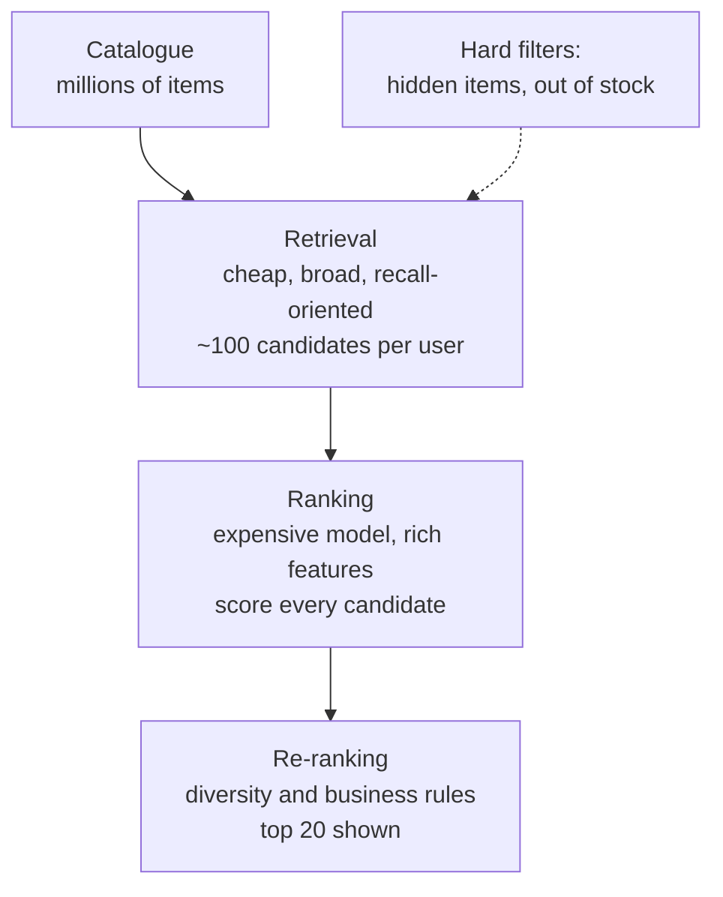
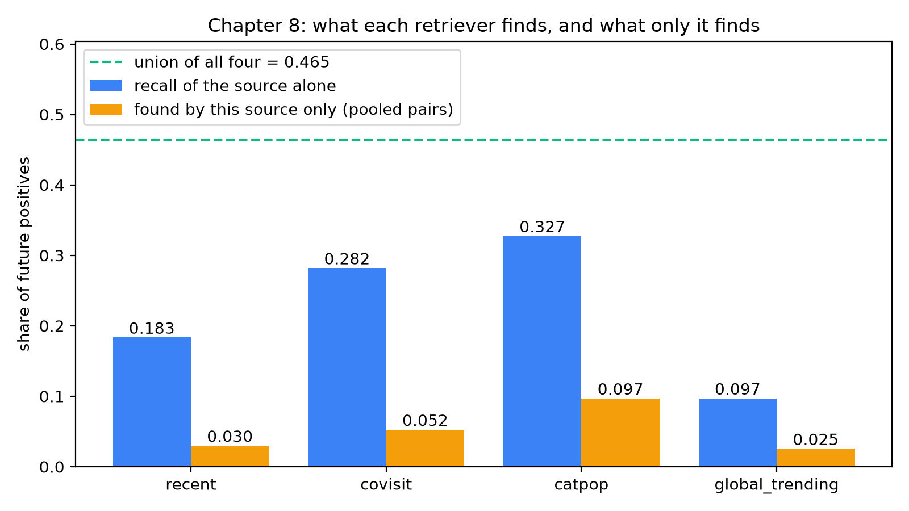
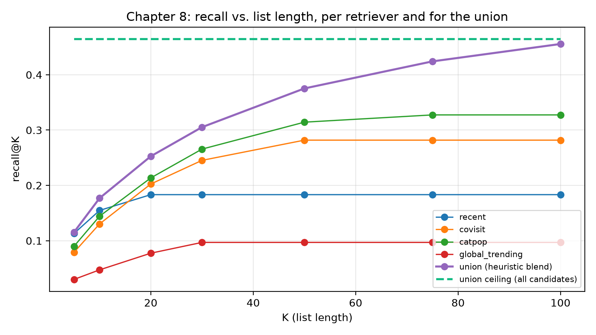

# Multi-source candidate generation

It is 12:05 on a payday, and the home page of a Shopee-like marketplace is about to be opened by a few hundred thousand people in the same minute. Each needs twenty products in a fraction of a second, from a catalogue of millions of items. Somebody proposes: "Let's run our best ranking model (the program that scores how well an item suits a user) on every item for every user and sort." A back-of-the-envelope calculation ends the meeting: even 20 microseconds (millionths of a second) per (user, item) pair means tens of seconds of CPU (processor) time per request, and the model we really want, with dozens of features (input facts) per pair, is far slower.

So the team splits the problem in two. A cheap, broad stage picks a hundred or so items that *might* interest this user; an expensive, precise stage ranks only those. This chapter is about the first stage, **candidate generation** or **retrieval**. It decides what the ranker is even allowed to see, and it sets a hard ceiling on everything downstream.

In this repository the first stage is `recommender/recsys/candidates.py`: four small retrievers, each a different reason to believe a user may like an item, plus a couple of hard filters. The simulator lets us put numbers on every claim.

### Four words to know before we start

Think of shopper Sari opening the app. The catalogue holds millions of items; she can look at twenty.

- A **candidate** is an item that *might* be shown to Sari. It is a "maybe", not a decision. The **candidate pool** is the list of all maybes for her, about a hundred items.
- A **retriever** (also called a *source*) is a small, fast piece of code that proposes candidates for one reason, for example "Sari looked at these cat-food bags yesterday". Several retrievers each add items to the pool.
- The **ranker** is the slower, smarter model of a later chapter. It takes the pool and puts the items in order for Sari. It can only reorder what the pool contains.
- **Recall** is the share of the items Sari will really want that made it into the pool. Suppose she will buy 4 things next week and 2 of them are in the pool: recall is $2/4 = 50\%$. If the other 2 are missing, no ranker can ever show them, however clever it is.

Compare this with a shop assistant who first fetches a trolley of 100 products from the warehouse (retrieval) and only then lays out the best 20 on the counter (ranking). The assistant cannot lay out something that is still in the warehouse. That is why this chapter matters: the pool decides what is *possible*.

**What you'll learn**

- Why recommendation is organised as a funnel of stages, and why recall rather than precision is the goal of the first stage.
- How the four retrievers in the repo work (`recent`, `covisit`, `catpop`, `global_trending`) and which real-life behaviour each one imitates.
- How to combine retrievers with an outer join, keep each retriever's score as a feature, and count how many sources proposed an item.
- How to measure a retriever with recall and with *unique* recall, and what the "recall ceiling" means for the whole system.
- Why hidden and out-of-stock items must be removed with hard filters at this stage and not left to the ranker.

## Intuition: the librarian and the shortlist

Imagine asking a librarian for "something good to read tonight". She does not read every book in the building. She shortlists using several instincts: what you borrowed last week, what readers of those books also borrowed, which shelves you browse and which of their books are most borrowed this month, and, if you are a first-time visitor, what everybody is borrowing right now. Only with twenty or thirty books on her trolley does she sit down, look carefully at each one and decide the order.

Notice that the librarian uses *several* instincts, because each fails differently: your last loan is useless if you are new, and "popular this month" is useless for niche tastes. Combining them covers blind spots. That is **multi-source candidate generation**, and the module docstring of `candidates.py` calls each retriever "a different reason to like an item".

## Why two stages: the funnel

Suppose the catalogue has $N$ items and we serve $U$ requests per second. Scoring every item with a ranker that costs $c$ seconds per pair needs $U \cdot N \cdot c$ seconds of compute every second. With $N$ in the millions, even a cheap $c$ is unaffordable, because a good ranker needs features computed *per pair*: the user's history with this item, its recent click-through rate (the share of people who saw it and clicked), the shop's quality.

The funnel solves this by spending compute where it pays. Each stage looks at fewer items and may therefore afford more computation per item:


*Figure: The recommendation funnel. Each stage sees fewer items and can spend more compute per item. Hard filters act at the earliest possible point.*

Three properties follow. **Recall is the metric of stage one:** of the items the user will go on to like, how many are inside my shortlist? Order inside the shortlist is irrelevant and precision is secondary, because the ranker cleans up false positives. **The shortlist is an upper bound:** if a future click is not in the candidate set, no ranker can recommend it. This is the *recall ceiling*. **Cheapness beats elegance:** a retriever should be an index lookup, a group-by or a nearest-neighbour query; anything needing per-pair features belongs in stage two.

Here is the recall idea with numbers you can check by hand. Say Sari goes on to click items $\{P, Q, R, S\}$ the next week. Retriever 1 proposes $\{P, X, Y\}$, retriever 2 proposes $\{P, Q, Z\}$. The pool is the union (everything either one proposed): $\{P, Q, X, Y, Z\}$. Sari's clicks found in the pool are $P$ and $Q$, so recall is $2/4 = 50\%$. Items $R$ and $S$ are the *ceiling* in action: nothing downstream can bring them back. Retriever 2 alone also found $P$ and $Q$, so retriever 1 added nothing new that Sari wanted. We will measure exactly this later, as *unique recall*.

::: fact
**Two networks, one funnel.** YouTube's recommender, as published by Covington, Adams and Sargin, is split into exactly two neural networks: one for candidate generation and one for ranking. The candidate generation network takes the user's activity history and retrieves a small subset, "hundreds" of videos, from a corpus of millions; the ranking network then scores that small set using a much richer set of features. The authors point out that this two-stage design lets them recommend from a very large corpus while still being sure that the few videos shown are personalised, and that it also lets them blend candidates generated by other sources.

Source: Covington et al., RecSys, 2016
:::

The same paper makes a second observation that this repo copies: information from the candidate stage should be passed to the ranker as features, such as which sources nominated a candidate and with what scores. `generate` does this with `cand_recent_score`, `cand_covisit_score`, `cand_catpop_score`, `cand_global_pop_rank` and `cand_n_sources`.

## The four retrievers

Each retriever answers a different question and is silent for a different group of users.

| Retriever | Question it answers | Analogy | Silent for |
|---|---|---|---|
| `recent` | What did *you* touch lately? | "Your last loans" | Users with no history |
| `covisit` | What do people who touched *your* items also touch? | "Readers of this also read…" | Users with no history, or whose items nobody else visited |
| `catpop` | What is popular in the categories *you* like? | "The best-selling shelf you browse" | Users with no clicks *and* no searches |
| `global_trending` | What is hot for everybody right now? | "The front-of-store display" | Nobody. It is the same list for everyone |

All of them share an exponential time decay (the idea from Chapter 3: older actions count less) and a "top-n per user" cut so no source floods the pool:

Two ideas appear in the code below. **Time decay** means that an old action counts less than a fresh one, like yesterday's news versus last month's. We use a **half-life**: after 7 days an action counts half as much, after 14 days a quarter, and so on. A **top-n per user** cut means that each retriever keeps only its best $n$ items for each user, so no single source can flood the pool with hundreds of items. (If a "recent" list had 500 items, it would crowd out the other sources.)

```include
path: recommender/recsys/candidates.py
symbol: _decay
```

```include
path: recommender/recsys/candidates.py
symbol: _top_per_user
```

The formula below has three parts: $w$ is how strong the action was (a click is weak, an order is strong), $a$ is how many days ago it happened, and $2^{-a/7}$ is the fading factor. At $a=0$ it equals 1 (full strength), at $a=7$ it equals $\tfrac12$.

With `HALF_LIFE_DAYS = 7.0`, for an action of strength $w$ that happened $a$ days before the cutoff:

$$
s = w \cdot 2^{-a/7}.
$$

An order ($w=5$) from a week ago counts $2.5$, five times a week-old click ($w=1$ gives $0.5$). The weights come from `schema.EVENT_WEIGHT`: click 1, add-to-cart 3, order 5.

### Retriever 1: `recent`

The simplest retriever is memory. It sums the decayed weights of all the user's past actions on each item and keeps the top 20 items per user.

```include
path: recommender/recsys/candidates.py
symbol: recent
```

This looks too trivial to be useful, but shoppers revisit things: they look at a phone, leave, and come back two days later. It is also the seed list for `covisit`.

### Retriever 2: `covisit`

Co-visitation is the session-based item-to-item collaborative filtering of Chapter 5. `covisitation_matrix` counts how often two items received a positive action in the same session within 30 days and normalises per source item, so each row sums to 1: a distribution $w(a \to b)$ over the items $b$ that usually accompany $a$.

A **session** is one visit to the app, a stretch of continuous activity. The idea of co-visitation is simple: if many shoppers who looked at a phone case in one session also looked at a screen protector in the same session, the two items are "neighbours". "Normalises per source item" means we turn counts into shares. Say that after phone case A, 30 sessions touched item C and 70 touched item D: the row for A becomes $C = 0.3$, $D = 0.7$, which sums to 1.


The `covisit` retriever then walks from the user's best recent items to their neighbours:

```include
path: recommender/recsys/candidates.py
symbol: covisit
```


Think of it as a vote. Each item the user touched recently (a **seed**, as in "a seed that grows into a list of neighbours") casts votes for its neighbours. A stronger and fresher seed has a louder vote, and a neighbour that several seeds vote for gets the most votes in total.

The score of a neighbour $b$ is a weighted vote of the user's seeds:

$$
\text{covisit}(u, b) = \sum_{a \in \text{seeds}(u)} \text{recent}(u, a)\; w(a \to b),
$$

where `seeds(u)` is the user's ten strongest recent items (`N_SEEDS = 10`) and we keep the top 40 neighbours (`N_COVISIT = 40`). Notice the dependency: `covisit` takes the *output of `recent`* as its input. If the user has no history, `recent` is empty, so `covisit` is empty too.

### Retriever 3: `catpop`

The third retriever works on *categories* rather than items. First it builds a user-by-category interest table, `category_affinity`:


An **affinity** is a measure of how much someone likes something, here how much Sari likes each product category (a group such as Pets or Beauty). For Sari, if 6 of her 10 weighted actions were about Pets and 4 about Beauty, her affinity is 60% Pets and 40% Beauty.

```include
path: recommender/recsys/candidates.py
symbol: category_affinity
```

Two details matter. Searches count: a search for "coffee" becomes a category hit by naive substring matching and weighs 2.0 ("about two clicks of intent"), so a shopper who searched but never clicked still has a profile. And the result is a *share*: each user's weights sum to 1, so a heavy user does not look "more interested" than a light one.

`catpop` takes each user's top three categories and joins them with the most popular available items in those categories:

```include
path: recommender/recsys/candidates.py
symbol: catpop
```

For each category only the 20 most popular items in the last 7 days are kept (`N_PER_CATEGORY = 20`), and popularity is normalised by the category's maximum, giving `pop_norm` in $[0, 1]$. The score is

$$
\text{catpop}(u, i) = \text{share}(u, c(i)) \cdot \bigl(0.1 + \text{pop\_norm}(i)\bigr).
$$

The constant $0.1$ matters: without it an item with zero recent popularity would score exactly zero and look "not proposed". With it, even a brand-new listing in the user's favourite category stays eligible.

### Retriever 4: `global_trending`

The last retriever is deliberately dull:

```include
path: recommender/recsys/candidates.py
symbol: global_trending
```

It takes the popularity of each item over the last 3 days (a shorter window than `catpop`'s 7, since "trending" means *right now*), keeps only in-stock items, and returns the top 30 with their rank. The list is the same for every user. Its value is not personalisation; it is *coverage*: it guarantees every user, including a brand-new visitor with no events, receives at least 30 candidates. The order of operations is important: the in-stock filter happens **before** `nlargest(N_GLOBAL)`. If it were applied afterwards, any sold-out item in the top 30 would leave a hole, and the list would silently shrink.

### A tiny worked example

Let us calculate one user by hand. At the cutoff, user $u$ has this history (decay with half-life 7 days):

- Clicked item A seven days ago: $1 \cdot 2^{-1} = 0.5$.
- Ordered item B fourteen days ago: $5 \cdot 2^{-2} = 1.25$.

`recent` therefore proposes B with score $1.25$ and A with score $0.5$. Now suppose the co-visitation rows are:

| seed | neighbour | $w$ |
|---|---|---|
| B | C | 0.4 |
| B | D | 0.6 |
| A | C | 0.5 |
| A | E | 0.5 |

Then `covisit` scores are $C = 1.25 \cdot 0.4 + 0.5 \cdot 0.5 = 0.75$, $D = 1.25 \cdot 0.6 = 0.75$ and $E = 0.5 \cdot 0.5 = 0.25$. Item C received a vote from two seeds, which is exactly the kind of agreement we want to reward.

Finally, say the user's affinity is 60% Pets and 40% Beauty. A pet-food item with `pop_norm = 0.5` gets $0.6 \cdot (0.1 + 0.5) = 0.36$, while a pop-0.9 beauty item gets $0.4 \cdot (0.1 + 0.9) = 0.40$. A less popular item in the more-loved category can lose to a popular one elsewhere; the ranker decides later.

## Combining the sources: `generate`

We now have four tables with different shapes: `recent` and `covisit` and `catpop` are keyed by (user, item) with their own score column, while `global_trending` is a user-independent list. `generate` stitches them together.

Before the code, a short note on the tool it uses. A **join** glues two tables together by matching rows on a key. An **outer join** keeps rows even when only one table has them, and fills the gaps with "missing" (null). A tiny example for Sari, whose key is the item:

| item | `recent` score | `covisit` score |
|---|---|---|
| A | 0.5 | *missing* |
| B | 1.25 | 0.4 |
| C | *missing* | 0.75 |

Item B, proposed by both sources, appears in **one** row with both scores filled in, not in two rows. That merging of several proposals into one row is **deduplication** (removing duplicates). The *missing* cells record **source attribution**: which sources nominated the item (A came only from `recent`, C only from `covisit`). An *inner* join, by contrast, would keep only B, the items proposed by every source, and throw away almost everything.


```include
path: recommender/recsys/candidates.py
symbol: generate
```

Walk through it in four movements.

**1. Union by outer join.** The global list is cross-joined with the user list (a **cross join** pairs every row of one table with every row of the other) so that every user gets the same 30 rows. Then the sources are merged with `how="outer"` on `(user_id, item_id)`. An item proposed by any source survives. An item proposed by two sources becomes *one row with two non-null score columns*, not two rows. This is the single most important design decision in the function: the unit of the ranking stage is the (user, item) pair, and the sources are *features of that pair*.

**2. Availability filter.** `cands["item_id"].isin(available["item_id"])` removes anything out of stock *at the cutoff*. `History.at` drops the future stock-out time, so the filter uses only information available at request time.

**3. The hidden filter.** The "Not interested" button logs a `hide` event. `generate` left-joins every `(user, item)` pair with such an event as a marker column (a **left join** keeps every row of the pool and attaches a marker where a match exists) and drops the matches: a *hard filter* on the pool, not a feature.

**4. Source bookkeeping.** Finally the function computes `cand_n_sources`, the number of sources that proposed the pair, *before* it replaces missing scores with 0.0 (and the missing global rank with 999). Order matters here, and we will use it as a quiz question: once `fillna` has run on the three score columns, they are never null, so each would count as a source for every row.

A tiny example of why that order matters. Say an item was proposed by `recent` and `covisit` but not by `catpop` (and ignore `global_trending` for simplicity). `fillna(0.0)` means "replace every missing cell with 0.0":

| Moment | `recent` | `covisit` | `catpop` | counted sources |
|---|---|---|---|---|
| Before `fillna` | 1.25 | 0.75 | *missing* | 2 (count the non-missing cells) |
| After `fillna` | 1.25 | 0.75 | 0.0 | 3 (wrong: `catpop` never proposed it) |

After `fillna` we can no longer tell "proposed with score 0" from "not proposed", so we count first.

## Measuring retrievers: recall, pair recall and unique recall

How do we know that a retriever is good? By the rule from Chapter 2 we need a time split: we build candidates from history before the cutoff, and look at what the user actually did in the following seven days (the *labels*, here 947 evaluation users with 3,357 positive (user, item) pairs). The question for each retriever is then: what share of those future positives does it contain?

The word **label** means the correct answer we hide from the retriever, here "what Sari actually did next". **Pooled** means we put everyone's pairs into one big heap and count together, instead of averaging per person.

The companion script `book/code/ch08_candidates.py` computes three numbers per source:

- **recall**: for each user, the share of their future positives found in the source's candidates, averaged over users. This is `evaluate.candidate_recall`.
- **pair recall**: the same share, but pooled over all positive pairs, so users with many positives count more.
- **unique pair recall**: the share of pooled pairs found by *this* source and by *no other*. This is the number that justifies the source's existence.

Unique recall answers the engineering question "what would we lose if we deleted this retriever?" A retriever with a high recall but zero unique recall is a redundant retriever, and we pay for it in latency and in feature noise for nothing.

## Run it

From the `book/` directory:

```bash
uv run python code/ch08_candidates.py
```

The first part of the output is the per-source table:

```output
file: results/ch08_candidates.txt
lines: 2-12
```

`cands_per_user` is the average size of each source's list. `users_with_cands` shows `recent` and `covisit` at about 0.97, so a few percent of users have no history, while `global_trending` reaches everyone. The union averages 103.94 candidates per user, the "hundred or so" of the funnel.

## Results

The picture below shows the per-source recall against the union and the recall of pairs found *only* by that source.



Four observations, tied to the numbers.

**No single retriever is enough.** The best single source, `catpop`, reaches a recall of 0.3274; the union reaches 0.4645, about 14 points (roughly 42% relative) higher. **Overlap is information, not waste.** The four `cands_per_user` values sum to $12.19 + 35.83 + 54.91 + 30.00 \approx 132.9$, but the union holds 103.94, so about 29 candidates per user (a fifth) were proposed by more than one source.

**Every source carries unique value, but unequally.** `catpop` finds 9.68% of all positive pairs that nobody else finds, `covisit` 5.24%, `recent` 2.98% and `global_trending` 2.53%. The trending list has the lowest recall yet almost as much unique value as `recent`: it is the cheap safety net for positives no personalised source reached.

**Even the union misses over half of the future.** A ceiling of 0.4645 means 53.55% of what users click, add or order within the week is never offered to the ranker. Some of it is irreducible (discovery through search, ads, friends); some is addressable with more sources, such as Chapter 7's two-tower retrieval (a model that places users and items in the same "map" and fetches the items nearest to the user).

Recall as a function of how many candidates we keep is plotted below (the values are in `results/ch08_candidates.json`). Each source is ranked by its own score and the union by the repo's heuristic blend.



The flat tails are a signature of retrievers with a fixed size. `recent` is at 0.1833 from $K=20$ on because it never proposes more than 20 items per user. `covisit` stops at 0.2818 from $K=50$, and `catpop` at 0.3274 from $K=75$. The union ranked by the heuristic blend continues to climb, and at $K=100$ it reaches 0.4557, close to the ceiling of 0.4645. It does not reach it exactly because the average pool holds 103.94 candidates per user, so a cut at 100 still drops a few positives that sit at the end of some users' lists. The ceiling is the recall you get when nothing is cut at all.

At $K=20$ the heuristic blend achieves 0.2526 recall against 0.4645 available. That 0.21 gap is the headroom a better ranker (Chapter 10) can try to capture; it cannot exceed the ceiling, but it can move much closer.

::: fact
**Why more sources help: agreement is evidence.** Candidates proposed by several retrievers are better bets. In our run, 76,612 candidates were proposed by exactly one source and only 0.9% of them turned out to be positive in the next week. For candidates proposed by all four sources (622 of them), the positive rate was 18.2%, about twenty times higher. This is the reason `cand_n_sources` exists as a ranking feature, mirroring the practice Covington et al. describe of propagating the nominating sources and their scores from candidate generation into the ranker.

Source: Covington et al., RecSys, 2016
:::

The rate rises monotonically with the number of sources (the per-count table is in `results/ch08_candidates.txt`): 0.0090, 0.0319, 0.0806 and 0.1817. Each extra retriever that independently proposes an item raises the odds that the user wants it, and a tree-based ranker uses this signal heavily.

Ranked by the repo's hand-made heuristic blend (a fixed weighted sum of the source scores, with no learning at all), the union already scores an NDCG@20 of 0.1674 (a ranking-quality score from Chapter 2: higher when relevant items sit near the top of the top 20) with a coverage of 0.5682 (the share of the in-stock catalogue appearing in somebody's top 20). Chapter 10's learned ranker improves on this on the same pool, always *inside the ceiling this chapter draws*.

::: fact
**Built for scale and for real time.** Linden, Smith and York describe Amazon's item-to-item collaborative filtering as a response to a retailer with "tens of millions of customers and millions of distinct catalog items" whose pages must be returned in real time, in no more than half a second. Their algorithm's online computation scales independently of the number of customers and the number of catalogue items, because the expensive item-to-item work is not done per request. The `covisit` retriever has the same spirit: the co-visitation matrix summarises 30 days of sessions, and serving only joins it with the user's ten seed items.

Source: Linden et al., IEEE Internet Computing, 2003
:::

## Hard filters: what must never reach the ranker

Some rules are absolute, not "learn a weight". `generate` applies two while the pool is assembled.

### Out-of-stock items

An item that cannot be bought should not be shown, so `generate` restricts every source to `hist.items[hist.items["in_stock"]]`. A filter beats a feature here because of the asymmetry of the error: a sold-out item at position 3 teaches the shopper that the recommendations are unreliable, while losing it from the pool costs nothing, since it could not have produced a sale.

### Hidden items

When a user presses "Not interested", the frontend sends a `hide` event; `generate` drops every row carrying one. Why not give the ranker a feature? A learned model is statistical and might still show the hidden item once in a hundred requests, and the user sees exactly that one. Users forgive an irrelevant recommendation but not one they explicitly rejected.

## Code walkthrough: how the evaluation script is built

The recall numbers come from `book/code/ch08_candidates.py`. It calls each retriever, restricts the result to evaluation users and in-stock items, and builds a set of `(user_id, item_id)` pairs per source:

```include
path: book/code/ch08_candidates.py
region: unique_recall
```

Unique recall is a set difference. For a source $s$, with $L$ the set of positive label pairs and $C_s$ the pairs covered by $s$:

$$
\text{unique}(s) = \frac{\left| (L \cap C_s) \setminus \bigcup_{o \neq s} C_o \right|}{|L|}.
$$

The *union* row calls the real `candidates.generate`, so the script measures the production path. Global trending has no per-user score, so the script negates its rank to turn "rank 0 is best" into "larger is better". Every source is evaluated on the same 947 users, labels and availability filter; comparing retrievers on different populations is a common mistake.

## Pitfalls and how it is done in production

**Pitfall 1: optimising precision in retrieval.** The ranker removes false positives better than a retriever can, and a discarded candidate is gone for good. Tune for recall at a fixed candidate budget.

**Pitfall 2: the candidate budget is a latency budget.** Every extra candidate costs feature computation and inference. The constants at the top of `candidates.py` (`N_RECENT`, `N_COVISIT`, `N_PER_CATEGORY`, `N_GLOBAL`) are the dials; plot recall against pool size (our second figure) and stop where the curve flattens.

::: warning
A candidate-stage bug is hard to see: recommendations stay plausible but come from a poorer pool. Monitor offline candidate recall and online `candidates_considered` like any health metric; a sudden drop is usually a broken pipeline, not user behaviour.
:::

**How production systems do it.** Real marketplaces run many more retrievers in parallel, each with its own latency budget: embedding retrieval with an approximate nearest-neighbour index (Chapter 7), session-based retrieval, "same shop as items you ordered", "frequently bought with", campaign lists. The merge step applies per-source quotas and deduplicates by item; hard filters run against fast stores such as a key-value blocklist; and offline recall at the pool size is a daily monitored job.

Two terms from that paragraph. A **quota** is a fixed number of slots reserved for each source, for example "at most 30 from `catpop`, at most 20 from `recent`", so one chatty source cannot take the entire pool. **Deduplicating by item** means that if three sources propose the same cat-food bag, the pool keeps one copy, not three, but remembers all three nominators (the attribution from earlier). An **approximate nearest-neighbour (ANN) index** is a data structure that finds "items similar to this one" quickly by accepting that it may occasionally miss the exact best match.

## Summary

- A two-stage funnel exists because ranking every item for every user with a rich model is unaffordable.
- Stage one is judged on recall and sets a ceiling: the union of all sources contains 46.45% of a user's future positives, and no ranker can exceed that.
- The repo uses four retrievers: `recent` (decayed own history), `covisit` (items viewed in the same sessions), `catpop` (popular in favourite categories, from clicks and searches) and `global_trending` (user-independent fallback).
- Sources are merged with an outer join on (user, item); each score is kept as a feature and `cand_n_sources` counts agreeing sources (positive rate 0.9% for one source, 18.2% for four).
- Judge a retriever by recall *and* unique recall; overlap is common (about 133 proposals per user vs 103.94 in the union).
- Hidden and out-of-stock items are hard filters on the pool, not features.

## Quiz

**Q8.1** Why is recall, rather than precision, the primary metric for the candidate generation stage?

A. Because precision cannot be computed on implicit feedback.
B. Because an item that is missing from the candidate set can never be recovered by the ranker, while false positives can be removed by it.
C. Because recall is cheaper to compute than precision.
D. Because the ranker only works when its input contains no irrelevant items.

**Q8.2** According to the per-source table in `results/ch08_candidates.txt`, which retriever finds the largest share of positive pairs that no other retriever finds?

A. `recent`
B. `covisit`
C. `catpop`
D. `global_trending`

**Q8.3** In the output, the positive rate increases from 0.0090 for candidates with one source to 0.1817 for candidates with four sources. What is the most appropriate use of this finding in the system?

A. Remove candidates that only one source proposed.
B. Pass `cand_n_sources` (and the per-source scores) to the ranker as features.
C. Return only the candidates that all four sources propose.
D. Replace the ranker by counting sources.

**Q8.4** A visitor with no history opens the home page. Which retriever(s) still produce candidates for them?

A. All four, because the outer join fills missing values.
B. `recent` and `covisit` only.
C. Only `global_trending`.
D. `catpop` and `global_trending`, because `catpop` falls back to popular items overall.

**Q8.5** The union of the sources has a recall ceiling of 0.4645, yet the union ranked by the heuristic blend reaches only 0.4557 at K=100. Explain why the figure at K=100 is not exactly the ceiling.

**Q8.6** Why does the repo treat "hidden" items as a hard filter in `generate` instead of giving the ranker a `was_hidden` feature and letting it learn to avoid them?

**Q8.7** Read the end of `generate`: the line `cands["cand_n_sources"] = ...` comes before `cands[score_cols] = cands[score_cols].fillna(0.0)`. Suppose you swapped the two statements. What value would `cand_n_sources` take for a candidate that only `covisit` proposed and that is not in the trending list, and why is that a problem?

**Q8.8** Read `global_trending`. The code applies `pop[pop.index.isin(available["item_id"])]` before `.nlargest(N_GLOBAL)`. What would be the observable problem if the order were reversed?

**Q8.9** Using the `cands_per_user` column of the retriever table, compute the average number of (user, item) pairs per user that were proposed by more than one source, i.e. the sum of the four per-source sizes minus the size of the union. Give the value to one decimal place and as a percentage of the sum.

**Q8.10** Hands-on. Open `book/code/ch08_candidates.py` and, at the very top of `main()`, add the line `candidates.N_TOP_CATEGORIES = 5` (the default is 3). Run the script again, then restore the original (`git checkout book/code/ch08_candidates.py book/results`). What changes do you expect to see in the `catpop` row (`cands_per_user`, `recall`) and in the union row, and what happens to the average number of candidates per user? Explain in one or two sentences why the ranker's job gets harder even if recall improves.
