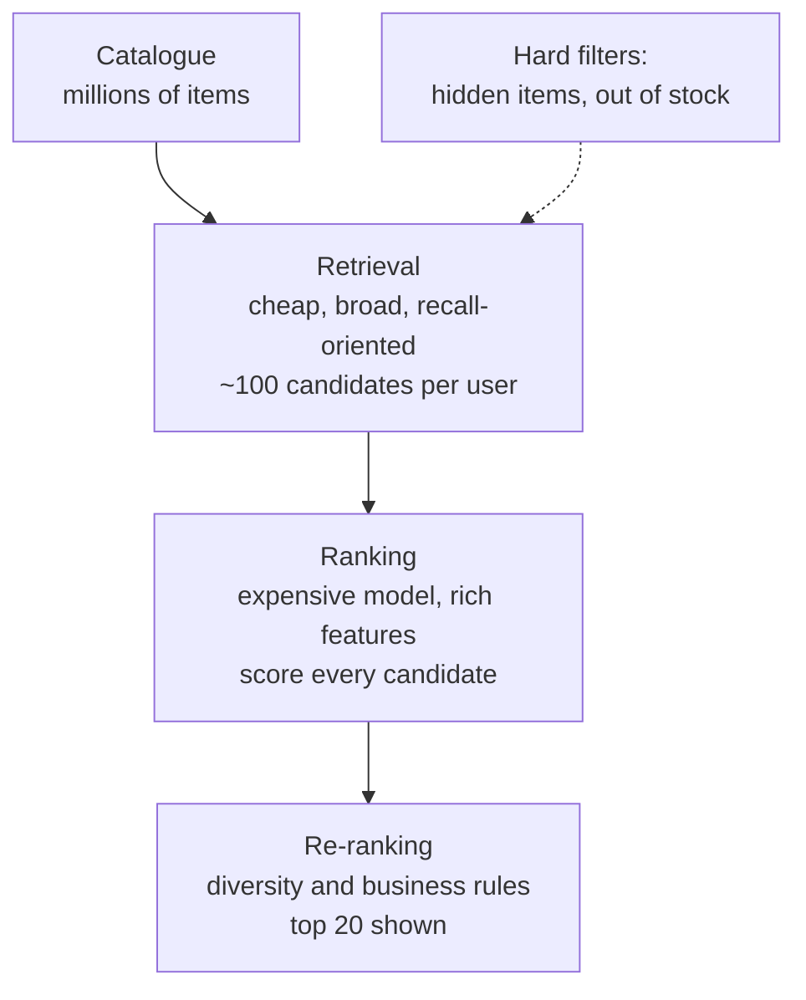

# Multi-source candidate generation

It is 12:05 on a payday, and the home page of a Shopee-like marketplace is about to be opened by a few hundred thousand people in the same minute. For each of them the page must show twenty products, and each answer has to arrive in a fraction of a second. The catalogue holds millions of items. Somebody on the team proposes the obvious thing: "Let's run our best ranking model on every item for every user and sort." A quick back-of-the-envelope calculation ends the meeting. A model that takes even 20 microseconds to score one (user, item) pair would need tens of seconds of CPU time per request for a catalogue of a few million items, and the model we really want to use, with dozens of features per pair, is far slower than that.

So the team does what every large recommender does. It splits the problem in two. First, a cheap and broad stage picks a hundred or so items that *might* interest this user. Then an expensive and precise stage ranks only those. This chapter is about the first stage, which engineers call **candidate generation** or **retrieval**. It is the stage that decides what the ranker is even allowed to see, and, as we will measure, it sets a hard ceiling on the quality of everything downstream.

In this repository the first stage is `recommender/recsys/candidates.py`. It combines four small retrievers, each with a different reason to believe a user may like an item, and it applies a couple of hard filters. Our simulated marketplace lets us put numbers on every claim: how much each retriever finds, what only it finds, and how much the union leaves on the table.

**What you'll learn**

- Why recommendation is organised as a funnel of stages, and why recall rather than precision is the goal of the first stage.
- How the four retrievers in the repo work (`recent`, `covisit`, `catpop`, `global_trending`) and which real-life behaviour each one imitates.
- How to combine retrievers with an outer join, keep each retriever's score as a feature, and count how many sources proposed an item.
- How to measure a retriever with recall and with *unique* recall, and what the "recall ceiling" means for the whole system.
- Why hidden and out-of-stock items must be removed with hard filters at this stage and not left to the ranker.

## Intuition: the librarian and the shortlist

Imagine you walk into a huge library and ask the librarian for "something good to read tonight". A good librarian does not read every book in the building and rank them. Instead she shortlists quickly using several different instincts. She remembers what you borrowed last week. She knows that people who borrowed those books often borrowed a few others too. She knows which shelves you tend to browse, and which of those shelves have the most-borrowed titles this month. If you are a first-time visitor and she knows nothing about you, she shows you what everybody is borrowing right now. Only after she has twenty or thirty books on her trolley does she sit down with you, look carefully at each one, and decide the order in which to present them.

That is a two-stage recommender. The shortlisting is quick, uses coarse signals, and is allowed to be sloppy about order. The final choice is slow, uses rich signals, and is where precision matters. The trick is that the two stages have *different jobs*:

- The shortlist stage must not lose the good books. If the book you would have loved never makes it onto the trolley, no amount of cleverness in the second stage can bring it back.
- The ranking stage must not waste time on hopeless books. Its job is to sort a small set well.

Notice also that the librarian uses *several* instincts rather than one. Each instinct fails differently. Remembering your last loan is useless if you are new. "Popular this month" is useless for a reader with niche tastes. Combining them covers one another's blind spots. That is the idea behind **multi-source candidate generation**, and it is why the module docstring of `candidates.py` describes each retriever as "a different reason to like an item".


The screenshot above is the end of the story told by this chapter. When a shopper opens "Why this?" on a card, the first thing the app shows is a source in plain words ("you viewed it", "viewed together with your items", "popular in a category you like", "trending now"). Those four phrases are exactly the four retrievers of this chapter. Everything under the source line is the work of later chapters.

## Why two stages: the funnel

Let us make the cost argument precise. Suppose the catalogue has $N$ items and we serve $U$ requests per second. Scoring every item with a ranking model that costs $c$ seconds per pair takes $N \cdot c$ seconds per request, and the cluster needs $U \cdot N \cdot c$ seconds of compute every second. With $N$ in the millions, even a very cheap $c$ is unaffordable once you add the features a good ranker needs, such as the user's history with this item, the item's recent click-through rate, and shop quality. Those features have to be computed *per pair*, which is the expensive part.

The funnel solves this by spending compute where it pays. Each stage looks at fewer items and may therefore afford more computation per item:


*Figure: The recommendation funnel. Each stage sees fewer items and can spend more compute per item. Hard filters act at the earliest possible point.*

Three properties follow, and they shape the rest of the chapter.

1. **Recall is the metric of stage one.** Stage one is judged on one question: of the items the user will go on to like, how many are inside my shortlist? Order inside the shortlist is irrelevant, and precision is secondary because the ranker will clean up false positives.
2. **The shortlist is an upper bound.** If a future click is not in the candidate set, the best conceivable ranker cannot recommend it. This is the *recall ceiling*.
3. **Cheapness matters more than elegance.** A retriever should be answerable with an index lookup, a group-by, or a nearest-neighbour query. Anything needing per-pair feature computation belongs in stage two.

::: fact
**Two networks, one funnel.** YouTube's recommender, as published by Covington, Adams and Sargin, is split into exactly two neural networks: one for candidate generation and one for ranking. The candidate generation network takes the user's activity history and retrieves a small subset, "hundreds" of videos, from a corpus of millions; the ranking network then scores that small set using a much richer set of features. The authors point out that this two-stage design lets them recommend from a very large corpus while still being sure that the few videos shown are personalised, and that it also lets them blend candidates generated by other sources.

Source: Covington et al., RecSys, 2016
:::

The same paper makes a second observation that this repo copies directly: information from the candidate stage should be passed forward to the ranker as features, for example which sources nominated a candidate and what scores they gave it. We will see that `generate` does precisely this with the columns `cand_recent_score`, `cand_covisit_score`, `cand_catpop_score`, `cand_global_pop_rank` and `cand_n_sources`.

## The four retrievers

Before the formulas, here is the overview. Each retriever answers a different question, and each has a defined group of users for whom it works well and one for whom it is silent.

| Retriever | Question it answers | Analogy | Silent for |
|---|---|---|---|
| `recent` | What did *you* touch lately? | "Your last loans" | Users with no history |
| `covisit` | What do people who touched *your* items also touch? | "Readers of this also read…" | Users with no history, or whose items nobody else visited |
| `catpop` | What is popular in the categories *you* like? | "The best-selling shelf you browse" | Users with no clicks *and* no searches |
| `global_trending` | What is hot for everybody right now? | "The front-of-store display" | Nobody. It is the same list for everyone |

All of them share two building blocks. The first is an exponential time decay, so recent behaviour counts more than old behaviour. The second is a "top-n per user" cut, so no source floods the candidate pool. Here are both. They are the same ideas that you met as the decay curve in Chapter 3.

```include
path: recommender/recsys/candidates.py
symbol: _decay
```

```include
path: recommender/recsys/candidates.py
symbol: _top_per_user
```

With `HALF_LIFE_DAYS = 7.0`, an action's weight is multiplied by $0.5^{\text{age}/7}$. In formula form, for an action of strength $w$ that happened $a$ days before the cutoff:

$$
s = w \cdot 2^{-a/7}.
$$

An order ($w=5$) from a week ago therefore counts $2.5$, the same as half an order today, and three times as much as a week-old click ($w = 1$ gives $0.5$). The weights $w$ come from `schema.EVENT_WEIGHT`: click 1, add-to-cart 3, order 5.

### Retriever 1: `recent`

The simplest retriever is memory. It sums the decayed weights of all the user's past actions on each item and keeps the top 20 items per user.

```include
path: recommender/recsys/candidates.py
symbol: recent
```

This looks too trivial to be useful, but it is not. Shoppers revisit things: they look at a phone, leave, and come back two days later; they put something in the cart and check out on payday. It is the most personal retriever there is, since it reads only the user's own history, and it also serves another purpose: its output becomes the seed list for `covisit`.

### Retriever 2: `covisit`

Co-visitation is item-to-item collaborative filtering based on sessions, the idea you studied in Chapter 5. The function `covisitation_matrix` (covered there) counts how often two items received a positive action in the same session within the last 30 days and normalises per source item, so that each row of the matrix sums to 1. For a seed item $a$ it gives a distribution $w(a \to b)$ over the items $b$ that usually accompany it.

The `covisit` retriever then walks from the user's best recent items to their neighbours:

```include
path: recommender/recsys/candidates.py
symbol: covisit
```

The score of a neighbour $b$ is a weighted vote of the user's seeds:

$$
\text{covisit}(u, b) = \sum_{a \in \text{seeds}(u)} \text{recent}(u, a)\; w(a \to b),
$$

where `seeds(u)` is the user's ten strongest recent items (`N_SEEDS = 10`) and we keep the top 40 neighbours (`N_COVISIT = 40`). Notice the dependency: `covisit` takes the *output of `recent`* as its input. If the user has no history, `recent` is empty, so `covisit` is empty too.

### Retriever 3: `catpop`

The third retriever works at a higher level of abstraction. It does not look at which items you touched but at which *categories*. First it builds a user-by-category interest table, `category_affinity`:

```include
path: recommender/recsys/candidates.py
symbol: category_affinity
```

Two details deserve attention. First, searches count. A search for "coffee" is turned into a category hit by naive substring matching in `History.searched_categories`, and gets weight 2.0, which the comment describes as "a search is about two clicks of intent". A shopper who searched but never clicked therefore still has an affinity profile. Second, the result is a *share*: each user's weights are divided by their own total, so every user's affinities sum to 1 and a heavy user does not look "more interested" than a light one.

`catpop` takes each user's top three categories and joins them with the most popular available items in those categories:

```include
path: recommender/recsys/candidates.py
symbol: catpop
```

For each category only the 20 most popular items in the last 7 days are kept (`N_PER_CATEGORY = 20`), and popularity is normalised by the category's maximum, giving `pop_norm` in $[0, 1]$. The score is

$$
\text{catpop}(u, i) = \text{share}(u, c(i)) \cdot \bigl(0.1 + \text{pop\_norm}(i)\bigr).
$$

The constant $0.1$ matters. Without it, an item with zero recent popularity would get a score of exactly zero and be indistinguishable from "not proposed". With it, even a brand-new listing in the user's favourite category is eligible, which is the cheapest cold-start remedy available for items.

### Retriever 4: `global_trending`

The last retriever is deliberately dull:

```include
path: recommender/recsys/candidates.py
symbol: global_trending
```

It takes the popularity of each item over the last 3 days (a shorter window than `catpop`'s 7, since "trending" means *right now*), keeps only in-stock items, and returns the top 30 with their rank. The list is the same for every user. Its value is not personalisation; it is *coverage*: it guarantees every user, including a brand-new visitor with no events, receives at least 30 candidates. The order of operations is important: the in-stock filter happens **before** `nlargest(N_GLOBAL)`. If it were applied afterwards, any sold-out item in the top 30 would leave a hole, and the list would silently shrink.

### A tiny worked example

Let us calculate one user by hand. At the cutoff, user $u$ has this history (decay with half-life 7 days):

- Clicked item A seven days ago: $1 \cdot 2^{-1} = 0.5$.
- Ordered item B fourteen days ago: $5 \cdot 2^{-2} = 1.25$.

`recent` therefore proposes B with score $1.25$ and A with score $0.5$. Now suppose the co-visitation rows are:

| seed | neighbour | $w$ |
|---|---|---|
| B | C | 0.4 |
| B | D | 0.6 |
| A | C | 0.5 |
| A | E | 0.5 |

Then `covisit` scores are $C = 1.25 \cdot 0.4 + 0.5 \cdot 0.5 = 0.75$, $D = 1.25 \cdot 0.6 = 0.75$ and $E = 0.5 \cdot 0.5 = 0.25$. Item C received a vote from two seeds, which is exactly the kind of agreement we want to reward.

Finally, say the user's affinity is 60% Pets and 40% Beauty. A pet-food item with `pop_norm = 0.5` gets $\text{catpop} = 0.6 \cdot (0.1 + 0.5) = 0.36$, while a pop-0.9 beauty item gets $0.4 \cdot (0.1 + 0.9) = 0.40$. The less popular item in the more-loved category can lose to the popular item in a lesser category; the ranker will later decide who truly wins. If item C also happens to be a pet item that the global trending list contains, it arrives from several sources at once, and the next section explains how that is represented.

## Combining the sources: `generate`

We now have four tables with different shapes: `recent` and `covisit` and `catpop` are keyed by (user, item) with their own score column, while `global_trending` is a user-independent list. `generate` stitches them together:

```include
path: recommender/recsys/candidates.py
symbol: generate
```

Walk through it in four movements.

**1. Union by outer join.** The global list is cross-joined with the user list so that every user gets the same 30 rows. Then the sources are merged with `how="outer"` on `(user_id, item_id)`. An item proposed by any source survives. An item proposed by two sources becomes *one row with two non-null score columns*, not two rows. This is the single most important design decision in the function: the unit of the ranking stage is the (user, item) pair, and the sources are *features of that pair*.

**2. Availability filter.** `cands["item_id"].isin(available["item_id"])` removes anything out of stock *at the cutoff*. In the simulator, stock status is known at the cutoff and the future stock-out time is dropped in `History.at`, so the filter uses only information available at request time. There is more on the production implications in the pitfalls section.

**3. The hidden filter.** The "Not interested" button logs a `hide` event. `generate` collects every `(user, item)` pair with such an event, left-joins it as a marker column, and drops the matches. This is a *hard filter*: it is applied to the candidate pool, not as a feature. We will argue below why that is the right place.

**4. Source bookkeeping.** Finally the function computes `cand_n_sources`, the number of sources that proposed the pair, *before* it replaces missing scores with 0.0 (and the missing global rank with 999). Order matters here, and we will use it as a quiz question: once `fillna` has run on the three score columns, they are never null, so each would count as a source for every row.

A note on missing values: after `fillna`, a score of 0.0 means "this source did not propose the item", and a rank of 999 means "not in the trending list". The ranker (a tree model, as in Chapter 10) can learn these meanings by itself because the split `cand_covisit_score > 0` is trivially available. Nothing is lost by filling the gaps this way.

## Measuring retrievers: recall, pair recall and unique recall

How do we know that a retriever is good? By the rule from Chapter 2 we need a time split: we build candidates from history before the cutoff, and look at what the user actually did in the following seven days (the *labels*, here 947 evaluation users with 3,357 positive (user, item) pairs). The question for each retriever is then: what share of those future positives does it contain?

The companion script `book/code/ch08_candidates.py` computes three numbers per source:

- **recall**: for each user, the share of their future positives found in the source's candidates, averaged over users. This is `evaluate.candidate_recall`.
- **pair recall**: the same share, but pooled over all positive pairs, so users with many positives count more.
- **unique pair recall**: the share of pooled pairs found by *this* source and by *no other*. This is the number that justifies the source's existence.

Unique recall answers the engineering question "what would we lose if we deleted this retriever?" A retriever with a high recall but zero unique recall is a redundant retriever, and we pay for it in latency and in feature noise for nothing.

## Run it

From the `book/` directory:

```bash
uv run python code/ch08_candidates.py
```

The first part of the output is the per-source table:

```output
file: results/ch08_candidates.txt
lines: 2-12
```

Read it column by column. `cands_per_user` is the average size of each source's list for an evaluation user. `users_with_cands` is the share of users for whom the source produced anything: `recent` and `covisit` are around 0.97 rather than 1.0, i.e. a few percent of users have no history at all, whereas `global_trending` reaches everyone (1.0). The union produces on average 103.94 candidates per user, which is the "hundred or so" of the funnel.

## Results

The picture below shows the per-source recall against the union and the recall of pairs found *only* by that source.


Four observations, tied to the numbers.

**No single retriever is enough.** The best single source, `catpop`, reaches a recall of 0.3274. The union reaches 0.4645. Adding the other three sources lifts the ceiling by about 14 percentage points, a relative improvement of roughly 42%.

**The sum of the parts is larger than the whole.** Add up the `cands_per_user` column: $12.19 + 35.83 + 54.91 + 30.00 \approx 132.9$ candidates per user, but the union holds only 103.94. About 29 candidates per user, roughly a fifth, were proposed by more than one source. Overlap is not waste; as we show below, it is information.

**Every source carries unique value, but unequally.** `catpop` finds 9.68% of all positive pairs that nobody else finds, `covisit` 5.24%, `recent` 2.98%, and the unremarkable `global_trending` 2.53%. Notice that `global_trending`, which has the lowest recall, finds almost as many unique pairs as `recent`. The list is the same for everybody, so what it finds are positives that no personalised source reached, which makes it a cheap safety net.

**Even the union misses half of the future.** A ceiling of 0.4645 means that 53.55% of what a user will click, add or order within the week is never offered to the ranker. Part of that is irreducible: users discover items through search, ads or friends, and some positives are for items unrelated to their history. But part of it is addressable: Chapter 7's two-tower retrieval is one way to raise it, and more sources (for example "same shop as items you ordered") are another.

Next, recall as a function of how many candidates we keep. The script ranks each source's candidates by its own score, and the union by the repo's heuristic blend, and measures recall@K for several K:

```output
file: results/ch08_candidates.txt
lines: 14-23
```


The flat tails are a signature of retrievers with a fixed size. `recent` is at 0.1833 from $K=20$ on because it never proposes more than 20 items per user. `covisit` stops at 0.2818 from $K=50$, and `catpop` at 0.3274 from $K=75$. The union ranked by the heuristic blend continues to climb, and at $K=100$ it reaches 0.4557, close to the ceiling of 0.4645. It does not reach it exactly because the average pool holds 103.94 candidates per user, so a cut at 100 still drops a few positives that sit at the end of some users' lists. The ceiling is the recall you get when nothing is cut at all.

The gap between the union curve and the ceiling at small $K$ is also instructive. At $K=20$, the heuristic blend achieves 0.2526 recall, against 0.4645 available. That 0.21 gap is the headroom that a better ranker (Chapter 10) can try to capture. It cannot exceed the ceiling, but it can move much closer to it.

::: fact
**Why more sources help: agreement is evidence.** Candidates proposed by several retrievers are better bets. In our run, 76,612 candidates were proposed by exactly one source and only 0.9% of them turned out to be positive in the next week. For candidates proposed by all four sources (622 of them), the positive rate was 18.2%, about twenty times higher. This is the reason `cand_n_sources` exists as a ranking feature, mirroring the practice Covington et al. describe of propagating the nominating sources and their scores from candidate generation into the ranker.

Source: Covington et al., RecSys, 2016
:::

The table behind that fact is part of the same output:

```output
file: results/ch08_candidates.txt
lines: 25-31
```

The rate rises monotonically: 0.0090, 0.0319, 0.0806 and 0.1817. Each additional retriever that independently proposes the same item multiplies the odds that the user will want it. A tree-based ranker, as we will see, uses this signal heavily.

Finally, here is how the union performs when we simply rank it by the repo's hand-made heuristic blend, with no learning at all:

```output
file: results/ch08_candidates.txt
lines: 33-36
```

An NDCG@20 of 0.1674 and a coverage of 0.5682 (the share of the in-stock catalogue that appears in somebody's top 20) is a respectable baseline for a model with no training. Chapter 10's learned ranker will improve on this on the same candidate pool, and every improvement it achieves is measured *inside the ceiling that this chapter draws*.

::: fact
**Built for scale and for real time.** Linden, Smith and York describe Amazon's item-to-item collaborative filtering as a response to a retailer with "tens of millions of customers and millions of distinct catalog items" whose pages must be returned in real time, in no more than half a second. Their algorithm's online computation scales independently of the number of customers and the number of catalogue items, because the expensive item-to-item work is not done per request. The `covisit` retriever has the same spirit: the co-visitation matrix summarises 30 days of sessions, and serving only joins it with the user's ten seed items.

Source: Linden et al., IEEE Internet Computing, 2003
:::

## Hard filters: what must never reach the ranker

Not every rule in a recommender is "learn a weight". Some are absolute. `generate` applies two of them while the candidate set is still being assembled.

### Out-of-stock items

An item that cannot be bought should not be shown on a shopping page, so `generate` restricts every source to `hist.items[hist.items["in_stock"]]`. Doing it as a *filter* rather than a *feature* is justified by the asymmetry of the error: if the ranker sometimes puts a sold-out item at position 3, the shopper clicks, finds "stock: 0" and learns that the recommendations are unreliable. The cost of losing one candidate that was out of stock is, in contrast, nothing, because it could not have produced a sale.

There is a subtle point about *when* stock is evaluated. At training time, the stock is evaluated at the cutoff in the past. At serving time, it is evaluated now: the Python service reloads items from the database and `Store.refresh()` picks up the latest events on each request. A system that serves from a cache of the stock state must be aware that its filter lags by the age of the cache.

### Hidden items

The second filter implements negative feedback. When a user presses "Not interested" on the home feed, the frontend sends a `hide` event for that item. In `generate` the `hide` events become a `_hidden` marker, and rows carrying the marker are dropped. Why not let the ranker learn from hide events as a feature? Because a learned model is statistical. It might still recommend a hidden item once in a hundred requests, and the user sees precisely that one time. Users forgive an irrelevant recommendation; they do not forgive one they explicitly rejected. Negative feedback is the clearest signal a user ever gives, and the system must honour it with certainty.

::: tip
Put every rule of the form "never show X" into the candidate stage, expressed as a *filter on the pool*. It is cheaper (the ranker scores fewer rows), easier to audit (a single place to read), and safer (no model can resurrect the item). Rules that are preferences, such as "prefer new items", belong in the ranker or the re-ranker.
:::

There are other things that the pool deliberately does *not* filter. Items the user has already bought are not removed here. For consumables like cat food, buying again is the most likely thing to happen, so the decision belongs to features such as "category is repeat-purchase" and to the re-ranking rules of Chapter 11.

## Code walkthrough: how the evaluation script is built

The recall numbers come from `book/code/ch08_candidates.py`, and the way it is built is worth a short look, because the same pattern will serve you when you add a fifth retriever. The script calls each retriever, restricts the result to evaluation users and in-stock items, and renames each source's score column to a common `score`. A set of `(user_id, item_id)` pairs is then built per source:

```include
path: book/code/ch08_candidates.py
region: unique_recall
```

Unique recall is a set difference. For a source $s$, with $L$ the set of positive label pairs and $C_s$ the pairs covered by $s$:

$$
\text{unique}(s) = \frac{\left| (L \cap C_s) \setminus \bigcup_{o \neq s} C_o \right|}{|L|}.
$$

The *union* row is computed by calling the real `candidates.generate`, so the script measures the production code path rather than a re-implementation. Then `rs_eval.candidate_recall` computes the per-user recall, and for the curve the script calls `rs_eval.metrics(..., k)` on each source ranked by its own score. Note that global trending has no per-user score, so the script negates its rank (`neg_rank`) to turn "rank 0 is best" into "larger is better".

This design has a practical lesson. Every source reports on the same population (the same 947 users), the same labels and the same availability filter. A comparison between retrievers that use different user sets or filters is meaningless, and it is one of the most common mistakes when people evaluate retrieval in a hurry.

## Where the application uses it

In the running application the candidate stage is invoked by the gRPC service every time somebody opens the home page. The call chain is: the browser requests `/api/recommendations`, the Rust API forwards a `Recommend` RPC, the Python service refreshes its in-memory copy of the events, builds the history at "now", and calls `candidates.generate` for this single user. The number it returns to the API as `candidates_considered` is the size of this union for the user, and the Home page displays it in the small grey caption under the title ("model … · N candidates · M ms"). When the requesting user is anonymous (user id 0), `recent`, `covisit` and `catpop` are all empty, the outer join leaves the trending list, and the ranker sees 30 candidates whose missing user features are `NaN`, a value tree models handle natively.

Chapter 13 follows this path end to end and measures its latency. For now, remember the shape: **per-user retrieval is a small number of group-bys over in-memory frames, so it is cheap.** The expensive part comes after.

## Pitfalls and how it is done in production

**Pitfall 1: optimising precision in the retrieval stage.** It is tempting to tune the thresholds so that the candidate list is "clean". But the ranker is better at removing false positives than the retriever is, and a candidate you throw away is gone for good. Tune retrieval for recall at a fixed candidate budget.

**Pitfall 2: the candidate budget is a latency budget.** Every extra candidate costs feature computation and model inference. With roughly 104 candidates per user the ranker stays fast; with 1,000 it might not. The constants at the top of `candidates.py` (`N_RECENT = 20`, `N_COVISIT = 40`, `N_PER_CATEGORY = 20`, `N_GLOBAL = 30`) are the dials. A good procedure is to plot recall against candidate count, as in our second figure, and stop where the curve flattens.

**Pitfall 3: evaluating a source in isolation.** A retriever's standalone recall is a poor guide to its worth. Look at the *unique* recall, and also at *which users* gain. A source that contributes mostly to users who are already well served adds little. A source that rescues cold users, like `global_trending`, can justify itself with 2.5% unique recall.

**Pitfall 4: inconsistent filters between training and serving.** If training candidates are generated with stock status at the cutoff and serving candidates with a stale cache, the ranker learns a distribution it never sees in production. Apply the same function in both paths, which is what this repo does with `generate`.

**Pitfall 5: feedback loops.** If candidates come only from what the system has shown before, items that were never shown never get clicks, and never become candidates. This is the problem of Chapter 12. In the simulator we sidestep it, but note that `catpop`'s constant 0.1 and the trending list are small exploration channels.

::: warning
A bug in candidate generation is hard to see. The system keeps returning plausible, well-ordered recommendations; they are just drawn from a poorer pool. Monitor *candidate recall* (as we do offline) and `candidates_considered` (online) like any other health metric. A sudden drop of the second is usually a broken data pipeline, not a change in user behaviour.
:::

**How production systems do it.** Real marketplaces run many more retrievers than four, usually in parallel and each with its own latency budget. Typical ones are: embedding retrieval with an approximate nearest-neighbour index (Chapter 7), graph-based or session-based retrieval, "same shop as items you ordered", "frequently bought with", seasonal or campaign lists, and per-category or per-shop trending. The merge step often applies per-source quotas (at most $q_s$ candidates from source $s$), and deduplicates by item. Hard filters run against fast stores (a blocklist in a key-value store, a stock bit in a cache) because they have to apply on every request. And the offline evaluation of the stage, with recall at the pool size as the headline metric, is a daily job that alerts when it moves.

### How to add a fifth retriever

The recipe for extending this repo is short, and it ends in the feature table:

1. Write a function that returns `user_id, item_id, cand_<name>_score`, restricted to a bounded number of rows per user.
2. Add it to the `sources` list in `generate` so the outer join picks it up, and add the new column to the `score_cols` list so it takes part in `cand_n_sources` and the fill.
3. Declare the column in `schema.FEATURES` with a plain-language description, so the ranker, the "Why this?" panel and `uv run recsys schema` all know about it.
4. Re-run `ch08_candidates.py`. If the unique pair recall of the new source is near zero, delete it.

## Summary

- A two-stage funnel (retrieve, then rank) exists because ranking every item for every user with a rich model is unaffordable; retrieval spends little per item, ranking spends more on far fewer items.
- The goal of stage one is recall. The candidate set is a ceiling: in our run the union of all sources contains 46.45% of a user's future positives, and no ranker can exceed that.
- The repo uses four retrievers: `recent` (your own decayed history), `covisit` (items viewed in the same sessions as your recent ones), `catpop` (popular items in your favourite categories, from clicks and searches) and `global_trending` (a user-independent fallback).
- Sources are merged with an outer join on (user, item). Each source's score is kept as a feature and `cand_n_sources` counts the agreeing sources, which is a strong signal: the positive rate rose from 0.9% for one source to 18.2% for four.
- Judge a retriever by its recall *and* its unique recall; the sum of per-source sizes (about 133 per user) exceeds the union (103.94), so overlap is common.
- Hard rules, namely hidden items and out-of-stock items, are filters on the pool, not features, because they must hold with certainty.
- The candidate budget is a latency budget; tune it by plotting recall against pool size and stopping where the curve flattens.

## Quiz

**Q8.1** Why is recall, rather than precision, the primary metric for the candidate generation stage?

A. Because precision cannot be computed on implicit feedback.
B. Because an item that is missing from the candidate set can never be recovered by the ranker, while false positives can be removed by it.
C. Because recall is cheaper to compute than precision.
D. Because the ranker only works when its input contains no irrelevant items.

**Q8.2** According to the per-source table in `results/ch08_candidates.txt`, which retriever finds the largest share of positive pairs that no other retriever finds?

A. `recent`
B. `covisit`
C. `catpop`
D. `global_trending`

**Q8.3** In the output, the positive rate increases from 0.0090 for candidates with one source to 0.1817 for candidates with four sources. What is the most appropriate use of this finding in the system?

A. Remove candidates that only one source proposed.
B. Pass `cand_n_sources` (and the per-source scores) to the ranker as features.
C. Return only the candidates that all four sources propose.
D. Replace the ranker by counting sources.

**Q8.4** A visitor with no history opens the home page. Which retriever(s) still produce candidates for them?

A. All four, because the outer join fills missing values.
B. `recent` and `covisit` only.
C. Only `global_trending`.
D. `catpop` and `global_trending`, because `catpop` falls back to popular items overall.

**Q8.5** The union of the sources has a recall ceiling of 0.4645, yet the union ranked by the heuristic blend reaches only 0.4557 at K=100. Explain why the figure at K=100 is not exactly the ceiling.

**Q8.6** Why does the repo treat "hidden" items as a hard filter in `generate` instead of giving the ranker a `was_hidden` feature and letting it learn to avoid them?

**Q8.7** Read the end of `generate`: the line `cands["cand_n_sources"] = ...` comes before `cands[score_cols] = cands[score_cols].fillna(0.0)`. Suppose you swapped the two statements. What value would `cand_n_sources` take for a candidate that only `covisit` proposed and that is not in the trending list, and why is that a problem?

**Q8.8** Read `global_trending`. The code applies `pop[pop.index.isin(available["item_id"])]` before `.nlargest(N_GLOBAL)`. What would be the observable problem if the order were reversed?

**Q8.9** Using the `cands_per_user` column of the retriever table, compute the average number of (user, item) pairs per user that were proposed by more than one source, i.e. the sum of the four per-source sizes minus the size of the union. Give the value to one decimal place and as a percentage of the sum.

**Q8.10** Hands-on. Open `book/code/ch08_candidates.py` and, at the very top of `main()`, add the line `candidates.N_TOP_CATEGORIES = 5` (the default is 3). Run the script again, then restore the original (`git checkout book/code/ch08_candidates.py book/results`). What changes do you expect to see in the `catpop` row (`cands_per_user`, `recall`) and in the union row, and what happens to the average number of candidates per user? Explain in one or two sentences why the ranker's job gets harder even if recall improves.
