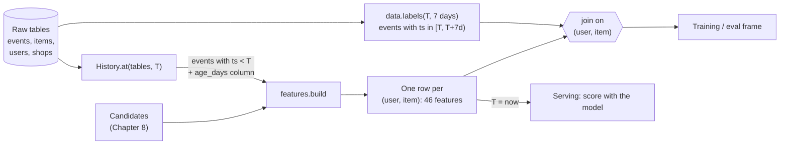
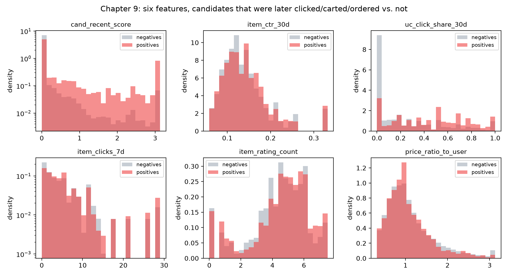
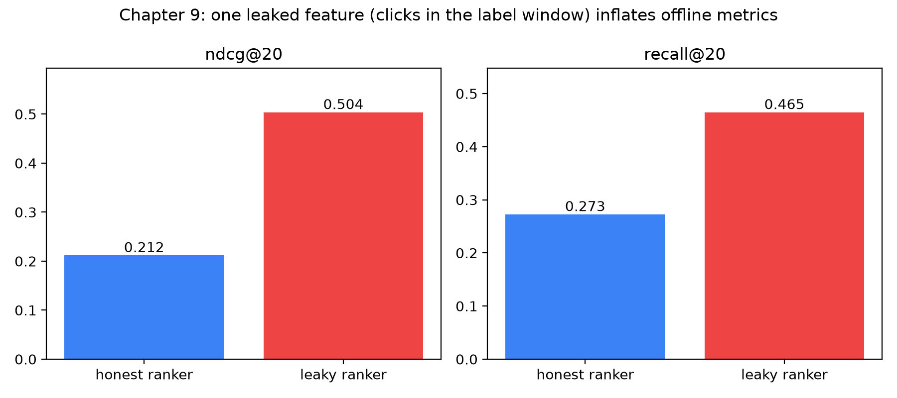

# Feature engineering for ranking

Dewi works on the growth team of a marketplace that looks a lot like Shopee. On Monday morning she shows her manager a ranking model that scores an offline NDCG of 0.50, more than double the previous model. (*Offline* means we scored the model on saved historical data, not on live shoppers. NDCG is a score from 0 to 1 for how well the top of a ranked list matches what people really did; higher is better.) The manager is delighted and asks for a launch date. On Thursday the model goes into a 5% A/B test (a live experiment: 5% of shoppers get the new model, the rest keep the old one), and by Friday the dashboard shows that it performs no better than the old one. In some segments it is worse. Dewi spends the weekend reading her feature pipeline line by line, and at 2 a.m. on Sunday she finds it: one of the columns, "clicks on this item this week", was computed over the whole week *including the days the model was supposed to predict*. The model had not learned to recommend. It had learned to read the answer sheet.

This story, in one form or another, happens at almost every company that builds a recommender. It happens because features are the place where a ranking system touches the real world, and the real world has a time axis that a spreadsheet does not. In Chapter 8 we built the machinery that proposes a few hundred plausible items per user. In this chapter we turn each of those (user, item) pairs into a row of numbers that a ranking model can learn from. How you build those numbers matters more than which model you feed them to.

Before we start, here is the vocabulary of this chapter in one place. Each term gets a full explanation later; this table is only a map.

| Term | Plain meaning |
|---|---|
| **Feature** | One number that describes a (user, item) pair, for example "how many times this user clicked this item last week". |
| **Feature row** | All the features of one pair, side by side. The model reads one row per candidate. |
| **Label** | The answer we want the model to predict: did the user click, add to cart or order the item *afterwards*? |
| **Cutoff** (written $T$) | The moment we freeze time. Features may use only what happened before it; labels come from after it. |
| **Leakage** | A feature that secretly contains information from after the cutoff, so the model "cheats". |
| **Window** | "The last 3 days", "the last 30 days": we count only events inside that stretch before the cutoff. |
| **Smoothing** | Pulling a rate that rests on very little evidence back toward the average. |
| **Cross feature** | A feature about a *pair* of things, such as this user × this item, rather than about one thing alone. |
| **Sentinel value** | A deliberately extreme number (such as 9999) that means "this never happened". |

**What you'll learn**

- Why a feature is only valid if it is computed *as of* a cutoff time, and how `History.at` enforces that rule for the entire code base.
- The eight feature groups used in this repo (46 features in total), what each group is for, and which ones carry personalisation versus quality.
- How time windows (3 / 7 / 14 / 30 days) and Bayesian smoothing turn raw counts into stable rates.
- How cross features such as user × item, user × category and user × shop are built with a few `groupby` calls.
- How to read one complete feature row for a real candidate, and how to compare positives with negatives.
- How to write an automated leakage test, and how big the damage is when you do leak (offline NDCG 0.50 versus an honest 0.21).

## Intuition: features are a briefing note

Imagine you are a personal shopper hired to pick ten products for a customer. Before you start, an assistant hands you a one-page briefing note for each candidate product. The note says things like: "This customer looked at this exact product three times last week", "this product is 40% cheaper than similar ones", "the shop answers messages within an hour", "this category is 31% of what the customer has been browsing this month". You do not see raw logs of millions of clicks. You see the note. If the notes are good, even a mediocre shopper makes good picks. If the notes are poor, the cleverest shopper in the world is guessing.

A ranking model is that shopper, and a feature row is the briefing note. Gradient-boosted trees (Chapter 10) are good at combining a few dozen informative numbers, but they cannot invent information that is not in the row. This is why practitioners say that the model is the easy part and the features are where the work is.

There is one more rule for the briefing note, and it is the rule that Dewi violated: **the note must only contain what was knowable at the moment the decision was made**. A personal shopper on Tuesday cannot be told what the customer will buy on Wednesday. In machine learning terms, the feature for a training example must be computed at a cutoff time $T$ (the moment we freeze time), using only events with timestamp strictly before $T$, while the label comes from events at or after $T$. We call that property *point-in-time correctness*: every feature is computed "as of" the cutoff, exactly as it could have been at that moment. A violation is called *leakage*: information from the future leaks into the note.

Here is a tiny example with shopper Sari. Suppose we freeze time at day 53:

| Day | What Sari did | May a feature use it? |
|---|---|---|
| 1–52 | Clicked three cat-food brands, added one to her cart | Yes, it is before the cutoff |
| *53 = cutoff $T$* | *we freeze time here* | |
| 55 | **Orders a 2 kg bag of cat food** | **No**: this is the label, the answer we want to predict |

A feature such as "Sari's cat-food clicks in the last 30 days, counted from day 53" is fine. A feature such as "Sari's cat-food orders this week" would include day 55. It would tell the model the answer, and the model would look brilliant offline and useless in real life, because on a real Tuesday nobody knows Wednesday's orders.


## The algorithm: from raw events to a feature row

### Step 0: fix the cutoff and split the world in two

Let $T$ be a cutoff timestamp. Everything the system may use is the *history* $H_T$:

$$H_T = \{\, e \in \text{events} : e.\text{ts} < T \,\} \ \cup\ \{\, i \in \text{items} : i.\text{listed\_at} \le T \,\}$$

In words: the history $H_T$ is "every event whose timestamp (`ts`) is before $T$, plus every item that was listed in the catalog at or before $T$". The symbol $\in$ means "is one of", and $\cup$ means "together with". Nothing after $T$ is in the set.

The labels come from the future window $[T, T + 7\text{ days})$. The square bracket means "including $T$" and the round bracket means "up to but not including $T + 7$ days". The same code is used at training time (with $T$ in the past, so the future is observable and we can label) and at serving time (with $T$ = now, so the future is empty). *Serving* means answering a real shopper's request live. This symmetry is the single most important design choice in the feature pipeline. If training and serving share one code path, a whole class of bugs known as *training/serving skew* cannot occur. Skew means the model was trained on numbers computed one way and is fed numbers computed another way when it goes live, like practising for a test with one answer key and sitting the real exam with a different one.



*Figure: Features are computed from the past of the cutoff, labels from its future; at serving time the future part is simply empty.*

### Step 1: add an age to every event

Instead of storing absolute timestamps, `History.at` precomputes `age_days = (T - ts) / 1 day` for every surviving event: how many days before the cutoff it happened. An event from 2 days before the cutoff has age 2; one from 12 hours before has age 0.5. A window then becomes a simple filter: "clicks in the last 7 days" is `age_days < 7`. The age column also makes it impossible to write a feature that depends on the current wall clock, because the only clock is $T$. (If a feature used today's date, the same training row would change value every day you re-ran it.)

### Step 2: aggregate over windows

To *aggregate* means to squash many events into one number, usually by counting. A *windowed count* counts only the events inside a recent stretch of time. For example, "how many times was this item clicked in the last 7 days?" is one windowed count. Formally, for an entity $e$ (a user, an item, or a pair) and an event type $t$ (click, cart, order…), with window $w$ in days:

$$n_{e,t}(w) = \bigl|\{\, \text{events of type } t \text{ for } e \text{ with age} < w \,\}\bigr|.$$

The vertical bars $|\cdot|$ just mean "how many things are in this set".

We use several windows because they answer different questions. A 3-day window says "what is hot right now", a 30-day window says "what is steadily good", and the ratio of the two says whether something is heating up or cooling down. Think of a restaurant: 20 customers a day for a year is steadily good; 5 customers a day last month but 20 a day this week is heating up. The repo's trend feature is

$$\text{trend} = \frac{n_{\text{click}}(3)/3 + 0.1}{n_{\text{click}}(14)/14 + 0.1}.$$

Both terms are *click rates per day*: clicks divided by the number of days in the window. A value above 1 means the last three days are busier than the last two weeks on average. Take an item with 6 clicks in the last 3 days and 14 clicks in the last 14 days. Its recent rate is $6/3 = 2$ per day, its two-week rate is $14/14 = 1$ per day, so the trend is $(2 + 0.1)/(1 + 0.1) \approx 1.91$: heating up. An item with 1 click in the last 3 days and 14 in 14 days gives $(0.33 + 0.1)/(1 + 0.1) \approx 0.39$: cooling down. The $+0.1$ is a small constant that stops a division by zero (an item with no clicks at all gets $0.1/0.1 = 1$, "no change", instead of an error) and keeps tiny counts from producing silly ratios.

### Step 3: smooth the rates

*Smoothing* means pulling a rate that rests on very little data back toward the overall average, so one lucky event cannot fake a star. A raw click-through rate (CTR, the share of times an item was shown that it was clicked) is $\text{clicks}/\text{impressions}$. An *impression* is one time the item was shown to a user. An item that was shown once and clicked once has a CTR of 100%, which is nonsense. Think of a basketball player who sinks his first and only shot: you do not believe he never misses. You would guess "about average" until he has taken many shots, and then trust his own record more and more.

That is exactly the Bayesian recipe (named after the statistician who formalised updating a first guess with evidence). The *prior* $p_0$ is the first guess, here the global average CTR. We pretend every item starts with $s$ imaginary impressions at that average rate, and let real data gradually take over:

$$\widehat{\text{CTR}} = \frac{\text{clicks} + s \cdot p_0}{\text{impressions} + s}.$$

The hat on CTR means "estimated". $s$ is how many imaginary impressions we add; $p_0$ is the average rate they carry. With $s = 50$ and a global CTR of $p_0 = 0.14$, the first imaginary 50 impressions contribute $50 \times 0.14 = 7$ imaginary clicks. Take two items:

| Item | Clicks | Impressions | Raw CTR | Smoothed CTR |
|---|---|---|---|---|
| A (brand new, lucky) | 1 | 1 | 1.000 | $(1 + 7)/(1 + 50) = 0.157$ |
| B (established) | 30 | 100 | 0.300 | $(30 + 7)/(100 + 50) = 0.247$ |

The brand-new item is pulled almost all the way back to the average, while the established item keeps most of its advantage. The parameter $s$ is the "strength of belief" in the prior: the larger it is, the more evidence you need before the item's own data wins. Without smoothing, a ranker would put every item with one lucky click at the top of the list. The same idea appeared in Chapter 3 for ratings.

### Step 4: build cross features

An item feature describes the item for everybody, and a user feature describes the user for every item. Neither one says whether *this* user will like *this* item. That information lives in *cross features* (the name comes from "crossing" two columns, like a row and a column of a table meeting in one cell), which are aggregates over a pair of keys. Sari browsing cat food is a user fact; "Whiskas 2 kg is popular" is an item fact; "Sari clicked Whiskas 2 kg three times" is a cross feature, and it is the one that predicts her next move.

- **user × item**: how often did this user click, cart or order this exact item? How many hours ago? How many times was it shown to them and ignored?
- **user × category**: what share of this user's recent clicks fall in this item's category? How many orders did they place there, and how many days ago?
- **user × shop**: has this user bought from this seller before?
- **user price level × item price**: is the item cheap or expensive *for this user*?

Cross features are where personalisation happens. Most of the raw predictive power in a marketplace ranker comes from the combination "this user has a history with something close to this item". Without them, every user would get the same list, ordered by general quality.

### Step 5: handle missing values on purpose

A pair that never interacted has no row in the aggregated tables, so the join (the step that attaches the aggregates to the candidate list) produces missing values. A missing value can mean two different things: "zero" (no clicks) or "unknown or never" (no previous order, so the number of days since the last order does not exist). The repo makes this choice per feature. Counts become 0. Recency features, where 0 would mean "just now", receive large sentinel values: 9999 hours for "never touched" or 999 days for "never ordered". A tree model learns by asking yes/no questions about a feature, such as "were there fewer than 30 days since the last order?". With a sentinel of 999, "no" cleanly means "long ago or never", while a fake 0 would wrongly say "just ordered". Trees split on thresholds, so a sentinel far away from real values separates the two cases cleanly.

::: fact
**Do top features dominate a ranking model?** In a widely cited study of click prediction at Facebook, the authors boosted trees over hundreds of features and found that the top 10 features were responsible for about half of the total feature importance, while the last 300 features contributed less than 1%. They also found that *historical* features (such as cumulative clicks on an ad) carried considerably more explanatory power than contextual ones: the top 10 features were all historical. Contextual features mattered mostly for cold start.

Source: He et al., ADKDD (KDD workshop), 2014
:::

## Code walkthrough

### The gatekeeper: `History.at`

All of the point-in-time logic of the project lives in one class method. Read it carefully, because every feature in the system depends on it.

```include
path: recommender/recsys/data.py
symbol: History.at
```

Walk through it line by line:

1. `ev["ts"] < cutoff` keeps events strictly *before* the cutoff. The inequality is strict, and that matters: an event stamped exactly at $T$ belongs to the label window, not to the history. The label function uses `ts >= cutoff`, so every event lands on exactly one side.
2. `age_days` is computed against the cutoff, never against `now()`.
3. Searches get the same treatment, because a search query is as much a behavioural signal as a click.
4. The catalog is filtered with `listed_at <= cutoff`. An item listed next Tuesday does not exist for a model standing on Friday. This is the catalog version of the same rule, and it is why a brand-new product cannot appear in training candidates before its launch.
5. `in_stock` is true when the item has no stock-out time *or* the stock-out happens after the cutoff, and the future stock-out time is dropped, so the model cannot learn "this item will sell out in two days". Price, rating and rating count are shown as they are *now*; in this simulated data they never change, which keeps the lab honest. A real catalog changes, which is why production keeps snapshots (see the pitfalls).

The `History` dataclass is frozen and nothing else reads the raw `events` table, so a feature function that takes a `History` cannot see the future. The only code that looks forward is `data.labels`: it selects events in $[T, T+7d)$, maps click / add_to_cart / order to graded labels 1 / 2 / 3 via `schema.LABEL_GAIN`, and keeps the maximum per (user, item).
### Building blocks

Two tiny helpers in `features.py` do most of the aggregation. `_count` filters one event type, optionally to a window with `age_days < max_age`, then groups by any key list (user, item, or pair); `groupby` is the pandas operation "put rows with the same key together and count them", like sorting receipts into one pile per customer. `_smoothed` is the formula of Step 3 on whole columns: `num` is clicks, `den` impressions, `prior` is $p_0$, `strength` is $s$. User features (`user_features`) use the same helpers: four windowed counters, a CTR smoothed with strength 20, and recency and account age measured against the cutoff, never the wall clock.
### Item features

```include
path: recommender/recsys/features.py
symbol: item_features
```

The first block of assignments copies static catalog attributes into feature columns. `item_rating_count` goes through `np.log1p`, which computes $\log(1 + x)$ and squeezes large numbers together, because counts are heavy-tailed (a few items have huge counts, most have small ones, and 5 versus 50 ratings matters more than 5,005 versus 5,050). `item_price_vs_category` divides by the category median (the middle price when all prices are sorted) so a phone case and a laptop are compared on "cheap or premium for what it is": 0.60 means the item costs 60% of its category's typical price. The middle block declares ten counters as `(name, event_type, window)` triples; underscore names are temporary inputs to the smoothed rates (strengths 50 for CTR, 20 for conversion rate (CVR, orders per click), 10 for returns, lower for rarer events). Then come the trend formula from Step 2 and a join with shop quality.
### Cross features

Three functions build the cross features. They look different but share one pattern: *join events to the second key, then group by the pair*.

```include
path: recommender/recsys/features.py
symbol: user_item_features
```

`user_item_features` counts clicks, carts, orders and impressions per pair. `ui_ignored_impressions` is the number of times the pair was shown *only if the user never clicked it*, which is the fatigue signal: an item that was displayed ten times without a click is probably not interesting. `ui_hours_since_last` uses only positive actions (click, cart, order) and converts days to hours; it measures *recency*, how long ago the last interaction was. `ui_max_dwell_sec` is the longest product-page stay (*dwell time*): a user who spent seven minutes on a product page is telling us more than one who bounced after two seconds.

The user × category block computes the click *share* (`transform("sum")` divides by the user's total, making heavy and light clickers comparable: 3 of 10 clicks and 30 of 100 clicks are both a 30% share), plus searches mapped to categories and order recency. The user × shop block is the same pattern. `user_price_level` is the median of `price / category_median_price` over the user's clicks, that is, how expensive the things this user clicks are compared with their category's norm; dividing the item's own ratio by it gives `price_ratio_to_user`, so 0.62 means the item costs 62% of what this user usually pays relative to category norms. A ratio like this is useful because it removes the unit: it says "cheap for this shopper", whether the item costs 20,000 or 2,000,000 rupiah.

### Putting it together: `build`

```include
path: recommender/recsys/features.py
symbol: build
```

`build` takes the candidate frame from Chapter 8 (`user_id`, `item_id`, the five candidate-source scores) and does left joins: candidates stay, features are attached. Two details are easy to miss. The `assert` at the end guarantees that the output columns equal `schema.FEATURE_NAMES` in the same order, so a feature cannot be added to the code and forgotten in the schema, or vice versa. And the explicit `fill` and `zero` dictionaries are where the missing-value policy of Step 5 is written down in one place. Because the same function runs offline and inside the gRPC service, the model sees identical column semantics in both.

### The eight feature groups

The schema registers every feature with a name, a group, and a description. The groups and their sizes:

| Group | Count | What it describes | Example features |
|---|---|---|---|
| `candidate` | 5 | Which retrievers proposed the item and how strongly | `cand_recent_score`, `cand_covisit_score`, `cand_n_sources` |
| `user` | 8 | Activity level and profile of the user | `user_clicks_30d`, `user_ctr_30d`, `user_days_since_active` |
| `item` | 15 | Price, quality, popularity, freshness, trend | `item_ctr_30d`, `item_cvr_30d`, `item_trend`, `item_age_days` |
| `shop` | 4 | Seller reliability | `shop_rating`, `shop_is_mall`, `shop_cancel_rate` |
| `user_item` | 7 | History of this user with this exact item | `ui_clicks`, `ui_hours_since_last`, `ui_max_dwell_sec`, `price_ratio_to_user` |
| `user_category` | 4 | User's relation to the item's category | `uc_click_share_30d`, `uc_days_since_order` |
| `user_shop` | 2 | User's relation to the seller | `us_clicks`, `us_orders` |
| `context` | 1 | Request or pair context | `same_city` |

The counts add up to 46. Notice the proportions. Fifteen features describe the item alone, and it is the largest group. But the `user_item` (7), `user_category` (4), `user_shop` (2) and `context` (1) groups together hold 14 pair-level features. Those 14 are the ones that make two users see different lists. The other groups mostly measure *quality*: how good the item, the shop or the user's general activity is, the same for everyone who sees the item.

::: fact
**Leakage has a formal definition.** Kaufman, Rosset and Perlich gave leakage a precise statement in data mining: leakage is the introduction of information about the target that should not legitimately be available to the model at prediction time. They catalogued how it sneaks in, through features that are proxies of the label, through the way a data set is sampled, and through time, and used competition data sets to show how often it decides winners and losers.

Source: Kaufman et al., ACM Transactions on Knowledge Discovery from Data, 2012
:::

### The leakage test

Discipline is good, but an automated test is better. The repo ships a test that rewrites the future and checks that nothing in the features changes.

```include
path: recommender/tests/test_point_in_time.py
symbol: _build
```

The helper builds the entire feature frame at a cutoff, candidates included, and sorts it so row order cannot cause false failures.

```include
path: recommender/tests/test_point_in_time.py
symbol: test_features_ignore_events_after_cutoff
```

The test runs in four steps. It builds features at day 30 of the simulation. Then it tampers with the future: *every* event after the cutoff becomes an order of item 0, and every later search becomes a query for "diapers". Then it rebuilds, and `assert_frame_equal` demands that the two frames are identical, cell by cell. If a new feature reads even one future event, the tampered run differs and the test fails. The test is deliberately brutal. A subtle leak, such as using a 30-day window that accidentally extends forward through `abs(age_days)`, would produce a tiny difference in a handful of cells, and it would still be caught.

## Run it

The companion script `ch09_features.py` builds the frames, prints one complete feature row, compares positives and negatives and then runs the leakage experiment. From the `book/` directory:

```bash
uv run python code/ch09_features.py
```

First the frames. The training frame uses a cutoff one week earlier than the evaluation frame, with labels from the following seven days in each case, mirroring the real training pipeline.

```output
file: results/ch09_features.txt
lines: 2-5
```

About 78,800 training rows and 98,400 evaluation rows come from 781 and 947 users respectively. The positive rate is a little over 1.7%: out of every 100 candidate rows, fewer than 2 are followed by a click, cart or order. That is typical, because for the vast majority of candidates the user will do nothing in the next week. We will return to this class imbalance (far more negatives than positives) in Chapter 10.

Now one candidate row with all 46 features: the best heuristic-scored candidate for user 42, abbreviated here to the candidate and user groups (the full row is in the results file).

```output
file: results/ch09_features.txt
lines: 7-24
```

## Results: reading a feature row

Read the row like a detective. The candidate is item 2381, and the briefing note says: the user has interacted with it directly (`cand_recent_score` is 11.63, a large score from the user's own recent actions, where newer actions weigh more), the item was proposed by all four retrievers (`cand_n_sources` = 4) and it is number 1 in the global trending list (`cand_global_pop_rank` = 0, ranks count from 0). The user is active (45 clicks in 30 days, 14 orders) and was last seen 1.3 days ago. The item is cheap for its category (`item_price_vs_category` = 0.60), has the best possible rating (5.0) with $e^{5.673} - 1 \approx 290$ ratings (the table stores $\log(1+\text{count})$, so we undo it with $e^x - 1$), and it is popular right now (29 clicks in seven days). The cross features tell the personal story: six clicks, six add-to-carts and five orders on this exact item, and 31% of the user's category clicks land in this category.


### Do positives look different from negatives?

A feature is only useful if its distribution differs between candidates that were later engaged with and candidates that were not. The script prints means and medians for six representative features.

```output
file: results/ch09_features.txt
lines: 65-74
```



`cand_recent_score` separates the classes sharply (mean 0.847 for positives versus 0.099; the user's own recent actions are the strongest predictor), and `uc_click_share_30d` does the same in a personalised way (0.447 versus 0.245; negatives pile up at zero). `item_ctr_30d` (0.144 versus 0.141), `item_rating_count` (4.555 versus 4.414) and `price_ratio_to_user` (1.073 versus 1.118) barely differ, and `item_clicks_7d` is only mildly higher (5.893 versus 5.204). Weak-looking features can still help a tree in interaction with others, so never delete a feature purely from a histogram.

### What a leak looks like

Now the experiment that explains Dewi's weekend. The script adds *one* extra column, `leaky_future_clicks`, which counts the user's clicks on the item inside the label window. Here is the exact line that creates the leak:

```include
path: book/code/ch09_features.py
symbol: label_window_clicks
```

It looks innocent: an ordinary `groupby` whose only unusual element is the time filter `ts >= start`, the opposite of what `History.at` enforces. The same LightGBM ranker is trained twice, with the 46 honest features and with 47 (honest plus the leak), and both are evaluated on the same frame.

```output
file: results/ch09_features.txt
lines: 76-84
```



The numbers are dramatic. NDCG@20 (the ranking-quality score, looking at the top 20) jumps from 0.2116 to 0.5035, a factor of 2.38, and recall@20 (the share of things the user really engaged with that appear in the top 20) from 0.2725 to 0.4645. The leaked column takes 88.5% of all the gain in the model, ranking first of 47 features. (*Gain* is how much a feature helps the model's trees reduce their errors, summed over all their splits; a feature with 88.5% of the gain is doing almost all the work.) Look at the recall columns for the leaky ranker: recall@10, @20 and @50 are all about 0.464, so essentially every positive that is reachable was already found within the first ten positions. A ranker can only reorder the candidates it is given, so the plateau is the candidate recall ceiling we discussed in Chapter 8: the positives beyond it were never proposed by any retriever. A model that has the answers pushes straight up against that ceiling.

A 2.4× improvement from one column should make you suspicious, not happy. Red flags: a single new feature takes most of the gain; offline metrics jump far more than any earlier change; recall saturates at the candidate ceiling at tiny $K$; or importance concentrates on features that describe the outcome (`total_orders`, anything computed `all_time` over the whole table).
## Pitfalls and how it is done in production

**1. Snapshotting slowly changing attributes.** In this repo the catalog is a single table, and price or rating changes would overwrite history. A real system needs *point-in-time joins*: the value that was current at $T$. Feature stores (Chapter 14) record every feature value with an event timestamp and implement an "as-of join" that picks the latest value not after $T$. Without it, the rating of an item at training time includes reviews that were written *because* people bought it after the cutoff. That is the leakage Dewi would have found next.

**2. Label-adjacent aggregates.** "Total orders of this item" over the full table is the classic leak, because it includes the orders you are trying to predict. The same trap hides in rates, in "last purchase date", in any `max` or `min` over an unbounded column. The `age_days < w` filter inside `_count` is the guard: every windowed aggregate is computed over `History` only.

**3. Training/serving skew.** The best defence is one code path: `features.build` serves training, evaluation and the live gRPC service. Systems with separate batch and online pipelines need parity tests that run both on the same inputs, because a different rounding, time zone or missing-value rule silently degrades the model.

**4. Feature creep.** Every feature is a dependency that costs serving time and can break when its source changes. Add a group, run an ablation (Chapter 10), and remove groups that do not help.

::: fact
**Data dependencies are technical debt.** In "Hidden Technical Debt in Machine Learning Systems", Sculley and colleagues describe *unstable* and *underutilized* data dependencies: input signals that change behaviour over time, or that provide little incremental modelling benefit yet make the system vulnerable to upstream changes. They recommend detecting underutilized dependencies with regular, exhaustive leave-one-feature-out evaluations, which is exactly the group ablation we run in Chapter 10.

Source: Sculley et al., NeurIPS, 2015
:::

**5. Cost at serving time.** This chapter's code recomputes every feature table on each `Recommend` request, which is why a request takes roughly a second (measured in Chapter 13). Production precomputes the heavy parts (item statistics by a streaming job, user features in a key-value store) and computes only cheap pair features such as `same_city` at request time. The *definitions* stay identical.

## Summary

- A feature is valid only if it is computed from events strictly before the cutoff $T$; labels come from $[T, T+7d)$. Violating this is leakage.
- `History.at` is the single gate: it filters events, searches and the catalog by the cutoff, adds `age_days`, and hides future stock-outs. All feature code reads only a `History`.
- Windows (3/7/14/30 days) separate "hot now" from "steadily good"; the trend feature compares per-day rates and uses a small constant to stay stable.
- Smoothing, $(\text{num} + s\,p_0)/(\text{den} + s)$, keeps rates from extreme values when data is thin; $s$ is how much evidence you demand.
- The 46 features fall into eight groups: candidate, user, item, shop, user_item, user_category, user_shop and context. The 14 pair-level cross features carry the personalisation.
- Missing values are a design decision: counts become 0, recency features get sentinel values (9999 hours, 999 days) that trees can split on.
- A leaked column took 88.5% of the model's gain and raised offline NDCG@20 from 0.2116 to 0.5035; a result that good from one feature is a warning sign, not a success.
- Automate the guard: a test that rewrites the future and demands identical features catches leaks before they reach a dashboard.

## Quiz

**Q9.1** What does point-in-time correctness require of a feature used to train a ranker?

A. It must be normalised to zero mean and unit variance.
B. It must be computed only from information that was available before the cutoff time of the training example.
C. It must be computed from the same number of events for every user.
D. It must be recomputed every hour in production.

**Q9.2** In `History.at`, why is the filter `ev["ts"] < cutoff` strict rather than `<=`?

A. Because floating-point timestamps cannot be compared with `<=`.
B. Because events exactly at the cutoff belong to the label window `[cutoff, cutoff + days)`, so each event is used on exactly one side.
C. Because the database stores timestamps with one-second resolution.
D. Because impressions are not logged at exactly the cutoff.

**Q9.3** An item shown once and clicked once has a raw CTR of 100%. Which statement about the smoothed CTR $(\text{clicks} + s\,p_0)/(\text{impressions} + s)$ is correct?

A. It stays at 100% because the item has no negatives.
B. It moves close to the global average $p_0$, and moves away from it only as the item collects more impressions.
C. It becomes exactly zero until the item has at least $s$ impressions.
D. It no longer depends on the item's own clicks.

**Q9.4** In one or two sentences: why does the code use a sentinel such as 9999 for `ui_hours_since_last` rather than 0 when the user never touched the item?

**Q9.5** Explain the difference between an item feature, a user feature and a cross feature, and name one example of each from this chapter. Which kind carries most of the personalisation?

**Q9.6** Read the test below (included earlier in this chapter as `test_features_ignore_events_after_cutoff`). Suppose someone adds a feature `item_orders_all_time` that counts orders per item from a module-level variable holding the full, unfiltered events table, instead of from `hist.events`. Would the test fail, and why? What exactly in the test makes the failure visible?

```python
ev.loc[future, ["event_type", "item_id"]] = ["order", 0]
pd.testing.assert_frame_equal(before, _build(tampered, cutoff))
```

**Q9.7** An item has 3 clicks and 10 impressions. The global CTR is 0.10 and the smoothing strength is $s = 20$. Compute the smoothed CTR, and give the raw CTR for comparison.

**Q9.8** An item had 6 clicks in the last 3 days and 14 clicks in the last 14 days. Using the repo's formula with the constant 0.1, compute `item_trend`. Is the item heating up or cooling down?

**Q9.9** *Hands-on.* In `book/code/ch09_features.py`, change the window in `label_window_clicks` from `pd.Timedelta(days=7)` to `pd.Timedelta(days=1)` (only the leaky feature, not the labels), then run the script again. Before you run it, predict what will happen to the leaky ranker's NDCG@20 and to the share of gain taken by `leaky_future_clicks`. What do you observe, and what does it tell you about how much of the future a feature needs to leak before the offline metric becomes untrustworthy?
