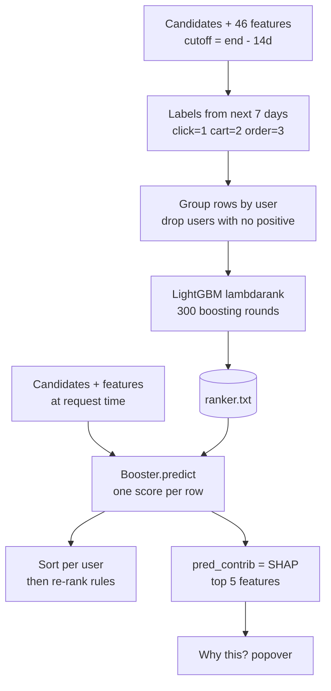

# Learning to rank

Dina is a ranking engineer on a marketplace team, and on Monday morning she opens a ticket that reads: "Home feed is weird. We show a kettle first to a user who bought a kettle yesterday, and a phone case in slot 9 to someone who has been staring at phone cases for a week." Nothing is wrong with retrieval. The candidate generators from the previous chapters did their job: the right products are somewhere in the pool of roughly a hundred candidates for that user. The problem is the *order*. The pool arrives sorted by whichever retriever happened to find the item first, and for every user the page only has room for a handful of slots at the top.

Her team's stopgap is a hand-written formula, still in the repo as `pipeline.heuristic_score`: normalise the three retriever scores per user and add them up. This chapter replaces that shrug with a learning algorithm: 46 features per `(user, item)` pair (Chapter 9), graded labels from the next seven days, and a model that puts the best items first. By the end you will have opened the model behind the app's "Why this?" popover.

**What you'll learn**

- The three families of learning-to-rank objectives (pointwise, pairwise, listwise) and when each one makes sense.
- How gradient-boosted decision trees work from first principles, with a hand-sized example of one split and one round of residuals.
- What LambdaMART adds on top of boosting: the *lambda* gradients and the NDCG swap delta.
- How the repo's `ranker.train` configures LightGBM, including graded labels and the `label_gain` table.
- How to read feature importance, SHAP contributions and a feature-group ablation, and how to avoid fooling yourself with seed noise.
- An honest result: on this small simulated dataset, a plain pointwise model scores *slightly higher* than LambdaMART, and why that happens.

## Intuition: sorting by a score someone learned

**Ranking** means putting the same set of items into a better *order*. **Learning to rank** means the order comes from a model that learned from past outcomes, not from a hand-written formula.

Think of two shop assistants arranging the eye-level shelf, where only a few items fit. The new assistant follows a points sheet: "add the three scores, put the highest first" (our heuristic blend). The experienced assistant has watched thousands of shoppers and has a feel for combinations, for example "a kettle is a bad bet for someone who bought one yesterday". Learning to rank extracts that feel from historical outcomes.

Two different questions can be learned from the same history. One is "how likely is this shopper to buy this item?" (a probability). The other is "between these two items, which goes first?" (an ordering). A shelf with five slots only needs the second one. The ranking literature has three families of methods, depending on which question the model is trained to answer:

| Family | The model is trained to… | Loss looks at | Example |
|---|---|---|---|
| **Pointwise** | predict the label of each row on its own | one row | logistic regression, `objective="binary"` |
| **Pairwise** | put the more relevant item above the less relevant one | pairs of rows from the same user | RankNet, Ranking SVM |
| **Listwise** | directly improve a list-level metric such as NDCG | the whole list for one user | LambdaMART, `objective="lambdarank"` |

Since NDCG@20 (Chapter 2) is a list-level metric that discounts the lower slots, a listwise method should be the natural fit. Practice will turn out to be less tidy.

To see the difference, take shopper Sari and three candidates: a cat-food bag she ordered (label 3), a cat toy she only clicked (label 1) and a phone case she ignored (label 0).

- A **pointwise** model looks at each row alone and tries to guess its number: "bag: 3? toy: 1? case: 0?". It never compares items.
- A **pairwise** model looks at pairs and asks "is the bag above the toy? the toy above the case? the bag above the case?". Three pairs from three items.
- A **listwise** model looks at the whole list at once, scores how good the full ordering is (with a metric such as NDCG), and adjusts itself to raise that score.

Pointwise is the easiest to build. Listwise is the closest to what we are graded on. Pairwise sits in between.

### Vocabulary: row, feature, label, query group

Four words come up constantly in this chapter.

- A **row** is one `(user, item)` pair, for example "Sari and the cat-food bag".
- **Features** are the numbers describing a row, such as "how long Sari stayed on this item's page" (Chapter 9 built 46 of them).
- The **label** is the right answer for the row, taken from what happened in the next seven days: 0 = nothing, 1 = click, 2 = add-to-cart, 3 = order.
- A **query group** (or just *group*) is all rows that belong to one user. Ranking only makes sense *inside* a group: nobody asks whether Sari's cat food should beat Ben's phone case. In this chapter every user is one group, so the model only compares items that compete for the same user's page.

Without groups, the model would try to compare rows from different users, and the "pairs" it learns from would be meaningless.

### The overall flow

The overall flow of this stage in the repo looks like this.



*Figure: how the ranker is trained offline and used at serving time, including the SHAP explanation path.*

## The algorithm

We will build the pieces in order: first plain gradient boosting, then the lambdas that turn it into a ranker, then the graded labels that tell it what "good" means.

### Step 1: regression trees and one split

A **decision tree** is a flowchart of yes/no questions, like the game of twenty questions. You enter a row of feature values at the top, answer "is `ui_max_dwell_sec` at most 45?", follow the yes or no branch, and keep going until you reach a **leaf** (an end box). A *regression* tree stores a number in each leaf, and that number is the prediction for every row that lands there.

Training a tree means choosing, at each branching point (a **node**), the question (which feature, which threshold) that sorts the rows into two groups that are each as *similar* as possible. We measure "similar" with the **sum of squared errors (SSE)**: take each row's value, measure how far it is from its group's average, square that distance (so that being too high and too low both count as bad), and add everything up. An SSE of 0 means every row in the group is identical.

Take a toy training set of six candidate rows for one feature, `ui_max_dwell_sec` (the longest the user stayed on this item's page), with their graded labels.

(dwell seconds, label) = (0, 0), (0, 0), (5, 0), (30, 1), (60, 2), (90, 3), one row each, numbered 1 to 6. Read it as "the longer the shopper stayed, the stronger the action they took later".

Boosting starts from the most boring guess possible: the same constant for every row, the mean label, $F_0 = (0+0+0+1+2+3)/6 = 1.0$. (With no information, the average is the safest guess.) The **residual** of each row is *what is still wrong*: the label minus the current prediction, $r_i = y_i - F_0$. For our six rows that gives $-1, -1, -1, 0, 1, 2$. The first three rows are overpredicted, the last two are underpredicted. Their sum of squares is $1+1+1+0+1+4 = 8$, our starting "untidiness".

Now we try candidate **splits** (a split is one yes/no question, here "is dwell at most this number?") and score each by how much SSE it removes. For a split into a left set $L$ and a right set $R$ with residuals $r$,

$$\text{SSE}(S) = \sum_{i\in S}\bigl(r_i - \bar r_S\bigr)^2, \qquad \text{gain} = \text{SSE}(\text{all}) - \text{SSE}(L) - \text{SSE}(R).$$

In words: $S$ is any group of rows, $\bar r_S$ is the average residual of that group, and SSE adds up the squared distances from that average. The **gain** is how much untidiness the split removes: SSE before the split minus SSE of the two sides after it. Walk through the winning split in the table below, `dwell ≤ 45`. The left side holds rows 1–4 with residuals $-1, -1, -1, 0$. Their mean is $-0.75$, so SSE(L) $= 3\times(0.25)^2 + (0.75)^2 = 0.75$. The right side holds rows 5 and 6 with residuals $1, 2$, mean $1.5$, SSE(R) $= 0.25+0.25 = 0.5$. The gain is $8 - 0.75 - 0.5 = 6.75$.

| split | left rows | right rows | SSE(L) | SSE(R) | gain |
|---|---|---|---|---|---|
| dwell ≤ 2.5 | 1, 2 | 3–6 | 0 | 5.0 | 3.0 |
| dwell ≤ 17.5 | 1–3 | 4–6 | 0 | 2.0 | 6.0 |
| **dwell ≤ 45** | 1–4 | 5, 6 | 0.75 | 0.5 | **6.75** |
| dwell ≤ 75 | 1–5 | 6 | 3.2 | 0 | 4.8 |

The winning split is `dwell ≤ 45`. The leaf value is the mean residual on each side: $-0.75$ on the left, $+1.5$ on the right. A tree like this is a **weak learner**: one question, two numbers, and obviously wrong for rows 4 and 5 individually. That is fine. Boosting does not need one great tree; it needs hundreds of mediocre ones that each fix part of the previous errors, like a team of people who each correct a small slip in the draft they receive.

The *gain* column is also where **feature importance** comes from later. It answers "which features did the trees lean on most?". Every time a feature is chosen for a split, the gain of that split is credited to it. Summing the credit over all splits of all trees and dividing by the total gives the "share of total gain" you will see in the results.

### Step 2: boosting = repeated residual fitting

Each new tree is not trusted fully. Instead, we move each prediction only a *fraction* of the way toward what the tree says. That fraction is the **learning rate**, written $\eta$ (LightGBM calls it `learning_rate`). It works like turning a shower tap: a big turn overshoots, small turns let you check and correct. In symbols, $F_m(x)$ is the model's prediction after $m$ trees, $h_m(x)$ is the number tree $m$ outputs for row $x$, and

$$F_m(x) = F_{m-1}(x) + \eta\, h_m(x).$$

Take $\eta = 0.5$ for a one-round example. Rows 1–4 fall left and move by $0.5 \times (-0.75) = -0.375$, from $1.0$ to $0.625$. Rows 5 and 6 move by $0.5 \times 1.5 = +0.75$, to $1.75$. The new residuals (label minus new prediction) are:

| Row | Label | New prediction | New residual |
|---|---|---|---|
| 1–3 | 0 | 0.625 | −0.625 |
| 4 | 1 | 0.625 | +0.375 |
| 5 | 2 | 1.75 | +0.25 |
| 6 | 3 | 1.75 | +1.25 |

Total squared error fell from 8 to $3\times 0.3906 + 0.1406 + 0.0625 + 1.5625 \approx 2.94$. The next tree is trained on these new residuals, and so on. After 300 rounds with a small $\eta$ the model has taken 300 small corrective steps, and its final prediction is the starting guess plus the sum of all the small steps.

Why "gradient" boosting, then? A **loss** is a number that says how bad the current predictions are (smaller is better); squared error is one loss. The **gradient** of the loss tells you, for each prediction, which direction to nudge it and how strongly to make the loss shrink fastest. For squared error, the residual $y - F$ is exactly that nudge: it is the negative gradient of $\tfrac12 (y-F)^2$ with respect to the prediction $F$. Friedman's insight was that you can plug in *any* smooth (differentiable) loss and fit each new tree to its negative gradient instead. Swap squared error for log-loss (a loss for yes/no labels) and you get a classifier; swap it for a ranking loss and you get a ranker.

::: fact
**Boosting is gradient descent in function space.** Jerome Friedman's 2001 paper "Greedy function approximation: A gradient boosting machine" framed boosting as stage-wise gradient descent on an arbitrary differentiable loss, where each new tree is fit to the negative gradient of the loss at the current predictions. That single idea is why the same library can train regressors, classifiers and rankers by changing only the objective.

Source: Friedman, Annals of Statistics, 2001
:::

### Step 3: from per-row error to per-list quality

A pointwise objective (say log-loss on "was this row clicked or better?") treats each row as an independent example. It will happily spend model capacity on getting the 95th item's probability right. But Dina's page only shows the top 20 positions, and NDCG discounts the later of those heavily. We would like the model to spend its effort where the metric cares.

Recall NDCG (normalised discounted cumulative gain) from Chapter 2. It scores a ranked list from 0 to 1: items with a strong label earn a lot, items placed lower earn less, and the result is compared with the best possible ordering. With graded relevance $rel_i$ at position $i$:

$$\text{DCG@}K = \sum_{i=1}^{K} \frac{2^{rel_i}-1}{\log_2(i+1)}, \qquad \text{NDCG@}K = \frac{\text{DCG@}K}{\text{IDCG@}K},$$

where IDCG (ideal DCG) is the DCG of the perfect ordering. The numerator $2^{rel}-1$ is the **gain**, the reward for having that item in the list: a relevance of 0, 1, 2, 3 gives gains 0, 1, 3, 7. An order is worth seven clicks. The denominator is the **discount**, how much a slot is worth because of its position: position 1 has weight $1$, position 2 has $0.631$, position 3 has $0.5$, and so on. Top slots count most, as on any shelf.

NDCG depends on the *sorted order*, and sorting is not differentiable: nudging a score by a tiny amount either changes nothing or suddenly swaps two items, so there is no smooth slope to follow downhill. We therefore cannot take its gradient. LambdaRank's trick (Burges, 2010) is pragmatic: *skip the loss, define the gradient directly*.

### Step 4: lambdas and the NDCG swap

We start with a **pairwise loss**, as in RankNet. Take two items $i$ and $j$ from the same user, where $i$ is the more relevant one. The model's current scores are $s_i$ and $s_j$; ideally $s_i$ is clearly bigger. The **logistic function** turns the score difference into a probability between 0 and 1 ("how sure is the model that $i$ goes above $j$?"): near 0.5 when the scores are equal, near 1 when $s_i$ is far above. The pairwise loss pushes $s_i - s_j$ to grow. The push on $i$ is called **lambda** ($\lambda$): its sign says up or down, its size says how hard. For a pair, it is

$$\lambda_{ij} = \frac{-\sigma}{1 + e^{\sigma (s_i - s_j)}}.$$

Here $\sigma$ (sigma) is just a constant that sets how steep the logistic curve is; $e$ is the usual exponential constant. In words: the push is strong when the pair is in the wrong order and fades to nothing when the pair is already well separated.

When $i$ is already far above $j$ the denominator is huge and the push vanishes. When $i$ is wrongly below $j$, $s_i - s_j$ is negative, the denominator is near 1, and the push is close to its maximum $\sigma$. So far this is plain pairwise logic: all mis-ordered pairs are equally urgent, whether they sit at the top of the page or on page nine.

The LambdaRank step is to **multiply by the change in NDCG that swapping the two items would cause**. Intuitively, "how much would the metric care if we fixed this pair?":

$$\lambda_{ij} = \frac{-\sigma}{1 + e^{\sigma (s_i - s_j)}}\; \bigl|\Delta \text{NDCG}_{ij}\bigr|.$$

Swapping the items at positions $p_i$ and $p_j$ changes the DCG by $(g_i - g_j)\,(d_{p_i} - d_{p_j})$ in absolute value, where $g$ is the gain and $d_p = 1/\log_2(p+1)$ is the discount. Dividing by IDCG gives $|\Delta\text{NDCG}|$ (the bars mean "ignore the sign"; $\Delta$ means "change in"). A pair that is both mis-ordered *and* sits at the top of the list with a big gain gap gets a big lambda. A pair that is mis-ordered at positions 80 and 81, or whose gains are equal, gets almost none. That is how the algorithm "pays attention" to the top of the list without ever differentiating NDCG.

Each row's lambda is the sum over all its pairs, signed up for the more relevant member and down for the less relevant. These lambdas replace the negative gradient (the residual in our toy example) when fitting the next tree: that is **LambdaMART** (**MART**, multiple additive regression trees, is an older name for gradient-boosted trees). So LambdaMART is just gradient boosting where "what is still wrong" is measured in lambdas rather than residuals.

### A worked example of the swap delta

Take three candidates for one user, currently ranked $A, B, C$ with graded labels 0, 3, 1. Their gains are $0, 7, 1$.

- $\text{DCG} = 0\cdot 1 + 7\cdot 0.631 + 1\cdot 0.5 = 4.917$.
- The ideal order is $B, C, A$, so $\text{IDCG} = 7\cdot 1 + 1\cdot 0.631 = 7.631$.
- $\text{NDCG} = 4.917/7.631 = 0.644$.

Swapping $A$ and $B$ (positions 1, 2) changes NDCG by $7\times(1-0.631)/7.631 = 0.339$; swapping $A$ and $C$ (positions 1, 3) only by $1\times 0.5/7.631 = 0.066$. The first mistake, a never-clicked item above the order-level one, is five times more important. Now suppose the model's raw scores are $s_A = 2.0$ and $s_B = 1.0$ and $\sigma = 1$. For the pair "$B$ should be above $A$", $s_B - s_A = -1$, so the logistic factor is $1/(1+e^{-1}) = 0.731$. The magnitude of the lambda for that pair is $0.731 \times 0.339 = 0.248$: a firm upward push on $B$ and an equal downward push on $A$. For the pair $(C, A)$ with the same logistic factor the magnitude would be only $0.731\times 0.066=0.048$. The next tree will therefore spend most of its splitting effort on features that tell $B$ and $A$ apart.

In plain terms: the model currently puts the never-clicked $A$ first and the ordered item $B$ second. Fixing that pair would lift NDCG by 0.339, so $B$ gets a strong push up and $A$ a strong push down. Fixing the $A$/$C$ pair would only add 0.066, so it gets a gentle push. Mistakes that matter more to the metric get louder instructions.

::: fact
**LambdaMART won the Yahoo! Learning to Rank Challenge.** The system that won Track 1 of the Yahoo! Learning to Rank Challenge (2010) was an ensemble of lambda-gradient models, built on boosted trees trained with LambdaRank-style gradients. Chris Burges's earlier overview paper, "From RankNet to LambdaRank to LambdaMART", is the standard reference for how the three algorithms fit together.

Source: Burges et al., Proceedings of the Learning to Rank Challenge (PMLR), 2011
:::

### Step 5: graded labels

In this repo a label is not just 0 or 1. `schema.LABEL_GAIN` says a click is worth 1, an add-to-cart 2 and an order 3. If a user did several things with the same item in the label window, `data.labels` keeps the *strongest* one: someone who clicked and then ordered counts as an order. This matters in two ways:

1. The model is rewarded for putting the item the user ordered above the item the user only clicked.
2. The `label_gain=[0, 1, 3, 7]` parameter in LightGBM converts the integer labels to the gain $2^{rel}-1$ used in NDCG (label 0 earns 0, label 1 earns 1, label 2 earns 3, label 3 earns 7). LightGBM's default table happens to be the same $2^{rel}-1$ for these labels, but spelling it out in `PARAMS` keeps the objective and the offline evaluator from silently drifting apart; it means the objective being optimised and the metric being reported are the same function.

Users with no positive in the window carry no ordering information: every item has label 0, so swapping any two changes nothing (all their $|\Delta\text{NDCG}|$ are 0). `ranker.train` drops them.

## Code walkthrough

### The ranker itself

The whole LambdaMART configuration lives in the `PARAMS` dictionary at the top of `recommender/recsys/ranker.py` (plus the `NUM_ROUNDS` constant). A **hyperparameter** is a setting you choose before training, rather than something the model learns. The table gives the plain meaning of each:

| Parameter | Value | Plain meaning |
|---|---|---|
| `objective` | `lambdarank` | use the lambda gradients (Step 4) |
| `learning_rate` | 0.05 | the step size $\eta$: each tree moves predictions only 5% of the way |
| `num_leaves` | 31 | each tree may have at most 31 end boxes (leaves), so it stays small |
| `min_data_in_leaf` | 50 | a leaf must hold at least 50 rows, so it cannot memorise one shopper |
| `bagging_fraction` / `bagging_freq` | 0.8 / 1 | every tree sees a fresh random 80% of the rows |
| `feature_fraction` | 0.8 | every tree sees a random 80% of the columns (features) |
| `label_gain` | `[0, 1, 3, 7]` | reward for label 0, 1, 2, 3 |
| `lambdarank_truncation_level` | 20 | only pairs involving the top 20 positions matter |
| `NUM_ROUNDS` | 300 | number of trees |


Small steps and many rounds generalise better than few large ones (they give the model more chances to correct itself without overreacting to one tree). LightGBM grows trees **leaf-wise**, always splitting the leaf that would gain the most, so `num_leaves` (not depth) controls complexity, and `min_data_in_leaf` stops a leaf memorising one user. **Bagging** (training each tree on a random sample of rows) and feature sampling inject randomness so that the trees do not all copy each other; this is also why the **seed**, the starting number of the random-number generator, changes results (see the ablation). Truncation at 20 matches `K = 20`: pairs deep in the list have negligible $|\Delta\text{NDCG}|$.

::: fact
**LightGBM is fast because it does less work per split.** The LightGBM paper introduced Gradient-based One-Side Sampling, which skips most rows with small gradients when estimating split gain, and Exclusive Feature Bundling, which merges sparse features that are rarely non-zero together. On the public datasets the authors tested, this sped up training of conventional gradient-boosted trees by up to over 20 times with almost the same accuracy.

Source: Ke et al., NeurIPS, 2017
:::

Training takes eight lines. Read this function slowly: its structure encodes everything about how LightGBM wants ranking data.

```include
path: recommender/recsys/ranker.py
symbol: train
```

Three things to notice. First, the `has_pos` mask keeps only users who have at least one positive in the label window; the rest are dropped. Second, `sort_values("user_id", kind="stable")` puts every user's rows next to each other, because LightGBM's `group=` argument is a list of *consecutive group sizes*, not user ids. Example: if the sorted frame holds 3 rows of user A followed by 2 rows of user B, the group list is `[3, 2]`, and LightGBM reads "the first 3 rows are one user, the next 2 are another". If the rows were not contiguous, the group boundaries would silently cut through the wrong users and the model would train on garbage without raising an error. Third, the seed is injectable: `train(frame, names, seed)` is what lets the ablation retrain the same model with different random seeds.

### Training and evaluating end to end

`pipeline.train_and_evaluate` ties together the data split from Chapter 2, the frame builder from Chapter 9 and the ranker above:

```include
path: recommender/recsys/pipeline.py
symbol: train_and_evaluate
```

Walk through it in order. The two cutoffs sit 14 and 7 days before `end`. The training frame is built as of `end - 14d`, its labels come from the following 7 days. The evaluation frame is built as of `end - 7d`, with labels from the final 7 days; the model never sees them. The ranker is trained on the first frame only, and scored on the second.

The `results` dictionary compares four methods on the same evaluation frame, using the same `evaluate.metrics` function. "global popular" is the Chapter 3 baseline. "heuristic blend" is Dina's hand-written formula. "lightgbm ranker" is what we just trained. "lightgbm + rerank" applies the business rules from Chapter 11 on top. Without these rows in the same table an ML model has no yardstick, and a model can easily ship that is no better than the blend if nobody checks.

The service, in `recommender/recsys/service.py`, calls the same `retrain` machinery on a timer and on the admin button, so what you read here is the code that actually runs in production for this repo.

### Explaining a score with SHAP

A boosted model is a sum of 300 trees. A single prediction passes through all of them, so reading the trees directly is hopeless. We want something like a **shop receipt**: a list of lines, each saying "this feature added this much, that one subtracted that much", that sums exactly to the final total. **SHAP** values (Lundberg and Lee, 2017) give us that receipt. The total is the model's score, the starting amount is the **base score** (what an unremarkable row would get), and each line is one feature's **contribution**.

How do we decide a fair size for each line? SHAP borrows the **Shapley value** from cooperative game theory: imagine the features joining the prediction one at a time, and measure how much the score moves when each joins. The order of joining matters (features can overlap), so we average over all possible orders. Tiny illustrative example with two features, starting from base 0. Knowing dwell time alone moves the score to $+1.0$; knowing "is a consumable" alone moves it to $+0.4$; knowing both gives $+1.6$. If dwell joins first it adds $1.0$; if it joins second it adds $1.6 - 0.4 = 1.2$. Its average is $1.1$. For "consumable": $0.4$ when first, $1.6 - 1.0 = 0.6$ when second, average $0.5$. The contributions $1.1 + 0.5 = 1.6$ add up *exactly* to the score. For one row, the contributions of all features plus the base score always add up exactly to the model's raw output.

Computing Shapley values naively requires trying an exponential number of feature subsets (with 46 features, far too many). For tree ensembles there is a fast exact algorithm, and LightGBM implements it behind a single flag, `pred_contrib=True`. The repo wraps it:

```include
path: recommender/recsys/ranker.py
symbol: contributions
```

`model.predict(x, pred_contrib=True)` returns a matrix with one row per candidate and one column per feature, plus one final column holding the **bias**, the model's average output when it knows nothing about the row (the "starting amount" of the receipt). The slice `[:, :-1]` means "all rows, all columns except the last", so it drops the bias column and what remains are the pure per-feature contributions. For each row we then sort features by $|\text{contribution}|$ (largest push first, whether up or down) and keep the top `top` of them as `(name, value, contribution)` triples. The gRPC service (the repo's internal server for other programs to call) calls this in `recommend_rpc` and puts the top five in each response; the Rust API forwards them untouched, and `WhyThis.vue` draws them as bars.

::: fact
**Exact SHAP for trees runs in polynomial time.** The TreeExplainer paper presented the first polynomial-time algorithm to compute optimal game-theoretic explanations for tree-based models such as random forests and gradient-boosted trees. Before it, exact Shapley values required enumerating exponentially many feature subsets, which made them impractical for models with dozens of features and hundreds of trees.

Source: Lundberg et al., Nature Machine Intelligence, 2020
:::

## Run it

The companion script trains three rankers on exactly the same candidate frames, runs a four-seed check, prints importances and a SHAP breakdown, and runs the group ablation. From the `book/` directory:

```bash
uv run python code/ch10_ltr.py
```

The script builds the training frame (cutoff 14 days before the end) and the evaluation frame (7 days before the end) once, then reuses them for every model. (A **cutoff** is the moment we freeze time: the model only sees the past of that moment, and the following days serve as the answer key.) The first block compares the three orderings.

```output
file: results/ch10_ltr.txt
lines: 1-9
```

Read the table from top to bottom. The heuristic blend reaches ndcg@20 of 0.1674. The two trained models reach 0.2146 (pointwise) and 0.2116 (LambdaMART): roughly 26–28% higher, from the same candidates and the same labels. The last line, 0.4645, is the *candidate recall ceiling*: of all the things a user actually did in the answer window, the fraction that were in the candidate pool at all. A ranker can only reorder the pool, so it can never find an item the pool lacks; recall@20 (the share of the user's true positives that land in the top 20) of any ranker is bounded by this ceiling. LambdaMART's recall@20 of 0.2725 is 59% of what an oracle reordering of the same pool could reach (an *oracle* is a perfect ranker that peeks at the answers).

## Results

### Pointwise versus LambdaMART: an honest comparison

The second block of the output is the one many ranking tutorials omit. A pointwise LightGBM (`objective="binary"`, label = "was there any positive action?") was trained on the same rows with the same hyperparameters, and both models were retrained with four different random seeds. Why seeds? Training uses random choices (which rows and columns each tree sees), so two runs with different seeds give slightly different models, like baking the same cake four times and getting four slightly different cakes. If two methods differ by less than that run-to-run wobble, we cannot say one is truly better. The wobble is measured by the **standard deviation** (std): roughly, the typical distance of a run's result from the average of all runs.

```output
file: results/ch10_ltr.txt
lines: 11-20
```

The pointwise model is ahead on every seed. The mean ndcg@20 is 0.2147 against 0.2125, a gap of 0.0022, and the standard deviation across seeds is 0.0014 for pointwise and 0.0021 for LambdaMART. The gap is therefore about one seed-standard-deviation: consistent in sign across the four seeds, but small. Pointwise also leads on recall@5 (0.1577 against 0.1503) and recall@10 (0.2176 against 0.2015). LambdaMART's coverage@20, the share of the catalogue that appears in somebody's top 20 (a measure of how varied the recommendations are), is the lowest of the three (0.4245, against 0.4777 for pointwise and 0.5682 for the heuristic blend).

This contradicts the principle that a listwise objective suits a list-level metric. Plausible reasons:

1. **Few positives per list.** About a hundred candidates and a handful of positives give few informative pairs; a binary pointwise label is a simpler signal the trees learn directly.
2. **A low ceiling.** With candidate recall at 0.4645, the room for ranking gains is small, so two good rankers end up close.
3. **Noisy graded labels.** Orders are rare and depend on mood and stock; `label_gain` amplifies exactly that noise for LambdaMART.

None of this makes LambdaMART the wrong choice. The gap is about one seed standard deviation, on a far smaller dataset than the published results, and you would not launch on it. What is beyond argument is the gap to the heuristic blend: both learned models beat it by roughly 0.045 ndcg@20. The repo keeps `lambdarank` because it should scale with data and handles graded labels; if your A/B test disagrees, `objective="binary"` is a one-line change. The lesson is the process: *keep a simple baseline in the table and rerun with several seeds before declaring a winner.*

### What did the model learn? Feature importance

The simplest question to ask a boosted model is which features it used the most. LightGBM can report the total gain per feature (the sum of the split gains from Step 1). `ranker.importance` normalises the gains to shares that sum to one, so "0.063" means "6.3% of all the error-removal credit". The chart shows the top 15 features; the output gives the share of gain by group (a *group* here means a family of features, such as all item features, not a user's query group).

```output
file: results/ch10_ltr.txt
lines: 39-48
```


The importance is *diffuse*: the top feature, `ui_max_dwell_sec`, has only 6.3% of gain. By group, **item** features lead (0.309), then user-item (0.198), user (0.189) and candidate (0.134); **context** gets 0.004. A caution: gain importance describes how the trees were built, not how much the model would suffer without a feature. Correlated features (features that carry similar information) share credit, and features with many distinct values get more chances to be picked for a split. The ablation below shows the discrepancy.

### Why this? One prediction under the microscope

Importance averages over every prediction; SHAP explains one. The script scores the 106 candidates for user 42 and prints the contributions of the top item (id 2381), the one the ranker placed first:

```output
file: results/ch10_ltr.txt
lines: 50-63
```

The raw score is 1.277 and the bias (the baseline for an unremarkable candidate) is -2.917. The raw score is not a probability and has no unit; only the ordering of scores matters. The last lines confirm additivity: contributions plus bias equal the model score. The eight largest contributions add up to about +2.73, so the other 38 features add the remaining +1.47.


Reading the chart as a story: user 42 dwelled on this item for 450 seconds (+0.735), it is a consumable (+0.666), has many recent impressions (+0.425), and the user ordered it five times and carted it six (+0.407, +0.336). The one negative bar is instructive: `cand_covisit_score` = 4.03 *lowers* the score by 0.505, because an item found only via co-visitation is a weaker bet than direct evidence from this user. A hand-written sum of retriever scores cannot express that.

The app's "Why this?" popover (`WhyThis.vue`, screenshot in Chapter 13) shows these contributions for a live model; its source line comes from `pipeline.source_of`.

### Ablation: which groups of features matter, and compared to what?

Importance asks about the trained model. **Ablation** asks a counterfactual: if we had never had these features, would the model be worse? It is like removing one ingredient from a recipe and baking again to see whether the cake gets worse. You answer it by retraining. `pipeline.group_ablation` removes one feature group at a time, retrains with the same settings, and reports the change in each metric against the full model.

`pipeline.group_ablation` retrains without each feature group, and also retrains the *full* model with seeds 1, 2 and 3. Their standard deviation is the **noise floor**: baking the full recipe repeatedly gives slightly different cakes, so any change smaller than that wobble tells you nothing, because a different seed could flip its sign. A **delta** is simply the change in a metric (ablated minus full): negative means the model got worse without the group.

```output
file: results/ch10_ltr.txt
lines: 66-75
```


The seed noise on ndcg@20 is 0.0021 (the shaded band). Compare each row's ndcg@20 change to that band:

- **without item: −0.0328.** Fifteen times the noise. The item group (price, popularity, CTR, return rate, stock, and so on) is the most valuable evidence, and no other group can substitute for it.
- **without user_item: −0.0114.** About five times the noise. What this user did with this item is important, and the other groups do not replace it.
- **without user_category: −0.0034.** Beyond the noise band on ndcg, and clearly beyond it on recall@20 (−0.0159 against a noise of 0.0021), so we count it as a real, if smaller, contribution.
- **context, user, shop, candidate, user_shop:** deltas between +0.0018 and +0.0047. These are *positive*, meaning the model without these groups scored *higher*, and they are all within about two noise standard deviations of zero. The honest reading is "no evidence that they help in this data", not "removing them improves the model".

Compare with gain importance: the candidate group has 13.4% of the gain and the user group 18.9%, yet removing either does not hurt, because correlated features (the user-item evidence echoes the retriever scores) take over. Gain importance never reveals that.

## Pitfalls and production practice

- **Leakage.** A feature that secretly contains information from the future (the answer key) makes offline scores look great and production scores collapse. A leaky feature took offline ndcg@20 from the honest 0.2116 to 0.5035 in Chapter 9. Build features as of a cutoff via `History.at` and keep `tests/test_point_in_time.py`.
- **Group boundaries.** LightGBM's `group=` is a list of consecutive sizes; unsorted rows run silently and train garbage. Sort first, as `ranker.train` does.
- **Scores have no scale.** A LambdaMART score is only meaningful for ordering. Do not cut it at a threshold ("show if above 0.5") or mix it with probabilities; use a pointwise model or **calibration** (adjusting scores so that "0.3" really means a 30% chance) where a probability is needed.
- **Label design is product design.** The click 1 / cart 2 / order 3 table is a business opinion about what a good outcome is; production teams often train separate **heads** (one model per outcome, such as click and order) and combine them (Chapter 14).
- **Retrain as deploy.** The service retrains every six hours and from the admin button; refuse to swap in a model worse than the heuristic baseline, otherwise a bad training run goes straight to users.
- **Explanations are not causal.** A SHAP bar says a value pushed the score up relative to the baseline, nothing more. It does not say that changing that feature would make the shopper buy.

## Summary

- Learning to rank turns a pool of candidates and their features into an ordering. Pointwise methods predict each row's label, pairwise methods order pairs, listwise methods target a list metric like NDCG.
- Gradient boosting builds a model as a sum of small trees, each fit to the residuals (negative gradients) of the current ensemble; a split's gain is the SSE it removes.
- LambdaMART replaces the unusable gradient of NDCG with *lambdas*: pairwise logistic pushes scaled by the NDCG change $|\Delta\text{NDCG}|$ that swapping the pair would cause, so errors near the top with big gain gaps dominate.
- The repo's `ranker.PARAMS` uses `lambdarank`, 300 rounds at a 0.05 learning rate, `label_gain=[0, 1, 3, 7]` for graded click/cart/order labels, and truncation at 20. Rows must be grouped contiguously by user, and users with no positives are dropped.
- Both learned rankers beat the heuristic blend by wide margins (ndcg@20 0.2146 and 0.2116 versus 0.1674), but here the pointwise model is marginally ahead of LambdaMART across all four seeds, by about one seed-standard-deviation. List-aware objectives pay off with more data per query.
- Gain importance is diffuse (the top feature has 6.3%); it tells you how the trees were built, not what the model needs.
- SHAP gives exact, additive per-prediction explanations (contributions plus bias equal the score) and powers the app's "Why this?" popover through `ranker.contributions`.
- A feature-group ablation answers the counterfactual question, but only deltas larger than the seed noise count: here only the item, user–item and user–category groups cleared it.

## Quiz

**Q10.1** Which statement best distinguishes pointwise, pairwise and listwise learning to rank?

A. Pointwise uses trees, pairwise uses neural networks, listwise uses linear models.
B. Pointwise losses score each row on its own, pairwise losses compare two items of the same query, listwise losses look at the whole ranked list.
C. Pointwise methods need graded labels; pairwise and listwise methods need binary labels.
D. Pointwise methods are trained online, the others offline.

**Q10.2** In gradient boosting with squared error, what does each new tree try to predict?

A. The original label of each row.
B. The average label of the whole training set.
C. The residual of the current ensemble, which is the negative gradient of the loss.
D. The feature with the highest gain.

**Q10.3** In LambdaMART, why is each pairwise push multiplied by $|\Delta\text{NDCG}|$?

A. To make the loss differentiable.
B. To make scores comparable between users.
C. To speed up training by skipping pairs.
D. To make mis-orderings that would change NDCG a lot (near the top, with large gain gaps) count more than ones that change it little.

**Q10.4** `ranker.train` sorts the frame by `user_id` with a stable sort before building the LightGBM dataset. Why must the rows of one user be contiguous, and what goes wrong if they are not?

**Q10.5** In our results, pointwise LightGBM scores slightly higher than LambdaMART on ndcg@20. Give two plausible reasons, and say what evidence would make you switch the production objective.

**Q10.6** Read this code from `recommender/recsys/ranker.py`:

```include
path: recommender/recsys/ranker.py
symbol: contributions
```

Why does the function slice the prediction matrix with `[:, :-1]`? What would happen to the "explanation" if that slice were forgotten, assuming the list is then sorted by $|\text{contribution}|$ for each row?

**Q10.7** A user's candidates are ranked with graded labels $1, 0, 3$ at positions 1, 2, 3 (gains $2^{rel}-1 = 1, 0, 7$). Using $d_p = 1/\log_2(p+1)$, compute $|\Delta\text{NDCG}|$ for swapping the items at positions 1 and 3. Give three decimals.

**Q10.8** For the item explained in the chapter, the model score is 1.277 and the bias is −2.917. The eight contributions shown sum to about +2.726. What is the combined contribution of the remaining features?

**Q10.9** An ablation reports "without user_category: −0.0034 ndcg@20" and the seed noise is ±0.0021 (one standard deviation). Which conclusion is best supported?

A. Removing the group has a definite effect of exactly −0.0034.
B. The group is useless because the effect is below 0.01.
C. The effect is larger than one noise standard deviation, so there is mild evidence the group helps; checking recall@20 or more seeds would strengthen the conclusion.
D. The result is meaningless because the delta is negative.

**Q10.10** *Hands-on.* In `book/code/ch10_ltr.py`, just before the line `model = ranker.train(train)`, add `ranker.PARAMS["label_gain"] = [0, 1, 1, 1]` so that an order is worth no more than a click, then rerun the script. Observe `ndcg@20` and `order_recall@20` for LambdaMART in the first table and compare with the values in this chapter, using the seed standard deviation (0.0021) as the yardstick for whether any change is real. Revert the change afterwards.
