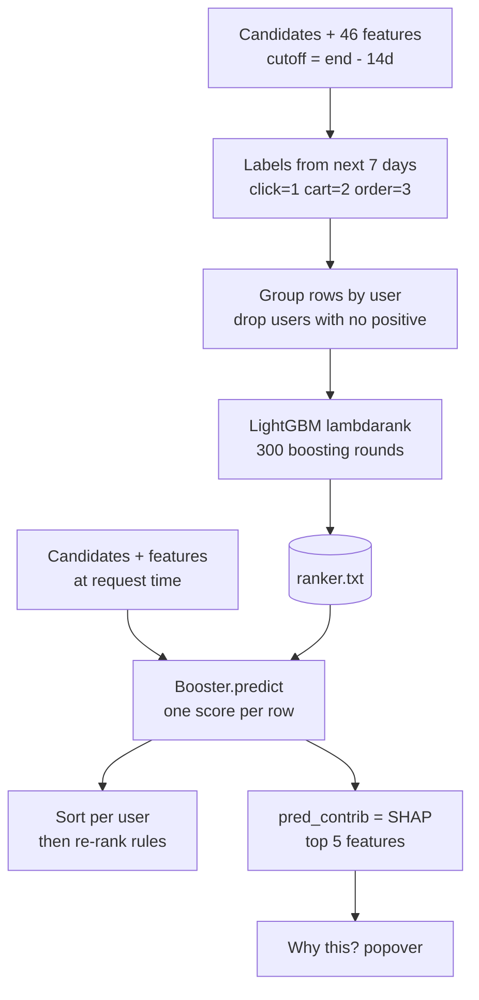
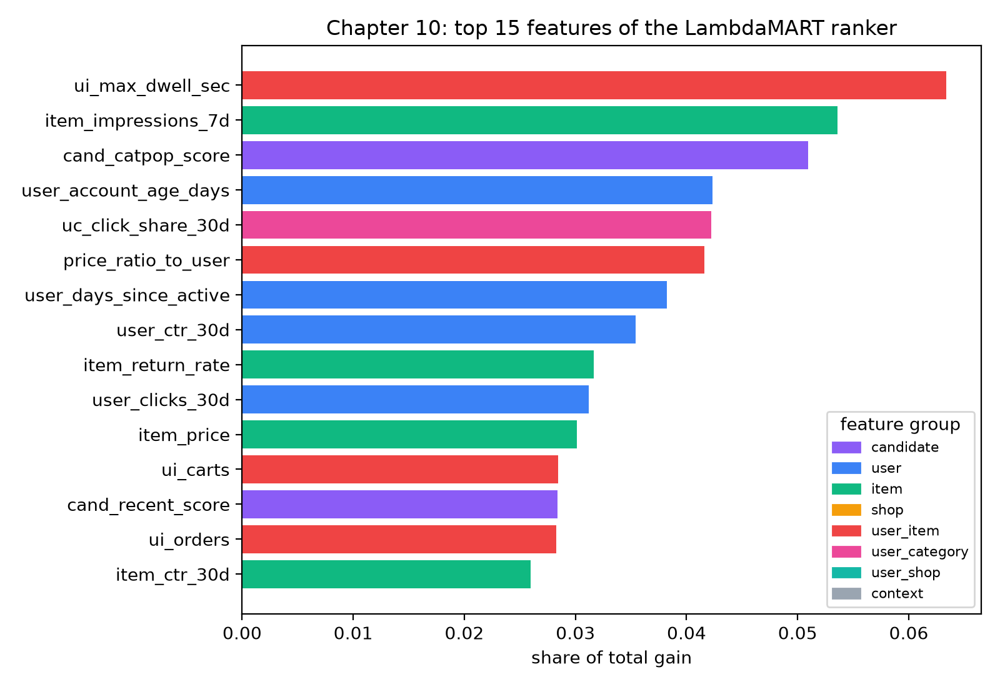
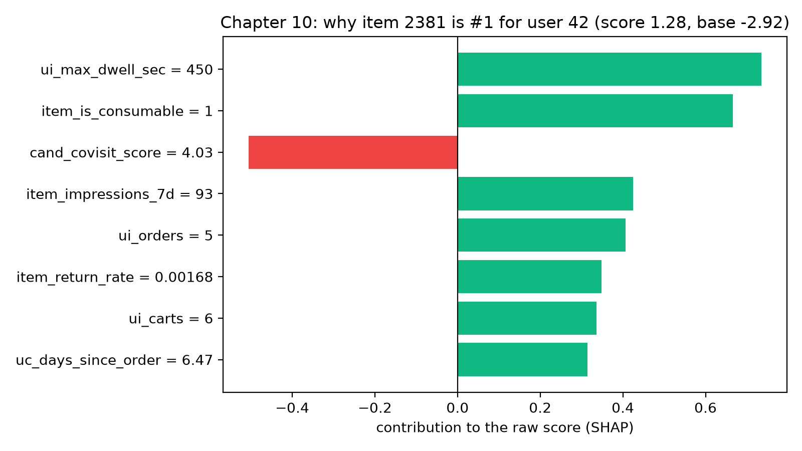
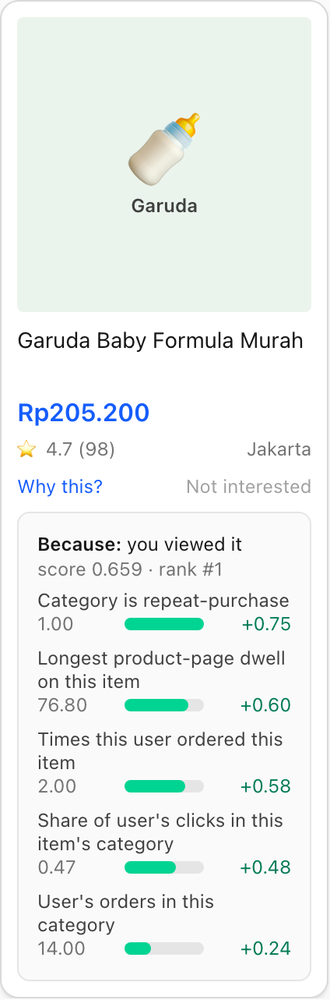
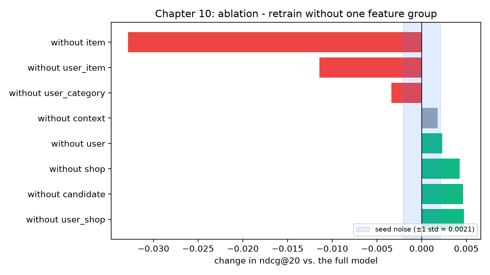

# Learning to rank

Dina is a ranking engineer on a marketplace team, and on Monday morning she opens a ticket that reads: "Home feed is weird. We show a kettle first to a user who bought a kettle yesterday, and a phone case in slot 9 to someone who has been staring at phone cases for a week." Nothing is wrong with retrieval. The candidate generators from the previous chapters did their job: the right products are somewhere in the pool of roughly a hundred candidates for that user. The problem is the *order*. The pool arrives sorted by whichever retriever happened to find the item first, and for every user the page only has room for a handful of slots at the top.

Last quarter Dina's team solved this with a hand-written formula: take the three retriever scores, divide each by its per-user maximum, add them up. It worked well enough to ship, and it is still in this repo as `pipeline.heuristic_score`. But every time somebody asked "should the dwell time count more than the cart count?" the answer was a shrug and a trial-and-error A/B test. This chapter is about replacing the shrug with a learning algorithm. We have 46 numbers for every `(user, item)` pair (Chapter 9), we have labels from the next seven days of real behaviour (click, add to cart, order), and we want a function that turns the first into a good guess of the second *and* puts the best items first.

That is the **learning-to-rank** problem, and gradient-boosted trees are the workhorse that solves it in the overwhelming majority of production marketplaces' ranking stages. By the end of the chapter you will have opened up the model that powers the "Why this?" popover in the app and understood every number in it.

**What you'll learn**

- The three families of learning-to-rank objectives (pointwise, pairwise, listwise) and when each one makes sense.
- How gradient-boosted decision trees work from first principles, with a hand-sized example of one split and one round of residuals.
- What LambdaMART adds on top of boosting: the *lambda* gradients and the NDCG swap delta.
- How the repo's `ranker.train` configures LightGBM, including graded labels and the `label_gain` table.
- How to read feature importance, SHAP contributions and a feature-group ablation, and how to avoid fooling yourself with seed noise.
- An honest result: on this small simulated dataset, a plain pointwise model scores *slightly higher* than LambdaMART, and why that happens.

## Intuition: sorting by a score someone learned

Think about how a recruiter shortlists candidates. A junior recruiter has a checklist: "+2 points for a degree, +3 for five years of experience, +1 for a referral." That is our heuristic blend. A senior recruiter has seen thousands of hires and developed a feel: a strong referral matters more when the candidate has a short work history, a degree matters less for sales roles. The senior recruiter's checklist is not additive, and nobody wrote it down. Learning to rank is the process of extracting that senior recruiter's judgement from historical outcomes.

Two different things can be learned from the same history.

1. **"How likely is this candidate to be hired?"** This is a *calibrated probability* question. If you only ever need yes/no decisions, this is exactly what you want.
2. **"Between these two candidates, who should come first?"** This is a *relative ordering* question. A recruiter with 100 candidates and 5 interview slots does not care whether the true hire probability is 12% or 14%; she cares that the person at rank 1 is better than the person at rank 6.

Both views are valid, and they correspond to the three families of objectives you will meet in the ranking literature.

| Family | The model is trained to… | Loss looks at | Example |
|---|---|---|---|
| **Pointwise** | predict the label of each row on its own | one row | logistic regression, `objective="binary"` |
| **Pairwise** | put the more relevant item above the less relevant one | pairs of rows from the same user | RankNet, Ranking SVM |
| **Listwise** | directly improve a list-level metric such as NDCG | the whole list for one user | LambdaMART, `objective="lambdarank"` |

A page of products is a list, the metric we care about (NDCG@20, defined in Chapter 2) is a list-level quantity, and the discount in NDCG says that a mistake near the top costs more than a mistake near the bottom. So in principle a listwise method should be the natural fit. We will see that principle meet practice later in the chapter, and the meeting is not entirely one-sided.

The overall flow of this stage in the repo looks like this.



*Figure: how the ranker is trained offline and used at serving time, including the SHAP explanation path.*

## The algorithm

We will build the pieces in order: first plain gradient boosting, then the lambdas that turn it into a ranker, then the graded labels that tell it what "good" means.

### Step 1: regression trees and one split

A decision tree turns a row of features into a number by asking a sequence of yes/no questions. A *regression* tree stores a number at each leaf. Training one means choosing, at each node, the question (feature and threshold) that makes the rows on each side as similar to each other as possible. "Similar" is measured by the sum of squared errors (SSE) around the mean of each side.

Take a toy training set of six candidate rows for one feature, `ui_max_dwell_sec` (the longest the user stayed on this item's page), with their graded labels.

| row | dwell (s) | label |
|---|---|---|
| 1 | 0 | 0 |
| 2 | 0 | 0 |
| 3 | 5 | 0 |
| 4 | 30 | 1 |
| 5 | 60 | 2 |
| 6 | 90 | 3 |

Boosting starts from a constant prediction, the mean label: $F_0 = (0+0+0+1+2+3)/6 = 1.0$. The **residual** of each row is what is left to explain, $r_i = y_i - F_0$, which gives $-1, -1, -1, 0, 1, 2$. Their sum of squares is $1+1+1+0+1+4 = 8$.

Now we try candidate splits on dwell time and score each by how much SSE it removes. For a split into a left set $L$ and a right set $R$ with residuals $r$,

$$\text{SSE}(S) = \sum_{i\in S}\bigl(r_i - \bar r_S\bigr)^2, \qquad \text{gain} = \text{SSE}(\text{all}) - \text{SSE}(L) - \text{SSE}(R).$$

| split | left rows | right rows | SSE(L) | SSE(R) | gain |
|---|---|---|---|---|---|
| dwell ≤ 2.5 | 1, 2 | 3–6 | 0 | 5.0 | 3.0 |
| dwell ≤ 17.5 | 1–3 | 4–6 | 0 | 2.0 | 6.0 |
| **dwell ≤ 45** | 1–4 | 5, 6 | 0.75 | 0.5 | **6.75** |
| dwell ≤ 75 | 1–5 | 6 | 3.2 | 0 | 4.8 |

The winning split is `dwell ≤ 45`. The leaf value is the mean residual on each side: $-0.75$ on the left, $+1.5$ on the right. A tree like this is a "weak learner": one question, two numbers, and obviously wrong for rows 4 and 5 individually. That is fine. Boosting does not need one great tree; it needs hundreds of mediocre ones that each fix part of the previous errors.

The *gain* column is also where **feature importance** comes from later: every time a feature is chosen for a split, the gain of that split is credited to it. Summing the credit over all splits of all trees and dividing by the total gives the "share of total gain" you will see in the results.

### Step 2: boosting = repeated residual fitting

The update rule is simple. With a learning rate $\eta$ (LightGBM calls it `learning_rate`), every row's prediction is moved a fraction of the way toward its tree's leaf value:

$$F_m(x) = F_{m-1}(x) + \eta\, h_m(x).$$

Take $\eta = 0.5$ for a one-round example. Rows 1–4 fall left and move by $0.5 \times (-0.75) = -0.375$, from $1.0$ to $0.625$. Rows 5 and 6 move by $0.5 \times 1.5 = +0.75$, to $1.75$. The new residuals are:

| row | label | new prediction | new residual |
|---|---|---|---|
| 1, 2, 3 | 0 | 0.625 | −0.625 |
| 4 | 1 | 0.625 | +0.375 |
| 5 | 2 | 1.75 | +0.25 |
| 6 | 3 | 1.75 | +1.25 |

Total squared error fell from 8 to $3\times 0.3906 + 0.1406 + 0.0625 + 1.5625 \approx 2.94$. The next tree is trained on these new residuals, and so on. After 300 rounds with a small $\eta$ the model has taken 300 small corrective steps.

Why "gradient" boosting, then? For squared error, the residual $y - F$ is exactly the negative gradient of $\tfrac12 (y-F)^2$ with respect to the prediction $F$. Friedman's insight was that you can plug in *any* differentiable loss and fit each new tree to the negative gradient of that loss instead. Swap squared error for log-loss and you get a classifier; swap it for a ranking loss and you get a ranker.

::: fact
**Boosting is gradient descent in function space.** Jerome Friedman's 2001 paper "Greedy function approximation: A gradient boosting machine" framed boosting as stage-wise gradient descent on an arbitrary differentiable loss, where each new tree is fit to the negative gradient of the loss at the current predictions. That single idea is why the same library can train regressors, classifiers and rankers by changing only the objective.

Source: Friedman, Annals of Statistics, 2001
:::

### Step 3: from per-row error to per-list quality

A pointwise objective (say log-loss on "was this row clicked or better?") treats each row as an independent example. It will happily spend model capacity on getting the 95th item's probability right. But Dina's page only shows the top 20 positions, and NDCG discounts the later of those heavily.

Recall the definition from Chapter 2. For a ranked list with graded relevance $rel_i$ at position $i$ (1-based):

$$\text{DCG@}K = \sum_{i=1}^{K} \frac{2^{rel_i}-1}{\log_2(i+1)}, \qquad \text{NDCG@}K = \frac{\text{DCG@}K}{\text{IDCG@}K},$$

where IDCG is the DCG of the perfect ordering. The numerator $2^{rel}-1$ is the **gain**: a relevance of 0, 1, 2, 3 gives gains 0, 1, 3, 7. An order is worth seven clicks. The denominator is the **discount**: position 1 has weight $1$, position 2 has $0.631$, position 3 has $0.5$, and so on.

The difficulty is that NDCG is a function of the *sorted order*, and sorting is not differentiable: nudging a score by $10^{-6}$ either changes nothing or flips two items. We cannot compute a gradient of NDCG with respect to scores. LambdaRank's trick (Burges, 2010) is wonderfully pragmatic: *skip the loss, define the gradient directly*.

### Step 4: lambdas and the NDCG swap

Start with a pairwise loss, as in RankNet. For two items $i$ and $j$ from the same user, where $i$ is more relevant, the model's current scores are $s_i$ and $s_j$. The probability the model assigns to "$i$ ranks above $j$" is a logistic function of the score difference, and the pairwise loss pushes $s_i - s_j$ to grow. Its gradient with respect to $s_i$ is

$$\lambda_{ij} = \frac{-\sigma}{1 + e^{\sigma (s_i - s_j)}}.$$

When $i$ is already far above $j$ the denominator is huge and the push vanishes. When $i$ is wrongly below $j$, $s_i - s_j$ is negative, the denominator is near 1, and the push is close to its maximum $\sigma$. So far this is plain pairwise logic: all mis-ordered pairs are equally urgent.

The LambdaRank step is to **multiply by the change in NDCG that swapping the two items would cause**:

$$\lambda_{ij} = \frac{-\sigma}{1 + e^{\sigma (s_i - s_j)}}\; \bigl|\Delta \text{NDCG}_{ij}\bigr|.$$

Swapping the items at positions $p_i$ and $p_j$ changes the DCG by $(g_i - g_j)\,(d_{p_i} - d_{p_j})$ in absolute value, where $g$ is the gain and $d_p = 1/\log_2(p+1)$ is the discount. Dividing by IDCG gives $|\Delta\text{NDCG}|$. A pair that is both mis-ordered *and* sits at the top of the list with a big gain gap gets a big lambda. A pair that is mis-ordered at positions 80 and 81, or whose gains are equal, gets almost none. That is how the algorithm "pays attention" to the top of the list without ever differentiating NDCG.

Each row's total lambda is the sum over all pairs it takes part in, with a sign (pushed up for the more relevant member, pushed down for the less relevant). These per-row lambdas are then used *in place of the negative gradient* when fitting the next tree. That is **LambdaMART**: **MART** (multiple additive regression trees, an older name for gradient-boosted trees) driven by **lambda** gradients.

### A worked example of the swap delta

Take three candidates for one user, currently ranked $A, B, C$ with graded labels 0, 3, 1. Their gains are $0, 7, 1$.

- $\text{DCG} = 0\cdot 1 + 7\cdot 0.631 + 1\cdot 0.5 = 4.917$.
- The ideal order is $B, C, A$, so $\text{IDCG} = 7\cdot 1 + 1\cdot 0.631 = 7.631$.
- $\text{NDCG} = 4.917/7.631 = 0.644$.

Which mistake matters most? Compute $|\Delta\text{NDCG}|$ for three possible pairwise swaps:

| swap | gain gap | discount gap | $\lvert\Delta\text{NDCG}\rvert$ |
|---|---|---|---|
| $A \leftrightarrow B$ (positions 1, 2) | 7 | $1 - 0.631 = 0.369$ | $7\times0.369/7.631 = 0.339$ |
| $A \leftrightarrow C$ (positions 1, 3) | 1 | $1 - 0.5 = 0.5$ | $1\times 0.5/7.631 = 0.066$ |
| $B \leftrightarrow C$ (positions 2, 3) | 6 | $0.631 - 0.5 = 0.131$ | $6\times0.131/7.631 = 0.103$ |

The $A$–$B$ mistake, a never-bought item above the order-level item, is five times more important than the $A$–$C$ mistake. Now suppose the model's raw scores are $s_A = 2.0$ and $s_B = 1.0$ and $\sigma = 1$. For the pair "$B$ should be above $A$", $s_B - s_A = -1$, so the logistic factor is $1/(1+e^{-1}) = 0.731$. The magnitude of the lambda for that pair is $0.731 \times 0.339 = 0.248$: a firm upward push on $B$ and an equal downward push on $A$. For the pair $(C, A)$ with the same logistic factor the magnitude would be only $0.731\times 0.066=0.048$. The next tree will therefore spend most of its splitting effort on features that tell $B$ and $A$ apart.

::: fact
**LambdaMART won the Yahoo! Learning to Rank Challenge.** The system that won Track 1 of the Yahoo! Learning to Rank Challenge (2010) was an ensemble of lambda-gradient models, built on boosted trees trained with LambdaRank-style gradients. Chris Burges's earlier overview paper, "From RankNet to LambdaRank to LambdaMART", is the standard reference for how the three algorithms fit together.

Source: Burges et al., Proceedings of the Learning to Rank Challenge (PMLR), 2011
:::

### Step 5: graded labels

In this repo a label is not just 0 or 1. `schema.LABEL_GAIN` says a click is worth 1, an add-to-cart 2 and an order 3. If a user did several things with the same item in the label window, `data.labels` keeps the *strongest* one. This matters in two ways:

1. The model is rewarded for putting the item the user ordered above the item the user only clicked.
2. The `label_gain=[0, 1, 3, 7]` parameter in LightGBM converts the integer labels to the gain $2^{rel}-1$ used in NDCG. LightGBM's default table happens to be the same $2^{rel}-1$ for these labels, but spelling it out in `PARAMS` keeps the objective and the offline evaluator from silently drifting apart; it means the objective being optimised and the metric being reported are the same function.

One more detail: users with no positive label in the window carry no ordering information (every pair of their items has equal labels, so every $|\Delta\text{NDCG}|$ is 0). `ranker.train` drops them before training.

## Code walkthrough

### The ranker itself

The whole LambdaMART configuration lives in the `PARAMS` dictionary at the top of `recommender/recsys/ranker.py` (plus the `NUM_ROUNDS` constant):

| Parameter | Value | Role |
|---|---|---|
| `objective` | `lambdarank` | lambda gradients (Step 4) |
| `learning_rate` | 0.05 | the step size $\eta$ |
| `num_leaves` | 31 | tree size cap |
| `min_data_in_leaf` | 50 | minimum rows per leaf |
| `bagging_fraction` / `bagging_freq` | 0.8 / 1 | fresh 80% row sample per tree |
| `feature_fraction` | 0.8 | 80% column sample per tree |
| `label_gain` | `[0, 1, 3, 7]` | gain of label 0..3 |
| `lambdarank_truncation_level` | 20 | focus on the top 20 |
| `NUM_ROUNDS` | 300 | number of trees |


Read the table as a list of dials:

- `objective="lambdarank"` selects the lambda gradients from Step 4.
- `learning_rate=0.05` is $\eta$. Small steps and many rounds (`NUM_ROUNDS = 300`) generalise better than few large steps.
- `num_leaves=31` caps the size of each tree. LightGBM grows trees *leaf-wise* (always splitting the leaf with the greatest gain), so the number of leaves, not depth, is the natural complexity control.
- `min_data_in_leaf=50` refuses to create a leaf supported by fewer than 50 rows, which protects against memorising a single user.
- `bagging_fraction=0.8` with `bagging_freq=1` trains every tree on a fresh random 80% of the rows; `feature_fraction=0.8` lets every tree see a random 80% of the columns. Both inject randomness so the trees are less correlated, in the same spirit as a random forest. They also explain why `seed` changes the result, which will matter in the ablation section.
- `label_gain=[0, 1, 3, 7]` is the gain table discussed in Step 5.
- `lambdarank_truncation_level=20` tells LightGBM to compute lambdas only for pairs where at least one item is currently within the top 20. That matches the metric (`K = 20`) and skips pairs at the bottom of the list where $|\Delta\text{NDCG}|$ is negligible anyway.

::: fact
**LightGBM is fast because it does less work per split.** The LightGBM paper introduced Gradient-based One-Side Sampling, which skips most rows with small gradients when estimating split gain, and Exclusive Feature Bundling, which merges sparse features that are rarely non-zero together. On the public datasets the authors tested, this sped up training of conventional gradient-boosted trees by up to over 20 times with almost the same accuracy.

Source: Ke et al., NeurIPS, 2017
:::

Training takes eight lines. Read this function slowly: its structure encodes everything about how LightGBM wants ranking data.

```include
path: recommender/recsys/ranker.py
symbol: train
```

Three things to notice. First, the `has_pos` mask keeps only users who have at least one positive in the label window; the rest are dropped. Second, `sort_values("user_id", kind="stable")` puts every user's rows next to each other, because LightGBM's `group=` argument is a list of *consecutive group sizes*, not user ids. If the rows were not contiguous, the group boundaries would silently cut through the wrong users and the model would train on garbage without raising an error. Third, the seed is injectable: `train(frame, names, seed)` is what lets the ablation retrain the same model with different random seeds.

Scoring is a one-liner that returns a score for every row, aligned to the frame's index:

```include
path: recommender/recsys/ranker.py
symbol: score
```

A LambdaMART score has no units. It is not a probability and not a predicted label. Only the *differences* between scores of the same user's candidates mean anything. This is why the app never shows the raw score as "match percentage", and why you should be suspicious of any product UI that does.

### Training and evaluating end to end

`pipeline.train_and_evaluate` ties together the data split from Chapter 2, the frame builder from Chapter 9 and the ranker above:

```include
path: recommender/recsys/pipeline.py
symbol: train_and_evaluate
```

Walk through it in order. The two cutoffs sit 14 and 7 days before `end`. The training frame is built as of `end - 14d`, its labels come from the following 7 days. The evaluation frame is built as of `end - 7d`, with labels from the final 7 days; the model never sees them. The ranker is trained on the first frame only, and scored on the second.

The `results` dictionary compares four methods on the same evaluation frame, using the same `evaluate.metrics` function. "global popular" is the Chapter 3 baseline. "heuristic blend" is Dina's hand-written formula. "lightgbm ranker" is what we just trained. "lightgbm + rerank" applies the business rules from Chapter 11 on top. Without these rows in the same table an ML model has no yardstick, and a model can easily ship that is no better than the blend if nobody checks.

Here is the heuristic, in full. It is short on purpose: the three retriever scores, each normalised by the user's best, added up.

```include
path: recommender/recsys/pipeline.py
symbol: heuristic_score
```

The service, in `recommender/recsys/service.py`, calls the same `retrain` machinery on a timer and on the admin button, so what you read here is the code that actually runs in production for this repo.

### Explaining a score with SHAP

A boosted model is a sum of 300 trees. A single prediction passes through all of them, so reading the trees directly is hopeless. **SHAP** values (Lundberg and Lee, 2017) solve this with an idea from cooperative game theory: treat the features as players in a game whose payout is the model's score. The Shapley value of a feature is its average marginal contribution over all the orders in which features could be added. For one row, the contributions of all features plus a base score add up *exactly* to the model's raw output.

Computing Shapley values naively requires an exponential number of feature subsets. For tree ensembles there is a fast exact algorithm, and LightGBM implements it behind a single flag, `pred_contrib=True`. The repo wraps it:

```include
path: recommender/recsys/ranker.py
symbol: contributions
```

`model.predict(x, pred_contrib=True)` returns a matrix with one column per feature plus one final column holding the **bias**, the model's average output when it knows nothing about the row. The slice `[:, :-1]` drops that last column, so what remains are the pure per-feature contributions. For each row we then sort features by $|\text{contribution}|$ and keep the top `top` of them as `(name, value, contribution)` triples. The gRPC service calls this in `recommend_rpc` and puts the top five in each response; the Rust API forwards them untouched, and `WhyThis.vue` draws them as bars.

::: fact
**Exact SHAP for trees runs in polynomial time.** The TreeExplainer paper presented the first polynomial-time algorithm to compute optimal game-theoretic explanations for tree-based models such as random forests and gradient-boosted trees. Before it, exact Shapley values required enumerating exponentially many feature subsets, which made them impractical for models with dozens of features and hundreds of trees.

Source: Lundberg et al., Nature Machine Intelligence, 2020
:::

## Run it

The companion script trains three rankers on exactly the same candidate frames, runs a four-seed check, prints importances and a SHAP breakdown, and runs the group ablation. From the `book/` directory:

```bash
uv run python code/ch10_ltr.py
```

The script builds the training frame (cutoff 14 days before the end) and the evaluation frame (7 days before the end) once, then reuses them for every model. The first block compares the three orderings.

```output
file: results/ch10_ltr.txt
lines: 1-9
```

Read the table from top to bottom. The heuristic blend reaches ndcg@20 of 0.1674. The two trained models reach 0.2146 (pointwise) and 0.2116 (LambdaMART): roughly 26–28% higher, from the same candidates and the same labels. The last line, 0.4645, is the *candidate recall ceiling*, the fraction of the user's true positives that were in the candidate pool at all. Recall@20 of any ranker is bounded by it. LambdaMART's recall@20 of 0.2725 is 59% of what an oracle reordering of the same pool could reach.

## Results

### Pointwise versus LambdaMART: an honest comparison

The second block of the output is the one many ranking tutorials omit. A pointwise LightGBM (`objective="binary"`, label = "was there any positive action?") was trained on the same rows with the same hyperparameters, and both models were retrained with four different random seeds.

```output
file: results/ch10_ltr.txt
lines: 11-20
```

The pointwise model is ahead on every seed. The mean ndcg@20 is 0.2147 against 0.2125, a gap of 0.0022, and the standard deviation across seeds is 0.0014 for pointwise and 0.0021 for LambdaMART. The gap is therefore about one seed-standard-deviation: consistent in sign across the four seeds, but small. Pointwise also leads on recall@5 (0.1577 against 0.1503) and recall@10 (0.2176 against 0.2015). LambdaMART's coverage@20, the share of the catalogue that appears in somebody's top 20, is the lowest of the three (0.4245, against 0.4777 for pointwise and 0.5682 for the heuristic blend).

This contradicts the principle that a listwise objective matches a list-level metric. Why would it lose here?

1. **Few positives per list.** Each user has about a hundred candidates and typically only a handful of positives in the next seven days. A pairwise or listwise loss turns that into at most a few hundred informative pairs. A pointwise loss with a binary label simply asks "positive or not?" for each row, a task with a much simpler signal, and one that the leaf-wise trees can learn directly. The list-aware machinery has little extra to exploit.
2. **The metric is already near what the pool allows.** With a candidate recall ceiling of 0.4645, the room for ranking improvements is limited. Differences between two good rankers get squeezed.
3. **Graded labels are noisy.** Whether somebody clicks, carts or buys in a seven-day window depends on mood and stock as much as on affinity. The `label_gain` table amplifies those distinctions for LambdaMART, so it can chase noise in orders, which are rare, while the binary pointwise label is steadier.
4. **Swap deltas favour the head.** With `lambdarank_truncation_level=20` the lambdas concentrate effort on the top of the list. That is what you want when the training data is large; with little data it can overfit the head.

Does this mean LambdaMART is the wrong choice? No, and the right conclusion is deliberately modest. (a) On a dataset ten or a hundred times bigger, with thousands of impressions per query, the picture often flips; that is the setting of the published results. (b) The differences here are about one seed-standard-deviation, so you would not make a launch decision on them. (c) LambdaMART optimises the NDCG-style objective you actually care about, with graded labels, and costs the same to train and serve. (d) What cannot be argued with is the gap to the heuristic blend: both learned models beat it by roughly 0.045 of ndcg@20.

The repo keeps `lambdarank` as its production objective because it is the one most likely to scale with data, because the app needs graded labels and because the pointwise advantage here is within noise. If your own A/B test says otherwise, `objective="binary"` is a one-line change in `PARAMS`. The practical lesson is the process: *always keep a simple baseline in the table and always rerun with several seeds before declaring a winner.*

### What did the model learn? Feature importance

The simplest question to ask a boosted model is which features it used the most. LightGBM can report the total gain per feature (the sum of the split gains from Step 1). `ranker.importance` normalises the gains to shares that sum to one.

```include
path: recommender/recsys/ranker.py
symbol: importance
```

The top 15 features and the share of gain by group are in the output:

```output
file: results/ch10_ltr.txt
lines: 22-48
```



Three observations. First, the importance is *diffuse*: the single most used feature, `ui_max_dwell_sec`, accounts for only 6.3% of gain, and the fifteenth, `item_ctr_30d`, for 2.6%. There is no one feature to rely on; the model is spreading its decisions over the 46 features. Second, by group, the **item** features carry the largest share (0.309), then user–item features (0.198), user (0.189), candidate (0.134) and user–category (0.086). The **context** group (device, hour of day) gets only 0.004 and is almost unused. Third, the top of the list is a mixture of user–item evidence (the longest dwell on this very item, the number of carts and orders), item quality signals (`item_return_rate`, `item_ctr_30d`) and the retrievers' own scores (`cand_catpop_score`).

A caution. Gain importance is a statement about *how the trees were built*, not about how much the model would suffer without a feature. A feature can win many splits because it is correlated with other features that would do the job equally well, and it is biased toward features with many distinct values, because they offer more possible thresholds. The ablation below shows the discrepancy concretely.

### Why this? One prediction under the microscope

Importance averages over every prediction. SHAP explains one. The script scores the 106 candidates for user 42, takes the top item (id 2381), and prints its contributions:

```output
file: results/ch10_ltr.txt
lines: 50-63
```

The model's raw score for this item is 1.277. The bias, the model's baseline score for an unremarkable candidate, is −2.917, and the final two lines of the output demonstrate the additivity property: *sum of all contributions + bias = 1.277*, equal to the model score. The eight largest contributions shown add up to about $+2.73$, so the remaining 38 features together add the remaining $+1.47$. The page cannot show them all, so the app shows the top five.



Reading the chart as a story: user 42 once dwelled on this very item for a long time (`ui_max_dwell_sec` = 450 seconds, +0.735), the item belongs to a consumable, re-purchase-friendly category (+0.666), the item was impressed to many people lately (`item_impressions_7d` = 93, +0.425), the user has ordered it five times and carted it six times (+0.407 and +0.336), and its return rate is tiny (+0.348). It has been 6.5 days since the user last bought in the category, which is a plausible re-purchase cycle (+0.314). The single negative bar is instructive: `cand_covisit_score` = 4.03 *lowers* the score by 0.505. A high co-visitation score means the item was found through "other users viewed these together", a source that on its own is less predictive than direct evidence from this user. Given everything else the model knows, a co-visit-only candidate is a weaker bet, so the same feature contributes negatively here. A hand-written formula that simply added the retriever scores could not express this.

You can see the same mechanism in the running app. The "Why this?" popover on a Home card is these contributions, rendered by `WhyThis.vue` with the feature descriptions from `schema.FEATURES`.



The card in the screenshot was explained by the model live in the app's database, trained at a different time from the one in the chart, so its numbers differ from the chart's; the mechanism is identical. The source line ("you viewed it") comes from `pipeline.source_of`, which names whichever retriever gave the item its largest score. The bars below it are `ranker.contributions`, scaled in the UI to the largest absolute value in the list.

### Ablation: which groups of features matter, and compared to what?

Importance asks about the trained model. **Ablation** asks a counterfactual: if we had never had these features, would the model be worse? You answer it by retraining. `pipeline.group_ablation` removes one feature group at a time, retrains with the same settings, and reports the change in each metric against the full model.

```include
path: recommender/recsys/pipeline.py
symbol: group_ablation
```

The last four lines are the key insight of the function and the reason this chapter keeps mentioning seeds. LightGBM's bagging and feature sampling make training slightly random. If you retrain the *same* full model with seeds 1, 2 and 3, you get slightly different metrics each time. Their standard deviation is the **noise floor** of the experiment. A delta smaller than the noise floor tells you nothing, because rerunning with a different seed could easily flip its sign.

```output
file: results/ch10_ltr.txt
lines: 65-77
```



The seed noise on ndcg@20 is 0.0021 (the shaded band). Compare each row's ndcg@20 change to that band:

- **without item: −0.0328.** Fifteen times the noise. The item group (price, popularity, CTR, return rate, stock, and so on) is the most valuable evidence, and no other group can substitute for it.
- **without user_item: −0.0114.** About five times the noise. What this user did with this item is important, and the other groups do not replace it.
- **without user_category: −0.0034.** Beyond the noise band on ndcg, and clearly beyond it on recall@20 (−0.0159 against a noise of 0.0021), so we count it as a real, if smaller, contribution.
- **context, user, shop, candidate, user_shop:** deltas between +0.0018 and +0.0047. These are *positive*, meaning the model without these groups scored *higher*, and they are all within about two noise standard deviations of zero. The honest reading is "no evidence that they help in this data", not "removing them improves the model".

Compare with the gain-importance results. The candidate group has 13.4% of the gain and the user group 18.9%, yet removing either does not hurt. The reason is redundancy: the candidate scores (`cand_recent_score`, `cand_covisit_score`) largely re-express what the user–item features already know, and the user's overall activity level correlates with other signals. When one of two correlated features is removed, the model uses the other. Gain importance would never reveal that.

::: warning
**Do not read a positive ablation delta as a finding.** A delta of +0.0046 for "without candidate" is roughly twice the seed noise, and both signs are possible on a rerun. Experiments on one split of one simulated dataset are only suggestive. If a decision (say, dropping a costly feature pipeline) depends on the result, repeat it over more seeds and more time windows first.
:::

## Pitfalls and production practice

**Leakage, again.** The most common reason a ranker looks fantastic offline and disappoints online is that a feature was computed with information from the label window. Chapter 9 showed a model with a leaky feature scoring an ndcg@20 of 0.50, against 0.21 for the honest one. The best defence is the structure of this repo: features are built as of a cutoff via `History.at`, and a test in `tests/test_point_in_time.py` fails if anything looks past it. In your own system keep that test.

**Group boundaries.** LightGBM's `group=` argument is a list of consecutive sizes. If your DataFrame is not sorted by group, the code runs and the metrics look strange rather than failing. Sort, then compute group sizes from the sorted frame, exactly as `ranker.train` does. Also guard against groups with no positives, which add nothing (and in some libraries crash the NDCG computation).

**Do not trust raw scores across users or models.** A LambdaMART score has no scale. You cannot threshold it ("show only items above 0.5"), compare it between two models, or average it with a click probability without a calibration step. If another component needs a probability (an ads auction or an expected-revenue calculation), train a pointwise model for that, or add an isotonic calibration layer on top.

**Label design is product design.** The `LABEL_GAIN` table (click 1, cart 2, order 3) is an opinion about what the business values. Changing the gain table to `[0, 1, 3, 7]`, as the repo does, makes the model very order-hungry. If most of your traffic is browsing, the signal from rare orders is noisy. Production teams often train several heads on the same features (click, cart, order) and combine them, which is the multi-task approach discussed in Chapter 14.

**Train/serve skew.** The training frame in this repo is made by the same `features.build` function the live service uses, which is the cheap way to avoid skew. Where a team builds batch features in Spark and serving features in a different code path, small differences (time zones, rounding, missing-value conventions) silently cripple the model. Compare feature distributions in training and in the logs of live requests.

**Position bias in the labels.** Items shown at the top of the page get clicked more, regardless of how good they are, so a model trained on logged clicks learns to love whatever the *previous* ranker put on top. We deal with this in Chapter 12. For now, remember that logged labels carry this bias.

**Retrain cadence and monitoring.** The service retrains on a timer (every six hours by default) and from the admin button, writing `ranker.txt` and a metadata file with the metrics and importances. Treat every retrain as a deploy: compare the new model's offline metrics with the previous model's, and refuse to swap in a model that is worse than the heuristic baseline. The "model info" page in the app surfaces the latest numbers so a human can notice.

**Explanations are not causal.** A SHAP bar says "this feature value pushed the score up relative to the baseline", not "if the user had done something else the item would have been shown". The popover is useful for debugging ("why on earth is a kettle ranked first?") and for building user trust, but its language should stay modest. An explanation can also be *wrong in a way that is hard to see*: with correlated features, SHAP splits credit among them in a way that depends on how the trees happened to use them.

::: tip
**Always keep a "dumb" baseline in the table.** The cheapest insurance in applied ML is a one-line baseline (`global popular`, a blend, pointwise logistic regression) that is evaluated by the same function, on the same split, with the same seeds. If your sophisticated model cannot clearly beat it, the fault is more likely in the data than in the algorithm.
:::

## Summary

- Learning to rank turns a pool of candidates and their features into an ordering. Pointwise methods predict each row's label, pairwise methods order pairs, listwise methods target a list metric like NDCG.
- Gradient boosting builds a model as a sum of small trees, each fit to the residuals (negative gradients) of the current ensemble; a split's gain is the SSE it removes.
- LambdaMART replaces the unusable gradient of NDCG with *lambdas*: pairwise logistic pushes scaled by the NDCG change $|\Delta\text{NDCG}|$ that swapping the pair would cause, so errors near the top with big gain gaps dominate.
- The repo's `ranker.PARAMS` uses `lambdarank`, 300 rounds at a 0.05 learning rate, `label_gain=[0, 1, 3, 7]` for graded click/cart/order labels, and truncation at 20. Rows must be grouped contiguously by user, and users with no positives are dropped.
- Both learned rankers beat the heuristic blend by wide margins (ndcg@20 0.2146 and 0.2116 versus 0.1674), but here the pointwise model is marginally ahead of LambdaMART across all four seeds, by about one seed-standard-deviation. List-aware objectives pay off with more data per query.
- Gain importance is diffuse (the top feature has 6.3%); it tells you how the trees were built, not what the model needs.
- SHAP gives exact, additive per-prediction explanations (contributions plus bias equal the score) and powers the app's "Why this?" popover through `ranker.contributions`.
- A feature-group ablation answers the counterfactual question, but only deltas larger than the seed noise count: here only the item, user–item and user–category groups cleared it.

## Quiz

**Q10.1** Which statement best distinguishes pointwise, pairwise and listwise learning to rank?

A. Pointwise uses trees, pairwise uses neural networks, listwise uses linear models.
B. Pointwise losses score each row on its own, pairwise losses compare two items of the same query, listwise losses look at the whole ranked list.
C. Pointwise methods need graded labels; pairwise and listwise methods need binary labels.
D. Pointwise methods are trained online, the others offline.

**Q10.2** In gradient boosting with squared error, what does each new tree try to predict?

A. The original label of each row.
B. The average label of the whole training set.
C. The residual of the current ensemble, which is the negative gradient of the loss.
D. The feature with the highest gain.

**Q10.3** In LambdaMART, why is each pairwise push multiplied by $|\Delta\text{NDCG}|$?

A. To make the loss differentiable.
B. To make scores comparable between users.
C. To speed up training by skipping pairs.
D. To make mis-orderings that would change NDCG a lot (near the top, with large gain gaps) count more than ones that change it little.

**Q10.4** `ranker.train` sorts the frame by `user_id` with a stable sort before building the LightGBM dataset. Why must the rows of one user be contiguous, and what goes wrong if they are not?

**Q10.5** In our results, pointwise LightGBM scores slightly higher than LambdaMART on ndcg@20. Give two plausible reasons, and say what evidence would make you switch the production objective.

**Q10.6** Read this code from `recommender/recsys/ranker.py`:

```include
path: recommender/recsys/ranker.py
symbol: contributions
```

Why does the function slice the prediction matrix with `[:, :-1]`? What would happen to the "explanation" if that slice were forgotten, assuming the list is then sorted by $|\text{contribution}|$ for each row?

**Q10.7** A user's candidates are ranked with graded labels $1, 0, 3$ at positions 1, 2, 3 (gains $2^{rel}-1 = 1, 0, 7$). Using $d_p = 1/\log_2(p+1)$, compute $|\Delta\text{NDCG}|$ for swapping the items at positions 1 and 3. Give three decimals.

**Q10.8** For the item explained in the chapter, the model score is 1.277 and the bias is −2.917. The eight contributions shown sum to about +2.726. What is the combined contribution of the remaining features?

**Q10.9** An ablation reports "without user_category: −0.0034 ndcg@20" and the seed noise is ±0.0021 (one standard deviation). Which conclusion is best supported?

A. Removing the group has a definite effect of exactly −0.0034.
B. The group is useless because the effect is below 0.01.
C. The effect is larger than one noise standard deviation, so there is mild evidence the group helps; checking recall@20 or more seeds would strengthen the conclusion.
D. The result is meaningless because the delta is negative.

**Q10.10** *Hands-on.* In `book/code/ch10_ltr.py`, just before the line `model = ranker.train(train)`, add `ranker.PARAMS["label_gain"] = [0, 1, 1, 1]` so that an order is worth no more than a click, then rerun the script. Observe `ndcg@20` and `order_recall@20` for LambdaMART in the first table and compare with the values in this chapter, using the seed standard deviation (0.0021) as the yardstick for whether any change is real. Revert the change afterwards.
