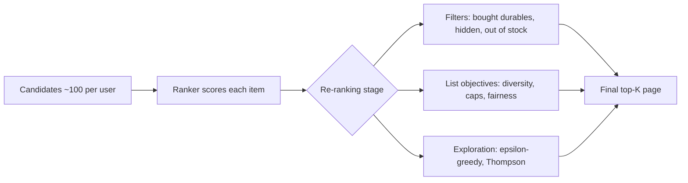

# Re-ranking, diversity and business rules

## The page that was all baby formula

Imagine you open the home page of a large marketplace app on a Tuesday evening. Last week you bought a pack of diapers and clicked on three tins of baby formula to compare prices. Your recommender is a good one: a gradient-boosted ranker from the previous chapter, trained on tens of thousands of examples, with a healthy offline NDCG. It looks at your history and concludes, correctly, that you are a new parent. So the first screen is baby formula, baby formula, baby formula, a baby bottle, more baby formula, and one lipstick that slipped in at position five.

Nothing is *wrong* with any single card. Each one is, individually, a defensible bet. But the *page* is a bad page. If the formula brands you like are out of budget this week, the whole screen is wasted. If you wanted to browse, you have nothing to browse. If you bought a refrigerator yesterday, the page might even offer you three more refrigerators. Your ranker scores items one at a time, and it has no idea that twenty similar good bets are not twenty times as good as one.

This is the job of the last stage of the pipeline: **re-ranking**. It takes the scored list from the ranker and fixes properties that only exist at the level of the *whole list*: variety, fairness between sellers, freshness, things the user must never see again, things the business must show, and a small amount of deliberate randomness so that the system keeps learning. In this chapter we first look at the re-ranker in our repo (a few lines of pandas), then at the classic diversity algorithm, Maximal Marginal Relevance (MMR), measure what diversity costs in offline accuracy on our simulated marketplace, and finish with the two standard exploration strategies: epsilon-greedy and Thompson sampling.


### What you'll learn

- Why a model that scores items independently produces lists that are bad as lists, and what "list-level" objectives are.
- How Maximal Marginal Relevance trades relevance against redundancy, with the formula and a hand-computed example.
- How the repo's `rerank.rerank` implements an already-bought filter and per-category and per-shop caps in five lines of pandas.
- How much offline accuracy each of these rules costs on our data, using real numbers from the companion script.
- How sellers' fairness, sponsored items and manual boosts fit into the re-ranking stage without corrupting the ranker.
- How epsilon-greedy and Thompson sampling choose which items to explore, with a worked Beta-distribution example.

## Intuition: building a shopping window, not picking the best products

Think about how a shop owner dresses a window. She does not sort her stock by profit margin and then put the top twelve items in a row. If the twelve best sellers are all running shoes, the window says "we sell running shoes", and passers-by who need a coat walk on. She chooses a *set* of items that together say something: a shoe, a coat, a bag, a gift. Each item in the window is slightly worse than the single best item she could have chosen for its slot, but the *window* is better, because the items complement rather than duplicate each other.

A recommender home page is a window. The ranker of Chapter 10 is the owner who sorts by margin. It answers "how likely is this user to engage with this item?" for each item independently, and independence is exactly the problem: after you have shown one baby-formula tin, the probability that a second one is useful is not the same as the probability it had before. Economists call this *diminishing marginal utility*; in information retrieval it is called *redundancy*.

There is a second analogy for the business rules. A supermarket will not display expired yoghurt, however well it sells; it will not let one supplier fill every shelf; and it may display a promoted brand at eye level, but it must tell you when a shelf is paid for. Such rules are not about prediction at all. They are *constraints* on the output, and the cleanest place to apply them is after the model has done its prediction job, in a small, readable, testable piece of code. That is why the repo puts them in a separate file, `recommender/recsys/rerank.py`, rather than baking them into the model.

There are three families of re-ranking logic and we will meet all of them:

1. **Filters** remove items that must not appear (already bought, hidden, out of stock).
2. **List-level objectives** such as diversity: the value of an item depends on what is already on the page.
3. **Exploration**: sometimes put an item on the page because the system is *uncertain* about it, not because it is the best bet.



*Figure: Re-ranking is the last stage. It sees scored candidates and produces the page; it never retrains the model.*

## The algorithm

### Why we re-rank *after* the model

One could try to teach the ranker about variety directly. That is an active research area (listwise and "slate" models), but in a production pipeline the separation is attractive for three engineering reasons. First, the rules change weekly (a marketing campaign starts, a legal team forbids a category in a country) while the model retrains every few hours or days; mixing them would force retraining for every policy change. Second, rules must be *auditable*: when a seller complains about not being shown, "the cap is four items per shop" is an answer, whereas "the gradient boosting learned it" is not. Third, the re-ranker works on a few dozen items and can afford $O(n^2)$ computation that would be unaffordable over millions.

### Filters: the already-bought rule

The simplest rule is the *already-bought filter*. We drop an item if the user ordered it before and the category is not consumable. Someone who bought a refrigerator last month does not need to see that exact refrigerator; someone who bought coffee last month very probably does. In the simulator (and in the schema from Chapter 1) each category has an `is_consumable` flag, which the feature table exposes as `item_is_consumable`, and the history feature `ui_orders` counts how many times this user ordered this item. The rule is

$$\text{drop}(u, i) \iff \text{ui\_orders}(u,i) > 0 \ \wedge\ \text{item\_is\_consumable}(i) = 0 .$$

Hidden items (the user pressed "Not interested") are handled earlier, in candidate generation, as a hard filter; you can see it in `candidates.generate`. Out-of-stock items are also removed there. Filtering at candidate time is cheaper because we do not waste feature computation on rows that will never be shown.

### Caps: a poor man's diversity

The second rule limits how many items from one category and one shop may appear. Sort the user's items by score. Number the items of each category $0, 1, 2, \dots$ in score order and do the same for each shop. Keep an item only if its position within its category is below $C_{\text{cat}}$ and its position within its shop is below $C_{\text{shop}}$. In the repo $C_{\text{cat}} = 8$ and $C_{\text{shop}} = 4$. Then take the first $K$ survivors.

Caps are blunt but powerful. They give a hard guarantee (no page ever has more than four items from one shop) at the cost of being completely insensitive to how *similar* the items are. Two phone cases from two different shops, both in the "Phone Cases" category, are to a human near-duplicates, yet the caps allow eight of them.

### Maximal Marginal Relevance

MMR, proposed by Carbonell and Goldstein for reordering search results and summaries, is the classic answer to "how do we penalise similarity to what is already on the page?". It is greedy. Start with the empty list $S$. At each step pick the item $i$ from the remaining candidates $R$ that maximises

$$\text{MMR}(i) = \lambda \cdot \text{rel}(i) - (1-\lambda) \cdot \max_{j \in S} \text{sim}(i, j),$$

where $\text{rel}(i)$ is the relevance (here, the ranker score rescaled to $[0, 1]$ per user) and $\text{sim}(i,j) \in [0,1]$ measures how similar two items are. The parameter $\lambda \in [0,1]$ is a dial. At $\lambda = 1$ the second term vanishes and MMR reproduces the original ranking. At $\lambda = 0$ relevance is ignored and you get a maximally spread list. For the first pick the set $S$ is empty, so the penalty is zero by convention, and the top-ranked item always comes first.

The algorithm in numbered steps:

1. Scale each user's scores to $[0,1]$: $\text{rel}(i) = (s_i - s_{\min}) / (s_{\max} - s_{\min})$.
2. Precompute the pairwise similarity matrix for this user's candidates. In our companion script, $\text{sim} = 1$ for the same category, $0.5$ for the same parent category, and $0$ otherwise.
3. Maintain, for every remaining candidate, the largest similarity to any selected item so far.
4. Repeat $K$ times: compute the MMR score of every remaining item, select the argmax, mark it taken, and update the running maximum of similarities.

The cost is $O(K \cdot n)$ per user after the similarity matrix exists, and building the matrix is $O(n^2)$. With $n \approx 100$ candidates that is a few thousand operations; trivial.

#### A worked example with four items

Take $\lambda = 0.7$ and four candidates with normalised relevance and categories:

| item | rel | category |
|---|---|---|
| A | 1.0 | Phones |
| B | 0.9 | Phones |
| C | 0.6 | Shoes |
| D | 0.5 | Beauty |

Items in the same category have similarity 1; all other pairs have similarity 0 (we ignore the parent level here for simplicity).

- **Pick 1.** Nothing selected yet. Scores are $0.7 \times$ rel: A = 0.70, B = 0.63, C = 0.42, D = 0.35. We pick **A**.
- **Pick 2.** B is a Phone, so its similarity to A is 1: $0.7 \times 0.9 - 0.3 \times 1 = 0.33$. C: $0.7 \times 0.6 - 0.3 \times 0 = 0.42$. D: $0.35$. We pick **C**, although B is much more relevant.
- **Pick 3.** B still has similarity 1 to A (the maximum over the selected set $\{A, C\}$): 0.33. D has similarity 0 to both: 0.35. We pick **D**.
- **Pick 4.** Only B is left.

The final order is A, C, D, B. The Phones twin B fell from second place to last. With $\lambda = 0.9$ the penalty term is $0.1$, so B would score $0.81 - 0.10 = 0.71$ against C's $0.54$, and B would keep second place. This is the whole story of the parameter: $\lambda$ decides how large a relevance gap a duplicate can survive.

### Exploration: giving uncertain items a chance

Everything so far assumes that the ranker's scores are right. But the ranker only knows what it has seen. An item that was never shown has no clicks, so the model scores it low, so it is never shown: a *feedback loop* we study in Chapter 12. The textbook remedy is the **multi-armed bandit** framework: each item is an "arm" with an unknown click probability, and every impression is a pull that both earns reward (a click) and teaches us about the arm.

**Epsilon-greedy** is the simplest policy. With probability $1-\varepsilon$ show the item the model ranks best; with probability $\varepsilon$ show an item chosen at random from a pool. With $\varepsilon = 0.1$ on a 20-slot page, on average two slots are exploratory. It is trivial to implement, easy to explain to a product manager, and wasteful: the random slot is equally likely to pick an item with 50 impressions and a dismal click rate as one with 2 impressions and unknown potential.

**Thompson sampling** is smarter about *where* to explore. For each item, maintain a probability distribution over its click rate $\theta$. With a Beta prior and click/no-click feedback, this is conjugate: after $c$ clicks and $n-c$ non-clicks, starting from a uniform $\text{Beta}(1,1)$ prior,

$$\theta \mid \text{data} \sim \text{Beta}(1 + c,\ 1 + n - c), \qquad \mathbb{E}[\theta] = \frac{1+c}{2+n}, \qquad \text{Var}[\theta] = \frac{ab}{(a+b)^2(a+b+1)} .$$

To choose what to show, *draw one random sample from each item's Beta distribution and rank by the draws*. An item with lots of evidence has a narrow distribution and its draws hover around its true rate. An item with little evidence has a wide distribution and sometimes draws a high number, which pushes it to the top and earns it an impression. As evidence accumulates the distribution narrows and exploration dies out by itself, with no tunable $\varepsilon$ and no schedule.

#### A worked Thompson example

Three items, uniform prior:

| item | impressions | clicks | posterior | mean | std dev |
|---|---|---|---|---|---|
| A (established) | 10 | 3 | Beta(4, 8) | 0.333 | 0.131 |
| B (shown twice, no clicks) | 2 | 0 | Beta(1, 3) | 0.250 | 0.194 |
| C (brand new) | 0 | 0 | Beta(1, 1) | 0.500 | 0.289 |

The means are $4/12$, $1/4$ and $1/2$. The variances follow from the formula: for A, $ab/((a+b)^2(a+b+1)) = 32/(144 \times 13) \approx 0.0171$, so the standard deviation is about $0.131$; for B it is $3/(16 \times 5) = 0.0375$ (std $0.194$); for C it is $1/(4 \times 3) = 0.0833$ (std $0.289$).

Now suppose one round of sampling yields the (illustrative) draws A = 0.31, B = 0.18, C = 0.77. The order is C, A, B: the unknown newcomer is shown first, even though B and A both have lower uncertainty. Next round the draws might be A = 0.38, B = 0.22, C = 0.12, and the established item wins. If C then gets 1 click in 1 impression, it becomes Beta(2, 1) with mean $0.667$; if it gets zero clicks in 5 impressions it becomes Beta(1, 6), mean $0.143$, and rarely wins another draw. The system explores precisely as much as it is uncertain.

::: fact
**Maximal Marginal Relevance is a 1998 idea that outlived its original task.** MMR was introduced by Carbonell and Goldstein at SIGIR 1998 for reordering retrieved documents and for producing summaries, combining a query-relevance term with a novelty term that penalises similarity to documents already selected. The same greedy formula is still the default starting point for diversifying recommendation slates.

Source: Carbonell et al., SIGIR, 1998
:::

::: fact
**Diversity can hurt average accuracy and still improve satisfaction.** Ziegler and colleagues introduced "topic diversification" and the intra-list similarity metric for recommendation lists. They reported that, although it was detrimental to average accuracy, the method improved user satisfaction, which they tested in an online study with more than 2,100 subjects, in particular for lists produced by item-based collaborative filtering.

Source: Ziegler et al., WWW, 2005
:::

::: fact
**Thompson sampling is older than computers, and surprisingly strong.** William R. Thompson described the idea of choosing between treatments in proportion to their posterior probability of being best in a 1933 Biometrika paper. In 2011, Chapelle and Li reported that on display advertising and news article recommendation it was highly competitive with other bandit methods, and argued it should be a standard baseline.

Source: Chapelle et al., NeurIPS, 2011
:::

## Code walkthrough

### The repo's re-ranker

The production re-ranker in this repo is the entire file `recommender/recsys/rerank.py`. Here is its only function.

```include
path: recommender/recsys/rerank.py
symbol: rerank
```

Read it line by line. The input `scored` has one row per `(user_id, item_id)` candidate, with the ranker's `score` plus a few columns the rules need. The first statement builds a boolean mask `bought_durable` for the filter rule from above. The second statement drops those rows and sorts by user and descending score; after that line, every user's rows are in best-first order, which the next lines depend on.

Then comes the trick. `groupby(["user_id", "category_id"]).cumcount()` numbers the rows inside each group in their current order, starting from zero. Because the frame is already sorted by score, the number is exactly "how many higher-scored items of this category does this user already have". The same is done per shop. A row survives when both counters are under their limits (`MAX_PER_CATEGORY = 8`, `MAX_PER_SHOP = 4`, defined at the top of the module). Finally `groupby("user_id").head(k)` truncates each user's list to $k$ items. The function is fully vectorised, which matters: during training evaluation it runs for thousands of users at once, and in the live `Recommend` RPC it runs on one user's frame.

One consequence to keep in mind: the caps remove items, they do not *replace* them. If a user's candidate pool is dominated by one category, the output list can be shorter than $k$. We will see a trace of this in the results.

### The MMR companion script

The companion script `book/code/ch11_rerank.py` implements MMR on top of the LambdaMART scores from Chapter 10 (it re-trains the same ranker through a small shared helper, so the numbers are comparable with the previous chapter). First the similarity function.

```include
path: book/code/ch11_rerank.py
symbol: similarity
```

It receives two NumPy arrays, one with each candidate's category and one with each candidate's parent category, and broadcasts them into an $n \times n$ matrix with `cat[:, None] == cat[None, :]`. `np.where` is nested: same category gives 1, otherwise same parent gives 0.5, otherwise 0. Giving partial credit to the parent category matters because "Dog Toys" and "Cat Food" are not the same category but are both Pets, and a page full of Pets items is still repetitive.

Now the greedy loop itself.

```include
path: book/code/ch11_rerank.py
symbol: mmr
```

Work through it in order. For each user `g` we normalise the scores to $[0,1]$ (the `max(..., 1e-9)` guards against a user whose candidates all have the same score). `max_sim` holds, for every candidate, the largest similarity to anything chosen so far; it starts at zeros, which implements "empty set, no penalty". `avail` marks candidates not yet taken. Inside the loop, `mmr_score` is exactly the formula $\lambda \cdot \text{rel} - (1-\lambda) \cdot \text{max\_sim}$, with unavailable items set to $-\infty$ so `argmax` never picks them twice. After choosing item `j`, we update the running maximum with `np.maximum(max_sim, sim[j])`, one row of the similarity matrix, rather than recomputing the maximum over the whole selected set. That update is what makes the algorithm cheap.

The loop returns only `user_id`, `item_id` and `category_id` in the chosen order, which is the format `common.evaluate` expects (best first, top 50 per user). The last helper measures list variety.

```include
path: book/code/ch11_rerank.py
symbol: diversity
```

`diversity` takes each user's top 20, maps items to categories and counts distinct categories, then averages over users. This is a deliberately simple *intra-list diversity* measure. Coverage, from Chapter 2, is the other lens: it measures how many distinct items of the whole catalogue are ever recommended to anyone, which is a property of the system rather than of one page.

The `main` function loops over $\lambda \in \{1.0, 0.9, 0.7, 0.5, 0.3\}$, evaluates each result with the same evaluation helper used since Chapter 3, then evaluates two more variants: the repo's `rerank.rerank`, and the already-bought filter on its own (the first of the two rules, without any caps). Seeing the two rules separately tells us which one costs what.

## Run it

From the `book/` directory:

```bash
uv run python code/ch11_rerank.py
```

The script prints a table for all methods. These are the captured results: the first block shows the five MMR settings and the repo's rules.

```output
file: results/ch11_rerank.txt
lines: 7-14
```

And the script's own summary of the effect of each $\lambda$, relative to the unmodified ranker:

```output
file: results/ch11_rerank.txt
lines: 16-21
```

## Results: what does diversity cost?

Start with the first row. `MMR lambda=1.0` is the LambdaMART ranking untouched (with $\lambda = 1$ the penalty is multiplied by zero): ndcg@20 of 0.2116 and recall@20 of 0.2725. The top 20 contains on average 5.33 distinct categories. That is our baseline: roughly five different kinds of product on a 20-card page. Not terrible, but not a window either.


The chart plots the same table. Moving down the MMR line from the top left is moving from "pure relevance" to "pure variety". Reading the numbers:

- **$\lambda = 0.9$**: ndcg falls from 0.2116 to 0.2081, a change of $-0.0035$, a relative loss of under 2%. Distinct categories rise from 5.33 to 6.78, an increase of 1.45. This is by far the best exchange rate on the curve: one and a half additional categories for a third of a point of NDCG.
- **$\lambda = 0.7$**: ndcg drops $0.0232$ to 0.1884, while the page now spans 11.03 categories: 5.71 more than the baseline. A little over two additional categories for every $0.01$ of ndcg lost, and the curve begins to steepen.
- **$\lambda = 0.5$ and $0.3$**: ndcg is 0.1603 and 0.1401, and the distinct-category count reaches 16.28 and 18.69. A 20-card page with 18.69 categories is almost entirely unique categories. We have given up roughly a quarter and a third of the ranker's ndcg to get it.

The behaviour at the deep end is instructive. Look at `recall@5` in the table: it goes from 0.1503 at $\lambda = 1.0$ to 0.0927 at $\lambda = 0.3$. The penalty hurts the *top* of the list the most, because MMR deliberately pushes down strong relevant items that happen to be similar to ones already placed. But `recall@50` barely moves, from 0.3824 to 0.3580. The same items are still in the list; they are merely moved down the page. That is a useful reminder: re-ranking changes *order* and *selection from a fixed pool*, it never invents new good candidates. Recall at deep cut-offs is mostly a statement about the candidate generator and ranker.

Coverage tells a related story. Coverage@20 drops from 0.4245 to 0.3129 as $\lambda$ falls. One might expect diversity to increase catalogue coverage, but MMR diversifies *within* a user's list over *categories*, not across users over *items*. To pick a variety of categories, it has to dip into each category's best items, and the best items in each category are the same popular items for everyone. So the page is more varied, yet the whole system shows a narrower slice of the catalogue. Per-list diversity and system-level coverage are different goals and need different tools (for instance exposure caps per item, or boosts for under-exposed items).

### The repo's own rules

Now the two red squares in the chart. `already-bought filter only` scores ndcg@20 of 0.2109 against 0.2116: a loss of 0.0007, far smaller than any of the MMR steps, with 5.36 categories on average. The filter is nearly free offline. Offline labels rarely reward re-showing a durable item the user already owns, so removing it costs almost nothing.

`rerank.rerank caps` (filter plus the caps of 8 per category and 4 per shop) yields ndcg@20 of 0.2044 and 6.58 distinct categories. Compare with MMR: at $\lambda = 0.9$ the loss is smaller (0.2081) and the distinct categories similar (6.78). In this experiment, MMR gives slightly better accuracy for the same amount of variety, because it chooses *which* items to demote based on their similarity to the others, while the caps only react once a count exceeds a threshold.

There is a sharper difference in `recall@50`, which is 0.2956 for the caps and 0.3789 for the filter alone. The caps reduce the deep recall by about eight points. Remember that `rerank` removes items and does not replace them: if a user's candidate pool comes from a few categories, the surviving rows can be fewer than 50 (our likely explanation for the drop, which we did not instrument), and recall at 50 simply cannot reach what it did before. This is an *interaction between stages*: if you apply strict caps, the candidate generator must supply enough variety upstream. Applying caps to a pool that is already narrow just shortens the page.

A word of caution about what these experiments can and cannot show. The offline labels (click, cart or order within seven days) are generated by users who saw whatever the *old* system showed. They cannot reward variety that the user never had the chance to consume, and boredom, the long-term effect of a monotone page, does not show up in a seven-day window. Ziegler and colleagues needed an online study to demonstrate the benefit, and you will too. Treat the offline curve as the *price list*, and the online A/B test (Chapter 14) as the place to decide how much to pay.

## Beyond diversity: business rules in the re-ranker

### Fairness to sellers

A marketplace is a two-sided platform. Buyers want relevant items; sellers want to be seen. A ranker trained on engagement learns that established shops with many reviews get clicks, so they get more impressions, so they get more reviews: the rich-get-richer loop. A new seller with a good product may never accumulate the data to be ranked well. The per-shop cap in our repo is a crude fairness rule: no seller can occupy more than four slots on a page.

More principled approaches define fairness in terms of *exposure*. The position-bias analysis of Chapter 12 tells us that attention decays steeply with rank, so being placed in slot 15 is not remotely equivalent to slot 1. Singh and Joachims formalised constraints in terms of the exposure allocated to items or groups relative to their merit, and gave algorithms that maximise user utility subject to those constraints. In practice a marketplace implements simple versions: a guaranteed minimum number of slots for new sellers, or an exposure budget per shop per day that the re-ranker consults.

### Ads, boosts and sponsored slots

Almost every real marketplace sells advertising placement. The key design rule is **do not contaminate the ranker with ad money.** The ranker's job is to estimate relevance. Ads are inserted *after* it, into fixed positions (say slots 3, 8 and 13), selected by a separate auction that considers the advertiser's bid *and* a predicted click rate, and they are clearly labelled "Sponsored". Similarly, a campaign-driven boost ("all items in the 9.9 sale get $+0.05$ to their score") should be a visible multiplier or additive term in the re-ranker, with a start and end date, not a hidden change in the training labels. If you boost inside the model, the next retraining will treat boosted impressions as organic evidence and bake the campaign into the model forever.

### Position slots, freshness and "do not show" lists

Other typical rules: reserve a slot for a brand-new item, so that cold-start items get measurable impressions (Chapter 12); suppress items with recent bad-quality signals (high return rate, a cancel rate above a threshold, which we saw in the shop features); never show an item from a seller under suspension; remove restricted goods by country. Each of these is a few lines in the style of `rerank.rerank`, and each should have a unit test with a hand-made frame.

### Exploration in the re-ranker

The exploration policies above also live here. The cleanest way to add epsilon-greedy is to run the whole pipeline as usual, then, for a fraction $\varepsilon$ of *slots* (not of users), swap the item in the slot for a random choice from a pool of under-exposed candidates, in the lower half of the page where the cost of a miss is smallest. Thompson sampling needs click and impression counts per item (or per item and context) in a feature store; at serving time you draw one Beta sample per candidate and either replace the ranker's predicted click rate with the draw or blend the two. In pseudo-code:

The following sketch is illustrative pseudo-code, not code from the repo (the repo does not implement exploration):

```python
def thompson_rerank(candidates, stats, alpha0=1.0, beta0=1.0, rng=None):
    # stats[item] = (clicks, impressions); unseen items get (0, 0)
    for c in candidates:
        clicks, shown = stats.get(c.item_id, (0, 0))
        draw = rng.beta(alpha0 + clicks, beta0 + shown - clicks)
        c.explore_score = 0.5 * c.model_score + 0.5 * draw
    return sorted(candidates, key=lambda c: -c.explore_score)
```

Two details matter. First, exploration only works if you **log the policy** (which slot was exploratory and with what probability), otherwise the data collected is as biased as before and you cannot correct it, a point we return to with inverse propensity weighting in Chapter 12. Second, keep exploration away from the first screen of high-value traffic until you have measured its cost.

## Pitfalls and production practice

**Normalise relevance before MMR.** The MMR formula mixes a score with a similarity in $[0,1]$. LightGBM scores are unbounded log-odds-like numbers, and different users have different ranges. If you do not rescale, $\lambda$ means a different thing for every user. The script uses per-user min-max scaling; production systems often use the calibrated probability instead.

**Choose the similarity that matches the goal.** Our similarity is category-based and cheap. It can't tell two different phone cases from two identical ones; for that you would use item embeddings (Chapter 7) and cosine similarity. Embedding similarity is smoother, but harder to explain, and it can reduce visible category variety while still reducing redundancy.

**Do not tune $\lambda$ offline only.** The curve above is the price list, not a prescription. Typical practice is to start from a mild value (our 0.9 gives most of the first gains), run an A/B test measuring session-level metrics (orders per user over days, return rate, add-to-cart diversity), and move the dial from there.

**Rules need monitoring.** Each filter should emit a counter of how many items it removed. If `rerank` suddenly drops 40% of candidates, either a category went out of stock, or a bug in `item_is_consumable` flipped a flag. Silent filters are the commonest source of quiet recommendation regressions.

**Order of operations matters.** Filters first (so that you do not diversify around items you will delete), diversity next, ad insertion last. Exploration slots must be carved out *before* caps are applied, or the cap can remove the explored item and its impressions silently vanish.

**Short lists after caps.** As we saw, caps can leave fewer than $K$ items. Decide a policy: backfill from the next-best candidates ignoring caps, relax the caps, or accept a short page and let the surface fill the remainder with trending items. The repo accepts the short page, which is fine for a teaching system but should be a conscious choice in production.

**Re-ranking is not a cure for a bad candidate pool.** If everything in the pool is baby formula, MMR will pick the least-similar baby formula. Diversity has to be enforced upstream too, for example by having separate retrievers per interest cluster.

### How the home page behaves in this repo

The live `Recommend` RPC calls `rerank.rerank` as its last step; the "Why this?" panel of Chapter 13 therefore explains the model score, not the re-ranking. The page in the screenshot at the start of this chapter is *after* the filter and the caps, which is a strong reminder that caps of eight per category are loose: on a 20-card page they still allow a single category to fill 40% of the screen. If you wanted the behaviour of MMR with $\lambda = 0.9$, the change is a localised replacement of one function, thanks to the separation of stages.

## Summary

- Rankers score items independently, so the best-scored list can be repetitive; re-ranking optimises properties of the whole list.
- Filters remove items that must never be shown (already-bought durables, hidden, out of stock) and cost almost nothing offline: 0.2109 versus 0.2116 ndcg@20 for the bought-durable filter alone.
- Caps per category and per shop give hard guarantees but are blind to similarity; in our run they cost more accuracy than mild MMR for similar variety.
- MMR picks greedily by $\lambda \cdot \text{rel} - (1-\lambda) \cdot \max \text{sim}$; $\lambda = 0.9$ added about 1.45 categories for $-0.0035$ ndcg, while lower values lose accuracy quickly.
- Diversity is a product trade-off: offline metrics cannot reward variety the user never saw, so tune $\lambda$ by A/B test.
- Keep fairness rules, ad slots and campaign boosts in the re-ranker, outside the model, so they can be audited and switched off.
- Epsilon-greedy explores at a fixed rate; Thompson sampling explores in proportion to uncertainty by sampling from each item's Beta posterior.
- Log which slots were exploratory; without propensities, exploration data cannot be used safely.

## Quiz

**Q11.1** In MMR with $\lambda = 1$, what does the algorithm return?

A. A list with maximal diversity, ignoring relevance.
B. The original relevance ordering, because the similarity penalty is multiplied by zero.
C. The reverse of the original ordering.
D. A random permutation.

**Q11.2** Why does `rerank.rerank` exempt consumable categories from the already-bought filter?

A. Consumables are cheaper, so the business does not care.
B. Consumables cannot be hidden by users.
C. Buying consumables again (coffee, diapers) is a normal and desirable repeat purchase, unlike a durable such as a refrigerator.
D. Consumables do not have a `shop_id`.

**Q11.3** What is the main advantage of Thompson sampling over epsilon-greedy?

A. It needs no logging of impressions.
B. It never shows the model's top item.
C. It explores in proportion to uncertainty, so well-measured poor items stop being shown and new items get chances without a fixed $\varepsilon$.
D. It is guaranteed to maximise offline NDCG.

**Q11.4** Explain in two or three sentences why business rules such as sponsored slots and campaign boosts should be applied in the re-ranker and not as extra features or label changes in the ranker's training data.

**Q11.5** In the results, `recall@50` for `rerank.rerank caps` is much lower than for the already-bought filter alone, while `recall@5` is almost identical. Give the most likely explanation.

**Q11.6** Read the `rerank` function included in this chapter. A user has 30 scored candidates, all from the same category, coming from 10 different shops (3 items each), and none of them is a bought durable. With `MAX_PER_CATEGORY = 8`, `MAX_PER_SHOP = 4` and $k = 20$, how many items does the function return for this user, and which rule is responsible?

**Q11.7** Use MMR with $\lambda = 0.5$ on three items with normalised relevance 0.9 (category X), 0.8 (category X) and 0.5 (category Y). Similarity is 1 for the same category and 0 otherwise. Give the final order, showing the MMR scores at each step.

**Q11.8** An item starts with a uniform Beta(1, 1) prior and then receives 20 impressions and 5 clicks. What is its posterior distribution, its mean click rate and its standard deviation (to three decimals)? Compare the standard deviation with that of a new item (no impressions) and say what that means for Thompson sampling.

**Q11.9** Which statement best matches the chapter's measured results?

A. MMR with $\lambda = 0.9$ cost about 0.0035 ndcg@20 and added about 1.45 distinct categories; $\lambda = 0.3$ cost about 0.0715 ndcg@20.
B. MMR at every $\lambda$ raised coverage@20 above the baseline.
C. The already-bought filter alone cost about 0.05 ndcg@20.
D. The caps reduced the number of distinct categories below the baseline.

**Q11.10** Hands-on: copy `book/code/ch11_rerank.py` to a scratch file and change `similarity` so that sharing a parent category gives 0.0 instead of 0.5 (only the exact same category counts as similar). Run it and compare ndcg@20 and `distinct_categories@20` at $\lambda = 0.5$ with the chapter's table. State what you expect to observe (hint: how does the penalty change for items in sibling categories?) and whether the result matches.
