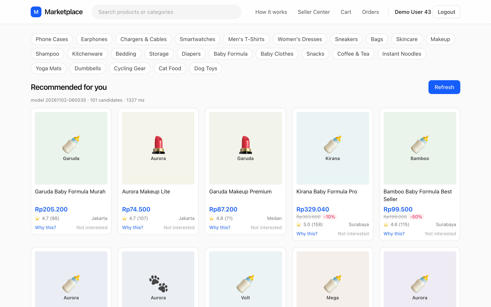
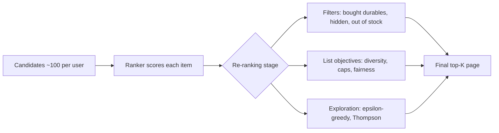
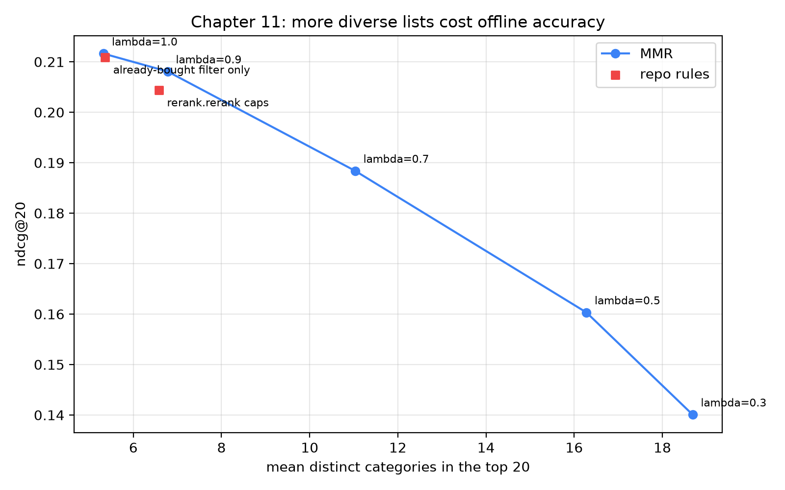

# Re-ranking, diversity and business rules

## The page that was all baby formula

Imagine you open the home page of a large marketplace app on a Tuesday evening. Last week you bought a pack of diapers and clicked on three tins of baby formula to compare prices. Your recommender is a good one: a gradient-boosted ranker from the previous chapter, trained on tens of thousands of examples, with a healthy offline NDCG. It looks at your history and concludes, correctly, that you are a new parent. So the first screen is baby formula, baby formula, baby formula, a baby bottle, more baby formula, and one lipstick that slipped in at position five.

Nothing is *wrong* with any single card; each is a defensible bet. But the *page* is a bad page. If you wanted to browse, there is nothing to browse, and if you bought a refrigerator yesterday, the page might offer three more. Your ranker scores items one at a time, and it has no idea that twenty similar good bets are not twenty times as good as one.

This is the job of the last stage of the pipeline: **re-ranking**. It takes the scored list and fixes properties that only exist at the level of the *whole list*: variety, fairness between sellers, things the user must never see again, things the business must show, and a little deliberate randomness so the system keeps learning. We look at the repo's re-ranker (a few lines of pandas), then Maximal Marginal Relevance (MMR), measure what diversity costs in offline accuracy, and finish with epsilon-greedy and Thompson sampling.

Four terms come up again and again, so here they are in plain words:

- **Ranker**: the model from Chapter 10 that gives every candidate item a score. Higher score means "more likely this shopper wants it".
- **ndcg@20** (normalised discounted cumulative gain, "how high are the right items in the top 20?"): a score from 0 to 1. It is higher when the items the shopper really went on to buy sit near the top of the 20-card list.
- **recall@K** ("how many of the right items made the list?"): of the items the shopper really bought, the share that appear in the top K.
- **Business rule**: a rule that comes from what the company needs, not from patterns in the data. "Never show a refrigerator the shopper already bought" and "no more than four items from one shop" are business rules. The ranker cannot learn them from clicks, so we apply them by hand.



### What you'll learn

- Why a model that scores items independently produces lists that are bad as lists, and what "list-level" objectives are.
- How Maximal Marginal Relevance trades relevance against redundancy, with the formula and a hand-computed example.
- How the repo's `rerank.rerank` implements an already-bought filter and per-category and per-shop caps in five lines of pandas.
- How much offline accuracy each of these rules costs on our data, using real numbers from the companion script.
- How sellers' fairness, sponsored items and manual boosts fit into the re-ranking stage without corrupting the ranker.
- How epsilon-greedy and Thompson sampling choose which items to explore, with a worked Beta-distribution example.

## Intuition: building a shopping window, not picking the best products

Think about how a shop owner dresses a window. She does not sort her stock by profit margin and then put the top twelve items in a row. If the twelve best sellers are all running shoes, the window says "we sell running shoes", and passers-by who need a coat walk on. She chooses a *set* of items that together say something: a shoe, a coat, a bag, a gift. Each item in the window is slightly worse than the single best item she could have chosen for its slot, but the *window* is better, because the items complement rather than duplicate each other.

A recommender home page is a window. The ranker of Chapter 10 is the owner who sorts by margin. It answers "how likely is this user to engage with this item?" for each item independently, and independence is exactly the problem: after you have shown one baby-formula tin, the chance that a second one is useful is lower than the chance the first one had. Think of cake. The first slice is a treat, the second is nice, the fifth is a chore. Economists call this *diminishing marginal utility* (each extra copy is worth less than the last); in information retrieval it is called *redundancy* (the new item repeats what the page already says).

There are three families of re-ranking logic and we will meet all of them:

1. **Filters** remove items that must not appear (already bought, hidden, out of stock). Plain meaning: a yes/no check on each item.
2. **List-level objectives** such as diversity: the value of an item depends on what is already on the page. Plain meaning: we judge the page as a whole, not each card alone.
3. **Exploration**: sometimes put an item on the page because the system is *uncertain* about it, not because it is the best bet. Plain meaning: occasionally try something new so we can learn whether it is good.



*Figure: Re-ranking is the last stage. It sees scored candidates and produces the page; it never retrains the model.*

## The algorithm

### Filters: the already-bought rule

The simplest rule is the *already-bought filter*: **do not show something the shopper already owns, unless it is the kind of thing people buy again.** Shopper Sari bought a refrigerator last month; showing her that same refrigerator is wasted space. Sari also bought a bag of coffee last month; she very probably wants coffee again, so coffee stays. Formally, we drop an item if the user ordered it before and the category is not consumable (a *consumable* is something used up and re-bought, like coffee or diapers). In the simulator (and in the schema from Chapter 1) each category has an `is_consumable` flag, which the feature table exposes as `item_is_consumable`, and the history feature `ui_orders` counts how many times this user ordered this item. The rule is

$$\text{drop}(u, i) \iff \text{ui\_orders}(u,i) > 0 \ \wedge\ \text{item\_is\_consumable}(i) = 0 .$$

Read it as: "drop item $i$ for user $u$ exactly when (the user has ordered it at least once) **and** (its category is not consumable)". For Sari's refrigerator, `ui_orders` is 1 and `item_is_consumable` is 0, so it is dropped. For her coffee, `item_is_consumable` is 1, so it stays.

Hidden items (the user pressed "Not interested") and out-of-stock items are removed earlier, in `candidates.generate`, which is cheaper because we do not compute features for rows that will never be shown.

### Caps: a poor man's diversity

The second rule limits how many items from one category and one shop may appear. It is like a shelf label that says "maximum two per customer": the best ones still get through, but nobody can take them all. Here is a tiny example with a cap of 2 per category (illustrative; the repo uses larger caps). Sari's candidates, best score first, are: phone case (shop X), phone case (shop X), phone case (shop Y), cat food (shop Z). The first two phone cases are the 0th and 1st of their category, so they stay. The third phone case is the 2nd, which is not below the cap of 2, so it is dropped, even though it scores higher than the cat food. Cat food is the 0th of its category and stays.

Formally: sort the user's items by score. Number the items of each category $0, 1, 2, \dots$ in score order and do the same for each shop. Keep an item only if its position within its category is below $C_{\text{cat}}$ and its position within its shop is below $C_{\text{shop}}$. In the repo $C_{\text{cat}} = 8$ and $C_{\text{shop}} = 4$. Then take the first $K$ survivors ($K$ is the page length, here 20).

Caps are blunt but powerful. They give a hard guarantee (no page ever has more than four items from one shop) at the cost of being completely insensitive to how *similar* the items are. Two phone cases from two different shops, both in the "Phone Cases" category, are to a human near-duplicates, yet the caps allow eight of them.

### Maximal Marginal Relevance

**MMR builds the page one slot at a time, and each pick must be both good and different from what is already on the page.** Picture ordering dishes with friends. You first order the best-sounding dish. For the second, you do not want something nearly identical, so a similar dish loses points even if it sounds great; a different dish with slightly lower appeal wins. MMR does exactly this with a score for every remaining item. The idea was proposed by Carbonell and Goldstein for reordering search results and summaries, and it is the classic answer to "how do we penalise similarity to what is already on the page?". The method is *greedy*: at each step it takes the best-looking choice right now and never goes back to change earlier picks. Start with the empty list $S$. At each step pick the item $i$ from the remaining candidates $R$ that maximises

$$\text{MMR}(i) = \lambda \cdot \text{rel}(i) - (1-\lambda) \cdot \max_{j \in S} \text{sim}(i, j),$$

where $\text{rel}(i)$ is the relevance (how much the shopper is likely to want the item; here, the ranker score rescaled to $[0, 1]$ per user) and $\text{sim}(i,j) \in [0,1]$ measures how similar two items are (1 = near-identical, 0 = unrelated). The $\max_{j \in S}$ part means "look at the page so far and take the *most* similar item already there". The parameter $\lambda$ (Greek letter "lambda", between 0 and 1) is a dial between relevance and variety. At $\lambda = 1$ the second term vanishes and MMR reproduces the original ranking. At $\lambda = 0$ relevance is ignored and you get a maximally spread list. For the first pick the set $S$ is empty, so the penalty is zero by convention, and the top-ranked item always comes first.

The algorithm in numbered steps:

1. Scale each user's scores to $[0,1]$: $\text{rel}(i) = (s_i - s_{\min}) / (s_{\max} - s_{\min})$.
2. Precompute the pairwise similarity matrix for this user's candidates (a table with one row and one column per candidate, where each cell says how similar those two items are). In our companion script, $\text{sim} = 1$ for the same category, $0.5$ for the same parent category (for example Dog Toys and Cat Food are both under Pets), and $0$ otherwise.
3. Maintain, for every remaining candidate, the largest similarity to any selected item so far.
4. Repeat $K$ times: compute the MMR score of every remaining item, select the argmax (the item with the highest score), mark it taken, and update the running maximum of similarities.

The cost is $O(K \cdot n)$ per user after the similarity matrix exists (roughly "$K$ times the number of candidates $n$" steps), and building the matrix is $O(n^2)$ (every candidate compared with every other). With $n \approx 100$ candidates that is a few thousand operations; trivial.

#### A worked example with four items

Take $\lambda = 0.7$ and four candidates with normalised relevance and categories:

| item | rel | category |
|---|---|---|
| A | 1.0 | Phones |
| B | 0.9 | Phones |
| C | 0.6 | Shoes |
| D | 0.5 | Beauty |

Items in the same category have similarity 1; all other pairs have similarity 0 (we ignore the parent level here for simplicity).

- **Pick 1.** Nothing selected yet. Scores are $0.7 \times$ rel: A = 0.70, B = 0.63, C = 0.42, D = 0.35. We pick **A**.
- **Pick 2.** B is a Phone, so its similarity to A is 1: $0.7 \times 0.9 - 0.3 \times 1 = 0.33$. C: $0.7 \times 0.6 - 0.3 \times 0 = 0.42$. D: $0.35$. We pick **C**, although B is much more relevant.
- **Pick 3.** B still has similarity 1 to A (the maximum over the selected set $\{A, C\}$): 0.33. D has similarity 0 to both: 0.35. We pick **D**.
- **Pick 4.** Only B is left.

The final order is A, C, D, B. The Phones twin B fell from second place to last. With $\lambda = 0.9$ the penalty term is $0.1$, so B would score $0.81 - 0.10 = 0.71$ against C's $0.54$, and B would keep second place. This is the whole story of the parameter: $\lambda$ decides how large a relevance gap a duplicate can survive.

### Exploration: giving uncertain items a chance

Everything so far assumes the ranker's scores are right, but the ranker only knows what it has seen. An item never shown has no clicks, so the model scores it low, so it is never shown: a *feedback loop* we study in Chapter 12. Without exploration, a great new item can stay hidden forever.

Think of choosing a lunch place. If you always go to the best restaurant you know, you will never discover the new place that might be even better. But trying a random place every day wastes lunches. The textbook version of this dilemma is the **multi-armed bandit** problem (named after slot machines, "one-armed bandits"): each item is an "arm" with an unknown click probability, and every *impression* (one showing of the item to a shopper) both may earn a click (the reward) and teaches us about that item.

**Epsilon-greedy** is the simplest policy: with probability $1-\varepsilon$ ($\varepsilon$ is the Greek letter epsilon, a small number like 0.1) show the model's best item, otherwise a random one from a pool. In lunch terms: nine days out of ten you go to your favourite, one day in ten you pick a random place. With $\varepsilon = 0.1$ on a 20-slot page, two slots are exploratory on average. It is trivial to implement and wasteful: the random slot is as likely to pick an item with 50 impressions and a dismal click rate as one with 2 impressions and unknown potential.

**Thompson sampling** is smarter about *where* to explore. Here is the idea with a coin. Each item behaves like a coin whose chance of "heads" (a click) we do not know. Show the item 10 times and see 3 clicks: the true click rate is probably near 0.3, but 0.2 or 0.45 would not surprise us. Show it 0 times: any rate from 0 to 1 is plausible. So for each item we keep a *curve that says how plausible each click rate is*. A narrow curve means we are fairly sure; a wide curve means we do not know yet.

The curve has a name: the **Beta distribution**, written $\text{Beta}(a, b)$. You can think of $a$ as "clicks so far, plus 1" and $b$ as "non-clicks so far, plus 1". The "plus 1" comes from our starting assumption, called the **prior**: before seeing any data, every click rate from 0 to 1 is equally plausible, which is the flat curve $\text{Beta}(1,1)$. After we observe data, the updated curve is called the **posterior**. This update is simple (the technical word is *conjugate*, meaning the new curve is the same kind of curve as the old one, just with new numbers): after $c$ clicks and $n-c$ non-clicks,

$$\theta \mid \text{data} \sim \text{Beta}(1 + c,\ 1 + n - c), \qquad \mathbb{E}[\theta] = \frac{1+c}{2+n}, \qquad \text{Var}[\theta] = \frac{ab}{(a+b)^2(a+b+1)} .$$

In words: $\theta$ (theta) is the item's unknown true click rate; $\mathbb{E}[\theta]$ is the curve's average, our best single guess of $\theta$; $\text{Var}[\theta]$ (the variance) measures how wide the curve is, and its square root is the *standard deviation* (the typical distance from the average). Here $a = 1 + c$ and $b = 1 + n - c$. For an item with 10 impressions and 3 clicks, $a = 4$, $b = 8$, so the average is $4/12 \approx 0.333$.

To choose what to show, *draw one random sample from each item's Beta distribution and rank by the draws*. An item with lots of evidence has a narrow curve, so its draw lands close to its average. An item with little evidence has a wide curve and sometimes draws a high number, which earns it an impression. As evidence accumulates, exploration dies out by itself, with no tunable $\varepsilon$.

#### A worked Thompson example

Three items, uniform prior:

| item | impressions | clicks | posterior | mean | std dev |
|---|---|---|---|---|---|
| A (established) | 10 | 3 | Beta(4, 8) | 0.333 | 0.131 |
| B (shown twice, no clicks) | 2 | 0 | Beta(1, 3) | 0.250 | 0.194 |
| C (brand new) | 0 | 0 | Beta(1, 1) | 0.500 | 0.289 |

The means are $4/12$, $1/4$ and $1/2$. The variances follow from the formula: for A, $ab/((a+b)^2(a+b+1)) = 32/(144 \times 13) \approx 0.0171$, so the standard deviation is about $0.131$; for B it is $3/(16 \times 5) = 0.0375$ (std $0.194$); for C it is $1/(4 \times 3) = 0.0833$ (std $0.289$). Notice that the standard deviation grows as the evidence shrinks: A (10 impressions) is narrowest, C (none) is widest. That width is what lets C win a draw now and then.

Suppose one round of sampling yields the (illustrative) draws A = 0.31, B = 0.18, C = 0.77. The order is C, A, B: the unknown newcomer is shown first. If C then gets 1 click in 1 impression it becomes Beta(2, 1) with mean $0.667$; if it gets zero clicks in 5 impressions it becomes Beta(1, 6), mean $0.143$, and rarely wins another draw. The system explores exactly as much as it is uncertain.

::: fact
**Maximal Marginal Relevance is a 1998 idea that outlived its original task.** MMR was introduced by Carbonell and Goldstein at SIGIR 1998 for reordering retrieved documents and for producing summaries, combining a query-relevance term with a novelty term that penalises similarity to documents already selected. The same greedy formula is still the default starting point for diversifying recommendation slates.

Source: Carbonell et al., SIGIR, 1998
:::

::: fact
**Diversity can hurt average accuracy and still improve satisfaction.** Ziegler and colleagues introduced "topic diversification" and the intra-list similarity metric for recommendation lists. They reported that, although it was detrimental to average accuracy, the method improved user satisfaction, which they tested in an online study with more than 2,100 subjects, in particular for lists produced by item-based collaborative filtering.

Source: Ziegler et al., WWW, 2005
:::

::: fact
**Thompson sampling is older than computers, and surprisingly strong.** William R. Thompson described the idea of choosing between treatments in proportion to their posterior probability of being best in a 1933 Biometrika paper. In 2011, Chapelle and Li reported that on display advertising and news article recommendation it was highly competitive with other bandit methods, and argued it should be a standard baseline.

Source: Chapelle et al., NeurIPS, 2011
:::

## Code walkthrough

### The repo's re-ranker

The production re-ranker in this repo is the entire file `recommender/recsys/rerank.py`. Here is its only function.

```include
path: recommender/recsys/rerank.py
symbol: rerank
```

Read it line by line. `scored` has one row per `(user_id, item_id)` candidate with the ranker's `score` plus the columns the rules need. The first statement builds the boolean mask `bought_durable`; the second drops those rows and sorts by user and descending score, which the following lines depend on.

Then comes the trick. `groupby(["user_id", "category_id"]).cumcount()` numbers the rows inside each group in their current order, starting from zero. Because the frame is already sorted by score, the number is exactly "how many higher-scored items of this category does this user already have". The same is done per shop. A row survives when both counters are under their limits (`MAX_PER_CATEGORY = 8`, `MAX_PER_SHOP = 4`, defined at the top of the module). Finally `groupby("user_id").head(k)` truncates each user's list to $k$ items. The function is fully *vectorised* (it works on whole columns at once instead of looping over rows in Python), which matters: during training evaluation it runs for thousands of users at once, and in the live `Recommend` RPC (remote procedure call, the request the app sends to the recommender service) it runs on one user's frame.

### The MMR companion script

The companion script `book/code/ch11_rerank.py` implements MMR on top of the LambdaMART scores from Chapter 10 (it re-trains the same ranker through a small shared helper, so the numbers are comparable with the previous chapter). First the similarity function.

```include
path: book/code/ch11_rerank.py
symbol: similarity
```

It broadcasts the category and parent-category arrays into an $n \times n$ matrix with `cat[:, None] == cat[None, :]`; nested `np.where` gives 1 for the same category, 0.5 for the same parent, else 0. Partial credit for the parent matters because "Dog Toys" and "Cat Food" are different categories but both Pets, and a page full of Pets items is still repetitive.

Now the greedy loop itself.

```include
path: book/code/ch11_rerank.py
symbol: mmr
```

Work through it in order. Scores are normalised to $[0,1]$ per user (`1e-9` guards against all-equal scores). `max_sim` holds, for every candidate, the largest similarity to anything chosen so far; zeros mean "empty set, no penalty". Inside the loop, `mmr_score` is exactly $\lambda \cdot \text{rel} - (1-\lambda) \cdot \text{max\_sim}$, with taken items set to $-\infty$. After choosing `j`, one row of the similarity matrix updates the running maximum with `np.maximum(max_sim, sim[j])`, which is what keeps the algorithm cheap.

The loop returns only `user_id`, `item_id` and `category_id` in chosen order, the format `common.evaluate` expects. A helper, `diversity`, counts distinct categories in each user's top 20 and averages over users; this is the *intra-list diversity* plotted below.

The `main` function loops over $\lambda \in \{1.0, 0.9, 0.7, 0.5, 0.3\}$, then evaluates two more variants: the repo's `rerank.rerank`, and the already-bought filter alone, so we can see which rule costs what.

## Run it

From the `book/` directory:

```bash
uv run python code/ch11_rerank.py
```

The script prints a table for all methods. These are the captured results: the first block shows the five MMR settings and the repo's rules.

```output
file: results/ch11_rerank.txt
lines: 7-14
```

And the script's own summary of the effect of each $\lambda$, relative to the unmodified ranker:

```output
file: results/ch11_rerank.txt
lines: 16-21
```

## Results: what does diversity cost?

A reminder of the measures in the table, in plain words. **ndcg@20** and **recall@5/20/50** ask whether the items the shopper really bought later appear in the top 5, 20 or 50 (higher is better). **distinct_categories@20** counts how many different categories appear in a user's top 20, averaged over users: our measure of variety (higher means more varied). **coverage@20** is the share of the whole catalogue that shows up in *anyone's* top 20: it tells us whether the system uses many products or keeps showing the same few.

Start with the first row. `MMR lambda=1.0` is the LambdaMART ranking untouched (with $\lambda = 1$ the penalty is multiplied by zero): ndcg@20 of 0.2116 and recall@20 of 0.2725. The top 20 contains on average 5.33 distinct categories. That is our baseline: roughly five different kinds of product on a 20-card page. Not terrible, but not a window either.



The chart plots the same table. Moving down the MMR line from the top left is moving from "pure relevance" to "pure variety". Reading the numbers:

- **$\lambda = 0.9$**: ndcg falls from 0.2116 to 0.2081, a change of $-0.0035$, a relative loss of under 2%. Distinct categories rise from 5.33 to 6.78, an increase of 1.45. This is by far the best exchange rate on the curve: one and a half additional categories for a third of a point of NDCG.
- **$\lambda = 0.7$**: ndcg drops $0.0232$ to 0.1884, while the page now spans 11.03 categories: 5.71 more than the baseline. A little over two additional categories for every $0.01$ of ndcg lost, and the curve begins to steepen.
- **$\lambda = 0.5$ and $0.3$**: ndcg is 0.1603 and 0.1401, and the distinct-category count reaches 16.28 and 18.69. A 20-card page with 18.69 categories is almost entirely unique categories. We have given up roughly a quarter and a third of the ranker's ndcg to get it.

The deep end is instructive. `recall@5` goes from 0.1503 at $\lambda = 1.0$ to 0.0927 at $\lambda = 0.3$, because MMR pushes down strong items similar to ones already placed, so the *top* of the list suffers most. But `recall@50` barely moves, from 0.3824 to 0.3580: the same items are still in the list, merely lower. Re-ranking changes order and selection from a fixed pool; it never invents new good candidates.

Coverage tells a related story: coverage@20 drops from 0.4245 to 0.3129 as $\lambda$ falls. MMR diversifies *categories within one user's list*, and to do so it dips into each category's best items, which are the same popular items for everyone. The page is more varied, yet the system shows a narrower slice of the catalogue. Per-list diversity and system-level coverage are different goals needing different tools, such as per-item exposure caps.

### The repo's own rules

Now the two red squares in the chart. `already-bought filter only` scores ndcg@20 of 0.2109 against 0.2116, a loss of 0.0007, far smaller than any MMR step, with 5.36 categories on average: nearly free offline. `rerank.rerank caps` (filter plus 8 per category and 4 per shop) yields 0.2044 and 6.58 distinct categories. MMR at $\lambda = 0.9$ does slightly better (0.2081 with 6.78 categories), because it demotes items according to their similarity to the rest of the page, while the caps only react once a count passes a threshold.

There is a sharper difference in `recall@50`: 0.2956 for the caps against 0.3789 for the filter alone. `rerank` removes items without replacing them, so when a user's candidate pool is concentrated in a few categories the surviving list can be shorter than 50 (our likely explanation; we did not instrument it). Strict caps therefore need enough variety from the candidate generator upstream.

A caution: the offline labels come from users who saw whatever the *old* system showed. They cannot reward variety the user never saw, and the long-term boredom of a monotone page does not show up in a seven-day window. Ziegler and colleagues needed an online study to demonstrate the benefit, and you will too. Treat the offline curve as the *price list* and the A/B test (Chapter 14) as the place to decide how much to pay.

## Beyond diversity: business rules in the re-ranker

### Fairness to sellers

A marketplace is two-sided: buyers want relevance, sellers want to be seen. A ranker trained on engagement gives established shops more impressions, hence more reviews: a rich-get-richer loop that can starve a good new seller. The per-shop cap is a crude fairness rule. More principled approaches work with *exposure* (how much attention an item actually receives): since attention decays steeply with rank (Chapter 12), slot 15 is not slot 1. Singh and Joachims formalised constraints on the exposure items or groups receive relative to their merit and gave algorithms that maximise user utility (total benefit to shoppers) subject to them. In practice marketplaces implement simple versions, such as minimum slots for new sellers or a per-shop daily exposure budget.

### Ads, boosts and sponsored slots

Almost every marketplace sells advertising placement. The design rule is **do not contaminate the ranker with ad money.** Ads are inserted *after* the ranker, into fixed positions (say slots 3, 8 and 13), chosen by a separate auction (sellers bid for the slot) that weighs the bid and a predicted click rate, and labelled "Sponsored". A campaign boost ("all 9.9 sale items get $+0.05$", meaning we add 0.05 to their score) should likewise be a visible term in the re-ranker with a start and end date, not a change to the training data; otherwise the next retraining treats boosted impressions as organic evidence (clicks that happened naturally, without a push from us) and bakes the campaign into the model.

### Exploration in the re-ranker

In practice, run the pipeline as usual, then swap the item in a fraction $\varepsilon$ of *slots* (not users) for an under-exposed candidate, preferably in the lower half of the page; for Thompson sampling, keep click and impression counts per item in a feature store (a database of ready-to-use model inputs) and blend one Beta draw per candidate into the score. Either way, **log which slots were exploratory and with what probability**; otherwise the data stays as biased as before and cannot be corrected (inverse propensity weighting, Chapter 12: giving each logged example a weight that undoes how unlikely it was to be shown).

## Pitfalls and production practice

**Normalise relevance before MMR.** The formula mixes a score with a similarity in $[0,1]$, but LightGBM scores are unbounded and differ per user. Without rescaling (we use per-user min-max), $\lambda$ means something different for every user.

**Do not tune $\lambda$ offline only.** The curve above is the price list, not a prescription. Start mild (our 0.9 gives most of the first gains), A/B test on session-level metrics (orders per user, return rate), and move the dial from there.

**Order of operations matters.** Filters first, diversity next, ad insertion last; carve out exploration slots *before* caps, or a cap can silently remove the explored item.

**Caps can shorten the page, and re-ranking cannot fix a bad pool.** Decide whether to backfill, relax the caps or accept a short page (the repo accepts it). If everything in the pool is baby formula, MMR just picks the least-similar baby formula, so enforce diversity upstream too, for example with separate retrievers per interest cluster.

## Summary

- Rankers score items independently, so the best-scored list can be repetitive; re-ranking optimises the whole list.
- Filters (already-bought durables, hidden, out of stock) cost almost nothing offline: 0.2109 versus 0.2116 ndcg@20.
- Caps give hard guarantees but are blind to similarity; here they cost more accuracy than mild MMR for similar variety.
- MMR picks greedily by $\lambda \cdot \text{rel} - (1-\lambda) \cdot \max \text{sim}$; $\lambda = 0.9$ added about 1.45 categories for $-0.0035$ ndcg, while lower values lose accuracy quickly. Tune $\lambda$ by A/B test.
- Keep fairness rules, ad slots and boosts in the re-ranker, outside the model, so they can be audited and switched off.
- Epsilon-greedy explores at a fixed rate; Thompson sampling explores in proportion to uncertainty. Log which slots were exploratory.

## Quiz

**Q11.1** In MMR with $\lambda = 1$, what does the algorithm return?

A. A list with maximal diversity, ignoring relevance.
B. The original relevance ordering, because the similarity penalty is multiplied by zero.
C. The reverse of the original ordering.
D. A random permutation.

**Q11.2** Why does `rerank.rerank` exempt consumable categories from the already-bought filter?

A. Consumables are cheaper, so the business does not care.
B. Consumables cannot be hidden by users.
C. Buying consumables again (coffee, diapers) is a normal and desirable repeat purchase, unlike a durable such as a refrigerator.
D. Consumables do not have a `shop_id`.

**Q11.3** What is the main advantage of Thompson sampling over epsilon-greedy?

A. It needs no logging of impressions.
B. It never shows the model's top item.
C. It explores in proportion to uncertainty, so well-measured poor items stop being shown and new items get chances without a fixed $\varepsilon$.
D. It is guaranteed to maximise offline NDCG.

**Q11.4** Explain in two or three sentences why business rules such as sponsored slots and campaign boosts should be applied in the re-ranker and not as extra features or label changes in the ranker's training data.

**Q11.5** In the results, `recall@50` for `rerank.rerank caps` is much lower than for the already-bought filter alone, while `recall@5` is almost identical. Give the most likely explanation.

**Q11.6** Read the `rerank` function included in this chapter. A user has 30 scored candidates, all from the same category, coming from 10 different shops (3 items each), and none of them is a bought durable. With `MAX_PER_CATEGORY = 8`, `MAX_PER_SHOP = 4` and $k = 20$, how many items does the function return for this user, and which rule is responsible?

**Q11.7** Use MMR with $\lambda = 0.5$ on three items with normalised relevance 0.9 (category X), 0.8 (category X) and 0.5 (category Y). Similarity is 1 for the same category and 0 otherwise. Give the final order, showing the MMR scores at each step.

**Q11.8** An item starts with a uniform Beta(1, 1) prior and then receives 20 impressions and 5 clicks. What is its posterior distribution, its mean click rate and its standard deviation (to three decimals)? Compare the standard deviation with that of a new item (no impressions) and say what that means for Thompson sampling.

**Q11.9** Which statement best matches the chapter's measured results?

A. MMR with $\lambda = 0.9$ cost about 0.0035 ndcg@20 and added about 1.45 distinct categories; $\lambda = 0.3$ cost about 0.0715 ndcg@20.
B. MMR at every $\lambda$ raised coverage@20 above the baseline.
C. The already-bought filter alone cost about 0.05 ndcg@20.
D. The caps reduced the number of distinct categories below the baseline.

**Q11.10** Hands-on: copy `book/code/ch11_rerank.py` to a scratch file and change `similarity` so that sharing a parent category gives 0.0 instead of 0.5 (only the exact same category counts as similar). Run it and compare ndcg@20 and `distinct_categories@20` at $\lambda = 0.5$ with the chapter's table. State what you expect to observe (hint: how does the penalty change for items in sibling categories?) and whether the result matches.
