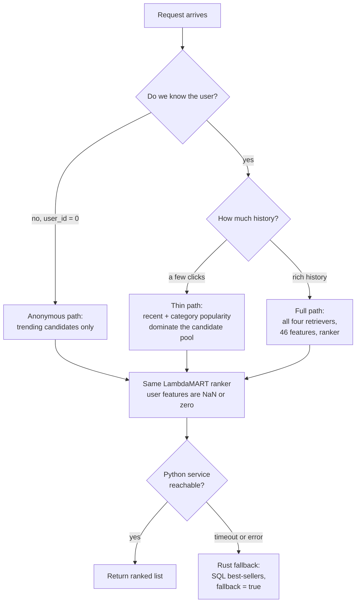
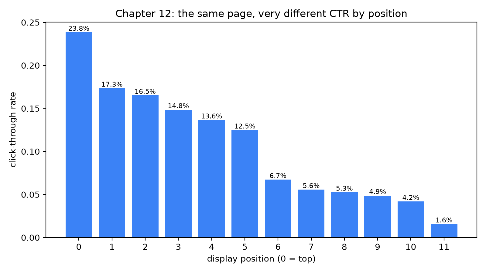
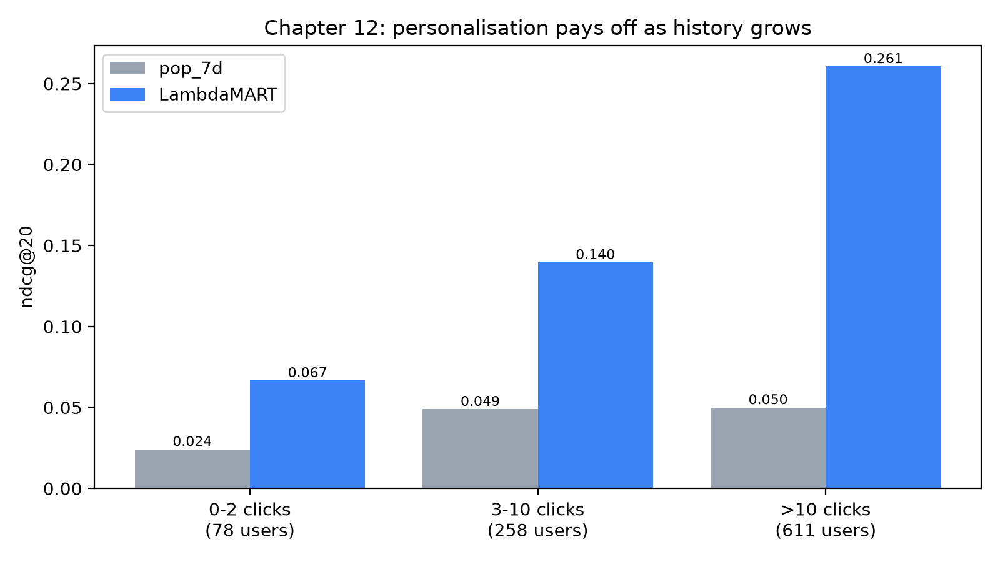

# Cold start, context and bias

It is 00:01 on the night of a 12.12 sale. Within a single minute, tens of thousands of people who have never opened the marketplace before tap the app icon, because a friend sent them a flash-deal link. For the recommender these visitors are ghosts: no clicks, no searches, no history. At the same moment, three hundred sellers publish brand-new products that have never been shown to anybody, so no one has clicked them either. And in the background a data scientist is staring at a dashboard, puzzled: the item at the top of every home feed gets a click-through rate more than ten times higher than the item in the last slot, and the team cannot tell how much of that gap is "the top item is better" and how much is "the top item is at the top".

Three problems are hiding in that story, and this chapter takes them one at a time:

- **Cold start**: the model is asked about a user or an item that it has no behaviour data for.
- **Context**: the right answer depends on *when* and *where* the request happens, not just on *who* is asking.
- **Bias**: the clicks we train on were produced by the very system we are trying to improve, so they are a distorted picture of what people want.

What you'll learn:

- The three flavours of cold start (new user, new item, new system) and a practical ladder of fallbacks for each.
- How this repository degrades gracefully, from a personalised ranker, to trending items for anonymous users, to a plain SQL query when the Python service is down.
- What position bias is, how to see it in the impression log, and how inverse propensity weighting corrects for it.
- How a feedback loop turns a small popularity advantage into a large one, and the cheapest ways to resist it.
- Why request-time context (hour of day, device, surface) is *not* a feature of this book's weekly ranker, and what the real-time companion model looks like.
- How to measure all of this: ranker quality by user activity bucket, and how often new items reach the top 20.

## Intuition: the new colleague, the restaurant menu and the escalator

Imagine you are the first person to greet a customer in a bookshop. A stranger walks in. You know nothing about them. What do you do? You do not stay silent. You point at the table of bestsellers, because bestsellers are the best guess for an unknown person. After the stranger picks up two cookbooks, you walk them to the cooking shelf. After ten minutes you are recommending a specific author. Cold start is exactly this ladder: *start with what is true for everyone, then narrow as evidence accumulates.* A recommender that skips the ladder either says nothing (an empty page) or pretends to know a person it has never met.

New items are the mirror image: a waiter who only recommends dishes others have ordered never promotes a brilliant new dish, so it is never ordered. Someone must spend a recommendation on something unproven (the exploration problem of chapter 11).

Position bias has the cleanest analogy. Take two identical doors, one at eye level at the front of a corridor and one at the far end behind a corner. More people will walk through the first door, and not because it is a better door. A supermarket shelf shows the same effect: the products at eye level sell more than the ones near the floor, even if you swap them. If you judged the products by sales alone, you would "learn" that eye-level products are better and then put them at eye level again. That self-confirming circle is a **feedback loop**, and we will see it twice in this chapter, once for position and once for popularity.



*Figure: the cold-start ladder. The same ranker serves every user; what changes is how much evidence the candidate generators and features can contribute, and an outer safety net catches service failures.*

## The algorithm: ladders, propensities and loops

This section has four parts. First we look at where cold start bites in the pipeline we already built. Then we work through position bias and inverse propensity weighting with a small example. Then we model a feedback loop, and finally we decide where context belongs.

### Where cold start bites

Walk through the pipeline of chapters 8–10 and ask at each stage: *what happens if there is no data?*

1. **Candidate generation.** The four retrievers are `recent` (items the user viewed), `covisit` (items viewed together with those), `catpop` (popular items in categories the user likes) and `global_trending`. For a user with no history, the first three return nothing for that user. `global_trending` does not depend on the user, so *every* user, including a brand-new one, receives at least the globally trending items. That is the first rung of the ladder, and it is built into `candidates.generate`.
2. **Features.** User-level features are built by aggregating events. A user with no events has no row in the event aggregates, so a left join produces missing values. The builder fills them with explicit sentinels: counters become $0$, and "days since active" becomes a large constant (`NEVER_DAYS = 999`). LightGBM natively accepts missing values for the rest, learning at each split which side missing values should go to.
3. **Ranking.** The ranker is one model for everyone. It has seen training examples with thin and empty histories, so it has learned what to do when `user_clicks_30d` is zero: lean on item-level features such as smoothed item CTR and conversion rate.
**New items** are the harder case, because the usual strong signals are all behavioural. A product listed an hour ago has no clicks, no orders, no co-visits, and an item-level CTR that is the Bayesian-smoothed prior. The smoothing formula from chapter 3 is exactly the right tool: with prior rate $p_0$ and prior strength $s$,

$$\hat{p} = \frac{x + p_0\, s}{n + s}$$

where $x$ is the number of clicks and $n$ the number of impressions. With $x = 0$ and $n = 0$ the estimate is $p_0$, the catalogue average, not zero. A new item is therefore treated as "average until proven otherwise", rather than "terrible because nobody clicked it". Without smoothing, a brand-new item would have a CTR of $0/0$ (undefined) or $0$ (hopelessly low). The ranker also receives `item_age_days`, so it can learn explicit freshness effects.

### Position bias and inverse propensity weighting

Now to bias. A user clicks an item only if they *examine* it and *like* it. The classic **examination hypothesis** writes this as a product:

$$P(\text{click} = 1 \mid \text{item } i, \text{position } k) = \underbrace{\theta_k}_{\text{examination}} \cdot \underbrace{r_i}_{\text{relevance}}$$

Here $\theta_k \in [0,1]$ is the probability that a user even looks at position $k$ (the **propensity** of that position) and $r_i$ is how much the user likes item $i$ if they look. We want to learn $r_i$, but the logs only contain clicks, which mix $\theta_k$ and $r_i$. Training a ranker directly on clicks teaches it to rank *items that were shown high* on top, which is circular.

The **inverse propensity weighting** (IPW) fix is one line: weight each click by $1/\theta_k$. In expectation,

$$\mathbb{E}\!\left[\frac{c}{\theta_k}\right] = \frac{\theta_k\, r_i}{\theta_k} = r_i ,$$

so the weighted click rate is an unbiased estimate of relevance regardless of where the item was displayed. Here is a worked example with toy numbers. Suppose the propensities are $\theta_0 = 1.0$, $\theta_1 = 0.5$, $\theta_2 = 0.25$. Item A was shown 100 times at position 0 and got 20 clicks. Item B was shown 100 times at position 2 and got 10 clicks.

1. Raw CTR: A is $20/100 = 0.20$, B is $10/100 = 0.10$. Raw clicks say A is twice as good.
2. Weight each click: every click on A counts $1/1.0 = 1$, every click on B counts $1/0.25 = 4$.
3. Weighted clicks: A is $20 \times 1 = 20$, B is $10 \times 4 = 40$.
4. Debiased relevance: A is $20/100 = 0.20$, B is $40/100 = 0.40$.

After correction B is twice as relevant as A. Raw clicks had it backwards, because B was penalised for being displayed in the third slot.

IPW has a price: the variance. A click at a position with $\theta_k = 0.02$ counts $50$ times. A single lucky click can dominate the training set. In practice we **clip** the weights, for example $w = \min(1/\theta_k, M)$ with $M$ around 10–50, accepting a little bias for a lot less variance.

The harder problem is estimating $\theta_k$. The tempting shortcut is to read it off the CTR-by-position table: $\hat\theta_k \propto \text{CTR}_k / \text{CTR}_0$. That only works if the *same quality of items* appears at every position. In a logged system the ranker deliberately puts its best guesses at the top, so the table confounds examination with relevance. Honest propensity estimates need randomisation: swap two adjacent items for a small fraction of traffic, or shuffle a small slice of the page, and compare. The cheaper alternative is to treat position as a **model feature** during training (so the model can attribute part of the click to position) and then set it to a constant at serving time, which is what exercise 3 in `recommender/README.md` suggests.

### Feedback loops

Position bias is the *local* feedback loop; the *global* one works at the catalogue level. Say the home feed shows item A, which has 10 more clicks than item B this week. The ranker, trained on clicks, gives A a higher score. A is shown more often, collects more clicks, and widens the gap. A toy model makes the dynamics concrete. Let each item's displayed share in week $t+1$ be proportional to its clicks in week $t$, and suppose clicks are proportional to displayed share times true relevance $r$. Then

$$s_i^{(t+1)} = \frac{s_i^{(t)}\, r_i}{\sum_j s_j^{(t)}\, r_j}.$$

Take $r_A = 0.12$, $r_B = 0.10$ and a 50/50 start: week 1 gives $s_A = 0.06/0.11 = 0.545$ and week 2 gives $0.590$. The slightly better item keeps gaining share, and a never-displayed item C with $r_C = 0.30$ is never discovered. The loop amplifies what the system already believes; it does not question it.

### Where does context belong?

The ranker predicts a 7-day outcome per user, so the request hour is identical for all of a user's candidates and has no per-request label (`recommender/README.md`, "What's deliberately simplified"). Chaney et al. (RecSys 2018) showed in simulation that training on already-recommended data homogenises behaviour without adding utility; the antidotes are exploration, diversity and logging impressions with positions.

Finally, request-time context: hour of day, day of week, device, entry surface. This repository logs all of them (the `sessions` table stores `surface` and `device_os`; `events` has `ts`, `position` and `surface`), and yet the LightGBM ranker of chapters 9–10 does **not** use them as features. That is deliberate, and `recommender/README.md` explains why in its "What's deliberately simplified" section.

The correct place for context is a **second, real-time model** trained on the impression log: each row is one displayed item, the label is whether it was clicked, and the features include hour, surface, device and the *position it was shown at*. That model re-scores the few dozen items that the weekly ranker already selected. Real-time **session features** belong to the same layer: "categories clicked in the last 30 minutes", "the last search query", "items added to the cart this session". The `recent` retriever and `Store.refresh()` already give this repository a taste of it, because a click posted two seconds ago changes the next response; but the ranker itself is retrained only periodically.

::: fact
**Users look at the top two results almost equally, but click the first far more often.** Joachims and colleagues tracked the eyes of students searching the web and found that the abstracts at ranks 1 and 2 were viewed with nearly equal frequency, yet users clicked the first link substantially more often than the second. In a follow-up experiment where the top two results were swapped without the users' knowledge, users still showed a strong bias to click whatever was in first position, even when the second result had been judged more relevant. The authors called this *trust bias* and concluded that clicks are "informative but biased".
Source: Joachims et al., SIGIR, 2005
:::

::: fact
**Heuristics are surprisingly hard to beat when you know nothing.** Schein and colleagues benchmarked a probabilistic model for the cold-start problem, recommending items that nobody has rated yet, against trivial "heuristic recommenders". On the implicit-feedback task, simply ranking users by how many movies they had rated gave nearly the same global performance as their aspect model, which led the authors to argue that such heuristic baselines should always be included in this kind of evaluation.
Source: Schein et al., SIGIR, 2002
:::

## Code walkthrough

We will follow the same ladder as the pipeline: how the retrievers cope with missing history, how the features fill in gaps, how the product page handles an item with no co-views, and finally what the Rust API does when the whole Python service disappears.

### Candidates for everyone

Start with the one retriever that needs no user at all:

```include
path: recommender/recsys/candidates.py
symbol: global_trending
```

`global_trending` takes the last three days of weighted interactions (click, cart and order events, each with its own weight), keeps items that are in stock, and returns the top `N_GLOBAL`. It takes no user argument. That one fact is the entire anonymous-user story: the function produces candidates that are the same for everyone.

Every user id in `generate` is cross-joined with the trending frame, so no user ever has zero candidates and the ranker never receives an empty group. Missing source scores become $0.0$ and the missing trending rank becomes $999$; a cold user's candidates all have `cand_n_sources` equal to 1, a pattern the ranker learns to recognise.

### Features that tolerate emptiness

In `features.user_features` every user has a row (it starts from the full `users` table), count merges are left joins, and `fillna` turns missing counts into zero. `_smoothed`, the formula $\hat{p} = (x + p_0 s)/(n + s)$, is called in `user_features` as `_smoothed(u["user_clicks_30d"], u["_impr_30d"], global_ctr, 20)`: a new user gets exactly `global_ctr`, and $s = 20$ acts like twenty imaginary impressions at the average rate.

After the join, `user_days_since_active` for users without events is filled with `NEVER_DAYS = 999`. This is a better sentinel than zero, because zero would mean "active just now", the opposite of the truth. Features for items follow the same philosophy in `item_features`: counts become zero, rates are smoothed towards the catalogue average, and `item_age_days` is computed directly from `listed_at`, which exists even for an item nobody has seen.

### A product page with no co-views

The product page's "Similar items" strip faces a version of the problem for every freshly listed product:

```include
path: recommender/recsys/pipeline.py
symbol: similar_items
```

This is a two-rung ladder in about twenty lines. First it asks the co-visitation matrix for items viewed together with `item_id`. A new item has no rows there, so `co` is empty. Then it fills the remaining slots with in-stock items from the *same category*, ordered by seven-day popularity, and labels them `same_category`. Notice `.fillna(0.0)`: items with no popularity at all are still allowed to appear, ranked last. The `source` column is what the UI uses to tell the user (and you) which rung answered.

### The safety net: when Python is down

The last rung is not in Python at all. The Rust API treats the recommender as an optional dependency. First the SQL fallback:

```include
path: backend/src/recommender.rs
region: fallback
```

This function takes an optional `category_id` (used by "Similar items") and an optional `exclude_id`, and orders active, in-stock items by the number of `order` events in the last seven days, breaking ties by `rating_count`, then by id so that the output is deterministic. Every row gets `source: "trending"`, `score: 0.0` and an empty `contributions` vector, honestly reporting that nothing was personalised. Now the route that decides when to use it:

```include
path: backend/src/recommender.rs
region: recommend_route
```

Three details deserve attention. The gRPC call is wrapped in `tokio::time::timeout(Duration::from_secs(5), ...)`, so a *slow* service is treated the same as a *dead* one: a user is never left staring at a spinner longer than five seconds. The `match` has only one success arm; the catch-all `other` covers both the gRPC error and the elapsed timeout, logs a warning (distinguishing an error from a timeout) and falls through to `fallback(&st.pool, k, None, None)`. And the JSON it returns has exactly the same shape as the success path, plus `"fallback": true` and `"model_version": "fallback"`. The frontend does not need a second code path; it only needs to read the flag and show a banner.

The yellow banner on the home page (screenshot `fallback-banner.png`, shown in chapter 13's tour) is all the frontend needs to change.

The position table below exists only because the browser logs impressions *with positions* (`ProductGrid.vue`: `position` is the array index, one impression per item per grid). Without that log you can compute neither a CTR nor a propensity.

## Run it

The companion script `book/code/ch12_coldstart_bias.py` computes three things on the same simulated data as every other chapter: CTR by display position over the impression log, ranker quality by user activity bucket, and the share of new items in each method's top 20. Run it from the `book/` directory:

```bash
uv run python code/ch12_coldstart_bias.py
```

Its stdout is stored in `results/ch12_coldstart_bias.txt`. We read it one section at a time. First, the position table:

```output
file: results/ch12_coldstart_bias.txt
lines: 4-18
```

Then the activity buckets, which compare the popularity baseline `pop_7d` from chapter 3 with the LambdaMART ranker from chapter 10:

```output
file: results/ch12_coldstart_bias.txt
lines: 21-32
```

And finally the exposure of new items:

```output
file: results/ch12_coldstart_bias.txt
lines: 34-38
```

## Results

### The position table



*Figure: click-through rate by display position. Every position has exactly the same number of impressions, so the bars are directly comparable.*

Each of the twelve positions has exactly 16,770 impressions, which means the denominators are equal and the bar heights are honest rates. Position 0 has a CTR of 0.2385 and position 11 has 0.0156, a ratio of 15.3 times. The decline is not smooth. From position 0 to position 1, CTR drops from 0.2385 to 0.1734; positions 1 to 5 slide gently from 0.1734 to 0.1248; then between position 5 (0.1248) and position 6 (0.0673) it nearly halves in a single step. That cliff is consistent with a page whose first six items are visible without scrolling. Joachims et al. observed a similar break at the fold in their eye-tracking data. Positions 6 to 10 then decline slowly, and position 11 drops sharply again.

### Personalisation pays as history grows



*Figure: ndcg@20 by prior-click bucket. The popularity baseline barely moves with user history; the ranker climbs steeply.*

The second table splits the 947 evaluation users (78 + 258 + 611) by how many clicks they had before the cutoff. Look at the `pop_7d` rows first. Its ndcg@20 is 0.0241 for users with 0–2 clicks, 0.0489 for 3–10 clicks and 0.0499 for more than 10. Popularity ignores the user, so history does not help it; its recall@20 is the same 0.08 in all three buckets (0.0795, 0.0785, 0.0785).

The LambdaMART rows rise steeply: ndcg@20 of 0.0666, 0.1395 and 0.2606. For the heaviest users the ratio over `pop_7d` is 5.22x. For the coldest bucket it is 2.76x. Two points are worth drawing out.

First, **the ranker already beats popularity even for users with at most two clicks**. A plausible reason (we did not isolate it here) is that trending candidates plus item-level features such as smoothed CTR and conversion rate make a better popularity model than a raw seven-day count. The ratio for the 3–10 bucket (2.86x) is similar to that of the cold bucket (2.76x); the large jump happens only above ten clicks, where personalised retrievers (`recent`, `covisit`, `catpop`) and user-item features start to dominate the candidate pool and the ranking.

### The new-item exposure table

The third table is the most uncomfortable one. Items listed less than seven days before the cutoff make up 2.16% of the available catalogue. Among the *future positives* (the items users actually went on to interact with during the label week) they make up 2.68%, slightly more than their catalogue share, so users do want fresh items. What do the methods show them? `pop_7d` puts exactly 0.00% new items into its top 20s. LambdaMART puts 0.25%. Both are an order of magnitude below the 2.68% that users would have welcomed.

This is a feedback loop in action, caught in a single table. The ranker is not malicious: new items have weak behavioural features, so they are scored low, so they are not shown, so they stay weak. A model with a better offline ndcg than a popularity baseline can still be a worse citizen for sellers. It is a reminder that offline metrics reward predicting the past. They do not reward *giving the future a chance*.

## Pitfalls and how it's done in production

**Treating "new user" as one case.** There are at least three: a visitor who has not logged in, a newly registered user with a profile but no behaviour, and a returning user who has been away for months. This repository handles the first with `user_id = 0`, which reaches the service through `Recommend` as an ordinary request and gets trending candidates. The second can use the `city`, `age_bucket` and `device_tier` columns that the registration form already collects. The third is best handled by features like `user_days_since_active` that expose the gap to the model.

**Context in the wrong place.** Adding "hour of day" to the weekly ranker gives you a feature that is constant within each group; at best it is ignored, at worst it lets the trees fit noise. Put context in the real-time layer, which has per-impression rows and labels. The repository README describes the production version of this design: a second, real-time ranker trained on the `impression` log that can use hour, surface and position, sitting after the long-term-taste stack.

## Summary

- Cold start comes in three kinds (new user, new item, new system); the cure for each is a *ladder* of fallbacks that narrows from global to personal as evidence accumulates.
- Here `global_trending` guarantees every user, including `user_id = 0`, at least some candidates, and smoothing plus explicit sentinels (`NEVER_DAYS`) keep the features meaningful for users with no events.
- If the Python service is slow or down, the Rust API returns a SQL best-seller list with `fallback: true` after a five-second timeout, with the same JSON shape as a normal response.
- Position bias is visible in the impression log: CTR falls from 0.2385 at position 0 to 0.0156 at position 11, but raw CTR by position mixes examination with relevance and is not a propensity curve.
- Inverse propensity weighting divides each click by the probability that its position was examined; it is unbiased but high-variance, so weights are clipped and propensities are estimated with randomisation.
- The ranker beats the popularity baseline in all activity buckets, but the margin grows from 2.76x (0–2 clicks) to 5.22x (more than 10 clicks); cold cohorts are small, so their metrics are noisy.
- New items are 2.16% of the catalogue and 2.68% of future positives but only 0.25% of LambdaMART's top 20: an offline-better model can still starve the catalogue, which is a feedback loop.
- Request-time context belongs in a real-time impression-level model, not in a weekly "next 7 days" ranker.

## Quiz

**Q12.1** Which statement about `candidates.global_trending` is correct?

A. It returns items personalised from the user's most recent session.
B. It does not depend on the user, so it guarantees every user, including `user_id = 0`, some candidates.
C. It is only called when the Python service is down.
D. It ranks items by their price discount.

**Q12.2** A brand-new item has 0 impressions and 0 clicks. The smoothed CTR in `features._smoothed` is computed as $(x + p_0 s)/(n + s)$. What does the model see for this item's CTR?

A. 0, because no one clicked it.
B. Undefined, which crashes the builder.
C. The prior $p_0$, the catalogue-average CTR.
D. 1, because new items are boosted.

**Q12.3** Why is "hour of day" *not* a feature in this book's LightGBM ranker?

A. Hour of day has no predictive value in any e-commerce system.
B. LightGBM cannot handle numeric features that wrap around at 24.
C. The ranker predicts a 7-day outcome per user, so the request hour is the same for all of a user's candidates and has no per-request label to learn from.
D. The `events` table does not store timestamps.

**Q12.4** In your own words, explain how a popularity feedback loop forms in a recommender trained on clicks, and name two techniques that reduce its effect.

**Q12.5** The Rust route `recommendations` falls back to SQL after a 5-second timeout *and* when the gRPC call returns an error. Why is it sensible to treat a slow response the same way as a failed one? What two fields in the JSON tell the frontend that the fallback was used?

**Q12.6** Read the included `fallback` function. Item P has 0 `order` events in the last seven days and `rating_count = 500`. Item Q has 1 `order` event in the last seven days and `rating_count = 5`. Both are active and in stock. Which ranks higher, and why does the query end with `i.id`?

**Q12.7** Toy propensities are $\theta_0 = 0.8$ and $\theta_3 = 0.2$. Item A was shown 200 times at position 0 and received 40 clicks. Item B was shown 200 times at position 3 and received 20 clicks. Compute the raw CTR and the IPW-debiased relevance estimate for each item, and say which item is more relevant.

**Q12.8** *Hands-on.* Open `book/code/ch12_coldstart_bias.py` and change `BUCKETS` so that it also contains a zero-click bucket, for example `("0 clicks", 0, 0)` placed first (and set the next bucket to start at 1). Re-run the script. What do you expect to observe about the number of users in the new bucket, about the ratio `LambdaMART / pop_7d`, and about how much you trust that ratio? Report what you actually see.

**Q12.9** Why do practitioners *clip* inverse propensity weights, for example at $w = \min(1/\theta_k, 20)$?

A. Because propensities can be negative.
B. To reduce variance: a click at a very low-propensity position would otherwise count for dozens of clicks and dominate training, at the cost of a small bias.
C. To make the weights sum to one.
D. Because LightGBM rejects weights above 20.
