# Building the system

It is a Tuesday evening, a few minutes after payday, and Dewi opens the marketplace app on her phone. She taps a cat-food listing, scrolls through the photos, decides the price is a little high, and presses back. She does not buy anything. She does not "like" anything. She did not even type a word. And yet, if she returns to the home page thirty seconds later, the feed should already look a little different: more pet supplies, fewer phone cases. The page she just left has to change what the system believes about her.

Every earlier chapter treated that sentence as a given. We assumed there was a table of events, that somebody had logged "Dewi viewed item 8812 for forty seconds", and that a model could read that table, build features at a cutoff, score candidates and return twenty products in well under a second. This chapter is about the somebody. It is about the plumbing that makes the loop real: a browser that notices what the shopper does, a server that writes it down without losing it, a database that holds it, a recommender that reads it back within seconds, and a web API that stitches the answer into a product grid, with a safe fallback for the day the recommender is broken.

The marketplace in this repository is small, but it is not a toy in the way a notebook is a toy. It has four cooperating processes, two languages, a typed network contract, real authentication, a real checkout transaction, and a model that retrains itself. Reading it end to end is the quickest way to see where recommender-system bugs actually come from. Spoiler: far more of them come from event plumbing, time zones, race conditions and ordering than from the choice of loss function.

**What you'll learn**

- How the Vue frontend, the Rust/Axum API, PostgreSQL and the Python gRPC recommender divide responsibilities, and why the recommender only ever *reads* the database.
- The life of one click, from an impression in the browser to a changed recommendation, with the code at every hop.
- How impressions, clicks and dwell time are captured in the browser, and why the order of two `pagehide` listeners decides whether a click is recorded at all.
- How the server turns a batch of client events into session-aware rows, and how sessions are defined by a 30-minute idle rule.
- How the recommender keeps an in-memory copy of the database fresh with an incremental, overlap-safe refresh, and how a request flows through `Recommend`, hydration and the fallback path.
- How one `.proto` file generates both the Rust client and the Python server, how retraining is hot-swapped, and how the "Why this?" panel is fed.
- What the end-to-end latency of this system is today (we measure it) and what to do about it.

## The intuition: a restaurant with a ledger

Think of a busy restaurant. Waiters take orders, run plates, and write every table's activity into a ledger: who sat down, what they looked at on the menu, what they ordered. The kitchen has a chef who is very good at suggesting the right dish, but the chef never talks to customers and never writes in the ledger. Whenever a waiter asks "what should I suggest to table twelve?", the chef glances at the ledger, thinks, and answers with a short list. If the chef is out sick, the waiter still has a printed card with the five best-selling dishes of the week and hands that to the table instead. Nobody leaves hungry.

That is exactly this architecture. The **ledger** is PostgreSQL. The **waiters** are the Rust API, which is the only writer: it registers users, takes cart and checkout actions, and appends the behavioural events. The **chef** is the Python recommender service, which reads the ledger through a read-only connection and returns ranked suggestions over gRPC. The **menu** that the customer sees is the Vue single-page application. The **printed card** is the fallback query inside the Rust API.

The division is deliberate, for three reasons.

1. **One writer means one set of rules.** Anything that must be validated (stock never negative, an order only moves `paid → shipped → completed`, a client may not forge an `order` event) lives in exactly one place. The recommender can then trust that every row it reads was written by code that enforces the invariants.
2. **The recommender can be wrong or down without taking the shop down.** It sits behind a network boundary with a timeout. A bug in feature code cannot corrupt orders, because it does not hold a write-capable connection. In `recsys/db.py`, `connect(read_only=True)` sets `default_transaction_read_only=on`, so an accidental `INSERT` from Python fails loudly with `ReadOnlySqlTransaction` instead of silently succeeding.
3. **Each side uses the right tool.** Rust is a good fit for a concurrent, type-checked web API that needs transactions and predictable memory. Python is where pandas, LightGBM and the research code live. Gluing them with a typed RPC contract lets both be idiomatic.

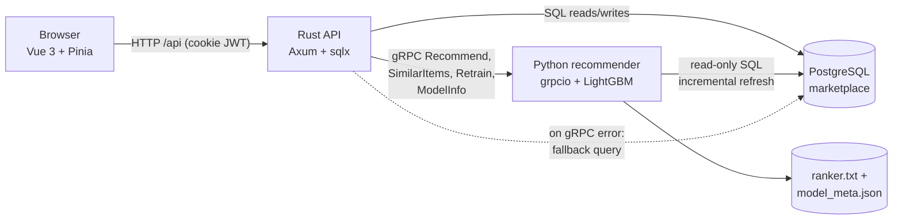
*Figure: The four processes. Rust is the only writer; Python reads Postgres through a read-only connection and is called over gRPC.*

Notice that there is no message queue, no Kafka, no feature store and no cache between the writer and the reader. The database *is* the integration point. That is a conscious choice for a system of this size and Chapter 14 discusses what replaces each piece when traffic grows by four orders of magnitude.

## The algorithm: the life of one click

The "algorithm" of this chapter is a protocol: the sequence of steps that turns a user action into a changed ranking. Let us write it down as a sequence diagram first and then walk it step by step.

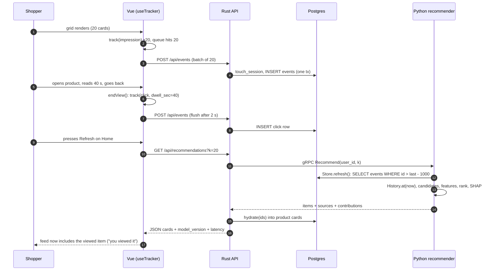
*Figure: One click, end to end. The first half records impressions and the click with its dwell time; the second half reads them back into a new feed.*

The numbered steps:

1. **Render and observe.** `ProductGrid.vue` watches the list of items it was given and calls `track({event_type: 'impression'})` once per item per grid instance, with the item's index as `position` and the surface name (`home_feed`, `search`, `similar`, `shop`) as context.
2. **Queue and flush.** `useTracker.ts` keeps a module-level queue. It flushes when the queue reaches 20 events or 2 seconds after the first queued event, whichever comes first, with one `POST /api/events`.
3. **Validate and persist.** The Rust handler `post_events` rejects anonymous traffic (silently, with `204`), more than 100 events per batch, and any event type other than `impression`, `click` and `hide`. It opens a transaction, asks `touch_session` for the user's current session, and inserts every event with that `session_id`.
4. **Dwell becomes a click.** When the shopper leaves a product page, `Product.vue` emits a single `click` event whose `dwell_sec` is the time on the page. That is the strongest implicit-feedback signal in the whole system: in the model-info page, `ui_max_dwell_sec` is the top feature by gain.
5. **Ask for recommendations.** The home page calls `GET /api/recommendations`. The Rust route builds a `RecommendRequest` and calls the Python service with a 5-second timeout.
6. **Refresh the in-memory copy.** Before doing anything else, `Recommend` calls `Store.refresh()`, which reads only the events newer than what it has already seen.
7. **Run the stack from Chapters 8-11.** `History.at(now)` freezes the world at the current time; retrievers produce candidates; `features.build` computes the feature frame; the LightGBM model scores; `rerank.rerank` applies caps and filters; SHAP contributions are computed for the survivors.
8. **Hydrate and respond.** gRPC returns only item ids, scores, sources and contributions. The Rust API fetches the corresponding product cards in one query and returns JSON that the frontend renders.

### A worked example with hand-sized numbers

How soon after a click does the ranking change? Let $T_\text{flush}$ be the client flush delay, $T_\text{refresh}$ the recommender's refresh throttle and $L$ the time of the recommendation request itself. In the worst case the new row arrives just after the recommender refreshed, so

$$T_\text{stale} \le T_\text{flush} + T_\text{refresh} + L.$$

In this code base, `FLUSH_MS = 2000` in `useTracker.ts` and `MIN_REFRESH_SEC = 1.0` in `db.py`. Add the measured median request time later in this chapter, roughly 0.84 s, and the worst case is about $2 + 1 + 0.84 = 3.84$ seconds between "the shopper pressed back" and "the shopper sees a feed that knows about it". For a typical shopper who presses Refresh a few seconds after returning, the new item is already in the feed. That is the "recommendations are computed on request" decision from the project plan paying off: there is no nightly batch between behaviour and effect.

A second tiny example concerns batching. A home page renders 20 cards, so 20 impressions are queued and the size trigger fires at once: one request, 20 rows. A search page renders 24 cards: the first 20 flush immediately, the remaining 4 sit in the queue until the 2-second timer fires. The event table in the screenshot tour below shows the same rhythm: impressions arrive in groups that share a timestamp, with the next group two seconds later.

A third example is the session rule. Suppose Dewi acts at 10:00, 10:20 and 11:05. The first action creates session A. At 10:20 the latest session was last seen 20 minutes ago, inside the 30-minute window, so session A is reused and its `last_seen_at` moves to 10:20. At 11:05 the gap since 10:20 is 45 minutes, so a new session B is created. Two sessions, not three. Sessions matter because the co-visitation retriever from Chapter 5 groups items by `session_id`: if sessions were mis-assigned, "viewed together" would become noise.

::: fact
**Why this loop cannot be left to a notebook.** In "Hidden Technical Debt in Machine Learning Systems", Sculley et al. observe that only a small fraction of a real-world ML system is the ML code itself; the surrounding infrastructure for data collection, serving and monitoring is "vast and complex". In this repository the same proportion is visible: the ranking model lives in a handful of Python files, while the collection, storage and delivery of its inputs and outputs spans a frontend, an API, a schema and an RPC contract.

Source: Sculley et al., NeurIPS, 2015
:::

## Code walkthrough, part 1: capturing behaviour in the browser

We now follow the click through the code. We start where the data is born.

### The tracker

The tracker is a module-level singleton: a queue, a timer and three functions. Because it lives at module scope, every component that calls `track` shares the same queue, which is what allows batching across grids and views.

```include
path: frontend/src/composables/useTracker.ts
region: tracker
```

Read it from the top. `take()` swaps the queue for an empty one and cancels the pending timer, so a batch is never sent twice. `flush()` posts the batch with `fetch`, swallowing network errors on purpose: *tracking is best-effort*. If a shopper's phone loses signal for a second, we lose a handful of impressions; we must never break the page, retry in a loop, or show an error toast for telemetry.

`track()` is the public entry. Its first line, `if (!useAuth().user) return`, is a product decision with a modelling consequence: anonymous visitors generate no events. The server also drops anonymous batches (it returns `204` without storing), so the privacy-friendly default is enforced on both sides. The cost is that new visitors have no history and the recommender can only offer trending items, the cold-start path of Chapter 12. The second half of the function is the batching policy: send immediately at `FLUSH_AT = 20`, otherwise start a 2-second timer if one is not already running.

The bottom third of the region handles the hardest moment in the life of a web page: leaving it. When a tab closes or the user navigates away, the browser may cancel in-flight `fetch` requests. `navigator.sendBeacon` exists for precisely this case; it queues a small POST that the browser promises to deliver after the page is gone. We will return to the `pageHideHooks` set in a moment, because it carries a bug story.

### Impressions

An impression is "this item was rendered for this user at this position on this surface". It is the denominator of every click-through rate in Chapter 9 (`item_impressions_7d`, `user_ctr_30d`) and the raw material for the position-bias analysis of Chapter 12. Without logged impressions you can only ever say what people clicked, never what they ignored.

```include
path: frontend/src/components/ProductGrid.vue
region: impressions
```

Three details deserve attention. First, the `seen` set makes the rule *one impression per item id per grid instance*. Without it, a Vue re-render, a "Refresh" that returns an overlapping list, or a window resize that re-evaluates the watcher would log the same impression repeatedly and inflate the denominator of every CTR. Second, the watcher is keyed on `idsKey`, the comma-joined list of ids, not on the array object. Vue creates a new array on each fetch even when the contents are identical; keying on the ids avoids spurious fires. Third, `position` is the index in the grid at the time of render, which is the information Chapter 12 needs to correct for position bias.

An honest caveat: this counts an item as "seen" when it is *rendered*, not when it is *scrolled into view*. A card on row five is logged as an impression even if the shopper never scrolls that far. Production systems use an `IntersectionObserver` with a minimum visible time. We kept the simple version because it is easy to read; the data it yields is an upper bound on exposure.

### Dwell time and the `pagehide` ordering bug

Every click event carries `dwell_sec`, and it is created in the product page. The idea is simple: record `performance.now()` when the product loads, and when the shopper leaves, emit one `click` with the elapsed seconds, the position they clicked from and the surface they came from. Those last two travel in the URL (`/products/:id?src=search&pos=3`), which is how a product page knows how it was reached.

```include
path: frontend/src/views/Product.vue
region: dwell
```

`beginView()` and `endView()` bracket a "view". The guard `clickSent` guarantees exactly one click per product view, even though `endView` is wired to four different exits:

- `onBeforeRouteLeave`: the shopper navigates to another page of the app.
- `onBeforeRouteUpdate`: the shopper goes from one product to another, where Vue Router *reuses* the same component instance. Without this hook the first product's dwell would never be recorded.
- `onPageHide(endView)`: the tab is closed or the page is reloaded.
- `onUnmounted`: a final safety net.

Here is the bug that surfaced while verifying the app by hand. The first version of the product page registered its own `window.addEventListener('pagehide', ...)` to record the click. The tracker also had a `pagehide` listener, whose job is to drain the queue into `sendBeacon`. Browsers run listeners for the same event in registration order. The tracker's module is loaded first, so its listener ran first: it emptied the queue and sent the beacon, and only then did the product page add its click to the (now empty) queue. The click was queued after the last flush opportunity and was silently lost. The symptom was subtle: clicks recorded when navigating inside the app, but never when closing the tab, so "dwell on the last product before leaving" went missing.

The fix is visible in the tracker region above: a tiny hook registry. A view that must record something at tab-close calls `onPageHide(fn)`; the tracker's single `pagehide` listener first runs every registered hook, which queue their events, and *then* takes the queue and sends the beacon. The ordering is now enforced by data flow instead of by luck of registration order. The general lesson applies to any "flush on exit" design: do not give every producer its own exit listener; give the flusher one, and let producers register with it.

::: fact
**`pagehide` is not a guarantee.** MDN's documentation for `navigator.sendBeacon()` explains that the legacy exit events (`unload`, `beforeunload` and `pagehide`) are unreliable, especially on mobile: if a user switches apps and later kills the browser, none of them fire. MDN recommends sending analytics on the `visibilitychange` event instead, and notes that the beacon payload is limited to about 64 KiB. Our tracker uses `pagehide`, which is simple and good enough to demonstrate the design; a production tracker would also flush when `document.visibilityState` becomes `hidden`.

Source: Mozilla Contributors, MDN Web Docs, 2026
:::

## Code walkthrough, part 2: the server writes it down

### The events table

Everything the recommender knows about behaviour comes from one append-only table. Its schema is the contract between "what the web app can observe" and "what the model can learn from".

```include
path: backend/migrations/0001_init.sql
region: events_table
```

Compare it with the simulator schema from Chapter 1: `ts`, `user_id`, `session_id`, `item_id`, `event_type`, `position`, `dwell_sec`, `price_paid`. Real data adds `surface` (the page the event happened on) and the foreign keys that stop a client from writing events about items that do not exist. The `CHECK` constraint on `event_type` is the database's last line of defence: whatever a buggy handler tries to insert, only the six known types can land in the table. Two indexes serve the two access patterns we need: per-user history, `(user_id, ts DESC)`, and per-item aggregates, `item_id`. The recommender's incremental refresh reads by primary-key order, which the `BIGSERIAL` index already provides.

Note the absence of an `UPDATE` anywhere. Append-only logs are easy to reason about, easy to replay, and easy to turn into training data later. Returns are modelled as a new `return` event, not as a modification of an `order` row.

### From batch to rows: `post_events`

```include
path: backend/src/events.rs
region: post_events
```

The handler is only about thirty lines, but each line encodes a rule. `MaybeUser(user)` is an extractor that never fails: anonymous requests reach the handler and are told `204 No Content`, exactly what a well-behaved beacon expects. The batch limit of 100 stops a runaway client from filling a transaction. The `matches!` check enforces *what a browser is allowed to claim*: impressions, clicks and hides are observations of the shopper's own screen, so the client may report them. `add_to_cart` and `order` are different. They are consequences of authenticated server-side actions (adding to a cart, running checkout), so the API creates them itself and refuses to accept them from the network. If a shopper could post `order` events directly, they could train the recommender to love any item, including their own listings.

Then the transaction. One `touch_session` call resolves the session for the whole batch, using the surface of the first event. Every event in the batch goes in with that `session_id`. A foreign-key violation becomes a clean `400 unknown item` rather than a 500, and `tx.commit()` makes the whole batch visible atomically. Atomicity matters for the recommender: it will never see half of a batch.

### Sessions: `touch_session`

A session is a run of activity separated from the next by a quiet gap. The simulator's `sessions` table had that structure built in; the real app has to *derive* it.

```include
path: backend/src/sessions.rs
region: touch_session
```

The SQL is a single `UPDATE ... WHERE id = (SELECT ... LIMIT 1) RETURNING id`. It selects the user's most recently active session that was seen within the last 30 minutes, bumps its `last_seen_at` to `now()`, and returns its id, all in one round trip. If it returns nothing, the function inserts a new session. A user with two browser tabs, or a click and a checkout a minute apart, will therefore share one session, which is what we want for co-visitation.

There is a classic race here: two requests from the same user arriving in the same millisecond could both find no live session and both insert one. We accept that: the worst outcome is two sessions that are a few milliseconds apart, which only slightly dilutes co-visitation, and a stronger guarantee would require an advisory lock on the user id. Knowing where you accept an imperfection, and why, is part of production practice.

Every server-side event goes through this same function: client batches, the `add_to_cart` event written by `POST /cart`, and the `order` events written inside checkout. This is a rule worth enforcing by code review: never insert an event without a valid `session_id`, because the co-visitation matrix depends on it.

## Code walkthrough, part 3: the recommender reads it back

### Keeping an in-memory copy fresh: `Store`

The recommender needs the entire event history as DataFrames because the pipeline from earlier chapters (`History.at`, `candidates.generate`, `features.build`) was written against pandas tables. Re-reading 277,000 rows from Postgres for every request would be slow. So `Store` keeps the tables in memory and refreshes them incrementally.

```include
path: recommender/recsys/db.py
symbol: Store.refresh
```

`refresh()` does three things. It takes a lock, so concurrent gRPC threads do not issue overlapping refreshes. It applies a throttle: if the last refresh was less than `MIN_REFRESH_SEC` (one second) ago, it returns immediately, which caps database load at roughly one refresh per second no matter how many requests arrive. And it retries once on `OperationalError` after dropping the connection, which is what you want after a Postgres restart.

```include
path: recommender/recsys/db.py
symbol: Store._refresh
```

`_refresh()` reloads the four small tables (categories, shops, items, users) in full, because they change in place: a seller edits a price, stock reaches zero, a new item is listed. The two large append-only tables, events and searches, are fetched incrementally: `WHERE id > last_id - 1000`. The 1000-id overlap is the subtle part. A `BIGSERIAL` id is assigned when a row is *inserted*, but a row becomes *visible to other connections* when its transaction *commits*. Suppose transaction X inserts event 500, transaction Y inserts event 501 and commits first, and the recommender refreshes in between. It sees 501 and sets `last_id = 501`; when X commits, a naive `id > 501` query would never fetch event 500. By re-reading the last 1000 ids and de-duplicating with `drop_duplicates(subset=key, keep="last")` in `_merge`, the store tolerates commits that arrive out of order, at the cost of reading a few extra rows. The 1000 is a rule of thumb: it must be larger than the number of rows that can be inserted while the slowest transaction is still open.

Observe also that all four read queries run on a read-only connection, and that `_merge` sorts by `ts` with a stable sort: `History.at` assumes time-ordered events.

### The `Recommend` RPC

```include
path: recommender/recsys/service.py
region: recommend_rpc
```

This method is the whole chapter in miniature. It refreshes the store, clamps `k` to 1..50 (never trust a caller's page size), and takes a reference to the current model and version *before* doing any work: `model, version = self.model, self.meta["version"]`. That one line is what makes hot-swapping safe, as we will see in a moment. Then it calls `pipeline.recommend`, the same function the offline CLI uses, with `now` as the cutoff. This is not an accident: the offline evaluation and the online service share one code path, which is the best defence against training/serving skew.

`source_of(recs)` labels each row with the retriever that proposed it with the largest score (`recent`, `covisit`, `category_popular`) or `trending` when none of them did. `ranker.contributions` returns the five largest SHAP contributions per row. Both are packaged in protobuf messages. The method ends by timing itself and logging one INFO line with the user id, `k`, candidate count and latency, the line you will tail in a terminal while using the app.

Anonymous users (`user_id = 0`) need no special branch: they have no history, so the retrievers return only trending items and the user-level features are missing, which LightGBM handles natively as NaN. That is why the anonymous home page in the screenshot tour shows exactly 30 candidates, which is the minimum in our latency run too.

### Retraining without downtime

A model trained once is a model that is already ageing. New items appear, tastes shift with payday and flash sales, and the ranker's features such as `item_impressions_7d` drift. The service therefore supports two retrain triggers: a background thread that fires every `RECSYS_RETRAIN_INTERVAL_SEC` (six hours by default), and an admin-only gRPC `Retrain` call surfaced as a button on the "How it works" page.

```include
path: recommender/recsys/service.py
symbol: retrain
```

The module-level `retrain` function is shared by the service and the CLI (`uv run recsys retrain`). It trains on a snapshot of the store with `end=now`, so the label windows slide forward with the clock: the training set always ends "now minus 14 days to now minus 7 days" and the evaluation window is the last seven days. It converts the evaluation table into flat metric keys such as `lightgbm_ranker/ndcg@20`, writes `ranker.txt` and a `model_meta.json` containing the version, timestamp, metrics and feature importances, and returns the new objects without touching global state.

```include
path: recommender/recsys/service.py
symbol: RecommenderService.retrain
```

The method wraps the function with two safeguards. First, `retrain_lock.acquire(blocking=False)`: if a retrain is already running, a second request fails immediately with `RuntimeError`, which the RPC maps to `ABORTED` and Rust maps to HTTP `409 retrain already running`. Two simultaneous retrains would waste minutes of CPU and race to write the same files. Second, the swap `self.model, self.meta = model, meta` is two reference assignments. In-flight `Recommend` calls hold their own reference to the old booster (recall the first line of the RPC), so they finish with a consistent model/version pair, and new calls see the new one. No lock on the read path, no pause in traffic.

::: fact
**Real-time learning is a research topic of its own.** The Monolith system, from ByteDance, argues that general-purpose training frameworks fall short for recommendation because they separate a batch-training stage from a serving stage, which prevents the model from interacting with customer feedback in real time. Its authors describe an online-training architecture with a collisionless embedding table, and show that reliability can be traded off for real-time learning. Our six-hour retrain interval sits at the opposite, much simpler end of that spectrum.

Source: Liu et al., ORSUM Workshop (RecSys), 2022
:::

## Code walkthrough, part 4: the Rust side of the bridge

### The recommendations route

Now the other end of the gRPC call.

```include
path: backend/src/recommender.rs
region: recommend_route
```

The handler reads the user from the cookie, if any (`MaybeUser`), clamps `k`, and builds the request. `st.rec.clone()` clones the *client handle*, which is cheap: tonic channels multiplex many calls over one HTTP/2 connection, and in `main.rs` the channel is created with `connect_lazy()`, so the API starts even when Python is down. The call is wrapped in `tokio::time::timeout(Duration::from_secs(5), ...)`. The match has two arms of interest: a successful reply is hydrated and returned with `"fallback": false`; anything else, whether a gRPC error or a timeout, is logged as a warning and answered from the fallback query with `"model_version": "fallback"`. The frontend reads that flag to display the yellow banner "Recommender offline — showing popular items".

This is the standard contract of a recommender in production: *degraded is better than down*. The route never returns a 5xx just because the model service is unavailable.

### Hydration

```include
path: backend/src/recommender.rs
region: hydrate
```

gRPC returned ids and scores; the browser needs titles, prices and images. Hydration is one SQL query with `id = ANY($1)` that builds a map from id to card, followed by a pass over the recommender's list *in the recommender's order*. Two design choices are worth naming. The ranking order is owned by the recommender, so hydration uses `filter_map` over the original list rather than the SQL result order. And items that vanished between ranking and display (a seller deactivated a listing in the last second) are skipped, not turned into errors. The response may therefore contain fewer than `k` cards; that is correct behaviour. The alternative of failing the entire request because one product disappeared would make the feed brittle.

### The fallback

```include
path: backend/src/recommender.rs
region: fallback
```

The printed card from our restaurant: active, in-stock items ordered by the number of `order` events in the last seven days, then by rating count. It reuses the same card SQL fragment as the catalogue and gives every row `source: "trending"`, a score of 0 and empty contributions, so the frontend does not need a separate rendering path. The function optionally restricts to one category and excludes one item, which is how the similar-items endpoint falls back when `SimilarItems` fails. The fallback is deliberately *non-personalised*: a degraded experience that is the same for everybody is also the safest, because it cannot be wrong in a surprising, user-specific way.

### Checkout: the transaction that writes the strongest signal

Orders are rare compared to impressions, but they are the label with the highest weight in Chapter 9 and the one that most directly measures what a marketplace cares about. The checkout handler is also the best example in the code base of *why a single writer pays off*.

```include
path: backend/src/cart.rs
region: checkout
```

The shape is a textbook transaction. Load the cart; lock the item rows with `SELECT ... FOR UPDATE` in a deterministic order (`ORDER BY id`, which prevents deadlocks between two shoppers buying overlapping carts); check that every line is active and in stock, otherwise `409 insufficient stock for <title>`; group lines by shop so that a mixed cart produces one order per seller; insert orders and order items at the *final* price (the discount is applied at the moment of purchase and stored as `unit_price`); decrement stock and stamp `out_of_stock_at` when it reaches zero; write one `order` event per line through `touch_session`, with `price_paid` and surface `checkout`; and delete the cart. Commit, or roll everything back.

Two recommender-relevant consequences follow. First, stock changes write `out_of_stock_at`, which is the column `History.at` reads to decide whether an item is in stock at the cutoff, so the very next `Recommend` stops proposing a sold-out product. Second, the `order` event is created only here, never from the browser: the recommender can trust that every `order` in the table corresponds to a real, paid order row.

## The contract between languages: one `.proto`, two code generators

The Rust API and the Python service never share code, only a schema. The schema is a single file, and it is short enough to read in full.

```include
path: proto/recommender.proto
```

The file defines four RPCs and their messages. The pieces map directly to the product:

- `Recommend` powers the home feed; `SimilarItems` powers the product page; both return `RecommendResponse`, which carries `items`, the `model_version` that produced them, the number of `candidates_considered`, and the server-measured `latency_ms`. These last three fields are what the grey caption under "Recommended for you" displays.
- `RecommendedItem.contributions` carries the top five SHAP contributions per item: feature name, the feature's value and its signed contribution to the score. This is the raw material of the "Why this?" panel.
- `Retrain` returns the new version, the metrics map and the number of training rows. `ModelInfo` returns everything the "How it works" page needs: feature descriptions, gain shares, metrics, event counts.

Design the contract as you would a public API. Responses carry the *model version* so you can correlate any observed behaviour with the model that caused it. IDs, not objects, cross the boundary: the recommender never has to know how a product is rendered, and the API never has to know how a score is computed. The request carries `surface` even though today's model ignores it: when you later want a different ranker for search than for home, the field is already there. A `user_id` of 0 means "anonymous", a convention that must be documented on the contract, and is, in a comment.

::: fact
**Field numbers are the wire format.** In Protocol Buffers, each field is identified on the wire by its number, not its name. The language guide states that the number cannot be changed once the message type is in use, that field numbers 1 through 15 take one byte to encode while 16 through 2047 take two, and that numbers of deleted fields should be reserved so they are never reused. In `recommender.proto`, the most frequently populated fields such as `item_id` and `score` therefore sit at the low numbers.

Source: Google, Protocol Buffers Language Guide (proto 3), 2026
:::

### Generating code on both sides

Rust generates its client at build time. The build script is the whole file:

```include
path: backend/build.rs
```

`tonic_prost_build::configure().build_server(false)` generates only the client half (the Rust crate never *implements* the service), and `rerun-if-changed` makes Cargo rebuild when the proto changes. The generated module is pulled in by `tonic::include_proto!("recommender.v1")`, and from then on `pb::RecommendRequest` and `recommender_client::RecommenderClient` are ordinary, fully type-checked Rust items. A typo in a field name is a compile error, not a runtime surprise.

Python generates its stubs with one command, wrapped as a CLI subcommand so nobody has to remember the flags:

```bash
cd recommender && uv run recsys gen-proto
```

It runs `grpc_tools.protoc` with `-I recsys/pb=../proto`, which makes the generated import read `from recsys.pb import recommender_pb2`, and writes `recommender_pb2.py` and `recommender_pb2_grpc.py`. These files are committed, so someone who only wants to run the service does not need a codegen step. The cost of committing generated code is the risk of forgetting to regenerate after editing the proto; the cost of not committing it is an extra setup step for every reader. For a teaching repository, the first is the better trade.

The discipline that makes this work is simple: *the `.proto` is the only place a field is ever defined.* If you rename `candidates_considered`, both builds break loudly on the next compile or import, and you fix both sides in the same commit.

## Run it

Everything so far could be a story. The next step is to measure the system. The script `ch13_latency.py` talks to the *running* gRPC service directly, bypassing Rust and the browser, and calls `Recommend` with `k = 20` for 200 random users with a fixed seed. The first call is a warm-up and is not counted.

```bash
# terminal A
cd recommender && uv run recsys serve
# terminal B (from the repo root)
cd book && uv run python code/ch13_latency.py
```

```output
file: results/ch13_latency.txt
```

The first table reports two views of the same calls. "server latency_ms" is the number the service measured about itself, from the start of the RPC to just before the response was built. "client wall ms" is what the Python client measured around the whole call, including serialisation and the loopback network hop. The two differ by only about a millisecond, which tells us that the network and protobuf cost on a local machine are negligible: essentially all the time is inside the recommender. The last two lines show that every request scored between 30 and 129 candidates, 102 on average, and returned exactly 20 items.

## Results

### Latency

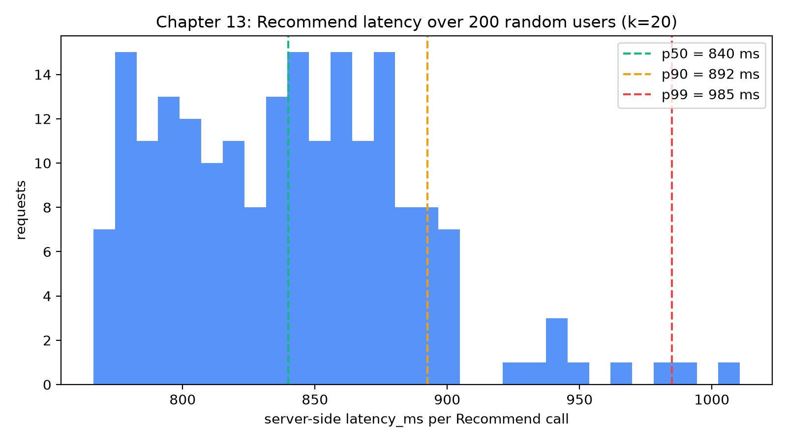

The histogram shows a compact body between about 770 and 900 ms, and a short tail reaching about 1,010 ms. The median is 839.9 ms, the 90th percentile 892.5 ms and the 99th 985.0 ms. Two observations matter.

First, **latency barely depends on the user**. A user with 30 candidates and a user with 129 candidates sit in the same band. That is a strong hint that most of the 840 ms is a fixed cost paid on every request rather than work proportional to the candidates, and the code path is consistent with that: `pipeline.recommend` calls `History.at(tables, now)`, which rebuilds the point-in-time history over the whole event table, and `features.build` computes item-level statistics before it looks at any one user. The exercise at the end of the chapter lets you probe this. [INFERENCE: we did not profile the request; the flat distribution and the code path point to this cause but do not prove it.]

Second, **0.84 s is fine for a demo and too slow for a real home page**. The Rust route allows 5 s, so even the slowest observed call of 1,010.6 ms uses about a fifth of the budget, but a shopper waiting nearly a second for a feed will notice. The remedy was already planned: cache the item-level frames (the co-visitation matrix and item features) with a short TTL such as 30 seconds and recompute only the user-specific parts per request, accepting that item-level statistics may lag by up to that TTL while the shopper's *own* clicks remain live. We leave it as an optimisation exercise because it shows an important truth about recommender latency: the budget is eaten by feature computation, not by the model. Scoring a hundred rows with a gradient-boosted tree takes milliseconds.

### A screenshot tour

The remaining figures are screenshots of the running application, captured with Playwright against the same seeded database. We use them to connect each page to the code you just read.

**Logging in.** The demo accounts are shown on the login page so a reader can start in seconds. Authentication is an email and password; the API verifies an Argon2 hash and answers with a JWT in an `httpOnly`, `SameSite=Lax` cookie, so the JavaScript never sees the token and the same-origin proxy from Vite keeps the cookie on `localhost:5173`.

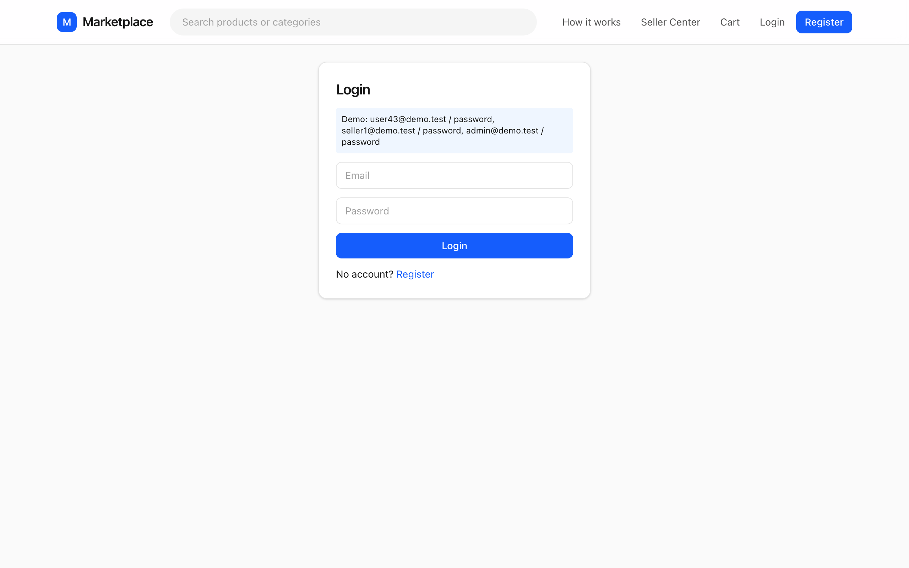

**The anonymous home page.** With no cookie, `Recommend` is called with `user_id = 0`. The heading says "Popular now", and the grey caption gives the model version, 30 candidates and the latency. No impressions are recorded because the tracker returns early when there is no user.

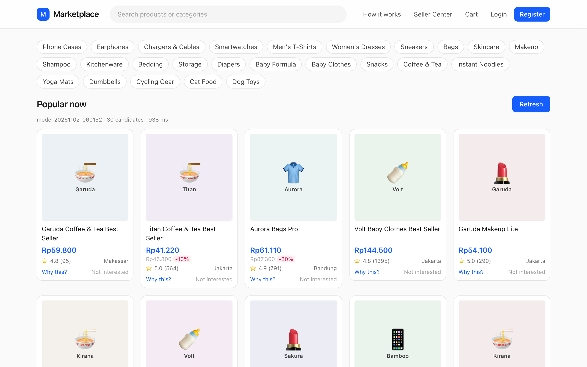

**The personalised home page.** Logged in as `user43`, the same URL now says "Recommended for you", the caption reports more candidates (the retrievers have history to work with) and the feed is dominated by baby products and make-up, consistent with the user's category affinities. Each card has "Why this?" and "Not interested" links; the latter tracks a `hide` event, which the recommender uses both as a negative feature and as a hard filter.

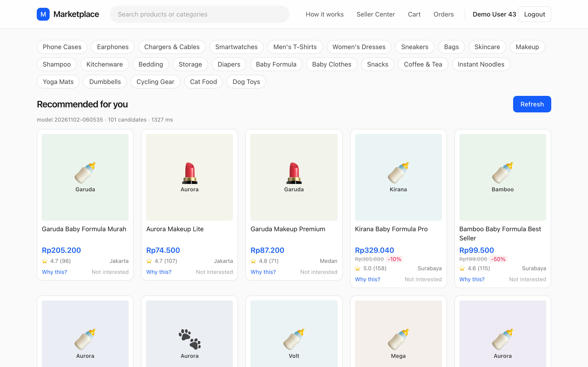

**Why this?** Opening the panel on the first card shows "Because: you viewed it", the score and rank, and five features with their values and signed contributions: a repeat-purchase category, long dwell, previous orders, a high share of the user's clicks in this category. The names come from `schema.FEATURES` through `ModelInfo`, and the bars are the SHAP values that `ranker.contributions` computed inside `recommend_rpc`. The panel makes the system *inspectable*, which is invaluable when debugging a recommender: if a card appears for a reason that makes no sense, the panel tells you which feature to investigate.

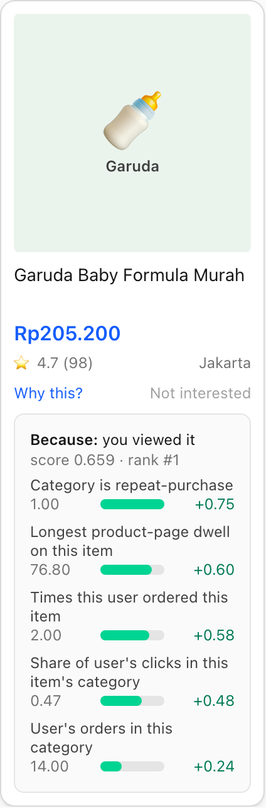

**Search and product pages.** Search is a plain SQL `ILIKE` over titles and category names with sort options, not a recommender, but it generates the `search` surface and the `searches` rows that the personalisation uses. The product page loads the detail and, separately, `/products/:id/similar`, which calls `SimilarItems`: co-visited items first, then same-category popular ones. Notice the layout: product details load first, and "Similar items" is optional; if it fails, the page still works.

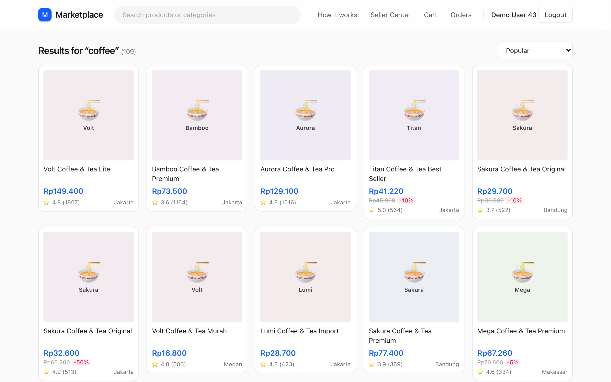

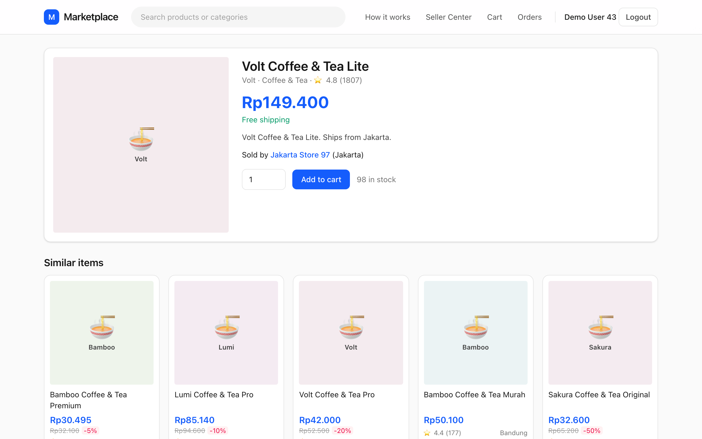

**Cart, checkout and orders.** These pages exercise the writer side. Adding to the cart writes a row and an `add_to_cart` event; placing the order runs the transaction above; the orders page lists one order per shop with a `paid` status badge.

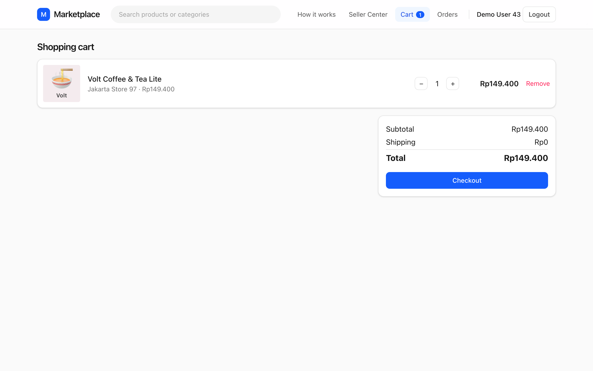

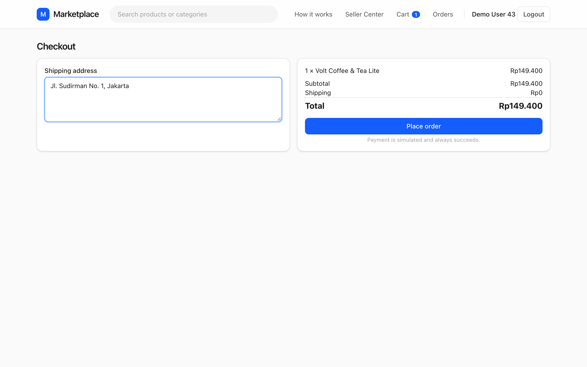

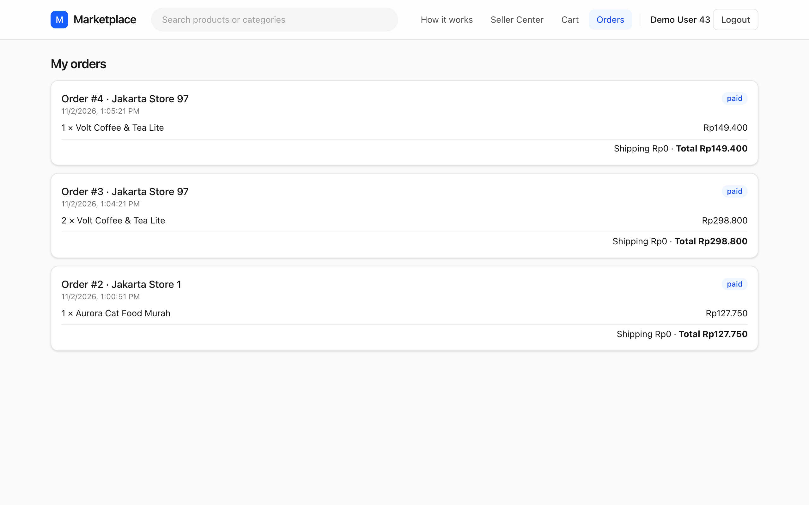

**The seller side.** A seller sees their products with stock and status, a form to create a listing, and the orders that buyers placed. The list of orders contains exactly the orders created a moment ago in checkout, with the buyer's name and a "Mark shipped" button; the API accepts only `paid → shipped` and `shipped → completed`. A newly created product starts with no impressions and no interactions: the cold-start problem of Chapter 12 in its purest form.

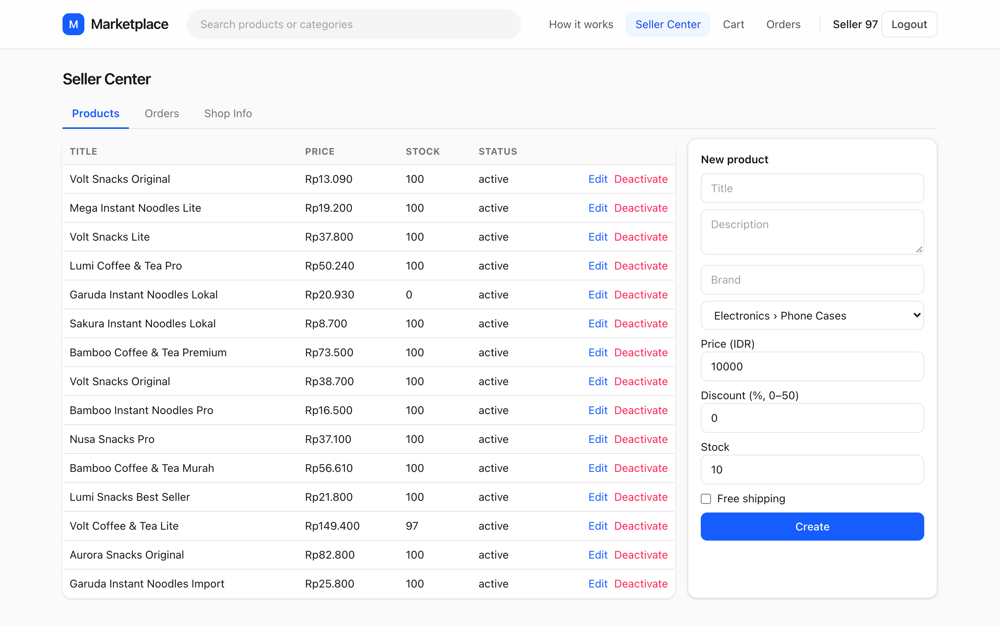

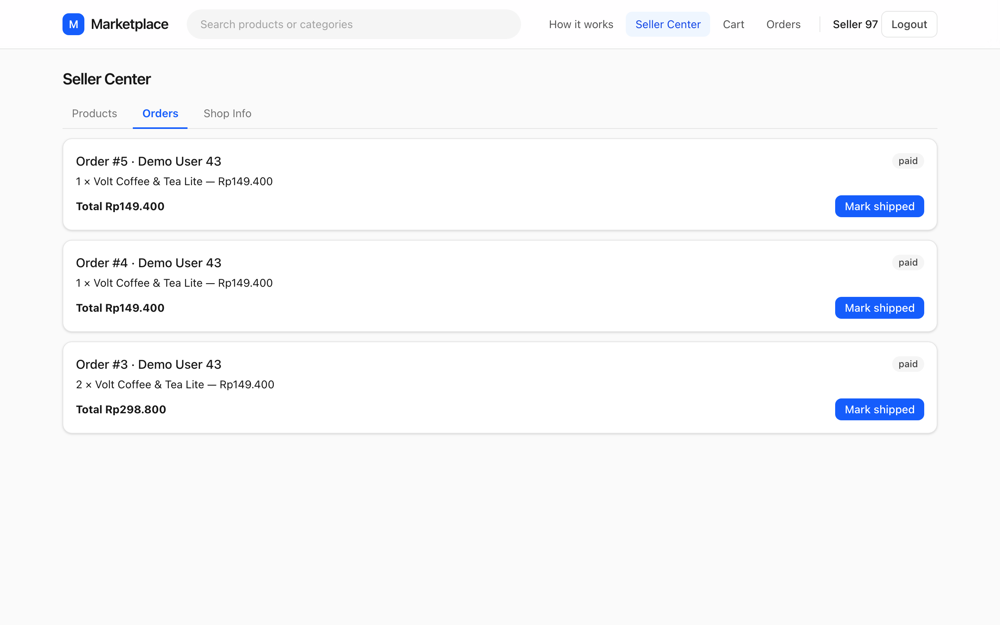

**The learning pages.** "How it works" has a live view of the user's own behaviour. The screenshot below is the events table captured partway down the page: the newest rows at the top are an `order` from checkout, then a `click` with a dwell of 1.8 seconds from the search surface, a long run of `similar` impressions at positions 0 to 11, and an `add_to_cart`. The searches on the right are the last ten queries. This is the same table the recommender reads.

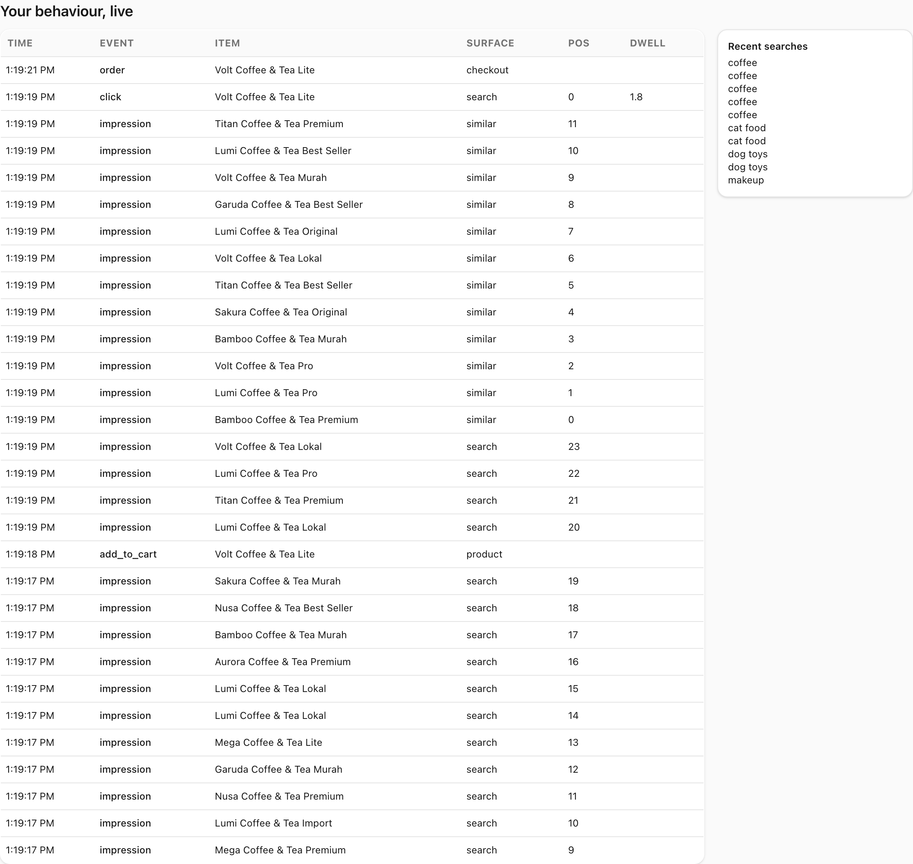


The model section shows the version, when it was trained, how many events were loaded, the metric table for the four methods and the top features by gain. The numbers are the same ones you computed offline in Chapters 3 and 10: the heuristic blend scores far above global popularity and the LightGBM ranker above the blend, with `ui_max_dwell_sec` as the single most important feature.

Admins also get a "Retrain now" button. After clicking it, the page lists the new model's version and every metric key returned by gRPC.

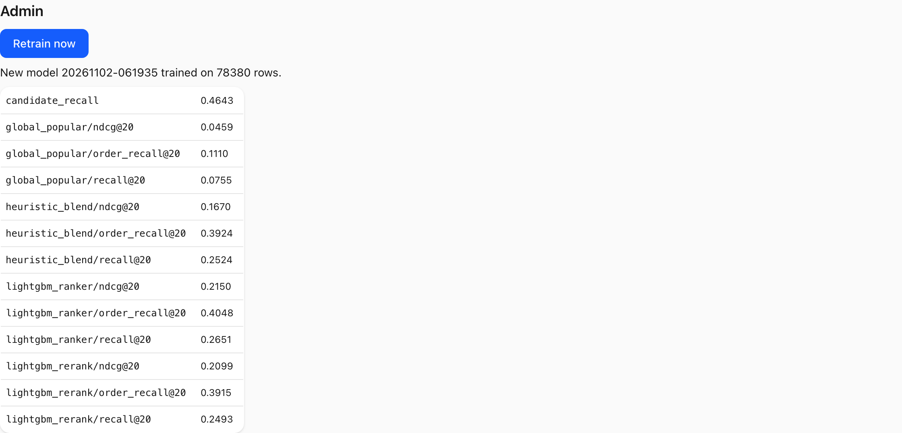

Compare this screenshot with the model section above. The retrained model has a different version and slightly different metrics and training-row counts, even though no code changed. Why? Because every cutoff is defined relative to `now`: when the clock moves forward and new events arrive, the label windows slide and the training set changes. This is normal, and it is why the model version is part of every response.

**Degraded mode.** Finally, the screenshot taken with the recommender stopped.

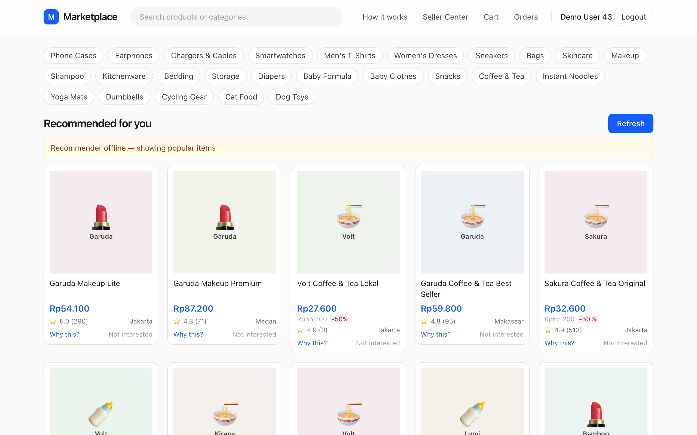

The page is still a working shop: the yellow banner replaced the model caption, the cards come from the fallback query and "Why this?" panels are empty because trending items have no contributions. The user is slightly worse off; nobody is locked out.

## Pitfalls and production practice

**Event time versus server time.** `events.ts` defaults to the database's `now()` at insert. A client-side timestamp would let a skewed phone clock write events from the future into the recommender's history. Using server time is simple and safe, and the cost is that a batch flushed late is stamped with the flush time, not the click time. For a 2-second flush window that error is irrelevant; for an offline-first mobile app that batches events for minutes, it is not, and you would need server-validated client timestamps.

**Never trust the client's event vocabulary.** We enforce `impression | click | hide` at the API and the schema. The same principle applies to numbers: `dwell_sec` comes from the browser, so a robust pipeline clips it (a tab left open overnight reports hours of dwell) before it becomes a feature. Consider `ui_max_dwell_sec`, the top feature in the model: a single bogus dwell value would immediately distort it.

**Feedback loops start here.** The tracker records what was *shown*, and what is shown depends on what the model recommended, which depends on what was clicked. Impressions with positions are what make later correction possible. If you logged only clicks you could never tell "ignored" from "never shown". Chapter 12 uses exactly this log to measure position bias.

**Idempotency and double counting.** A beacon sent on `pagehide` and an in-flight `fetch` from the same page could, in theory, deliver the same events twice. We tolerate that because the queue is emptied by `take()` before sending, so a batch exists in exactly one place at a time. In a system where duplicate events are harmful, give each event a client-generated UUID and deduplicate on the server.

**Training/serving skew.** The service calls `pipeline.recommend`; the training job calls `pipeline.train_and_evaluate`; both build features with `History.at` and `features.build`. There is one implementation of each feature, not two. The moment a team writes the feature once in SQL for training and once in application code for serving, the two will diverge. A feature store (Chapter 14) is the industrialised version of "one definition, two consumers".

**Stale and mismatched models.** The response carries `model_version` and the log line carries latency and candidate counts. In production you would also log the *recommended list* with the model version, so that an A/B test or an incident analysis can recover exactly what each shopper saw.

**Latency budgets.** At scale you do not have 840 ms. A typical request budget for a home feed is a few hundred milliseconds in total, and each stage (retrieval, features, ranking, re-ranking, hydration) is given a slice. We saw the right instinct above: measure the percentiles, find the fixed cost, cache what can be cached, and keep the personalised work small.

**Read-only is a feature, not a limitation.** Connecting the recommender with `default_transaction_read_only=on` means that even a bug cannot damage the system of record. It also keeps the architecture honest: if you ever feel the need for the recommender to write to the application database, ask whether the data belongs in a separate store (for example, a table of precomputed candidates) rather than mixed with the transactional tables.

::: tip
**Debug with the whole stack in view.** When a recommendation looks wrong, check in this order: (1) is the event in the table (`select ... from events where user_id = 43 order by id desc`)? (2) did `Store.refresh` see it (the service log shows candidate counts)? (3) which source proposed the item (the "Why this?" panel)? (4) what features pushed it up? Four questions, four tools, no guessing.
:::

::: warning
**Do not "fix" a missing event by writing it from the server on a hunch.** If a click is missing, find out *why* it was missed. The `pagehide` bug above was found because clicks on the last product before closing a tab were absent; the root cause was ordering, and the fix was a hook registry. Inserting synthetic events would have hidden the bug and polluted the training data.
:::

## Summary

- The marketplace has four processes: a Vue frontend, a Rust/Axum API that is the only writer, PostgreSQL as the shared ledger, and a Python gRPC recommender that reads Postgres through a read-only connection.
- A click becomes a changed ranking through impressions queued and flushed by `useTracker`, `post_events` and `touch_session` writing rows with a session id, `Store.refresh` reading them incrementally, and `Recommend` running the full pipeline on request. The worst-case staleness is the flush delay plus the refresh throttle plus the request time.
- Exit-time events need one ordered flusher: the `onPageHide` hook registry fixes the bug where a click was queued after the beacon had already been sent.
- The recommender stays fresh with an overlap-safe incremental refresh (`id > last - 1000`, then de-duplicate) because auto-increment ids are assigned at insert but become visible at commit.
- A single `.proto` file is the contract; Rust generates a client in `build.rs`, Python generates stubs with `recsys gen-proto`, and responses carry the model version, candidate count and latency for observability.
- Retraining is periodic and on demand, guarded by a non-blocking lock and hot-swapped by assigning two references, so serving never pauses.
- The Rust API hydrates ids into cards in the recommender's order and falls back to a non-personalised trending query on error or timeout, so a recommender outage degrades the page instead of breaking it.
- Measured on this machine, `Recommend` takes about 840 ms at the median and 985 ms at the 99th percentile, almost independent of the user; the cost is fixed per-request feature work, which a short-TTL cache would attack first.

## Quiz

**Q13.1** Why does the Python recommender open its database connection with `default_transaction_read_only=on`?

A. It makes `SELECT` queries faster by skipping locks.
B. It guarantees that a bug in the recommender cannot modify application data; any write fails with an error.
C. It lets Postgres reuse the same connection for the Rust API.
D. It is required by the gRPC protocol.

**Q13.2** Which set of event types does `POST /api/events` accept from the browser, and why is `order` not among them?

A. `impression`, `click`, `hide`; `order` is a consequence of a server-side action (checkout) and must not be forgeable from the client.
B. `impression`, `click`, `order`; `hide` is derived on the server.
C. All six types; the database `CHECK` constraint is the only protection.
D. Only `click`; impressions are computed by the server from page loads.

**Q13.3** In the `pagehide` bug, what exactly went wrong in the first version of the product page?

A. The `fetch` call timed out after 2 seconds.
B. The product page's own `pagehide` listener ran after the tracker's listener had already drained the queue into the beacon, so the click was never sent.
C. `sendBeacon` cannot send JSON.
D. Vue Router unmounted the component before `pagehide` fired.

**Q13.4** Explain in two or three sentences why `Store._refresh` re-reads the last 1000 event ids instead of querying `id > last_event_id`. What would go wrong without the overlap?

**Q13.5** `Recommend` begins with `model, version = self.model, self.meta["version"]` and `retrain` finishes with `self.model, self.meta = model, meta`. Explain how these two lines let the service swap models during traffic without a lock on the request path.

**Q13.6** (Code reading.) Read `touch_session` in `backend/src/sessions.rs`. A shopper triggers events at 10:00, 10:20 and 11:05 on the same day, with no other activity. How many sessions are created, and what is the `last_seen_at` of the first session at the end of the day? Justify using the 30-minute rule in the SQL.

**Q13.7** (Numeric.) The Rust route times out the gRPC call after 5 seconds. Using the results in this chapter, what fraction of that budget does the slowest observed server-side call (1,010.6 ms) consume, and what is the worst-case staleness $T_\text{stale} = T_\text{flush} + T_\text{refresh} + L$ if $T_\text{flush} = 2$ s, $T_\text{refresh} = 1$ s and $L$ is the observed p99 server latency of 985.0 ms? Give both answers.

**Q13.8** What does the fallback return when the recommender is unavailable, and why does it label every item with `source: "trending"`, a score of 0 and empty contributions?

**Q13.9** You rename a field in `recommender.proto` by changing its number from `3` to `7` and rebuild only the Rust API. The Python service still runs with the old generated stubs. What is the most likely outcome and why does the guide say field numbers should never be changed once in use?

A. Nothing; the wire format uses field names.
B. The two sides disagree about which bytes mean which field, so data is silently dropped or misread.
C. Rust will refuse to compile.
D. gRPC will automatically negotiate the new number.

**Q13.10** (Hands-on.) Open `book/code/ch13_latency.py` and change `k=20` in both the warm-up and the measurement loop to `k=5`, then again to `k=50`, re-running the script against the live service each time. Record `p50` and the "candidates scored per request" line. What do you expect to observe about latency and candidate counts, and what does it tell you about where the time goes?
