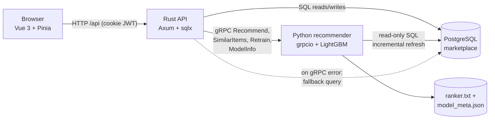
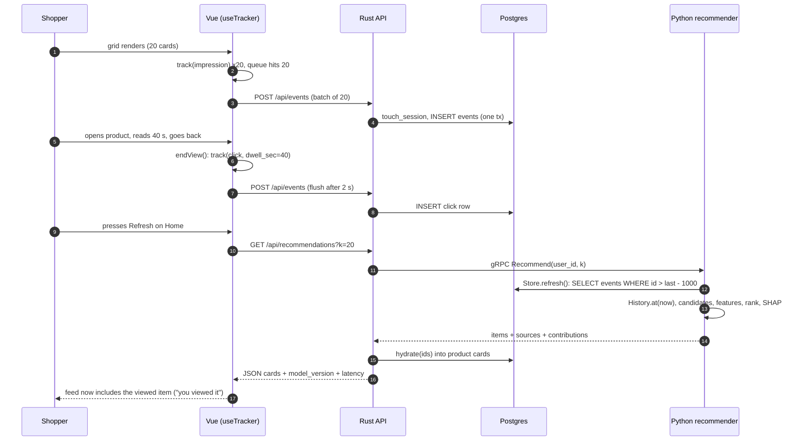

# Building the system

It is a Tuesday evening, a few minutes after payday, and Dewi opens the marketplace app on her phone. She taps a cat-food listing, scrolls through the photos, decides the price is a little high, and presses back. She does not buy anything. She does not "like" anything. She did not even type a word. And yet, if she returns to the home page thirty seconds later, the feed should already look a little different: more pet supplies, fewer phone cases. The page she just left has to change what the system believes about her.

**What you'll learn**

- How the four processes (Vue, Rust/Axum, PostgreSQL, Python gRPC) divide responsibilities, and why the recommender only *reads* the database.
- The life of one click, from an impression to a changed recommendation, with the code at every hop.
- How impressions, clicks and dwell are captured, and why the order of two `pagehide` listeners decides whether a click is recorded.
- How sessions are derived, how the recommender refreshes an in-memory copy of the database, and how hydration, fallback and retraining work.
- How one `.proto` file generates both sides, and what the end-to-end latency is (we measure and profile it).

## The intuition: a restaurant with a ledger

Think of a busy restaurant. Waiters take orders, run plates, and write every table's activity into a ledger: who sat down, what they looked at on the menu, what they ordered. The kitchen has a chef who is very good at suggesting the right dish, but the chef never talks to customers and never writes in the ledger. Whenever a waiter asks "what should I suggest to table twelve?", the chef glances at the ledger, thinks, and answers with a short list. If the chef is out sick, the waiter still has a printed card with the five best-selling dishes of the week and hands that to the table instead. Nobody leaves hungry.

That is exactly this architecture. The **ledger** is PostgreSQL. The **waiters** are the Rust API, which is the only writer: it registers users, takes cart and checkout actions, and appends the behavioural events. The **chef** is the Python recommender service, which reads the ledger through a read-only connection and returns ranked suggestions over gRPC. The **menu** that the customer sees is the Vue single-page application. The **printed card** is the fallback query inside the Rust API.

The division is deliberate, for three reasons.

1. **One writer means one set of rules.** Stock never goes negative, an order only moves `paid → shipped → completed`, and a client cannot forge an `order` event, all in one place.
2. **The recommender can be wrong or down without taking the shop down.** It sits behind a network boundary with a timeout and holds no write-capable connection: in `recsys/db.py`, `connect(read_only=True)` sets `default_transaction_read_only=on`, so an accidental `INSERT` fails loudly with `ReadOnlySqlTransaction`.
3. **Each side uses the right tool.** Rust for a concurrent, type-checked API with transactions; Python for pandas, LightGBM and the research code.

**What "read-only connection" means.** A database connection is a phone line from a program to the database. A *read-only* line can ask questions ("what did shopper Dewi click?") but cannot change anything. It is like letting the chef look at the ledger through a glass window: they can read every entry, but they cannot pick up a pen. Without it, one bug in the recommender, say a loop that updates the wrong table, could silently corrupt orders and stock. With it, the same bug just produces an error message.


*Figure: The four processes. Rust is the only writer; Python reads Postgres through a read-only connection and is called over gRPC.*

### Words you will meet in this chapter

Several technical terms appear in the next pages. Here is each one in plain words, tied to the restaurant. You can come back to this table whenever a term feels unfamiliar; each one is explained again, with an example, where it first matters.

| Term | Plain meaning | In the restaurant |
|---|---|---|
| **REST API** | A set of web addresses (URLs) that a program can call to ask for something or to send something, for example `GET /api/recommendations` ("give me the feed") or `POST /api/events` ("here are some events"). The reply is usually JSON, a plain-text format for data. | The waiter's order window: the customer asks in a fixed way and gets an answer in a fixed way. |
| **JWT cookie** | After you log in, the server hands the browser a small signed note saying "this is Dewi" (a *JSON Web Token*, JWT). The browser stores it in a *cookie* and attaches it to every later request, so Dewi need not log in again for each click. `httpOnly` means page scripts cannot read the note, which protects it from theft. | A wristband given at the door: staff check it instead of asking for ID each time. |
| **gRPC** | A way for one program to call a function that lives in *another* program, possibly in another language, as if it were a local function. | The waiter calling through the kitchen hatch: "suggest something for table 12!" |
| **Protobuf / `.proto`** | *Protocol Buffers*: a short file that lists exactly which fields each request and reply contains. Both programs generate their code from this one file, so they cannot disagree. | A printed order form that waiter and chef both use. |
| **Read-only connection** | A database connection that can read but never write. | The glass window onto the ledger. |
| **Beacon** | A browser feature (`navigator.sendBeacon`) that hands a small message to the browser to deliver *after* the page has closed. | Dropping a letter into a postbox on your way out, instead of waiting at the counter for a reply. |
| **Latency, p50, p99** | Latency is how long one request takes. p50 is the typical (median) time; p99 is the time that 99 of every 100 requests beat. | How long a table waits for a suggestion; p99 is the worst waits, not the average ones. |
| **Profiling** | Timing each stage of a slow job to find where the time goes. | Timing each step of a dish to see which step makes the table wait. |
| **Retrain** | Building the model again from the newest data. | The chef revising the recipe notes after a busy week. |
| **Fallback** | A simpler plan B used when the main system fails. | The printed card of best-sellers. |
| **Cutoff = now** | In earlier chapters the *cutoff* was a past date we pretended was "today" to test fairly. When serving real shoppers, "today" is real, so the cutoff is simply the current time. | Nothing is hidden, because the future has not happened yet. |

## The algorithm: the life of one click

The "algorithm" of this chapter is a protocol: the sequence of steps that turns a user action into a changed ranking. Let us write it down as a sequence diagram first and then walk it step by step.


*Figure: One click, end to end. The first half records impressions and the click with its dwell time; the second half reads them back into a new feed.*

The numbered steps:

1. **Render and observe.** `ProductGrid.vue` calls `track` with an `impression` once per item per grid, with its index as `position` and the surface name as context.
2. **Queue and flush.** `useTracker.ts` flushes at 20 queued events or 2 seconds after the first, with one `POST /api/events`.
3. **Validate and persist.** `post_events` accepts only `impression`, `click` and `hide`, at most 100 per batch, and inserts them in one transaction with the user's current `session_id`.
4. **Dwell becomes a click.** When the shopper leaves a product page, `Product.vue` emits one `click` carrying `dwell_sec`, the strongest implicit signal: `ui_max_dwell_sec` is the top feature by gain on the model page.
5. **Ask.** The home page calls `GET /api/recommendations`; Rust calls the Python service with a 5-second timeout.
6. **Refresh.** `Recommend` first calls `Store.refresh()`, which reads only events newer than what it has seen.
7. **Run Chapters 8-11.** `History.at(now)`, candidates, `features.build`, LightGBM scoring, `rerank.rerank`, SHAP for the survivors.
8. **Hydrate and respond.** gRPC returns ids, scores, sources and contributions; Rust fetches the cards in one query.

### A worked example with hand-sized numbers

How soon after a click does the ranking change? Let $T_\text{flush}$ be the client flush delay, $T_\text{refresh}$ the recommender's refresh throttle and $L$ the time of the recommendation request itself. In the worst case the new row arrives just after the recommender refreshed, so

$$T_\text{stale} \le T_\text{flush} + T_\text{refresh} + L.$$

In this code base, `FLUSH_MS = 2000` in `useTracker.ts` and `MIN_REFRESH_SEC = 1.0` in `db.py`. Add the measured median request time later in this chapter, roughly 0.84 s, and the worst case is about $2 + 1 + 0.84 = 3.84$ seconds between "the shopper pressed back" and "the shopper sees a feed that knows about it". For a typical shopper who presses Refresh a few seconds after returning, the new item is already in the feed. That is the "recommendations are computed on request" decision from the project plan paying off: there is no nightly batch between behaviour and effect.

::: fact
**Why this loop cannot be left to a notebook.** In "Hidden Technical Debt in Machine Learning Systems", Sculley et al. observe that only a small fraction of a real-world ML system is the ML code itself; the surrounding infrastructure for data collection, serving and monitoring is "vast and complex". In this repository the same proportion is visible: the ranking model lives in a handful of Python files, while the collection, storage and delivery of its inputs and outputs spans a frontend, an API, a schema and an RPC contract.

Source: Sculley et al., NeurIPS, 2015
:::

## Code walkthrough, part 1: capturing behaviour in the browser

### The tracker

`track()` first checks `if (!useAuth().user) return`: anonymous visitors generate no events (the server also answers `204` without storing), so new visitors only get trending items, the cold-start path of Chapter 12. Then comes the batching policy: send at `FLUSH_AT = 20`, otherwise start a 2-second timer. `flush()` swallows network errors on purpose: tracking is best-effort. The bottom of the region handles leaving the page, where the browser may cancel in-flight `fetch` calls; `navigator.sendBeacon` queues a small POST that the browser delivers after the page is gone. The `pageHideHooks` set carries a bug story, below.

**What is a beacon, and why is it needed?** When Dewi closes the tab, the browser tears the page down. A normal network request that is still on its way may be cancelled, like a customer leaving before the waiter has finished writing the order. `navigator.sendBeacon` fixes this by handing a small message to the browser itself, which promises to deliver it even though the page is gone. The cost is that you cannot wait for a reply or see an error, which is fine for "the shopper clicked this."

```include
path: frontend/src/composables/useTracker.ts
region: tracker
```

### Impressions

An impression is "this item was rendered for this user at this position on this surface". It is the denominator of every click-through rate in Chapter 9 (`item_impressions_7d`, `user_ctr_30d`) and the raw material for the position-bias analysis of Chapter 12. Without logged impressions you can only ever say what people clicked, never what they ignored.

```include
path: frontend/src/components/ProductGrid.vue
region: impressions
```

The `seen` set enforces one impression per item id per grid instance; without it a re-render or an overlapping "Refresh" would inflate the denominator of every CTR. The watcher is keyed on the joined id list because Vue creates a new array on every fetch. And `position` is the render index, which Chapter 12 needs for position bias. Caveat: an item counts as seen when *rendered*, not when scrolled into view; production uses an `IntersectionObserver`.

### Dwell time and the `pagehide` ordering bug

Every click event carries `dwell_sec`, and it is created in the product page. The idea is simple: record `performance.now()` when the product loads, and when the shopper leaves, emit one `click` with the elapsed seconds, the position they clicked from and the surface they came from. Those last two travel in the URL (`/products/:id?src=search&pos=3`), which is how a product page knows how it was reached.

```include
path: frontend/src/views/Product.vue
region: dwell
```

`beginView()` and `endView()` bracket a "view". The guard `clickSent` guarantees exactly one click per product view, even though `endView` is wired to four different exits:

- `onBeforeRouteLeave`: the shopper navigates to another page of the app.
- `onBeforeRouteUpdate`: the shopper goes from one product to another, where Vue Router *reuses* the same component instance. Without this hook the first product's dwell would never be recorded.
- `onPageHide(endView)`: the tab is closed or the page is reloaded.
- `onUnmounted`: a final safety net.

The first version of the product page registered its own `pagehide` listener to record the click. The tracker's listener, which drains the queue into `sendBeacon`, was registered first and therefore ran first: it emptied the queue and sent the beacon, and only then did the product page queue its click. The click missed the last flush and was silently lost. The symptom was subtle: clicks were recorded when navigating inside the app but never when closing the tab.

The fix is the hook registry in the tracker region: a view calls `onPageHide(fn)`, and the tracker's single `pagehide` listener runs every hook (which queue their events) and *then* sends the beacon. The general lesson for any flush-on-exit design: give the flusher one exit listener and let producers register with it.

::: fact
**`pagehide` is not a guarantee.** MDN's documentation for `navigator.sendBeacon()` explains that the legacy exit events (`unload`, `beforeunload` and `pagehide`) are unreliable, especially on mobile: if a user switches apps and later kills the browser, none of them fire. MDN recommends sending analytics on the `visibilitychange` event instead, and notes that the beacon payload is limited to about 64 KiB. Our tracker uses `pagehide`, which is simple and good enough to demonstrate the design; a production tracker would also flush when `document.visibilityState` becomes `hidden`.

Source: Mozilla Contributors, MDN Web Docs, 2026
:::

## Code walkthrough, part 2: the server writes it down

### The events table

Everything the recommender knows about behaviour comes from one append-only table, `events` in `backend/migrations/0001_init.sql`: `ts`, `user_id`, `session_id`, `item_id`, `event_type`, `position`, `dwell_sec`, `price_paid`, `surface`.

```include
path: backend/migrations/0001_init.sql
region: events_table
```

Its schema is the contract between "what the web app can observe" and "what the model can learn from".

Compared with the simulator schema of Chapter 1, real data adds `surface` and foreign keys that stop a client from writing events about nonexistent items. The `CHECK` on `event_type` is the last line of defence, and two indexes serve per-user history and per-item aggregates. There is no `UPDATE` anywhere: the log is append-only, and a return is a new `return` event.

### From batch to rows: `post_events`

```include
path: backend/src/events.rs
region: post_events
```

`MaybeUser` never fails, so anonymous requests get `204`, which is what a beacon expects. The `matches!` check enforces what a browser may claim: impressions, clicks and hides are observations of the shopper's own screen. `add_to_cart` and `order` are consequences of authenticated server-side actions, so the API creates them itself; if a shopper could post `order` events, they could train the recommender to love any item.

One `touch_session` call resolves the session for the whole batch; a foreign-key violation becomes `400 unknown item`; and `tx.commit()` makes the batch visible atomically, so the recommender never sees half of one.

### Sessions: `touch_session`

A session is a run of activity separated from the next by a quiet gap. The simulator's `sessions` table had that structure built in; the real app has to *derive* it.

```include
path: backend/src/sessions.rs
region: touch_session
```

One `UPDATE ... WHERE id = (SELECT ... LIMIT 1) RETURNING id` finds the latest session seen within 30 minutes, bumps `last_seen_at` and returns its id; otherwise a new session is inserted. Two concurrent requests could in theory both insert one; we accept that, since it only slightly dilutes co-visitation. Every server-side event (client batches, `add_to_cart`, `order`) goes through this function, because the co-visitation matrix depends on a valid `session_id`.

### Checkout: the strongest signal

This is the best example of why a single writer pays off. In one transaction the handler loads the cart, locks the item rows with `SELECT ... FOR UPDATE ORDER BY id` (a deterministic order prevents deadlocks), rejects inactive or short-stock lines with `409`, groups lines by shop into one order per seller, stores `unit_price` at the final discounted price, decrements stock and stamps `out_of_stock_at` at zero, writes one `order` event per line through `touch_session`, and empties the cart. Two recommender-relevant consequences: the next `Recommend` stops proposing a sold-out product because `History.at` reads `out_of_stock_at`, and every `order` event corresponds to a real, paid order row.

```include
path: backend/src/cart.rs
region: checkout
```

## Code walkthrough, part 3: the recommender reads it back

### Keeping an in-memory copy fresh: `Store`

The recommender needs the entire event history as DataFrames because the pipeline from earlier chapters (`History.at`, `candidates.generate`, `features.build`) was written against pandas tables. Re-reading 277,000 rows from Postgres for every request would be slow. So `Store` keeps the tables in memory and refreshes them incrementally.

```include
path: recommender/recsys/db.py
symbol: Store.refresh
```

`refresh()` does three things. It takes a lock, so concurrent gRPC threads do not issue overlapping refreshes. It applies a throttle: if the last refresh was less than `MIN_REFRESH_SEC` (one second) ago, it returns immediately, which caps database load at roughly one refresh per second no matter how many requests arrive. And it retries once on `OperationalError` after dropping the connection, which is what you want after a Postgres restart.

The four small tables (categories, shops, items, users) are reloaded in full because they change in place. Events and searches are fetched with `WHERE id > last_id - 1000`. The overlap matters because a `BIGSERIAL` id is assigned at *insert* but the row becomes visible at *commit*: if transaction Y commits event 501 before X commits event 500, a naive `id > 501` query would never fetch 500. Re-reading the last 1000 ids and de-duplicating in `_merge` (which also sorts by `ts`, as `History.at` assumes) tolerates out-of-order commits. All reads use the read-only connection.

### The `Recommend` RPC

```include
path: recommender/recsys/service.py
region: recommend_rpc
```

The method refreshes the store, clamps `k` to 1..50, and takes references to the current model and version *before* any work, which makes hot-swapping safe. It then calls `pipeline.recommend`, the same function the offline CLI uses: offline evaluation and online serving share one code path, the best defence against training/serving skew. `source_of` labels each row with its strongest retriever (or `trending`), `ranker.contributions` adds the top five SHAP values, and one INFO log line records user, `k`, candidates and latency. Anonymous users (`user_id = 0`) need no special branch: no history means trending candidates and NaN user features, which LightGBM handles.

### Retraining without downtime

Retraining means **building the ranking model again from the newest data**. A model is a snapshot of the patterns found in the data it was trained on. As new items are listed and tastes change, the snapshot goes stale, like a recipe book that never mentions this season's dishes. Without retraining, recommendations slowly get worse. The difficulty is doing it while customers keep ordering, which the next paragraphs solve.

The ranker's inputs drift as items appear and tastes shift, so the service retrains on two triggers: a background thread every `RECSYS_RETRAIN_INTERVAL_SEC` (six hours by default) and an admin-only gRPC `Retrain` call behind a button on the "How it works" page.

```include
path: recommender/recsys/service.py
symbol: retrain
```

The module-level `retrain` is shared by the service and the CLI. It trains on a store snapshot with `end=now`, so label windows slide with the clock, converts the evaluation table into flat keys such as `lightgbm_ranker/ndcg@20`, and writes `ranker.txt` and `model_meta.json`.

The method adds two safeguards. `retrain_lock.acquire(blocking=False)` makes a second concurrent request fail at once (`ABORTED`, which Rust maps to `409`). And the swap `self.model, self.meta = model, meta` is two reference assignments: in-flight `Recommend` calls keep the old booster and finish consistently, new calls see the new one, with no lock on the read path.

**Why `end=now`: the cutoff at serving time.** In the Preface and Chapter 9 we fixed a past *cutoff* (day 53), hid everything after it, and checked the model against what really happened next. Training still works that way: a model learns by seeing "as of this day, what did people do in the following week?" at many past days. But the retrain job simply uses the *current time* as the latest cutoff, so each retrain slides all of those windows forward. This is also why a retrain gives slightly different metrics even when no code changed. At serving time there is nothing to hide: the future has not happened, so the cutoff is `now`, and `History.at(now)` means "everything known up to this moment."

## Code walkthrough, part 4: the Rust side of the bridge

### The recommendations route

```include
path: backend/src/recommender.rs
region: recommend_route
```

The handler reads the optional user, clamps `k` and builds the request. The `connect_lazy()` channel in `main.rs` lets the API start even when Python is down. The call is wrapped in a 5-second `tokio::time::timeout`; success is hydrated and returned with `"fallback": false`, while any gRPC error or timeout is logged and answered from the fallback query with `"model_version": "fallback"`, which the frontend turns into the yellow banner. Degraded is better than down.

### Hydration

gRPC returns ids and scores; the browser needs titles and prices.

```include
path: backend/src/recommender.rs
region: hydrate
```

One SQL query with `id = ANY($1)` builds an id-to-card map, and the code walks the recommender's list *in the recommender's order*, skipping ids that vanished meanwhile. Fewer than `k` cards beats failing the whole feed.

### The fallback

```include
path: backend/src/recommender.rs
region: fallback
```

The printed card from our restaurant: active, in-stock items ordered by `order` events in the last seven days, then rating count. It labels every row `source: "trending"`, score 0, no contributions, so the frontend needs no separate path. It is deliberately non-personalised: a degraded experience that is the same for everybody cannot be wrong in a surprising, user-specific way.

## The contract between languages: one `.proto`, two code generators

A **schema** is an agreed description of the data. Here, a request is "a user id and a count `k`", and a reply is "a list of items, each with an id, a score and some contributions". **gRPC** is the mechanism that carries these messages between two programs; **Protocol Buffers** (protobuf) is the compact format they are written in. The file with the agreed description, `recommender.proto`, is like a printed order form that both waiter and chef use: both are generated from it, so a request written by one side can always be read by the other. Without a shared form, each side would guess at the other's format, and silent mismatches would appear only in production.

The Rust API and the Python service share only a schema, one short file:

```include
path: proto/recommender.proto
```

The pieces map directly to the product:

- `Recommend` and `SimilarItems` return `RecommendResponse` with `items`, `model_version`, `candidates_considered` and `latency_ms`, the numbers in the grey caption under "Recommended for you".
- `RecommendedItem.contributions` carries the top five SHAP contributions per item: the raw material of "Why this?".
- `Retrain` and `ModelInfo` feed the "How it works" page.
IDs, not objects, cross the boundary, and the response carries the model version so any behaviour can be tied to the model that caused it.

::: fact
**Field numbers are the wire format.** In Protocol Buffers, each field is identified on the wire by its number, not its name. The language guide states that the number cannot be changed once the message type is in use, that field numbers 1 through 15 take one byte to encode while 16 through 2047 take two, and that numbers of deleted fields should be reserved so they are never reused. In `recommender.proto`, the most frequently populated fields such as `item_id` and `score` therefore sit at the low numbers.

Source: Google, Protocol Buffers Language Guide (proto 3), 2026
:::

### Generating code on both sides

Rust generates its client at build time:

```include
path: backend/build.rs
```

`build_server(false)` generates only the client half, `rerun-if-changed` rebuilds on proto changes, and `tonic::include_proto!("recommender.v1")` pulls in typed items such as `pb::RecommendRequest`. A typo in a field name is a compile error, not a runtime surprise.

Python generates its stubs with one command, wrapped as a CLI subcommand so nobody has to remember the flags:

```bash
cd recommender && uv run recsys gen-proto
```

`grpc_tools.protoc` with `-I recsys/pb=../proto` makes the generated import read `from recsys.pb import recommender_pb2`. The stubs are committed, so running the service needs no codegen step; the price is remembering to regenerate after editing the proto, a fair trade for a teaching repository.

## Run it

The script `ch13_latency.py` calls the *running* gRPC service directly (bypassing Rust and the browser) with `Recommend`, `k = 20`, for 200 random seeded users; the first call is a warm-up and is not counted.

```bash
# terminal A
cd recommender && uv run recsys serve
# terminal B (from the repo root)
cd book && uv run python code/ch13_latency.py
```

```output
file: results/ch13_latency.txt
```

"server latency_ms" is the service's own measurement; "client wall ms" adds serialisation and the loopback hop. They differ by about a millisecond, so essentially all the time is inside the recommender. Every request scored between 30 and 129 candidates and returned exactly 20 items.

**What is profiling?** When something is slow, guessing the cause usually fails. *Profiling* means timing each stage separately and reading the numbers, like timing every step of preparing a dish to learn whether the chopping, the cooking or the plating makes the table wait. The next script does exactly this for one `Recommend` call.

Where do 840 ms go? The second script, `ch13_profile.py`, runs offline on the simulated data through the very same `pipeline.recommend` path, timing each stage for three users with very different histories (median of 7 runs). It needs no running services:

```bash
cd book && uv run python tools/run_all.py --only ch13_profile
```

```output
file: results/ch13_profile.txt
```

The per-user table shows totals of 668 to 674 ms for users with 4, 22 and 133 interactions. `History.at` costs 8 to 9 ms, `generate` 213 to 215 ms and `features` 437 to 443 ms; `score`, `rerank` and `shap` together are a few milliseconds. The second section opens up `features.build`. Two kinds of work hide in there. Item-level work, the same for every user, is `item_features` (122 ms) plus `covisitation_matrix` (23 ms, inside `generate`): 144 ms in total. The larger part is user-side aggregation: `user_features` (57 ms), `user_item_features` (152 ms), `user_category_features` (57 ms), `user_shop_features` (26 ms) and `user_price_level` (11 ms) each aggregate *all users'* events, although only one user asked, and only afterwards are the rows joined to that user's candidates. That adds up to 303 ms. The model is the cheap part.

## Results

### Latency

**How to read p50, p90 and p99.** Imagine ten requests that took (in seconds) 0.7, 0.7, 0.8, 0.8, 0.8, 0.8, 0.9, 0.9, 0.9 and 1.5. Sort them from fastest to slowest. The **p50** (the 50th percentile, or median) is the middle of the sorted list: half the requests were faster, about 0.8 s. The **p90** is the time that 90% of requests beat, about 0.9 s. The **p99** is the same idea for 99 of every 100 requests; with only ten requests it would sit near the slowest one, 1.5 s. We report percentiles rather than the average because a few slow requests barely move an average but are exactly what an unlucky shopper experiences. The p99 answers: "how bad is it for the unluckiest one shopper in a hundred?"


The histogram shows a compact body between about 770 and 900 ms, and a short tail reaching about 1,010 ms. The median is 839.9 ms, the 90th percentile 892.5 ms and the 99th 985.0 ms. Two observations matter.

First, **latency barely depends on the user**. The profile explains it: `generate` plus `features.build` take 97% of the request on average, candidate counts are 95 to 112 whatever the history, and the work inside them is recomputed on every call: item-level frames and, more expensively, user-side aggregations over every user's events. Scoring, re-ranking and SHAP take about ten milliseconds together.

Second, **0.84 s is fine for a demo and too slow for a real home page**. Even the slowest observed call (1,010.6 ms) uses about a fifth of the 5-second budget, but a shopper will notice. The profile says the fix has two parts. Caching the item-level frames (co-visitation matrix and item features) for about 30 seconds would remove the 144 ms of item-level work; item statistics then lag by up to 30 s while the shopper's *own* clicks stay live. But that alone leaves the larger 303 ms: the user-side aggregations must also be restricted to the requesting user's events *before* aggregating, instead of aggregating every user and joining afterwards. A cache by itself does not fix the latency.

### A screenshot tour

The screenshots come from the running application, captured with Playwright. The other pages follow the same pattern: login sets a JWT in an `httpOnly` cookie; search is plain SQL `ILIKE` that writes `searches` rows; the product page loads `/products/:id/similar` separately, so a failing recommender never blocks it; cart, checkout and orders exercise the writer side; and a freshly listed product in the Seller Center is the cold-start case of Chapter 12.


**Two terms from that paragraph.** A *JWT cookie* is the signed "this is user43" note described in the glossary above. The browser attaches it automatically, and the `httpOnly` flag stops page scripts from reading it, so even a buggy script cannot steal the login. And `ILIKE` is SQL's case-insensitive text match: searching "cat" finds "Cat food".


**The personalised home page.** Logged in as `user43`, "Recommended for you" shows a caption with model version, candidate count and latency, and each card has "Why this?" and "Not interested" (which tracks a `hide` event). An anonymous visitor gets "Popular now" from `user_id = 0`, with no tracking.


**Why this?** The panel shows "Because: you viewed it", the score and rank, and five features with their signed contributions. The names come from `schema.FEATURES` via `ModelInfo`; the bars are the SHAP values computed inside `recommend_rpc`. If a card appears for a reason that makes no sense, the panel tells you which feature to investigate.


**The model page.** "How it works" shows the live event table (the same rows the recommender reads), then the model section: version, events loaded, the metric table for the four methods, candidate recall and the top features by gain, with `ui_max_dwell_sec` first. Admins also get a "Retrain now" button; after a retrain the version, metrics and training-row count differ slightly even though no code changed, because every cutoff is relative to `now` and the label windows slide with the clock.


**Degraded mode.** With the recommender stopped, the yellow banner replaces the model caption, cards come from the fallback query, and the "Why this?" panels are empty because trending items have no contributions. The user is slightly worse off; nobody is locked out.


## Pitfalls and production practice

**Event time versus server time.** `events.ts` defaults to the database's `now()`: a client timestamp would let a skewed phone clock write events from the future. The cost is that a late-flushed batch is stamped with the flush time, irrelevant for a 2-second window but not for an offline-first app.

**Training/serving skew.** The service calls `pipeline.recommend` and the training job calls `pipeline.train_and_evaluate`; both use `History.at` and `features.build`. One implementation per feature, not two; a feature store (Chapter 14) industrialises this.

**Latency budgets.** At scale you do not have 840 ms; each stage gets a slice of a few hundred milliseconds. Measure percentiles, find the fixed cost, cache what can be cached, keep personalised work small.

## Summary

- The marketplace has four processes: a Vue frontend, a Rust/Axum API that is the only writer, PostgreSQL as the shared ledger, and a Python gRPC recommender that reads Postgres through a read-only connection.
- A click becomes a changed ranking through impressions queued and flushed by `useTracker`, `post_events` and `touch_session` writing rows with a session id, `Store.refresh` reading them incrementally, and `Recommend` running the full pipeline on request. The worst-case staleness is the flush delay plus the refresh throttle plus the request time.
- Exit-time events need one ordered flusher: the `onPageHide` hook registry fixes the bug where a click was queued after the beacon had already been sent.
- The recommender stays fresh with an overlap-safe incremental refresh (`id > last - 1000`, then de-duplicate) because auto-increment ids are assigned at insert but become visible at commit.
- A single `.proto` file is the contract; Rust generates a client in `build.rs`, Python generates stubs with `recsys gen-proto`, and responses carry the model version, candidate count and latency for observability.
- Retraining is periodic and on demand, guarded by a non-blocking lock and hot-swapped by assigning two references, so serving never pauses.
- The Rust API hydrates ids into cards in the recommender's order and falls back to a non-personalised trending query on error or timeout, so a recommender outage degrades the page instead of breaking it.
- Measured on this machine, `Recommend` takes about 840 ms at the median and 985 ms at the 99th percentile, almost independent of the user. A stage profile attributes 97% of it to candidate generation and feature building: 144 ms of item-level work a short-TTL cache can absorb, and 303 ms of user-side aggregations over all users that only filtering events to the requesting user removes.

## Quiz

**Q13.1** Why does the Python recommender open its database connection with `default_transaction_read_only=on`?

A. It makes `SELECT` queries faster by skipping locks.
B. It guarantees that a bug in the recommender cannot modify application data; any write fails with an error.
C. It lets Postgres reuse the same connection for the Rust API.
D. It is required by the gRPC protocol.

**Q13.2** Which set of event types does `POST /api/events` accept from the browser, and why is `order` not among them?

A. `impression`, `click`, `hide`; `order` is a consequence of a server-side action (checkout) and must not be forgeable from the client.
B. `impression`, `click`, `order`; `hide` is derived on the server.
C. All six types; the database `CHECK` constraint is the only protection.
D. Only `click`; impressions are computed by the server from page loads.

**Q13.3** In the `pagehide` bug, what exactly went wrong in the first version of the product page?

A. The `fetch` call timed out after 2 seconds.
B. The product page's own `pagehide` listener ran after the tracker's listener had already drained the queue into the beacon, so the click was never sent.
C. `sendBeacon` cannot send JSON.
D. Vue Router unmounted the component before `pagehide` fired.

**Q13.4** Explain in two or three sentences why `Store._refresh` re-reads the last 1000 event ids instead of querying `id > last_event_id`. What would go wrong without the overlap?

**Q13.5** `Recommend` begins with `model, version = self.model, self.meta["version"]` and `retrain` finishes with `self.model, self.meta = model, meta`. Explain how these two lines let the service swap models during traffic without a lock on the request path.

**Q13.6** (Code reading.) Read `touch_session` in `backend/src/sessions.rs`. A shopper triggers events at 10:00, 10:20 and 11:05 on the same day, with no other activity. How many sessions are created, and what is the `last_seen_at` of the first session at the end of the day? Justify using the 30-minute rule in the SQL.

**Q13.7** (Numeric.) The Rust route times out the gRPC call after 5 seconds. Using the results in this chapter, what fraction of that budget does the slowest observed server-side call (1,010.6 ms) consume, and what is the worst-case staleness $T_\text{stale} = T_\text{flush} + T_\text{refresh} + L$ if $T_\text{flush} = 2$ s, $T_\text{refresh} = 1$ s and $L$ is the observed p99 server latency of 985.0 ms? Give both answers.

**Q13.8** What does the fallback return when the recommender is unavailable, and why does it label every item with `source: "trending"`, a score of 0 and empty contributions?

**Q13.9** You rename a field in `recommender.proto` by changing its number from `3` to `7` and rebuild only the Rust API. The Python service still runs with the old generated stubs. What is the most likely outcome and why does the guide say field numbers should never be changed once in use?

A. Nothing; the wire format uses field names.
B. The two sides disagree about which bytes mean which field, so data is silently dropped or misread.
C. Rust will refuse to compile.
D. gRPC will automatically negotiate the new number.

**Q13.10** (Hands-on.) Open `book/code/ch13_latency.py` and change `k=20` in both the warm-up and the measurement loop to `k=5`, then again to `k=50`, re-running the script against the live service each time. Record `p50` and the "candidates scored per request" line. What do you expect to observe about latency and candidate counts, and what does it tell you about where the time goes?
