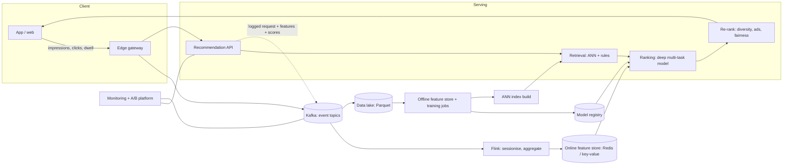
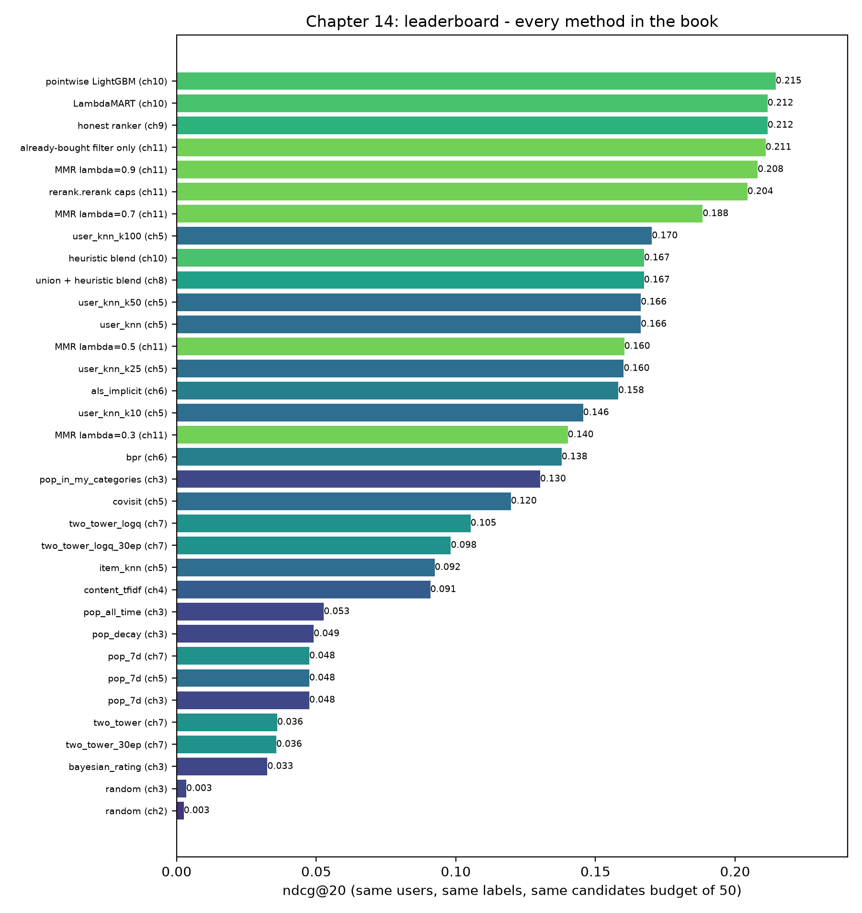

# From prototype to Shopee scale

It is 12:00 on 9.9, and a flash sale has just opened. Within a few seconds the number of people on the marketplace jumps to many times the usual lunchtime peak. Every one of them lands on a home feed, and every feed has to be different. The ranker that you trained in Chapter 10 is a few hundred kilobytes of trees. It was built from a single Postgres table, and it takes about 840 milliseconds to answer one request on a laptop. Nothing about it is wrong. It is the right size for a book and for a weekend of learning, and it is almost the right shape for a production system. But it was never designed to survive that noon.

Something else matters just as much. The sale does not only stress the servers. It changes the data. Shoppers who normally browse sneakers are suddenly hunting for discounted rice cookers. A model trained last week has never seen a flash-sale crowd, and its features say that yesterday's popular items are still the popular ones. Scale is not only about throughput. It is also about freshness, about measuring whether a change really helped, and about keeping many teams, many objectives and many models honest at the same time.

This final chapter is a map. We will not build a Kafka cluster or train a transformer. Instead we walk through, one by one, the pieces that a company at the size of Shopee adds around the core you already understand, and we say precisely which problem each piece solves. For every piece, we point back to the part of this repository that it would replace or extend. By the end you should be able to read an architecture diagram from a large marketplace and recognise every box as a bigger, sturdier version of something you have already run.

**What you'll learn**

- How streaming logs (Kafka) and stream processing (Flink) turn the batch `events` table into real-time features, and why that changes what "fresh" means.
- What a feature store is for, and how it prevents training/serving skew.
- Why approximate nearest neighbour (ANN) search is unavoidable at billions of items, and how to estimate its memory cost.
- How Wide & Deep, DCN, DIN and multi-task MMoE rankers differ from the gradient-boosted ranker in this repo, and when they are worth their cost.
- How to combine several objectives (GMV, ads, seller fairness) into one score without hiding the trade-offs.
- How to run an A/B test, including a complete two-proportion z-test and a sample-size calculation worked by hand.
- What to monitor once the system is live, how to budget latency, and a concrete checklist of what to build next in this repository.

## Intuition: the night market and the supermarket chain

Imagine a night-market stall that sells fried bananas. The owner knows every regular. She sees who walks up, remembers last week's order, adjusts the sugar when the weather turns, and decides on the spot what to recommend. That is our prototype. Everything fits in one head, which is the single Postgres database and the single Python process. The owner can try a new idea at lunch and know by dinner whether it worked.

Now imagine a national supermarket chain: hundreds of shops report sales through a stream of messages, a data team maintains one shared definition of "loyal customer", several teams run promotions, and finance insists that experiments are measured before a promotion goes national. The chain did not need a smarter owner. It needed *infrastructure for agreeing on facts, moving them quickly, and measuring change*.

That is the whole difference between our repository and a production marketplace. The ideas (candidates, features, ranking, re-ranking) survive intact. What multiplies is the plumbing around them. In the rest of the chapter we will keep asking the same three questions of every new component:

1. Which of the limits of the prototype does it remove: speed, freshness, scale, correctness, or the ability to experiment?
2. What new failure mode does it introduce?
3. Which file of this repository would it replace?

## The algorithm: the same pipeline, scaled out

Before the details, here is the whole picture. The multi-stage pipeline from Chapter 8 (retrieve, rank, re-rank) is unchanged. What changes is that every arrow in the diagram becomes a networked service with its own latency, capacity and owner.



*Figure: A Shopee-style architecture. The dashed edge is the most important one: serving logs what it showed, with the features and scores it used.*

Read the diagram from left to right. Behaviour flows from the app into a message queue. From there it takes two paths. The fast path (Flink into an online feature store) keeps features fresh to the second. The slow path (the data lake into training jobs) produces models and ANN indexes every few hours or days. Serving reads from both: the latest model and index from the slow path, the freshest user features from the fast path. And, crucially, serving writes back the *exposure log*, i.e. what it displayed, so that the next training run knows what the user actually saw.

In the prototype, the same loop exists but is shrunk to one machine. `useTracker.ts` is the client, the Rust `POST /api/events` route is the edge gateway, the Postgres `events` table is Kafka plus the data lake in one, `db.Store.refresh` is a stream consumer, `pipeline.train_and_evaluate` is the training job, and the `Recommend` RPC is the serving tier. When a question starts with "how would we scale this?", map the question onto this list first.

### Streaming logs and real-time features

In the prototype, Rust inserts one row per event into Postgres, and the Python service polls for rows newer than the last id it saw. This is simple and correct, and it works for a few hundred thousand rows. It breaks in three ways at scale:

- **Write throughput.** A single Postgres primary will not absorb millions of inserts per second, and event writes compete with orders and carts.
- **Fan-out.** The same event is wanted by many consumers: the feature pipeline, the ads system, fraud detection, the analytics warehouse. Polling a table makes every consumer a reader of the production database.
- **Replay.** When a bug is found in a feature definition, you need to re-process last month's events. A table that is also the system of record is a poor place for that.

The standard answer is a log-based message broker such as Apache Kafka. Producers append events to *topics*, which are split into *partitions*. Each consumer group tracks its own offset. Partitioning by `user_id` guarantees that all events of one user arrive in order at the same consumer, which is exactly what session logic needs. Because the log is retained for days, a new consumer can start from the beginning, and a fixed bug can be re-run over the old events.

A stream processor such as Apache Flink then computes features incrementally. Take the feature `user_clicks_30d` from Chapter 9. In SQL it is a `COUNT` over a window. In a streaming system it becomes a stateful operator: keep a small per-user state, add one for each click, subtract the click that has just left the 30-day window, and write the new value to the online store. The general shape is *event in, state update, feature out*:

$$
s_u^{(t+1)} = f\bigl(s_u^{(t)},\, e_{t+1}\bigr), \qquad x_u^{(t+1)} = g\bigl(s_u^{(t+1)}\bigr)
$$

Here $s_u$ is the state of user $u$, $e$ is a new event, $f$ updates the state, and $g$ turns the state into a feature value $x_u$. A decayed score such as the exponential decay of Chapter 3 is particularly pleasant in this form, because it can be updated in constant time: $s \leftarrow s \cdot 2^{-\Delta t / h} + w$, where $h$ is the half-life and $w$ the event weight.

Streaming adds subtleties: late, out-of-order events need event-time windows and watermarks, restarts must not double count, and computing a feature once in Flink and once in batch invites the skew discussed next.

### Feature stores and training/serving skew

Recall the leakage demo in Chapter 9. A feature that peeked at the future made the offline ndcg@20 look like 0.5035 instead of 0.2116, and the model was useless live. *Training/serving skew* is the quieter cousin of leakage: the feature is legitimate in both places, but it is computed differently. A common example: training reads `user_ctr_30d` from a SQL job that excludes bot traffic, while serving computes it in application code that does not. The model learned a relationship with one distribution and is queried with another. Offline metrics stay excellent. Online metrics quietly sag.

A *feature store* attacks the problem by making the feature definition a single, versioned artefact with two materialisations:

- an **offline store** (columnar files or a warehouse) that can answer "what was this feature's value for user $u$ *as of* time $t$?" for millions of training rows; and
- an **online store** (a low-latency key-value store) that answers "what is it now?" in a millisecond.

The same definition feeds both, so the numbers agree by construction. The offline half is where point-in-time correctness lives. It performs the "as-of join" that `data.History.at` performs in this repository: for each training row with timestamp $t$, take the latest feature value with timestamp $\le t$, never later. The sense in which this is the same idea as Chapter 9 is exact. The feature store simply industrialises it.

A second defence against skew is *logging the served features*. Instead of recomputing historical features for training, the serving layer writes the feature vector it actually used, together with the item's position and the model's score, into the exposure log (the dashed edge in the diagram). Training then learns from precisely what was served. This costs storage, but it eliminates an entire class of bugs, and it gives you the propensities you need for the position-bias corrections of Chapter 12.

### ANN at billions of items

Chapter 7 showed an IVF index probing clusters of item vectors. At 2,311 in-stock items, brute force took 0.140 ms per query, and the index was slower to build than it was useful. At a hundred million or a billion items the picture reverses. Take a back-of-the-envelope memory estimate. One billion items, each a 64-dimensional vector of 4-byte floats:

$$
10^9 \times 64 \times 4\ \text{bytes} = 2.56 \times 10^{11}\ \text{bytes} = 256\ \text{GB}.
$$

That does not fit comfortably on one machine, and scanning it per request is hopeless. Production systems therefore do three things at once.

First, **shard** the index. Each shard holds a slice of the catalogue, and a query fans out to all shards, which each return their local top results to be merged. Second, **compress** the vectors. *Product quantisation* splits a vector into sub-vectors and replaces each by the id of its nearest codeword. A 256-byte vector might become 16 bytes, shrinking the same index to $10^9 \times 16 = 16$ GB. Third, use a **graph or clustered index** (HNSW, IVF-PQ, or Google's ScaNN) so that each query touches only a tiny fraction of the vectors. The trade-off is exactly the one in the Chapter 7 table, where probing 4 of 32 clusters kept recall@20 at 0.975 of brute force while scanning 12.5% of the items. At scale you tune the same dial, only with a tighter latency target and a much larger catalogue.

Indexes are rebuilt, not edited, and the item tower must be re-run for the whole catalogue whenever the model changes, so model and index versions deploy as a pair.

::: fact
**Graph embeddings at web scale.** Pinterest's PinSage combined random walks with graph convolutions to learn embeddings of pins. It was trained on a graph with 3 billion nodes (pins and boards) and 18 billion edges, which its authors described as the largest application of deep graph embeddings to date at the time of publication.

Source: Ying et al., KDD, 2018
:::

### Deep rankers

Gradient-boosted trees are a superb ranker for a few dozen to a few hundred dense features, and the leaderboard at the end of this chapter shows how far they get on our simulated data. At a large marketplace, the ranker's inputs look different: billions of sparse ids (users, items, shops, queries), long behaviour sequences, and several outcomes to predict at once. Trees handle this poorly, because a tree cannot learn an embedding for an id it sees once a month. Neural rankers can. Here are the four families you will hear about most.

**Wide & Deep.** The Google Play team observed two complementary needs. *Memorisation*: learn that a specific pair, such as "installed app A and was shown app B", is strongly predictive. *Generalisation*: handle pairs never seen together before, by way of embeddings. Wide & Deep trains both jointly. The "wide" part is a linear model over sparse cross-product features. The "deep" part is an MLP over embeddings. Their outputs are summed into one logit:

$$
P(y=1 \mid \mathbf{x}) = \sigma\bigl(\mathbf{w}_{\text{wide}}^{\top}[\mathbf{x}, \phi(\mathbf{x})] + \mathbf{w}_{\text{deep}}^{\top} a^{(L)} + b\bigr)
$$

where $\phi(\mathbf{x})$ are the cross-product transformations and $a^{(L)}$ is the last hidden layer of the MLP. In our repository, the hand-built cross features of Chapter 9 (`uc_click_share_30d`, `price_ratio_to_user`) play the role of the wide part, built by an engineer and fed to a tree. In **DCN** (Deep & Cross Network), the crossing is learned: explicit cross layers multiply the input features with each other, layer after layer, so you stop hand-writing every interaction.

**DIN.** Alibaba's Deep Interest Network started from an observation about e-commerce. A user's history contains many interests, and only some matter for the item being scored. Compressing the whole history into one fixed vector wastes capacity. DIN adds a *local activation unit*: the user's history items are weighted by how relevant each is to the *candidate* item, so the same user gets a different interest vector when the candidate is a phone case than when it is a frying pan. In pseudo-formula:

$$
\mathbf{v}_u(a) = \sum_{j=1}^{H} w_j(a)\,\mathbf{e}_j, \qquad w_j(a) = \text{MLP}\bigl(\mathbf{e}_j,\ \mathbf{e}_a,\ \mathbf{e}_j \odot \mathbf{e}_a\bigr)
$$

Here $\mathbf{e}_j$ are the embeddings of the user's $H$ past items and $\mathbf{e}_a$ is the candidate's embedding. Compare this with the user tower of Chapter 7, which averaged the last 20 items with equal weights. DIN is that same idea, with the weights learned and conditioned on the candidate. Transformer-based sequence models, which are now common, generalise it further with self-attention.

**Multi-task MMoE.** A marketplace cares about at least three outcomes: click, add-to-cart and order. In this repository we squeeze them into one label (click is 1, cart 2, order 3) and train one LambdaMART model. That is cheap, but it hard-codes the trade-off and gives the model only a single, noisy target. A multi-task network predicts each outcome with its own *head* and shares the lower layers. The naive version, one shared trunk, suffers when tasks conflict: what makes a user click (an eye-catching picture) differs from what makes them buy. The *Multi-gate Mixture-of-Experts* design keeps several shared "expert" sub-networks and gives each task its own gate that decides how to mix them:

$$
y_k = h_k\Bigl(\sum_{i=1}^{n} g_k(\mathbf{x})_i \, f_i(\mathbf{x})\Bigr), \qquad g_k(\mathbf{x}) = \text{softmax}(W_{g_k}\,\mathbf{x})
$$

for task $k$, expert networks $f_i$, task head $h_k$, and a per-task gate $g_k$. If click and order are closely related, their gates will pick similar experts. If they conflict, the gates specialise. Because orders are rare compared with clicks (Chapter 1's funnel), the sparse `order` head also benefits from the representation that the dense `click` head learns. The production score then combines the heads, which brings us to the next topic.

::: fact
**Attention over user history.** Alibaba's Deep Interest Network (DIN) replaced the fixed-length user vector of the standard Embedding-and-MLP recipe with a local activation unit that weights the user's past behaviours by their relevance to the candidate ad. It was trained on an Alibaba production dataset of over 2 billion samples and deployed in Alibaba's online display advertising system, serving the main traffic.

Source: Zhou et al., KDD, 2018
:::

::: fact
**Wide & Deep in an app store.** Google's Wide & Deep paper jointly trained a linear model (memorisation) and a deep network (generalisation), and evaluated it on Google Play, a commercial app store with over one billion active users and over one million apps. Online experiments showed that it significantly increased app acquisitions compared with wide-only and deep-only models.

Source: Cheng et al., DLRS Workshop, 2016
:::

### Multi-objective ranking: GMV, ads and sellers

Once the ranker emits $\hat{p}_{\text{click}}$, $\hat{p}_{\text{cart}}$ and $\hat{p}_{\text{order}}$ separately, someone must decide how to blend them. The simplest form is a weighted sum, often with a business term for margin or for sponsored placements:

$$
\text{score}(u, i) = \Bigl(w_1\,\hat{p}_{\text{click}} + w_2\,\hat{p}_{\text{cart}} + w_3\,\hat{p}_{\text{order}}\Bigr)\cdot \bigl(1 + \beta_{\text{boost}}(i)\bigr) + \lambda_{\text{ads}}\,\text{bid}(i)\,\hat{p}_{\text{click}}
$$

The weights are not learned from clicks. They are policy. Raising $w_3$ favours GMV (gross merchandise value), and raising $\lambda_{\text{ads}}$ favours advertising revenue. The boost $\beta_{\text{boost}}(i)$ encodes campaign rules, such as a shop-level subsidy for a mall brand during a sale. This is the same structure as the re-ranking rules of Chapter 11, promoted from "caps in a Python function" to a formal part of the objective, and a good production system is explicit about it. Everyone can read the weights, argue about them, and see them in the experiment configuration. The danger is hidden coupling: a ranker trained to predict orders and then re-weighted by margin may chase expensive items that rarely convert.

Seller fairness enters in two ways. As a **constraint**, it is like the repository's cap of 4 items per shop in `rerank.rerank`. As an **objective**, you give new or small sellers a controlled amount of exposure, because a marketplace that only ever shows incumbent shops starves its own supply side. This is the exploration idea from Chapter 11 and Chapter 12, applied to sellers instead of items. Whatever you choose, *measure it separately*. Track seller-side metrics (share of exposure to shops under 30 days old, concentration across shops) next to buyer-side metrics in every experiment, and treat a drop in either as a cost.

::: fact
**Multi-task learning for recommenders.** The MMoE paper adapted the Mixture-of-Experts structure to multi-task learning by sharing expert sub-models across all tasks while giving each task its own gating network. The authors showed that it performs better than baselines when tasks are less related, and demonstrated improvements on a large-scale content recommendation system at Google.

Source: Ma et al., KDD, 2018
:::

### A/B testing, with the arithmetic

Every number in the leaderboard below is *offline*. It is computed from logs of what users did under a previous system. Offline metrics rank candidate models cheaply, but they cannot settle whether a model helps real users, for the reasons from Chapters 2 and 12: logged data reflects the old system's choices, position bias is baked in, and our metrics ignore diversity and revenue. The final arbiter is an **A/B test**: randomly assign users to control (the current system) or treatment (the new one), wait, and compare a business metric.

The mechanics follow a fixed recipe:

1. Choose a *primary metric* (say, order conversion per user) and *guardrail metrics* (latency, seller-side exposure, return rate) before launch.
2. Compute the required sample size from the smallest effect you care about.
3. Randomise **by user**, with a stable hash, so that one user always sees one variant.
4. Check the assignment itself. If you intended a 50/50 split and observe 50.6/49.4 on millions of users, something is broken (a *sample ratio mismatch*), and the results cannot be trusted.
5. Run for full weekly cycles, then test the difference.

Here is a complete worked example. **Every number below is hypothetical**, invented to show the working. They are not outputs of this repository's scripts.

Suppose each variant receives $n = 100{,}000$ users. In control, 8,000 users place an order, giving $\hat{p}_C = 0.0800$. In treatment, 8,240 do, giving $\hat{p}_T = 0.0824$. The observed absolute lift is $0.0824 - 0.0800 = 0.0024$, a relative lift of 3%. Is it real or noise?

The two-proportion z-test starts from the null hypothesis that both variants have the same underlying rate. Under that hypothesis, the best estimate of the shared rate is the pooled proportion:

$$
\hat{p} = \frac{x_C + x_T}{n_C + n_T} = \frac{8000 + 8240}{200000} = 0.0812
$$

The standard error of the difference, under the null, is

$$
\text{SE} = \sqrt{\hat{p}(1-\hat{p})\left(\frac{1}{n_C}+\frac{1}{n_T}\right)} = \sqrt{0.0812 \times 0.9188 \times \frac{2}{100000}} \approx 0.001222
$$

The test statistic counts how many standard errors the observed difference is from zero:

$$
z = \frac{\hat{p}_T - \hat{p}_C}{\text{SE}} = \frac{0.0024}{0.001222} \approx 1.965
$$

For a two-sided test, the p-value is $2\,(1 - \Phi(1.965)) \approx 0.0494$, where $\Phi$ is the standard normal CDF. At the conventional $\alpha = 0.05$ this just clears the threshold. The 95% confidence interval for the difference (using the unpooled standard error, also about 0.001222) is roughly $[0.000006,\ 0.004794]$: it barely excludes zero, so the true lift could be anywhere from essentially nothing to 6% relative. That is the honest reading. "Significant" here means "we cannot comfortably rule out zero", not "the lift is 3%". If you had peeked at the dashboard daily and stopped the first time $p < 0.05$, your real false-positive rate would be far higher than 5%. The significance level assumes a single, pre-planned look.

How many users would we have needed? For a target absolute effect $\delta$ at significance $\alpha$ and power $1 - \beta$, the per-variant sample size is approximately

$$
n \approx \frac{2\,(z_{\alpha/2} + z_{\beta})^2\; p(1-p)}{\delta^2}
$$

With $p = 0.08$, $\delta = 0.0024$, $z_{\alpha/2} = 1.96$ and $z_{\beta} = 0.8416$ (80% power):

$$
n \approx \frac{2 \times (2.8016)^2 \times 0.08 \times 0.92}{0.0024^2} = \frac{2 \times 7.849 \times 0.0736}{0.00000576} \approx 200{,}600
$$

So about 200,600 users per variant, roughly twice what we ran. Our hypothetical test was *underpowered* for a 3% relative lift, which is why it landed on the boundary. Because the required $n$ grows with $1/\delta^2$, halving the effect you want to detect quadruples the traffic you need. This is why large companies obsess over variance-reduction techniques, and why testing many small tweaks at once requires care.

### Monitoring and drift

A deployed recommender can fail silently. The service keeps returning 200 OK with twenty perfectly formatted items, while quality decays. The usual causes are:

- **Data drift:** inputs change, for example a new app version stops sending `dwell_sec`.
- **Concept drift:** the feature-outcome relationship changes after a holiday.
- **Feedback loops:** the model only learns about items it showed (Chapter 12).
- **Pipeline breakage:** a late stream, a stale feature, an index that did not rebuild.

Each has a monitor. For data drift, compare the distribution of each feature in the last hour against the training distribution with a simple statistic such as the *population stability index* or a Kolmogorov–Smirnov test, and alert when the share of missing values changes. For the model, watch the distribution of predicted scores, because a sudden shift is a cheap proxy for broken inputs. For outcomes, track online CTR and conversion by position and by user activity bucket, as Chapter 12 did offline, and compare against a small **holdout**: a few percent of users who always receive a simple baseline. The holdout is your honest ruler, because it tells you whether the whole recommender is still beating popularity, which our leaderboard says is a 4x gap at least (pop_7d scores 0.048, the ranker 0.215). Finally, monitor *freshness* itself: the age of the newest event visible to the ranker, and the age of the index. In this repository, the equivalent of a freshness alert would be comparing `max(ts)` in the `events` table with the latest event seen by `Store.refresh`.

### Latency budgets

A request is a chain of calls, so a page budget (say 300 ms at p99) is sliced across stages: gateway and auth, user-feature fetch, retrieval, feature assembly, ranking, re-ranking, hydration and network. Three principles make budgets work. First, **tails dominate**: a page that fans out to ten services is as slow as the slowest, so p99 matters more than the median. Our own result shows it at small scale: server p50 839.9 ms, p99 985.0 ms, maximum 1010.6 ms. Second, **degrade rather than fail**: every stage needs a deadline and a cheaper fallback, which is why `GET /api/recommendations` returns a popularity list with `fallback: true` after a 5 second timeout. Third, **cache what is shared**: item-level statistics change slowly and can be computed once for all users.

## Code walkthrough: pseudo-code for the missing pieces

There is no included repository code here, because none of these components exist in the repository yet. The sketch below is pseudo-code: the business blend from the multi-objective section. Compare the serving flow with `RecommenderService.Recommend`: it has the same shape, plus a user-tower retriever, batch feature-store lookups, several task heads and an exposure log written at the end.

```python
# Pseudo-code: blending task heads into one score.
def final_score(p, cands, w=(1.0, 2.0, 3.0), ads_weight=0.0):
    base  = w[0]*p["click"] + w[1]*p["cart"] + w[2]*p["order"]
    boost = np.array([c.campaign_boost for c in cands])   # e.g. 0.1 in a sale
    ads   = ads_weight * np.array([c.bid for c in cands]) * p["click"]
    return base * (1.0 + boost) + ads
```

The weights `(1.0, 2.0, 3.0)` echo the label scheme of this book (click 1, cart 2, order 3) but are now *explicit and tunable*.

## Run it: the book's leaderboard

The chapter's figure aggregates every method evaluated in this book on the same simulated users, the same labels and the same 7-day evaluation window. Regenerate it, and the headline comparison it summarises, with:

```bash
cd book
uv run python tools/make_figures.py ch14
```

The figure reads `results/*.json` from every companion script. Its top three rows come from the comparison in Chapter 10, which looks like this:

```output
file: results/ch10_ltr.txt
lines: 2-9
```

The heuristic blend, the pointwise model and LambdaMART are all ordering the *same* candidates, whose recall ceiling is 0.4645. That ceiling is why even the best ranker reaches only a modest recall@20.

## Results: reading the leaderboard



The chart tells the story of the whole book in one picture, and it is worth reading from the bottom up.

**Random and rating-only baselines** (0.003 and 0.033) are the floor. A Bayesian-average rating alone, with no notion of what people actually buy, scores barely above chance. The popularity family lands around 0.048 to 0.053. Windowed 7-day popularity, all-time popularity and the decayed version are nearly indistinguishable, which is the honest outcome that Chapter 3 reported.

**Content and collaborative models** climb into the 0.09 to 0.17 range. TF-IDF content filtering reaches 0.091, item-kNN 0.092, ALS 0.158, and user-kNN with 100 neighbours 0.170. The family of personalised retrievers roughly triples the popularity baseline. Notice that the simple co-visitation retriever (0.120) is already stronger than the best two-tower model (0.105), and that the two-tower model only got there after the logQ correction of Chapter 7: the uncorrected run scored 0.036. A neural model is not automatically better. It needs the right loss, and on 2,495 items it has little room to shine.

**The multi-stage system** occupies the top of the chart. The heuristic blend over the union of candidate sources scores 0.167. Learned rankers over the same candidates reach 0.212 (LambdaMART) and 0.215 (pointwise LightGBM). The honest leakage-free ranker of Chapter 9 (0.212) sits on the same level, while its leaky twin from the same chapter scored 0.5035, which is why it is deliberately absent from the ranking: it is a bug, not a method. The ordering of the green bars is a reminder of two earlier lessons: the gap between the two ranker objectives is about one seed standard deviation (Chapter 10), and the rows for MMR with $\lambda$ below 1 *lose* ndcg in exchange for diversity (Chapter 11).

Two cautions apply to every conclusion drawn from this chart. First, the data is simulated, and its hidden preference model is simpler than the real world. The *ordering* of methods transfers better than the absolute values. Second, these are offline numbers on a single weekly split. They justify trying a method in a real A/B test. They never replace the test.


The screenshot above is the "The model" panel of `/how-it-works`: the model version, events loaded and top features by gain share. At scale it becomes a model registry with history across versions.

## Pitfalls and how it is done in production

**Adding scale before you need it.** Copying a big-company architecture for a small problem adds operational burden and new outages. If your events fit in one database and the model retrains in minutes, the prototype design is right; migrate on a concrete bottleneck.

**Deep models without a strong baseline.** Keep the boosted-tree ranker as benchmark and fallback; ship the deep model only if it wins online by enough to justify its cost.

### What to build next in this repository

If you want to carry this project forward, here is a prioritised checklist. Each item is small enough for a weekend and teaches one idea from this chapter.

1. **Cache item-level frames and filter events per user.** The profile in Chapter 13 splits the request into two costs: item-level frames (`item_features`, `covisitation_matrix`) recomputed on every call, and user-side aggregations computed over every user's events although only one user asked, the larger share. Cache the item-level frames for a short TTL, keyed on the cache time, and filter events to the requesting user before the user-side aggregations. Measure after each part; neither alone removes the cost.
2. **Log the exposure.** Make `Recommend` write a row per displayed item (request id, model version, rank, score, features). Train on exposure instead of reconstructing it, and use it for propensity weighting.
3. **Add a holdout and a mini A/B framework.** Hash `user_id` into buckets; send 5% to the popularity fallback; log the bucket on every event; build a page that applies the z-test from this chapter to order conversion.
4. **Split the label into heads.** Train separate click, cart and order models (three LightGBM models are enough), expose the blend weights in configuration, and compare against the single graded label.
5. **Replace the poller with a queue.** Have Rust publish events to a broker, and have `Store` consume from it. Keep Postgres as the system of record. This is the smallest honest step towards the streaming architecture.
6. **Add a drift monitor.** Implement a drift check (for example the population stability index) for the top 15 features by importance and surface it on the `/how-it-works` page.
7. **Add the two-tower retriever as a fifth source.** Use the item index from Chapter 7 with the logQ correction, and check with the Chapter 8 script that it raises union recall before you pay for it in latency.
8. **Protect new sellers.** Add an exposure floor for shops listed in the last 7 days and measure its cost in ndcg, as Chapter 11 did for diversity.

::: tip
Do the checklist in order. Items 1 to 3 give you the *measurement* machinery (speed, logs, experiments). Without them you cannot tell whether items 4 to 8 helped.
:::

::: fact
**Real-time training in production.** ByteDance's Monolith system argues that general-purpose frameworks separate batch training from serving and so cannot learn from customer feedback in real time. It introduces a collisionless embedding table (with expirable embeddings and frequency filtering to limit memory) and an online-training architecture, and it has been deployed in BytePlus Recommend.

Source: Liu et al., arXiv, 2022
:::

## Summary

- Scaling a recommender keeps the pipeline (retrieve, rank, re-rank) and replaces each arrow with a service: events go through a log such as Kafka, and streaming jobs keep features fresh.
- A feature store defines each feature once, with an offline as-of materialisation for training and an online one for serving, which prevents training/serving skew. Logging the served features is the second defence.
- At a billion items you shard, compress (product quantisation) and use ANN indexes; a 64-dimensional float32 index is 256 GB before compression, so memory arithmetic drives the design.
- Deep rankers add what trees cannot: embeddings for sparse ids (Wide & Deep, DCN), candidate-aware attention over history (DIN), and several heads for click, cart and order (MMoE).
- Blending heads into one score is a policy decision: make the weights, ads terms and seller-fairness rules explicit and measure them separately.
- An A/B test needs a pre-declared metric, a sample size computed in advance, a sample-ratio check and a single planned look. The worked example showed how a hypothetical $z \approx 1.965$ is only borderline significant, and why about 200,600 users per variant were needed.
- Monitor feature drift, score distributions, outcomes by position and activity, and freshness, against a holdout. Budget latency by the p99, give every stage a deadline and a fallback.
- The leaderboard says what this book found offline: personalised retrieval beats popularity, and a learned ranker over multi-source candidates beats everything else. A live experiment decides whether the gain is real.

## Quiz

**Q14.1** Training/serving skew most directly arises when:

A. The training set is larger than the serving set.
B. A feature is computed by different code or filters at training time and at serving time.
C. The model is retrained too often.
D. The ANN index returns approximate results.

**Q14.2** What does the *local activation unit* of DIN do?

A. It compresses the whole user history into one fixed-length vector regardless of the candidate.
B. It weights the user's past behaviours by their relevance to the specific candidate item being scored.
C. It selects which retrieval source to use for each user.
D. It removes position bias from training labels.

**Q14.3** In a multi-gate mixture-of-experts (MMoE) model, what is the purpose of a separate gate per task?

A. To let each task (click, cart, order) choose its own weighted combination of shared experts.
B. To train each task on a different dataset.
C. To guarantee that all tasks have equal loss.
D. To cache predictions between tasks.

**Q14.4** In the latency result of Chapter 13, the server p50 is 839.9 ms and the p99 is 985.0 ms. Why do production teams budget for p99 rather than p50, and what does this repository do when a request is too slow?

**Q14.5** Explain why a better position on the offline leaderboard does not by itself justify shipping a model. Use the leaky ranker (ndcg@20 0.5035 against 0.2116 for the honest one) as one of your examples, and name one other reason.

**Q14.6** A hypothetical A/B test sends 50,000 users to each variant. Control has 5,000 orders and treatment has 5,150. Compute the pooled proportion, the standard error, the z statistic, and decide at $\alpha = 0.05$ (two-sided) whether the lift is significant. (The two-sided p-value for $z = 1.57$ is about 0.116.)

**Q14.7** A catalogue has 2 billion items. Each item vector has 128 dimensions stored as 2-byte half-precision floats. How many GB does the raw index need? If product quantisation compresses each vector to 32 bytes, how many GB is the compressed index?

**Q14.8** Read the `final_score` sketch in the chapter, with `w=(1.0, 2.0, 3.0)`, `ads_weight=0.0`. An item has `p_click = 0.2`, `p_cart = 0.05`, `p_order = 0.01` and `campaign_boost = 0.1`. What is its final score? What would the score be if the campaign boost were 0?

**Q14.9** You plan a 50/50 A/B test and, after a day, observe 50.6% of users in control and 49.4% in treatment, out of several million users. What does this suggest, and should you read the conversion results?

A. It is expected noise; read the results.
B. It is a sample ratio mismatch, suggesting a bug in randomisation or logging; investigate before trusting any result.
C. It proves the treatment reduces traffic.
D. It means the sample size is too small.

**Q14.10** *Hands-on.* Open `book/code/ch11_rerank.py` and add `0.8` to the `LAMBDAS` list (between 0.9 and 0.7). Run it from `book/` with `uv run python code/ch11_rerank.py`. State what you expect to observe for the new row's ndcg@20 and distinct categories relative to the 0.9 and 0.7 rows, then check it, and say whether this supports the claim in this chapter that diversity must be paid for in relevance.
