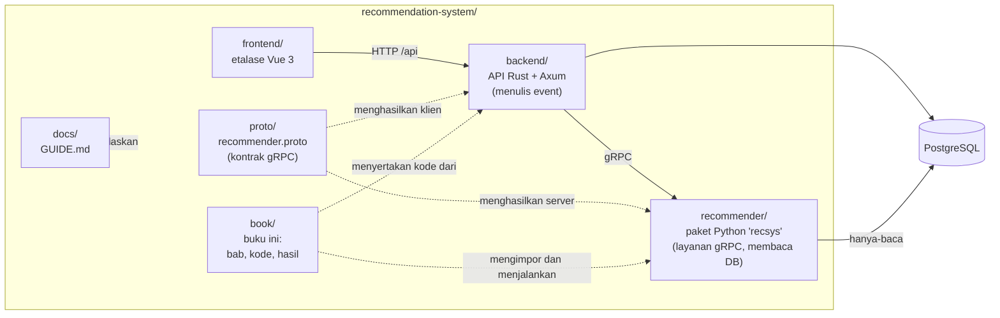
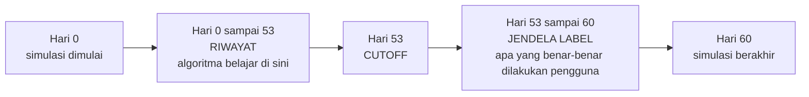

# Kata Pengantar

Buka aplikasi Shopee pada Selasa malam. Sebelum Anda mengetik satu huruf pun, layar beranda sudah menampilkan empat puluh produk: casing untuk ponsel yang Anda beli bulan lalu, makanan kucing karena minggu lalu Anda menjelajahi produk hewan peliharaan, dan sebuah ketel listrik *flash sale*. Tidak ada orang yang menyusun slot-slot itu dengan tangan. Sebuah *pipeline* menelusuri jutaan produk, membuang hampir semuanya dalam hitungan milidetik, menilai yang tersisa, lalu mengacak urutan para pemenangnya agar halaman tidak tampak seperti tembok berisi casing ponsel yang seragam.

*Pipeline* itu adalah **sistem rekomendasi** (*recommender system*). Buku ini mengajarkan cara kerjanya dengan membangun satu: mula-mula daftar item paling populer, lalu, bab demi bab, setiap gagasan yang mengubah daftar itu menjadi sistem multi-tahap modern.

## Buku ini untuk siapa

Buku ini ditulis untuk **software engineer tingkat menengah**: Anda nyaman membaca Python, mengenal REST dan SQL, dan pernah merilis kode ke produksi. Latar belakang *machine learning* tidak diperlukan; setiap bagian matematika dijelaskan saat pertama kali muncul dan dipakai pada contoh kecil yang dihitung dengan tangan. Semuanya berjalan di laptop dalam hitungan menit, tanpa GPU.

Dua janji membentuk seluruh isi buku ini:

1. **Setiap algoritma dijelaskan selangkah demi selangkah.** Anda akan melihat intuisi, rumus, contoh hitungan, lalu kode sungguhan yang mengimplementasikannya.
2. **Setiap angka dalam teks berasal dari program yang bisa Anda jalankan.** Tidak ada hasil dalam buku ini yang diketik tangan. Setiap bab punya skrip pendamping; keluarannya ditempel ke buku langsung dari berkas yang ditangkap saat skrip dijalankan. Jika Anda menjalankan ulang skripnya, Anda akan mendapat angka yang sama, karena semua *random seed* dikunci.

## Bentuk buku ini

Buku ini mengikuti jalur historis dan praktis bidangnya. Setiap bab menambahkan perangkat baru hanya setelah pendekatan sebelumnya menunjukkan batasnya pada data yang sama.

- **Fondasi (Bab 1–2).** Masalahnya, datanya, dan penggarisnya: precision, recall, NDCG, dan evaluasi berbasis waktu.
- **Recommender model tunggal (Bab 3–7).** Popularitas, *content-based filtering*, *collaborative filtering*, faktorisasi matriks, serta *embedding* dengan *retrieval* dua menara (*two-tower*).
- **Sistem multi-tahap (Bab 8–12).** Marketplace sungguhan menjalankan sebuah corong (*funnel*): tahap murah mengambil beberapa ratus **kandidat** (*candidate*), tahap presisi **memeringkat** (*rank*) kandidat itu, dan tahap akhir **memeringkat ulang** (*re-rank*) demi keberagaman dan aturan bisnis. Bab-bab ini membahas pembangkitan kandidat, rekayasa fitur, *learning to rank*, *re-ranking*, serta *cold start*, konteks, dan bias.
- **Produksi (Bab 13–14).** Sebuah aplikasi Vue, Rust, Postgres, dan Python gRPC yang berjalan, tempat Anda mengikuti satu klik dari ujung ke ujung, lalu apa yang berubah pada puluhan juta pengguna.

Lampiran berisi jawaban kuis, glosarium, perintah reproduksi, dan daftar pustaka.

## Isi repositori

Buku ini berada di dalam repositori sebuah proyek lengkap yang berjalan. Repositori itu berisi buku, kode yang diajarkan buku, dan aplikasi yang memakainya.



*Gambar: Gambaran repositori sekilas. Panah penuh adalah pemanggilan saat runtime; panah putus-putus adalah hubungan saat build atau dokumentasi.*

Setiap direktori punya satu tugas:

| Direktori | Isinya | Kemunculannya dalam buku |
|---|---|---|
| `recommender/` | Paket Python `recsys`: simulator marketplace, *retriever* kandidat, pembangun fitur, ranker LightGBM, re-ranker, dan layanan gRPC | Bab 1–3 dan 8–13 |
| `book/code/` | Satu skrip pendamping per bab algoritma, ditambah `common.py` yang dipakai bersama | Setiap bab |
| `book/results/` | Keluaran (`.txt`) dan metrik (`.json`) hasil tangkapan skrip-skrip itu | Setiap blok `output` |
| `backend/` | API Rust dan Axum: autentikasi, katalog, keranjang, *checkout*, pencatatan event, klien gRPC | Bab 13 |
| `frontend/` | Etalase Vue 3 dengan penjelasan "Why this?" dan log event langsung | Bab 13 |
| `proto/` | `recommender.proto`, satu berkas yang mendefinisikan kontrak antara Rust dan Python | Bab 13 |
| `docs/` | `GUIDE.md`, panduan berbahasa sederhana tentang aplikasi yang berjalan | Bab 13 |
| `book/` | Bab, grafik, tangkapan layar, dan perangkat build untuk PDF yang sedang Anda baca | – |

Dua keputusan desain muncul berulang kali. **Rust menulis semua perilaku pengguna ke Postgres; Python hanya membacanya**, lewat koneksi hanya-baca. Dan **rekomendasi dihitung saat diminta**, sehingga klik lima detik lalu sudah bisa mengubah beranda, sementara model dilatih ulang secara berkala.

## Persiapan

Anda bisa membaca buku ini tanpa menjalankan apa pun, tetapi Anda akan belajar lebih banyak jika mengubah satu angka dan melihat apa yang terjadi.

### Yang Anda butuhkan

| Perangkat | Kegunaan |
|---|---|
| [`uv`](https://docs.astral.sh/uv/) | Lingkungan Python untuk `recommender/` dan `book/` |
| Node.js dan `npm` | Frontend Vue, serta pustaka `mermaid` dan `katex` yang dipakai merender diagram dan matematika di PDF |
| PostgreSQL | Hanya untuk aplikasi langsung di Bab 13. Berjalan di `localhost:5432`, user `postgres`, password `postgres` |
| Rust toolchain (`cargo`) | Hanya untuk backend |
| `protoc` | Hanya untuk mengompilasi kontrak gRPC bagi Rust |

Bab algoritma (1–12) **hanya membutuhkan `uv`**. Postgres, Rust, dan Node baru diperlukan saat Anda ingin menjalankan aplikasi web lengkap.

### Skrip pendamping dan perangkat build buku

*Clone* repositori, lalu dari root repositori jalankan:

```bash
cd book && uv sync && uv run playwright install chromium && npm i
```

`uv sync` memasang dependensi Python, termasuk paket `recsys` dari `../recommender` dalam mode *editable*, sehingga skrip mengimpor kode yang sama dengan yang ditampilkan bab. Langkah `playwright install` mengunduh Chromium *headless*, yang dipakai untuk merender PDF sekaligus mengambil tangkapan layar. `npm i` mengunduh `mermaid` dan `katex`.

Setiap skrip pendamping dijalankan dari direktori `book/`:

```bash
uv run python code/ch01_explore.py
```

Untuk membuat ulang semua berkas hasil secara berurutan, gunakan `uv run python tools/run_all.py`. Lampiran C mencantumkan semua perintah, termasuk yang membangun ulang grafik dan PDF.

### Aplikasi web

Untuk Bab 13 Anda memerlukan ketiga layanan berjalan. Petunjuk langkah demi langkah yang otoritatif ada di `docs/GUIDE.md`, bagian "Run it". Garis besarnya:

1. Buat basis data dan terapkan skemanya: `createdb marketplace`, salin `backend/.env.example` ke `backend/.env`, lalu `cargo run -- migrate` di dalam `backend/`.
2. Isi basis data dengan marketplace simulasi: `uv run recsys seed-db --yes` di dalam `recommender/`.
3. Buka tiga terminal: `uv run recsys serve` (Python, port 50051), `cargo run` (Rust, port 8080), dan `npm run dev` (Vue, port 5173).

Lalu buka `http://localhost:5173`. Data seed menyertakan akun demo seperti `user43@demo.test` dengan password `password`; halaman login mencantumkan akun lainnya.

## Contoh berjalan: marketplace simulasi

Log marketplace asli bersifat privat, dan dataset publik tidak memuat posisi, durasi tinggal (*dwell time*), dan stok, sehingga buku ini memakai **marketplace simulasi** yang disertakan dalam repositori. Karena kita sendiri yang menulis simulatornya, kita juga tahu kebenaran tersembunyi di balik perilaku itu, yang dipakai Bab 1 untuk menunjukkan bagaimana data log memelintir apa yang sebenarnya diinginkan pengguna.

Simulasi bawaan, yang dikonfigurasi di `recommender/recsys/simulate.py`, memiliki 1,500 pengguna, 2,500 item, 150 toko, dan 60 hari aktivitas, dengan *seed* tetap. Skrip Bab 1 mengonfirmasi ukuran tabelnya:

```output
file: results/ch01_explore.txt
lines: 2-9
```

Selain ukurannya, simulator mereproduksi pola-pola yang membuat rekomendasi menarik:

- **Popularitas timpang.** Sebagian kecil item menarik sebagian besar interaksi (*long tail*), persis seperti di toko sungguhan.
- **Selera bersifat personal.** Setiap pengguna punya preferensi tersembunyi terhadap kategori, rentang harga, dan merek.
- **Waktu berpengaruh.** Lalu lintas lebih tinggi pada akhir pekan dan sekitar tanggal gajian (tanggal 25 hingga tanggal 1 setiap bulan), dan jendela simulasi memuat **mega-sale 9.9**, hari saat lalu lintas dan pesanan melonjak. Bab 1 mengukur dan membuat grafik efek-efek ini.
- **Perilaku berbentuk corong.** Pengguna melihat *impression*, sebagian menjadi *click*, lebih sedikit menjadi *add-to-cart*, lebih sedikit lagi menjadi *order*. Beberapa item di-*hide* dan beberapa pembelian di-*return*.
- **Stok habis dan item baru muncul.** Penjual mendaftarkan produk selama jendela simulasi dan sebagian terjual habis, yang menciptakan masalah *cold start* dan ketersediaan di Bab 12.

### Satu pembagian waktu untuk seluruh buku

Konvensi terpenting dalam buku ini adalah satu titik waktu tetap bernama **cutoff**. Marketplace simulasi mencakup 60 hari. Kita memilih **hari ke-53 sebagai cutoff** dan menerapkan satu aturan di mana-mana:

> Setiap algoritma boleh belajar dari, dan menghitung fitur dari, event yang terjadi **sebelum** cutoff. Algoritma itu lalu dinilai berdasarkan apa yang benar-benar dilakukan pengguna dalam **7 hari setelahnya**.



*Gambar: Pembagian waktu yang dipakai setiap skrip pendamping. Tidak ada data dari jendela label yang pernah terlihat saat pelatihan atau pembangunan fitur.*

Berkas bersama `book/code/common.py` menegakkan pembagian ini dan menyediakan satu fungsi `evaluate`, sehingga angka-angka dapat dibandingkan antarbab.

## Bagaimana setiap bab disusun

Bab 1 sampai 14 mengikuti templat yang sama, sehingga Anda selalu tahu posisi Anda:

1. **Cerita pembuka** dengan skenario ala Shopee, dan daftar singkat hal yang akan Anda pelajari.
2. **Intuisi**, memakai analogi sehari-hari sebelum rumus apa pun.
3. **Algoritma**: rumus, langkah bernomor, dan contoh hitungan yang cukup kecil untuk dikerjakan dengan pensil.
4. **Penelusuran kode**: kode sungguhan dari repositori, dijelaskan bagian demi bagian.
5. **Jalankan**: perintah untuk dieksekusi beserta keluaran hasil tangkapannya.
6. **Hasil**: grafik dan interpretasi yang terkait dengan angka sebenarnya.
7. **Jebakan dan praktik produksi**: apa yang bisa salah, dan bagaimana sistem besar menanganinya.
8. **Ringkasan** dan **Kuis**.

### Konvensi visual dan tipografi

Kode diambil langsung dari berkas repositori, dan blok keluaran disalin dari berkas hasil yang ditangkap. Setiap angka dalam paragraf juga muncul di blok keluaran atau berkas JSON di bawah `book/results/`. Matematika sebaris tampak seperti $a \cdot b$; Bab 2 membangun NDCG dari nol. Angka ditulis dengan titik desimal, sama seperti pada keluaran program.

Empat jenis kotak callout menyela teks. Tampilannya di PDF seperti berikut:

**Kotak "Tahukah kamu?"** (biru) memuat fakta yang dapat diverifikasi dari literatur riset atau sejarah bidang ini, dengan sumbernya disebut di bagian bawah kotak dan tercantum dalam daftar pustaka. Setiap bab memiliki sedikitnya dua.

::: tip
**Tip** adalah pintasan praktis atau kebiasaan yang akan menghemat waktu Anda.
:::

::: warning
**Peringatan** menandai kesalahan yang mudah dibuat dan mahal untuk ditemukan, seperti mengevaluasi pada data yang sudah pernah dilihat model.
:::

::: try
**Kotak "Coba sendiri"** menyarankan eksperimen kecil: ubah satu parameter di sebuah skrip, jalankan ulang, dan bandingkan. Inilah cara terbaik mengubah bacaan menjadi pemahaman.
:::

Terakhir, setiap bab ditutup dengan **kuis** berisi delapan sampai sepuluh soal: pilihan ganda, jawaban singkat, satu soal membaca kode, satu soal hitungan, dan satu latihan praktik yang memodifikasi skrip pendamping. Jawaban beserta penjelasan singkat ada di Lampiran A. Cobalah menjawab sebelum melihatnya; usaha mengingat kembali sebuah jawaban inilah yang membuatnya melekat.

## Catatan tentang skala

Saat kami menjelaskan cara kerja platform besar, kami mengandalkan makalah yang telah dipublikasikan dan tidak mengarang angka internal. Ketika metode sederhana mengalahkan yang lebih canggih pada dataset ini, buku ini mengatakannya dan menjelaskan alasannya.

Dengan peta di tangan, bukalah halaman berikutnya. Bab 1 dimulai dari tempat setiap proyek rekomendasi dimulai: dari data, dan dari tinjauan jujur tentang apa yang bisa dan tidak bisa dikatakannya kepada kita.
