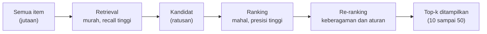
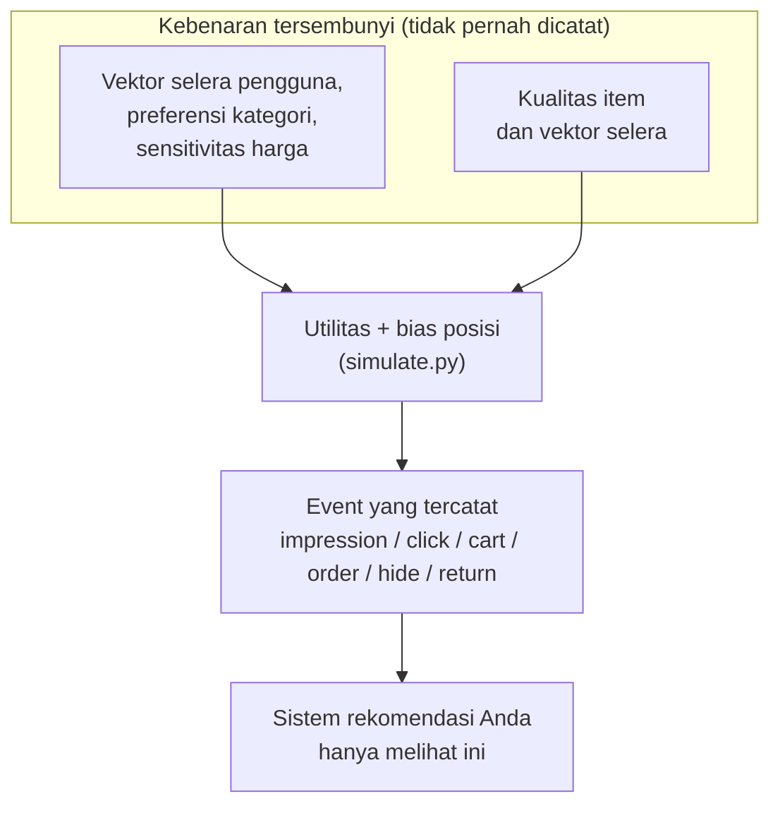
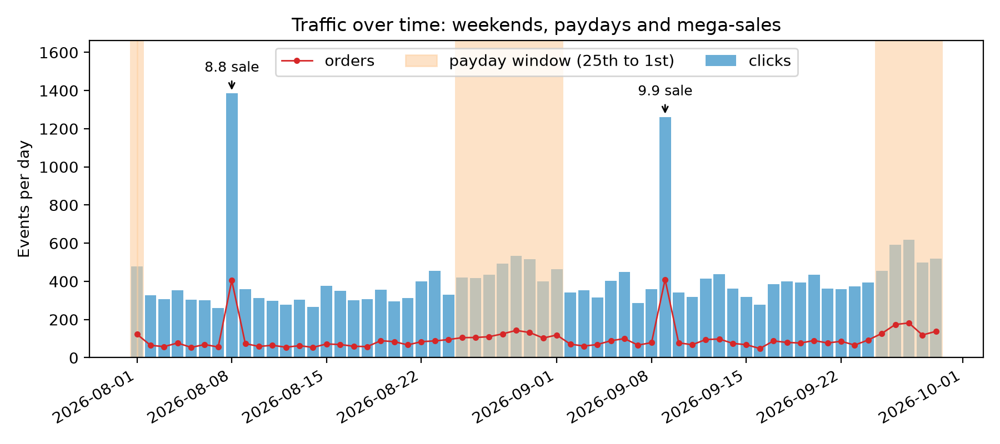

# Apa yang Dilakukan Sistem Rekomendasi

## Masalah Senin pagi

Pukul 08.55 hari Senin, Rina, seorang *product manager* di sebuah marketplace yang tidak jauh berbeda dari Shopee, menatap dasbornya. Platformnya memajang jutaan produk. Para pembelinya membuka aplikasi, menggulir layar selama sembilan puluh detik, lalu pergi. Sebagian pergi dengan puas, membawa casing ponsel di keranjang. Sebagian besar pergi dengan tangan kosong, karena barang yang sebenarnya akan mereka sukai berada di urutan ke-48,213 dalam daftar yang tidak pernah digulir siapa pun sampai sejauh itu.

Kepala engineering-nya mengucapkan kalimat yang membuka setiap proyek sistem rekomendasi: "Kita perlu menampilkan hal yang tepat untuk setiap orang." Rina mengajukan pertanyaan yang benar-benar penting: *apa yang dimaksud "hal-hal" itu, siapa "orang" itu, dan bagaimana kita tahu bahwa kita sudah benar?* Bab ini menjawab pertanyaan-pertanyaan tersebut sebelum ada kode pemodelan apa pun, dan memperkenalkan marketplace simulasi yang dipakai di setiap eksperimen dalam buku ini.

**Yang akan Anda pelajari**

- Cara membingkai "rekomendasi" sebagai dua pekerjaan terpisah, *pengambilan kandidat* (*retrieval*) dan *pemeringkatan* (*ranking*), serta mengapa personalisasi adalah inti dari keduanya.
- Perbedaan antara umpan balik eksplisit (*explicit feedback*) dan implisit (*implicit feedback*), dan mengapa e-commerce hampir selalu hidup dari jenis yang implisit.
- Apa itu *kebenaran tersembunyi (hidden truth) milik simulator*, mengapa data yang Anda catat hanyalah bayangan darinya, dan mengapa platform sungguhan tidak pernah melihat kebenaran itu.
- Tujuh tabel mentah (*raw table*) marketplace dalam buku ini dan enam tipe event yang mengisi tabel `events`.
- Cara mengukur *sparsity* (kejarangan data), *long tail* (ekor panjang), aktivitas per pengguna, dan efek waktu (tanggal gajian, mega-sale 8.8 dan 9.9) dengan angka nyata dari skrip pendamping `ch01_explore.py`.

## Intuisi: pramuniaga yang mengingat Anda

Bayangkan dua pramuniaga di sebuah pasar. Yang pertama berdiri di pintu masuk dan berteriak, "Barang terlaris hari ini ada di sini!" setiap kali ada orang masuk. Yang kedua memperhatikan siapa yang datang. Saat Anda tiba, ia ingat bahwa minggu lalu Anda membeli makanan kucing, bahwa Anda lama memandangi sebuah mug keramik, dan bahwa Anda dua kali melewati meja sepatu begitu saja. Ia berkata: "Merek makanan kucing yang baru sudah datang, dan mug sedang diskon." Tak satu pun dari keduanya berbohong. Tetapi yang kedua sedang melakukan *personalisasi*: keluarannya bergantung pada siapa Anda dan apa yang sudah Anda lakukan.

Sistem rekomendasi adalah pramuniaga kedua itu, diotomatisasi dan dikalikan beberapa juta pelanggan. Ia punya tiga bahan dasar, dan ada baiknya kita menamainya sekarang karena seluruh buku ini adalah variasi dari ketiganya:

1. **Pengguna (*user*)**: orang (atau akun) yang bertindak.
2. **Item**: hal-hal yang bisa ditampilkan, diklik, dibeli.
3. **Interaksi (*interaction*)**: catatan tentang siapa melakukan apa terhadap item mana, dan kapan.

Berikut ketiganya untuk seorang pembeli, **Sari**, pada satu momen kecil:

| Bahan dasar | Pada momen Sari |
|---|---|
| Pengguna | Sari (akun #1) |
| Item | sekantong makanan kucing 2 kg (item #17) |
| Interaksi | "Sari mengklik item #17 pukul 10.03" |

*Sistem rekomendasi* (atau *recommender*, rekomender) adalah program yang melihat interaksi yang sudah tercatat dan, untuk setiap pengguna, memilih beberapa item untuk ditampilkan.

Otak si pramuniaga harus memecahkan masalah yang terdengar mudah tetapi brutal dalam praktik: diberikan seorang pengguna dan himpunan item yang sangat besar, hasilkan daftar pendek berurutan yang kemungkinan besar bernilai bagi pengguna itu. "Pendek" penting karena layar itu kecil. "Berurutan" penting karena orang tidak menggulir jauh-jauh. "Kemungkinan bernilai" penting karena kita harus mengubah gagasan manusiawi yang kabur menjadi sesuatu yang bisa dioptimalkan komputer.

Ia juga tidak membandingkan Anda dengan *setiap produk di pasar*. Ia lebih dulu menyusuri rak dan mengambil tiga puluh hal yang masuk akal dalam sekali lihat yang kasar. Baru kemudian ia berpikir cermat tentang mana yang ditampilkan pertama, kedua, dan ketiga. Kebiasaan dua langkah ini persis yang dilakukan setiap sistem rekomendasi berskala besar, dan bagian berikutnya memberi kedua langkah itu nama resminya.

## Algoritma: membingkai masalahnya

### Pengambilan kandidat dan pemeringkatan

Sistem rekomendasi butuh cara untuk menyatakan "seberapa bagus item $i$ bagi pengguna $u$?" dalam bentuk yang bisa diurutkan komputer. Bentuk paling sederhana adalah **skor** (*score*): satu angka untuk setiap pasangan pengguna-item, dengan angka lebih besar berarti "tampilkan lebih awal". Jika skor Sari adalah 0.9 untuk kantong makanan kucing, 0.5 untuk mug, dan 0.2 untuk sepatu, daftarnya adalah makanan kucing, mug, sepatu. Setiap metode dalam buku ini adalah cara berbeda untuk menghasilkan angka itu.

Secara formal, misalkan $U$ adalah himpunan pengguna dan $I$ himpunan item (jadi $|I|$ dibaca "jumlah item"). Kita menginginkan sebuah fungsi skor

$$
s(u, i) \in \mathbb{R}
$$

yang dibaca: "beri saya seorang pengguna dan sebuah item, dan saya mengembalikan satu bilangan real" ($\mathbb{R}$ hanyalah "bilangan biasa apa pun"). Kita menginginkannya sedemikian rupa sehingga, untuk setiap pengguna $u$, mengurutkan item berdasarkan $s(u,\cdot)$ menempatkan item yang paling bernilai bagi $u$ di urutan pertama.

Mengapa tidak menskor setiap item setiap kali? Jika $|I|$ adalah 2,500, seperti pada marketplace dalam buku ini, bisa saja: skor semua item untuk setiap permintaan. Jika $|I|$ adalah 100 juta, seperti di marketplace besar, hal itu mustahil. Model skor yang baik butuh waktu nyata untuk tiap item, dan aplikasi punya **anggaran latensi** (*latency budget*): waktu yang bersedia ditunggu pembeli, beberapa ratus milidetik. Beberapa ratus milidetik dibagi 100 juta item tidak menyisakan waktu untuk memikirkan satu pun.

Maka sistem produksi membagi pekerjaan ke dalam tahap, seperti pramuniaga yang mengambil tiga puluh barang lalu memilih:

- **Pengambilan kandidat** (*retrieval*, disebut juga *candidate generation*) adalah tahap pertama yang cepat dan murah. Tahap ini mereduksi jutaan item menjadi beberapa ratus **kandidat** (*candidates*): item yang akan dipertimbangkan lebih lanjut. Urutannya boleh salah dan bahkan boleh menyertakan sampah, tetapi tahap ini tidak boleh *melewatkan* item yang akan disukai pengguna, karena tidak ada tahap sesudahnya yang bisa mengembalikannya. Sifat ini disebut ***recall* tinggi**: dari semua item yang akan disukai pengguna, tumpukan kandidat memuat sebagian besarnya. Jika Sari akan menyukai kantong makanan kucing dan retrieval membiarkannya di rak, tidak ada tahap berikutnya yang bisa menyelamatkannya.
- **Pemeringkatan** (*ranking*) adalah tahap kedua yang lambat dan cermat. Tahap ini mengambil beberapa ratus kandidat tersebut dan menskor masing-masing dengan model yang lebih kaya yang memakai banyak **fitur** (*features*: fakta tentang pengguna, item, dan hubungan keduanya, misalnya harga item, kota Sari, berapa kali ia mengklik produk kucing minggu lalu). Tahap inilah yang menentukan urutan akhir. Di sini kita menginginkan **presisi (*precision*) tinggi**: item di puncak daftar akhir benar-benar bagus, bukan sekadar masuk akal.
- **Pemeringkatan ulang** (*re-ranking*, bab 11) menerapkan aturan bisnis dan keberagaman di atasnya: jangan ada lima casing ponsel identik berderet.



*Gambar: corong (*funnel*) yang dipakai bersama oleh setiap sistem rekomendasi besar. Bab 3 sampai 7 membangun retriever, bab 9 dan 10 membangun ranker, bab 11 membangun re-ranker.*

Corong ini adalah kerangka buku ini. Bab 3 sampai 7 membahas cara menghasilkan *sebuah* skor dengan metode yang makin cerdas, dan kita akan mengevaluasi masing-masing seolah-olah ia sendirian harus mengerjakan seluruh tugas. Mulai bab 8 kita menggabungkannya seperti yang dilakukan sistem sungguhan. Jika nama sebuah tahap terasa asing saat Anda menemuinya nanti, kembalilah ke gambar ini.

### Personalisasi

Rekomender **non-personal** mengembalikan daftar yang sama untuk semua orang ("terpopuler minggu ini"), seperti pramuniaga pertama yang berteriak di pintu. Rekomender **personal** mengubah daftarnya tergantung pengguna, seperti pramuniaga kedua. Metode non-personal juga disebut ***baseline***: acuan sederhana yang harus dikalahkan oleh metode yang lebih canggih agar layak dibangun. *Baseline* popularitas lebih kompetitif daripada yang diduga pemula (bab 3), sehingga personalisasi harus menang di tempat yang penting: di tempat pilihan populer itu keliru untuk orang ini.

"Tepat" bisa berarti hal berbeda. Bisa jawaban pengguna (item yang akan saya nikmati), jawaban bisnis (pesanan, pendapatan), atau jawaban ekosistem (sebaran penjual yang sehat, bukan hanya penjual raksasa). Di buku ini perilaku adalah sinyalnya, yang menggabungkan dua yang pertama.

### Umpan balik eksplisit versus implisit

Bagaimana sistem belajar apa yang disukai pengguna? Ada dua keluarga sinyal. Bayangkan sebuah restoran. Meminta tamu mengisi kartu ulasan adalah satu cara. Mengamati apa yang benar-benar mereka pesan dan sisakan di piring adalah cara lainnya.

**Umpan balik eksplisit** (*explicit feedback*) adalah pernyataan yang disengaja: rating bintang 1 sampai 5, jempol ke atas, ketukan "tidak tertarik". Inilah kartu ulasan. Sinyal ini bersih, karena pengguna memang bermaksud demikian. Namun ia juga langka. Kebanyakan orang tidak pernah memberi rating apa pun, dan mereka yang melakukannya tidak mewakili mereka yang tidak.

**Umpan balik implisit** (*implicit feedback*) adalah hasil sampingan dari perilaku biasa, tanpa usaha tambahan dari pengguna: sebuah item ditampilkan, diklik, ditatap selama 40 detik, dimasukkan ke keranjang, dibeli. Inilah mengamati apa yang dipesan tamu. Sinyal ini melimpah, karena setiap kunjungan menghasilkannya. Ia juga **bising** (*noisy*, bercampur kecelakaan dan kebiasaan acak) dan ambigu. Sebuah klik bisa berarti rasa ingin tahu atau salah pencet. Ketiadaan klik tidak berarti tidak suka; pengguna mungkin tidak pernah melihat item itu. Pembelian adalah "ya" yang kuat, tetapi juga condong ke item yang murah, praktis, dan gencar dipromosikan.

Setiap aksi yang tercatat disebut **event**: satu baris di log aplikasi, misalnya "pukul 10.03, Sari mengklik item #17". Untuk Sari yang membeli makanan kucing, event-nya bisa seperti ini:

| Waktu | Tipe event | Artinya |
|---|---|---|
| 10.03 | `impression` | aplikasi menampilkan kantong itu kepada Sari |
| 10.03 | `click` | ia membuka halamannya |
| 10.04 | `add_to_cart` | ia memasukkannya ke keranjang |
| 10.09 | `order` | ia membayar |

Setiap jenis event adalah satu **tipe event** (*event type*). Empat yang pertama adalah yang positif; dua lagi bersifat negatif dan muncul di bawah.

Di marketplace, umpan balik implisit mendominasi, dan simulator mencatat persis jenis event yang dicatat aplikasi sungguhan. Aksi yang lebih kuat layak mendapat kredit lebih banyak daripada yang lemah, jadi kita memberi masing-masing **bobot** (*weight*, skor kekuatan), yang didefinisikan di `schema.py`:

$$
w(\text{click}) = 1,\qquad w(\text{add\_to\_cart}) = 3,\qquad w(\text{order}) = 5.
$$

Di sini $w(\cdot)$ dibaca "bobot tipe event ini": sebuah klik bernilai 1 poin, add to cart 3, order 5. Pengguna yang mengklik sebuah item dua kali, memasukkannya ke keranjang satu kali, dan kemudian membelinya memiliki **kekuatan interaksi** (*interaction strength*, total poinnya) $2\cdot 1 + 1\cdot 3 + 1\cdot 5 = 10$ untuk item itu. Contoh sederhana, tetapi inilah persis cara matriks interaksi pada bab 5 dan 6 dibangun dari event mentah. Tanpa bobot, klik iseng dan pembelian sungguhan akan dihitung sama.

Dua tipe event bersifat *negatif*: `hide` (pengguna mengetuk "tidak tertarik") dan `return` (pengguna membeli lalu mengembalikannya). Keduanya jarang, tetapi satu `hide` bercerita lebih banyak tentang ketidaksukaan daripada seribu impresi yang diam.

### Kebenaran tersembunyi versus data yang tercatat

Berikut poin halus yang membedakan seorang *data scientist* dari orang yang sekadar menjalankan scikit-learn (pustaka *machine learning* Python yang populer). Di balik setiap log sungguhan ada **kebenaran** yang tidak pernah Anda amati: apa yang *sebenarnya* disukai pengguna, seberapa bagus setiap item *sebenarnya*, seberapa sensitif setiap pembeli *sebenarnya* terhadap harga. Para statistikawan menyebut besaran yang tidak teramati seperti ini **laten** (*latent*, tersembunyi). Log adalah bayangan yang kehilangan banyak informasi dari kebenaran itu, tersaring melalui apa yang Anda pilih untuk ditampilkan. Bayangkan bayangan di dinding: ia memberi tahu bentuk sebuah benda, tetapi tidak warnanya.

Karena marketplace kita adalah simulasi, kita bisa melakukan sesuatu yang tidak bisa dilakukan platform sungguhan: kita menuliskan kebenarannya sendiri. Setiap pengguna simulasi memiliki tiga sifat tersembunyi:

- **vektor selera** (*taste vector*): daftar pendek angka yang menyatakan seberapa kuat pengguna condong ke tiap jenis produk, misalnya (kucing dan hewan peliharaan 0.9, elektronik 0.1, fesyen 0.4, ...; angka ini hanya ilustrasi);
- **preferensi kategori yang jarang** (*sparse category preference*): "jarang" berarti sebagian besar nol. Pengguna hanya benar-benar peduli pada beberapa kategori dan tidak peduli pada sisanya;
- **sensitivitas harga** (*price sensitivity*): seberapa kuat harga tinggi membuat pembeli ini enggan.

Setiap item memiliki **kualitas** tersembunyi (seberapa bagus ia, siapa pun yang melihat) dan vektor selera sendiri, sehingga pengguna dan item bisa dibandingkan. Kemudian simulator membangkitkan **sesi** (*session*: satu kunjungan ke aplikasi, dari membukanya sampai pergi), menampilkan dua belas item per sesi, dan membiarkan sebuah **utilitas** (*utility*) menentukan apakah tiap item yang ditampilkan diklik, dimasukkan ke keranjang, atau dibeli. Utilitas adalah satu angka yang menyatakan "seberapa menarik item ini bagi pengguna ini saat ini", dibuat dengan menjumlahkan nilai plus dan mengurangi nilai minus.

Untuk mengubah angka itu menjadi peluang, simulator memakai **sigmoid logistik**, ditulis $\sigma$: fungsi yang memampatkan angka apa pun ke rentang 0 sampai 1. Masukan yang sangat negatif memberi probabilitas mendekati 0, masukan 0 memberi tepat 0.5, dan masukan yang sangat positif memberi probabilitas mendekati 1. Dengan $\text{pos}$ sebagai slot tempat item ditampilkan (0 adalah paling atas), probabilitas klik adalah

$$
P(\text{click}) = \sigma\bigl(\text{utility}(u,i) - 4.2 - 0.12\cdot \text{pos}\bigr).
$$

Dengan kata lain: mulai dari utilitas, kurangi 4.2 (sebagian besar item yang ditampilkan tidak pernah diklik, jadi sebuah klik butuh alasan kuat), kurangi sedikit lagi untuk setiap slot yang makin ke bawah di layar, lalu mampatkan hasilnya menjadi probabilitas.

Utilitas adalah jumlah dari suku-suku yang mudah dibaca: kecocokan selera, preferensi kategori, bonus "niat" (*intent*) ketika item berada di kategori yang dituju pengguna, kualitas item, penalti kecocokan harga yang diskalakan oleh sensitivitas harga pengguna, diskon efektif, gratis ongkir, pengiriman satu kota, bonus untuk membeli ulang barang habis pakai (barang yang dipakai sampai habis, seperti makanan kucing), dan penalti berat untuk barang tahan lama yang sudah dimiliki pengguna (Anda tidak membeli kulkas kedua).

**Contoh hitung.** Misalkan utilitas Sari untuk kantong makanan kucing adalah $3.0$. Maka:

| Slot (`pos`) | Argumen $\sigma$ | $P(\text{click})$ |
|---|---|---|
| 0 (paling atas) | $3.0 - 4.2 - 0 = -1.2$ | $\sigma(-1.2) \approx 0.231$ |
| 5 | $3.0 - 4.2 - 0.6 = -1.8$ | $\sigma(-1.8) \approx 0.142$ |

Item yang sama, pengguna yang sama, tetapi memindahkannya dari slot teratas ke slot keenam membuatnya kehilangan sekitar 39% probabilitas klik ($0.231 \to 0.142$). Inilah **bias posisi** (*position bias*): orang lebih sering mengklik yang berada dekat puncak, terlepas dari kualitasnya. Karena simulator mencatat `position` pada setiap event, kita akan bisa mempelajari dan mengoreksinya di bab 12. Utilitas $5.0$ di slot teratas memberikan $\sigma(0.8)\approx 0.690$; utilitas $1.0$ memberikan $\sigma(-3.2)\approx 0.039$. Utilitas sebagian besar menentukan *apakah* Anda mengklik, sedangkan posisi menaikkan atau menurunkan probabilitasnya sedikit.

Aturan desain yang krusial tertulis di *docstring* (komentar penjelas di bagian atas berkas) `schema.py`: *variabel laten tidak pernah ditulis ke disk*. Hanya apa yang akan dicatat oleh sebuah aplikasi yang keluar dari simulator. Setiap algoritma dalam buku ini harus menemukan kembali kebenaran dari bayangan itu, persis seperti di produksi. Dan karena kita tahu kebenarannya, kita juga tahu bahwa data ini *dapat dipelajari*: ketika sebuah metode gagal, kita boleh curiga pada metodenya, bukan pada dataset yang murni derau.



*Gambar: simulator merahasiakan kebenaran. Sistem rekomendasi hanya melihat event yang tercatat dan tabel katalog.*

::: fact
Collaborative filtering bermula dari rating *eksplisit* dengan sedikit sentuhan implisit. Pada sistem GroupLens untuk berita Usenet (1994), rating berupa angka 1 sampai 5, yang opsional disertai jumlah detik yang dihabiskan pembaca pada artikel, sinyal waktu yang dicatat para penulis tetapi belum dipakai oleh server rating mereka. Tiga puluh tahun kemudian, waktu di halaman (`dwell_sec` kita) menjadi salah satu sinyal implisit standar.

Sumber: Resnick et al., ACM CSCW, 1994
:::

### Waktu: kalender adalah fitur dunia

Lalu lintas marketplace tidak **stasioner** (*stationary*), artinya tidak sama setiap hari. Orang berbelanja lebih banyak pada akhir pekan, lebih banyak tepat setelah gajian, dan jauh lebih banyak lagi pada hari mega-sale. Marketplace di Asia Tenggara menjalankan kampanye "tanggal kembar" (9.9, 10.10, 11.11, dan seterusnya), yaitu angka bulan sama dengan angka tanggal. Sistem rekomendasi harus menghadapi kenyataan bahwa pada hari-hari itu perilaku pengguna berubah: lebih banyak diskon, lebih banyak klik, **konversi** (*conversion*: porsi kunjungan atau klik yang berakhir dengan pembelian) lebih tinggi.

Simulator mereproduksi hal ini dengan fungsi kecil yang mudah dibaca, `_day_weights`. **Bobot** di sini adalah skor "seberapa ramai hari ini". Setiap hari dimulai dengan bobot $1$. Kemudian bobot dikalikan $1.2$ pada hari Sabtu dan Minggu, $1.4$ pada hari gajian (tanggal 25 hingga tanggal 1 bulan berikutnya), dan $3.0$ pada hari sale "tanggal kembar", yang dideteksi sebagai *bulan sama dengan tanggal*. Akhirnya bobot **dinormalisasi**, yaitu dibagi totalnya sehingga berjumlah satu. Bobot itu lalu menjadi **distribusi probabilitas atas hari**: peluang bahwa sebuah sesi yang dipilih acak jatuh pada tiap hari. Contohnya, tiga hari dengan bobot mentah 1, 1, dan 3 menjadi 0.2, 0.2, dan 0.6, sehingga hari ketiga menerima 60% sesi. Pada jendela 60 hari yang dimulai 1 Agustus 2026 ini, artinya sale 8.8 (8 Agustus) dan sale 9.9 (9 September) sama-sama terjadi. *Docstring* modul hanya menyebut 9.9, tetapi aturan `d.month == d.day` berlaku untuk setiap tanggal kembar, itulah sebabnya 8.8 juga ikut terdongkrak.

**Contoh hitung.** Hari sale yang jatuh pada hari Sabtu (seperti 8 Agustus) memiliki bobot mentah $1.2\times3.0=3.6$, dibandingkan $1.0$ untuk hari Rabu biasa, sebelum normalisasi. Artinya hari itu diperkirakan 3.6 kali lebih ramai.

### Tabel-tabel mentah

Simulator membangkitkan tujuh tabel mentah yang didefinisikan di `recommender/recsys/schema.py`. *Tabel* adalah kisi baris dan kolom, seperti lembar spreadsheet, yang disimpan dalam database. Berkas ini sengaja dijadikan "satu-satunya sumber kebenaran": simulator menulisnya, *loader* Postgres (kode yang menyalin data ke database Postgres) membacanya, dan pembangun fitur (kode yang mengubah tabel mentah menjadi angka untuk model) memeriksa terhadapnya. Tabel-tabel itu terbagi dalam tiga kelompok:

| Kelompok | Tabel | Satu baris adalah... |
|---|---|---|
| Katalog | `categories`, `shops`, `items` | satu kategori daun (kategori paling bawah seperti "casing ponsel", tanpa kategori di bawahnya), satu penjual, satu listing produk |
| Orang | `users` | satu akun pembeli |
| Perilaku | `sessions`, `searches`, `events` | satu kunjungan aplikasi, satu kueri pencarian yang dikirim, satu aksi pengguna pada satu item |

Frasa "satu baris adalah..." punya nama: **grain** (granularitas baris) tabel itu. Ia menyatakan apa yang diwakili satu baris. Kita kembali ke mengapa hal ini penting pada penelusuran kode.

`events` adalah log interaksi utama, dan tabel inilah yang menjadi sandaran sisa buku ini. Kolomnya adalah `event_id`, `ts` (*timestamp*, cap waktu), `user_id`, `session_id`, `item_id`, `event_type`, `position`, `dwell_sec`, dan `price_paid`. Empat di antaranya perlu dikomentari.

- `event_type` bernilai salah satu dari enam: `impression`, `click`, `add_to_cart`, `order`, `hide`, `return`.
- `position` mencatat slot, sehingga kita bisa mempelajari bias posisi.
- `dwell_sec` hanya diisi pada klik: detik yang dihabiskan di halaman produk ("dwell" berarti "berdiam"). Berdiam lama mengisyaratkan minat sungguhan.
- `price_paid` hanya diisi pada order, setelah diskon.

**Impresi** (*impression*) adalah event yang paling tidak glamor dan paling penting. Ia menyatakan "item ini ditampilkan kepada pengguna ini di slot ini". Tanpa impresi Anda tidak bisa menghitung ***click-through rate*** (CTR: klik dibagi impresi), karena Anda tidak tahu penyebutnya (angka di bagian bawah pecahan). Bayangkan pemilik toko yang menghitung berapa orang membeli kue tetapi tidak pernah menghitung berapa orang melihatnya di etalase: ia tidak bisa membedakan kue populer dari kue yang sehari penuh hanya terpajang. Anda juga tidak bisa membedakan "diabaikan" dari "tidak pernah terlihat".

### Sparsity dan long tail

Dua fakta statistik membentuk setiap metode di bab-bab berikutnya.

**Sparsity (kejarangan data).** *Sparse* berarti "kebanyakan kosong". Susun pengguna sebagai baris dan item sebagai kolom, seperti spreadsheet. Setiap sel menyimpan kekuatan interaksi antara satu pengguna dan satu item. Berikut versi mini dengan 3 pengguna dan 4 item:

| | makanan kucing | mug | sepatu | casing ponsel |
|---|---|---|---|---|
| Sari | 10 | 1 | . | . |
| Budi | . | . | 3 | . |
| Rina | . | . | . | . |

Hanya 3 dari 12 sel yang terisi (titik berarti "tidak pernah disentuh"). Pada katalog nyata hampir setiap sel kosong. Kita mengukurnya sebagai **densitas** (*density*), yaitu pecahan sel yang tidak kosong; di sini $3/12 = 25\%$.

$$
\text{density} = \frac{\text{non-zero cells}}{|U_{\text{active}}|\cdot|I_{\text{active}}|}, \qquad \text{sparsity} = 1 - \text{density}.
$$

Sekarang ilustrasi berukuran realistis: toko dengan 1,000 pengguna dan 10,000 item, yang di antara para penggunanya menghasilkan 50,000 interaksi pengguna-item yang berbeda, memiliki densitas $50{,}000 / 10{,}000{,}000 = 0.5\%$. Membaca rumusnya: pembilang adalah jumlah sel terisi, penyebut adalah jumlah semua sel ($1{,}000 \times 10{,}000$). Sparsity adalah sisanya, 99.5%. Masalah praktisnya: sebagian besar algoritma di bab-bab berikutnya harus menyimpulkan selera pengguna dari segelintir sel terisi dalam baris yang hampir kosong, seperti menebak makanan favorit seseorang setelah melihat tiga kali makan. Itulah sebabnya **collaborative filtering** (bab 5: merekomendasikan yang disukai pengguna serupa) membutuhkan tetangga (*neighbours*) dan **matrix factorisation** (bab 6) memampatkan matriks menjadi vektor berdimensi rendah (daftar pendek angka untuk tiap pengguna dan tiap item).

**Long tail (ekor panjang).** Interaksi tidak tersebar merata di seluruh item. Bayangkan lima item dengan 90, 5, 3, 1, dan 1 interaksi dari 100: satu item mengambil 90% perhatian. Segelintir item sangat populer; sebagian besar jarang disentuh. Urutkan item berdasarkan jumlah interaksi dan kurva yang dihasilkan turun tajam lalu menyusuri dasar untuk waktu yang lama: sebuah "kepala" (*head*, segelintir yang populer) dan sebuah "ekor" (*tail*, yang banyak dan jarang disentuh). Ringkasan yang berguna adalah pangsa dari semua interaksi yang diterima oleh $p\%$ item teratas. Semakin terkonsentrasi pangsanya, semakin mudah *baseline* popularitas menang secara default, dan semakin sulit membuat sistem rekomendasi yang tampak jelas mengunggulinya.

Ekor adalah tempat personalisasi membuahkan hasil: di sanalah produk yang cocok dengan selera tak biasa berada, juga penjual yang tak pernah mendapat kesempatan. Tanpa personalisasi, item di ekor nyaris tidak punya cara untuk sampai ke satu orang yang akan menyukainya.

::: fact
Gagasan bahwa "ekor" dari distribusi popularitas bermakna secara ekonomi dipopulerkan oleh artikel Chris Anderson, "The Long Tail", di *Wired* pada Oktober 2004. Ia berargumen bahwa ritel daring, yang bebas dari batas ruang rak, bisa meraup untung dengan melayani produk niche yang secara agregat menyaingi produk hit. Apakah ekor benar-benar tempat uang berada masih diperdebatkan, tetapi kosakata kepala dan ekor kini menjadi standar dalam dunia rekomender.

Sumber: Anderson, Wired, 2004
:::

## Penelusuran kode

Kita akan membaca tiga potong kode nyata: pembantu skema yang mencetak kontrak data, konfigurasi simulator, dan fungsi bobot hari yang mengimplementasikan kalender.

### Skema sebagai kontrak data

`schema.py` memodelkan tabel dengan dua *dataclass* beku (*frozen*) yang sangat kecil. **Dataclass** adalah kelas Python yang terutama menyimpan field bernama, dan *frozen* berarti nilainya tidak bisa diubah setelah dibuat, sehingga kontrak tidak berubah secara tidak sengaja. Sebuah `Column` adalah nama, label tipe, dan deskripsi yang mudah dibaca manusia. Sebuah `Table` adalah nama, *grain*, dan tuple kolom berurutan.

```include
path: recommender/recsys/schema.py
symbol: Table
```

Kata **grain** (granularitas baris) itu penting: untuk `events`, satu baris adalah satu aksi pengguna pada satu item, dan setiap agregat berikutnya adalah `GROUP BY` (di SQL: "kelompokkan baris menurut kunci ini, lalu hitung atau jumlahkan di tiap kelompok") di atasnya. Jika Anda keliru menganggap tabel sebagai satu baris per pasangan pengguna-item padahal sebenarnya satu baris per aksi, pengguna yang mengklik dua kali akan diam-diam terhitung dua kali. Grain yang salah akan diam-diam menghitung ganda.

Fungsi `describe` mengubah kontrak menjadi laporan yang bisa dicetak, yaitu yang ditampilkan oleh `uv run recsys schema`:

```include
path: recommender/recsys/schema.py
symbol: describe
```

`describe` mencetak setiap tabel mentah beserta grain-nya, lalu fitur-fitur (angka yang disiapkan untuk model, mulai bab 9) yang dikelompokkan menurut grup fitur, sehingga dokumentasi berubah setiap kali skema berubah.

### Mengonfigurasi dunia

Segala hal tentang dunia simulasi dikendalikan oleh satu *dataclass* beku:

```include
path: recommender/recsys/simulate.py
symbol: SimConfig
```

Enam angka mendefinisikan eksperimen: 1,500 pengguna, 2,500 item, 150 toko, 60 hari mulai 1 Agustus 2026, dan *seed* 7. **Seed** adalah angka awal pembangkit bilangan acak. Bilangan "acak" komputer sebenarnya urutan tetap yang dimulai dari mana pun yang ditentukan *seed*; dengan *seed* yang sama, simulator membangkitkan dunia yang sama, byte demi byte, seperti memutar ulang rekaman permainan. Begitulah setiap hasil dalam buku ini bersifat *dapat direproduksi*: jika Anda menjalankan ulang sebuah skrip, Anda mendapatkan angka yang sama dengan yang saya kutip.

### Kalender

Fungsi di bawah ini adalah seluruh model waktu:

```include
path: recommender/recsys/simulate.py
symbol: _day_weights
```

`payday` bernilai benar untuk tanggal dalam bulan minimal 25 atau tepat 1; `sale` bernilai benar ketika `d.month == d.day`. Bobot dikalikan melalui *mask* boolean (larik penanda benar/salah, satu per hari, yang menyalakan atau mematikan sebuah pengali), lalu dinormalisasi. *Flag* dikembalikan karena *loop* sesi memakainya lagi: pada hari sale, diskon efektif naik 0.2 dan probabilitas order mendapat bonus, jadi waktu mengubah perilaku, bukan hanya lalu lintas.

Kita tidak menempelkan badan panjang `simulate()`: fungsi itu membangun katalog dan pengguna, lalu untuk setiap sesi memilih hari, **surface** (layar tempat item ditampilkan: `home_feed` atau `search`) dan kategori niat (apa yang ingin dicari pengguna), menampilkan 12 item, menghitung utilitas, dan mengambil sampel event (mengundi hasil acak dengan probabilitas yang sudah dihitung). Cari `utility =` untuk membacanya.

## Jalankan

Skrip pendamping `book/code/ch01_explore.py` memuat tabel simulasi melalui pembantu bersama `common.load_tables()` (seed 7, di-*cache*: dihitung sekali lalu dipakai ulang) dan mencetak enam ringkasan. Jalankan dari direktori `book/`:

```bash
cd book
uv run python code/ch01_explore.py
```

Keluaran yang tertangkap ada di bawah. Setiap angka yang saya kutip dalam bab ini berasal dari sini atau dari `ch01_explore.json` yang bersesuaian.

```output
file: results/ch01_explore.txt
```

## Hasil: membaca bentuk data

### Ukuran dan corong

Dunia ini memiliki 25 kategori, 150 toko, 2,500 item, 1,500 pengguna, 19,455 sesi, 8,680 pencarian, dan 276,378 event: kecil menurut standar industri, tetapi cukup besar untuk efek yang ingin kita pelajari.

Berikutnya **corong event** (*event funnel*): berapa banyak event yang bertahan di setiap langkah dari ditampilkan sampai dibeli. Dari 276,378 event, 233,460 adalah impresi; 24,726 adalah klik, yaitu 10.59% dari impresi: **click-through rate** (CTR), artinya sekitar satu dari sepuluh item yang ditampilkan diklik. Dari klik-klik itu, 42.95% diikuti add-to-cart (10,619 event). Dari penambahan keranjang itu, 55.17% diikuti order (5,858 event). Mengalikan ketiga rasio ini (0.1059 × 0.4295 × 0.5517) menghasilkan 2.51% impresi yang berakhir menjadi order. Sementara itu, 1,594 event `hide` (0.68% dari impresi) dan 121 event `return` (0.05%) adalah negatif yang jarang.

Corong ini adalah alasan pertama mengapa "memprediksi klik" bukanlah pekerjaan yang sama dengan "memprediksi pembelian". Jika kita hanya mengoptimalkan klik, kita akan menguntungkan item murah yang menarik perhatian; karena itu ranker di bab 10 dilatih dengan label **bertingkat** (*graded*: label dengan tingkatan, click 1, cart 2, order 3, skala yang berbeda dari bobot interaksi di atas), sehingga sebuah order bernilai lebih daripada sebuah klik.

Perhatikan juga betapa sedikitnya event positif untuk sistem yang menampilkan lebih dari dua ratus ribu impresi. Melatih ranker adalah **masalah kejadian langka** (*rare-event problem*): hal yang ingin kita prediksi jarang terjadi, sehingga sedikit sinyal untuk dipelajari. Kita memperhatikannya di sepanjang buku: ketika kita menyebut "positif" di bab-bab berikutnya (contoh hal yang memang diinginkan pengguna), yang dimaksud adalah puluhan ribu baris yang sedikit ini.

### Waktu

Blok "Events per day" menunjukkan kalender bekerja. Dua jenis rata-rata muncul di bawah. **Median** adalah nilai tengah ketika hari-hari diurutkan (separuh hari di bawahnya, separuh di atasnya), dan ia tidak terpengaruh lonjakan. **Rata-rata** (*mean*) adalah rata-rata biasa, yang ditarik naik oleh lonjakan. Pada hari biasa, mediannya 347 klik. Pada hari gajian, rata-ratanya naik menjadi 488 klik. Pada akhir pekan, rata-ratanya 496 klik per hari dibandingkan 376 pada hari kerja. Dua sale tanggal kembar tampak mencolok: 1,386 klik dan 405 order pada 2026-08-08, serta 1,262 klik dan 410 order pada 2026-09-09.



Jendela gajian mengangkat batang-batang secara moderat; hari sale adalah lonjakan hampir empat kali lipat tingkat biasa untuk klik (1,386 dibandingkan 347).

### Konsentrasi: long tail dalam angka

Blok popularitas menghitung setiap klik, add-to-cart, dan order per item. 1% item teratas (25 item) menerima 12.5% dari seluruh interaksi. 10% teratas (250 item) menerima 50.3%, dan 20% teratas (500 item) menerima 68.6%. Di sisi sebaliknya, 317 dari 2,500 item memiliki interaksi *nol*, lebih dari satu dari delapan item di katalog. Dengan kata lain, jika Anda mengurutkan rak-rak toko ini menurut seberapa sering pelanggan menyentuhnya, 250 rak pertama menyumbang separuh dari semua sentuhan.


Panel kiri adalah kurva kepala-dan-ekor yang klasik. Panel kanan, pangsa kumulatif, menceritakan hal yang sama: semakin jauh kurva merah melengkung menjauhi diagonal bertitik, semakin terkonsentrasi interaksinya. Setengah volume interaksi berasal dari hanya sepersepuluh katalog. Ini realistis: marketplace biasanya memiliki sedikit item yang dilihat semua orang, dan sangat banyak item yang hampir tidak dilihat siapa pun. Ini juga *ramah bagi baseline popularitas*, yang akan kita manfaatkan lalu coba kalahkan.

317 item tanpa interaksi itu adalah item **cold-start** pada bab 12. *Cold start* berarti "sistem belum punya riwayat untuk item (atau pengguna) ini", sehingga tidak ada yang bisa dipelajari. Hanya fitur konten (fakta seperti kategori dan harga), *boost* (poin tambahan yang diberikan manual), dan eksplorasi (sengaja menampilkan sesuatu untuk mengumpulkan data) yang bisa memunculkannya.

### Sparsity

Sebelum ***cutoff* waktu** (saat kita membekukan dunia: rekomendasi hanya boleh memakai data sebelum saat itu; bab 2 menjelaskan alasannya), 1,408 pengguna dan 2,120 item memiliki setidaknya satu interaksi. Mereka terhubung oleh 18,256 sel bukan nol dalam matriks pengguna-kali-item, sehingga densitasnya 0.612% dan sparsity-nya 99.388%. Dengan kata lain, pengguna aktif yang tipikal hanya menyentuh sebagian kecil sekali dari item yang bisa ia sentuh, dan sisa barisnya tidak diketahui. Matriks ini cukup kecil untuk disimpan di memori, tetapi bentuk yang sama pada skala nyata (ratusan juta pengguna, ratusan juta item) adalah alasan mengapa setiap metode di bab-bab berikutnya harus dirancang untuk matriks yang hampir kosong.

### Pengguna pun tidak setara

Blok terakhir menunjukkan berapa banyak klik yang dibuat setiap pengguna sebelum *cutoff*. **Persentil** (*percentile*) menjawab "berapa nilai yang tidak dilampaui $p\%$ pengguna?": persentil ke-90 adalah jumlah klik yang tidak dilampaui 90% pengguna. **Kuartil** adalah persentil ke-25, ke-50, dan ke-75; median adalah yang ke-50. Pengguna median mengklik 11 item; kuartilnya 5 dan 20 (25% pengguna mengklik 5 kali atau kurang, 75% mengklik 20 kali atau kurang); persentil ke-90 adalah 31 dan persentil ke-99 adalah 56. Rata-ratanya 14.2 klik, maksimumnya 106, dan 92 pengguna tidak memiliki klik sama sekali. Ke-92 pengguna itu adalah **pengguna cold-start**: pendatang baru yang belum diketahui apa pun oleh sistem. Untuk mereka, yang terbaik yang bisa kita lakukan adalah menampilkan item populer atau sedang tren, atau memakai konteks seperti kota atau tingkat perangkat. Kita akan melihat bagaimana aplikasi langsung melakukan ini untuk pengunjung anonim di halaman beranda pada bab 13.

::: fact
Rekomendasi bukan fitur sampingan di layanan streaming besar. Para insinyur Netflix melaporkan bahwa sistem rekomendasi mereka memengaruhi pilihan untuk sekitar 80% jam yang ditonton di layanan tersebut, sedangkan 20% sisanya berasal dari pencarian. Angka itu dipublikasikan dalam artikel tentang algoritma dan nilai bisnis dari sistem rekomendasi Netflix.

Sumber: Gomez-Uribe et al., ACM Transactions on Management Information Systems, 2015
:::

## Jebakan dan praktik di produksi

**Menyangka log adalah kebenaran.** Log adalah sampel dari apa yang *dipilih untuk ditampilkan* oleh sistem. Item yang tidak pernah ditampilkan tidak punya klik, yang tidak menyatakan apa-apa tentang apakah orang akan mengkliknya. Inilah **bias eksposur** (*exposure bias*): data terlalu banyak mewakili apa pun yang sudah dipilih sistem untuk ditampilkan. Tim produksi mencatat impresi beserta posisi dan *surface* agar model dapat memperhitungkannya.

**Memperlakukan semua event setara.** Satu impresi bukan satu order. Bobot 1 / 3 / 5 yang dipakai dalam buku ini bersifat sembarang tetapi masuk akal; di produksi, bobot tersebut, atau pilihan *tujuan utama* seperti order atau pendapatan, adalah keputusan produk yang perlu ditinjau ulang ketika bisnis berubah.

**Perbedaan di produksi.** Marketplace besar mencatat tipe event yang sama melalui *stream* (aliran event yang terus mengalir; Kafka adalah alat populer untuk itu), dengan validasi, deduplikasi (membuang salinan event yang berulang), *warehouse* (database besar untuk analisis dan pelatihan), dan *feature store* (tempat pencarian cepat untuk fitur yang sudah disiapkan, dipakai saat melayani permintaan langsung). Impresi mahal pada skala besar, sehingga banyak platform mencatatnya di sisi klien (dari aplikasi pengguna, bukan dari server) secara *batch*, seperti yang dilakukan frontend Vue kita (bab 13).

::: tip
Sebelum membangun model apa pun, luangkan satu jam dengan *notebook* dan tabel mentah. Cetak ukuran tabel, corong event, distribusi event per pengguna dan per item, serta deret waktu event per hari. Kelima pemeriksaan ini menangkap sebagian besar bug data, dan membentuk ekspektasi yang jujur tentang apa yang bisa dicapai model.
:::

::: warning
Jangan pernah menghitung click-through rate sebagai klik dibagi *pengguna* atau *sesi*. CTR membutuhkan jumlah **impresi** sebagai penyebutnya. Jika sistem Anda tidak mencatat impresi, Anda tidak bisa membedakan item populer dari item yang sekadar sangat sering ditampilkan.
:::

::: try
Buka `book/code/ch01_explore.py` dan temukan *loop* `for pct in (1, 10, 20)`. Ubah tuple-nya menjadi `(1, 5, 10, 50)`, jalankan ulang skripnya, dan bandingkan pangsanya. Lalu lihat `common.history()`, yang membangun tampilan data *point-in-time* yang akan dipakai di sisa buku ini.
:::

## Ringkasan

- Sistem rekomendasi mengubah himpunan item yang sangat besar menjadi daftar pendek, berurutan, dan personal; agar dapat ditangani, pekerjaannya dibagi menjadi *retrieval* yang murah dengan recall tinggi dan *ranking* yang mahal dengan presisi tinggi, dengan *re-ranking* di atasnya.
- Umpan balik eksplisit (rating) bersih tetapi langka; umpan balik implisit (impresi, klik, keranjang, order) melimpah tetapi bising, dan ketiadaan klik bukan berarti tidak suka.
- Simulator menyimpan kebenaran tersembunyi (selera, kualitas, sensitivitas harga) dan hanya mencatat apa yang akan dilihat sebuah aplikasi. Metode Anda harus menemukan kembali kebenaran dari log.
- Marketplace ini memiliki tujuh tabel mentah; `events` adalah log utama, dan grain-nya adalah satu aksi pada satu item. Impresi sangat penting sebagai penyebut CTR.
- Corongnya berjalan dari 233,460 impresi ke 24,726 klik (10.59%), 10,619 keranjang, dan 5,858 order; matriksnya 99.388% jarang (*sparse*).
- Popularitas sangat terkonsentrasi: 10% item teratas mengumpulkan 50.3% interaksi, dan 317 item tidak memiliki interaksi sama sekali.
- Waktu penting: akhir pekan, tanggal gajian, serta sale 8.8 dan 9.9 mengubah volume lalu lintas dan konversi, itulah sebabnya kita membagi data berdasarkan waktu dan memakai fitur berjendela (*window*).
- 92 pengguna tidak memiliki klik sebelum *cutoff*; setiap sistem nyata membutuhkan *fallback* untuk cold-start.

## Kuis

**Q1.1** Pernyataan manakah yang paling tepat menggambarkan tahap *retrieval* pada sistem rekomendasi dua tahap?

A. Mengurutkan 20 item dengan model besar yang memakai ratusan fitur.
B. Menyempitkan jutaan item secara murah menjadi beberapa ratus kandidat, dengan mengutamakan recall.
C. Menegakkan keberagaman dan aturan bisnis pada daftar akhir.
D. Menghitung hasil A/B test.

**Q1.2** Manakah yang merupakan contoh umpan balik *implisit*?

A. Pengguna memberi rating 4 dari 5 bintang pada sebuah produk.
B. Pengguna menulis ulasan teks.
C. Pengguna menghabiskan 40 detik di halaman produk dan memasukkannya ke keranjang.
D. Pengguna mengetuk jempol ke atas pada sebuah rekomendasi.

**Q1.3** Pada simulator buku ini, mengapa penting bahwa selera laten dan kualitas item *tidak* ditulis ke tabel keluaran?

A. Menghemat ruang disk.
B. Memaksa sistem rekomendasi belajar dari jenis data yang sama dengan yang dicatat aplikasi sungguhan, sementara kebenarannya tetap tersedia untuk bernalar tentang apa yang dapat dipelajari.
C. Variabel laten tidak bisa disimpan dalam DataFrame pandas.
D. Postgres menolak kolom *floating-point*.

**Q1.4** Dalam satu atau dua kalimat, jelaskan mengapa event `impression` diperlukan untuk menghitung click-through rate, dan apa yang salah jika sistem hanya mencatat klik.

**Q1.5** Jelaskan apa arti *sparsity* pada matriks interaksi pengguna-kali-item dan sebutkan satu konsekuensinya bagi desain algoritma rekomendasi.

**Q1.6** Baca fungsi `_day_weights` di atas. Berapa bobot mentah (sebelum normalisasi) untuk hari Sabtu yang bertepatan dengan sale tanggal kembar, seperti 8 Agustus 2026, dan untuk hari Minggu yang merupakan hari gajian tetapi bukan hari sale? Mengapa fungsi ini mengembalikan *flag* `payday` dan `sale` selain probabilitasnya?

**Q1.7** Dengan memakai rasio corong dari bab ini (click-through rate 10.59%, click-to-cart 42.95%, cart-to-order 55.17%), berapa order yang Anda harapkan dari 10,000 impresi? Bulatkan ke bilangan bulat terdekat.

**Q1.8** Sebuah marketplace memiliki 1,000 pengguna aktif dan 10,000 item aktif, dan 50,000 pasangan pengguna-item yang berbeda memiliki setidaknya satu interaksi. Berapa densitas dan sparsity matriksnya, dalam persen?

**Q1.9** *Praktik langsung.* Pada `book/code/ch01_explore.py`, ubah *loop* `for pct in (1, 10, 20)` menjadi `for pct in (1, 5, 10, 50)` dan jalankan ulang skripnya. Berapa pangsa seluruh interaksi yang diterima oleh 50% item teratas, dan apa yang dikatakannya tentang separuh bawah katalog? Sebutkan juga apa yang Anda harapkan untuk pangsa 5% teratas relatif terhadap 1% teratas dan 10% teratas.

**Q1.10** Seorang rekan mengusulkan memperlakukan setiap impresi yang tidak diklik sebagai label "tidak suka" untuk pelatihan. Berikan dua alasan mengapa asumsi ini berisiko pada aplikasi marketplace.
