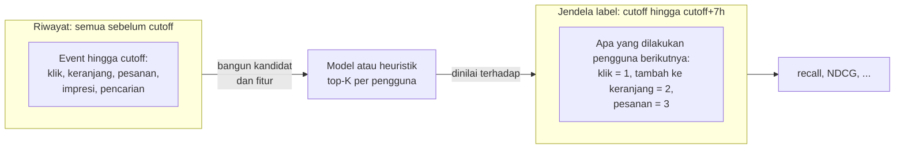
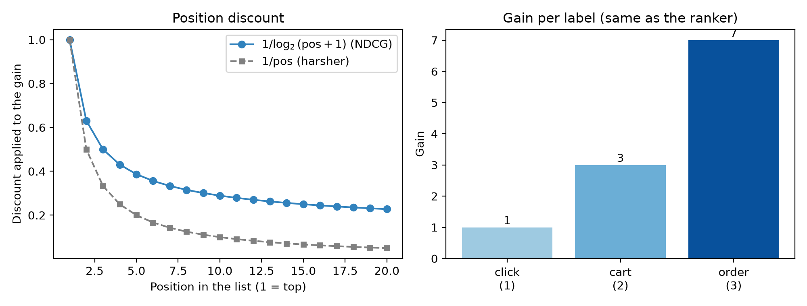
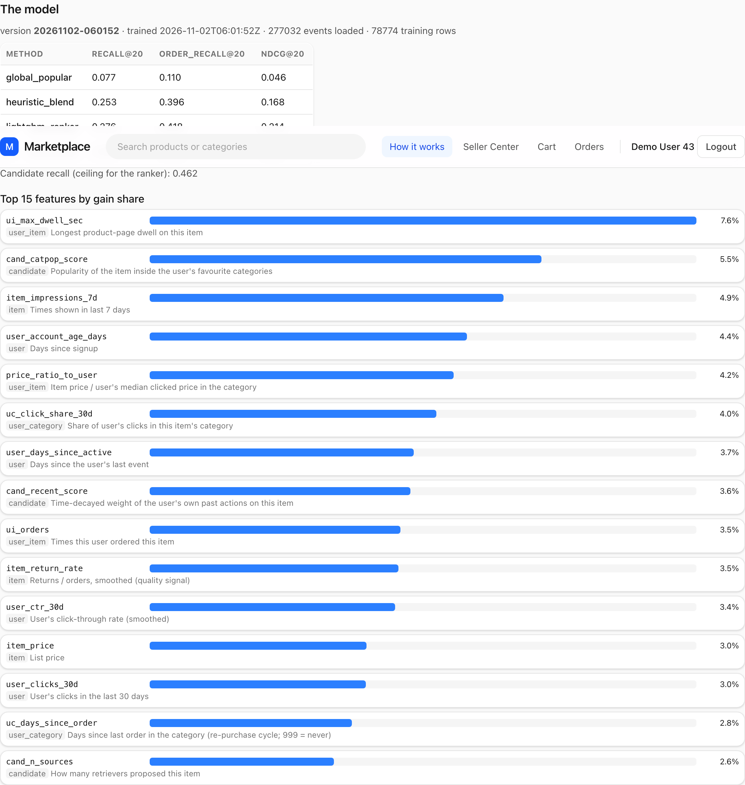

# Mengukur keberhasilan

Senin pagi di sebuah perusahaan marketplace, dua engineer berdebat di depan dashboard. Dina baru saja menyelesaikan model pemeringkatan (*ranking*) baru untuk home feed. Di laptopnya model itu "terlihat bagus": item teratas untuk akun ujinya sendiri semuanya barang yang akan ia klik. Raka, yang memegang funnel checkout, belum yakin. Kuartal lalu, model lain yang "jelas lebih baik" dirilis, konversi turun selama seminggu, dan tak ada yang bisa memastikan apakah penyebabnya model itu, promo akhir pekan, atau sekadar *noise*.

Keduanya benar untuk khawatir. Sebuah sistem rekomendasi tidak punya satu keluaran yang pasti benar, dan tidak ada unit test yang berbunyi "kesepuluh item ini tepat untuk user 43". Yang kita punya adalah **perilaku**: apa yang dilakukan orang setelah kita menampilkan sesuatu. Mengukur keberhasilan berarti mengubah perilaku itu menjadi angka yang cukup jujur untuk dipakai mengambil keputusan, cukup murah untuk dihitung seratus kali sehari, dan cukup berperilaku baik sehingga angka yang lebih tinggi benar-benar berarti produk yang lebih baik. Setiap bab berikutnya ditutup dengan tabel hasil yang dihasilkan oleh kode yang sama, jadi penting untuk memahami persis apa yang dilakukan kode itu, dan di mana ia bisa menyesatkan Anda.

## Apa yang akan Anda pelajari

- Perbedaan antara evaluasi **offline** dan **online**, dan mengapa Anda membutuhkan keduanya.
- Mengapa **pembagian berbasis waktu** (*time-based split*) adalah satu-satunya cara yang jujur untuk mengevaluasi sistem rekomendasi, dan bagaimana pembagian acak diam-diam membocorkan masa depan.
- Cara menghitung **precision@K**, **recall@K**, dan **average precision** secara manual, serta apa yang dihargai oleh masing-masing.
- Bagaimana **DCG** dan **NDCG** diturunkan langkah demi langkah, dan mengapa repo ini memakai gain 1, 3, dan 7 untuk klik, tambah ke keranjang, dan pesanan.
- Apa yang diukur oleh **coverage** dan **candidate recall**, dan mengapa sistem rekomendasi bisa tampak "akurat" padahal tidak berguna.
- Bagaimana `recommender/recsys/evaluate.py` mengimplementasikan semua ini dalam sekitar empat puluh baris pandas, baris demi baris.

## Intuisi: menilai ujian yang jawabannya tidak Anda tulis

Bayangkan Anda guru yang ingin tahu apakah seorang murid sudah menguasai aljabar. Anda tidak akan membagikan ujian, membiarkan murid melihat kunci jawaban, lalu menilai ujian yang sama. Anda akan menyisihkan soal yang belum pernah dilihat murid. Dan Anda juga tidak akan memakai ujian *peramal* yang soalnya diambil dari silabus tahun depan; ujian harus sesuai dengan pengetahuan yang memang bisa Anda miliki pada saat itu.

Mengevaluasi sistem rekomendasi mengikuti aturan yang sama, dengan satu keunikan: "kunci jawabannya" adalah masa depan. Kita membekukan dunia pada satu titik waktu (**cutoff**), membuat rekomendasi hanya dari apa yang diketahui sebelum titik itu, lalu melihat apa yang benar-benar dilakukan pengguna *setelahnya*. Jika daftar top-20 kita memuat sekantong makanan kucing yang kemudian dipesan pengguna, kita mendapat poin; jika isinya empat puluh casing ponsel yang tak pernah ia sentuh, kita tidak mendapat apa-apa.

Dua hal mengikuti dari sini. Pertama, **murid tidak boleh melihat kunci jawaban**: apa pun yang dihitung dari data setelah cutoff terlarang saat kita menghasilkan rekomendasi. Inilah *kebocoran data* (*leakage*), penyebab nomor satu hasil yang tampak indah secara offline lalu ambruk di produksi. Kedua, **satu ujian tidak pernah cukup**: sistem rekomendasi bisa mendapat skor akurasi bagus sambil tetap menampilkan dua puluh barang terlaris yang sama kepada semua pengguna, sehingga kita memerlukan metrik untuk akurasi, kualitas pemeringkatan, keluasan, dan batas atas yang ditetapkan oleh tahap-tahap pipeline sebelumnya. Jawaban yang berbeda juga layak diberi bobot berbeda: pesanan lebih bernilai daripada klik, dan slot 1 lebih bernilai daripada slot 18.

## Evaluasi offline versus online

Ada dua tempat untuk mengukur sistem rekomendasi, dan keduanya menjawab pertanyaan yang berbeda.

**Evaluasi online** berarti menempatkan model di hadapan pengguna sungguhan dan mengamati apa yang terjadi. Alat standarnya adalah **A/B test**: membagi pengguna secara acak menjadi kelompok kontrol (model lama) dan kelompok perlakuan (model baru), lalu membandingkan metrik bisnis, seperti *click-through rate* $\text{CTR} = \frac{\text{clicks}}{\text{impressions}}$, tingkat konversi, jumlah pesanan per sesi, atau *gross merchandise value* (GMV) per pengguna. Hasil online adalah kebenaran dasar (*ground truth*). Ia menangkap segalanya: efek kebaruan, tata letak halaman, latensi, dan fakta bahwa pengguna bereaksi terhadap apa yang ditampilkan kepada mereka. Namun ia lambat (berhari-hari atau berminggu-minggu untuk mencapai signifikansi statistik), mahal (model yang buruk merugikan pendapatan sungguhan selama Anda mencari tahu bahwa ia buruk), dan Anda hanya bisa menjalankan beberapa eksperimen sekaligus.

**Evaluasi offline** memutar ulang sejarah. Anda mengambil perilaku yang tercatat, berpura-pura sekarang adalah hari sebelum sesuatu terjadi, menghasilkan rekomendasi, lalu menilainya terhadap apa yang terjadi berikutnya. Ia cepat (hitungan menit), gratis, dapat diulang, dan Anda bisa menguji seratus varian dalam satu sore. Kelemahannya, sejarah hanya berisi apa yang dilakukan pengguna sebagai respons terhadap pilihan sistem *lama*. Item yang tak pernah ditampilkan sistem lama tidak punya klik; model yang akan memunculkannya tidak mendapat kredit. Angka offline hanyalah **proksi**.

Dalam praktik, evaluasi offline adalah filter murah di depan beberapa eksperimen online yang mahal: ide yang kalah secara offline dibuang, dan hanya yang lolos yang mendapat A/B test. Metrik offline berguna untuk **menolak ide buruk dengan cepat** dan untuk memilih di antara varian yang mirip. Hasil offline yang bagus itu perlu, tetapi jarang cukup.

::: fact
Ketika Netflix menggelar kompetisi berhadiah yang terkenal untuk prediksi rating film, targetnya adalah sebuah proksi: menurunkan *root mean squared error* (RMSE) prediksi rating bintang sebesar 10% dimaksudkan sebagai wakil dari "rekomendasi yang lebih baik". Gabungan ratusan model dari tim pemenang memang melewati garis itu, namun Netflix melaporkan bahwa tambahan akurasi yang terukur secara offline tampaknya tidak sepadan dengan upaya rekayasa untuk membawa ensemble itu ke produksi. Skor offline yang hebat tidak sama dengan produk yang hebat.

Sumber: Amatriain & Basilico, Netflix Technology Blog, 2012
:::

## Pembagian berbasis waktu, dan mengapa pembagian acak membocorkan data

Tutorial machine learning biasanya berkata "acak datanya dan sisihkan 20% untuk pengujian". Untuk sistem rekomendasi, saran ini berbahaya. Misalkan kita punya 60 hari event lalu mengacaknya menjadi 80% train dan 20% test. Sebuah klik pada hari ke-52 bisa masuk ke set training sementara klik pengguna yang sama pada hari ke-14 masuk ke set test. Model lalu "memprediksi" hari ke-14 dengan memanfaatkan pengetahuan tentang hari ke-52. Secara konkret ia bisa mempelajari:

- **Popularitas dari masa depan.** Item yang meledak saat sale 9.9 menjadi laris *karena* klik yang terjadi setelah event uji.
- **Selera pengguna dari masa depan.** Jika pengguna beralih dari ponsel ke makanan kucing pada minggu ke-7, model yang dilatih dengan minggu ke-7 "memprediksi" klik minggu ke-3 dengan menghafal di mana ia akhirnya berlabuh.
- **Kebocoran sesi.** Klik dalam satu sesi sangat berkorelasi (orang menelusuri item serupa berturut-turut). Membelah satu sesi ke train dan test membuat set test hampir menjadi salinan set training.

Di produksi Anda tidak pernah bisa melihat masa depan, sehingga model yang bergantung padanya gagal pada hari pertama ia berjalan. Solusinya adalah menghormati arah waktu.

### Pembagian yang dipakai di buku ini

Repo ini memakai **pembagian waktu rolling-origin**. Pilih sebuah cutoff $t_c$. Semua yang terjadi sebelum $t_c$ adalah *riwayat* (*history*); $H = 7$ hari berikutnya adalah *jendela label*; dan model dinilai dari seberapa baik ia memprediksi jendela itu.



*Gambar: Fitur dan kandidat hanya berasal dari riwayat; label hanya berasal dari jendela label setelah cutoff.*

Untuk angka evaluasi di buku ini, skrip pendamping menetapkan akhir dataset pada hari simulasi terakhir, menaruh cutoff 7 hari sebelumnya, dan memakai minggu terakhir sebagai jendela label. Untuk *melatih* ranker (bab 10) kita memerlukan pembagian kedua yang lebih awal, agar label training seluruhnya berada sebelum cutoff evaluasi:

| Tujuan | Riwayat berakhir pada | Jendela label |
|---|---|---|
| Melatih ranker | end − 14 hari | end − 14 hari hingga end − 7 hari |
| Evaluasi | end − 7 hari | end − 7 hari hingga end |
| Serving (produksi) | sekarang | masa depan, belum teramati |

Ini persis diagram pada docstring `recommender/recsys/pipeline.py`. Model tidak pernah dilatih pada minggu yang kelak dipakai untuk menilainya.

### Contoh kecil kebocoran

Misalkan Rina mengklik mainan C pada hari ke-13 dan memesannya pada hari ke-14. Pembagian **acak** bisa menaruh hari ke-14 di training dan hari ke-13 di test, sehingga pertanyaan "akankah Rina mengklik mainan C?" diajukan kepada model yang sudah melihat pesanannya atas C. Pembagian **waktu** pada hari ke-12 memaksa model menebak hanya dari klik-klik sebelumnya, seperti yang harus dilakukan sistem langsung.

### Aturan yang sama berlaku untuk fitur

Membagi event dengan benar baru separuh pekerjaan: fitur seperti "jumlah pesanan item ini dalam 7 hari terakhir" harus dihitung dari event sebelum cutoff, bukan "hingga hari ini". Bab 9 menyebutnya **ketepatan point-in-time** (*point-in-time correctness*). Aturannya: *pada saat prediksi $t$, Anda hanya boleh memakai data dengan timestamp $< t$*.

## Apa yang kita ukur: label dan daftar berperingkat

Sebelum masuk ke rumus, mari tetapkan kosakata. Untuk pengguna $u$ dan cutoff $t_c$ tertentu, sistem rekomendasi menghasilkan **daftar berperingkat** item $r_1, r_2, \dots, r_K$, terbaik lebih dulu. Kita membandingkannya dengan apa yang benar-benar dilakukan pengguna selama jendela label. Repo ini menurunkan **label** bergradasi untuk setiap pasangan (pengguna, item) yang disentuh pengguna:

| Perilaku dalam jendela label | Label |
|---|---|
| Mengklik item | 1 |
| Menambahkan item ke keranjang | 2 |
| Memesan item | 3 |
| Tidak ada | (tidak ada dalam tabel label) |

Jika pengguna melakukan beberapa hal pada item yang sama, kita ambil yang terkuat (maksimum); ini dilakukan oleh `data.labels` di `recommender/recsys/data.py`. Fungsi itu mengembalikan *hanya* pasangan dengan label positif, sehingga pengguna yang tidak melakukan apa pun di jendela label tidak pernah muncul: mereka tidak dapat dinilai dan dikecualikan dari setiap rata-rata di bawah. Angka-angkanya adalah rata-rata atas *pengguna yang kembali dan melakukan sesuatu*.

Sebut item dengan label positif sebagai **positif masa depan** (*future positives*) milik pengguna, dan misalkan $R$ adalah jumlahnya. Semua yang berikut menyangkut seberapa baik daftar berperingkat menangkap mereka.

## Algoritma: metrik pemeringkatan dari dasar

### Precision@K dan recall@K

Dua pertanyaan paling dasar tentang daftar top-$K$ adalah:

- **Precision@K**: dari $K$ item yang kita tampilkan, berapa bagian yang direspons pengguna?
- **Recall@K**: dari hal-hal yang direspons pengguna, berapa bagian yang kita tampilkan?

$$
\text{precision@}K = \frac{|\text{hits in top } K|}{K}, \qquad
\text{recall@}K = \frac{|\text{hits in top } K|}{R}
$$

"Hit" adalah item dalam daftar yang merupakan positif masa depan. Untuk satu pengguna, keduanya hanyalah sebuah hitungan yang dibagi dengan bilangan berbeda. Precision peduli pada *pemborosan* (setiap slot adalah ruang layar yang mahal), recall peduli pada *cakupan terhadap apa yang diinginkan pengguna*. Di marketplace dengan ribuan item per kategori, dan pengguna yang hanya merespons segelintir dalam seminggu, nilai precision wajar saja sangat kecil; recall lebih mudah dibaca dan paling sering dilaporkan buku ini. Ketika $K$ tetap dan besar dibandingkan $R$, precision dan recall membawa informasi yang sama hingga faktor skala, itulah sebabnya kita lebih sering menampilkan recall.

Keduanya mengabaikan **urutan** di dalam top $K$: menemukan hit di slot 1 atau slot 20 memberi skor sama. Di halaman sungguhan itu keliru, karena slot 1 dilihat hampir semua orang sedangkan slot 20 menuntut scroll. Kita butuh metrik yang peka terhadap posisi.

### Average precision (AP)

**Average precision** menghargai penempatan hit di awal. Telusuri daftar; setiap kali Anda menemukan hit pada posisi $k$, catat precision pada titik potong itu, $P@k$. Lalu rata-ratakan nilai-nilai itu atas *seluruh* positif masa depan pengguna:

$$
\text{AP@}K = \frac{1}{R}\sum_{k=1}^{K} P@k \cdot \mathbb{1}[\text{item at } k \text{ is a hit}]
$$

Contoh berukuran tangan. Daftar tiga item memiliki hit pada posisi 2 dan 3, dan pengguna memiliki $R=2$ positif masa depan. Maka $P@2 = 1/2$ dan $P@3 = 2/3$, sehingga

$$
\text{AP} = \frac{1}{2}\left(\frac{1}{2} + \frac{2}{3}\right) = 0.583.
$$

Dengan hit pada posisi 1 dan 2, kita akan mendapat $\frac{1}{2}(1 + 1) = 1$. Membagi dengan $R$ (bukan dengan jumlah hit) menghukum positif yang tidak pernah muncul. Namun AP bersifat biner: pesanan dan klik sama-sama dihitung sebagai "hit", jadi untuk relevansi bergradasi kita memakai DCG.

### Cumulative gain, dan diskon

Misalkan $\text{rel}_i$ adalah label (0, 1, 2, atau 3) item pada peringkat $i$, dengan peringkat dihitung dari 1. Skor bergradasi yang paling naif hanya menjumlahkannya:

$$
\text{CG@}K = \sum_{i=1}^{K} \text{rel}_i
$$

Ada dua masalah. Pertama, label 3 bukan sekadar "tiga kali" sebuah klik: pesanan adalah sinyal yang jauh lebih kuat dan bernilai. Kita memperbaikinya dengan mengubah label menjadi **gain** yang tumbuh secara eksponensial:

$$
g(\text{rel}) = 2^{\text{rel}} - 1 \quad\Rightarrow\quad g(0)=0,\; g(1)=1,\; g(2)=3,\; g(3)=7 .
$$

Angka-angka ini persis yang ada pada dictionary `GAIN` di `evaluate.py`, dan sama dengan `label_gain` yang dipakai ranker LightGBM di bab 10, sehingga training dan evaluasi sepakat tentang apa arti "bagus".

Kedua, CG tidak peduli urutan. Kita memperbaikinya dengan **diskon posisi**: item pada peringkat $i$ bernilai lebih kecil semakin ke bawah posisinya. Pilihan klasiknya adalah

$$
d(i) = \frac{1}{\log_2(i+1)}
$$

sehingga $d(1)=1$, $d(2)=0.63$, $d(3)=0.5$, dan diskon terus menyusut, secara perlahan. Menggabungkan kedua perbaikan menghasilkan **discounted cumulative gain**:

$$
\text{DCG@}K = \sum_{i=1}^{K} \frac{2^{\text{rel}_i}-1}{\log_2(i+1)}
$$

Mengapa logaritma? Penurunan antara slot 1 dan 2 besar, antara slot 19 dan 20 dapat diabaikan, karena sebagian besar pengguna tidak pernah sampai ke sana; diskon $1/i$ akan jauh lebih kejam. Logaritma adalah konvensi, bukan hukum alam, tetapi itulah yang disepakati bidang ini. Gambar di bawah memperlihatkan kedua kurva, serta gain yang dipakai repo ini.



### Normalisasi: NDCG

DCG tidak dapat dibandingkan antarpengguna. Pengguna dengan satu klik masa depan memiliki DCG maksimum 1; pengguna dengan lima pesanan masa depan memiliki maksimum yang jauh lebih tinggi. Untuk merata-ratakan antarpengguna kita memerlukan skala bersama. Solusinya adalah membagi dengan **DCG ideal** (IDCG): DCG dari urutan terbaik yang mungkin atas positif masa depan pengguna itu, yaitu diurutkan menurut gain, tertinggi lebih dulu.

$$
\text{NDCG@}K = \frac{\text{DCG@}K}{\text{IDCG@}K} \in [0, 1]
$$

NDCG 1 berarti "Anda mendaftar setiap positif masa depan, terbaik lebih dulu". Skor 0 berarti Anda tidak menemukan satu pun. Angka akhir yang dilaporkan adalah rata-rata NDCG atas semua pengguna yang dievaluasi.

Perhatikan kehalusan pada daftar ideal: ia memuat *setiap* positif masa depan milik pengguna, termasuk item yang tidak mungkin ditemukan sistem rekomendasi mana pun (misalnya item yang kehabisan stok pada cutoff, atau yang ditemukan pengguna lewat tautan dari teman). Itulah yang membuat NDCG@K jujur: ia diukur terhadap perilaku nyata pengguna, bukan terhadap apa yang dapat direkomendasikan.

::: fact
Keluarga ukuran DCG diperkenalkan oleh Järvelin dan Kekäläinen dalam makalah tahun 2002 tentang evaluasi sistem *information retrieval* dengan relevansi bergradasi. Mereka mengusulkan agar gain yang diterima pengguna sepanjang daftar berperingkat dikumulasikan dan item didiskon menurut peringkatnya, justru agar menemukan dokumen yang sangat relevan lebih awal dihargai lebih besar daripada menemukannya belakangan. Dua dekade kemudian, hampir setiap leaderboard pencarian dan sistem rekomendasi masih melaporkan NDCG.

Sumber: Järvelin & Kekäläinen, ACM Transactions on Information Systems, 2002
:::

### Coverage

Metrik akurasi adalah rata-rata atas pengguna, sehingga sistem rekomendasi bisa mendapat skor bagus dengan menampilkan item populer yang nyaris sama kepada semua orang. **Catalog coverage** mengukur keluasan:

$$
\text{coverage@}K = \frac{|\bigcup_{u} \text{top-}K(u)|}{|\text{recommendable items}|}
$$

Dari semua item yang boleh kita rekomendasikan, berapa bagian yang pernah muncul di top $K$ milik setidaknya satu pengguna? Untuk marketplace ini bukan sekadar estetika: penjual yang itemnya tidak pernah ditampilkan tidak akan pernah menjual. Coverage *bukan* skor kualitas yang berdiri sendiri (sistem rekomendasi acak memiliki coverage sempurna dan akurasi terburuk), jadi pakailah ia sebagai **guardrail** di samping metrik akurasi.

### Candidate recall: batas atas

Sistem rekomendasi produksi, termasuk milik kita, bersifat **multi-tahap**: tahap pertama yang murah memilih beberapa ratus *kandidat* (*candidate*) dari ribuan (atau jutaan) item, lalu tahap kedua yang lebih cerdas mengurutkannya. Tahap kedua hanya bisa mengurutkan ulang apa yang disediakan tahap pertama, sehingga

$$
\text{candidate recall} = \frac{|\text{future positives that appear in the candidate set}|}{R}
$$

(dirata-ratakan atas pengguna) adalah **batas atas** recall pemeringkatan akhir: jika *candidate generation* tidak pernah mengambil item yang dibeli pengguna, tidak ada ranker yang bisa menaruhnya di slot 1. Ketika ranker baru mengecewakan, periksa angka ini lebih dulu. Bab 8 membahas cara menaikkannya.

## Penelusuran kode: `recsys/evaluate.py`

Seluruh modul evaluasi cukup pendek untuk dibaca dalam satu kali duduk. Mulailah dengan `metrics`:

```include
path: recommender/recsys/evaluate.py
symbol: metrics
```

Fungsi ini menerima dua frame. `recs` berisi baris `user_id, item_id` dalam urutan tampil; `labels` adalah tabel dari `data.labels`. Kita menelusurinya dalam empat langkah.

**Langkah 1: beri nomor pada rekomendasi.** `recs.groupby("user_id").head(k)` mempertahankan $k$ baris pertama tiap pengguna, sehingga posisi *diturunkan dari urutan baris*: frame yang tidak terurut diam-diam menilai daftar acak. `cumcount()` memberi nomor `0, 1, 2, …` ke `pos`. Posisi berbasis nol, karena itu diskon memakai `np.log2(pos + 2)` untuk peringkat berbasis satu $i$ pada rumus, $\log_2(i+1)$.

**Langkah 2: kaitkan rekomendasi ke label (merge).** `labels.merge(recs, ..., how="left")` dimulai dari *label*, sehingga setiap positif masa depan bertahan dalam merge, dengan `pos` terisi jika kita merekomendasikannya dan `NaN` jika tidak. Itu membuat penyebutnya benar: jumlah baris per pengguna adalah $R$, dan `count()` dari `pos` (yang mengabaikan `NaN`) adalah jumlah hit. Pengguna yang tidak kita rekomendasikan apa pun mendapat recall 0 alih-alih dibuang, sehingga sebuah metode tidak bisa menaikkan skornya dengan melewati pengguna yang sulit. `order_recall` melakukan hal yang sama hanya untuk baris berlabel 3, metrik yang paling dekat dengan pendapatan; rata-ratanya hanya mencakup pengguna yang memesan.

**Langkah 3: DCG.** `found` hanya menyimpan hit, lalu `GAIN[label] / log2(pos + 2)` dijumlahkan per pengguna. `GAIN = {1: 1.0, 2: 3.0, 3: 7.0}` adalah tabel $2^{\text{rel}}-1$ dari atas.

**Langkah 4: IDCG dan rasio.** Daftar ideal dibangun dari label yang sama: urutkan label tiap pengguna menurut gain menurun, ambil $k$ pertama, dan diskon dengan cara yang sama. DCG (pengguna tanpa hit mendapat 0) dibagi IDCG, dirata-ratakan atas pengguna, adalah NDCG. Karena daftar ideal juga dipotong pada $k$, skor sempurna tetap dapat dicapai untuk pengguna yang memiliki lebih dari $k$ positif.

Sekarang pemeriksaan batas atasnya:

```include
path: recommender/recsys/evaluate.py
symbol: candidate_recall
```

Ini adalah ide left-merge yang sama: setelah merge, `found` bernilai `NaN` untuk positif yang tidak ada dalam set kandidat, sehingga rata-rata per pengguna dari `found.notna()` adalah porsi positif pengguna itu yang menjadi kandidat. Tidak ada `k`: kandidat adalah himpunan, bukan daftar berperingkat.

Bab-bab berikutnya memanggil helper bersama, `evaluate` di `book/code/common.py`, yang membungkus `metrics` dan melaporkan recall pada 5, 10, 20, dan 50, order recall, NDCG pada 20, serta coverage pada 20 (item berbeda yang direkomendasikan dibagi item yang tersedia pada cutoff). Setiap metode dinilai oleh kode yang identik, sehingga angka di bab 6 dapat dibandingkan dengan angka di bab 3 tanpa catatan kaki.

## Jalankan

Skrip pendamping `book/code/ch02_metrics.py` membangun daftar sepuluh item yang hasilnya kita kendalikan, dan mencetak setiap nilai antara agar Anda bisa mengikuti aritmetikanya dengan pensil. Jalankan dari direktori `book/`:

```bash
cd book
uv run python code/ch02_metrics.py
```

Blok pertama menampilkan daftar beserta label tiap item (apa yang kemudian dilakukan pengguna terhadapnya), gain-nya, diskonnya, dan gain terdiskonnya:

```output
file: results/ch02_metrics.txt
lines: 2-13
```

Item B dipesan (label 3, gain 7), G ditambahkan ke keranjang (label 2, gain 3), dan D serta J diklik (label 1, gain masing-masing 1). Perhatikan bahwa header kolom `1/log2(pos+2)` memakai posisi berbasis nol dari kode; sebagai peringkat berbasis satu, itu adalah $1/\log_2(i+1)$ pada rumus.

### Precision dan recall pada setiap titik potong

Pengguna memiliki total lima positif masa depan, termasuk item kelima, `Z`, yang tidak pernah ada di daftar kita:

```output
file: results/ch02_metrics.txt
lines: 15-27
```

Ikuti satu baris: pada $k=4$ kita telah menampilkan item A sampai D, dengan B dan D sebagai hit, sehingga precision adalah $2/4 = 0.500$ dan recall adalah $2/5 = 0.400$. Dua pola terlihat. Recall hanya naik (lebih banyak slot hanya dapat menambah hit), mencapai maksimum 0.800 karena `Z` tidak pernah direkomendasikan. Precision bergerigi: ia melonjak setiap kali hit mendarat (posisi 2, 4, 7, 10) dan meluruh di antaranya. Gerigi itulah yang dirata-ratakan oleh average precision.

### Average precision

```output
file: results/ch02_metrics.txt
lines: 29-34
```

Keempat hit berada pada peringkat 2, 4, 7, dan 10, dengan precision 0.5000, 0.5000, 0.4286, dan 0.4000, berjumlah 1.8286. Bagi dengan *lima* positif masa depan (bukan empat hit), dan AP adalah 0.3657. Positif kelima, `Z`, menarik skor turun karena menyumbang nol.

### DCG, IDCG, dan NDCG

```output
file: results/ch02_metrics.txt
lines: 36-45
```

Urutan ideal kelima positif pengguna adalah menurut gain: pesanan (label 3), lalu dua tambah-ke-keranjang (label 2: item G dari daftar kita, ditambah `Z`, yang tidak pernah kita rekomendasikan), lalu dua klik (label 1). Suku-sukunya adalah $7.0000$, $1.8928$, $1.5000$, $0.4307$, dan $0.3869$, yang berjumlah IDCG 11.2103. Daftar kita mencapai DCG 6.1362, sehingga

$$
\text{NDCG} = \frac{6.1362}{11.2103} = 0.5474 .
$$

Kita menemukan sebagian besar nilainya (pesanan di peringkat 2 dan keranjang di peringkat 7) tetapi kehilangan sebagian karena `Z` tidak ada dan karena B tidak berada di urutan pertama.

### Urutan berpengaruh: hit yang sama, daftar yang lebih buruk

Sekarang eksperimen yang membenarkan NDCG. Pertahankan empat hit yang persis sama, tetapi pindahkan item B yang dipesan dari peringkat 2 ke peringkat 10, dengan hit lainnya di peringkat 2, 5, dan 8:

```output
file: results/ch02_metrics.txt
lines: 47-48
```

Himpunan item yang direkomendasikan sama, sehingga recall@10 tidak berubah (0.800). Tetapi NDCG turun dari 0.5474 menjadi 0.3684. Dashboard yang hanya memantau recall akan menyebut kedua daftar ini identik; pembeli yang harus scroll sampai dasar untuk menemukan barang yang ia inginkan tidak akan setuju.

## Hasil: berapa skor sistem rekomendasi acak?

Terakhir, kita alirkan metode yang sengaja tidak berguna melalui helper `evaluate` bersama: untuk setiap pengguna dalam set label, tarik 50 item secara seragam acak dari katalog yang tersedia stoknya.

```output
file: results/ch02_metrics.txt
lines: 50-55
```

Inilah **lantai** (*floor*) bagi setiap tabel di buku ini. Ada beberapa hal yang perlu dicermati.

Pertama, populasi evaluasi: 947 pengguna memiliki setidaknya satu positif pada minggu terakhir, dan 2311 item tersedia pada cutoff. Jika Anda memilih 20 item dari 2311 untuk satu pengguna dengan satu positif, peluang mengenainya adalah $20/2311 \approx 0.0087$. Itulah nilai recall@20 yang kita harapkan dari metode tanpa informasi (hampir semua positif, sekitar 99,85%, adalah item yang tersedia stoknya pada cutoff, sehingga nilai harapannya hanya sedikit lebih rendah). Angka terukur 0.0069 hanyalah satu kali pengundian acak: kebanyakan pengguna hanya memiliki beberapa positif, sehingga recall tiap pengguna adalah 0 atau pecahan kecil, dan rata-rata atas 947 pengguna bersifat *noisy*. Angkanya akan sedikit bergeser antar *seed* acak, tetapi akan selalu berkisar di sekitar 0.0087. Sistem rekomendasi acak ini juga menemukan 0.0212 positif pada recall@50, naik seiring $K$ sebagaimana diharapkan, sementara NDCG@20 hanya 0.0026: hit acak mendarat di kedalaman acak, dan hit di peringkat 15 hanya memberi sedikit nilai.

Kedua, coverage@20 adalah 1.0: pengambilan sampel acak menyentuh setiap item, sehingga ia memiliki keluasan *sempurna* dan akurasi terburuk yang mungkin, itulah sebabnya coverage adalah guardrail dan tidak pernah menjadi target.

Ketiga, setiap metode berikutnya harus mengalahkan angka-angka ini dengan selisih lebar, dan juga mengalahkan baseline popularitas satu baris, yang menjadi topik bab berikutnya.

::: fact
Para evaluator offline sering mempercepat metrik mereka dengan memeringkat setiap positif uji terhadap sampel acak kecil item (misalnya 100) alih-alih seluruh katalog. Krichene dan Rendle menunjukkan bahwa **sampled metrics** semacam itu tidak konsisten dengan metrik eksak: mereka bahkan tidak mempertahankan urutan sistem rekomendasi secara ekspektasi, sehingga "model A mengalahkan model B" di bawah sampling bisa keliru pada katalog penuh. Saran mereka adalah menghindari sampling bila Anda sanggup melakukan perhitungan penuh, yang persis dilakukan `evaluate.py`.

Sumber: Krichene & Rendle, KDD, 2020
:::

### Metrik yang sama di dalam aplikasi

Layanan rekomendasi mengevaluasi setiap model yang dilatih dengan fungsi `metrics` yang sama dan menyimpan hasilnya; halaman "How it works" menampilkannya.



Nilainya berbeda dari buku ini karena aplikasi melatih pada database langsung ketika Anda mengklik "Retrain", sedangkan skrip buku memakai simulasi, cutoff, dan seed yang tetap. Perhatikan *bentuknya*: beberapa metode diurutkan menurut NDCG, dengan batas atas di atasnya.

## Jebakan, dan bagaimana dilakukan di produksi

**Kebocoran lewat fitur, bukan hanya event.** Pembagian di atas menjaga label di luar riwayat, tetapi fitur yang ceroboh (misalnya jumlah pesanan item sepanjang masa, dihitung dari database hari ini) diam-diam memasukkan kembali masa depan. Bab 9 memperagakan model yang NDCG offline-nya lebih dari dua kali lipat karena satu kolom bocor, lalu runtuh dalam evaluasi yang jujur. Jika angka offline tampak terlalu bagus, anggap ada kebocoran sampai terbukti sebaliknya.

**Noise dan survivorship.** Jendela label kita satu minggu dan 947 pengguna, sehingga selisih pada desimal ketiga antara dua metode kemungkinan besar hanya noise; tim produksi melaporkan *confidence interval* bootstrap dan merata-ratakan beberapa cutoff atau seed (bab 10 melakukannya untuk ablasi). Metrik juga hanya mencakup pengguna dengan setidaknya satu positif masa depan, jadi iris menurut kohort (baru versus kembali, kota, tingkat aktivitas; bab 12).

**Bias pencatatan (*logging bias*).** Klik hanya terjadi pada apa yang dipilih sistem lama untuk ditampilkan, dan slot yang lebih tinggi mendapat lebih banyak klik terlepas dari kualitas, sehingga label offline menghargai model yang meniru sistem lama. *Inverse-propensity weighting* dan traffic eksplorasi ada karena alasan ini (bab 11 dan 12); A/B test tetap menjadi penentu akhir.

**Mengoptimalkan satu metrik saja.** NDCG tidak mengatakan apa pun tentang keragaman, kesegaran, keadilan bagi penjual kecil, atau harga barang yang Anda dorong. Tim produksi menjaga dashboard **metrik guardrail** di samping metrik utama: coverage, porsi impresi untuk item baru, keragaman kategori (bab 11), latensi, dan tingkat error. Model yang menaikkan NDCG 2% sambil meruntuhkan coverage katalog bukanlah perbaikan.

**Praktik produksi singkatnya.** Pertahankan satu harness evaluasi dan satu definisi tiap metrik; jalankan pada setiap job training (layanan di repo ini menyimpan hasilnya di sebelah file model); beri versi pada dataset dan cutoff; dan bandingkan setiap metode baru dengan *model produksi sebelumnya* dan baseline sepele.

## Ringkasan

- Evaluasi offline memutar ulang sejarah untuk menolak ide buruk dengan murah; A/B test online adalah kebenaran dasar. Gunakan offline sebagai gerbang, bukan sebagai janji.
- Selalu bagi menurut **waktu**: bangun kandidat dan fitur dari event sebelum cutoff, ambil label dari 7 hari berikutnya. Pembagian acak membocorkan masa depan.
- Label bergradasi: klik 1, tambah ke keranjang 2, pesanan 3, dengan perilaku terkuat per (pengguna, item) dipertahankan; hanya pengguna dengan setidaknya satu positif yang dinilai.
- Precision@K mengukur pemborosan, recall@K mengukur seberapa banyak yang diinginkan pengguna berhasil Anda temukan, dan AP menambahkan kepekaan terhadap letak hit.
- DCG mengubah label menjadi gain $2^{rel}-1$ (1, 3, 7), mendiskon dengan $1/\log_2(i+1)$, dan NDCG membagi dengan DCG ideal sehingga skor antarpengguna dapat dibandingkan. Memindahkan satu hit dari peringkat 2 ke peringkat 10 menurunkan NDCG dari 0.5474 menjadi 0.3684 sementara recall tetap.
- Coverage adalah guardrail, bukan tujuan: sistem rekomendasi acak memiliki coverage sempurna dan akurasi terburuk. Candidate recall adalah batas atas bagi ranker mana pun yang dibangun di atas set kandidat.
- `evaluate.py` melakukan merge label **left** ke rekomendasi, sehingga positif yang terlewat tetap dihitung dan daftar kosong mendapat skor 0.

## Kuis

**Q2.1** Sebuah tim mengevaluasi sistem rekomendasi dengan mengacak semua event dan menyisihkan 20% untuk pengujian. Pernyataan manakah yang paling tepat menggambarkan kelemahan utama pengaturan ini?

A. Set training menjadi terlalu kecil untuk mempelajari apa pun.  
B. Event test bisa lebih awal daripada event training, sehingga model dapat belajar dari masa depan.  
C. Ia menghasilkan nilai precision yang selalu lebih tinggi daripada recall.  
D. Ia mencegah pemakaian label bergradasi seperti klik, keranjang, dan pesanan.

**Q2.2** Dua sistem rekomendasi mengembalikan sepuluh item yang persis sama untuk seorang pengguna, tetapi sistem X menaruh item yang dipesan di urutan pertama dan sistem Y menaruhnya di urutan terakhir. Metrik manakah yang akan membedakan keduanya?

A. recall@10  
B. precision@10  
C. NDCG@10  
D. coverage katalog

**Q2.3** Dalam pengaturan buku ini, pernyataan manakah tentang *candidate recall* yang benar?

A. Ia selalu lebih rendah daripada recall pemeringkatan akhir.  
B. Ia adalah batas atas recall yang dapat dicapai ranker mana pun yang dibangun di atas kandidat tersebut.  
C. Ia mengukur berapa banyak item berbeda yang direkomendasikan sistem di seluruh pengguna.  
D. Ia hanya dapat dinaikkan dengan melatih ranker yang lebih baik.

**Q2.4** Pada rumus average precision, mengapa kita membagi dengan jumlah total positif masa depan $R$ dan bukan dengan jumlah hit?

**Q2.5** `evaluate.metrics` menggabungkan `labels` dengan `recs` memakai `how="left"` mulai dari label. Jelaskan apa yang akan berubah jika merge dimulai dari `recs` (inner join antara kedua frame).

**Q2.6** Perhatikan dua pernyataan dalam fungsi `metrics` yang disertakan, yang membangun `found` dan `dcg` (yang memakai `dropna(subset=["pos"])` dan `np.log2(... + 2)`). Apa yang dibuang oleh `dropna(subset=["pos"])`, dan mengapa konstanta `+ 2` dipakai dan bukan `+ 1`?

**Q2.7** Daftar top-3 seorang pengguna memiliki label relevansi `[0, 1, 3]` pada peringkat 1, 2, 3 (gain 0, 1, 7). Satu-satunya positif masa depan pengguna adalah kedua item itu. Hitung DCG@3, IDCG@3, dan NDCG@3, hingga tiga desimal.

**Q2.8** Pengguna yang sama memiliki $R = 4$ positif masa depan, dan daftar top-5 mengenai dua di antaranya, pada peringkat 1 dan 3. Hitung precision@5 dan recall@5.

**Q2.9** Mengapa perlu melihat coverage dan candidate recall selain NDCG ketika membandingkan dua model pemeringkatan? Berikan satu kegagalan yang akan diungkap masing-masing yang tidak akan diungkap NDCG.

**Q2.10** *Praktik langsung.* Pada `book/code/ch02_metrics.py`, ubah sistem rekomendasi acak di bagian akhir sehingga setiap pengguna menerima 50 item tetap yang sama (misalnya 50 id pertama dari `common.available_items()`). Menjadi berapakah seharusnya coverage@20, dan apa artinya bagi hubungan antara coverage dan akurasi?
