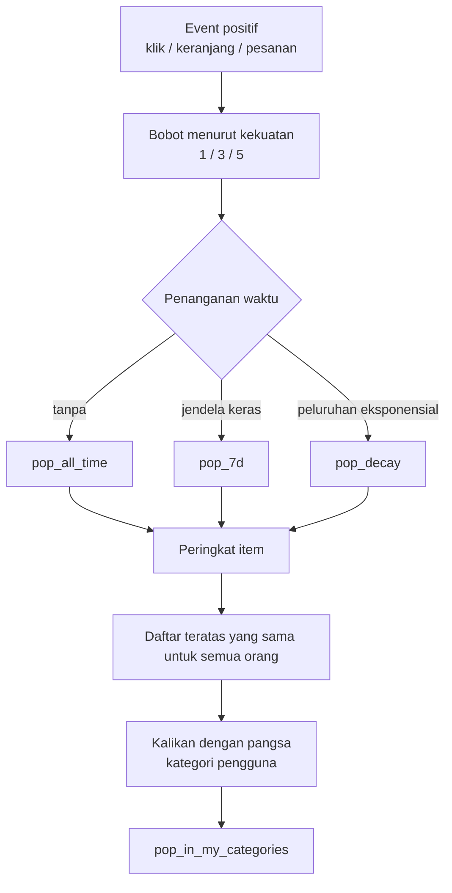
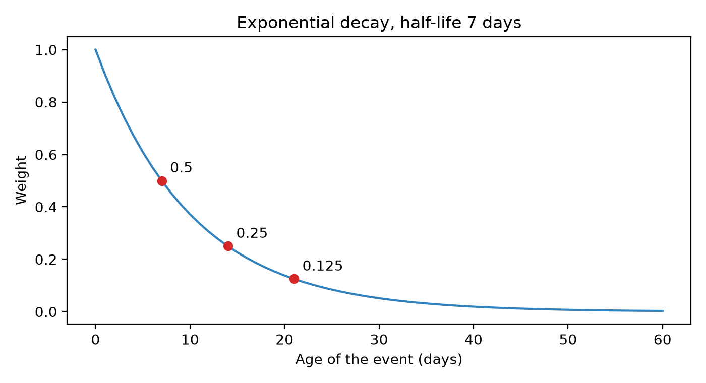
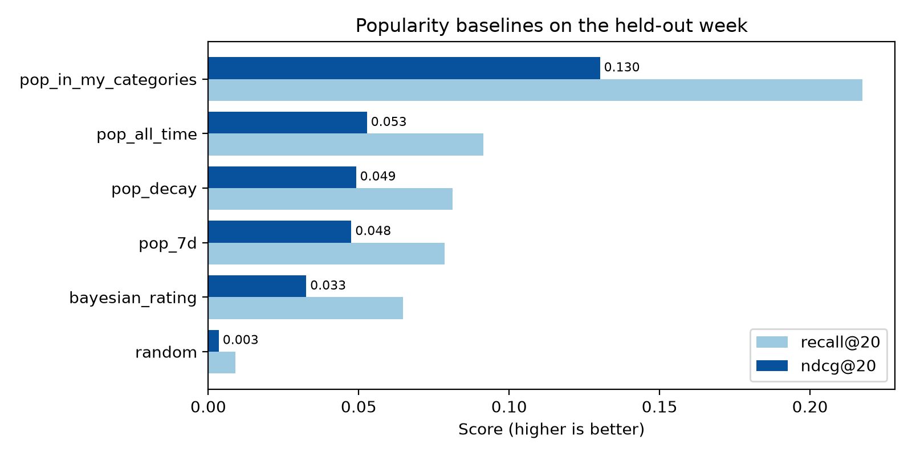

# Baseline popularitas

Hari Senin setelah tanggal gajian. Dewi, seorang product manager di marketplace sekelas Shopee, punya masalah. Home feed baru akan rilis dua minggu lagi, tim *machine learning* masih berdebat soal *embedding*, dan CEO baru saja mengajukan pertanyaan sederhana: "Kalau kita rilis *tanpa yang canggih-canggih*, home page menampilkan apa?" Jawaban Dewi adalah jawaban yang menjadi titik awal setiap proyek sistem rekomendasi: tampilkan apa yang sedang dibeli orang lain. Satu query SQL, `GROUP BY item_id ORDER BY count(*) DESC LIMIT 20`, dan halaman itu tidak lagi kosong.

Query itu adalah sistem rekomendasi tertua di dunia. Ia juga yang tetap dipertahankan oleh setiap sistem serius: sebagai *fallback* untuk *cold start*, sebagai sumber kandidat, sebagai fitur, dan terutama sebagai **tolok ukur** (*yardstick*). Kalau model canggih tidak bisa mengalahkan "tampilkan produk terlaris", ia bukan model, melainkan cara mahal untuk salah. Di bab ini kita membangun satu keluarga *baseline* popularitas, dari acak murni sampai "populer di kategori yang *Anda* sukai", mengukur semuanya pada data yang sama dengan metrik dari Bab 2, dan mempelajari sedikit matematika (peluruhan eksponensial, *Bayesian shrinkage*) yang akan muncul lagi di sepanjang buku ini.

**Yang akan Anda pelajari**

- Mengapa *baseline* didahulukan, dan seperti apa *baseline* yang baik.
- Popularitas global, berjendela (*windowed*), dan berpeluruhan waktu (*time-decayed*), termasuk matematika *half-life* di balik peluruhan.
- Rata-rata Bayesian (dan generalisasinya, `_smoothed`, di repositori ini) agar kita tidak terlalu percaya pada sampel kecil.
- Bagaimana sedikit personalisasi, "populer di kategori yang Anda sukai", lebih dari menggandakan ndcg@20 dibanding daftar global terbaik.
- Apa itu bias popularitas (*popularity bias*), mengapa cakupan (*coverage*) runtuh, dan apa yang dilakukan sistem produksi untuk mengatasinya.

## Intuisi: rak di depan toko

Bayangkan toko buku di lingkungan rumah Anda. Saat Anda pertama kali masuk, pemiliknya tidak tahu apa-apa tentang Anda, lalu apa yang ia lakukan? Ia menaruh buku terlaris di meja dekat pintu. Ia tidak perlu tahu selera Anda: buku yang dibeli ratusan orang lain adalah taruhan yang cukup baik untuk orang asing. Meja itu adalah **sistem rekomendasi popularitas global** (*global popularity recommender*): satu peringkat, sama untuk semua orang.

Sekarang perhatikan apa yang ditambahkan seorang pemilik toko yang cerdik seiring waktu.

1. **Ia melupakan secara perlahan.** Buku yang terjual 500 eksemplar tahun lalu tetapi hanya dua minggu lalu tidak lagi ada di meja. Itulah *peluruhan waktu* (*time decay*): penjualan terbaru dihitung lebih besar daripada yang lama. Toko yang tidak pernah lupa akhirnya menghias meja depannya dengan hit musim lalu.
2. **Ia tidak mempercayai sampel kecil.** Buku dengan skor bintang lima sempurna dari satu pengulas, sepupu sang penulis, tidak boleh mengalahkan buku dengan 4,7 bintang dari dua ribu pembaca. Itulah *shrinkage*, atau rata-rata Bayesian: ketika bukti tipis, bersandarlah pada apa yang kita ketahui tentang buku secara umum.
3. **Ia memperhatikan siapa Anda.** Begitu Anda bilang suka memasak, ia mengantar Anda ke rak buku resep, dan *di sana* ia kembali menunjuk buku terlaris. Ia tidak memakai model canggih tentang selera Anda; ia hanya mengiriskan "apa yang Anda suka" dengan "apa yang populer". Itulah **popularitas yang dipersonalisasi** (*personalised popularity*), dan itu jembatan dari bab ini ke sisa buku.

Setiap langkah itu punya bentuk numerik yang presisi. Tidak satu pun membutuhkan lebih dari `groupby` pandas. Namun, seperti yang akan kita lihat pada hasilnya, langkah ketiga saja menghasilkan skor 2,5 kali lebih tinggi daripada tabel terlaris biasa.



*Gambar: Setiap baseline popularitas bermula dari event positif berbobot yang sama dan hanya berbeda dalam cara memperlakukan waktu serta apakah ia memperhatikan pengguna.*

## Algoritma: lima cara menghitung

Kelima metode di bawah ini pada intinya satu gagasan: *jumlahkan bukti, urutkan, ambil yang teratas.* Bedanya ada pada apa yang dianggap sebagai bukti. Kita menjaga evaluasi tetap identik untuk semuanya: mereka menilai setiap item yang tersedia untuk setiap pengguna evaluasi, mengambil 50 terbaik, dan dinilai pada minggu setelah titik potong (*cutoff*) (Bab 2 menjelaskan mengapa pemisahan ini jujur).

### Langkah 0: Mengubah event menjadi bobot

Marketplace mencatat banyak jenis event, tetapi hanya tiga yang merupakan sinyal *positif*: klik, *add-to-cart*, dan pesanan. Repositori memberi mereka kekuatan di `schema.EVENT_WEIGHT`: klik = 1, add-to-cart = 3, pesanan = 5. Sebuah pembelian lima kali lebih bermakna daripada satu klik. `History.interactions()` adalah tempat hal itu terjadi: ia menyaring log event menjadi ketiga jenis tersebut, menempelkan bobot `w`, dan membawa serta `age_days`, jumlah hari antara event dan titik potong.

Semua yang ada di bab ini membaca dari satu tabel itu. Misalkan $w_e$ adalah bobot event $e$, dan $a_e$ usianya dalam hari.

### Metode 1: Popularitas global

Aturan penilaian paling sederhana adalah menjumlahkan bobot untuk setiap item di seluruh riwayat:

$$
\text{pop}(i) = \sum_{e \,:\, \text{item}(e)=i} w_e .
$$

Urutkan menurun dan Anda punya daftar terlaris. Kelebihannya: sepele, kokoh, dan tidak butuh informasi pengguna, sehingga bekerja untuk pengunjung yang belum pernah login. Kekurangannya: ia buta terhadap waktu. Item yang enam minggu lalu menjadi hit besar dan hari ini sudah mati tetap bertengger di dekat puncak.

### Metode 2: Jendela waktu keras

Perbaikan standarnya adalah menghitung hanya event terbaru. Untuk jendela selebar $W$ hari:

$$
\text{pop}_W(i) = \sum_{e \,:\, \text{item}(e)=i,\; a_e < W} w_e .
$$

Dengan $W=7$ inilah daftar "tren minggu ini", dan persis itulah yang dihitung `candidates.item_popularity(hist, 7)`. Jendela adalah alat yang kasar: event berusia 6,9 hari dihitung penuh, event berusia 7,1 hari tidak dihitung sama sekali. Ada pula harga statistiknya. Event yang lebih sedikit berarti hitungan yang lebih berisik: jika sebuah item terjual sepuluh unit seminggu, hitungan mingguannya naik-turun cukup besar hanya karena kebetulan.

### Metode 3: Peluruhan waktu eksponensial

Alih-alih tebing, kita bisa memakai lereng yang mulus. Setiap event kehilangan nilai seiring bertambahnya usia, dan pilihan yang lazim adalah peluruhan eksponensial yang dikendalikan oleh **half-life** (waktu paruh) $h$: usia ketika sebuah event bernilai separuh dari event yang masih baru.

$$
d(a) = 2^{-a/h} = e^{-\lambda a}, \qquad \lambda = \frac{\ln 2}{h}.
$$

Kedua bentuk itu adalah fungsi yang sama. Yang pertama lebih mudah dinalar (setiap $h$ hari bobotnya separuh); yang kedua adalah bentuk yang disukai kalkulus. Dengan $h = 7$ hari, yaitu `HALF_LIFE_DAYS` di repositori, kita mendapat $\lambda = 0{,}693/7 \approx 0{,}099$ per hari. Popularitas terluruh (*decayed*) adalah

$$
\text{pop}_{\text{decay}}(i) = \sum_{e \,:\, \text{item}(e)=i} w_e \cdot 2^{-a_e/h}.
$$

Mari kita periksa bahwa bentuknya sesuai klaim kita. Pada usia 0 bobotnya 1. Pada usia 7 bobotnya $2^{-1} = 0{,}5$. Pada 14 menjadi $2^{-2} = 0{,}25$, pada 21 menjadi $0{,}125$. Setelah sebulan sekitar 5%, dan event dari awal riwayat nyaris tidak bernilai. Skrip mencetak angka-angka ini, dan grafik memplotnya.



Peluruhan eksponensial menjadi bawaan produksi karena tiga alasan. Ia **tak bermemori** (*memoryless*): nilai relatif hanya bergantung pada selang antar event, sehingga penilaian ulang esok hari tidak mengubah peringkat. Ia **bisa diperbarui secara inkremental**: simpan satu angka $S$ per item dan atur $S \leftarrow S\cdot 2^{-(t-t_{\text{last}})/h} + w$ pada setiap event, satu perkalian dan satu penjumlahan. Dan ia punya **satu kenop yang intuitif**: agar sebuah event bernilai 10% setelah 30 hari, selesaikan $2^{-30/h}=0{,}1$, sehingga $h = 30\ln 2/\ln 10 \approx 9{,}0$ hari.

### Contoh hitungan kecil

Ambil dua item dan riwayat mainan. Item A mendapat tiga klik baru-baru ini: dua kemarin dan satu tiga hari lalu. Item B adalah hit tiga minggu lalu, dengan lima klik, semuanya 20 hari lalu. Semua klik berbobot 1. Angka-angka mainan di bawah ini dibuat-buat untuk ilustrasi; angka sesungguhnya muncul belakangan.

| Metode | Item A | Item B | Pemenang |
|---|---|---|---|
| Sepanjang waktu: jumlah bobot | 3 | 5 | B |
| Jendela 7 hari | 3 | 0 | A |
| Peluruhan, $h=7$ | $2 \times 0.906 + 0.743 = 2.55$ | $5 \times 2^{-20/7} = 5 \times 0.138 = 0.69$ | A |

Metode sepanjang waktu memilih B karena ia tidak pernah lupa. Jendela 7 hari memilih A, tetapi hanya karena B jatuh dari tebing; seandainya klik B berusia 6 hari, klik itu akan dihitung penuh. Peluruhan memberi jawaban yang lembut: A menang karena buktinya lebih segar, namun B tidak nol, jadi bila ia terus mendapat klik ia akan naik kembali. Kemulusan inilah alasan peluruhan muncul di separuh pembangkit kandidat (*candidate generator*) di repositori.

### Metode 4: Rata-rata Bayesian (tidak mempercayai sampel kecil)

Sejauh ini kita meranking berdasarkan *permintaan*. Sinyal populer lainnya adalah *kualitas*: rata-rata rating bintang. Tetapi rata-rata bisa berbohong saat sampelnya kecil. Produk dengan satu rating bintang 5 punya rata-rata 5,0, lebih tinggi daripada produk terlaris dengan 4,8 dari ribuan pembeli. Kita menginginkan skor yang dimulai dari rata-rata *global* ketika tidak ada bukti, lalu perlahan bergeser ke rata-rata item itu sendiri seiring bukti menumpuk.

Misalkan $R$ adalah rating rata-rata sebuah item, $v$ jumlah ratingnya, $C$ rating rata-rata semua item, dan $m$ **kekuatan prior** (*prior strength*): berapa banyak rating "bukti khayalan" pada rata-rata global yang kita tambahkan. Rata-rata Bayesian adalah

$$
\text{WR} = \frac{v}{v+m}\, R + \frac{m}{v+m}\, C .
$$

Bacalah sebagai campuran berbobot. Bobot untuk rata-rata item itu sendiri, $v/(v+m)$, bernilai 0 saat $v = 0$ dan menuju 1 seiring $v$ membesar. Bobot untuk rata-rata global adalah sisanya. Saat $v = m$ campurannya 50/50, jadi $m$ adalah "jumlah rating pada titik di mana kita mempercayai item sebesar kita mempercayai prior".

Sudut pandang yang setara membuat gagasan ini bisa dipakai ulang. Kalikan pembilangnya: $R \cdot v$ adalah total bintang, sehingga

$$
\text{WR} = \frac{\text{(total bintang)} + m \cdot C}{v + m}.
$$

Dengan kata lain: *anggaplah setiap item menerima $m$ rating tambahan, semuanya sama dengan rata-rata global.* Bentuk umum "(pembilang + prior × kekuatan) ÷ (penyebut + kekuatan)" berlaku untuk rasio apa pun, bukan hanya rating bintang. *Click-through rate* adalah klik ÷ impresi, konversi adalah pesanan ÷ klik, tingkat retur adalah retur ÷ pesanan. Repositori membungkusnya dalam satu fungsi kecil, `features._smoothed`, dan memakainya berkali-kali di Bab 9.

Berikut pemeriksaan dengan angka kecil. Sebuah item punya $v = 20$ rating dengan rata-rata $R = 4{,}8$. Rata-rata global $C = 4{,}0$ dan kekuatan prior $m = 100$. Maka

$$
\text{WR} = \tfrac{20}{120}\cdot 4.8 + \tfrac{100}{120}\cdot 4.0 = 0.8 + 3.33 = 4.13 .
$$

Item itu tampak bagus (4,8), tetapi dua puluh rating belum banyak, sehingga estimasinya tetap dekat dengan prior. Aritmetika yang sama berlaku pada tingkat konversi: 3 klik dari 10 impresi (30% mentah) dengan CTR global 5% dan kekuatan 50 di-*smooth* menjadi $(3+2{,}5)/60 = 9{,}2\%$, sedangkan 50 klik dari 1.000 impresi tetap di 5,0%. Sampel kecil dikerutkan keras; sampel besar nyaris tak bergeser.

::: fact
**"Top 250" adalah rata-rata Bayesian.** IMDb secara terbuka mendokumentasikan rumus yang dipakainya untuk meranking Top 250 film: weighted rating = (v ÷ (v+m)) × R + (m ÷ (v+m)) × C, dengan R adalah rating rata-rata judul tersebut, v jumlah ratingnya, m jumlah rating minimum agar dapat masuk daftar (saat ini 25.000), dan C rating rata-rata di seluruh judul. IMDb sendiri menyebutnya "a true Bayesian estimate". Itu persis rumus di bagian ini.

Sumber: IMDb, IMDb Help Center, 2026
:::

### Metode 5: Populer di kategori yang *Anda* sukai

Empat metode pertama mengembalikan *daftar yang sama untuk setiap pengguna*. Yang terakhir menambahkan dosis personalisasi sekecil yang bisa dibayangkan. Ia memakai dua bahan yang sudah dihitung repositori.

1. **Afinitas kategori** (*category affinity*) $s_{u,c}$: pangsa aktivitas (terluruh) pengguna $u$, yaitu klik, keranjang, pesanan *dan* pencarian, yang jatuh pada kategori $c$. Jumlahnya 1 atas semua kategori untuk setiap pengguna, dan dihasilkan oleh `candidates.category_affinity`.
2. **Popularitas ternormalisasi dalam kategori**: untuk item $i$ di kategori $c(i)$,

$$
\tilde p(i) = \frac{\text{pop}_7(i)}{\max_{j \in c(i)} \text{pop}_7(j)} \in [0,1].
$$

Item terbaik di setiap kategori mendapat 1, sisanya adalah pecahan darinya. Skor akhir mengalikan keduanya:

$$
\text{score}(u, i) = s_{u,\,c(i)} \cdot \tilde p(i).
$$

Mengapa dinormalisasi dalam kategori? Tanpa itu, kategori besar seperti Camilan akan menenggelamkan yang lain. Dengan normalisasi, setiap kategori punya "langit-langit" yang sama, dan afinitas pengguna menentukan *bintang dari kategori mana* yang muncul. Suku tambahan kecil (sepersejuta dari popularitas global) memecah seri dan memberi pengguna *tanpa* riwayat, yang afinitasnya nol semua, daftar `pop_7d` biasa sebagai *fallback*.

Contoh hitungan: Sari menghabiskan 60% aktivitasnya pada Makanan Kucing, 30% pada Mainan Anjing, dan 10% pada Perawatan Kulit. Item makanan kucing terbaik bernilai $0{,}6\times1=0{,}6$, runner-up dengan 80% popularitasnya bernilai $0{,}48$, mainan anjing terbaik $0{,}3$, item perawatan kulit terbaik hanya $0{,}1$. Feed-nya sebagian besar berisi item hewan peliharaan, diurutkan menurut popularitas dalam setiap rak.

::: fact
**Bias popularitas bukan bug pada implementasi Anda; ia adalah sifat sistem rekomendasi yang terdokumentasi.** Abdollahpouri dan rekan-rekannya menunjukkan pada dataset film bahwa banyak algoritma rekomendasi memusatkan keluarannya pada item populer, bahkan untuk pengguna yang seleranya kebanyakan niche, dan mereka mengukurnya sebagai "bias disparity" antara apa yang pengguna inginkan dan apa yang mereka dapatkan.

Sumber: Abdollahpouri et al., RMSE Workshop at RecSys, 2019
:::

## Penelusuran kode

Repositori sudah berisi komponen-komponen dasarnya. Kita membacanya lebih dulu, lalu skrip yang membungkusnya dalam sebuah evaluasi.

### Tabel interaksi

Semuanya bermula dari `History.interactions()`. Ingat bahwa objek `History` adalah log event yang *dipotong pada suatu titik waktu*, sehingga tidak ada yang setelah titik potong dapat bocor masuk (Bab 9 membahas ini lebih dalam).

```include
path: recommender/recsys/data.py
symbol: History.interactions
```

Ia hanya menyimpan jenis event yang ada di `EVENT_WEIGHT` dan menambahkan kolom bobot `w`. Kolom `age_days` ditempelkan saat `History` dibangun. Semua yang ada di bawah ini adalah reduksi yang berbeda atas baris-baris ini.

### Peluruhan waktu dalam satu baris

```include
path: recommender/recsys/candidates.py
symbol: _decay
```

Itulah seluruh rumus *half-life*: `0.5 ** (age_days / HALF_LIFE_DAYS)`. Karena diterapkan pada seluruh Series pandas, ia bekerja pada jutaan event sekaligus tanpa *loop* Python. Konstanta `HALF_LIFE_DAYS = 7.0` dideklarasikan di bagian atas `candidates.py`. Perhatikan bahwa fungsi ini privat (diawali garis bawah) namun dipakai beberapa *retriever*: `recent` mengalikan bobot setiap interaksi dengannya, dan `category_affinity` memakainya untuk klik maupun pencarian. Kurva yang sama dengan demikian mengungkapkan "berapa lama minat bertahan" di seluruh tahap pertama.

### Popularitas berjendela keras

```include
path: recommender/recsys/candidates.py
symbol: item_popularity
```

Tiga operasi: ambil interaksi positif, simpan baris dengan `age_days < window_days`, jumlahkan bobot per item. Perhatikan `<` yang ketat: event berusia tepat `window_days` *dikecualikan*. Fungsi ini mengembalikan `pd.Series` berindeks `item_id`, dan item tanpa event di dalam jendela sama sekali tidak ada, sehingga pemanggil harus melakukan `fillna(0)`. *Retriever* "trending" (jendela 3 hari), *retriever* populer-per-kategori (7 hari), dan `similar_items` semuanya memanggilnya, sehingga seluruh sistem berbagi *satu* definisi "populer" dan hanya jendelanya yang berubah.

### Smoothing

```include
path: recommender/recsys/features.py
symbol: _smoothed
```

Lagi-lagi satu baris, dan lagi-lagi persis rumusnya: `(num + prior * strength) / (den + strength)`. Petakan rata-rata Bayesian ke dalamnya dengan menetapkan `num` sebagai total bintang, `den` sebagai jumlah rating, `prior` sebagai $C$, dan `strength` sebagai $m$. Di tempat lain dalam `features.py` fungsi ini dipanggil dengan kekuatan yang berbeda: 20 pseudo-impresi untuk CTR pengguna, 50 untuk CTR item, 20 untuk konversi, dan 10 untuk tingkat retur. Nilai-nilai ini ditentukan dengan perasaan, bukan dipelajari; semakin kecil penyebut tipikal sebuah statistik, semakin kecil kekuatan yang bisa Anda tanggung.

### Skrip eksperimen

Skrip pendamping `book/code/ch03_popularity.py` membangun keenam *scorer* di atas item dan pengguna yang sama lalu mengevaluasinya dengan `common.evaluate` bersama. Dua fungsi pembantu mengurus pembukuan: `per_item` menyelaraskan Series per-item ke larik tetap item yang tersedia (nol untuk item tanpa event), dan `recs_from_scores` mengubah matriks skor (atau satu vektor, disiarkan ke setiap pengguna) menjadi 50 baris teratas per pengguna.

```include
path: book/code/ch03_popularity.py
symbol: per_item
```

```include
path: book/code/ch03_popularity.py
symbol: recs_from_scores
```

Urutan stabil (*stable sort*) itu penting: banyak item seri di nol, dan pengurutan tak stabil akan membuat hasil antar-run tidak dapat direproduksi.

Sekarang *scorer*-nya sendiri. Tiga yang pertama hampir satu baris (berada di tingkat modul dalam skrip):

```include
path: book/code/ch03_popularity.py
region: ch03_scores
```

Varian terluruh mengulang rumus `_decay` secara inline alih-alih mengimpor fungsi bantu privat, agar skrip bab ini mandiri. Rata-rata Bayesian bekerja pada kolom `rating_avg` dan `rating_count` katalog:

```include
path: book/code/ch03_popularity.py
region: ch03_bayes
```

Dua pilihan layak didiskusikan. Kekuatan prior $m$ ditetapkan sebagai *rata-rata jumlah rating per item*, heuristik yang lazim: pada ukuran sampel rata-rata, bukti dan prior dihitung sama. Rata-rata global $C$ diberi bobot $v$, sehingga ia adalah rata-rata atas semua *rating*, bukan rata-rata dari rata-rata item. Keduanya murah dihitung dan tidak butuh *tuning*.

Terakhir, versi yang dipersonalisasi. Ia membangun matriks pengguna × kategori `A` dari `category_affinity`, matriks per-item `P` berisi popularitas yang dinormalisasi dalam kategori, lalu mengalikannya:

```include
path: book/code/ch03_popularity.py
region: ch03_personal
```

`A` punya satu baris per pengguna evaluasi dan satu kolom per kategori; `P` punya satu baris per kategori dan satu kolom per item, dan bernilai bukan nol hanya di tempat item itu termasuk kategori pada baris tersebut. Hasil kali matriks dengan demikian menghasilkan, untuk setiap pengguna dan item, persis $s_{u,c(i)}\,\tilde p(i)$. Suku di ujung adalah pemecah seri yang dijelaskan sebelumnya.

## Jalankan

Dari direktori `book/`, dengan dependensi terpasang (lihat Kata Pengantar):

```bash
cd book
uv run python code/ch03_popularity.py
```

Skrip ini juga mencetak lima item teratas dari setiap metode global; kita tampilkan tiga kelompok di sini. Pertama, penyiapan rata-rata Bayesian dan empat baris contoh yang menunjukkan *shrinkage* bekerja:

```output
file: results/ch03_popularity.txt
lines: 2-12
```

Lalu tabel utama: satu baris per metode, dievaluasi pada pengguna yang sama, minggu label yang sama, dan kode metrik yang sama:

```output
file: results/ch03_popularity.txt
lines: 14-22
```

Terakhir, bobot peluruhan pada beberapa usia:

```output
file: results/ch03_popularity.txt
lines: 50-58
```

Skrip juga menulis `results/ch03_popularity.json`, yang dibaca skrip figur untuk menggambar dua grafik di bawah.

## Hasil

### Membaca kurva peluruhan

Kurva peluruhan pada Gambar 3.2 mengonfirmasi aritmetikanya. Bobot yang tercetak sesuai dengannya: 0,9057 setelah satu hari, 0,7430 setelah tiga, tepat 0,5000 setelah tujuh, 0,2500 setelah empat belas, dan 0,1250 setelah dua puluh satu. Pada titik 30 hari bobotnya sudah turun menjadi 0,0513, dan event berusia 53 hari, yang tertua dalam riwayat ini, hanya bernilai 0,0053 dari event baru. Artinya, untuk keperluan peringkat, peluruhan dengan half-life satu minggu berperilaku seperti jendela lunak sekitar dua hingga tiga minggu.

### Papan peringkat



Bacalah tabel utama baris demi baris. Kita berfokus pada ndcg@20 (satu angka yang memberi ganjaran bagi penempatan hit di dekat puncak) dan recall@20 (berapa banyak interaksi *held-out* pengguna yang kita temukan dalam 20 slot).

**Acak adalah lantainya.** `random` mencapai ndcg@20 sebesar 0,0035 dan recall@20 sebesar 0,0090. Tidak ada yang di bab ini boleh berskor lebih rendah, dan apa pun yang begitu pasti rusak. Cakupannya 1,0000: setiap item direkomendasikan kepada seseorang. Kita akan kembali pada keanehan bahwa metode *terburuk* punya cakupan *terbaik*.

**Popularitas global sudah sekitar empat belas hingga lima belas kali lebih baik daripada acak dalam ndcg@20.** `pop_all_time` berskor ndcg@20 0,0527 dan recall@20 0,0914, `pop_7d` berskor 0,0475 dan 0,0786, dan `pop_decay` berada di antaranya dengan 0,0491 dan 0,0813. Selisih antara acak dan metode masuk akal yang paling murah jauh lebih besar daripada selisih antar metode masuk akal itu sendiri. Sebagian besar nilai "mudah" yang dapat dicapai terletak pada sekadar mengetahui item mana yang diinginkan orang.

**Sepanjang waktu sedikit mengalahkan jendela 7 hari, kebalikan dari yang disarankan intuisi.** Banyak praktisi mengira "trending" akan menang. Di sini tidak, dan alasannya adalah sifat *data ini*: dalam simulator, setiap item punya kualitas tersembunyi yang tetap, sehingga kualitas tersembunyi sebuah item tidak berubah dan item yang populer sebulan lalu masih populer. Di bawah popularitas yang stabil, riwayat lebih panjang berarti lebih sedikit derau, dan hitungan 53 hari adalah estimasi yang lebih baik atas angka dasar yang sama daripada hitungan satu minggu. Varian peluruhan berada di antara keduanya karena alasan yang sama: jendela efektifnya lebih panjang dari tujuh hari namun tetap memberi bobot lebih kecil pada yang lama.

Pada *cut-off* yang lebih dalam, daftar terluruh jauh lebih dekat dengan daftar sepanjang waktu (recall@50 adalah 0,1557 berbanding 0,1575, sementara jendela keras turun ke 0,1335): lereng yang mulus mempertahankan ekor panjang bukti yang dibuang oleh tebing.

::: warning
Jangan menganggap "sepanjang waktu mengalahkan 7 hari" sebagai hukum alam. Itu hanya mengatakan bahwa katalog *simulasi* memiliki popularitas yang stasioner. Di marketplace sungguhan, *flash sale*, produk viral, dan kategori musiman (Ramadan, 9.9, 11.11) membuat popularitas bergeser, dan daftar berjendela atau terluruh biasanya menang. Pelajarannya: **ukur pada data Anda sendiri**, dan perlakukan jendela atau half-life sebagai hiperparameter yang disetel pada minggu validasi.
:::

**Kualitas bukan permintaan.** `bayesian_rating` punya ndcg@20 0,0325 dan recall@20 0,0648: sekitar sembilan kali lebih baik dari acak, tetapi lebih buruk daripada setiap metode berbasis permintaan. Pada baris-baris contoh, item 892 (tertulis 4,4, nol rating) bernilai 4,324, rata-rata global $C$; item 1840 (4,4, 34 rating) bergeser sedikit ke 4,343; item 610 (5,0, 2718 rating) berakhir di 4,975 karena bukti menenggelamkan prior ($m = 105{,}2$). *Shrinkage* bekerja sesuai rancangan, tetapi rating bagus bukan alasan untuk mengklik: produk niche berating tinggi hanya penting bagi segelintir orang yang membutuhkannya. Pakai rating Bayesian sebagai fitur atau rak "top rated", bukan sebagai *ranker* home feed.

Patut pula diperhatikan *placeholder* yang bersembunyi di data mentah. Baris pertama yang tercetak punya `rating_avg` 4,5 dengan nol rating: nilai bawaan yang ditulis ke setiap item baru. Tanpa *smoothing*, setiap item tanpa rating akan membawa 4,5 fiktif, yang tampak *lebih baik* daripada kebanyakan produk nyata. Rata-rata Bayesian memperbaikinya secara diam-diam dengan memperlakukan nol rating sebagai "tidak ada informasi".

**Sedikit personalisasi berdampak besar.** `pop_in_my_categories` mencapai ndcg@20 sebesar 0,1302 dan recall@20 sebesar 0,2173. Dibanding daftar global terbaik, itu faktor sekitar 2,5 pada ndcg, dan recall@50 naik ke 0,3529 berbanding 0,1575. Order recall@20, yang hanya menghitung *pesanan* held-out (sinyal terkuat), adalah 0,3050 berbanding 0,1202. Kita tidak melatih apa pun. Satu-satunya informasi baru adalah "kategori apa yang disentuh pengguna ini", dan itu memindahkan metrik dari "biasa saja" ke "lumayan". Inilah angka terpenting bab ini: *mengetahui bahkan preferensi pengguna yang kasar lebih berarti daripada perbaikan sebanyak apa pun pada daftar global.*

Perhatikan 21 pengguna evaluasi, dari 947, yang sama sekali tidak punya sinyal kategori dan jatuh kembali ke `pop_7d` biasa. Itu sekitar 2% pengguna, dan *fallback* itu berarti mereka tetap mendapat halaman yang masuk akal alih-alih kosong: degradasi yang anggun (*graceful degradation*) yang sama yang diandalkan sistem produksi ketika pengunjung baru tiba.

## Jebakan dan praktik di produksi

### Popularitas memperkuat dirinya sendiri

Masalah terpenting bukanlah akurasi, melainkan **lingkaran umpan balik** (*feedback loop*). Jika Anda menampilkan dua puluh item yang sama kepada semua orang, orang mengklik kedua puluh item itu (karena hanya itu yang bisa mereka lihat), hitungan klik item-item tersebut bertambah, dan minggu depan mereka makin "populer". Item di luar daftar tidak dapat memperoleh bukti, sebagus apa pun mereka. Para ekonom menyebutnya efek Matthew; orang rekomendasi menyebutnya bias popularitas.

Lingkarannya sederhana: eksposur menghasilkan klik, klik menghasilkan skor, dan skor menentukan eksposur, sehingga item di luar daftar tidak bisa masuk.

Tabel memperlihatkannya. Ketiga metode global semuanya punya coverage@20 sebesar 0,0087: di antara 947 pengguna, mereka merekomendasikan *dua puluh item yang sama*. Metode yang dipersonalisasi, pada 0,2164, menyentuh sekitar dua puluh lima kali lebih banyak item berbeda, dan acak, pada 1,0000, menyentuh semuanya.

Sistem produksi menanganinya berlapis-lapis; tidak ada yang menjadi tugas *baseline*, tetapi semuanya dibangun di atasnya:

- **Personalisasi** (sisa buku ini) mengurangi dominasi satu daftar global.
- **Eksplorasi**: sisihkan beberapa slot untuk item dengan data sedikit, dan tampilkan cukup sering agar bisa diukur. Bab 11 memperkenalkan ε-greedy dan Thompson sampling.
- **Koreksi bias posisi** agar "diklik" tidak keliru dianggap "relevan" padahal item itu hanya ditaruh di posisi 1 (Bab 12).
- **Re-ranking yang terkalibrasi atau didiversifikasi** seperti MMR, agar 20 teratas bukan dua puluh item yang nyaris kembar (Bab 11).
- **Normalisasi terhadap eksposur**: pakai *click-through rate* dengan *smoothing* alih-alih hitungan klik mentah, sehingga item diberi ganjaran atas *konversi per tampilan*, bukan atas seberapa sering ia ditempatkan di halaman. Di sinilah `_smoothed` muncul kembali.

### Memilih jendela dan half-life

Baik $W$ maupun $h$ adalah hiperparameter. Terlalu pendek mengejar derau (satu *flash sale* sejam menentukan daftar); terlalu panjang menyajikan berita kemarin. Fesyen, elektronik, dan makanan bergerak dengan kecepatan berbeda, sehingga sebagian marketplace memakai satu half-life per kategori tingkat atas. Cobalah tiga nilai (misalnya 3, 7, 14 hari) pada minggu *held-out*, seperti yang diminta latihan praktik.

### Jangan campur skala, hitung pengguna

Skala `pop_7d`, `pop_decay`, dan rating $[1,5]$ tidak sebanding: normalisasikan ke $[0,1]$ sebelum dicampur, atau umpankan masing-masing ke *ranker* sebagai fitur terpisah. Dan hitunglah pengguna yang berbeda (atau batasi kontribusi tiap pengguna), karena satu pembeli yang mengklik 40 kali menggelembungkan skor sebesar 40.

### Popularitas sebagai sumber kandidat dan sebagai fitur

Di repositori ini *baseline* bertahan dalam tiga peran: **fallback** (*retriever* trending untuk pengguna tanpa riwayat, dan query pesanan-terbaru-teratas milik API Rust ketika Python mati), **sumber kandidat** (`catpop` di Bab 8 hampir sama dengan metode 5), dan **fitur** (kolom popularitas ter-*smooth*, CTR, dan konversi yang dibobot sendiri oleh *ranker*).

## Ringkasan

- Sistem rekomendasi popularitas menjumlahkan event positif berbobot per item lalu mengurutkan. Murah, kokoh, tidak butuh data pengguna, dan menetapkan batas yang harus dilampaui setiap metode lain.
- Jendela keras hanya menghitung event terbaru; peluruhan eksponensial dengan half-life $h$ memberi setiap event bobot $2^{-a/h}$, sehingga bukti memudar secara mulus dan skor dapat diperbarui secara inkremental dengan satu perkalian dan satu penjumlahan.
- Rata-rata Bayesian $\frac{v}{v+m}R + \frac{m}{v+m}C$ mengerutkan sampel kecil ke rata-rata global. Repositori menggeneralisasinya sebagai `_smoothed(num, den, prior, strength)` untuk CTR, konversi, dan tingkat retur.
- Pada data ini popularitas sepanjang waktu sedikit mengalahkan jendela 7 hari, karena popularitas simulasi stabil. Jendela mana yang menang bergantung pada seberapa cepat popularitas nyata bergeser, jadi setel pada data *held-out*.
- Meranking berdasarkan rating saja kalah dari meranking berdasarkan permintaan: kualitas tidak sama dengan relevansi.
- Mengalikan afinitas kategori dengan popularitas dalam kategori menaikkan ndcg@20 dari sekitar 0,05 menjadi 0,13 tanpa pelatihan model, argumen paling jelas untuk personalisasi.
- Popularitas global memberi setiap pengguna beberapa item yang sama (cakupan 0,0087) dan menyuapi lingkaran yang memperkuat dirinya sendiri; bab-bab berikutnya menambahkan personalisasi, eksplorasi, dan diversitas untuk melawannya.

## Kuis

**Q3.1** Mengapa `pop_all_time` sedikit mengalahkan `pop_7d` pada data simulasi buku ini?

A. Jendela 7 hari tidak berisi klik sama sekali.
B. Popularitas item simulasi stabil, sehingga riwayat yang lebih panjang memberi estimasi yang kurang berisik atas besaran yang sama.
C. `pop_7d` memakai minggu evaluasi yang berbeda.
D. Peluruhan tidak diterapkan pada `pop_all_time`, dan peluruhan selalu merugikan.

**Q3.2** Sebuah item punya rating katalog 4,4 tetapi `rating_count = 0`. Berapa skor rata-rata Bayesian-nya?

A. 4,4, karena rating item itu sendiri selalu dipakai.
B. 0, karena tidak ada bukti.
C. Rata-rata rating global $C$, karena dengan $v=0$ seluruh bobot jatuh pada prior.
D. Rata-rata dari $m$ dan $C$.

**Q3.3** Ketiga metode popularitas global semuanya punya `coverage@20 = 0.0087`. Apa artinya?

A. Mereka gagal untuk 99% pengguna.
B. Setiap pengguna menerima 20 item yang sama, sehingga metode-metode itu hanya merekomendasikan sebagian sangat kecil dari katalog.
C. Mereka merekomendasikan sebuah item sekali setiap 115 permintaan.
D. Metriknya rusak, karena cakupan harus melebihi recall.

**Q3.4** Dengan kata-kata Anda sendiri, tunjukkan bagaimana `features._smoothed(num, den, prior, strength)` mereproduksi rata-rata Bayesian dari rating bintang sebuah item. Sebutkan apa yang Anda berikan sebagai masing-masing dari keempat argumennya.

**Q3.5** Jelaskan lingkaran umpan balik popularitas dalam dua atau tiga kalimat dan sebutkan satu teknik dari bab ini atau bab berikutnya yang melemahkannya.

**Q3.6** Bacalah kode di bawah. Untuk sebuah interaksi dengan `age_days` tepat `7.0`, apakah ia berkontribusi pada hasil? Berapa bobot interaksi yang lolos, dan apa yang akan Anda ubah agar event dari 7 hari terakhir *dan* hari ke-8 ikut dihitung?

```include
path: recommender/recsys/candidates.py
symbol: item_popularity
```

**Q3.7** Numerik. Dengan half-life 7 hari, hitung skor popularitas terluruh sebuah item yang memiliki event berikut (bobot dari repositori: klik = 1, add-to-cart = 3, pesanan = 5): satu pesanan 7 hari lalu, satu klik 14 hari lalu, dan satu add-to-cart 3 hari lalu. Gunakan $2^{-3/7} \approx 0{,}743$.

**Q3.8** Numerik. Sebuah item punya $v = 20$ rating dengan rata-rata $R = 4{,}8$. Rata-rata rating global adalah $C = 4{,}0$ dan kekuatan prior $m = 100$. Berapa rata-rata Bayesian-nya? Berapa jadinya jika $v = 400$ rating dengan rata-rata yang sama?

**Q3.9** Jawaban singkat. Anda ingin sebuah event bernilai tepat 25% dari event baru setelah 10 hari. Half-life berapa yang Anda butuhkan? Lalu jelaskan dalam satu kalimat mengapa half-life yang *lebih kecil* membuat sistem rekomendasi bereaksi lebih cepat tetapi juga lebih berisik.

**Q3.10** Latihan praktik. Buka `book/code/ch03_popularity.py` dan ubah `HALF_LIFE = 7.0` menjadi 2.0, lalu menjadi 30.0, dengan menjalankan `uv run python code/ch03_popularity.py` setiap kali (setelahnya pulihkan berkas dan hasilnya dengan `git checkout code/ch03_popularity.py results/`). Bandingkan ndcg@20 pada baris `pop_decay` dengan baris `pop_7d` dan `pop_all_time` setiap kali. Apa yang Anda amati saat half-life menjadi sangat pendek dan sangat panjang, dan apakah itu cocok dengan penjelasan di bagian Hasil?
