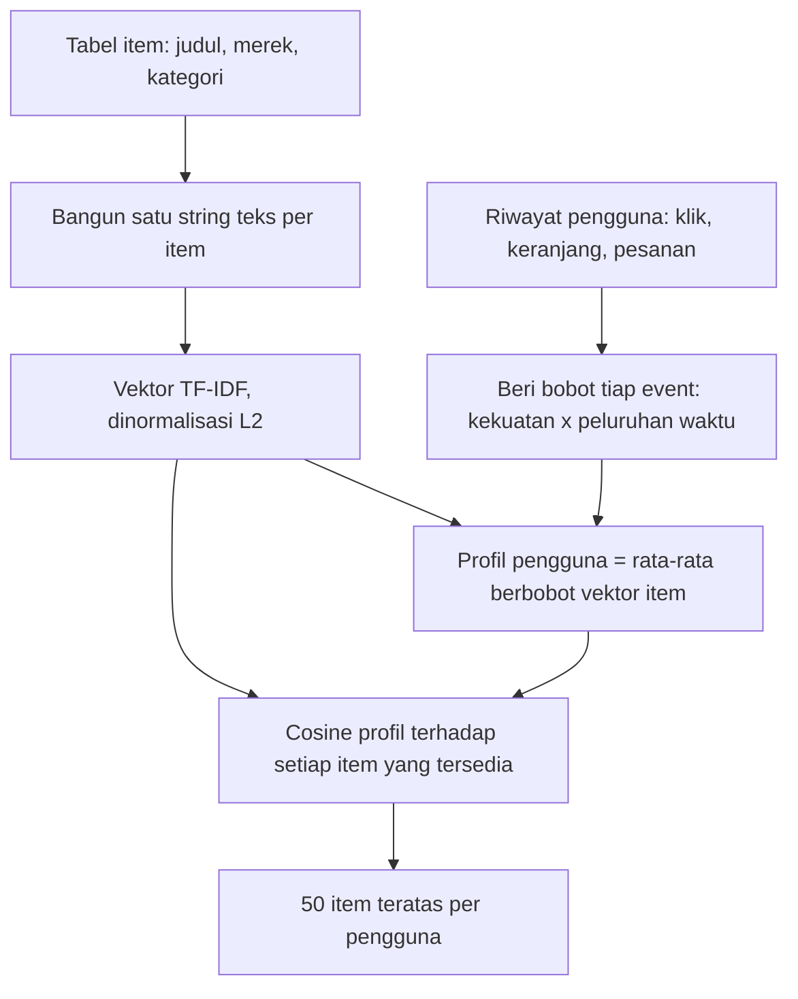
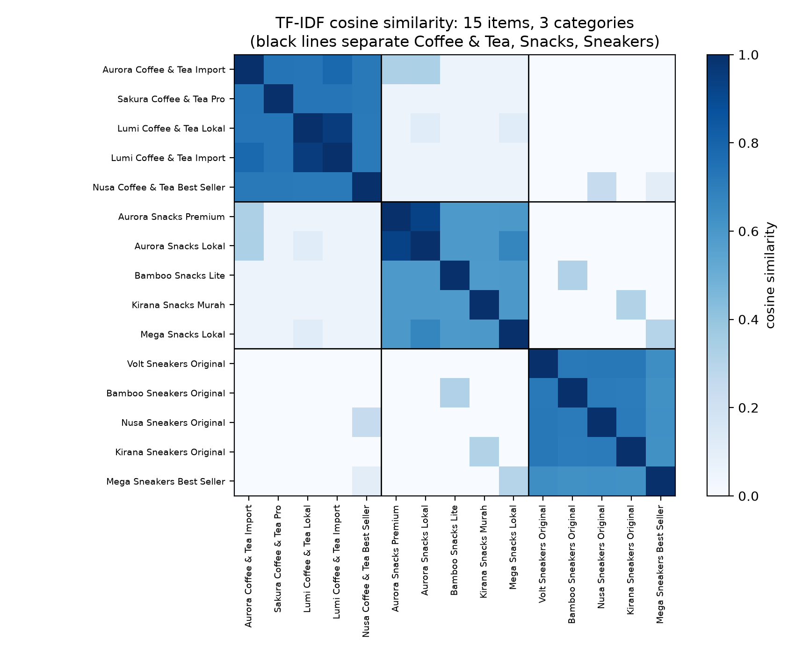
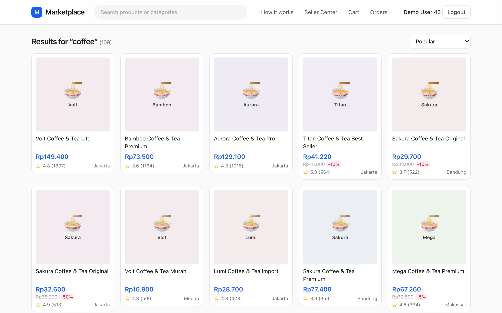

# Content-based filtering

Seminggu sebelum sale 9.9, Sari, seorang product manager di tim *discovery* marketplace, menatap dashboard dengan satu angka yang tidak ia sukai. Setiap hari beberapa ratus produk baru didaftarkan penjual: dripper kopi keramik dari toko di Bandung, sepasang sneakers dari merek yang belum pernah dicari siapa pun, paket makanan kucing yang baru tayang sepuluh menit lalu. Tak satu pun punya klik. *Baseline* popularitas dari bab sebelumnya tidak bisa melihat produk-produk ini, karena popularitas adalah *riwayat*, dan produk-produk ini belum punya riwayat. Padahal pembeli yang minggu lalu menjelajahi peralatan kopi *pour-over* hampir pasti akan menyukai dripper itu.

Yang dibutuhkan Sari adalah sistem rekomendasi yang melihat apa *wujud* sebuah item, bukan hanya siapa yang pernah menyentuhnya. Jika judul dripper memuat kata "coffee" dan pembeli sering mengeklik barang-barang kopi, keduanya bisa dicocokkan tanpa satu pun interaksi pada produk baru itu. Gagasan inilah yang disebut **content-based filtering** (penyaringan berbasis konten).

Masalah Sari punya nama: **cold start** ("start dingin"). Item atau pengguna yang *dingin* adalah yang belum punya riwayat, sehingga semua metode yang belajar dari klik masa lalu tidak punya bahan untuk dipelajari. Content-based filtering adalah jawaban standar untuk cold start, karena ia hanya butuh fakta yang sudah ada sejak detik pertama: judul, merek, dan kategori.

**Yang akan Anda pelajari**

- Cara mengubah teks dan metadata sebuah item menjadi vektor numerik, dan mengapa kata diberi bobot dengan TF-IDF alih-alih sekadar dihitung.
- Apa yang diukur oleh *cosine similarity* (kemiripan kosinus), dan mengapa ia menjadi ukuran jarak bawaan untuk vektor teks yang jarang (*sparse*).
- Cara membangun profil pengguna (*user profile*) sebagai rata-rata berbobot peluruhan waktu dari vektor item yang disentuh pengguna, lalu menilai setiap item terhadap profil itu.
- Bagaimana skrip pendamping `ch04_content.py` bekerja pada marketplace simulasi, dan mengapa ia mengalahkan popularitas global tetapi tidak mengalahkan popularitas yang sadar kategori.
- Di mana metode berbasis konten unggul (*cold start*) dan di mana ia gagal (spesialisasi berlebihan, metadata yang dangkal).

Berikut peta singkat istilah yang dipakai bab ini. Tiap istilah dijelaskan lagi, pelan-pelan, di tempat ia pertama kali muncul.

| Istilah | Arti sederhana |
|---|---|
| **Vektor** | Daftar angka dengan urutan tetap. Kita ubah setiap produk menjadi satu vektor agar komputer bisa membandingkan produk. |
| **TF-IDF** | Cara mengisi daftar itu agar kata yang langka dan spesifik dihitung lebih berat daripada kata yang umum. |
| **Cosine similarity** | Skor 0 sampai 1 untuk seberapa mirip dua vektor. 1 berarti arahnya sama, 0 berarti tidak ada kesamaan. |
| **Profil pengguna** | Ringkasan selera satu pembeli, dibangun dengan mencampur vektor produk yang ia sentuh. |
| **Cold start** | Merekomendasikan untuk item atau pengguna baru yang belum punya riwayat. |
| **Filter bubble** | Saat sistem rekomendasi terus menampilkan hal yang sama, sehingga pembeli tidak pernah melihat sesuatu yang berbeda. |

## Intuisi: pustakawan yang tak pernah melihat para pembaca

Bayangkan seorang pustakawan yang tidak boleh melihat catatan peminjaman. Ia tidak bisa berkata "orang yang meminjam buku ini juga meminjam buku itu". Yang boleh ia lakukan hanyalah membaca sampul: judul, rak subjek, pengarang. Ketika Anda menyerahkan tiga novel yang Anda sukai, ia berjalan ke rak, mencari buku yang sampulnya *terdengar mirip* dengan ketiga buku tadi, lalu menyerahkannya kepada Anda.

Pustakawan itu adalah *content-based recommender*. Ia punya dua keahlian:

1. Ia bisa menggambarkan setiap buku sebagai daftar singkat kata deskriptif (**representasi item**, *item representation*).
2. Ia bisa merangkum selera Anda sebagai daftar kata yang sejenis (**profil pengguna**, *user profile*), lalu membandingkan kedua daftar itu.

Perhatikan apa yang tidak ia butuhkan: pembaca lain. Itulah kekuatan sekaligus kelemahannya: buku yang baru tiba pagi ini langsung bisa direkomendasikan, tetapi ia akan terus menggiring Anda ke rak kriminal selamanya.

Di marketplace kita, "sampul" itu adalah kolom `title`, `brand`, dan kategori (beserta kategori induknya) pada tabel `items`.

*Pipeline* bab ini tampak seperti berikut:



*Gambar: Pipeline content-based. Vektor item dihitung sekali; profil pengguna dihitung ulang dari riwayat terbaru.*

Semua langkah di sini murah, deterministik, dan dapat dijelaskan. Itulah sebabnya penilaian berbasis konten tetap menjadi andalan untuk widget "item serupa" dan *fallback* saat *cold start*.

## Algoritma

### Langkah 1: representasi item sebagai teks

Cara paling sederhana, dan ternyata cukup efektif, untuk merepresentasikan item adalah merekatkan field deskriptifnya menjadi satu string dan memperlakukan string itu sebagai dokumen pendek. Di skrip pendamping ini hanya satu baris:

```include
path: book/code/ch04_content.py
region: item_text
```

Item berjudul "Volt Skincare Lokal" pada kategori "Skincare" dengan merek "Volt" dan kategori induk "Beauty" menjadi dokumen `Volt Skincare Lokal Skincare Volt Beauty`. Perhatikan bahwa kata kategori dan merek sengaja diulang: judul di simulator ini pendek, dan mengulang field terstruktur membuatnya dihitung lebih dari sekali.

Selanjutnya kita ubah tiap dokumen menjadi **vektor**. Vektor hanyalah **daftar angka dengan urutan tetap**. Untuk membangunnya, pertama kita kumpulkan **kosakata** (*vocabulary*): daftar semua kata berbeda yang muncul di item mana pun. Lalu vektor memuat satu angka per kata kosakata. Resep paling sederhana adalah **bag of words** (kantong kata): keluarkan kata-kata dari judul seolah dari sebuah kantong, lalu catat berapa kali setiap kata kosakata muncul.

Misalnya, ambil kosakata empat kata dengan urutan (`aurora`, `coffee`, `sneakers`, `volt`). Teks judul `volt sneakers sneakers` menjadi vektor $(0, 0, 2, 1)$: nol `aurora`, nol `coffee`, dua `sneakers`, satu `volt`. Vektor persis ini akan muncul lagi sebagai item D pada contoh hitungan manual di bawah.

Untuk apa? Komputer tidak bisa merasakan bahwa dua judul "terasa mirip", tetapi ia mudah membandingkan dua daftar angka. Kosakata sungguhan berisi ribuan kata, sedangkan satu judul hanya memakai segelintir, sehingga hampir semua elemennya nol. Vektor yang hampir semuanya nol ini disebut **sparse** (jarang), dan kita hanya menyimpan elemen tak-nolnya untuk menghemat memori.

### Langkah 2: pembobotan TF-IDF

*Bag-of-words* punya cacat yang jelas. Kata "home" muncul di setiap item kategori "Home & Living" (dan juga di teks kategori induk setiap item itu), sehingga hampir tidak memberi tahu *item rumah tangga yang mana* yang diinginkan pembeli, sedangkan kata "sneakers" spesifik dan jauh lebih informatif. Kita ingin **kata langka dihitung lebih berat daripada kata umum**.

Bayangkan permainan detektif: Anda harus menebak tersangka dari petunjuk. "Memakai sepatu" petunjuk yang tak berguna: hampir semua orang begitu. "Berjalan pincang" petunjuk yang sangat bagus: hanya sedikit orang. Petunjuk yang baik adalah yang *tidak* dimiliki kebanyakan tersangka. TF-IDF menilai kata dengan cara yang sama, memakai dua bagian:

- **TF, *term frequency***: berapa kali kata itu muncul di teks item *ini*. Makin sering diulang, makin penting bagi item ini.
- **IDF, *inverse document frequency***: seberapa *tidak biasa* kata itu di seluruh katalog. Di sini "dokumen" berarti teks satu item. Kata yang ada di hampir semua item mendapat IDF rendah; kata yang hanya ada di sedikit item mendapat IDF tinggi.

Kalikan keduanya dan Anda mendapat bobot **TF-IDF** (*term frequency–inverse document frequency*). Tanpa bagian IDF, kata umum seperti "home" akan menenggelamkan kata yang spesifik. Dalam simbol, untuk suatu term $t$ pada dokumen $d$ dari koleksi $N$ dokumen:

$$
\text{tfidf}(t, d) = \text{tf}(t, d) \times \text{idf}(t)
$$

dengan $\text{tf}(t,d)$ adalah berapa kali $t$ muncul di $d$, dan *inverse document frequency* menurunkan bobot term yang muncul di banyak dokumen. Versi yang dipakai `TfidfVectorizer` milik scikit-learn (perangkat TF-IDF siap pakai di pustaka Python scikit-learn), yang digunakan skrip kita, adalah versi *smoothed*:

$$
\text{idf}(t) = \ln\frac{1 + N}{1 + \text{df}(t)} + 1
$$

dengan $\text{df}(t)$ adalah ***document frequency***: jumlah dokumen yang memuat $t$. $\ln$ adalah logaritma natural, fungsi yang tumbuh lambat: rasio di dalamnya yang lebih besar memberi hasil lebih besar, tetapi tidak pernah meledak. Suku "+1" menjaga logaritma tetap terhingga dan menjamin bahwa term yang ada di setiap dokumen pun tetap memiliki bobot positif kecil.

Mari masukkan angka pada katalog berisi $N = 4$ item:

| Kata muncul di... | df | idf = ln((1+4)/(1+df)) + 1 |
|---|---|---|
| semua 4 item (umum) | 4 | $\ln(5/5) + 1 = 1.000$ |
| 2 item | 2 | $\ln(5/3) + 1 \approx 1.511$ |
| 1 item (langka) | 1 | $\ln(5/2) + 1 \approx 1.916$ |

Makin langka kata, makin besar pengalinya. Jika "sneakers" muncul dua kali di sebuah item (tf = 2) dan langka (idf 1.916), bobotnya $2 \times 1.916 = 3.832$.

Terakhir, kita **normalisasi L2** setiap vektor dokumen: kita skalakan agar panjangnya tepat 1. Panjang L2 adalah panjang garis lurus biasa dari Pythagoras: kuadratkan setiap elemen, jumlahkan, lalu ambil akar kuadratnya. Untuk vektor $(3, 4)$ panjangnya $\sqrt{9 + 16} = 5$, sehingga membagi setiap elemen dengan 5 memberi $(0.6, 0.8)$, yang berpanjang 1 dan menunjuk ke arah yang sama. Secara formal, setiap vektor dokumen $\mathbf{x}_d$ menjadi

$$
\hat{\mathbf{x}}_d = \frac{\mathbf{x}_d}{\lVert \mathbf{x}_d \rVert_2}
$$

dengan $\lVert \mathbf{x}_d \rVert_2$ adalah panjang itu (topi kecil pada $\hat{\mathbf{x}}$ berarti "berpanjang 1"). Ini memastikan judul yang panjang tidak otomatis tampak lebih penting daripada judul yang pendek: yang tersisa hanya *perbandingan* antar katanya.

### Langkah 3: cosine similarity

Cosine similarity menjawab satu pertanyaan: **apakah kedua vektor ini menunjuk ke arah yang sama?** Bayangkan tiap vektor sebagai panah dari titik awal yang sama. Dua panah searah berarti "selera yang sama" (skor 1); dua panah yang saling tegak lurus tidak berbagi apa pun (skor 0). Kita mengukur sudut di antara kedua panah, bukan jarak antar ujungnya:

$$
\cos(\mathbf{a}, \mathbf{b}) = \frac{\mathbf{a} \cdot \mathbf{b}}{\lVert \mathbf{a} \rVert \, \lVert \mathbf{b} \rVert}
$$

Dua notasi. **Dot product** $\mathbf{a} \cdot \mathbf{b}$ berarti: kalikan angka-angka pada posisi yang sama, lalu jumlahkan. Dan $\lVert \mathbf{a} \rVert$ adalah panjang $\mathbf{a}$ dari langkah sebelumnya. Dengan tangan, pada dua vektor kecil $\mathbf{a} = (1, 2, 0)$ dan $\mathbf{b} = (2, 1, 3)$:

- dot product: $1\times2 + 2\times1 + 0\times3 = 4$.
- panjang: $\lVert \mathbf{a} \rVert = \sqrt{5} \approx 2.236$ dan $\lVert \mathbf{b} \rVert = \sqrt{14} \approx 3.742$.
- kosinus: $4 / (2.236 \times 3.742) \approx 0.478$.

Dua uji kewajaran. Vektor $(1, 0)$ dan $(0, 1)$ sama sekali tidak berbagi kata, sehingga dot product-nya 0 dan kosinusnya 0. Vektor $(1, 2, 0)$ dan $(2, 4, 0)$ searah, hanya yang satu dua kali lebih panjang: dot product 10, hasil kali panjang $2.236 \times 4.472 = 10$, kosinus tepat 1.

Karena vektor TF-IDF tidak punya elemen negatif, nilai kosinus berada antara 0 (tidak ada term yang sama sama sekali, panah saling tegak lurus) dan 1 (arah identik). Ketika kedua vektor sudah berpanjang satu, seperti vektor kita setelah langkah 2, penyebutnya bernilai 1 dan **cosine similarity tak lain adalah *dot product***. Itulah sebabnya skrip dapat menghitung kemiripan semua pasangan item dengan satu perkalian matriks *sparse*, `X @ X.T`: `X` memiliki satu baris per item, dan hasil perkaliannya adalah tabel besar berisi kemiripan setiap item dengan setiap item lain.

Mengapa sudut, bukan jarak Euclidean (jarak garis lurus antara kedua ujung panah)? Teks yang diulang dua kali menghasilkan vektor dua kali lebih panjang tetapi menunjuk ke arah yang sama, seperti pada contoh $(1, 2, 0)$ dan $(2, 4, 0)$. Ujungnya berjauhan, namun isinya sama, dan kosinus dengan tepat menyebutnya identik.

### Langkah 4: profil pengguna

Profil adalah **ringkasan selera satu pembeli, ditulis sebagai vektor di ruang kata yang sama dengan item**. Item kini hidup dalam **ruang vektor** (*vector space*, sekadar "tempat semua vektor ini berada"). Pengguna digambarkan oleh apa yang ia lakukan terhadap item, jadi profil yang paling wajar adalah **rata-rata berbobot dari vektor item yang ia interaksikan**.

Rata-rata berbobot seperti nilai akhir mata kuliah di mana ujian dihitung lebih berat daripada kuis. Jika kuis bernilai 80 berbobot 1 dan ujian bernilai 90 berbobot 5, nilai akhirnya $(1\times80 + 5\times90)/(1+5) = 88.3$: tertarik ke arah ujian karena bobotnya lebih besar. Dengan cara yang sama, item yang paling penting menarik profil ke arahnya. Dua jenis bobot berlaku pada setiap event (klik, *add-to-cart*, atau pesanan):

- **Kekuatan.** Di repo ini, klik bernilai 1, *add-to-cart* 3, dan pesanan 5 (`EVENT_WEIGHT` di `recommender/recsys/schema.py`). Membeli sesuatu adalah bukti selera yang lebih kuat daripada sekadar melihatnya sekilas.
- **Kebaruan (*recency*).** Selera bergeser; klik minggu lalu lebih penting daripada klik bulan lalu. Kita menerapkan peluruhan eksponensial dengan waktu paruh (*half-life*) $h$ sebesar 7 hari: event berumur $a$ hari dikalikan $2^{-a/h}$.

Apa itu **peluruhan eksponensial dengan waktu paruh**? Artinya sebuah event kehilangan *separuh* bobotnya setiap $h$ hari. Dengan $h = 7$:

| Umur event | Pengali $2^{-a/7}$ |
|---|---|
| hari ini (0 hari) | 1 |
| 7 hari | 0.5 |
| 14 hari | 0.25 |
| 21 hari | 0.125 |

Jadi bobotnya memudar mulus: pesanan seminggu lalu (kekuatan 5) dihitung 5 × 0.5 = 2.5, bukan lenyap mendadak atau dihitung penuh selamanya.

Sekarang rumusnya, simbol demi simbol. $E_u$ adalah himpunan event pengguna $u$. Untuk satu event $e$: $w_e$ adalah kekuatannya, $a_e$ umurnya dalam hari, dan $\hat{\mathbf{x}}_{i(e)}$ adalah vektor berpanjang satu dari item $i(e)$ yang disentuhnya. Bagian atas pecahan menjumlahkan semua vektor item, masing-masing diskalakan oleh kekuatan dan kesegarannya; bagian bawah menjumlahkan skala yang sama itu. Profilnya adalah

$$
\mathbf{p}_u = \frac{\sum_{e \in E_u} w_e \, 2^{-a_e/h} \, \hat{\mathbf{x}}_{i(e)}}{\sum_{e \in E_u} w_e \, 2^{-a_e/h}},
\qquad
\hat{\mathbf{p}}_u = \frac{\mathbf{p}_u}{\lVert \mathbf{p}_u \rVert_2}.
$$

Dengan kata lain: kalikan vektor tiap item yang disentuh dengan "kekuatan × kesegaran", jumlahkan hasilnya, bagi dengan total "kekuatan × kesegaran", lalu skalakan hasilnya ke panjang 1 (persamaan kedua).

Penyebut menjadikannya rata-rata yang sebenarnya, sehingga pengguna dengan 100 event tidak mendapat vektor lebih besar daripada pengguna dengan 5 event. Fungsi peluruhannya sama dengan yang sudah dipakai repo untuk *retriever* "baru dilihat" (*retriever* adalah langkah pertama yang cepat dari sistem rekomendasi, yang memilih daftar pendek item kandidat):

```include
path: recommender/recsys/candidates.py
symbol: _decay
```

### Langkah 5: penilaian dan pemeringkatan

Sekarang kita **menilai** (*score*) item: kita beri setiap item angka yang menyatakan seberapa cocok ia dengan selera pengguna ini. Kita memakai cosine similarity antara profil dan item. Untuk setiap item $j$ yang tersedia (yang ada stoknya pada *cutoff*), skor bagi pengguna $u$ adalah

$$
\text{score}(u, j) = \hat{\mathbf{p}}_u \cdot \hat{\mathbf{x}}_j .
$$

Urutkan menurun dan ambil 50 teratas per pengguna. Pengguna tanpa riwayat memiliki profil berisi nol semua, sehingga setiap item bernilai tepat 0, yaitu seri total. Skrip **memutus kesamaan skor** (*tie-break*) dengan suku popularitas kecil (angka tambahan yang sangat kecil pada skor, yang hanya berpengaruh ketika yang lain sama persis), sehingga mereka mendapat daftar `pop_7d`: item terpopuler secara global dalam 7 hari terakhir, dari bab 3.

### Contoh hitungan manual

Mari jalankan seluruh prosesnya pada katalog mini berisi empat item, cukup kecil untuk dicek dengan kalkulator saku. Kosakatanya empat kata dan tiap item hanya memiliki beberapa di antaranya:

| Item | Teks | aurora | coffee | sneakers | volt |
|---|---|---|---|---|---|
| A | `aurora coffee` | 1 | 1 | 0 | 0 |
| B | `volt coffee` | 0 | 1 | 0 | 1 |
| C | `aurora sneakers` | 1 | 0 | 1 | 0 |
| D | `volt sneakers sneakers` | 0 | 0 | 2 | 1 |

Setiap kata muncul di tepat dua dari empat item, sehingga $\text{idf} = \ln(5/3) + 1 \approx 1.511$ untuk semuanya dan saling meniadakan setelah normalisasi. Setelah normalisasi L2:

- A $= (0.707,\ 0.707,\ 0,\ 0)$ dan B $= (0,\ 0.707,\ 0,\ 0.707)$ dan C $= (0.707,\ 0,\ 0.707,\ 0)$ (koordinat berurutan: aurora, coffee, sneakers, volt).
- D memiliki TF-IDF mentah $(0,\ 0,\ 2\cdot1.511,\ 1.511)$, panjang $1.511\sqrt{5}$, sehingga $\hat{\mathbf{x}}_D = (0,\ 0,\ 0.894,\ 0.447)$. Kata yang diulang dua kali mendominasi vektor.

Kemiripan kosinus langsung menyusul. A dan B hanya berbagi "coffee": $0.707 \times 0.707 = 0.5$. A dan C hanya berbagi "aurora": juga 0.5. A dan D tidak berbagi apa pun: 0. C dan D berbagi "sneakers": $0.707 \times 0.894 = 0.632$.

Sekarang seorang pengguna mengeklik item A hari ini (kekuatan 1, umur 0) dan memesan item C tujuh hari lalu (kekuatan 5, peluruhan $2^{-7/7} = 0.5$). Bobot efektifnya $1 \times 1 = 1$ dan $5 \times 0.5 = 2.5$, jumlah 3.5. Profilnya adalah

$$
\mathbf{p} = \frac{1 \cdot \mathbf{x}_A + 2.5 \cdot \mathbf{x}_C}{3.5} = (0.707,\ 0.202,\ 0.505,\ 0),
$$

dan setelah normalisasi $\hat{\mathbf{p}} = (0.793,\ 0.226,\ 0.566,\ 0)$. Skornya: A 0.721, B 0.160, C 0.961, dan D 0.506. C menang karena memuat kedua kata terkuat milik pengguna; D mengungguli B karena sinyal sneakers kuat sedangkan B hanya berbagi sinyal "coffee" yang lemah. (A dan C sudah pernah dilihat; sistem produksi menyaringnya, sedangkan *baseline* sederhana ini tidak.)

Cara membaca hasil ini: profil $(0.793,\ 0.226,\ 0.566,\ 0)$ berkata "terutama `aurora`, lalu `sneakers`, sedikit `coffee`, tidak ada `volt`". Ini ringkasan selera yang dapat dibaca, dan skor tiap item hanyalah seberapa dekat daftar katanya dengan profil itu.


## Penelusuran kode

Skrip lengkapnya adalah `book/code/ch04_content.py`; potongan di bawah diambil langsung darinya dan dijalankan dari atas ke bawah.

### Menyiapkan teks item

Skrip dimulai dengan memuat data simulasi bersama lewat `common.py`, sehingga setiap algoritma di buku ini melihat riwayat, ***cutoff*** (saat waktu yang kita bekukan; model hanya boleh melihat apa yang terjadi sebelumnya), dan pengguna evaluasi (pembeli yang dipakai untuk mengukur hasil) yang persis sama. Lalu ia menggabungkan tiap item dengan nama kategori dan kategori induknya, dan membangun teksnya:

```include
path: book/code/ch04_content.py
region: data_prep
```

Kemudian kolom teks dibangun:

```include
path: book/code/ch04_content.py
region: item_text
```

Perhatikan bahwa `hist` adalah `History.at(tables, CUTOFF)`: hanya data yang terlihat pada *cutoff*. Item yang didaftarkan setelah *cutoff* tidak ada bagi model ini, sehingga evaluasi tetap jujur.

### Melatih TF-IDF

```include
path: book/code/ch04_content.py
region: tfidf
```

`fit_transform` mengerjakan tiga hal sekaligus: mempelajari kosakata dan *document frequency*, menghitung IDF tiap kata, dan mengembalikan matriks *sparse* `X` dengan satu baris ternormalisasi L2 per item. `item_row` memetakan id item ke nomor barisnya agar kita bisa mencari item nanti. **Matriks sparse** adalah tabel yang hanya menyimpan sel yang tak-nol. Menjaganya tetap sparse itu penting: dengan kosakata nyata puluhan ribu kata, tabel dengan satu sel untuk setiap pasangan item-kata tak akan terkelola, padahal tiap item hanya menyentuh segelintir kolom.

### Membangun profil dengan aljabar sparse

Inilah inti skrip, dan ia menghindari *loop* Python atas pengguna:

```include
path: book/code/ch04_content.py
region: profile_build
```

Baris terakhir dalam pembangunan profil adalah langkah normalisasi:

```include
path: book/code/ch04_content.py
region: profile_norm
```

`hist.interactions()` mengembalikan event klik, *add-to-cart*, dan pesanan dengan kolom `w` yang memuat bobot kekuatan:

```include
path: recommender/recsys/data.py
symbol: History.interactions
```

Skrip mengalikan `w` dengan faktor peluruhan untuk mendapatkan bobot efektif `s`, lalu menjumlahkan bobot efektif per pasangan (pengguna, item). Jumlah-jumlah ini mengisi **matriks bobot pengguna × item** `W` yang *sparse*. Setelah itu rumus profil menjadi aljabar matriks murni:

- `W @ X` menghitung, untuk setiap pengguna, $\sum_e s_e\,\hat{\mathbf{x}}_{i(e)}$, yaitu jumlah berbobot vektor item.
- `sp.diags(1 / wsum)` membagi baris tiap pengguna dengan total bobotnya, menghasilkan rata-rata berbobot.
- `normalize(...)` menskalakan tiap profil ke panjang satu, sehingga *dot product* akhir benar-benar kosinus.
- `np.where(wsum > 0, wsum, 1)` adalah pengaman: pengguna tanpa event positif memiliki `wsum == 0`, dan pembagian dengan nol akan menghasilkan `inf`. Mengganti nol dengan satu membiarkan barisnya yang berisi nol tetap nol.

### Penilaian, pemutus kesamaan, dan evaluasi

```include
path: book/code/ch04_content.py
region: scoring
```

`profile @ Xa.T` menghasilkan seluruh matriks skor pengguna × item-tersedia dalam satu perkalian. Hanya item yang ada stoknya pada *cutoff* (`avail`) yang dinilai. Pemutus kesamaan berbasis popularitas diskalakan ke $10^{-6}$ (sepersejuta) sehingga hanya memisahkan skor yang memang sama: ia menentukan urutan di antara pengguna *cold* (nol semua) dan di antara item yang nyaris kembar, tetapi tidak pernah mengalahkan perbedaan konten yang nyata. `argsort` mengembalikan posisi item yang diurutkan menurut skor, dari situ kita ambil 50 teratas per pengguna, dan `common.evaluate` menghitung metrik yang persis sama dengan yang dipakai semua bab lain.

## Jalankan

Dari direktori `book/`:

```bash
uv run python code/ch04_content.py
```

Skrip pertama-tama mencetak statistik kosakata dan nilai IDF ekstrem:

```output
file: results/ch04_content.txt
lines: 8-21
```

Dokumennya pendek (4.8 term tak-nol per item) dan kosakatanya hanya 64 term, karena simulator membangun judul dari templat; marketplace sungguhan memiliki jutaan kata, nomor model, dan salah ketik. Peringkat IDF berperilaku seperti dijanjikan teori: "living" dan "home" memiliki bobot terendah, sekitar 2.86, sedangkan "sneakers", "shampoo", dan "skincare" tertinggi, sekitar 4.5 hingga 4.7.

## Hasil

### Seperti apa profilnya

```output
file: results/ch04_content.txt
lines: 26-32
```

Dari 947 pengguna evaluasi, 919 memiliki profil yang dapat dipakai; 28 tidak punya riwayat positif dan jatuh ke pemutus kesamaan berbasis popularitas. Untuk pengguna 894, term terkuatnya adalah "diapers" (0.809), diikuti "baby" dan "mother" (keduanya 0.301): orang tua yang membeli perlengkapan bayi, dan profilnya langsung bisa dibaca manusia.

### Seberapa baik peringkatnya?

```output
file: results/ch04_content.txt
lines: 34-37
```

Berikut pengingat metrik pada tabel tadi. **NDCG@20** (*normalised discounted cumulative gain*) adalah skor 0 sampai 1 yang memberi ganjaran jika item yang benar-benar dibeli pembeli berada di *puncak* dari 20 rekomendasinya. **recall@20** adalah porsi item yang benar-benar dibeli pembeli yang muncul di mana pun dalam 20 itu. **coverage@20** adalah porsi seluruh katalog yang muncul di 20 teratas *siapa pun*. Untuk semua metrik, makin tinggi makin baik.

Bab 3 melaporkan `pop_7d` (item terpopuler 7 hari terakhir) sebesar 0.0475 dan `pop_in_my_categories` (item terpopuler di dalam kategori yang sudah biasa dibeli pengguna) sebesar 0.1302 pada label yang sama.

Tiga kesimpulan:

1. **Content-based mengalahkan popularitas global.** NDCG@20 `content_tfidf` adalah 0.0909 berbanding 0.0475 untuk `pop_7d`, hampir dua kali lipat. Selera pribadi, bahkan hanya dari kata kategori dan merek, membawa informasi nyata.
2. **Ia kalah dari popularitas yang sadar kategori.** `pop_in_my_categories` mencetak 0.1302, jelas di atas 0.0909 milik kita. Mengapa? Kedua metode memanfaatkan fakta yang sama: pengguna berbelanja di dalam kategori. Tetapi `pop_in_my_categories` juga memeringkat *di dalam* kategori berdasarkan popularitas, yang memisahkan item bagus dari yang kurang. Vektor TF-IDF kita hanya memuat kata kategori dan merek, sehingga setiap item dalam satu kategori tampak nyaris sama, dan pilihan di antaranya seperti lempar koin (hanya ditentukan oleh pemutus kesamaan popularitas $10^{-6}$).
3. **Cakupan (*coverage*) sangat baik.** `coverage@20` sebesar 0.9892 berarti hampir seluruh katalog yang ada stoknya muncul di 20 teratas seseorang, dibandingkan 0.0087 untuk popularitas, yang merekomendasikan beberapa lusin item yang sama kepada semua orang. Metode berbasis konten adalah penawar alami efek "yang kaya makin kaya" yang kita temui di bab 3. Angka cakupan ini sedikit terdongkrak oleh pilihan yang nyaris acak di antara skor yang hampir imbang, tetapi arahnya nyata.

### Tetangga terdekat dan pelajaran "cosine = 1.0"

```output
file: results/ch04_content.txt
lines: 39-47
```

Lihat kueri pertama. "Aurora Coffee & Tea Import" memiliki tetangga terdekat dengan kosinus **1.000**: item lain (id 2399) dengan judul dan kategori yang persis sama. Yang berikutnya, 0.953, hanya berbeda pada akhiran "Lokal", "Lite", atau "Premium", yang nyaris tidak menyumbang apa-apa.

Ini poin pembelajaran, bukan bug. Teks identik menghasilkan vektor identik, sehingga tak ada metode berbasis konten yang dapat membedakan item-item itu; *recommender* yang hanya berbasis konten akan dengan senang hati mengisi 5 slot teratas dengan salinan produk yang sama. Membedakannya memerlukan sinyal *perilaku* seperti harga, rating, dan popularitas.

***Heat map*** adalah tabel di mana setiap sel diwarnai menurut angkanya: terang berarti tinggi, gelap berarti rendah. Yang ini menunjukkan kosinus antara 15 item, lima dari masing-masing tiga kategori:



Item dalam kategori yang sama mirip; item dari kategori berbeda tidak. Angka-angkanya membenarkan:

```output
file: results/ch04_content.txt
lines: 62-65
```

Baris dan kolomnya adalah Coffee & Tea, Snacks, dan Sneakers. Rata-rata kemiripan antara dua item berbeda dalam kategori yang sama adalah 0.752, 0.633, dan 0.681 pada diagonal; di luar diagonal paling tinggi 0.084. Kotak-kotak samar di luar diagonal berasal dari kata merek yang sama seperti "Aurora".

::: fact
**TF-IDF berusia lebih dari lima puluh tahun.** Gagasan memberi bobot pada sebuah term dengan kebalikan dari jumlah dokumen yang memuatnya diterbitkan oleh Karen Spärck Jones pada 1972, dengan judul "a statistical interpretation of term specificity". Sejak itu ia dipakai di mesin pencari dan sistem rekomendasi, dan hingga kini masih menjadi *baseline* yang kuat.

Sumber: Spärck Jones, Journal of Documentation, 1972
:::

::: fact
**"Music Genome" milik Pandora adalah content-based filtering yang dikerjakan dengan tangan.** Para pendiri Pandora menghimpun tim musikolog yang menganalisis dan mengklasifikasikan lagu berdasarkan sekitar 400 atribut, seperti gaya vokal atau ritme, lalu memakai vektor atribut itu untuk menemukan lagu yang mirip dengan yang disukai pendengar, alih-alih mengandalkan riwayat pendengar lain.

Sumber: Westergren, NPR interview, 2011
:::

### Gagasan yang sama di dalam aplikasi



Aplikasi ini sudah memuat komponen content-based yang sangat kecil: *backend* mencocokkan kueri yang diketik dengan judul produk dan nama kategori (filter `ILIKE`, yaitu pencocokan "memuat teks ini" yang tidak membedakan huruf besar-kecil, di `backend/src/catalog.rs`), sedangkan urutan "Popular" sama sekali tidak berbasis konten. Pendekatan profil di bab ini mengganti kueri yang diketik dengan *kueri yang dibangun dari perilaku pengguna itu sendiri*.

## Jebakan dan praktik di produksi

### Spesialisasi berlebihan (*over-specialisation*)

Pustakawan yang hanya membaca sampul akan terus merekomendasikan hal yang sama. Profil pengguna 894 kita didominasi "diapers", sehingga rekomendasinya akan berkisar pada popok; jika pengguna itu berikutnya butuh *stroller*, tak ada kesamaan kata yang menyarankannya. Inilah **spesialisasi berlebihan**, dan ketika terjadi pada seluruh feed ia sering disebut **filter bubble** (gelembung filter): pembeli hanya melihat yang mirip masa lalunya, dan sistem tak pernah tahu apakah ia sebenarnya akan menyukai sesuatu yang berbeda. Sistem ini tidak punya **serendipity** (kejutan menyenangkan saat menemukan sesuatu yang tak Anda tahu Anda inginkan).

Mitigasi: padukan dengan sinyal kolaboratif seperti *co-visitation* (item yang dilihat bersama dalam satu sesi; bab 5), *re-rank* demi keberagaman dengan MMR (*maximal marginal relevance*: aturan *re-rank* yang menghukum item yang terlalu mirip dengan yang sudah dipilih) dan batas per kategori (bab 11), dan sisihkan beberapa slot untuk eksplorasi.

### Metadata dangkal, teks berisik

Metode berbasis konten hanya sebaik kontennya. Di sini judul berasal dari templat; judul penjual sungguhan dijejali kata kunci ("MURAH!!! Best Seller Sneakers Pria Wanita Original 100%"), salah mengeja merek, dan mencampur bahasa. Sistem produksi membersihkan judul, mengekstrak atribut terstruktur, dan makin sering mengganti TF-IDF dengan ***embedding*** teks dan gambar hasil pembelajaran (vektor yang dipelajari model agar hal-hal yang mirip berada berdekatan; bab 7).

### Kekuatan pada cold start

Item yang baru saja didaftarkan tidak punya klik, sehingga popularitas, *co-visitation*, dan faktorisasi matriks (bab 3, 5, 6) tidak bisa merekomendasikannya. Tetapi judul, merek, dan kategorinya ada sejak detik pertama, sehingga penilai berbasis konten dapat menampilkannya kepada pembeli yang tepat *seketika*; kita akan membahasnya lagi di bab 12. *Pengguna* baru dengan satu klik pun terlayani serupa: satu klik sudah menghasilkan profil tak-nol. Ingatlah bahwa konten memberi tahu sistem *ke mana menampilkan* sebuah item; hanya klik nyata yang memberi tahu *apakah item itu bagus*.

### Skalabilitas dan penyetelan

Vektor item dihitung secara *offline* dan disimpan dalam indeks *approximate nearest neighbour* (struktur pencarian yang menemukan item bervektor mirip dengan cepat tanpa membandingkan ke setiap item, dengan risiko sesekali melewatkan kecocokan terbaik; bab 7); profil dicari saat permintaan masuk. Setel waktu paruh, bobot event, dan resep teks pada evaluasi berbasis pemisahan waktu yang sama seperti yang lain; Anda akan memvariasikan waktu paruh pada latihan praktik.

### Bagaimana ini cocok dengan sistem pemeringkatan repo

Skor content-based bukan *retriever* di *pipeline* akhir repo; empat *retriever*-nya adalah `recent`, `covisit`, `catpop`, dan `global_trending`. Pengetahuan konten masuk ke *ranker* (model yang lebih lambat dan lebih cerdas yang mengurutkan daftar pendek) dengan cara lain: sebagai *feature* (angka masukan yang dipelajari model) seperti `uc_click_share_30d` (porsi klik pengguna yang jatuh pada kategori item itu) dan `item_price_vs_category` (harga dibagi median kategori), yang didefinisikan di `schema.py` dan dihitung di `features.py`. Ini pola yang umum di produksi. Skor konten yang murah menjadi satu masukan di antara banyak masukan bagi *ranker* terlatih, bukan keseluruhan sistem rekomendasi. *Ranker* kemudian belajar dari data seberapa jauh konten layak dipercaya dibandingkan popularitas atau kebaruan.

## Ringkasan

- Content-based filtering merepresentasikan setiap item dengan atributnya sendiri (teks, kategori, merek) dan merekomendasikan item yang menyerupai apa yang sudah disukai pengguna.
- TF-IDF memberi bobot kata dengan *term frequency* dikali *inverse document frequency*, sehingga kata spesifik ("sneakers") lebih berarti daripada kata umum ("home"); normalisasi L2 membuat cosine similarity sama dengan *dot product*.
- Profil pengguna adalah rata-rata berbobot dari vektor item yang disentuh pengguna, dengan bobot sama dengan kekuatan event dikali peluruhan waktu eksponensial (waktu paruh 7 hari di sini).
- Pada marketplace simulasi, metode ini mencapai NDCG@20 sebesar 0.0909, hampir dua kali 0.0475 milik `pop_7d`, tetapi di bawah 0.1302 milik `pop_in_my_categories`, karena kata kategori dan merek tidak dapat memisahkan item di dalam satu kategori.
- Cakupannya sangat tinggi (0.9892 berbanding 0.0087 untuk popularitas), tetapi judul yang nyaris kembar memiliki cosine similarity tepat 1.0, sehingga konten saja tidak dapat membedakan salinan; sinyal perilaku yang harus melakukannya.
- Kekuatan utamanya adalah *cold start* (item dan pengguna baru dapat dinilai seketika); kelemahan utamanya adalah spesialisasi berlebihan, karena metode ini tak pernah menyarankan sesuatu yang tidak mirip dengan riwayat.
- Pada sistem akhir repo, sinyal konten dipakai sebagai *feature* untuk *ranker*, bukan sebagai *retriever* mandiri.

## Kuis

**Q4.1** Mengapa TF-IDF mengalikan *term frequency* dengan *inverse* document frequency?

A. Agar dokumen panjang mendapat skor lebih tinggi daripada dokumen pendek.
B. Untuk memberi bobot lebih pada term yang muncul di sedikit dokumen dan bobot lebih kecil pada term yang muncul di banyak dokumen.
C. Agar semua vektor saling ortogonal.
D. Untuk menghapus *stop-word* dari kosakata secara otomatis.

**Q4.2** Setelah vektor TF-IDF dinormalisasi L2, pernyataan mana tentang cosine similarity yang benar?

A. Nilainya sama dengan jarak Euclidean antara kedua vektor.
B. Nilainya sama dengan *dot product* kedua vektor.
C. Nilainya bisa negatif untuk dua item mana pun.
D. Nilainya bergantung pada banyaknya kata dalam teks tiap item.

**Q4.3** Seorang penjual mendaftarkan item baru pukul 09:00 dan belum ada yang mengekliknya. Metode mana yang masih dapat merekomendasikannya pukul 09:01?

A. Popularitas global selama 7 hari terakhir.
B. *Co-visitation* item-ke-item yang dihitung dari sesi.
C. Penilai content-based yang memakai judul, merek, dan kategori item.
D. *Recommender* yang hanya memakai pesanan masa lalu.

**Q4.4** Pada hasil, dua item berbeda memiliki cosine similarity tepat 1.000. Apa yang ditunjukkan hal ini tentang teks keduanya, dan mengapa ini menjadi masalah bagi *recommender* yang hanya berbasis konten?

**Q4.5** Jelaskan "spesialisasi berlebihan" (*over-specialisation*) dalam content-based filtering dan sebutkan dua cara untuk menguranginya.

**Q4.6** Bacalah baris berikut dari skrip:

```include
path: book/code/ch04_content.py
region: profile_norm
```

Apa yang akan salah tanpa `np.where(wsum > 0, wsum, 1)`, dan seperti apa baris profil pengguna tanpa event positif setelah baris itu dijalankan?

**Q4.7** Seorang pengguna mengeklik item A hari ini (kekuatan 1, umur 0 hari) dan memasukkan item B ke keranjang 14 hari lalu (kekuatan 3). Dengan waktu paruh 7 hari, berapa pecahan dari total bobot profil akhir yang berasal dari item A? (Jawab dengan tiga angka desimal.)

**Q4.8** Dua item memiliki vektor berpanjang satu $\mathbf{a} = (0.6,\ 0.8,\ 0)$ dan $\mathbf{b} = (0.8,\ 0,\ 0.6)$. Hitung cosine similarity keduanya.

**Q4.9** *Praktik langsung.* Di `book/code/ch04_content.py`, ubah `HALF_LIFE = 7.0` menjadi `1.0`, jalankan skrip, lalu ulangi dengan `30.0`. Bandingkan `ndcg@20` dan `recall@20` pada tabel hasil dengan *baseline* 0.0909 dan 0.1378. Apa yang Anda perkirakan tentang seberapa cepat profil sebaiknya melupakan, dan apakah hasilnya sesuai? (Kembalikan nilainya setelahnya.)
