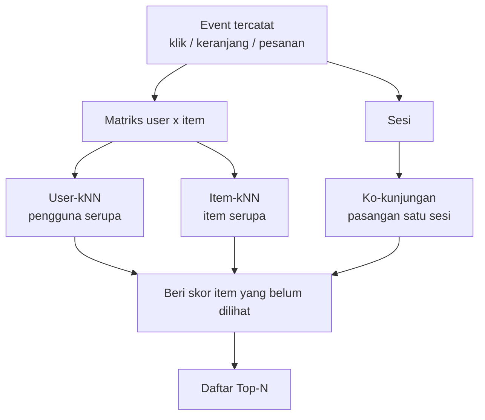
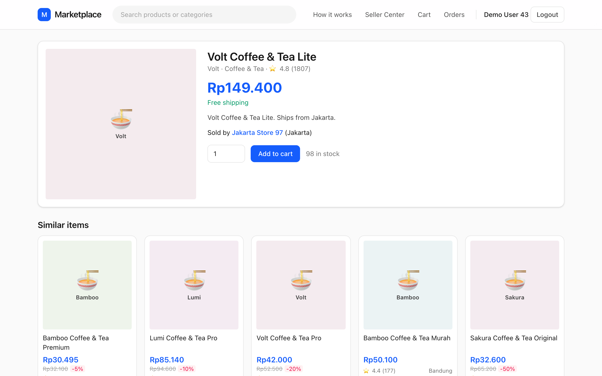
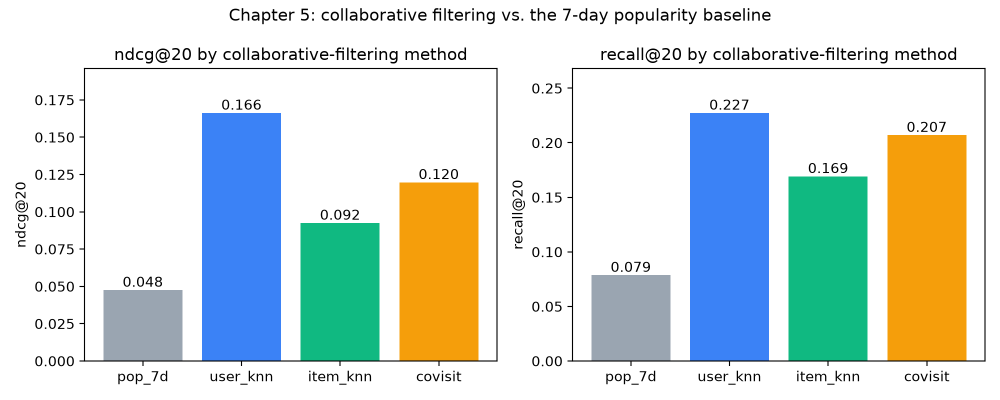

# Collaborative filtering

## Tidak ada yang menulis kata "kopi" di kartu itu

Selasa malam, seorang pembeli di Surabaya membuka halaman produk paket hadiah kopi dan teh. Di bawah foto, baris "Produk serupa" terisi lima listing kopi dan teh lainnya. Tidak ada yang menulis aturan "paket X cocok dengan paket Y dan Z", dan tidak ada yang memberi label pada produk-produk itu. Baris tersebut muncul karena, selama tiga puluh hari terakhir, banyak pembeli yang melihat produk ini dalam sesi penjelajahan (*session*) yang sama juga melihat kelima produk tadi.

Itulah trik utama **collaborative filtering** (CF, penyaringan kolaboratif): *kerumunan pengguna sudah melakukan pelabelan untuk Anda*. Setiap klik, keranjang, dan pesanan adalah sebuah suara. Sekalipun Anda tidak pernah melihat satu pun judul, harga, atau foto, selama Anda tahu siapa menyentuh apa dan kapan, Anda tetap bisa mengatakan cukup banyak hal tentang item mana yang cocok bersama dan orang mana yang berselera sama.

Content-based filtering di Bab 4 membutuhkan teks, kategori, dan merek. Collaborative filtering hanya melihat pola perilaku, sehingga ia menghubungkan item yang tidak akan pernah dihubungkan model berbasis konten, dan gagal dengan caranya sendiri ketika data perilaku tipis. Kita membangun empat metode di atas marketplace simulasi dan evaluasi yang sama dengan Bab 3, sehingga angkanya bisa langsung dibandingkan dengan **baseline popularitas** (recommender paling sederhana: tampilkan ke semua orang item yang paling banyak diklik belakangan ini; metode yang lebih canggih harus mengalahkannya). Keempatnya adalah user-kNN, item-kNN, ko-kunjungan sesi (*session co-visitation*; dipakai baris "Produk serupa" di aplikasi dan menjadi salah satu dari empat **retriever** di repo, yaitu komponen tahap pertama yang murah dan menarik beberapa ratus kandidat masuk akal dari ribuan item), serta tinjauan soal skalabilitas (apa yang terjadi bila toko membesar 1,000 kali lipat).

**Yang akan Anda pelajari**

- Cara membangun matriks user–item dari event implisit.
- User-kNN dan item-kNN, dengan cosine dan Jaccard yang dihitung manual.
- Cara kerja `covisitation_matrix` di repo dan mengapa setiap barisnya dinormalisasi.
- Cara membaca hasil nyata: ndcg, cakupan (*coverage*), dan pengisi popularitas (*popularity padding*).
- Mengapa desain item-to-item bisa diskalakan.

### Kata-kata yang akan kita pakai

Empat kata sehari-hari membawa sebagian besar isi bab ini. Berikut semuanya dalam satu tempat, dengan pembeli Sari dan tokonya sebagai contoh yang berjalan.

| Kata | Arti sederhana | Contoh |
|---|---|---|
| **Event** (kejadian) | Satu aksi yang tercatat: klik, add-to-cart, atau pesanan. | Sari mengklik sekantong makanan kucing 2 kg. |
| **Implicit feedback** (umpan balik implisit) | Selera yang kita *simpulkan* dari apa yang orang lakukan, karena tidak ada yang mengetik "aku suka ini" atau memberi bintang. | Memesan adalah "suka" yang lebih kuat daripada mengklik. |
| **Session** (sesi) | Satu kali duduk di toko: serangkaian event oleh satu pengunjung, biasanya dalam hitungan menit. | Sari membandingkan tiga merek makanan kucing dalam satu malam. |
| **Neighbour** (tetangga) | Sesuatu (pengguna atau item) yang pola perilakunya mirip dengan yang lain. | Dua pembeli yang mengklik item yang hampir sama. |

Nanti kita juga memakai **ndcg**, **recall**, dan **coverage**. Ketiganya dijelaskan ketika kita pertama kali membaca hasil, di "Membaca tabelnya".

## Intuisi: bertanya pada orang yang berselera sama

Bayangkan memilih restoran di kota baru. Anda bisa membaca menunya (berbasis konten), atau bertanya pada teman: "Kamu suka tempat ramen itu, apa lagi yang sebaiknya kucoba?" Itu tidak perlu penjelasan *mengapa* Anda menyukainya, cukup ada irisan tempat yang pernah dikunjungi; kunjungan *lain* si teman itulah rekomendasinya.

Itulah **user-based collaborative filtering**, bentuk aslinya. Ide ini mendasari sistem rekomendasi Usenet awal pada 1990-an (Usenet adalah papan diskusi internet awal tempat orang membaca dan memposting artikel), dan mudah dijelaskan ke product manager: "pelanggan seperti Anda juga membeli…".

Sekarang balik arahnya. Alih-alih bertanya *orang* mana yang mirip, tanyakan *item* mana yang mirip, di mana dua item dianggap mirip jika orang yang sama berinteraksi dengan keduanya. Jika semua orang yang membeli French press juga membeli sekantong kopi gilingan kasar, kedua item itu bertetangga, sekalipun judulnya tidak punya kata yang sama. Saat pengguna menunjukkan minat pada French press, kita mencari tetangganya dan menawarkan kopi itu. Inilah **item-based collaborative filtering**. Perannya ditukar, dan, seperti akan kita lihat, pertukaran inilah yang membuatnya praktis pada skala besar.

Varian ketiga mengubah arti "bersama". Pada user-kNN dan item-kNN, dua item terhubung jika *orang* yang sama menyentuh keduanya, mungkin berbulan-bulan berselang. Pada **ko-kunjungan sesi**, dua item terhubung hanya jika disentuh dalam *sesi penjelajahan* yang sama, biasanya dalam hitungan menit. Itu sinyal yang jauh lebih tajam bahwa "kedua item ini sedang dibandingkan sekarang": pembeli yang memilih di antara tiga casing ponsel melihat ketiganya dalam satu kali duduk. Pembeli yang membeli casing ponsel di bulan Maret dan mug di bulan April hampir tidak memberi tahu kita apa-apa tentang apakah casing dan mug berkaitan.



*Gambar: Tiga cara mengubah log event yang sama menjadi rekomendasi. Dua yang pertama membaca matriks seluruh riwayat; yang ketiga membaca batas sesi.*

## Algoritmenya

### Matriks interaksi

**Matriks** hanyalah tabel angka: satu baris per pengguna, satu kolom per item. Kita menyebutnya $R$. Sel $R_{ui}$ (baris pengguna $u$, kolom item $i$) menyatakan seberapa kuat pengguna itu berinteraksi dengan item tersebut. Nol berarti "tidak ada interaksi tercatat".

Log kita bersifat **implisit**: tidak ada yang memberi rating bintang, jadi kita mengubah tipe event menjadi kekuatan. Repo melakukannya dengan `schema.EVENT_WEIGHT`: klik bernilai 1, add-to-cart 3, dan pesanan 5. Sebuah sel adalah jumlah semua event pengguna pada item itu. Jika Anda mengklik sebuah item dua kali dan memasukkannya ke keranjang sekali, $R_{ui} = 1 + 1 + 3 = 5$.

Berikut matriks mungil berisi Sari dan dua pembeli lain, tiga item:

| | makanan kucing | mainan kucing | casing ponsel |
|---|---|---|---|
| Sari | 5 | 1 | 0 |
| Budi | 3 | 0 | 1 |
| Dewi | 0 | 0 | 5 |

Sari memesan makanan kucing (5) dan mengklik sebuah mainan (1). Budi memasukkan makanan kucing ke keranjang (3) dan mengklik casing ponsel (1). Dewi memesan casing ponsel. Baca sebuah **baris** untuk melihat selera satu orang; baca sebuah **kolom** untuk melihat siapa yang berminat pada satu item. User-kNN bekerja dengan baris, item-kNN dengan kolom.

Tiga sifat yang penting:

- $R$ bersifat **jarang** (*sparse*): hampir semua sel bernilai nol, karena pengguna menyentuh beberapa lusin item dari ribuan. Pada data kita, matriks aslinya berukuran 1,408 pengguna × 2,120 item dan hanya 0.612% selnya tidak nol (lihat "Menjalankannya"). Karena itu kita hanya menyimpan sel yang tidak nol.
- $R$ bersifat **non-negatif**: nol biasanya berarti "belum pernah melihat", bukan "tidak suka". Klik yang tidak ada bukanlah keluhan.
- $R$ **dibangun pada titik potong (*cutoff*)**: kita hanya menghitung event sebelum tanggal yang dibekukan, sehingga evaluasi tidak pernah melihat jawabannya (Bab 2).

### User-kNN

**User-kNN dalam satu kalimat:** cari pembeli yang riwayatnya paling mirip dengan riwayat Anda, lalu rekomendasikan apa yang *mereka* sukai dan belum Anda lihat. Namanya singkatan dari *k nearest neighbours* (k tetangga terdekat): "$k$ pengguna paling mirip", di mana $k$ adalah angka yang kita pilih (misalnya 50).

Bayangkan meminta tips restoran kepada beberapa teman yang seleranya mirip dengan Anda, dan menghitung pendapat teman terdekat lebih berat daripada pendapat teman yang jauh. Itulah seluruh algoritmanya: *cari orang yang mirip, bobotkan suara mereka sesuai kemiripan, jumlahkan*.

Agar "mirip" menjadi tepat, kita butuh satu angka. Yang standar adalah **cosine similarity**. Bayangkan baris setiap pengguna sebagai daftar angka. Cosine similarity bertanya: *apakah kedua daftar ini punya proporsi yang sama?* Ia mengabaikan seberapa banyak seseorang berbelanja secara keseluruhan. Pembeli ringan dengan baris $(1,1,0)$ dan pembeli berat dengan $(2,2,0)$ menyukai hal yang sama dalam proporsi yang sama, sehingga cosine similarity mereka 1 (maksimum). Dua pembeli tanpa satu pun item yang sama mendapat 0. Tanpa sifat "abaikan volume" ini, pembeli berat akan tampak mirip dengan semua orang.

Untuk pengguna target $u$:

1. Hitung kemiripan antara $u$ dan setiap pengguna lain $v$ dengan cosine similarity antar baris $R$ mereka:

$$\operatorname{sim}(u,v) = \frac{\sum_i R_{ui}\,R_{vi}}{\sqrt{\sum_i R_{ui}^2}\;\sqrt{\sum_i R_{vi}^2}}$$

   Dalam kata-kata: bagian atas ($\sum_i$ berarti "jumlahkan atas semua item $i$") mengalikan kekuatan kedua pengguna item demi item lalu menjumlahkannya. Item yang hanya disentuh salah satu dari mereka menyumbang 0, jadi hanya item bersama yang dihitung. Bagian bawah membagi dengan "panjang" tiap baris (kuadratkan setiap angka, jumlahkan, lalu akarkan), yang menghilangkan efek volume tadi.

2. Ambil $k$ pengguna dengan kemiripan tertinggi, tidak termasuk $u$ sendiri. Merekalah tetangga $N_k(u)$.
3. Beri skor setiap item dengan menjumlahkan kekuatan interaksi para tetangga, dibobot seberapa mirip masing-masing tetangga:

$$\hat r_{ui} = \sum_{v \in N_k(u)} \operatorname{sim}(u,v)\; R_{vi}$$

   Di sini $\hat r_{ui}$ ("r-hat") adalah skor prediksi untuk pengguna $u$ pada item $i$, penjumlahan berjalan atas para tetangga $v$, dan $R_{vi}$ adalah seberapa kuat tetangga $v$ menyentuh item $i$. Suara tetangga yang sangat mirip bernilai besar; suara yang nyaris tidak mirip bernilai kecil.

4. Buang item yang tidak boleh dilihat pengguna (stok habis, sudah disembunyikan) dan kembalikan $N$ teratas berdasarkan skor.

**Contoh kecil yang dihitung manual.** Tiga item $A, B, C$ dan tiga pengguna yang sudah ada. Angka di setiap baris adalah $(R_{vA}, R_{vB}, R_{vC})$:

| user | A | B | C |
|---|---|---|---|
| $u_1$ | 1 | 1 | 0 |
| $u_2$ | 1 | 3 | 0 |
| $u_3$ | 0 | 1 | 1 |

Pengguna target baru $t$ punya satu klik pada $A$ dan interaksi yang lebih kuat pada $C$, katakanlah $(1, 0, 2)$. Kita ingin tahu apakah $B$ layak direkomendasikan. Pertama kemiripannya. Ambil $u_1 = (1,1,0)$ sebagai penelusuran rumus: bagian atasnya $1\cdot1 + 0\cdot1 + 2\cdot0 = 1$ (hanya item $A$ yang sama). Panjang $t$ adalah $\sqrt{1^2+0^2+2^2}=\sqrt5$ dan panjang $u_1$ adalah $\sqrt{1+1+0}=\sqrt2$. Hasil pembagiannya:

- $\operatorname{sim}(t,u_1) = \frac{1\cdot1 + 0\cdot1 + 2\cdot 0}{\sqrt5\,\sqrt2} = \frac{1}{3.162} = 0.316$
- $\operatorname{sim}(t,u_2) = \frac{1\cdot1}{\sqrt5\,\sqrt{10}} = \frac{1}{7.071} = 0.141$
- $\operatorname{sim}(t,u_3) = \frac{2\cdot 1}{\sqrt5\,\sqrt2} = \frac{2}{3.162} = 0.632$

Dengan $k=3$ ketiganya menjadi tetangga, dan

$$\hat r_{tB} = 0.316\cdot 1 + 0.141\cdot 3 + 0.632\cdot 1 = 1.372$$

Item $B$ adalah satu-satunya item yang belum disentuh $t$, jadi itulah rekomendasi kita. Periksa penjumlahannya dalam kata-kata: suara setiap tetangga untuk $B$ ($R_{vB}$ mereka: 1, 3, dan 1) dikalikan seberapa mirip mereka dengan $t$ (0.316, 0.141, dan 0.632), lalu dijumlahkan. Perhatikan siapa yang berkontribusi paling besar: $u_3$, tetangga yang sama-sama punya pesanan pada $C$, memiliki kemiripan terbesar, sehingga meskipun buktinya untuk $B$ hanyalah sebuah klik, suaranya menambah 0.632. $u_2$ sangat menyukai $B$ (kekuatan 3) tetapi tampak cukup berbeda dari $t$, sehingga suaranya menyusut menjadi $0.141 \times 3 = 0.423$. Item yang dipesan mendominasi karena bobot ikut masuk ke cosine.

### Cosine versus Jaccard

Cosine memakai *kekuatan* interaksi. **Jaccard similarity** adalah alternatif yang lebih sederhana: ia membuang kekuatan dan hanya bertanya *siapa yang muncul*: dari semua orang yang menyentuh salah satu item, berapa bagian yang menyentuh keduanya? Bayangkan dua daftar tamu untuk dua pesta: skor Jaccard adalah jumlah orang yang diundang ke keduanya, dibagi jumlah orang yang diundang ke setidaknya satu pesta.

$$J(X,Y) = \frac{|X \cap Y|}{|X \cup Y|}$$

Di sini $X$ dan $Y$ adalah *himpunan* (himpunan hanyalah kumpulan tanpa hitungan). Untuk kemiripan item, keduanya adalah pengguna yang memiliki interaksi apa pun; untuk kemiripan pengguna, keduanya adalah item. $X \cap Y$ ("irisan") berarti anggota *kedua* himpunan; $X \cup Y$ ("gabungan") berarti anggota *salah satu*; tanda $|\cdot|$ menghitung anggotanya. Ambil item $A$ dan $B$ dari tabel di atas. Pengguna yang menyentuh $A$ adalah $\{u_1,u_2\}$ dan yang menyentuh $B$ adalah $\{u_1,u_2,u_3\}$. Irisannya berisi 2 pengguna dan gabungannya 3, sehingga $J(A,B)=2/3 = 0.667$. Untuk $B$ dan $C$: irisannya $\{u_3\}$, gabungannya $\{u_1,u_2,u_3\}$, sehingga $J(B,C) = 1/3 = 0.333$.

Jaccard cocok untuk sinyal yang benar-benar biner ("dalam sesi yang sama atau tidak"), dan melindungi dari pengguna berat (*heavy user*): orang yang mengklik sebuah item 500 kali dihitung sama dengan orang yang mengklik sekali. Cosine adalah default yang lebih baik ketika bobot membawa informasi, seperti pada data kita: satu pesanan bernilai lima klik. Keduanya simetris (kemiripan $A$ terhadap $B$ sama dengan $B$ terhadap $A$) dan tidak peduli seberapa populer sebuah item.

### Item-kNN

**Item-kNN dalam satu kalimat:** lihat item yang sudah disentuh pengguna, cari item yang paling sering disentuh oleh *orang yang sama*, lalu rekomendasikan item itu. Mesinnya sama dengan user-kNN, hanya diputar 90 derajat: membandingkan kolom, bukan baris. Dua item bertetangga jika kolomnya mirip, artinya pengguna yang sama berinteraksi dengan keduanya.

Bayangkan seorang asisten toko yang selama bertahun-tahun memperhatikan bahwa pelanggan yang membeli French press hampir selalu kembali untuk kopi gilingan kasar. Ia tidak tahu apa pun tentang kedua produk itu; ia hanya ingat siapa membeli apa. Ketika Anda mengambil French press, ia menunjuk kopinya. Item-kNN *adalah* ingatan itu, yang ditulis sebagai tabel.

Definisikan kemiripan item $i$ dan $j$ sebagai cosine kolom-kolomnya:

$$\operatorname{sim}(i,j) = \frac{\sum_u R_{ui}\,R_{uj}}{\sqrt{\sum_u R_{ui}^2}\;\sqrt{\sum_u R_{uj}^2}}$$

(rumusnya sama seperti sebelumnya, tetapi sekarang penjumlahan berjalan atas *pengguna* $u$, bukan item), lalu beri skor item kandidat $i$ untuk pengguna $u$ dengan menjumlahkan kemiripannya dengan semua yang pernah disentuh pengguna, dibobot seberapa kuat pengguna menyentuhnya:

$$\hat r_{ui} = \sum_{j} \operatorname{sim}(i,j)\; R_{uj}$$

Di sini $j$ berjalan atas item yang pernah disentuh pengguna, $\operatorname{sim}(i,j)$ menyatakan seberapa terkait kandidat $i$ dengan masing-masing item itu, dan $R_{uj}$ menyatakan seberapa peduli pengguna pada masing-masing.

Dengan matriks mainan yang sama, kolom-kolom atas pengguna $(u_1,u_2,u_3)$ adalah $A=(1,1,0)$, $B=(1,3,1)$, dan $C=(0,0,1)$. Maka:

- $\operatorname{sim}(A,B) = \frac{1+3}{\sqrt2\,\sqrt{11}} = \frac{4}{4.690} = 0.853$
- $\operatorname{sim}(B,C) = \frac{1}{\sqrt{11}\cdot 1} = 0.302$
- $\operatorname{sim}(A,C) = 0$, karena tidak ada yang menyentuh keduanya.

Untuk target $t=(1,0,2)$ atas $(A,B,C)$, skor $B$ adalah $0.853\cdot 1 + 0.302\cdot 2 = 1.457$: klik pada $A$ menyumbang $0.853 \times 1$ dan minat yang lebih besar pada $C$ menyumbang $0.302 \times 2$. Bentuk komputasinya berbeda dari user-kNN: di sana Anda membandingkan target dengan setiap pengguna saat permintaan datang, sedangkan tabel item–item tidak bergantung pada target, sehingga dihitung sekali di muka dan sebuah permintaan hanyalah pencarian tetangga dari beberapa item yang disentuh pengguna.

### Ko-kunjungan sesi

**Ko-kunjungan dalam satu kalimat:** hitung seberapa sering dua item dilihat dalam *sesi* yang sama, lalu rekomendasikan item yang sering muncul bersama apa yang sedang Anda lihat sekarang. Ia melepaskan pengguna sebagai unit pengelompokan dan memakai sesi. Bayangkan asisten toko yang membereskan toko saat tutup dan mencatat produk mana saja yang dipegang pelanggan dalam satu kunjungan yang sama; "ko-kunjungan" hanyalah "dikunjungi bersama".

Bayangkan tiga sesi belanja ponsel, semuanya hanya klik: $S_1 = \{\text{casing}, \text{ponsel}\}$, $S_2=\{\text{ponsel}, \text{charger}\}$, $S_3=\{\text{ponsel}, \text{kabel}\}$. Ponsel muncul di samping tiga hal berbeda; casing hanya muncul di samping ponsel. Kita ingin aturan yang menangkap hal ini, dan langkah-langkah berikut membangunnya.

Langkah-langkahnya:

1. Ambil hanya event positif (klik, keranjang, pesanan) dari jendela waktu terbaru (30 hari di repo ini), karena kebiasaan lama adalah bukti yang lebih lemah.
2. Dalam setiap sesi, simpan satu bobot per item: event terkuat yang terjadi padanya. Menyegarkan halaman sepuluh kali tidak boleh dihitung sepuluh kali.
3. Untuk setiap pasangan *berurutan* item berbeda $(a, b)$ yang berbagi sesi ("berurutan" berarti $(a,b)$ dan $(b,a)$ adalah dua pasangan terpisah), jumlahkan bobot $b$ dari semua sesi tempat keduanya muncul.
4. **Normalisasi per item sumber**: bagi sehingga bobot keluar setiap item $a$ berjumlah 1. Dalam kata sederhana: ubah hitungan mentah menjadi *porsi*, "dari semua yang dilihat di samping $a$, berapa porsi $b$?":

$$w(a \to b) = \frac{\sum_{s \ni a,b} \omega_{s,b}}{\sum_{c \neq a}\sum_{s \ni a,c} \omega_{s,c}}$$

Simbol: $s$ adalah sebuah sesi; $s \ni a,b$ berarti "sesi yang memuat $a$ dan $b$ sekaligus"; $\omega_{s,b}$ ("omega") adalah kekuatan item $b$ dalam sesi $s$ (1 klik, 3 keranjang, 5 pesanan); $c$ adalah item lain mana pun. Bagian atas adalah total bobot $b$ di samping $a$; bagian bawah adalah total atas *semua* item di samping $a$.

**Contoh hitung.** Tiga sesi: $S_1$ berisi klik pada $A$ dan klik pada $B$; $S_2$ berisi klik pada $A$, add-to-cart pada $B$, dan klik pada $C$; $S_3$ berisi klik pada $A$ dan klik pada $C$. Lihat baris untuk $A$. Jumlah mentah untuk $B$ adalah $1 + 3 = 4$ (klik di $S_1$, keranjang di $S_2$). Jumlah mentah untuk $C$ adalah $1 + 1 = 2$. Totalnya 6, sehingga $w(A\to B) = 4/6 = 0.667$ dan $w(A \to C) = 2/6 = 0.333$.

**Mengapa dinormalisasi per sumber?** Tanpa itu, item populer $a$ akan punya hitungan mentah besar ke semua item dan menenggelamkan peringkat. Pembagian membuat setiap baris berjumlah 1, sehingga setiap item mendapat "jatah perhatian" yang sama untuk dibagi di antara tetangganya. Ini juga membuat matriks **asimetris** ($w(a\to b) \neq w(b\to a)$). Periksa pada sesi ponsel: baris casing hanya berisi ponsel, sehingga $w(\text{casing}\to\text{ponsel}) = 1$. Baris ponsel terbagi ke tiga item, sehingga $w(\text{ponsel}\to\text{casing}) = 1/3 = 0.333$. Itu sesuai kenyataan: orang yang melihat casing ponsel hampir selalu juga melihat ponselnya, tetapi orang yang melihat ponsel kebanyakan tidak melihat casing itu.

Untuk personalisasi, ambil item terbaru pengguna sebagai **seed** (benih; titik awal: "apa yang belakangan dilihat orang ini?"), masing-masing dengan **skor kebaruan** (*recency*) dari jumlah berpeluruhan waktu. Peluruhan berarti event yang lebih lama dihitung lebih kecil; dengan *waktu paruh* (*half-life*) 7 hari, sebuah event kehilangan setengah bobotnya setiap 7 hari (peluruhan yang sama dengan Bab 3). Skor kandidat $b$ adalah $\sum_{a \in \text{seeds}} \text{recent}(u,a)\cdot w(a\to b)$: untuk setiap seed, kalikan skor kebaruannya dengan bobot seed itu menuju $b$, lalu jumlahkan atas semua seed. Jika seed $A$ milik pengguna punya skor kebaruan 0.8, maka pada contoh mainan tadi $B$ mendapat $0.8 \times 0.667 = 0.533$ dan $C$ mendapat $0.8\times0.333=0.267$.

::: fact
**Tahukah kamu?** Pada 2003, para insinyur Amazon, Greg Linden, Brent Smith, dan Jeremy York, menjelaskan algoritma collaborative filtering item-to-item di balik rekomendasi Amazon.com: alih-alih membandingkan seorang pelanggan dengan jutaan pelanggan lain, mereka membandingkan *item*, dan tabel item serupa yang mahal itu dibangun secara offline. Langkah online-nya hanya mencari item serupa dari judul yang dibeli atau diberi rating pengguna, sehingga skalanya tidak bergantung pada ukuran katalog maupun jumlah pelanggan. Makalah itu membandingkannya dengan collaborative filtering tradisional, yang komputasi online-nya tumbuh seiring keduanya.

Sumber: Linden et al., IEEE Internet Computing, 2003
:::

::: fact
**Tahukah kamu?** Kata "collaborative" dalam collaborative filtering berasal dari 1994. Proyek GroupLens (Resnick dan kolega di MIT dan University of Minnesota) membangun sistem yang memprediksi seberapa besar pembaca akan menyukai artikel netnews Usenet, berdasarkan heuristik bahwa orang yang sepakat di masa lalu kemungkinan akan sepakat lagi. Pengguna memasukkan rating, server rating bernama "Better Bit Bureaus" mengorelasikannya, dan skor prediksi ditampilkan di news reader. Itulah user-kNN di habitat aslinya.

Sumber: Resnick et al., CSCW, 1994
:::

::: fact
**Tahukah kamu?** Pendekatan berbasis pengguna menjadi default selama bertahun-tahun, tetapi pada 2001 Sarwar, Karypis, Konstan, dan Riedl membandingkannya dengan metode berbasis item dan melaporkan bahwa algoritma berbasis item memberikan kinerja yang jauh lebih baik daripada algoritma berbasis pengguna, sekaligus kualitas yang lebih baik daripada algoritma berbasis pengguna terbaik yang tersedia (pada dataset yang mereka uji). Makalah itu membantu menggeser perhatian bidang ini dari "pengguna serupa" ke "item serupa".

Sumber: Sarwar et al., WWW, 2001
:::

## Penelusuran kode

Semua angka di bab ini berasal dari `book/code/ch05_cf.py`. Skrip itu memakai setup bersama dari `book/code/common.py`: data simulasi yang sama, cutoff yang sama, evaluasi yang sama. Pertama matriksnya. Helper ini mengubah event positif dari riwayat menjadi **matriks sparse** (format yang hanya menyimpan sel tidak nol beserta posisinya, bukan jutaan nol) user × item berisi nilai-nilai yang masing-masing merupakan jumlah `EVENT_WEIGHT`:

```include
path: book/code/common.py
symbol: interaction_matrix
```

`pos["w"]` adalah bobot per event (1, 3, atau 5). `groupby` adalah langkah "jumlahkan semua event dari pengguna dan item yang sama" dari bagian algoritma, dan konstruktor `csr_matrix` (CSR = *compressed sparse row*, satu format sparse tertentu) menaruh setiap jumlah pada baris dan kolom yang tepat. Dua objek `pd.Index` adalah tabel terjemahan antara id pengguna dan item yang sebenarnya (yang bisa berupa angka apa saja) dan posisi dalam matriks (0, 1, 2, …).

Untuk cosine kita butuh baris dengan panjang satuan. "Panjang satuan" berarti kita membagi setiap baris dengan panjangnya sendiri sehingga panjangnya menjadi 1; misalnya baris $(3,4)$ berpanjang $\sqrt{9+16}=5$, sehingga menjadi $(0.6, 0.8)$. Cosine dua baris seperti itu lalu tak lain adalah **hasil kali titik** (*dot product*; kalikan entri yang bersesuaian, lalu jumlahkan), yang jauh lebih murah daripada rumus lengkapnya:

```include
path: book/code/ch05_cf.py
symbol: row_normalise
```

`np.maximum(norm, 1e-12)` menjaga dari pembagian dengan nol untuk pengguna atau item yang barisnya kosong (baris serba nol berpanjang 0). Setelah ini, "kemiripan semua terhadap semua" menjadi satu **perkalian matriks**, operasi standar yang dikerjakan komputer dengan sangat cepat: entri $(u,v)$ dari hasilnya adalah hasil kali titik baris $u$ dengan baris $v$.

### User-kNN, langkah demi langkah

Kutipan berikut dari `main()` adalah seluruh model user-kNN. Variabel `R` adalah matriks user × item padat dan `R_eval` adalah baris-baris pengguna evaluasi:

```include
path: book/code/ch05_cf.py
region: user_knn_sim
```

Lalu, di dalam loop atas $k$:

```include
path: book/code/ch05_cf.py
region: user_knn_topk
```

Bacalah sebagai empat langkah algoritma. Perkalian matriks menghitung semua cosine sekaligus. `argpartition` menemukan indeks $k$ kemiripan terbesar per baris *tanpa* mengurutkan seluruh baris (waktunya linear, bukan $n \log n$: untuk menemukan 50 teratas dari 1,408 Anda tidak perlu mengurutkan semua 1,408). Dua baris berikutnya membangun matriks `w` yang menyimpan kemiripan pada posisi tetangga dan nol di tempat lain. Lalu `w @ R` persis rumus $\hat r_{ui} = \sum_{v\in N_k(u)} \operatorname{sim}(u,v) R_{vi}$ untuk semua pengguna dan item sekaligus: `@` adalah perkalian matriks, yang melakukan "kalikan baris setiap tetangga dengan bobotnya lalu jumlahkan" untuk setiap pengguna. Skrip ini juga menetapkan entri diagonal setiap pengguna evaluasi menjadi nol. Diagonal adalah kemiripan setiap pengguna terhadap *dirinya sendiri*, yang selalu maksimum, yaitu 1; jika dibiarkan, setiap pengguna menjadi tetangga terdekat dirinya sendiri dan "merekomendasikan" riwayatnya sendiri kepada dirinya, yang skornya indah tetapi tidak bermakna.

### Item-kNN, langkah demi langkah

Item-kNN lebih pendek karena kerja beratnya adalah perkalian yang sama, diterapkan pada kolom:

```include
path: book/code/ch05_cf.py
region: item_knn_sim
```

dan baris penskorannya:

```include
path: book/code/ch05_cf.py
region: item_knn_score
```

`R.T` menukar baris dan kolom (*transpose*), sehingga `Cn @ Cn.T` adalah tabel cosine item–item `S` (semua pasangan 2,120 × 2,120), dengan diagonal dinolkan agar tidak ada item yang menjadi tetangga dirinya sendiri. Baris penskoran menerapkan rumus $\hat r_{ui} = \sum_j \operatorname{sim}(i,j) R_{uj}$ untuk semua pengguna sekaligus. Tabel ini **padat** (*dense*; setiap pasangan disimpan, bahkan bila kemiripannya 0), tidak masalah untuk toko kecil kita. Sistem produksi tidak pernah membentuk tabel padat seperti ini (lihat skalabilitas).

### Matriks ko-kunjungan di repo

Sekarang bagian yang berjalan di dalam sistem sebenarnya. Fungsinya ada di `recommender/recsys/candidates.py`:

```include
path: recommender/recsys/candidates.py
symbol: covisitation_matrix
```

Telusuri baris demi baris. `hist.interactions()` mengembalikan event positif (klik, keranjang, pesanan) beserta bobot `w` dan usianya dalam hari. Baris berikutnya hanya menyimpan event yang lebih baru dari `COVISIT_WINDOW_DAYS` (30). Mengambil `["w"].max()` per `(session_id, item_id)` meringkas aksi berulang pada item yang sama dalam satu sesi menjadi satu aksi terkuat, sehingga pembeli yang menyegarkan halaman sepuluh kali tidak dihitung sepuluh kali. Langkah berikutnya adalah **self-join**: tabel event digabungkan dengan *dirinya sendiri* pada `session_id`, sehingga setiap event dalam sebuah sesi dipasangkan dengan setiap event lain di sesi yang sama. Dengan cara inilah "semua pasangan item dalam satu sesi" dibuat; filter `!=` membuang pasangan trivial item dengan dirinya sendiri. Menjumlahkan `w_b` per pasangan berurutan menghasilkan massa ko-kemunculan mentah (angka 4 dan 2 dari contoh hitung), dan `transform("sum")` terakhir menghitung total massa keluar setiap item sumber lalu membaginya (mengubah 4 dan 2 menjadi 0.667 dan 0.333), yaitu normalisasi dari bagian algoritma.

Self-join adalah pendorong biaya: sesi dengan $n$ item menghasilkan $n(n-1)$ baris (masing-masing dari $n$ item berpasangan dengan $n-1$ item lain), sehingga sebuah bot dengan 5,000 item dalam satu sesi akan menghasilkan sekitar dua puluh lima juta.

Mengubah matriks menjadi kandidat per pengguna adalah tugas `covisit`:

```include
path: recommender/recsys/candidates.py
symbol: covisit
```

`top_seeds` memilih sepuluh item terbaru yang paling relevan bagi setiap pengguna (`N_SEEDS`). Merge memasangkan setiap seed dengan barisnya di matriks (langkah "cari tetangga" yang sama seperti pada contoh mainan), hasil kali `cand_recent_score * w` membobot setiap saran sesuai seberapa penting seed bagi pengguna (langkah $0.8 \times 0.667$), dan group-by menjumlahkan kontribusi ketika beberapa seed menunjuk kandidat yang sama. Akhirnya `_top_per_user` menyimpan 40 terbaik (`N_COVISIT`). Dua seed yang menunjuk kandidat yang sama saling memperkuat, dan itu perilaku yang benar: item yang di-ko-kunjungi dengan *kedua* hal yang Anda lihat adalah taruhan yang lebih baik daripada item yang hanya di-ko-kunjungi dengan salah satunya.

Seed berasal dari `recent`, yang membobot setiap event dengan `_decay`: event berusia $t$ hari dihitung $0.5^{t/7}$ dari event baru (Bab 3). Event berusia 7 hari dihitung $0.5^1 = 0.5$, event berusia 14 hari $0.5^2 = 0.25$.

### Dari mana halaman produk mendapat barisnya

Baris "Produk serupa" dari cerita pembuka bukan algoritma yang berbeda. Metode gRPC `SimilarItems` memanggil `pipeline.similar_items`, yang membaca satu baris dari matriks ko-kunjungan yang sama:

```include
path: recommender/recsys/pipeline.py
symbol: similar_items
```

Paruh pertama membangun baris ko-kunjungan untuk item di halaman itu: baris dengan `item_id_a == item_id`, dibatasi pada item yang tersedia stoknya, diurutkan menurut bobot. Paruh kedua adalah ***fallback*** untuk item yang jarang terlihat (rencana cadangan bila metode utama punya terlalu sedikit data): jika ko-kunjungan menghasilkan kurang dari `k` tetangga, sisa slot diisi item tersedia paling populer dari *kategori yang sama*. Hasilnya membawa label `source` (`covisit` atau `same_category`) sehingga frontend dan log bisa mengetahui mekanisme mana yang menghasilkan tiap kartu.



## Menjalankannya

Dari direktori `book/`:

```bash
uv run python code/ch05_cf.py
```

Setup-nya:

```output
file: results/ch05_cf.txt
lines: 2-5
```

Selanjutnya, sapuan user-kNN atas ukuran lingkungan (*neighbourhood*) $k$, dengan contoh seperti apa sebuah lingkungan itu:

```output
file: results/ch05_cf.txt
lines: 7-13
```

Item-kNN, dengan item terdekat dari satu item konkret:

```output
file: results/ch05_cf.txt
lines: 15-20
```

Ko-kunjungan, dan seberapa banyak pengisi popularitas yang dibutuhkan tiap metode:

```output
file: results/ch05_cf.txt
lines: 22-29
```

Terakhir tabel ringkasan, dievaluasi pada 50 teratas per pengguna:

```output
file: results/ch05_cf.txt
lines: 31-37
```

## Hasil

Gambaran utamanya: setiap metode kolaboratif mengalahkan baseline popularitas dengan selisih lebar. Sebelum membaca angka, ingat kembali tiga metrik (Bab 3 membahasnya lengkap). Setiap recommender menghasilkan daftar 20 teratas per pembeli; lalu kita melihat apa yang *sebenarnya* dilakukan pembeli itu setelah cutoff.

- **recall@20**: dari item yang kemudian disentuh pembeli, berapa bagian yang muncul di 20 teratas kita? Tidak melewatkan apa pun = 1, melewatkan semuanya = 0. (Bayangkan 4 item sebenarnya; kita menangkap 1: recall 0.25.)
- **ndcg@20**: seperti recall, tetapi juga memberi imbalan bila item yang tepat berada *dekat puncak*. Kena di peringkat 1 bernilai lebih daripada kena di peringkat 20. Skala 0 sampai 1, makin tinggi makin baik.
- **coverage@20**: berapa bagian katalog yang muncul di daftar siapa pun. Coverage rendah berarti beberapa item yang sama dikirim ke semua orang.



### Membaca tabelnya

Baseline `pop_7d` (merekomendasikan item paling populer 7 hari terakhir kepada semua orang) mendapat ndcg@20 sebesar 0.0475 dan recall@20 sebesar 0.0786; coverage@20 sebesar 0.0087 berarti hanya sekitar dua puluh item berbeda dari 2,311 yang pernah muncul. User-kNN menaikkan ndcg@20 menjadi 0.1662, sekitar tiga setengah kali baseline. Bahkan metode terlemah, item-kNN dengan 0.0925, hampir menggandakannya.

**User-kNN menang pada ndcg.** Dengan 50 tetangga ia mencapai ndcg@20 0.1662 dan order_recall@20 0.3456 (recall khusus pada pesanan, sinyal terkuat). Sapuan menunjukkan hasil yang makin menurun: tetangga tambahan membantu, tetapi tiap tambahan membantu lebih sedikit; dari 10 ke 100 tetangga, ndcg@20 naik dari 0.1456 menjadi 0.1702. Dalam simulator, selera mengikuti preferensi kategori, sehingga pengguna dengan riwayat yang beririsan memang berbagi apa yang mereka lakukan berikutnya. Dengan hanya 1,408 pengguna, memindai semuanya murah, sehingga eksperimen ini menyembunyikan apa yang membuat user-kNN menyakitkan pada skala besar. (Kita memakai $k=50$ tetap; menyetel $k$ pada pengguna evaluasi akan menjadi **kebocoran** (*leakage*) ringan, yaitu informasi dari data uji menyusup ke pilihan kita, sehingga skor tampak lebih baik daripada pada data baru.)

**Item-kNN lebih lemah dalam pemeringkatan, lebih kuat dalam keluasan.** ndcg@20-nya 0.0925, tetapi coverage@20-nya 0.8399 dibanding 0.4158 milik user-kNN: item-kNN menyebarkan rekomendasinya ke bagian katalog yang sangat besar. Itu sebagian baik (eksposur *long tail*, Bab 1: memberi item yang jarang diklik kesempatan) dan sebagian gejala *noise*, seperti ditunjukkan contoh ini:

Item terdekat dari item 1769, 'Sakura Earphones Original', mencakup 'Volt Instant Noodles Lokal' dengan cosine 0.538. Earphone dan mi tidak berhubungan; kedua item punya sedikit interaksi dan beberapa pengguna kebetulan menyentuh keduanya. Bila sebuah item hanya punya dua atau tiga penggemar, satu penggemar bersama saja membuat cosine tampak tinggi: kebetulan yang lemah tampak seperti hubungan yang kuat. Rata-rata kemiripan tak-nol hanya 0.0772 tetapi maksimumnya 1.000, hampir pasti dua item yang disentuh oleh satu pengguna yang sama. Item-kNN produksi karena itu menerapkan **ambang dukungan (*support threshold*)** atau **penyusutan (*shrinkage*)**. Ambang dukungan mengabaikan pasangan dengan terlalu sedikit pengguna bersama (misalnya kurang dari 5). Shrinkage mengalikan kemiripan dengan $n_{ij}/(n_{ij}+\lambda)$, di mana $n_{ij}$ adalah jumlah pengguna yang menyentuh kedua item dan $\lambda$ ("lambda") adalah konstanta yang Anda pilih. Dengan $\lambda=4$ sebagai ilustrasi, pasangan yang didukung satu pengguna bersama dikalikan $1/5 = 0.2$ (dipotong 80%), sedangkan pasangan yang didukung 20 pengguna bersama dikalikan $20/24 = 0.83$ (hampir tidak berubah). Bukti lemah disusutkan ke arah nol; bukti kuat bertahan.

**Ko-kunjungan berada di tengah pada ndcg dan menang pada satu metrik.** Ia mencapai ndcg@20 0.1197, tetapi recall@50-nya 0.3220, tertinggi dari semua metode dalam tabel (user-kNN 0.3163). Itulah pola yang Anda inginkan dari sebuah *retriever*: ia mungkin tidak mengurutkan 5 teratasnya sebaik metode terbaik, tetapi daftar yang lebih lebar menjaring sedikit lebih banyak dari apa yang akhirnya diinginkan pengguna. Recall@5-nya 0.0795 dibanding 0.1230 milik user-kNN, yang persis menunjukkan kelemahan pengurutan. Dalam pipeline produksi, pengurutan adalah tugas **ranker** (model tahap kedua yang mengurutkan ulang kandidat dari para retriever); retriever hanya perlu membawa item yang tepat ke meja. Bab 8 mengukur ini pada keempat retriever.

### Padding: bagian yang jujur

**Padding** berarti mengisi slot kosong dalam daftar dengan sesuatu yang aman, di sini daftar popularitas 7 hari, ketika model tidak punya apa-apa untuk dikatakan. Ini terjadi pada pengguna tanpa riwayat sebelum cutoff (model tidak punya baris untuk dibandingkan) atau riwayat yang terlalu sedikit. Melaporkan seberapa banyak padding yang dibutuhkan tiap metode menjaga perbandingan tetap jujur: metode yang diam-diam bersandar pada popularitas untuk 40% slotnya akan tampak lebih baik daripada kenyataannya. Baris-baris padding memberi tahu seberapa sering sebuah metode tidak punya apa-apa untuk dikatakan:

- user-kNN dan item-kNN masing-masing memiliki 29 pengguna evaluasi tanpa skor model sama sekali (pada dasarnya pengguna tanpa riwayat yang bisa dipakai sebelum cutoff), ditambah satu pengguna yang terisi sebagian, dan 3.1% dari semua slot diisi daftar popularitas 7 hari.
- Ko-kunjungan memiliki 30 pengguna tanpa skor dan 117 yang terisi sebagian, sehingga 8.6% slot berasal dari fallback popularitas.

Ko-kunjungan lebih banyak melakukan padding karena ia membutuhkan item *terbaru* pengguna pernah di-ko-kunjungi dalam jendela 30 hari: presisi tinggi, cakupan per pengguna rendah. Repo tidak pernah memakainya sendirian; `trending` dan `catpop` menutup celahnya dan ranker melihat keempat skor.

## Jebakan dan praktik di produksi

### Skalabilitas: mengapa item-to-item menang

Hitung apa yang dilakukan tiap pendekatan saat permintaan datang (**online**, ketika pembeli menunggu, berbeda dengan **offline**, pekerjaan batch yang dijalankan sebelumnya). User-kNN harus membandingkan target dengan semua $U$ pengguna: sekitar $U \times I$ operasi untuk vektor padat (pengguna kali item), atau lebih cermat $U$ perkalian titik sparse. Dengan 1,408 pengguna itu memakan milidetik. Dengan puluhan juta pengguna, itu mustahil per permintaan, dan solusi sementara yang umum (sampling pengguna, pengelompokan, reduksi dimensi) semuanya mengorbankan kualitas.

Item-kNN memindahkan biayanya ke offline. Tabel item–item dihitung dalam **batch job** (program yang berjalan sesuai jadwal, misalnya tiap malam, tanpa ada yang menunggu) dan disimpan sebagai peta dari setiap item ke $m$ tetangga teratasnya (biasanya 50–200). Saat permintaan datang, sistem mencari daftar tetangga dari beberapa item dalam riwayat pengguna dan menggabungkannya. Kerjanya bergantung pada jumlah item yang disentuh *pengguna*, bukan pada katalog atau basis pengguna. Inilah properti yang ditonjolkan makalah Amazon, dan mengapa begitu banyak industri hidup dengan tabel "juga dilihat".

Komputasi offline-nya tetap perlu kehati-hatian: Anda memanfaatkan sparsity (hanya pasangan dengan pengguna bersama yang penting), membatasi riwayat per pengguna, dan men-sampling item blockbuster. Dalam skrip padat kita tabelnya 2,120 × 2,120; dengan sepuluh juta item akan ada seratus triliun sel ($10^7 \times 10^7 = 10^{14}$), sehingga produksi menyimpan daftar top-$m$ yang sparse.

Ko-kunjungan punya bentuk yang sama, dan repo hanya menyimpan pasangan yang benar-benar terjadi: 13,632 pasangan, seperti ditunjukkan output di atas. Pendorong biayanya, seperti telah disebut, adalah self-join sesi. Di produksi Anda akan membatasi item per sesi (misalnya 50 terbaru) dan memberi jendela pada data, yang dilakukan repo dengan `COVISIT_WINDOW_DAYS`.

### Bias popularitas dan gray sheep

Item populer muncul di banyak daftar tetangga, lebih sering direkomendasikan, dan mengumpulkan lebih banyak klik, yang membuatnya muncul semakin sering (lingkaran umpan balik yang disebut **bias popularitas**); normalisasi meredamnya tetapi tidak menghilangkannya (Bab 12). Pengguna yang seleranya beririsan dengan tak seorang pun (***gray sheep***, pengguna berselera tidak biasa yang tidak cocok dengan kelompok mana pun) mendapat sinyal lingkungan yang lemah, dan pengisi popularitas mengambil alih.

### Jebakan evaluasi

- **Kemiripan dengan diri sendiri.** Lupa membuang baris pengguna itu sendiri dari daftar tetangganya membuat model merekomendasikan riwayat pengguna sendiri: angka luar biasa, model tak berguna.
- **Menyetel pada pengguna uji.** Ukuran lingkungan $k$, konstanta shrinkage, dan jumlah seed sebaiknya disetel pada **jendela validasi** (potongan waktu terpisah yang disisihkan khusus untuk memilih pengaturan) sebelum jendela evaluasi, sehingga ujian akhir tetap tak tersentuh.
- **Cold start.** Item *baru* tidak punya kolom di $R$ dan tidak punya pasangan sesi, dan pengguna baru punya baris kosong, sehingga CF tidak punya apa-apa untuk dikatakan (Bab 12). Inilah mengapa repo menggabungkan empat retriever.

### Yang sebenarnya dilakukan sistem produksi

Sedikit sistem besar yang menjalankan user-kNN murni. Tabel ko-kunjungan atau item-to-item, ditambah **embedding** hasil pelatihan (daftar angka ringkas yang mewakili pengguna dan item; Bab 6 dan 7), bertindak sebagai **retriever** ber-recall tinggi yang murah ("recall" di sini berarti jarang melewatkan item bagus); ranker terlatih mengurutkan gabungannya (Bab 9 dan 10). Di sini `cand_covisit_score` adalah salah satu kolom masukan ranker.

::: tip
Saat Anda membangun tabel ko-kunjungan untuk lalu lintas nyata, simpan hitungan mentah dan bobot ternormalisasi sebagai kolom terpisah. Bobot ternormalisasi dipakai untuk pemeringkatan, tetapi pasangan berbobot 0.5 yang didukung dua sesi jauh kurang dapat dipercaya daripada yang didukung dua ribu sesi. Ambang hitungan minimum, diterapkan sebelum normalisasi, adalah peningkatan kualitas termurah yang bisa Anda lakukan.
:::

::: try
Buka `book/code/ch05_cf.py`, temukan baris `for k in (10, 25, 50, 100):` lalu ubah ukuran lingkungannya. Jalankan ulang dan lihat kolom ndcg@20. Seberapa jauh Anda bisa menaikkan $k$ sebelum kurvanya berhenti membaik? Lihat soal Kuis Q5.10 untuk latihan lengkapnya.
:::

## Ringkasan

- Collaborative filtering merekomendasikan dari perilaku semata, sehingga ia menghubungkan item yang tidak akan dihubungkan model konten; nol pada matriks implisit berarti "belum terlihat", bukan "tidak disukai".
- User-kNN memakai suara berbobot kemiripan dari $k$ pengguna terdekat; item-kNN memakai kemiripan dengan item yang disentuh pengguna; keduanya bertumpu pada cosine (atau Jaccard untuk sinyal biner).
- Ketiganya mengalahkan popularitas 7 hari (ndcg@20 0.0475): user-kNN 0.1662, ko-kunjungan 0.1197, item-kNN 0.0925. Item-kNN memiliki cakupan terluas (0.8399) tetapi kemiripan yang berisik di tempat yang sedikit pengguna beririsan.
- Ko-kunjungan sesi adalah CF item-to-item dengan sesi sebagai unit pengelompokan; repo menormalisasi bobot keluar setiap item sumber agar berjumlah 1, yang meredam item populer dan membuat matriks asimetris.
- Ko-kunjungan memiliki recall@50 terbaik dari semua metode dalam tabel (0.3220), yang dibutuhkan sebuah retriever, tetapi bergantung pada pengisi popularitas untuk pengguna dengan sedikit riwayat terbaru (8.6% slot).
- Desain item-to-item bisa diskalakan karena tabel mahalnya dihitung offline dan langkah online hanya bergantung pada ukuran riwayat satu pengguna.
- Di produksi, sinyal kolaboratif adalah retriever dan fitur ranker, bukan kata akhir soal pengurutan.

## Kuis

**Q5.1** Pada user-based collaborative filtering, asumsi apa yang mendasari rekomendasi?

A. Item dengan judul mirip disukai oleh orang yang sama.
B. Pengguna yang berinteraksi dengan banyak item yang sama di masa lalu kemungkinan akan menyukai item serupa di masa depan.
C. Item populer selalu lebih baik daripada yang tidak populer.
D. Selera pengguna tidak berubah seiring waktu.

**Q5.2** Mengapa desain item-to-item ala Amazon bisa diskalakan ke katalog dan basis pelanggan puluhan juta, sedangkan user-kNN klasik tidak?

A. Ia memakai ukuran kemiripan yang lebih akurat.
B. Ia tidak membutuhkan data interaksi sama sekali.
C. Ia menghitung tabel item serupa yang mahal secara offline, sehingga pencarian online hanya bergantung pada jumlah item dalam riwayat pengguna.
D. Ia menyimpan matriks user × item padat penuh di memori agar aksesnya cepat.

**Q5.3** Situasi mana yang paling cocok untuk Jaccard similarity dibanding cosine similarity pada matriks berbobot mentah?

A. Sel matriks berisi bobot yang disetel cermat di mana satu pesanan bernilai lima klik dan Anda ingin bobot itu berpengaruh.
B. Sinyalnya biner (sebuah pasangan "dalam sesi yang sama" atau tidak) dan pengguna berat tidak boleh mendominasi lewat hitungan besar.
C. Anda menginginkan kemiripan yang tidak simetris.
D. Anda perlu membandingkan vektor dengan dimensi berbeda.

**Q5.4** Jelaskan dalam dua atau tiga kalimat mengapa `covisitation_matrix` membagi bobot setiap pasangan dengan total bobot keluar item sumber. Apa yang terjadi pada daftar kandidat jika tidak dilakukan?

**Q5.5** Pada hasil, item terdekat item-kNN dari 'Sakura Earphones Original' mencakup mi. Sebutkan penyebab yang mungkin dan satu perbaikan yang dipakai sistem produksi.

**Q5.6** (Membaca kode.) Dalam `covisitation_matrix`, baris `per_session = pos.groupby(["session_id", "item_id"], as_index=False)["w"].max()` dijalankan sebelum self-merge. Apa yang dilakukannya, dan apa yang berubah jika `.max()` diganti `.sum()`?

**Q5.7** (Numerik.) Item $X$ disentuh tiga pengguna dengan kekuatan $(2, 0, 1)$ atas pengguna $(u_1,u_2,u_3)$; item $Y$ dengan kekuatan $(1, 1, 0)$. Hitung cosine similarity $X$ dan $Y$, serta Jaccard similarity himpunan pengguna yang menyentuh keduanya. Berikan keduanya hingga tiga angka desimal.

**Q5.8** (Numerik.) Seorang pengguna memiliki dua item seed. Seed $A$ punya skor kebaruan 0.5 dan seed $E$ punya skor kebaruan 1.0. Pada matriks ko-kunjungan, $w(A \to C) = 0.3$ dan $w(E \to C) = 0.4$. Berapa skor kandidat item $C$ untuk pengguna ini, memakai rumus dalam `covisit`?

**Q5.9** Berdasarkan tabel hasil, pernyataan mana yang benar?

A. user_knn memiliki ndcg@20 tertinggi dan juga coverage@20 tertinggi.
B. item_knn memiliki coverage@20 tertinggi, tetapi ndcg@20 lebih rendah daripada user_knn maupun covisit.
C. covisit memiliki recall@5 tertinggi.
D. pop_7d mengalahkan item_knn pada ndcg@20.

**Q5.10** (Praktik langsung.) Di `book/code/ch05_cf.py`, ubah sapuan lingkungan `for k in (10, 25, 50, 100):` menjadi `for k in (50, 100, 200, 400):` dan jalankan skrip dari salinan sementara (agar tidak menimpa hasil yang sudah di-commit). Bandingkan ndcg@20 dan recall@20 yang tercetak untuk setiap $k$. Apa yang Anda amati tentang efek menaikkan $k$ melebihi 100, dan mengapa?
