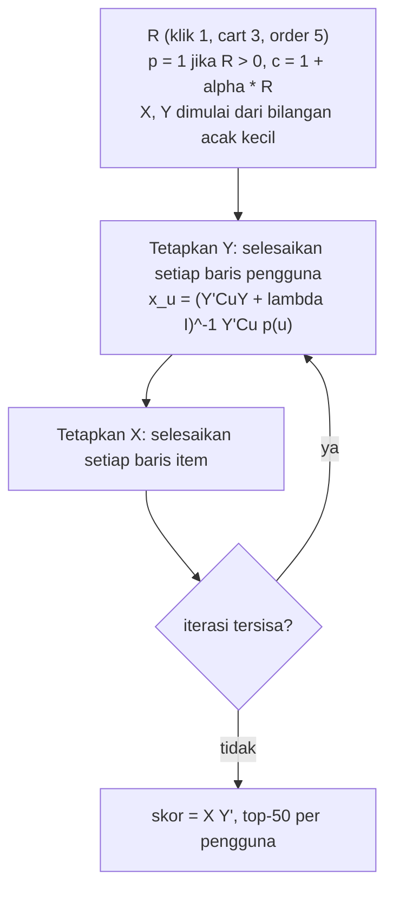
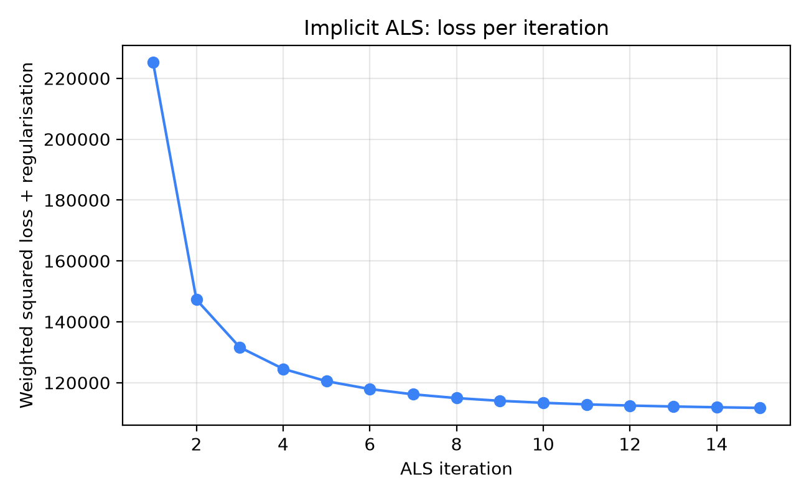
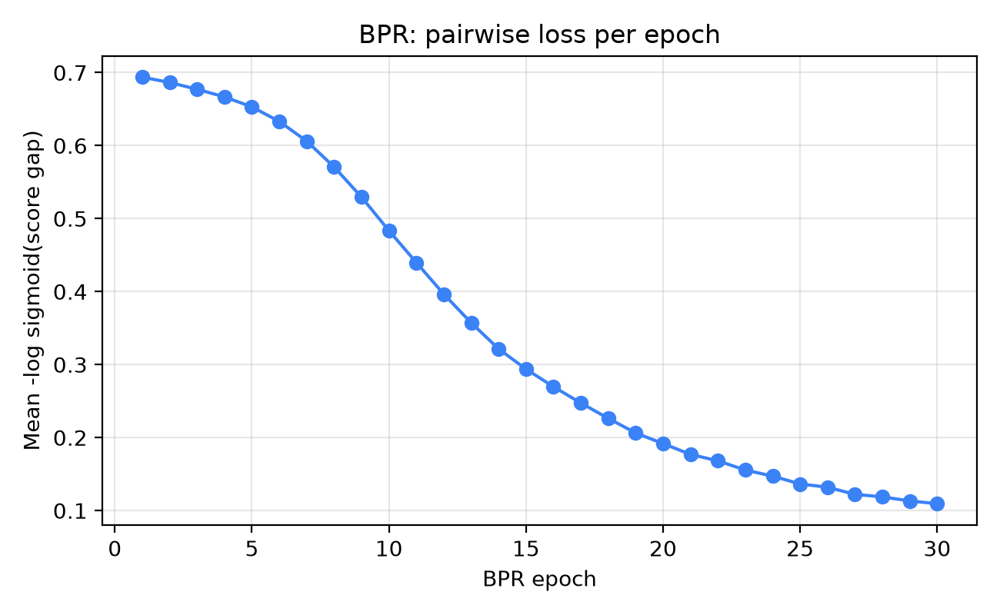

# Faktorisasi matriks (*matrix factorisation*)

## Pembeli yang tidak mirip siapa pun

Rina pernah mengklik satu set *pour-over* keramik, penggiling kopi manual, dan kertas filter, lalu pada suatu Selasa yang sepi juga mengklik earphone berkabel. Rekomender berbasis pengguna dari bab sebelumnya mencari tetangga (*neighbour*, yaitu pembeli dengan riwayat klik yang mirip) yang mengklik item yang *sama*, dan di katalog berisi dua ribu produk hampir tidak ada yang melakukannya. Inilah masalah kelangkaan data (*sparsity*) dari Bab 1 (tabel klik hampir seluruhnya kosong): metode berbasis tetangga membandingkan baris mentah dari tabel yang nyaris kosong itu, sehingga dua pembeli dengan selera sama tetapi tanpa SKU yang sama (SKU, *stock-keeping unit*, kode unik sebuah produk) akan memiliki cosine nol (cosine similarity adalah skor 0 sampai 1 tentang seberapa besar dua baris saling tumpang tindih; nilainya nol jika tidak ada yang sama).

Faktorisasi matriks bertanya dengan cara lain: *himpunan kecil selera tersembunyi apa yang dapat menjelaskan semua klik ini sekaligus?* Setiap pembeli menjadi vektor pendek berisi kekuatan selera, setiap produk menjadi vektor pendek berisi "seberapa banyak dari tiap selera yang saya miliki", dan skor sebuah pasangan adalah hasil kali titik (*dot product*) keduanya. Kita membangunnya dengan numpy biasa agar tidak ada yang tersembunyi di balik pemanggilan pustaka.

Bayangkan begini. Alih-alih mencatat setiap klik Rina, kita menulis "kartu selera" pendek untuk Rina, misalnya "kebanyakan perlengkapan kopi, sedikit gadget", dan sebuah kartu selera untuk setiap produk. Jika kartu Rina dan kartu sebuah produk menunjuk ke arah yang sama, kita merekomendasikannya. Menemukan kartu-kartu itu secara otomatis adalah seluruh teknik ini.

**Yang akan Anda pelajari**

- Apa itu *faktor laten* (*latent factor*), dan mengapa memampatkan matriks sparse raksasa menjadi dua matriks tipis menghasilkan rekomendasi yang berguna.
- Bagaimana faktorisasi klasik berbasis rating eksplisit (yang menggerakkan era Netflix Prize) dilatih dengan *stochastic gradient descent*, dan mengapa ia kurang cocok untuk klik.
- Bagaimana ALS untuk umpan balik implisit (*implicit-feedback ALS*) memandang klik sebagai *preferensi ditambah keyakinan (confidence)*, dan cara menurunkan solusi tertutup (*closed-form*) per barisnya dari nol.
- Bagaimana BPR mengoptimalkan peringkat secara langsung dengan *pairwise loss*, lengkap dengan gradiennya yang dihitung dengan tangan.
- Cara membaca kurva *loss*, menyetel `factors`, `reg`, `alpha`, `lr`, dan membandingkan kedua model dengan baseline dari Bab 3 dan 5 pada label yang persis sama.

**Kata-kata yang akan Anda temui.** Masing-masing dijelaskan lagi di tempat ia pertama kali penting; tabel ini hanya peta awal.

| Kata | Arti sederhana | Contoh kecil |
|---|---|---|
| **Vektor** (*vector*) | Daftar pendek berisi angka | Kartu selera Sari $(0.9, 0.1)$ |
| **Hasil kali titik** (*dot product*) | Kalikan dua vektor posisi demi posisi, lalu jumlahkan | $(0.9, 0.1)\cdot(1.0, 0.0) = 0.9 \times 1.0 + 0.1 \times 0.0 = 0.9$ |
| **Parameter** | Angka yang dipelajari model sendiri | Setiap angka pada setiap kartu selera |
| **Loss** (fungsi kerugian) | Satu skor untuk "seberapa salah model saat ini"; pelatihan berusaha membuatnya kecil | Memprediksi 3.5 padahal yang benar 5 |
| **Hyperparameter** | Kenop yang *Anda* setel sebelum pelatihan dimulai; model tidak mempelajarinya | Berapa banyak angka pada setiap kartu |
| **Epoch / iterasi** | Satu putaran penuh atas data latih | Membaca klik setiap pembeli satu kali |

## Intuisi: dimensi selera yang tidak pernah ditulis siapa pun

Bayangkan Anda menjelaskan para pelanggan tetap kepada barista baru. Anda tidak akan menyerahkan spreadsheet dengan centang untuk setiap item menu; Anda akan berkata "Dewi suka kopi pekat tanpa gula, Bayu suka yang manis dan berkrim susu". Beberapa frasa merangkum ratusan pembelian dan *memprediksi* perilaku.

Faktorisasi matriks mengotomatiskan langkah merangkum itu. Frasa-frasa tersebut ("pekat dan hitam", "manis dan berkrim susu") adalah **faktor laten**: dimensi selera yang tidak diberi label sebelumnya, ditemukan karena membuat data pembelian lebih mudah dijelaskan. Kata *laten* hanya berarti tersembunyi. Algoritma tidak tahu apa arti sebuah faktor; ia hanya tahu bahwa memberi setiap pengguna sebuah nilai pada faktor 1 dan setiap item sebuah nilai pada faktor 1 membuatnya dapat merekonstruksi matriks klik dengan lebih baik.

Mengapa ini penting? Tanpa faktor tersembunyi, satu-satunya cara menyatakan dua pembeli mirip adalah menemukan produk yang diklik keduanya. Faktor memungkinkan dua pembeli mirip karena berbagi *selera*, bahkan ketika mereka tidak berbagi produk apa pun.

Contoh mainan membuat mekanismenya konkret. Misalkan hanya ada dua faktor, dan kebetulan kita bisa menamainya: faktor A adalah "kegadgetan" dan faktor B adalah "kedapuran-dan-makanan". Setiap produk punya nilai pada tiap faktor, begitu pula setiap pembeli:

| | faktor A (gadget) | faktor B (dapur) |
|---|---|---|
| **Item** | | |
| earphone berkabel | 1.0 | 0.0 |
| power bank | 0.9 | 0.1 |
| mi instan | 0.0 | 1.0 |
| penggiling kopi | 0.4 | 0.8 |
| **Pengguna** | | |
| Pencinta gadget | 1.2 | 0.2 |
| Pencinta kuliner | 0.1 | 1.1 |

Skornya adalah hasil kali titik: untuk pencinta gadget dan earphone, $1.2 \times 1.0 + 0.2 \times 0.0 = 1.20$; untuk pencinta kuliner dan mi, $0.1 \times 0.0 + 1.1 \times 1.0 = 1.10$. Setelah diurutkan, pencinta gadget mendapat earphone (1.20), power bank (1.10), penggiling kopi (0.64), mi (0.20); pencinta kuliner mendapat mi, penggiling, power bank. Penggiling adalah *jembatan* yang memiliki sedikit dari kedua selera, sesuatu yang tidak dapat diungkapkan metode berbasis tetangga. Pencinta kuliner juga tidak perlu mengklik mi yang *sama* dengan orang lain: klik pada kacang, minyak goreng, dan penanak nasi menempatkan vektornya dekat $(0.1, 1.1)$, sehingga setiap item dengan faktor B besar akan bernilai tinggi. Satuan transfernya adalah faktor, bukan produk.

Daftar angka pendek ini punya nama lain: **embedding** (representasi vektor). Embedding adalah vektor pendek berisi angka yang mewakili seorang pengguna atau sebuah item, disusun sehingga hal-hal yang mirip mendapat angka yang mirip. Di sini baris "pencinta gadget" dan "pencinta kuliner" adalah embedding pengguna, dan setiap baris item adalah embedding item. Bab 7 sering memakai istilah ini, jadi ada baiknya mengenalinya sekarang.

Gagasan kedua adalah **peringkat rendah (*low rank*)**. Matriks klik dengan $m$ pengguna dan $n$ item memiliki $m \times n$ sel. Faktorisasi dengan $f$ faktor menggantinya dengan dua matriks yang hanya menyimpan $(m + n) \times f$ angka. Pada data bab ini, itulah selisih antara sekitar tiga juta sel ($1408 \times 2120 = 2{,}984{,}960$) dan $(1408 + 2120) \times 32 = 112{,}896$ parameter. Memeras begitu banyak informasi melalui leher botol yang sempit *memaksa* model menemukan keteraturan dalam data, itulah sebabnya kompresi dan generalisasi di sini adalah hal yang sama.

Dengan kata sederhana: **peringkat rendah berarti sedikit faktor.** Alih-alih mengingat reaksi setiap pembeli terhadap setiap produk, kita menyimpan satu kartu selera pendek per pembeli dan satu per produk (masing-masing 32 angka), dan setiap reaksi dapat dibangun kembali dari dua kartu. Kata *parameter* di sini berarti salah satu angka pada kartu-kartu itu, hal yang harus ditemukan pelatihan.

## Algoritma

Kita akan membahas tiga model dengan urutan kerelevanan yang meningkat terhadap repositori ini: faktorisasi eksplisit klasik (untuk melihat bentuk gagasannya), ALS implisit (andalan untuk data klik), dan BPR (alternatif yang sadar peringkat).

### Langkah nol: menyiapkan notasi

Misalkan $R$ adalah matriks interaksi berukuran $m \times n$. Dalam buku ini $R_{ui}$ adalah jumlah bobot event pengguna $u$ pada item $i$: klik bernilai 1, add-to-cart 3, dan order 5, yaitu `schema.EVENT_WEIGHT` dari Bab 1, sehingga pengguna yang mengklik lalu membeli memiliki $R_{ui} = 6$. Sel tanpa interaksi bernilai nol, tetapi, seperti yang akan kita lihat, *nol tidak berarti tidak suka*.

Model memberi setiap pengguna sebuah vektor $x_u \in \mathbb{R}^f$ dan setiap item sebuah vektor $y_i \in \mathbb{R}^f$, disimpan sebagai baris dari dua matriks $X$ (pengguna kali faktor) dan $Y$ (item kali faktor). Skor prediksinya adalah

$$\hat{r}_{ui} = x_u \cdot y_i = \sum_{k=1}^{f} x_{uk}\, y_{ik}.$$

Melatih berarti memilih $X$ dan $Y$. Ketiga metode hanya berbeda pada *loss yang diminimalkan*.

**Apa itu fungsi loss?** Fungsi loss adalah skor tentang seberapa salah tebakan model; melatih berarti mengubah angka-angka sampai skor itu sekecil mungkin. Bayangkan permainan lempar dart di mana Anda kehilangan poin sesuai jarak dari titik tengah: lemparan sempurna bernilai 0, lemparan melenceng jauh bernilai besar. Resep yang paling umum adalah mengambil selisih antara tebakan dan kebenaran lalu **mengkuadratkannya**. Jika model menebak 3.5 dan yang benar 5, selisihnya 1.5 dan loss-nya $1.5^2 = 2.25$. Mengkuadratkan melakukan dua hal berguna: menebak terlalu tinggi maupun terlalu rendah sama-sama mengurangi poin (tidak saling meniadakan), dan meleset besar jauh lebih mahal daripada meleset kecil (meleset 0.5 hanya bernilai 0.25). Tanpa loss tidak ada yang bisa diperbaiki: model tidak punya cara membedakan kumpulan kartu selera yang baik dari yang buruk.

### Faktorisasi eksplisit dan SGD ala Funk

Misalkan, sejenak, kita punya rating bintang, seperti pada Netflix Prize. Hanya sel pada himpunan teramati $\mathcal{K}$ yang membawa informasi, dan kita ingin prediksi yang cocok dengannya sambil menjaga vektor tetap kecil agar tidak menghafal noise:

$$\mathcal{L} = \sum_{(u,i) \in \mathcal{K}} \left( r_{ui} - x_u \cdot y_i \right)^2 + \lambda \left( \lVert x_u \rVert^2 + \lVert y_i \rVert^2 \right).$$

Bacalah rumus ini sepotong demi sepotong. $\mathcal{K}$ adalah himpunan sel yang benar-benar kita lihat ratingnya. $r_{ui}$ adalah rating sebenarnya, $x_u \cdot y_i$ adalah tebakan model, dan selisih keduanya yang dikuadratkan adalah loss dari paragraf sebelumnya, dijumlahkan atas semua sel teramati. Bagian kedua, dengan $\lambda$ (lambda, kenop yang Anda pilih), adalah **regularisasi**: penalti kecil atas *ukuran* angka pada kartu, karena $\lVert x_u \rVert^2$ hanyalah "seberapa besar vektor ini", dikuadratkan.

Mengapa ukuran dihukum? Karena **overfitting** (terlalu menghafal). Murid yang menghafal jawaban ujian tahun lalu mendapat nilai sempurna pada soal tahun lalu dan buruk pada soal tahun ini; model bisa melakukan hal yang sama, memakai angka besar yang sangat spesifik untuk mengingat setiap klik persis, termasuk noise-nya, lalu buruk memprediksi klik baru. Penalti membuat angka besar menjadi mahal, sehingga model memilih kartu sederhana yang menangkap pola nyata dan bukan kebetulan sekali-lewat. $\lambda$ yang lebih besar berarti penalti yang lebih kuat.

**Apa itu gradien dan gradient descent?** Kita masih butuh cara mengubah kartu agar loss mengecil. **Gradien** menyatakan, untuk setiap angka, "jika angka ini dinaikkan sedikit, apakah loss naik atau turun, dan seberapa cepat?" Bayangkan menuruni bukit berkabut: Anda tidak bisa melihat lembahnya, tetapi bisa merasakan ke mana tanah miring di bawah kaki, jadi Anda melangkah ke bawah, merasakan lagi, dan mengulang. Itulah **gradient descent** (penurunan gradien). Ukuran tiap langkah adalah **learning rate** (laju belajar), ditulis $\gamma$ di sini. ***Stochastic* gradient descent (SGD)** merasakan kemiringan hanya dari satu rating sekali waktu, bukan semuanya, yang murah dan bekerja baik dalam praktik. Langkah yang terlalu besar melewati lembah; terlalu kecil memakan waktu sangat lama.

Tuliskan galat prediksi $e_{ui} = r_{ui} - x_u \cdot y_i$. Mendiferensialkan satu suku terhadap $x_u$ menghasilkan $-2\, e_{ui}\, y_i + 2\lambda x_u$, dan serupa untuk $y_i$. Dengan melipat konstanta 2 ke dalam laju belajar (*learning rate*) $\gamma$, satu langkah *stochastic gradient descent* pada satu rating teramati adalah:

$$x_u \leftarrow x_u + \gamma \left( e_{ui}\, y_i - \lambda x_u \right), \qquad y_i \leftarrow y_i + \gamma \left( e_{ui}\, x_u - \lambda y_i \right).$$

Perhatikan betapa masuk akalnya pembaruan ini. Jika model memprediksi terlalu rendah ($e_{ui} > 0$), vektor pengguna bergerak *mendekati* vektor item dan vektor item mendekati vektor pengguna, sehingga hasil kali titiknya membesar. Jika prediksi terlalu tinggi, keduanya saling menjauh.

**Contoh hitung 1: satu langkah SGD.** Misalkan $x_u = (2.0, 1.0)$, $y_i = (1.5, 0.5)$, $r_{ui} = 5$, $\gamma = 0.05$, $\lambda = 0$. Prediksinya $3.5$, jadi $e = 1.5$. Maka $x_u' = (2.1125, 1.0375)$ dan, dengan memakai $x_u$ yang lama, $y_i' = (1.65, 0.575)$. Prediksi barunya adalah $2.1125 \times 1.65 + 1.0375 \times 0.575 \approx 4.08$. Galat menyusut dari 1.5 menjadi sekitar 0.92 dalam satu langkah. Ulangi untuk jutaan rating teramati, beberapa kali putaran, dan vektor-vektornya akan mengendap. Inilah pada dasarnya prosedur yang dipublikasikan Simon Funk selama Netflix Prize, dan alasan metode ini sering disebut "Funk SVD", meskipun bukan *singular value decomposition* sejati: SVD sejati membutuhkan setiap sel terisi, sedangkan di sini kita sengaja mengabaikan sel yang kosong.

::: fact
**Melewati sel yang kosong.** Ketika Simon Funk menjelaskan pendekatannya pada Desember 2006, data latih Netflix berupa matriks sekitar 500,000 pengguna kali 17,000 film, sekitar 8.5 miliar sel, dan hanya satu dari delapan puluh lima sel yang berisi rating. Trik utamanya adalah melewati sel kosong sepenuhnya dan menjalankan gradient descent hanya pada sel teramati, sehingga sebuah laptop dapat menyelesaikan satu putaran pelatihan penuh atas 100 juta rating dalam hitungan detik.

Sumber: Funk, "Netflix Update: Try This at Home" (blog sifter.org), 2006
:::

### Mengapa faktorisasi eksplisit kurang cocok untuk klik

**Umpan balik eksplisit dan implisit.** Umpan balik *eksplisit* adalah ketika pengguna memberi tahu langsung seberapa mereka menyukai sesuatu, misalnya rating bintang 1 sampai 5. Umpan balik *implisit* adalah yang disimpulkan dari perilaku: klik, add-to-cart, order. Data belanja hampir seluruhnya implisit, karena pembeli jarang memberi rating pada apa yang mereka klik.

Umpan balik implisit **tidak memiliki negatif yang teramati**: jika Rina tidak mengklik mouse gaming, bisa jadi ia tidak menyukainya atau memang belum pernah melihatnya. Mencocokkan hanya sel bukan-nol membuat prediksi melayang naik; memperlakukan nol sebagai rating 0 berarti menyatakan sebagian besar katalog dibenci. Dan angkanya bermakna lain: bobot 6 (klik plus order) menyatakan *keyakinan*, bukan besarnya preferensi.

Hu, Koren, dan Volinsky menyelesaikan kedua masalah itu dengan satu pembingkaian ulang. Pecah setiap sel menjadi dua besaran:

- **Preferensi** biner $p_{ui} = 1$ jika $R_{ui} > 0$, dan $0$ jika tidak.
- **Keyakinan (*confidence*)** $c_{ui} = 1 + \alpha R_{ui}$.

Inilah artinya dengan `alpha = 20` pada bab ini (kenop yang Anda setel; lihat daftar hyperparameter di bawah) untuk pembeli Sari:

| Yang dilakukan Sari pada sebuah item | $R_{ui}$ | Preferensi $p_{ui}$ | Keyakinan $c_{ui} = 1 + 20 R_{ui}$ |
|---|---|---|---|
| Tidak pernah menyentuhnya | 0 | 0 | 1 |
| Mengklik sekali | 1 | 1 | 21 |
| Memasukkan ke keranjang (bobot 3) | 3 | 1 | 61 |
| Memesannya (bobot 5) | 5 | 1 | 101 |

Preferensinya sama (1) untuk ketiga baris yang disentuh; hanya keyakinannya yang tumbuh. Analogi asisten toko cocok di sini: pelanggan yang membeli produk memberi tahu Anda jauh lebih banyak daripada yang hanya melirik, jadi Anda lebih memercayai pembelian itu.

Preferensi menjawab "apakah pengguna ini menunjukkan minat?". Keyakinan menjawab "seberapa besar loss harus peduli agar sel ini benar?". Sel teramati dengan banyak bukti mendapat keyakinan besar; sel tak teramati tetap pada nilai dasar $c = 1$: kita masih *lemah* meyakini bahwa itu nol, karena pada katalog yang sangat besar kebanyakan hal yang belum terlihat memang tidak menarik, tetapi kita jauh kurang yakin dibanding terhadap sebuah pembelian.

Loss yang baru berjalan pada **semua** $m \times n$ sel:

$$\mathcal{L}_{\text{ALS}} = \sum_{u,i} c_{ui} \left( p_{ui} - x_u \cdot y_i \right)^2 + \lambda \left( \sum_u \lVert x_u \rVert^2 + \sum_i \lVert y_i \rVert^2 \right).$$

Karena menjumlahkan seluruh sel, SGD harus menyentuh tiga juta suku per epoch padahal hanya 18,256 yang tidak sepele. Trik pada bagian berikutnya adalah bahwa pengoptimal yang berbeda dapat memanfaatkan persis ketimpangan itu.

::: fact
**Model faktor berbobot keyakinan dengan solver berwaktu linear.** Makalah ICDM 2008 oleh Hu, Koren, dan Volinsky mengusulkan untuk memperlakukan data implisit sebagai indikasi preferensi positif dan negatif "associated with vastly varying confidence levels", bersama prosedur optimasi yang biayanya tumbuh linear terhadap ukuran data. Mereka menerapkannya pada rekomender acara televisi.

Sumber: Hu et al., ICDM, 2008
:::

### ALS: menurunkan solusi tertutup

Loss $\mathcal{L}_{\text{ALS}}$ tidak konveks terhadap $(X, Y)$ secara bersamaan, karena memuat hasil kali $x_u \cdot y_i$. Tetapi tetapkan salah satu sisi, dan ia menjadi masalah kuadrat terkecil berbobot yang sepenuhnya biasa pada sisi lainnya. Pengamatan itulah yang memberi algoritma ini namanya: **alternating least squares** (kuadrat terkecil bergantian). Tahan $Y$ tetap dan selesaikan setiap vektor pengguna secara eksak; lalu tahan $X$ tetap dan selesaikan setiap vektor item secara eksak; ulangi.

Dua istilah dalam paragraf itu perlu dibaca sederhana. **Kuadrat terkecil** (*least squares*) berarti "cari angka yang membuat jumlah selisih kuadrat sekecil mungkin"; dengan satu angka yang tidak diketahui, jawaban terbaik sering dapat langsung dituliskan. **Bergantian** (*alternating*) seperti menyetel dua kenop radio: tahan satu, setel yang lain ke posisi terbaiknya, lalu bertukar peran, dan ulangi sampai tidak ada yang ingin bergerak. Kita menahan $Y$ sehingga hanya kartu pengguna yang tidak diketahui, dan ini mengubah satu masalah sulit menjadi banyak masalah mudah.

Ambil satu pengguna $u$ dengan $Y$ tetap. Satu-satunya suku yang melibatkan $x_u$ adalah

$$J(x_u) = \sum_{i} c_{ui} \left( p_{ui} - x_u \cdot y_i \right)^2 + \lambda \lVert x_u \rVert^2 .$$

Setel gradiennya ke nol:

$$\frac{\partial J}{\partial x_u} = -2 \sum_i c_{ui} \left( p_{ui} - x_u \cdot y_i \right) y_i + 2\lambda x_u = 0 .$$

Uraikan $x_u \cdot y_i = y_i^{\top} x_u$ dan kumpulkan suku-suku yang memuat $x_u$:

$$\Bigl( \sum_i c_{ui}\, y_i y_i^{\top} + \lambda I \Bigr) x_u = \sum_i c_{ui}\, p_{ui}\, y_i .$$

Dalam bentuk matriks, dengan $C^u$ matriks diagonal berisi keyakinan pengguna $u$ atas semua item, dan $p(u)$ vektor preferensinya:

$$\boxed{\; x_u = \left( Y^{\top} C^u Y + \lambda I \right)^{-1} Y^{\top} C^u\, p(u) \;}$$

Inilah solusi tertutup. Matriks dalam kurung berukuran $f \times f$, simetris dan, berkat $\lambda I$, positif definit, sehingga solusinya unik dan setiap solve hanya dapat *menurunkan* loss, tidak pernah menaikkannya. Itulah sebabnya kurva pelatihan yang akan kita lihat nanti turun secara monoton tanpa penyetelan learning rate sama sekali. Vektor item mengikuti secara simetris: tukar peran pengguna dan item lalu gunakan kolom dari $C$ dan $P$.

Dengan kata sederhana: ini adalah jawaban **tertutup** (*closed-form*), rumus yang memberi $x_u$ terbaik dalam satu perhitungan, tanpa menuruni bukit selangkah demi selangkah dan karenanya tanpa learning rate. "Positif definit" dan "monoton" berarti rumus itu selalu memiliki tepat satu jawaban dan setiap solve hanya bisa mempertahankan atau menurunkan loss. Kurva di bagian Hasil akan memperlihatkannya.

#### Trik matriks Gram

Menghitung $Y^{\top} C^u Y$ secara naif membutuhkan biaya $O(f^2 n)$ per pengguna, karena $C^u$ memiliki $n$ entri diagonal. Dengan $n = 2120$ item dan 1408 pengguna, itu pekerjaan yang banyak terbuang, sebab hampir semua entrinya bernilai 1. Hu dkk. memecah matriksnya:

$$Y^{\top} C^u Y = Y^{\top} Y + Y^{\top} \left( C^u - I \right) Y .$$

Suku pertama, **matriks Gram** $Y^{\top}Y$, tidak bergantung pada pengguna, sehingga dihitung sekali per sapuan (*sweep*). Suku kedua hanya memiliki entri bukan-nol untuk $n_u$ item yang benar-benar disentuh pengguna (di mana $c_{ui} - 1 = \alpha R_{ui} > 0$), sehingga biayanya $O(f^2 n_u)$. Demikian pula sisi kanan runtuh menjadi jumlah atas item yang disentuh pengguna karena $p_{ui} = 0$ di tempat lain. Total biaya satu sapuan jadi sebanding dengan jumlah sel *teramati*, bukan $m \times n$, dan itulah yang membuat ALS praktis pada data nyata.

Catatan tentang notasi $O(f^2 n_u)$: itu perkiraan kasar berapa banyak langkah hitung yang dibutuhkan, jadi ia menunjukkan bagaimana biaya bertumbuh. $O(f^2 n)$ dengan $n = 2120$ item per pengguna jauh lebih banyak pekerjaan daripada $O(f^2 n_u)$ dengan hanya segelintir item $n_u$ yang disentuh seorang pengguna.

**Contoh hitung 2: satu solve ALS dengan tangan.** Ambil $f = 1$ faktor, faktor item $y = (1, 2, 3)$, seorang pengguna yang menyentuh item 1 dan 2 dengan $R = (1, 2)$ (item 3 tak tersentuh), $\alpha = 2$, $\lambda = 0.5$. Maka $p = (1,1,0)$ dan $c = (3,5,1)$. Suku Gram-nya $Y^{\top}Y = 14$, koreksinya $Y^{\top}(C-I)Y = 2\cdot1 + 4\cdot4 = 18$, sehingga sisi kiri adalah $14 + 18 + 0.5 = 32.5$ (menjumlahkan $c\,y^2 + \lambda$ secara langsung memberi hasil sama). Sisi kanan adalah $\sum c\,p\,y = 3 + 10 = 13$, jadi $x_u = 13/32.5 = 0.4$ dan prediksinya $(0.4, 0.8, 1.2)$. Dengan satu faktor, model tidak dapat memuaskan semua orang, itulah sebabnya model nyata memakai 32; struktur yang perlu diingat adalah bahwa satu pengguna merupakan regresi ridge berbobot kecil atas item yang disentuhnya.



*Gambar: Satu putaran pelatihan ALS. Setiap kotak di dalam loop adalah solve kuadrat terkecil yang eksak, sehingga tidak ada learning rate yang perlu disetel.*

### BPR: optimalkan urutan, bukan nilainya

ALS meminimalkan galat kuadrat pada target 0/1. Tetapi kita tidak pernah menampilkan prediksi 0/1 kepada pengguna; kita menampilkan *daftar berperingkat*. Rendle dan kolega bertanya: mengapa tidak mengoptimalkan peringkat secara langsung? Data latih menjadi **triplet** $(u, i, j)$ dengan $i$ item yang berinteraksi dengan pengguna $u$ dan $j$ item yang tidak. Model harus memberi skor $i$ di atas $j$.

Contoh kecil: Sari mengklik makanan kucing ($i$) dan tidak pernah mengklik casing ponsel ($j$). BPR tidak bertanya "berapa skor persis Sari untuk makanan kucing?"; ia hanya bertanya "apakah makanan kucing diberi skor *di atas* casing ponsel?" dan menggeser angka-angka sampai jawabannya ya. (*BPR* singkatan dari Bayesian Personalised Ranking: mempelajari urutan untuk tiap orang.)

Misalkan selisihnya $\hat{x}_{uij} = x_u \cdot y_i - x_u \cdot y_j = x_u \cdot (y_i - y_j)$: seberapa jauh skor item yang diklik berada di atas skor item acak. Kita menekannya dengan fungsi logistik $\sigma(z) = 1/(1 + e^{-z})$ untuk mendapatkan probabilitas model mengurutkan pasangan dengan benar.

*Fungsi logistik* $\sigma$ (juga disebut sigmoid) menekan angka apa pun ke rentang 0 sampai 1, sehingga dapat dibaca sebagai probabilitas. Misalnya $\sigma(0) = 0.5$ (lempar koin), $\sigma(0.5) \approx 0.6225$ (unggul tipis), $\sigma(4) \approx 0.982$ (unggul jauh, hampir pasti benar) dan $\sigma(-4) \approx 0.018$ (hampir pasti salah).

Objektif BPR memaksimalkan log probabilitas itu atas triplet yang disampel. *Prior* adalah keyakinan awal, di sini bahwa parameter sebaiknya kecil; "prior Gaussian" BPR pada parameter hanya berubah menjadi penalti ukuran yang sama (regularisasi L2) seperti sebelumnya, dan itulah "Bayesian" dalam namanya. Jadi bacalah rumus berikut sebagai: *dorong probabilitas bahwa setiap item yang diklik mengalahkan item acaknya setinggi mungkin, sambil menjaga angka tetap kecil*. Tanda minus mengubah "maksimalkan" menjadi "minimalkan loss":

$$\mathcal{L}_{\text{BPR}} = - \sum_{(u,i,j)} \ln \sigma\bigl( \hat{x}_{uij} \bigr) + \lambda \lVert \Theta \rVert^2 .$$

Ini adalah pengganti AUC yang mulus dan terdiferensialkan, yaitu probabilitas bahwa sebuah positif acak mengungguli sebuah negatif acak untuk pengguna yang sama.

Gradiennya menyenangkan karena pendek. Karena $\frac{d}{dz} \ln \sigma(z) = 1 - \sigma(z) = \sigma(-z)$, dan $\hat{x}_{uij}$ linear terhadap setiap vektor:

$$\frac{\partial \hat{x}_{uij}}{\partial x_u} = y_i - y_j, \qquad \frac{\partial \hat{x}_{uij}}{\partial y_i} = x_u, \qquad \frac{\partial \hat{x}_{uij}}{\partial y_j} = -x_u .$$

Jadi satu langkah ascent dengan learning rate $\eta$ dan $s = \sigma(-\hat{x}_{uij})$ adalah

$$x_u \mathrel{+}= \eta \bigl( s\, (y_i - y_j) - \lambda x_u \bigr), \quad y_i \mathrel{+}= \eta \bigl( s\, x_u - \lambda y_i \bigr), \quad y_j \mathrel{+}= \eta \bigl( -s\, x_u - \lambda y_j \bigr).$$

Skalar $s$ adalah kuncinya. Ketika pasangan sudah terurut benar dengan selisih lebar, $\hat{x}_{uij}$ besar, $s \approx 0$, dan triplet itu nyaris tidak mengubah apa pun. Ketika pasangan salah atau seri, $s$ mendekati $0.5$ atau lebih dan pembaruannya besar. Model mencurahkan upayanya pada pasangan yang saat ini ia dapatkan salah, intuisi yang sama dengan gradien LambdaMART yang akan Anda temui di Bab 10.

**Contoh hitung 3: satu langkah BPR.** Misalkan $x_u = (0.5, -0.2)$, $y_i = (1.0, 0.5)$ (diklik), $y_j = (0.2, 1.0)$ (acak), $\eta = 0.1$, $\lambda = 0$. Selisihnya $y_i - y_j = (0.8, -0.5)$, sehingga gap-nya $0.5 \cdot 0.8 + (-0.2)(-0.5) = 0.5$. Maka $\sigma(0.5) \approx 0.6225$, loss-nya $-\ln 0.6225 \approx 0.474$ dan $s = 0.3775$. Pembaruannya $x_u \approx (0.5302, -0.2189)$, $y_i \approx (1.0189, 0.4924)$ dan $y_j \approx (0.1811, 1.0076)$. Gap baru sekitar $0.557$ dan loss sekitar $0.453$: satu langkah kecil menggerakkan pasangan itu ke arah yang benar.

Satu detail praktis. Saat inisialisasi semua vektor mendekati nol, sehingga setiap gap mendekati 0 dan $\sigma(0) = 0.5$, artinya setiap triplet memiliki loss $-\ln 0.5 = \ln 2 \approx 0.693$. Ketika melatih BPR, loss yang *dimulai* di sekitar 0.693 adalah pertanda baik bahwa kodenya terpasang dengan benar.

### Hyperparameter dalam satu tempat

**Hyperparameter** adalah kenop yang Anda setel *sebelum* pelatihan; **parameter** (angka pada kartu selera) adalah yang dipelajari pelatihan. **Underfitting** adalah kebalikan overfitting: model terlalu sederhana untuk menangkap pola nyata (kartu selera dengan terlalu sedikit angka untuk membedakan kopi dari gadget). Satu **epoch** adalah satu putaran penuh atas data latih.

- `factors` $f$: terlalu rendah menyebabkan underfit (selera tidak dapat dipisahkan), terlalu tinggi menyebabkan overfit dan memperlambat pelatihan.
- `reg` $\lambda$: terlalu rendah menghafal pengguna yang jarang datanya, terlalu tinggi menyusutkan setiap skor ke arah 0.
- `alpha` $\alpha$ (ALS): terlalu rendah membuat sel teramati dan tak teramati tampak serupa; terlalu tinggi membuat satu klik mendominasi dan menyeret rekomendasi ke item populer.
- `iters` / `epochs`: berhenti ketika loss mendatar; BPR juga membutuhkan `lr` yang wajar (terlalu tinggi berosilasi) dan cukup banyak negatif yang disampel.

Skrip kita memakai `factors = 32`, `reg = 0.1`, `alpha = 20`, 15 iterasi untuk ALS; dan `lr = 0.05`, `reg = 0.01`, 30 epoch, satu negatif untuk BPR. Ini nilai bawaan, bukan optimum hasil penyetelan.

## Penjelasan kode

Semua kode berada di `book/code/ch06_mf.py`. Ia melatih kedua model pada matriks pengguna-kali-item yang persis sama dengan Bab 3 dan 5 lalu menyerahkan skornya ke helper evaluasi bersama. Kita mulai dari matriksnya.

### Membangun matriks interaksi

```include
path: book/code/common.py
symbol: interaction_matrix
```

`hist.interactions()` mengembalikan satu baris per event positif (klik, cart, atau order) beserta bobotnya, diambil langsung dari kamus `EVENT_WEIGHT`. Groupby menjumlahkannya per pasangan pengguna-item, sehingga pengguna yang mengklik sebuah item dua kali dan membelinya sekali memiliki $R = 1 + 1 + 5 = 7$. Kita lalu memetakan id mentah ke posisi baris dan kolom yang rapat dengan `pd.Index.get_indexer` dan membangun matriks sparse CSR. Kedua indeks yang dikembalikan sangat penting nanti: keduanya menerjemahkan "baris 17" kembali menjadi "pengguna 61".

Skrip ch06 memadatkan matriks ini dengan `.toarray()`: 1408 pengguna kali 2120 item bertipe float64 hanya beberapa puluh megabyte, jadi tidak masalah untuk skrip pengajaran. Pada skala produksi Anda tidak pernah melakukan ini.

### ALS: seluruh algoritma dalam satu fungsi

```include
path: book/code/ch06_mf.py
symbol: als_implicit
```

Baca fungsi ini dari atas ke bawah, dan cocokkan setiap bagian dengan penurunannya.

- `P` dan `C` adalah matriks preferensi dan keyakinan; `X` dan `Y` dimulai dari noise Gaussian kecil (semua nol akan membuat setiap solve identik).
- `solve(fixed, conf, pref)` adalah solusi tertutup untuk setiap baris pada satu sisi. `gram = fixed.T @ fixed` adalah $Y^{\top}Y$, dihitung sekali per sapuan: baris itulah trik Hu-Koren-Volinsky.
- Per baris, `nz` menemukan item yang disentuh, `A = gram + Fn.T @ ((cu - 1.0)[:, None] * Fn) + eye` adalah $Y^{\top}Y + Y^{\top}(C^u - I)Y + \lambda I$, dan `b` adalah $Y^{\top}C^u p(u)$. `np.linalg.solve(A, b)` menghindari pembentukan invers.

Loop utama lalu memanggil `solve(Y, C, P)` untuk pengguna dan `solve(X, C.T, P.T)` untuk item. Mentranspos $C$ dan $P$ sudah cukup untuk memakai ulang fungsi yang sama bagi sisi lainnya. Setelah setiap sapuan, kode mencatat objektif penuh dengan operasi numpy padat, `(C * err**2).sum() + reg * (...)`, yang merupakan loss yang diplot nanti.

Satu catatan jujur: `C` dan `err` di sini padat. Itu tidak masalah untuk lab dengan tiga juta sel, tetapi tidak untuk jutaan pengguna. ALS produksi menjaga $R$ tetap sparse sepanjang waktu dan tidak pernah membangun $C$.

### BPR: sampling, gap, dan ketiga gradien

```include
path: book/code/ch06_mf.py
symbol: bpr
```

Fungsi ini sesuai satu-satu dengan persamaan BPR.

- `np.nonzero(pos_mask)` mendaftar setiap pasangan positif; satu epoch mengunjungi masing-masing sekali dalam mini-batch berukuran 256. `j` adalah item acak seragam, diundi ulang hingga lima kali jika ternyata positif sungguhan.
- `gap` adalah $\hat{x}_{uij}$ untuk batch; `sig = 1.0 / (1.0 + np.exp(gap))` adalah $\sigma(-\text{gap})$, pengali langkah $s$; `np.log1p(np.exp(-gap))` mengakumulasi loss.
- `gu`, `gi`, `gj` adalah ketiga gradien (tanda minus pada `gj` mendorong negatif menjauh). `np.add.at` diperlukan karena satu pengguna dapat muncul beberapa kali dalam sebuah batch.

### Dari skor ke daftar top-50

```include
path: book/code/dense_recs.py
symbol: scores_to_recs
```

Kedua model menghasilkan matriks skor padat `users × items`, `X[users] @ Y[items].T`; helper ini mengubahnya menjadi daftar top-50 yang diharapkan `common.evaluate`, dengan mengisi pengguna tanpa riwayat yang dapat dipakai menggunakan popularitas 7 hari. Ia tidak membuang item yang sudah disentuh pengguna; filter itu menjadi urusan Bab 11.

## Jalankan

Dari direktori `book/`:

```bash
uv run python code/ch06_mf.py
```

Proses berjalan beberapa detik saja karena matriksnya kecil. ALS lebih dulu. Setiap baris mencetak objektif penuh setelah satu sapuan bergantian:

```output
file: results/ch06_mf.txt
lines: 6-22
```

Lalu epoch pembuka dan penutup BPR. Loss yang dilaporkan adalah rata-rata $-\ln\sigma(\text{gap})$ atas triplet yang disampel pada epoch tersebut, jadi ini besaran waktu pelatihan, bukan skor peringkat:

```output
file: results/ch06_mf.txt
lines: 24-36
```

```output
file: results/ch06_mf.txt
lines: 45-55
```

Terakhir, berapa banyak pengguna evaluasi yang tidak memiliki vektor yang dapat dipakai dan bagaimana kedua model mendapat skor pada minggu uji:

```output
file: results/ch06_mf.txt
lines: 57-65
```

## Hasil

### Membaca kurva loss

**Kurva loss** memplot loss setelah setiap iterasi atau epoch. Jika turun, model sedang belajar; ketika berhenti turun dan mendatar, kita katakan ia telah **konvergen** (mengendap) dan pelatihan tambahan memberi sedikit manfaat. "Titik tekuk" (*knee*) adalah titik di mana penurunan curam berubah menjadi garis datar.



Loss ALS turun pada **setiap** iterasi, seperti yang dijanjikan penurunan rumusnya: dari 225190.5 pada iterasi 1 menjadi 147262.9 pada iterasi 2, 120478.2 pada iterasi 5, dan 111911.5 lalu 111705.9 pada iterasi 14 dan 15 (selisih sekitar 0.2%). Kurva sudah mendatar, jadi 15 iterasi sudah melewati titik tekuknya.



Kurva BPR dimulai pada 0.6937, pada dasarnya $\ln 2 \approx 0.693$: saat inisialisasi setiap gap mendekati nol. Nyaris tidak ada yang terjadi selama lima epoch (0.6530 pada epoch 5) karena vektor kecil menghasilkan gradien kecil; lalu loss turun cepat (0.4835 pada epoch 10, 0.2937 pada epoch 15) dan mencapai 0.1094 pada epoch 30. Loss **masih turun** pada epoch 30, jadi model belum konvergen.

### Kualitas peringkat dibanding semua yang sudah dibahas

Loss pelatihan bukanlah kualitas peringkat, jadi kita mengevaluasi kedua model pada minggu uji dan metrik yang sama seperti bab-bab sebelumnya (baris ch06 ada di tabel di atas). Pertama, pengingat singkat metrik. **recall@20**: dari item yang benar-benar berinteraksi dengan pembeli pada minggu uji, berapa bagian yang muncul di 20 teratas kita. **ndcg@20**: skor yang juga memberi imbalan karena menaruh item-item itu di dekat puncak daftar, bukan di posisi 20. **coverage@20**: berapa bagian katalog yang muncul di setidaknya satu daftar 20 teratas pengguna; coverage rendah berarti semua orang mendapat item yang sama. **Generator kandidat** adalah model yang murah menemukan beberapa ratus item yang masuk akal; **ranker** lalu mengurutkannya dengan cermat.

Sebagai pembanding, metode Bab 5 dan baseline Bab 3 terbaik pada label yang identik:

```output
file: results/ch05_cf.txt
lines: 31-37
```

```output
file: results/ch03_popularity.txt
lines: 22-22
```

Beberapa kesimpulan mengikuti langsung dari angka-angka ini.

**1. Faktorisasi menghancurkan popularitas.** ALS memiliki ndcg@20 0.1581 dibanding 0.0475 untuk `pop_7d`, lebih dari tiga kali lipat.

**2. ALS mengalahkan BPR di sini, tetapi tidak meyakinkan.** ALS mendapat ndcg@20 0.1581 dan recall@20 0.2715; BPR mendapat 0.1379 dan 0.2218. Loss BPR masih turun dan ia punya lebih banyak knob, jadi bacalah ini sebagai "dengan nilai bawaan ini ALS lebih baik dan lebih murah".

**3. ALS tidak mengalahkan user-kNN pada ndcg.** User-kNN dengan 50 tetangga mencapai 0.1662, dan bahkan `pop_in_my_categories` mencapai 0.1302, dekat dengan 0.1379 milik BPR. Pada katalog kecil, sinyal tetangga dan kategori adalah baseline yang kuat.

**4. Metrik-metrik itu berbeda secara informatif.** ALS memiliki recall@20 (0.2715 vs 0.2273) dan order_recall@20 (0.4122 vs 0.3456) yang lebih tinggi daripada user-kNN tetapi ndcg@20 yang lebih rendah. Ia menemukan lebih banyak item yang tepat dan mengurutkannya kurang tajam, itulah sebabnya generator kandidat dinilai dengan recall dan ranker dengan ndcg.

**5. Coverage dan pengguna dingin.** Coverage@20 adalah 0.5431 untuk ALS dan 0.4267 untuk BPR dibanding 0.0087 untuk `pop_7d`. Tetapi 28 pengguna evaluasi tidak memiliki vektor (tanpa interaksi sebelum cutoff) dan diisi dengan popularitas 7 hari, sekitar 3.0% slot: faktorisasi tidak dapat memberi skor kepada pengguna yang belum pernah ia lihat (Bab 12).

::: fact
**Sejuta dolar untuk sepuluh persen.** Netflix Prize diluncurkan pada Oktober 2006 dan menantang dunia untuk meningkatkan akurasi prediksi rating Netflix sebesar 10%. Hadiah diberikan pada September 2009 kepada tim "BellKor's Pragmatic Chaos", yang submisi pemenangnya memperbaiki sistem yang ada sebesar 10.06%, dilaporkan tiba kurang dari setengah jam sebelum tenggat kontes. Deskripsi metode yang dipublikasikan tim itu menonjolkan dua keluarga teknik: model tetangga dan model faktor laten seperti yang ada di bab ini.

Sumber: Sarno, Los Angeles Times, 2009
:::

::: fact
**Mengoptimalkan peringkat secara langsung.** Dalam makalah UAI 2009 mereka, Rendle dan kolega mencatat bahwa metode populer untuk rekomendasi item dari umpan balik implisit, seperti faktorisasi matriks dan adaptive k-nearest-neighbour, "are designed for the item prediction task of personalized ranking" namun "none of them is directly optimized for ranking". Kriteria BPR-Opt mereka, yang diturunkan sebagai penaksir maximum posterior, dilatih dengan stochastic gradient descent menggunakan bootstrap sampling dan dapat diterapkan pada kedua keluarga model.

Sumber: Rendle et al., UAI, 2009
:::

## Jebakan dan cara produksi melakukannya

**Menyetel pada set uji Anda.** Menyapu `alpha`, `factors`, dan `reg` terhadap label evaluasi berarti menyesuaikan diri pada data evaluasi. Setel pada jendela validasi yang lebih awal dan evaluasi sekali pada minggu uji; kami membiarkan nilai bawaan tanpa penyetelan karena alasan ini.

**Tidak teramati bukan berarti negatif.** ALS memberi bobot 1 pada sel kosong dan BPR menyampel sel kosong secara seragam, tetapi item bagus yang tidak pernah dilihat pengguna tetap dihukum. Sistem produksi memakai negatif yang *sadar paparan* (item yang ditampilkan namun diabaikan, yaitu event `impression`, yang dicatat repositori ini) dan sampling berbobot popularitas, karena sampling seragam memilih item langka sebagai negatif jauh lebih sering daripada item populer.

**Matriks padat tidak skalabel.** Kode kita membangun matriks $C$, $P$, dan galat yang *padat* (*dense*, setiap sel disimpan, termasuk nol). Pada skala Shopee, produksi menjaga $R$ tetap *sparse* (hanya sel bukan-nol yang disimpan), memproses pengguna dalam blok seukuran GPU, dan men-*shard* $X$ dan $Y$ (membaginya ke banyak mesin); pustaka sumber terbuka `implicit` dan Spark MLlib mengimplementasikan bentuk sparse-nya.

**Fold-in.** Fold-in berarti menghitung vektor untuk seorang pengguna *tanpa melatih ulang*. Dengan $Y$ dibekukan, vektor seorang pengguna adalah solusi tertutup yang dapat dihitung ulang jauh di bawah satu milidetik dari klik terbarunya, sehingga model yang dilatih tiap malam tetap dapat bereaksi pada perilaku segar (bandingkan desain on-request repositori ini).

**Dot product, bukan jarak.** Panjang vektor berpengaruh pada $x_u \cdot y_i$; pustaka ANN (pencarian tetangga terdekat hampiran: pencarian cepat, sedikit tidak eksak, atas vektor terdekat) membutuhkan varian *maximum-inner-product* (Bab 7).

**Posisinya dalam repositori ini.** Layanan rekomender tidak memakai ALS maupun BPR saat ini: sumber kandidatnya adalah empat retriever dari Bab 8 dan rankernya LightGBM (Bab 10). Perluasan yang wajar adalah melatih ALS saat retrain dan memakai dot product sebagai sumber kandidat tambahan sekaligus fitur ranker (lihat daftar periksa di Bab 14).

## Ringkasan

- Faktorisasi matriks memberi setiap pengguna dan item vektor pendek berisi **faktor laten** dan menilai sebuah pasangan dengan dot product-nya, memampatkan sekitar tiga juta sel menjadi kira-kira seratus ribu parameter.
- Faktorisasi eksplisit (Funk SVD) mencocokkan rating teramati dengan SGD; ia kurang cocok untuk klik, di mana sel kosong bukan nol dan bobot menyatakan keyakinan.
- **ALS implisit** memecah setiap sel menjadi preferensi $p = 1[R > 0]$ dan keyakinan $c = 1 + \alpha R$ lalu meminimalkan galat kuadrat berbobot atas semua sel.
- Dengan satu sisi tetap, setiap baris punya solusi tertutup, $x_u = (Y^{\top}C^uY + \lambda I)^{-1}Y^{\top}C^u p(u)$; trik Gram membuat biaya satu sapuan sebanding dengan sel teramati, dan loss turun pada setiap iterasi.
- **BPR** mendorong item yang diklik di atas item acak, dengan gradien diskalakan oleh $\sigma(-\text{gap})$; run yang sehat dimulai dekat $\ln 2 \approx 0.693$.
- ALS mencapai ndcg@20 0.1581 dan BPR 0.1379 dibanding 0.0475 untuk `pop_7d`; 0.1662 milik user-kNN masih lebih tinggi, meski ALS memiliki recall@20 lebih tinggi, sehingga faktorisasi adalah model retrieval, bukan ranker yang tajam.
- 28 pengguna evaluasi tidak memiliki vektor dan perlu diisi dengan popularitas; nilai jangka panjang dari faktor adalah representasinya, yang dikembangkan lebih jauh di Bab 7.

## Kuis

**Q6.1** Dalam model faktorisasi dengan 32 faktor, apa itu *faktor laten*?

- A. Satu kolom dari matriks interaksi mentah, seperti klik pada satu produk.
- B. Salah satu dimensi terpelajar dari vektor pengguna dan item; ia tidak diberi nama sebelumnya dan ditemukan karena membantu merekonstruksi interaksi.
- C. Sebuah hyperparameter yang dipilih dengan cross-validation, seperti learning rate.
- D. Sebuah fitur seperti harga atau kategori yang diketik penjual saat membuat produk.

**Q6.2** Pada model ALS implisit Hu-Koren-Volinsky, apa peran $p_{ui}$ dan $c_{ui}$?

- A. $p_{ui}$ adalah skor prediksi dan $c_{ui}$ adalah rating sebenarnya.
- B. $p_{ui}$ adalah target biner "menunjukkan minat" dan $c_{ui} = 1 + \alpha R_{ui}$ menyatakan seberapa besar loss harus peduli agar sel itu benar.
- C. $p_{ui}$ adalah popularitas item dan $c_{ui}$ adalah kategori item.
- D. $p_{ui}$ adalah learning rate dan $c_{ui}$ adalah kekuatan regularisasi.

**Q6.3** Mengapa trik matriks Gram $Y^{\top}C^uY = Y^{\top}Y + Y^{\top}(C^u - I)Y$ penting bagi ALS?

- A. Ia membuat loss konveks terhadap $X$ dan $Y$ secara bersamaan, sehingga ALS selalu menemukan minimum global.
- B. Ia menghilangkan kebutuhan akan regularisasi.
- C. $Y^{\top}Y$ dapat dihitung sekali per sapuan dan dibagi ke semua pengguna, sehingga biaya per pengguna hanya bergantung pada item yang disentuh pengguna itu, bukan seluruh katalog.
- D. Ia memungkinkan ALS menangani rating bintang eksplisit.

**Q6.4** Jelaskan dalam dua atau tiga kalimat mengapa memperlakukan setiap sel kosong sebagai rating 0 yang sebenarnya adalah gagasan buruk untuk data klik, dan bagaimana ALS implisit melunakkannya.

**Q6.5** Loss pelatihan BPR dalam bab ini dimulai sekitar 0.693 pada epoch 1. Mengapa itu nilai yang diharapkan ketika vektor hampir nol?

**Q6.6** (Perhitungan) Seorang pengguna menyentuh dua item. Model satu faktor memiliki faktor item $y = (2, 1)$ untuk kedua item itu (dan tidak ada item lain). Bobot interaksi mentah pengguna adalah $R = (1, 3)$. Gunakan $\alpha = 4$ dan $\lambda = 1$. Hitung faktor pengguna $x_u$ dengan solusi tertutup ALS (kedua item memiliki preferensi 1).

**Q6.7** (Perhitungan) Pada BPR, misalkan untuk satu triplet $\hat{x}_{uij} = -\ln 3 \approx -1.0986$. Hitung $\sigma(\hat{x}_{uij})$, loss $-\ln \sigma(\hat{x}_{uij})$, dan pengali gradien $s = \sigma(-\hat{x}_{uij})$. Apakah triplet itu terurut dengan benar? Apakah pembaruannya besar atau kecil?

**Q6.8** (Membaca kode) Pada fungsi `bpr` yang ditampilkan di penjelasan kode, perhatikan `sig = 1.0 / (1.0 + np.exp(gap))` dan `gu`, `gi`, serta `gj`. Berapakah nilai `sig` secara matematis, mengapa ia mengalikan ketiga gradien, dan mengapa `gj` membawa tanda negatif?

**Q6.9** ALS memiliki recall@20 yang lebih tinggi daripada user-kNN (0.2715 dibanding 0.2273) tetapi ndcg@20 yang lebih rendah (0.1581 dibanding 0.1662). Apa yang ditunjukkan perbedaan kedua metrik itu tentang hal yang dilakukan baik oleh masing-masing metode? Di mana dalam sistem multi-tahap Anda akan memakai ALS?

**Q6.10** (Praktik) Buka `book/code/ch06_mf.py`. Di `main()`, ubah pemanggilan ALS menjadi `als_implicit(R, alpha=1.0)`, dan pada run kedua menjadi `als_implicit(R, factors=8)`. Jalankan skrip setelah setiap perubahan. Catat `ndcg@20` untuk `als_implicit` dan loss ALS akhir setiap kali, lalu bandingkan dengan hasil di bab ini. Nyatakan perubahan mana yang Anda perkirakan lebih merugikan dan mengapa, lalu periksa. Apa yang disarankan eksperimen ini tentang memvalidasi hyperparameter pada label yang sama dengan yang Anda laporkan?
