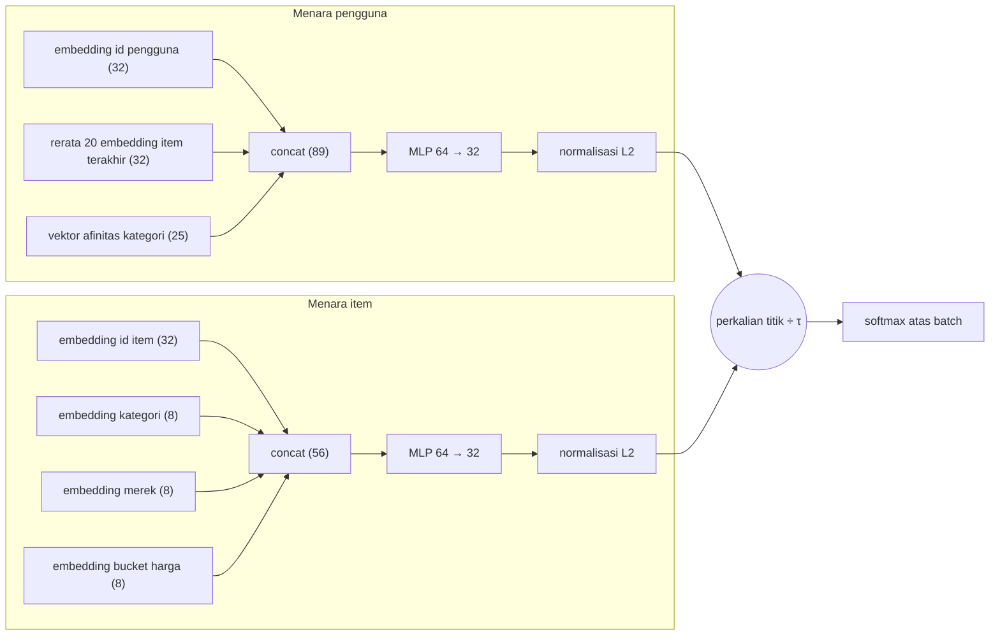
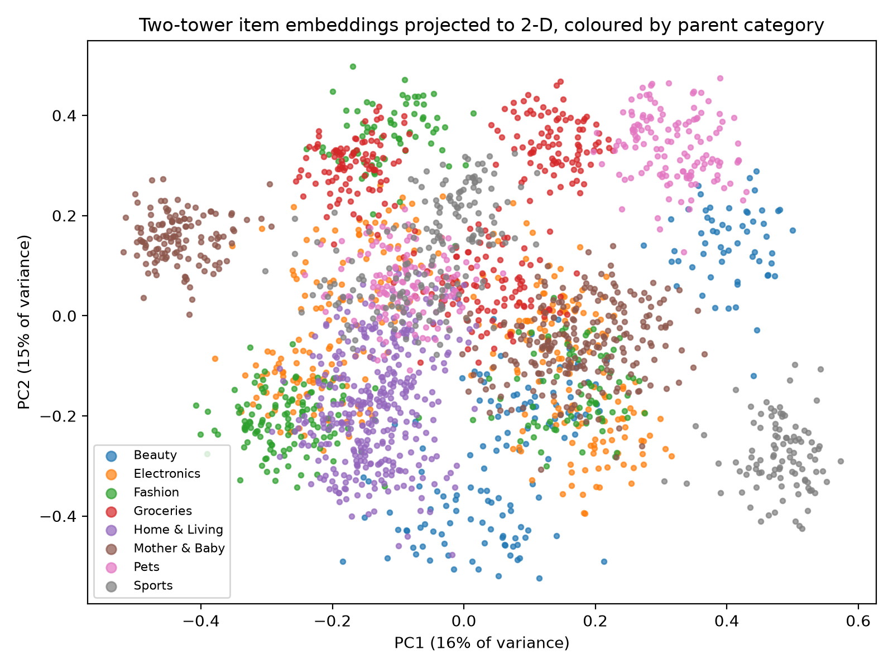
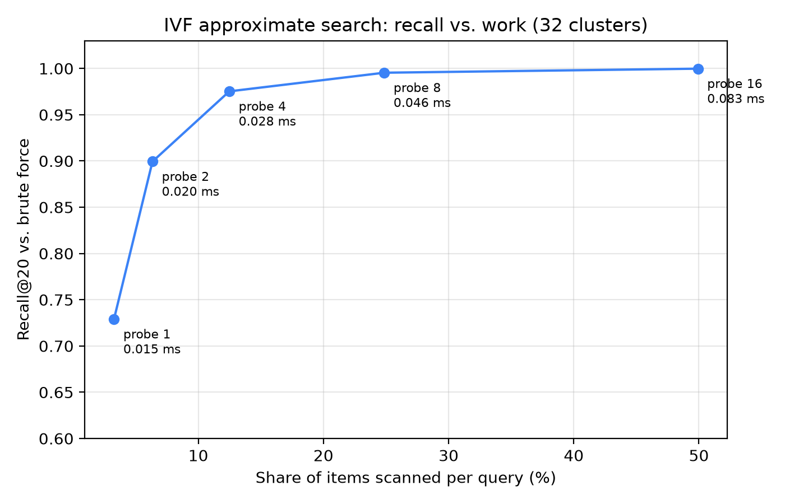

# Embedding dan retrieval two-tower

Malam puncak 9.9 sale, tim marketplace memelototi sebuah dasbor. Item-to-item co-visitation, *retriever* yang Anda kenal di Bab 5, sudah berbulan-bulan melayani strip "produk serupa", dan ia hebat di satu hal: memberi tahu apa saja yang dilihat orang-orang yang membuka ponsel *ini*. Namun Dewi, engineer terbaru di tim, punya keluhan lain. Seorang pengguna yang seminggu penuh menelusuri sepatu lari, jam tangan olahraga, dan minuman elektrolit membuka beranda dan disuguhi casing ponsel. "Sistem ini tidak tahu apa-apa soal *siapa* dia," kata Dewi. "Ia hanya tahu halaman produk mana yang disentuhnya. Tidak ada konsep selera yang menghubungkan sepatu, jam tangan, dan bubuk elektrolit."

Yang Dewi inginkan adalah sebuah *representasi*: daftar pendek angka untuk setiap pengguna dan setiap item, yang dipelajari sedemikian rupa sehingga "cocok dengan pengguna ini" berubah menjadi satu operasi aritmetika. Jika angkanya bagus, pengguna yang gemar olahraga akan mendarat di dekat item olahraga, bahkan ketika tak satu pun item itu pernah muncul bersamaan dengan riwayatnya. Dan jika operasinya murah, tim dapat menilai jutaan item tanpa *ranker* yang berat. Itulah janji **embedding** dan **model two-tower**, keluarga arsitektur yang menjadi dasar sistem retrieval skala besar seperti milik YouTube (lihat kotak fakta di bawah).

Di bab ini kita membangunnya dari nol di PyTorch pada marketplace simulasi yang sama dengan bab-bab lain, melatihnya, dan mengevaluasinya terhadap *baseline* popularitas. Hasilnya tidak seperti yang dijanjikan buku teks: model yang mengikuti resep dengan setia justru mencetak skor *di bawah* baseline sepele "populer dalam 7 hari terakhir". Mencari tahu sebabnya, lalu memperbaikinya dengan koreksi satu baris dari makalah produksi sungguhan, adalah bagian paling instruktif dari bab ini. Kita tutup dengan membangun indeks pencarian tetangga terdekat hampiran (*approximate nearest-neighbour*, IVF) hanya dengan numpy, sehingga Anda paham mengapa retrieval pada katalog raksasa tidak perlu menyentuh setiap item.

Dua istilah yang kita pakai terus. **Retriever** adalah tahap pertama yang cepat: ia melihat seluruh katalog dan memilih beberapa ratus *kandidat* yang mungkin cocok untuk pengguna. **Ranker** adalah tahap kedua yang cermat: ia menilai hanya kandidat itu, dengan informasi lebih banyak, lalu menyusunnya menjadi urutan akhir. Bayangkan asisten toko yang lebih dulu menarik dua puluh buku dari rak, baru kemudian Anda memutuskan tiga yang dibeli. Bab ini membahas cara membangun retriever yang lebih baik.

**Yang akan Anda pelajari**

- Apa itu embedding (*embedding*), dan mengapa "kedekatan dalam ruang vektor" adalah pengganti yang berguna untuk aturan kemiripan yang ditulis tangan.
- Bagaimana model two-tower disusun: menara pengguna, menara item, perkalian titik (*dot product*), dan mengapa pemisahan itu penting untuk *serving*.
- Bagaimana *loss* softmax in-batch dengan suhu (*temperature*) melatih kedua menara, dan mengapa negatif in-batch bias terhadap item populer.
- Bagaimana koreksi logQ menghilangkan bias itu, dan apa dampaknya pada angka offline kita.
- Bagaimana pencarian tetangga terdekat hampiran (IVF dari nol; HNSW, ScaNN, dan FAISS di dunia nyata) menukar *recall* dengan kecepatan.
- Bagaimana membaca gambar PCA dari embedding tanpa menafsirkannya berlebihan.

## Bahan dasar yang perlu Anda kenal dulu

Model two-tower memakai beberapa gagasan dari *machine learning*. Kita perkenalkan masing-masing di sini dengan contoh kecil, agar sisa bab terbaca lancar. Jika Anda sudah mengenalnya, lompat ke bagian berikutnya.

### Vektor adalah daftar angka

**Vektor** (*vector*) adalah daftar angka berurutan, seperti `[0.6, 0.8]`. Banyaknya angka itu disebut **dimensi**. Dua angka dapat digambar sebagai titik pada peta datar. Tiga puluh dua angka tidak dapat digambar, tetapi idenya sama: sebuah titik dalam ruang, dan titik yang berdekatan itu mirip. Model kita memberi setiap pengguna dan setiap item daftar angka seperti ini. Daftar itu kita sebut **embedding** (lebih lanjut sebentar lagi).

### Perkalian titik mengukur kesepakatan

**Perkalian titik** (*dot product*) dua vektor adalah: kalikan angka-angka di posisi yang sama, lalu jumlahkan hasilnya. Misalkan vektor pembeli Sari adalah $(0.6, 0.8)$. Bandingkan dengan tiga item:

| Vektor item | Perhitungan | Perkalian titik |
|---|---|---|
| Sepatu lari $(0.6, 0.8)$ | $0.6 \times 0.6 + 0.8 \times 0.8$ | $1.0$ |
| Casing ponsel $(0.8, -0.6)$ | $0.6 \times 0.8 + 0.8 \times (-0.6)$ | $0.0$ |
| Selera berlawanan $(-0.6, -0.8)$ | $0.6 \times (-0.6) + 0.8 \times (-0.8)$ | $-1.0$ |

Jika setiap vektor digambar sebagai anak panah dari titik asal, perkalian titik besar ketika kedua panah menunjuk ke arah yang sama, nol ketika saling tegak lurus, dan negatif ketika berlawanan arah. Jadi satu perkalian-dan-penjumlahan yang murah memberi skor "seberapa cocok item ini dengan pengguna ini?". Itulah alasan utama embedding berguna untuk rekomendasi.

### Panjang satu dan kemiripan kosinus

**Panjang** (disebut juga **norma**) sebuah vektor adalah akar dari jumlah kuadrat angka-angkanya. Untuk $(3, 4)$ panjangnya $\sqrt{9 + 16} = 5$. **Menormalisasi L2** sebuah vektor berarti membagi setiap angkanya dengan panjangnya, sehingga panjang barunya tepat 1: $(3, 4)$ menjadi $(0.6, 0.8)$. ("L2" hanyalah nama untuk panjang biasa ini.) Untuk dua vektor yang sudah dinormalisasi, perkalian titiknya disebut **kemiripan kosinus** (*cosine similarity*): $1$ berarti arah sama, $0$ tidak berhubungan, $-1$ berlawanan, persis seperti pada tabel di atas. Tanpa normalisasi, sebuah item bisa mendapat skor tinggi hanya karena vektornya panjang, apa pun arahnya.

### Jaringan saraf adalah aritmetika yang bisa disetel

**Jaringan saraf** (*neural network*) adalah fungsi yang dibangun dari tumpukan langkah sederhana, dengan banyak angka yang bisa disetel yang disebut **parameter** (atau *bobot*). Anda hanya perlu potongan-potongan ini:

- **Lapisan linear** menghitung jumlah berbobot. Misalnya, satu keluaran bisa berupa $0.9 \times (\text{jumlah lihat sepatu}) + 0.7 \times (\text{jumlah lihat jam tangan}) - 0.2 \times (\text{jumlah lihat casing ponsel})$. Angka $0.9$, $0.7$, dan $-0.2$ adalah parameter. Lapisan "selebar 64" menghitung 64 jumlah seperti itu sekaligus.
- **ReLU** adalah aturan satu baris: pertahankan angka positif, ubah angka negatif menjadi 0 ($\text{ReLU}(3) = 3$, $\text{ReLU}(-2) = 0$). Tanpanya, menumpuk lapisan linear akan menyusut menjadi satu lapisan linear saja; ReLU memungkinkan jaringan mempelajari pola yang melengkung dan lebih fleksibel.
- **MLP** (*multi-layer perceptron*) adalah tumpukan sederhana *lapisan linear → ReLU → lapisan linear*. Ketika diagram menulis "MLP 64 → 32", lapisan tengahnya selebar 64 angka dan keluarannya 32 angka.
- **Tabel embedding** adalah lembar kerja dengan satu baris per id (satu baris per pengguna, per merek, dan seterusnya). "Mengambil embedding" merek nomor 7 berarti membaca baris 7. Baris-barisnya dimulai sebagai angka acak dan merupakan parameter, sehingga pelatihan menyesuaikannya.

**Pelatihan** (*training*) berarti mencari parameter yang baik. Kita mulai dengan parameter acak, dan jaringan membuat prediksi pada beberapa contoh. **Loss** adalah satu angka yang menyatakan seberapa salah prediksi itu (makin rendah makin baik). **Gradien** memberi tahu, untuk setiap parameter, geseran kecil mana yang akan mengurangi loss. **Optimizer** (kita memakai yang bernama Adam) menerapkan geseran itu, dan **learning rate** adalah ukuran tiap geseran. Ibarat pendaki di tengah kabut yang tidak bisa melihat lembah tetapi bisa merasakan kemiringan di bawah kakinya dan terus melangkah menurun. Contoh diproses dalam kelompok kecil yang disebut **batch**, dan satu putaran penuh atas seluruh data latih disebut **epoch**.

Satu hal terakhir tentang **hiperparameter**: ini adalah pengaturan yang *kita* pilih sebelum pelatihan (ukuran embedding, learning rate, suhu yang akan kita temui di bawah), berbeda dengan parameter yang dipelajari oleh pelatihan.

## Intuisi: dari nama menjadi koordinat

Bayangkan cara kerja asisten toko buku yang baik. Ia tidak menghafal tabel "pelanggan yang membeli X juga membeli Y". Ia punya *peta di kepalanya*: buku masak di satu sisi toko, novel thriller di sisi lain, dan "memoar kuliner" di suatu tempat di antaranya. Pelanggan baru masuk, menyebut dua kalimat tentang apa yang disukainya, dan sang asisten menempatkannya di peta. Merekomendasikan kemudian hanyalah "berjalan ke rak terdekat yang belum diacak-acak".

**Embedding** adalah peta itu yang dibuat eksplisit. Setiap pengguna dan setiap item menjadi sebuah titik dalam ruang vektor, misalnya 32 dimensi. Tak seorang pun memberi tahu model arti dimensi-dimensinya. Pelatihan mendorong pengguna ke arah item yang berinteraksi dengannya dan menjauh dari item yang diabaikan, dan koordinat yang memungkinkan hal itu adalah embedding-nya. Faktorisasi matriks (Bab 6) sudah menghasilkan vektor semacam itu: satu baris $P$ per pengguna, satu baris $Q$ per item. Lalu apa yang baru?

Tiga hal.

1. **Vektor dihitung oleh sebuah fungsi, bukan dicari di tabel.** Pada faktorisasi matriks setiap item punya barisnya sendiri yang angkanya bebas disetel. Item tanpa interaksi tidak pernah dilatih barisnya, sehingga tidak mendapat vektor yang berguna. Pada model two-tower, vektor item adalah *keluaran jaringan saraf kecil*. Inputnya mencakup **informasi sampingan** (*side information*), fakta tambahan tentang item seperti kategori, merek, dan *bucket* harga (di seperlima harga mana item itu berada dalam kategorinya). Item baru dengan kategori dan merek yang diketahui mendapat vektor yang masuk akal sejak hari pertama. Hal yang sama berlaku untuk pengguna: menara pengguna dapat membaca item terakhir yang disentuh pengguna beserta afinitas kategorinya, sehingga vektornya bereaksi terhadap apa yang ia lakukan lima menit lalu, selama fitur riwayat masih segar saat Anda menghitungnya.
2. **Loss-nya berupa softmax bercita rasa pemeringkatan, bukan galat kuadrat.** Faktorisasi matriks di Bab 6 meminimalkan *galat kuadrat*: selisih antara angka prediksi dan angka sebenarnya, dikuadratkan. Di sini kita tidak memprediksi rating. Kita mengajukan soal pilihan ganda: dari item-item di batch ini, mana yang benar-benar berinteraksi dengan pengguna? Itu masalah klasifikasi (memilih satu jawaban dari banyak), dan ia skalabel untuk data besar.
3. **Serving berupa pencarian tetangga terdekat.** *Serving* berarti menjawab permintaan langsung setelah pelatihan selesai. Skor akhirnya adalah perkalian titik antara vektor pengguna dan vektor item, dan vektor item tidak bergantung pada pengguna. Jadi kita dapat menghitung semua vektor item sekali, memasukkannya ke indeks, dan menjawab "50 item teratas untuk pengguna ini" tanpa menjalankan jaringan saraf per item (*forward pass* adalah satu kali menjalankan input melalui jaringan).

::: fact
**Vektor yang bisa berhitung.** Makalah Google 2013 tentang pelatihan vektor kata yang efisien mengingat kembali sebuah temuan awal: dengan aljabar sederhana pada vektor kata, vector("King") − vector("Man") + vector("Woman") menghasilkan vektor yang paling dekat dengan vektor "Queen". Tak ada yang memprogram keteraturan itu ke dalam vektornya. Embedding rekomendasi mengikuti ide yang sama dengan item dan pengguna sebagai pengganti kata.

Sumber: Mikolov et al., arXiv, 2013
:::

## Arsitektur two-tower

*Tower* (menara) hanyalah fungsi yang mengubah input mentah menjadi sebuah vektor. Model two-tower memiliki dua menara yang tidak pernah saling melihat input masing-masing.



*Gambar: Dua menara pada model kita. Satu-satunya tempat sisi pengguna dan sisi item bertemu adalah perkalian titik terakhir.*

Dua operasi kecil muncul di diagram. **Concat** (menggabungkan) menyambung vektor ujung ke ujung: $[0.2, 0.8]$ dan $[0.5]$ menjadi $[0.2, 0.8, 0.5]$; itulah sebabnya $32 + 32 + 25 = 89$. **Rerata 20 embedding item terakhir** merata-ratakan posisi demi posisi: rerata $(0.2, 0.8)$ dan $(0.6, 0.4)$ adalah $(0.4, 0.6)$. Ia meringkas riwayat terbaru pengguna menjadi satu vektor. **Vektor afinitas kategori** punya satu angka per kategori (25 di sini), yang menyatakan berapa porsi minat terbaru pengguna yang tertuju ke kategori itu.

**Menara pengguna** menggabungkan (*concat*) embedding id pengguna yang dipelajari (32 angka), *rerata* embedding dari 20 item terakhir yang berinteraksi dengan pengguna (32, dari tabel id item yang sama dengan yang dipakai menara item), dan vektor afinitas kategori 25 dimensi dari `recsys.candidates.category_affinity`; MLP dua lapis memetakan 89 angka ini menjadi 32. **Menara item** menggabungkan embedding id item (32), kategori (8), merek (8), dan *bucket* harga (8, kuintil harga relatif terhadap median kategori); MLP lain memetakan 56 angka ini menjadi 32.

Kedua keluaran dinormalisasi **L2** (diskalakan ke panjang 1, seperti pada bahan dasar di atas), sehingga perkalian titik vektor pengguna dan vektor item persis sama dengan *kemiripan kosinus*-nya, antara $-1$ dan $1$. Ini mencegah model menggelembungkan panjang vektor item populer demi skor tinggi dan membatasi skor, yang membuat kita bisa membahas suhu berikutnya.

Mengapa dua menara dan bukan satu jaringan yang melihat pengguna dan item sekaligus? Model gabungan (*cross*) dapat mempelajari interaksi seperti "pengguna ini suka item murah *hanya* di Beauty" dan biasanya lebih akurat, tetapi ia harus berjalan sekali per pasangan (pengguna, item): layak untuk 2,311 item, tidak untuk 50 juta. Desain two-tower mengorbankan interaksi yang ekspresif demi kemampuan menghitung dan mengindeks salah satu sisi terlebih dahulu, kompromi yang tepat untuk tahap pertama, karena *ranker* di Bab 9 dan 10 menilai ulang item yang lolos dengan semua fitur silang yang Anda mau.

::: fact
**Dua tahap di YouTube.** Makalah YouTube 2016 membagi sistem rekomendasinya menjadi dua jaringan: pembangkitan kandidat, yang menyaring korpus raksasa menjadi ratusan video, dan pemeringkatan, yang menilainya. Pembangkitan kandidat dirumuskan sebagai klasifikasi multikelas ekstrem atas jutaan video menggunakan embedding pengguna dan video yang dipelajari. Karena menilai jutaan video dalam hitungan puluhan milidetik membutuhkan skema hampiran yang sublinear terhadap ukuran korpus, serving direduksi menjadi pencarian tetangga terdekat dalam ruang perkalian titik. Struktur sistem di buku ini mengikuti pembagian dua tahap yang sama.

Sumber: Covington et al., RecSys, 2016
:::

## Algoritma: pelatihan dengan softmax in-batch

### Langkah demi langkah

Data latih berupa **pasangan positif**: pengguna dan item yang berinteraksi dengannya sebelum *cutoff* (klik, keranjang, atau pesanan, dari `common.interaction_matrix` dan `History.interactions`). Kita tidak punya **negatif** berlabel, yaitu item yang ditolak pengguna; "pengguna tidak mengklik" tidak sama dengan "pengguna tidak menyukainya". Triknya yang baku adalah membuat negatif secara gratis dari batch itu sendiri.

### Softmax dan cross-entropy dengan kata sederhana

Dua alat kecil melakukan pekerjaannya, jadi kita kenalkan lebih dulu.

**Softmax** mengubah daftar skor apa pun menjadi probabilitas: angka positif yang jumlahnya 1, dengan skor lebih besar mendapat bagian lebih besar. Resepnya: pangkatkan $e \approx 2.718$ dengan setiap skor (ini membuat setiap angka positif dan membuat skor besar tumbuh lebih cepat), lalu bagi setiap hasil dengan totalnya. Misalkan skor mentah (disebut **logit**) Sari untuk tiga item adalah sepatu 2, jam tangan 1, dan casing ponsel 0:

| Item | Logit | $e^{\text{logit}}$ | Probabilitas |
|---|---|---|---|
| Sepatu lari | 2 | 7.39 | $7.39 / 11.11 = 0.67$ |
| Jam tangan olahraga | 1 | 2.72 | $2.72 / 11.11 = 0.24$ |
| Casing ponsel | 0 | 1.00 | $1.00 / 11.11 = 0.09$ |

**Cross-entropy** adalah loss yang menilai probabilitas itu terhadap kebenaran. Jika jawaban yang benar adalah sepatu lari, loss-nya $-\ln(0.67) \approx 0.40$ ($\ln$ adalah logaritma natural). Bayangkan siswa yang mengerjakan kuis pilihan ganda dan harus menulis persentase keyakinan di samping jawaban yang benar. Menulis 90% nyaris tanpa biaya, menulis 1% mahal sekali. Demikian pula, loss mendekati 0 ketika model memberi probabilitas hampir 1 pada item yang benar, dan membesar ketika probabilitas itu mendekati 0.

### Apa itu negatif in-batch

Sekarang kuisnya: "ini Sari; item mana di dalam batch yang benar-benar ia sentuh?" Item lain dalam batch adalah pilihan yang salah, dan harganya nol karena sudah ada di memori. Dengan $B = 3$ pasangan (Sari dengan sekantong makanan kucing, Budi dengan casing ponsel, Ani dengan sepatu lari), skor membentuk kisi $3 \times 3$: setiap baris adalah pengguna, setiap kolom adalah item. Diagonalnya jawaban yang benar; setiap sel lain di baris itu adalah negatif.

| | makanan kucing | casing ponsel | sepatu lari |
|---|---|---|---|
| **Sari** | jawaban benar | negatif | negatif |
| **Budi** | negatif | jawaban benar | negatif |
| **Ani** | negatif | negatif | jawaban benar |

Semua yang di bawah ini adalah kisi ini, dengan batch 512 alih-alih 3.

1. Ambil sampel satu batch berisi $B$ pasangan positif $(u_1, i_1), \dots, (u_B, i_B)$.
2. Jalankan menara pengguna pada setiap $u_b$ untuk mendapat $\mathbf{u}_b$, dan menara item pada setiap $i_b$ untuk mendapat $\mathbf{v}_b$. Keduanya vektor satuan.
3. Bangun matriks skor terskala $B \times B$, $s_{bj} = \mathbf{u}_b \cdot \mathbf{v}_j / \tau$, dengan $\tau$ ("tau") adalah **suhu** (*temperature*), dijelaskan berikutnya.
4. Baris $b$ adalah masalah klasifikasi $B$ kelas: jawaban yang benar adalah kolom $b$ (item yang benar-benar disentuh pengguna itu); $B-1$ item lain dalam batch diperlakukan sebagai negatif.
5. Minimalkan *cross-entropy* klasifikasi itu, dirata-ratakan atas batch. Dengan kata lain: untuk setiap baris, ambil probabilitas softmax kolom yang benar, ambil minus lognya, lalu rata-ratakan atas semua baris:

$$
\mathcal{L} = -\frac{1}{B}\sum_{b=1}^{B} \log \frac{\exp(s_{bb})}{\sum_{j=1}^{B} \exp(s_{bj})}
$$

Di sini $\exp(x)$ adalah $e^x$, $s_{bb}$ adalah skor pengguna $b$ dengan item sebenarnya, dan jumlah pada penyebut menambahkan $e^{\text{skor}}$ atas setiap item dalam batch: resep yang sama seperti tabel softmax di atas.

Inilah ide **sampled softmax**: softmax penuh atas seluruh katalog adalah objektif yang tepat tetapi terlalu mahal (butuh skor untuk semua 2,495 item, atau 50 juta di toko besar), sehingga kita mengaproksimasi penyebutnya dengan item-item lain dalam batch.

### Suhu

**Suhu** $\tau$ adalah kenop yang membagi setiap skor sebelum softmax, mengatur seberapa tajam probabilitasnya. Kita membutuhkannya karena kosinus berada dalam $[-1, 1]$, sehingga selisih mentah antara item bagus (0.8) dan item biasa (0.3) sangat kecil bagi softmax: $e^{0.8}$ berbanding $e^{0.3}$ hanya sekitar 1.6 kali. Membagi dengan $\tau$ kecil memperlebar skalanya. Dengan $\tau = 0.05$, seperti di skrip kita, skornya menjadi $0.8 / 0.05 = 16$ dan $0.3 / 0.05 = 6$, selisih 10 satuan logit, yaitu perbandingan sekitar 22,000 kali, dan softmax menjadi tegas. Suhu rendah membuat loss peduli pada ketepatan *puncak* peringkat dan menghukum negatif sulit (item salah yang tampak sangat mirip dengan yang benar) dengan berat; suhu tinggi menyebarkan probabilitas lebih merata dan belajar lebih lembut. Ini hiperparameter yang Anda *tuning*, biasanya antara 0.05 dan 0.2.

### Contoh hitung dengan angka sederhana

Ambil $B = 3$ dan, agar aritmetikanya ramah, $\tau = 0.5$. Misalkan kosinus pengguna 1 dengan tiga item dalam batch adalah $0.8, 0.3, 0.1$, dan item 1 adalah positif sebenarnya.

- Logit terskala: $1.6,\ 0.6,\ 0.2$.
- Eksponensial: $4.95,\ 1.82,\ 1.22$, jumlah $\approx 8.00$.
- Probabilitas item yang benar: $4.95 / 8.00 \approx 0.62$. Loss $= -\ln 0.62 \approx 0.48$.

Jika pelatihan menggeser kosinusnya dengan item 1 menjadi $0.9$, probabilitas naik menjadi sekitar $0.67$ dan loss turun. Gradien menarik $\mathbf{u}_1$ ke arah $\mathbf{v}_1$ dan mendorongnya menjauh dari $\mathbf{v}_2, \mathbf{v}_3$; karena setiap item adalah positif bagi sebagian baris dan negatif bagi baris lain, vektor item terus ditarik dan didorong sepanjang pelatihan.

### Bias tersembunyi: siapa yang jadi negatif?

Dalam kuis kita, pilihan yang salah tidak diambil secara adil. Batch adalah sampel acak *pasangan positif*, sehingga sebuah item muncul di dalamnya sebanding dengan jumlah interaksinya. Item dengan 2% dari seluruh interaksi menjadi positif bagi sekitar satu dari lima puluh baris, dan menjadi *negatif* di semua baris lain tempat ia muncul; item langka nyaris tak pernah ada di batch. Item populer jadi terlalu banyak terwakili sebagai negatif dibanding item katalog yang dipilih seragam, dan model belajar bahwa "item populer biasanya jawaban yang salah", sehingga skor mereka tergeser turun. Padahal saat serving kita menilai setiap item secara seragam, jadi penalti popularitas yang dipelajari itu adalah galat sistematis yang menekan *best-seller* yang sebenarnya relevan bagi banyak pengguna.

### Koreksi logQ

Yi et al. menjelaskan perbaikannya di Google. Misalkan $q_j$ adalah **probabilitas sampling** item $j$: seberapa mungkin ia terambil ke dalam batch, yang kita estimasi sebagai porsinya dari seluruh pasangan latih (sekantong makanan kucing dengan 2% pasangan memiliki $q = 0.02$). Perbaikannya adalah mengurangkan $\log q_j$ dari logit item $j$:

$$
s^{c}_{bj} = \frac{\mathbf{u}_b \cdot \mathbf{v}_j}{\tau} - \log q_j
$$

lalu memakai logit terkoreksi $s^c$ ini dalam softmax. Di sini $\log$ adalah logaritma natural. Untuk probabilitas di bawah 1 nilainya negatif, dan makin negatif bila probabilitasnya makin kecil: $\log 0.5 = -0.69$ dan $\log 0.25 = -1.39$. Jadi $-\log q_j$ adalah angka positif kecil untuk item populer dan angka positif besar untuk item langka.

Idenya sama dengan **pembobotan survei**. Jika seorang pollster menelepon 50 orang di kota besar dan 5 orang di desa, ia menghitung setiap jawaban desa lebih berbobot dan setiap jawaban kota kurang berbobot, untuk membatalkan pengambilan sampel yang tidak seimbang. Di sini item populer adalah "kota": mereka terlalu sering terambil sebagai pilihan salah, sehingga bobotnya pada penyebut dikurangi relatif terhadap item langka. Ini membatalkan dorongan ke bawah ekstra yang akan diterima item populer, sehingga perkalian titik itu sendiri belajar "kecocokan", bukan "kecocokan dikurangi pajak popularitas". Pada makalahnya, frekuensi diestimasi *online* dari aliran data; pada skrip offline kita, kita memakai frekuensi empiris item (jumlah dibagi total) di antara pasangan latih.

Versi numerik dari contoh sebelumnya. Misalkan item 1 populer ($q = 0.5$) dan item 2 dan 3 lebih jarang ($q = 0.25$). Kosinus pengguna 1 tetap $0.8, 0.3, 0.1$ dengan $\tau = 0.5$:

| | Item 1 (benar, populer) | Item 2 | Item 3 |
|---|---|---|---|
| Logit terskala | 1.6 | 0.6 | 0.2 |
| $-\log q$ | 0.69 | 1.39 | 1.39 |
| Logit terkoreksi | 2.29 | 1.99 | 1.59 |
| $e^{\text{terkoreksi}}$ | 9.90 | 7.34 | 4.92 |

Jumlahnya sekitar 22.16, sehingga probabilitas item yang benar turun dari $0.62$ menjadi sekitar $0.45$ (loss dari $0.48$ menjadi $0.80$). Item benar yang populer tidak lagi mendapat keuntungan cuma-cuma karena populer, sementara negatif yang langka kini lebih berbobot. Model kini harus memisahkan positif dengan lebih bersih di ruang kosinus alih-alih bersandar pada popularitas. Saat serving, suku $-\log q$ dibuang.

::: fact
**Mengoreksi bias sampling pada retrieval YouTube.** Yi et al. meninjau model retrieval two-tower yang dilatih dengan negatif in-batch, yaitu item yang terambil dalam batch acak. Mereka berargumen bahwa loss batch ini mengalami bias sampling yang dapat sangat membatasi performa, terutama pada distribusi item berhukum pangkat (*power-law*). Mereka mengusulkan algoritma yang mengestimasi frekuensi item dari data aliran tanpa kosakata item yang tetap, dan menerapkan pendekatan terkoreksi bias itu pada Neural Deep Retrieval, sistem YouTube yang melakukan retrieval dari korpus puluhan juta video.

Sumber: Yi et al., RecSys, 2019
:::

## Penelusuran kode

Semua kode di bawah berasal dari `book/code/ch07_two_tower.py`, yang melatih empat varian (10 atau 30 epoch, dengan dan tanpa logQ) lalu menjalankan demo ANN.

### Kedua menara

```include
path: book/code/ch07_two_tower.py
symbol: Towers
```

Baca kelas ini dalam tiga bagian.

- **Tabel embedding.** `user_emb` punya satu baris 32 dimensi per pengguna; `item_emb` punya satu baris per item *ditambah satu baris ekstra* sebagai **padding** (`padding_idx=n_items`): baris "slot kosong" tiruan, sehingga pengguna dengan riwayat kurang dari 20 item tetap dapat mengisi kisi angka berlebar tetap (sebuah *tensor*). `cat_emb`, `brand_emb`, dan `price_emb` adalah tabel kecil 8 dimensi. Perhatikan bahwa `item_emb` **dibagi bersama**: menara item mengambil baris item itu sendiri, dan menara pengguna mengambil baris item-item riwayat pengguna dari tabel yang sama. Berbagi berarti vektor untuk "sepatu lari A" punya satu makna di kedua menara.
- **MLP.** `user_mlp` menerima `32 + 32 + n_cats` input (32 untuk id pengguna, 32 untuk rerata riwayat, 25 untuk afinitas), yaitu angka 89 di diagram. `item_mlp` menerima `32 + 8 + 8 + 8 = 56`. Masing-masing berbentuk `Linear → ReLU → Linear` dengan lapis tersembunyi selebar 64 dan keluaran selebar 32.
- **`user_vec` dan `item_vec`.** Pada `user_vec`, `mask` adalah daftar 1 dan 0 yang menyalakan atau mematikan slot: 1 di slot riwayat yang berisi item sungguhan dan 0 di slot padding. Embedding di-*mask* sebelum dijumlahkan lalu dibagi dengan jumlah item sungguhan (dibatasi minimal 1 agar riwayat kosong dibagi 1), sehingga menghasilkan rerata atas item sungguhan saja. Tanpa mask, padding akan menyeret setiap pengguna berriwayat pendek ke arah "kosong" yang sama. Rerata itu digabung dengan embedding id pengguna dan afinitas, dilewatkan ke MLP, dan dinormalisasi dengan `F.normalize` (normalisasi L2 dari bahan dasar di atas). `item_vec` lebih sederhana: gabungkan empat embedding, MLP, normalisasi. Yang krusial, ia hanya menerima atribut item, tanpa input pengguna, dan itulah yang memungkinkan kita menghitung vektor seluruh katalog sekali, secara offline, lalu menyimpannya.

### Putaran pelatihan

Fungsi pelatihan bersarang di dalam `main`; proses build mendukung simbol bersarang, sehingga kita bisa menampilkannya tersendiri.

```include
path: book/code/ch07_two_tower.py
symbol: main.train
```

Telusuri putaran dalamnya.

1. `perm = torch.randperm(...)` mengocok pasangan positif tiap epoch; `b` adalah irisan 512 di antaranya (`BATCH`).
2. `h = t_hist[u].clone()` mengambil matriks 20 item terakhir setiap pengguna (`.clone()` membuat salinan pribadi sehingga riwayat tersimpan tidak berubah), dan baris berikutnya, `h[h == i[:, None]] = model.pad`, **mengosongkan item target di dalam riwayat penggunanya sendiri**. Tanpa itu, menara pengguna akan melihat jawaban yang seharusnya ia prediksi, jenis kebocoran data (*leakage*) yang sama dengan yang akan Anda pelajari di Bab 9. Model akan mencapai loss latih rendah dengan menyalin, lalu gagal pada minggu *held-out* yang tidak punya jalan pintas semacam itu.
3. `uv` dan `iv` adalah vektor pengguna dan item untuk batch. `logits = uv @ iv.T / TEMP` adalah matriks $B \times B$ $s_{bj}$ dari algoritma.
4. `if logq:` mengurangkan `log_q[i][None, :]`, dengan `log_q` dihitung di awal `train` sebagai `log(count / total)` tiap item di antara pasangan latih. *Broadcasting* (aturan yang menerapkan satu baris angka ke setiap baris matriks) mengurangkan $\log q_j$ dari kolom $j$. Satu baris itulah seluruh koreksi logQ.
5. Mask `same` menangani duplikat: jika dua pengguna dalam batch mengklik item yang sama, kolom itu akan menjadi "negatif" yang sebenarnya positif, sehingga entri off-diagonal tersebut diset ke $-10^9$ dan lenyap dari softmax.
6. `F.cross_entropy(logits, torch.arange(len(b)))` adalah loss di atas (kolom yang benar untuk baris $b$ adalah $b$), diikuti langkah Adam (geseran parameter yang dijelaskan pada bahan dasar) dengan *learning rate* $10^{-3}$, yaitu 0.001.

Saat putaran selesai, `train` beralih ke mode eval dan menghitung vektor item untuk seluruh katalog serta vektor pengguna untuk pengguna evaluasi.

### Penilaian dan evaluasi

Penilaian (`main.evaluate_variant` di skrip) adalah satu perkalian matriks, `uv_eval @ V.T`, dari 947 pengguna evaluasi terhadap item yang tersedia. Pengguna tanpa riwayat sebelum *cutoff* tidak mendapat skor model dan diisi dengan popularitas 7 hari, karena model "tidak punya pendapat". Lalu `common.evaluate` menghitung metrik yang dipakai setiap bab: recall@K (berapa porsi item yang benar-benar disentuh pengguna pada minggu *held-out* yang muncul di K teratas), order recall (sama, tetapi hanya menghitung item yang dibeli), NDCG@20 (skor yang memberi lebih banyak kredit bila item yang benar ditempatkan dekat puncak daftar), dan coverage@20 (berapa porsi katalog yang muncul di 20 teratas siapa pun).

### Indeks ANN, dari nol

Separuh kedua skrip tidak melibatkan *deep learning* sama sekali. IVF, *inverted file index*, hanya butuh rutin *clustering*: cara mengelompokkan titik menjadi kelompok tetangga.

```include
path: book/code/ch07_two_tower.py
symbol: kmeans
```

Ini **k-means** Lloyd, metode yang mengelompokkan titik menjadi $k$ kelompok. Pilih $k$ pusat awal (**centroid**). Tetapkan setiap titik ke centroid terdekatnya. Pindahkan setiap centroid ke rerata titik-titik yang ditetapkan kepadanya. Ulangi. Contoh kecil: titik $1, 2, 9, 10$ pada sebuah garis dengan $k = 2$ dan centroid awal $1$ dan $10$. Penetapannya $\{1, 2\}$ dan $\{9, 10\}$; centroid berpindah ke $1.5$ dan $9.5$; setelah itu tidak ada yang berubah, jadi kita berhenti. Kode menambahkan satu trik kecil. Mencari centroid terdekat menurut jarak Euklides (jarak garis lurus biasa) sama dengan `argmax(x @ cent.T - 0.5 * ||cent||²)`: dengan mengembangkan $\|x - c\|^2 = \|x\|^2 - 2x\cdot c + \|c\|^2$, suku $\|x\|^2$ sama untuk setiap centroid sehingga dapat dibuang, dan membalik tanda mengubah "minimalkan" menjadi "maksimalkan". Satu perkalian matriks menetapkan semua titik sekaligus. Lalu tiap centroid berpindah ke rerata titik-titiknya, dan kita ulangi 20 iterasi.

## Pencarian tetangga terdekat hampiran

### Mengapa brute force berhenti bekerja

**Pencarian tetangga terdekat** (*nearest-neighbour search*) berarti: diberi vektor query (pengguna), temukan vektor item dengan perkalian titik tertinggi terhadapnya. *Brute force* menghitung perkalian titik query dengan setiap vektor item dan menyimpan $K$ teratas, seperti berjalan menyusuri setiap rak di toko. Untuk 2,311 item dalam stok kita itu sepele; untuk 50 juta item, itu sekitar $50\text{M} \times 32 \approx 1.6$ miliar operasi kali-tambah per permintaan, jauh melampaui anggaran latensi (waktu yang kita izinkan per permintaan) puluhan milidetik. Tetapi kita tidak butuh top 50 yang *persis*, karena *ranker* toh menilai ulang semuanya; kita hanya butuh daftar kandidat yang memuat *sebagian besar* tetangga sebenarnya. Pencarian yang menerima sedikit kesalahan demi kecepatan disebut pencarian tetangga terdekat hampiran (*approximate nearest-neighbour*, **ANN**).

### IVF dalam empat langkah

IVF bekerja seperti bagian-bagian toko. Alih-alih menyusuri setiap rak, Anda bertanya "dua atau tiga bagian mana yang paling mungkin memuatnya?" dan mencari hanya di sana.

1. **Latih.** Jalankan k-means pada vektor item untuk mendapat $C$ centroid ($C = 32$ di sini). Tetapkan setiap item ke centroid terdekatnya. Himpunan item untuk satu centroid adalah *inverted list*-nya ("inverted file" pada namanya): daftar item di bagian itu.
2. **Query: pilih cluster.** Untuk vektor query $\mathbf{q}$, nilai terhadap $C$ centroid (murah: $C$ perkalian titik) dan simpan `n_probe` terbaik.
3. **Query: pindai.** Gabungkan inverted list dari cluster-cluster itu dan hitung perkalian titik eksak hanya pada item-item tersebut.
4. **Kembalikan $K$ terbaik** dari item yang dipindai.

Biayanya rata-rata $C + n_{\text{probe}} \cdot N / C$ perkalian titik, bukan $N$. Untuk $N = 2{,}311$ dan $C = 32$, memeriksa 4 cluster memindai sekitar $4 \times 72 \approx 289$ item ditambah 32 centroid, dibanding 2,311. Harganya: tetangga sejati yang berada di cluster yang tidak Anda periksa akan hilang; dari situlah *recall terhadap brute force* berasal. Recall ini menanyakan: dari top 20 sejati yang akan dikembalikan brute force, berapa porsi yang juga dikembalikan indeks? Recall 0.9 berarti 18 dari 20.

Bayangkan dua gugus berisi masing-masing empat item, di sekitar $(1, 1)$ dan $(5, 5)$. Query di $(1.5, 1.2)$ dengan `n_probe = 1` hanya memindai gugus pertama dan hasilnya eksak. Query di $(3, 3)$ punya tetangga di kedua gugus, jadi memeriksa satu gugus kehilangan sebagian; efek perbatasan itulah yang diperbaiki oleh lebih banyak probe.

### Demo dalam kode

Putaran query IVF ditulis inline di `main`. Untuk setiap query, ia menilai centroid, memilih `n_probe` teratas, mengumpulkan anggotanya, dan memeringkat hanya anggota itu secara eksak:

```include
path: book/code/ch07_two_tower.py
region: ivf_search
```

Baris `probe` adalah pemilihan cluster (`cent @ qi`, hanya 32 perkalian titik), `cand` menggabungkan inverted list, `top` adalah pemeringkatan ulang eksak pada item yang dipindai, dan dua baris terakhir mencatat recall terhadap jawaban brute force `ex` serta jumlah item yang dipindai. Di bawah kita tampilkan apa yang dicetak putaran ini, dengan 400 pengguna evaluasi sebagai query.

Kita menjalankan demo ANN pada model spesifikasi (`two_tower`); kualitas indeks bergantung pada geometri vektor, bukan pada kualitas rekomendasi.

::: fact
**Indeks berbasis graf.** Selain indeks berbasis cluster seperti IVF, pencarian tetangga terdekat hampiran dapat memakai graf kedekatan. HNSW (Hierarchical Navigable Small World graphs) secara bertahap membangun struktur multi-lapis graf kedekatan di atas himpunan bagian bersarang dari vektor yang tersimpan. Memulai pencarian dari lapisan atas memungkinkan algoritma memanfaatkan pemisahan skala antar tautan, dan para penulis melaporkan skala kompleksitas logaritmik.

Sumber: Malkov et al., IEEE TPAMI, 2020
:::

Indeks graf bukan satu-satunya pilihan. Pustaka FAISS (pustaka sumber terbuka yang banyak dipakai untuk pencarian vektor), yang dijelaskan oleh Johnson et al. (2021), menyediakan desain optimal untuk pencarian brute force, hampiran, dan **product-quantisation** (menyimpan kode pendek terkompresi sebagai pengganti vektor penuh, untuk menghemat memori) di GPU; makalah mereka melaporkan pembangunan graf k-NN (setiap vektor ditautkan ke $k$ tetangga terdekatnya) atas 1 miliar vektor dalam waktu kurang dari 12 jam pada empat GPU. Guo et al. (2020) menargetkan *maximum inner product search* (mencari perkalian titik terbesar; "inner product" adalah nama lain perkalian titik) dengan loss kuantisasi *anisotropik*, yang menghukum galat yang penting bagi pemeringkatan inner-product alih-alih galat rekonstruksi biasa; pustaka ScaNN milik Google dibangun di sekitar lini riset ini. Demo 2,311 item kita tidak butuh semua itu, tetapi inilah nama-nama yang perlu Anda cari ketika katalog melampaui satu perkalian matriks.

## Jalankan

```bash
cd book
uv run python code/ch07_two_tower.py
```

Skrip ini deterministik (semua seed dikunci) dan memakan waktu beberapa menit di CPU laptop.

```output
file: results/ch07_two_tower.txt
lines: 3-5
```

Kita punya 18,256 pasangan positif (pengguna, item) yang berbeda sebelum *cutoff* dan 1,500 pengguna. Sebelum menyalahkan model atas skor yang lemah, skrip juga menjalankan diagnostik (pemetaan indeks yang konsisten, riwayat sepenuhnya sebelum cutoff, vektor afinitas tidak kosong, item yang habis stok dikecualikan); semuanya lolos. Lalu pelatihan dimulai.

```output
file: results/ch07_two_tower.txt
lines: 13-17
```

Loss model spesifikasi turun stabil dari 6.8075 ke 5.1991, jadi optimisasi bekerja. Baris sanity memberi tahu kita bahwa untuk 14.7% pasangan *latih*, item yang benar berada di 20 teratas pengguna dari 2,495 item, jauh di atas peluang acak (sekitar 0.8%), sehingga model telah mempelajari struktur yang nyata. Loss pada run logQ tidak dapat dibandingkan, karena logit-nya menyertakan suku ekstra $-\log q_j$.

## Hasil

```output
file: results/ch07_two_tower.txt
lines: 38-47
```

Inilah tabel yang mengejutkan kita. Bacalah baris demi baris. Sebagai pengingat, `pop_7d` adalah baseline yang merekomendasikan item dengan interaksi terbanyak dalam 7 hari terakhir kepada semua orang, dan metriknya adalah yang didefinisikan di bawah "Penilaian dan evaluasi" di atas: makin tinggi makin baik untuk recall dan NDCG, sedangkan coverage menyatakan seberapa banyak katalog yang direkomendasikan sama sekali.

**Model spesifikasi kalah dari popularitas.** `two_tower` mencapai NDCG@20 sebesar 0.0361, di bawah baseline popularitas 7 hari yang 0.0475. Recall@20-nya 0.0818 kurang lebih setara dengan `pop_7d` (0.0786), dan recall@50-nya lebih baik (0.1932 vs. 0.1335), jadi ia memang mengambil item berguna lebih dalam di daftar, tetapi menempatkan yang benar di peringkat rendah. Pada order recall, yang hanya menghitung item yang benar-benar dibeli, ia tertinggal: 0.0912 melawan 0.1066. Pelatihan 30 epoch (`two_tower_30ep`) tidak membantu: NDCG@20 0.0357, dan loss terus turun, jadi optimisasi yang lebih banyak bukan jawabannya.

Kolom `coverage@20` membongkar penyebabnya. Model spesifikasi merekomendasikan sebaran katalog yang sangat lebar, dengan coverage@20 0.9766, sedangkan `pop_7d` hanya 0.0087, karena ia menampilkan hampir item yang sama kepada semua orang. Model spesifikasi telah belajar *untuk tidak* merekomendasikan item populer, tepat patologi yang diprediksi bagian logQ. Di marketplace ini popularitas adalah sinyal yang kuat dan sah, seperti ditunjukkan baris `pop_7d`: satu daftar bersama berisi beberapa item mengalahkan NDCG model. Model yang sengaja menghindari item populer membuang prior terbaiknya.

**Koreksi logQ memperbaikinya.** `two_tower_logq`, identik dalam segala hal kecuali satu baris pengurangan, mencapai NDCG@20 0.1053, lebih dari dua kali baseline popularitas 0.0475, dan sekitar tiga kali model tanpa koreksi yang 0.0361. Recall@20 melonjak dari 0.0818 ke 0.1766 dan order recall dari 0.0912 ke 0.2243. Coverage turun ke 0.4344: model terkoreksi terkonsentrasi pada himpunan bagian yang lebih masuk akal, masih jauh lebih luas daripada baseline popularitas 0.0087, tetapi tidak lagi menebar rekomendasi ke seluruh katalog. Itulah kompromi yang Anda inginkan pada sebuah retriever: terpersonalisasi *dan* sadar popularitas.

**Lebih banyak epoch juga bukan obatnya.** Dengan koreksi, 30 epoch menghasilkan NDCG@20 0.0982, sedikit *lebih rendah* daripada 0.1053 pada 10 epoch, awal *overfitting* yang lazim dengan hanya 18,256 pasangan latih. Evaluasilah pada himpunan *held-out* berdasarkan waktu dengan beberapa jumlah epoch, dan hentikan lebih awal (*early stopping*).

Catatan jujur: angka-angka ini berasal dari satu seed pada satu marketplace simulasi. Selisih antara model spesifikasi dan model terkoreksi (sekitar tiga kali lipat pada NDCG) cukup besar untuk memercayai arahnya, tetapi kita tidak mengklaim bahwa `two_tower_logq` mengalahkan `two_tower_logq_30ep` secara kokoh. Bab 10 menunjukkan cara mengukur derau seed.

### Seperti apa tampilan embedding-nya

Selanjutnya, vektor item dari model spesifikasi, dipadatkan dari 32 dimensi menjadi dua dengan **PCA** (*principal component analysis*, analisis komponen utama). PCA mencari arah di mana titik-titik paling tersebar, lalu arah tersebar berikutnya yang tegak lurus terhadapnya, dan menggambar setiap titik hanya dengan dua arah itu. Bayangkan bayangan benda 3-D pada dinding: jika sudutnya dipilih dengan baik, bayangan mempertahankan sebagian besar bentuk benda, meski sebagian kedalaman hilang. Secara teknis, kita mengambil dekomposisi nilai singular dari matriks yang dipusatkan, di numpy.



```output
file: results/ch07_two_tower.txt
lines: 58-58
```

Model tidak pernah diberi kategori induk, hanya kategori daun, merek, dan *bucket* harga, namun item mengelompok menurut induknya: Pets berada di kanan atas, Sports membentuk pulau di kanan bawah, Mother & Baby awan di kiri, dan kategori dengan pembeli yang mirip bertumpang tindih di tengah. Tetapi hati-hati: dua komponen hanya menjelaskan 30.6% **varians** (ukuran seberapa tersebar titik-titiknya), sehingga sekitar 70% struktur tidak terlihat di sini, dan titik yang tampak dekat di 2-D bisa jauh di 32-D. PCA adalah uji kewajaran, bukan pengukuran.

### Kompromi recall versus kecepatan

```output
file: results/ch07_two_tower.txt
lines: 49-56
```



Ke-32 cluster berisi antara 24 dan 127 item (median 68), tidak merata seperti cluster k-means pada umumnya. Memeriksa satu cluster saja hanya memindai 3.3% item dan sudah memulihkan 0.729 dari top 20 eksak. Dua cluster membawa recall ke 0.899 dengan 6.3% pekerjaan, empat ke 0.975 dengan 12.5%, dan delapan ke 0.995 dengan 24.9%; pada 16 probe, separuh katalog, recall-nya 1.000. Beberapa probe pertama membeli hampir seluruh recall, sebab itulah sistem produksi jarang memeriksa lebih dari beberapa persen clusternya.

Kolom waktu perlu hati-hati: pada 2,311 item, brute force hanya butuh 0.140 ms per query, dan overhead Python mendominasi waktu IVF. Yang berpindah ke katalog jutaan item adalah *bentuknya*: kerja tumbuh seiring porsi item yang dipindai sementara recall cepat jenuh, jadi ekstrapolasikan dari kolom "porsi dipindai", bukan dari milidetiknya.

## Jebakan dan praktik di produksi

**Training-serving skew.** Model melihat input yang dibangun dengan satu cara saat pelatihan dan cara lain saat berjalan langsung. Menara pengguna memakai 20 item terakhir dan vektor afinitas. Di produksi, *feature pipeline* harus menghasilkan fitur yang identik secara online dan offline; ketidakcocokan kecil dalam definisi "20 item terakhir" secara diam-diam menurunkan kualitas model (Bab 9 membahas ketepatan titik waktu, *point-in-time correctness*).

**Embedding bergeser; bangun ulang indeks bersama-sama.** Vektor item dari model versi 17 dan vektor pengguna dari versi 18 hidup di ruang yang tidak berhubungan, sehingga menara pengguna dan indeks item dikirim sebagai satu unit berversi, dan indeks dibangun ulang secara offline setiap kali model berubah.

**Bias popularitas bersembunyi di banyak tempat.** Sampling negatif yang tidak seragam, atau set latih yang terlalu banyak memuat item populer, menghasilkan efek yang sama. Obatnya mirip: beri bobot ulang, koreksi logit, atau campurkan negatif yang disampel seragam.

**Negatif palsu (*false negatives*).** Mask `same` kita menghapus kasus yang jelas, tetapi sebuah item masih bisa muncul sebagai "negatif" bagi pengguna yang sebenarnya akan menyukainya dan hanya belum pernah melihatnya; batch besar membuat hal ini lebih mungkin. Penambangan negatif sulit (*hard negative mining*: sengaja memilih item yang ditampilkan kepada pengguna tetapi diabaikan, yang tampak mirip dengan jawaban yang benar) membutuhkan kehati-hatian yang sama.

**Cold start baru setengah terselesaikan.** *Cold start* berarti item atau pengguna yang baru sama sekali dan belum punya riwayat. Item baru mendapat vektor yang masuk akal dari kategori, merek, dan *bucket* harganya, tetapi embedding id item-nya masih derau yang belum terlatih. Tim biasanya membuang embedding id di bawah ambang interaksi tertentu atau meng-*hash* id langka ke *bucket* bersama (banyak id langka berbagi satu baris embedding). Bab 12 kembali membahas cold start.

**Memilih indeks.** IVF adalah baseline termudah dan murah dibangun serta diperbarui. HNSW (indeks graf dari kotak fakta) biasanya memberi recall lebih baik pada latensi yang sama tetapi memakai lebih banyak memori dan canggung menangani penghapusan; product quantisation memampatkan vektor. Pada skala kita, satu perkalian matriks adalah jawaban yang tepat: jangan menambah dependensi ANN sebelum brute force benar-benar menyakitkan.

**Bagaimana repo ini melakukannya.** Sistem ala Shopee di bab-bab selanjutnya tidak memiliki tahap two-tower. Tahap pertamanya adalah empat retriever tulisan tangan yang digabungkan di Bab 8, dan ranker LightGBM di Bab 10 yang mengerjakan beban berat, pilihan yang masuk akal untuk 2,495 item. Retriever yang dipelajari layak dipakai ketika katalog melampaui retriever berbasis aturan atau ketika Anda menginginkan kandidat di luar jangkauan co-visitation; Bab 14 menunjukkan di mana ia akan ditempatkan. Ukurlah dengan *recall* marjinalnya terhadap sumber yang sudah ada, bukan dengan NDCG semata.

## Ringkasan

- Embedding adalah vektor yang dipelajari; kedekatan menggantikan aturan kemiripan tulisan tangan, dan informasi sampingan memberi item serta pengguna baru vektor yang bermakna.
- Model two-tower menghitung vektor pengguna dan item dengan jaringan terpisah; skornya adalah perkalian titik mereka (kosinus setelah normalisasi L2).
- Softmax in-batch memperlakukan item lain dalam batch sebagai negatif; suhu $\tau$ menskalakan kosinus, dan $\tau$ kecil mempertajam softmax.
- Negatif in-batch terambil sebanding dengan popularitas, sehingga loss mendorong item populer ke bawah: model spesifikasi mencetak NDCG@20 0.0361, di bawah baseline popularitas 7 hari yang 0.0475.
- Mengurangkan $\log q_j$ dari logit (Yi et al., 2019) mengangkat NDCG@20 ke 0.1053 dan recall@20 dari 0.0818 ke 0.1766; pelatihan lebih lama tidak membantu.
- Vektor item tidak bergantung pada pengguna, sehingga dapat dihitung lebih dulu dan diindeks; IVF hanya memindai beberapa cluster k-means per query, dan memindai 12.5% item mempertahankan 0.975 dari top 20 brute force.
- Pada ukuran katalog ini brute force sudah cukup; ANN, indeks berversi, dan penanganan cold start baru penting pada skala produksi.

## Kuis

**Q7.1** Apa yang terjadi ketika suhu $\tau$ pada softmax in-batch diturunkan?

A. Softmax menjadi lebih datar, sehingga semua item dalam batch diperlakukan sama.\
B. Selisih antar skor kosinus diregangkan, sehingga loss berfokus pada ketepatan puncak peringkat dan menghukum negatif sulit lebih berat.\
C. Dimensi embedding bertambah.\
D. Item populer dihapus dari batch.

**Q7.2** Mengapa negatif in-batch membuat model two-tower bias terhadap item populer?

A. Item populer punya judul lebih panjang, yang membingungkan menara item.\
B. Item populer selalu kehabisan stok.\
C. Item masuk ke batch sebanding dengan jumlah interaksinya, sehingga item populer muncul sebagai negatif pada banyak baris pengguna lain dan didorong turun lebih sering.\
D. Normalisasi L2 memberi item populer norma yang lebih kecil.

**Q7.3** Mengapa desain two-tower memungkinkan pencarian tetangga terdekat hampiran saat serving?

A. Karena vektor item hanya bergantung pada atribut item, sehingga dapat dihitung sekali dan diindeks, dan skor pengguna-item adalah inner product.\
B. Karena menara pengguna berjalan di GPU.\
C. Karena suhu selalu bernilai 1 saat serving.\
D. Karena menara item menerima riwayat pengguna sebagai input.

**Q7.4** Dalam satu atau dua kalimat, jelaskan apa yang dikurangkan koreksi logQ dari setiap logit, dan mengapa pengurangan itu menghilangkan penalti popularitas.

**Q7.5** Demo IVF kita mengukur "recall@20 terhadap brute force", bukan NDCG. Pertanyaan apa yang dijawab metrik itu, dan mengapa itu yang tepat untuk indeks ANN?

**Q7.6** Bacalah baris dari putaran pelatihan ini:

```include
path: book/code/ch07_two_tower.py
region: leak_mask
```

Apa yang dilakukannya, dan apa yang kemungkinan terjadi pada loss latih dan hasil evaluasi jika baris itu dihapus?

**Q7.7** Sebuah katalog berisi 10,000,000 item. Anda membangun indeks IVF dengan 4,096 cluster (anggap ukuran cluster sama) dan memeriksa 16 cluster per query. Kira-kira berapa perkalian titik yang dibutuhkan satu query (penilaian centroid ditambah pemindaian), dan berapa pecahannya dibanding brute force?

**Q7.8** Dua item memiliki probabilitas sampling $q = 0.04$ dan $q = 0.0004$. Seberapa besar koreksi logQ menaikkan logit item yang lebih langka relatif terhadap item yang lebih populer?

**Q7.9** Praktik langsung. Di `book/code/ch07_two_tower.py`, ubah `TEMP = 0.05` menjadi `TEMP = 0.2`, jalankan skrip, dan bandingkan baris `two_tower` dan `two_tower_logq` (ndcg@20 dan coverage@20) dengan tabel di bab ini. Lalu ulangi dengan `TEMP = 0.02`. Nyatakan apa yang Anda amati tentang pengaruh suhu dan apakah koreksi logQ masih membantu. (Skrip menimpa `results/ch07_two_tower.*`; pulihkan dengan `git checkout book/results` setelahnya.)
