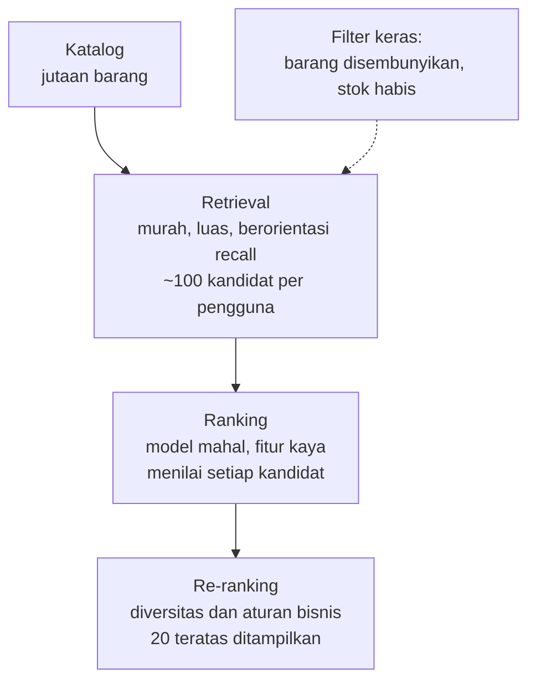
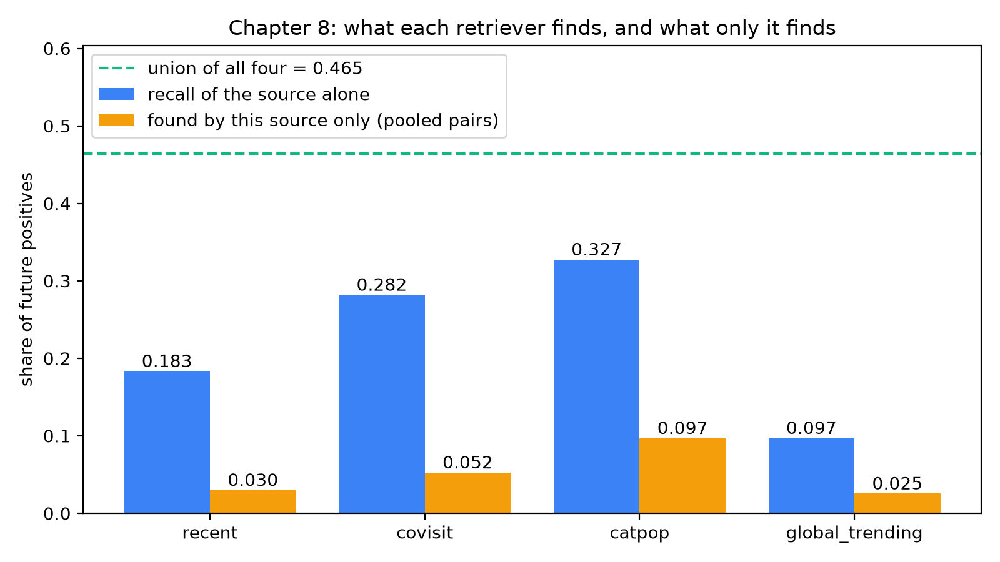
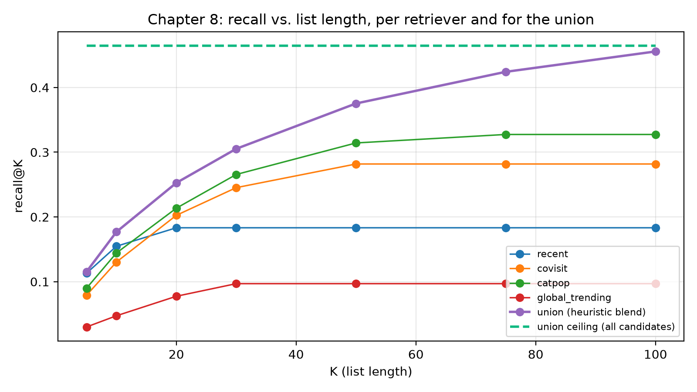

# Pembangkitan kandidat multi-sumber

Pukul 12.05 pada hari gajian, halaman utama sebuah marketplace ala Shopee akan dibuka oleh beberapa ratus ribu orang dalam menit yang sama. Masing-masing butuh dua puluh produk dalam sepersekian detik, dari katalog berisi jutaan barang. Seseorang mengusulkan: "Jalankan saja model pemeringkatan terbaik kita pada setiap barang untuk setiap pengguna, lalu urutkan." Hitung-hitungan kasar langsung mengakhiri rapat: bahkan 20 mikrodetik per pasangan (pengguna, barang) berarti puluhan detik waktu CPU per permintaan, dan model yang benar-benar kita inginkan, dengan puluhan fitur per pasangan, jauh lebih lambat.

Maka tim memecah masalah menjadi dua. Tahap yang murah dan luas memilih sekitar seratus barang yang *mungkin* menarik bagi pengguna ini; tahap yang mahal dan presisi hanya meranking barang-barang itu. Bab ini membahas tahap pertama, yaitu **pembangkitan kandidat** (*candidate generation*) atau **retrieval**. Tahap ini menentukan apa saja yang boleh dilihat oleh *ranker*, dan menetapkan batas atas yang keras untuk semua yang terjadi sesudahnya.

Di repositori ini, tahap pertama adalah `recommender/recsys/candidates.py`: empat *retriever* kecil, masing-masing berupa alasan berbeda untuk meyakini bahwa pengguna mungkin menyukai suatu barang, ditambah beberapa filter keras. Simulator memungkinkan kita memberi angka pada setiap klaim.

**Yang akan Anda pelajari**

- Mengapa sistem rekomendasi disusun sebagai corong (*funnel*) bertahap, dan mengapa *recall*, bukan *precision*, yang menjadi tujuan tahap pertama.
- Cara kerja empat *retriever* di repo (`recent`, `covisit`, `catpop`, `global_trending`) dan perilaku nyata apa yang ditiru masing-masing.
- Cara menggabungkan *retriever* dengan *outer join*, menyimpan skor tiap *retriever* sebagai fitur, dan menghitung berapa sumber yang mengusulkan suatu barang.
- Cara mengukur *retriever* dengan *recall* dan dengan *recall* yang *unik*, serta apa arti "batas atas *recall*" (*recall ceiling*) bagi seluruh sistem.
- Mengapa barang yang disembunyikan dan barang yang stoknya habis harus dibuang dengan filter keras di tahap ini, bukan diserahkan kepada *ranker*.

## Intuisi: pustakawan dan daftar pendek

Bayangkan Anda meminta pustakawan, "Carikan sesuatu yang bagus untuk dibaca malam ini." Ia tidak membaca semua buku di gedung itu. Ia membuat daftar pendek dengan beberapa naluri: apa yang Anda pinjam minggu lalu, apa yang juga dipinjam pembaca buku-buku itu, rak mana yang sering Anda jelajahi dan buku mana di rak itu yang paling banyak dipinjam bulan ini, dan, jika Anda pengunjung baru, apa yang sedang dipinjam semua orang saat ini. Baru setelah ada dua puluh atau tiga puluh buku di troli, ia duduk, memeriksa setiap buku dengan teliti, dan menentukan urutannya.

Perhatikan bahwa pustakawan memakai *beberapa* naluri, karena masing-masing gagal dengan cara berbeda: pinjaman terakhir Anda tak berguna jika Anda anggota baru, dan "populer bulan ini" tak berguna untuk selera yang niche. Menggabungkannya menutup titik buta. Itulah **pembangkitan kandidat multi-sumber**, dan *docstring* modul `candidates.py` menyebut setiap *retriever* sebagai "alasan berbeda untuk menyukai suatu barang".

## Mengapa dua tahap: corong

Misalkan katalog berisi $N$ barang dan kita melayani $U$ permintaan per detik. Menilai setiap barang dengan *ranker* yang butuh $c$ detik per pasangan memerlukan $U \cdot N \cdot c$ detik komputasi setiap detiknya. Dengan $N$ jutaan, bahkan $c$ yang murah pun tak terjangkau, karena *ranker* yang bagus membutuhkan fitur yang dihitung *per pasangan*: riwayat pengguna dengan barang ini, *click-through rate* terkininya, kualitas toko.

Corong menyelesaikan ini dengan membelanjakan komputasi di tempat yang berguna. Setiap tahap melihat lebih sedikit barang sehingga mampu menghabiskan lebih banyak komputasi per barang:


*Gambar: Corong rekomendasi. Setiap tahap melihat lebih sedikit barang dan dapat menghabiskan lebih banyak komputasi per barang. Filter keras bekerja di titik paling awal.*

Tiga sifat menyusul. **Recall adalah metrik tahap pertama:** dari barang yang nantinya disukai pengguna, berapa banyak yang ada dalam daftar pendek saya? Urutan di dalam daftar pendek tidak penting dan *precision* bersifat sekunder, karena *ranker* yang membersihkan positif palsu. **Daftar pendek adalah batas atas:** jika klik di masa depan tidak ada dalam himpunan kandidat, tidak ada *ranker* yang dapat merekomendasikannya. Inilah *recall ceiling*. **Murah lebih penting daripada elegan:** sebuah *retriever* sebaiknya berupa pencarian indeks, *group-by*, atau kueri tetangga terdekat; apa pun yang membutuhkan fitur per pasangan termasuk tahap kedua.

::: fact
**Dua jaringan, satu corong.** Sistem rekomendasi YouTube, sebagaimana dipublikasikan oleh Covington, Adams, dan Sargin, dibagi menjadi tepat dua jaringan saraf: satu untuk pembangkitan kandidat dan satu untuk pemeringkatan. Jaringan pembangkit kandidat menerima riwayat aktivitas pengguna dan mengambil sebagian kecil, "ratusan" video, dari korpus berisi jutaan; jaringan pemeringkat kemudian menilai himpunan kecil itu dengan himpunan fitur yang jauh lebih kaya. Para penulis menunjukkan bahwa rancangan dua tahap ini memungkinkan mereka merekomendasikan dari korpus yang sangat besar sambil tetap yakin bahwa beberapa video yang ditampilkan bersifat personal, dan juga memungkinkan mereka memadukan kandidat yang dihasilkan oleh sumber lain.

Sumber: Covington et al., RecSys, 2016
:::

Makalah yang sama membuat pengamatan kedua yang ditiru repo ini: informasi dari tahap kandidat sebaiknya diteruskan ke *ranker* sebagai fitur, seperti sumber mana yang menominasikan suatu kandidat dan dengan skor berapa. `generate` melakukannya lewat `cand_recent_score`, `cand_covisit_score`, `cand_catpop_score`, `cand_global_pop_rank`, dan `cand_n_sources`.

## Empat retriever

Setiap *retriever* menjawab pertanyaan berbeda dan diam untuk kelompok pengguna yang berbeda.

| Retriever | Pertanyaan yang dijawab | Analogi | Diam untuk |
|---|---|---|---|
| `recent` | Apa yang *Anda* sentuh belakangan ini? | "Pinjaman terakhir Anda" | Pengguna tanpa riwayat |
| `covisit` | Apa yang juga disentuh orang yang menyentuh barang *Anda*? | "Pembaca buku ini juga membaca…" | Pengguna tanpa riwayat, atau yang barangnya tak dikunjungi orang lain |
| `catpop` | Apa yang populer di kategori yang *Anda* sukai? | "Rak terlaris yang Anda jelajahi" | Pengguna tanpa klik *dan* tanpa pencarian |
| `global_trending` | Apa yang sedang ramai bagi semua orang saat ini? | "Etalase di depan toko" | Tak seorang pun. Daftarnya sama untuk semua |

Semuanya berbagi peluruhan waktu eksponensial (gagasan dari Bab 3) dan pemotongan "top-n per pengguna" agar tidak ada sumber yang membanjiri kolam kandidat:

```include
path: recommender/recsys/candidates.py
symbol: _decay
```

```include
path: recommender/recsys/candidates.py
symbol: _top_per_user
```

Dengan `HALF_LIFE_DAYS = 7.0`, untuk sebuah aksi berbobot $w$ yang terjadi $a$ hari sebelum *cutoff*:

$$
s = w \cdot 2^{-a/7}.
$$

Sebuah pesanan ($w=5$) dari seminggu lalu bernilai $2.5$, lima kali lipat klik berumur seminggu ($w=1$ menghasilkan $0.5$). Bobotnya berasal dari `schema.EVENT_WEIGHT`: klik 1, tambah ke keranjang 3, pesanan 5.

### Retriever 1: `recent`

*Retriever* paling sederhana adalah ingatan. Ia menjumlahkan bobot yang telah meluruh dari semua aksi masa lalu pengguna pada setiap barang dan menyimpan 20 barang teratas per pengguna.

```include
path: recommender/recsys/candidates.py
symbol: recent
```

Ini tampak terlalu sepele untuk berguna, tetapi pembeli memang kembali ke barang yang sama: mereka melihat sebuah ponsel, pergi, dan kembali dua hari kemudian. Ini juga daftar benih (*seed*) untuk `covisit`.

### Retriever 2: `covisit`

Ko-kunjungan (*co-visitation*) adalah *collaborative filtering* item-ke-item berbasis sesi dari Bab 5. `covisitation_matrix` menghitung seberapa sering dua barang menerima aksi positif dalam sesi yang sama dalam 30 hari dan menormalkannya per barang sumber, sehingga setiap baris berjumlah 1: distribusi $w(a \to b)$ atas barang $b$ yang biasanya menyertai $a$.

*Retriever* `covisit` kemudian bergerak dari barang-barang terbaru terbaik milik pengguna ke tetangganya:

```include
path: recommender/recsys/candidates.py
symbol: covisit
```

Skor sebuah tetangga $b$ adalah suara berbobot dari para *seed* pengguna:

$$
\text{covisit}(u, b) = \sum_{a \in \text{seeds}(u)} \text{recent}(u, a)\; w(a \to b),
$$

dengan `seeds(u)` adalah sepuluh barang terbaru terkuat milik pengguna (`N_SEEDS = 10`) dan kita menyimpan 40 tetangga teratas (`N_COVISIT = 40`). Perhatikan ketergantungannya: `covisit` mengambil *keluaran `recent`* sebagai masukannya. Jika pengguna tidak punya riwayat, `recent` kosong, sehingga `covisit` juga kosong.

### Retriever 3: `catpop`

*Retriever* ketiga bekerja pada *kategori*, bukan barang. Pertama ia membangun tabel minat pengguna-per-kategori, `category_affinity`:

```include
path: recommender/recsys/candidates.py
symbol: category_affinity
```

Dua detail penting. Pencarian dihitung: pencarian "coffee" menjadi *hit* kategori lewat pencocokan substring yang naif dan berbobot 2.0 ("sekitar dua klik niat"), sehingga pembeli yang mencari tetapi tak pernah mengklik tetap punya profil. Dan hasilnya berupa *porsi* (*share*): bobot setiap pengguna berjumlah 1, sehingga pengguna berat tidak tampak "lebih berminat" daripada pengguna ringan.

`catpop` mengambil tiga kategori teratas tiap pengguna dan menggabungkannya (*join*) dengan barang tersedia paling populer di kategori itu:

```include
path: recommender/recsys/candidates.py
symbol: catpop
```

Untuk setiap kategori hanya 20 barang terpopuler dalam 7 hari terakhir yang disimpan (`N_PER_CATEGORY = 20`), dan popularitas dinormalkan terhadap nilai maksimum kategori, menghasilkan `pop_norm` dalam $[0, 1]$. Skornya adalah

$$
\text{catpop}(u, i) = \text{share}(u, c(i)) \cdot \bigl(0.1 + \text{pop\_norm}(i)\bigr).
$$

Konstanta $0.1$ itu penting: tanpanya, barang dengan popularitas terkini nol akan bernilai tepat nol dan tampak "tidak diusulkan". Dengannya, bahkan listing baru di kategori favorit pengguna tetap memenuhi syarat.

### Retriever 4: `global_trending`

*Retriever* terakhir sengaja dibuat membosankan:

```include
path: recommender/recsys/candidates.py
symbol: global_trending
```

Ia mengambil popularitas setiap barang dalam 3 hari terakhir (jendela yang lebih pendek daripada 7 milik `catpop`, sebab "trending" berarti *saat ini*), hanya menyimpan barang yang stoknya ada, dan mengembalikan 30 teratas beserta peringkatnya. Daftarnya sama untuk setiap pengguna. Nilainya bukan personalisasi, melainkan *cakupan* (*coverage*): ia menjamin setiap pengguna, termasuk pengunjung baru tanpa event apa pun, menerima setidaknya 30 kandidat. Urutan operasinya penting: filter stok terjadi **sebelum** `nlargest(N_GLOBAL)`. Jika diterapkan sesudahnya, setiap barang habis di 30 teratas akan meninggalkan lubang, dan daftar akan menyusut tanpa disadari.

### Contoh hitung sederhana

Mari kita hitung satu pengguna dengan tangan. Pada *cutoff*, pengguna $u$ punya riwayat berikut (peluruhan dengan waktu paruh 7 hari):

- Mengklik barang A tujuh hari lalu: $1 \cdot 2^{-1} = 0.5$.
- Memesan barang B empat belas hari lalu: $5 \cdot 2^{-2} = 1.25$.

Maka `recent` mengusulkan B dengan skor $1.25$ dan A dengan skor $0.5$. Sekarang anggap baris ko-kunjungannya adalah:

| seed | tetangga | $w$ |
|---|---|---|
| B | C | 0.4 |
| B | D | 0.6 |
| A | C | 0.5 |
| A | E | 0.5 |

Maka skor `covisit` adalah $C = 1.25 \cdot 0.4 + 0.5 \cdot 0.5 = 0.75$, $D = 1.25 \cdot 0.6 = 0.75$, dan $E = 0.5 \cdot 0.5 = 0.25$. Barang C menerima suara dari dua *seed*, yang persis jenis kesepakatan yang ingin kita beri ganjaran.

Terakhir, anggap afinitas pengguna adalah 60% Pets dan 40% Beauty. Sebuah barang makanan hewan dengan `pop_norm = 0.5` mendapat $0.6 \cdot (0.1 + 0.5) = 0.36$, sedangkan barang kecantikan dengan popularitas 0.9 mendapat $0.4 \cdot (0.1 + 0.9) = 0.40$. Barang yang kurang populer di kategori yang lebih disukai bisa kalah dari barang populer di tempat lain; *ranker* yang memutuskan nanti.

## Menggabungkan sumber: `generate`

Kini kita punya empat tabel dengan bentuk berbeda: `recent`, `covisit`, dan `catpop` berkunci (pengguna, barang) dengan kolom skornya sendiri, sedangkan `global_trending` adalah daftar yang tak bergantung pada pengguna. `generate` menjahitnya:

```include
path: recommender/recsys/candidates.py
symbol: generate
```

Telusuri dalam empat gerakan.

**1. Gabungan lewat outer join.** Daftar global di-*cross-join* dengan daftar pengguna sehingga setiap pengguna mendapat 30 baris yang sama. Lalu sumber-sumber digabung dengan `how="outer"` pada `(user_id, item_id)`. Barang yang diusulkan sumber mana pun bertahan. Barang yang diusulkan dua sumber menjadi *satu baris dengan dua kolom skor tak-null*, bukan dua baris. Inilah keputusan desain terpenting dalam fungsi ini: unit tahap pemeringkatan adalah pasangan (pengguna, barang), dan sumber-sumber itu adalah *fitur dari pasangan tersebut*.

**2. Filter ketersediaan.** `cands["item_id"].isin(available["item_id"])` membuang apa pun yang stoknya habis *pada saat cutoff*. `History.at` membuang waktu kehabisan stok di masa depan, sehingga filter hanya memakai informasi yang tersedia saat permintaan.

**3. Filter barang tersembunyi.** Tombol "Not interested" mencatat event `hide`. `generate` melakukan *left join* untuk setiap pasangan `(user, item)` yang memiliki event tersebut sebagai kolom penanda, lalu membuang yang cocok: sebuah *filter keras* pada kolam, bukan fitur.

**4. Pembukuan sumber.** Terakhir fungsi menghitung `cand_n_sources`, jumlah sumber yang mengusulkan pasangan itu, *sebelum* ia mengganti skor yang hilang dengan 0.0 (dan peringkat global yang hilang dengan 999). Urutan penting di sini, dan kita akan memakainya sebagai soal kuis: begitu `fillna` dijalankan pada ketiga kolom skor, kolom-kolom itu tidak pernah null lagi, sehingga masing-masing akan dihitung sebagai sumber untuk setiap baris.

## Mengukur retriever: recall, pair recall, dan unique recall

Bagaimana kita tahu bahwa sebuah *retriever* bagus? Dengan aturan dari Bab 2 kita butuh pemisahan waktu: kita membangun kandidat dari riwayat sebelum *cutoff*, lalu melihat apa yang sebenarnya dilakukan pengguna dalam tujuh hari berikutnya (yaitu *label*, di sini 947 pengguna evaluasi dengan 3,357 pasangan (pengguna, barang) positif). Pertanyaan untuk setiap *retriever* kemudian: berapa porsi positif masa depan itu yang ia cakup?

Skrip pendamping `book/code/ch08_candidates.py` menghitung tiga angka per sumber:

- **recall**: untuk setiap pengguna, porsi positif masa depannya yang ditemukan dalam kandidat sumber itu, dirata-ratakan atas pengguna. Ini adalah `evaluate.candidate_recall`.
- **pair recall**: porsi yang sama, tetapi dikumpulkan (*pooled*) atas semua pasangan positif, sehingga pengguna dengan banyak positif berbobot lebih besar.
- **unique pair recall**: porsi pasangan terkumpul yang ditemukan oleh sumber *ini* dan oleh *tidak ada* sumber lain. Angka inilah yang membenarkan keberadaan sumber tersebut.

*Unique recall* menjawab pertanyaan rekayasa "apa yang hilang jika kita menghapus *retriever* ini?" *Retriever* dengan *recall* tinggi tetapi *unique recall* nol adalah *retriever* yang redundan, dan kita membayarnya dengan latensi dan derau fitur tanpa hasil apa pun.

## Jalankan

Dari direktori `book/`:

```bash
uv run python code/ch08_candidates.py
```

Bagian pertama keluarannya adalah tabel per sumber:

```output
file: results/ch08_candidates.txt
lines: 2-12
```

`cands_per_user` adalah ukuran rata-rata daftar tiap sumber. `users_with_cands` menunjukkan `recent` dan `covisit` sekitar 0.97, jadi beberapa persen pengguna tidak punya riwayat, sedangkan `global_trending` menjangkau semua orang. Gabungannya rata-rata berisi 103.94 kandidat per pengguna, yaitu "sekitar seratus" dari corong tadi.

## Hasil

Gambar di bawah memperlihatkan *recall* per sumber dibandingkan dengan gabungan, serta *recall* pasangan yang ditemukan *hanya* oleh sumber itu.



Empat pengamatan, dikaitkan dengan angkanya.

**Tidak ada satu pun retriever yang cukup.** Sumber tunggal terbaik, `catpop`, mencapai *recall* 0.3274; gabungannya mencapai 0.4645, sekitar 14 poin (kira-kira 42% secara relatif) lebih tinggi. **Tumpang tindih adalah informasi, bukan pemborosan.** Keempat nilai `cands_per_user` berjumlah $12.19 + 35.83 + 54.91 + 30.00 \approx 132.9$, tetapi gabungannya hanya 103.94, jadi sekitar 29 kandidat per pengguna (seperlima) diusulkan oleh lebih dari satu sumber.

**Setiap sumber membawa nilai unik, tetapi tidak sama besar.** `catpop` menemukan 9.68% dari semua pasangan positif yang tidak ditemukan siapa pun, `covisit` 5.24%, `recent` 2.98%, dan `global_trending` 2.53%. Daftar *trending* punya *recall* terendah tetapi nilai unik hampir sama besar dengan `recent`: ia jaring pengaman murah untuk positif yang tak dijangkau sumber personal mana pun.

**Bahkan gabungan pun melewatkan lebih dari separuh masa depan.** Batas atas 0.4645 berarti 53.55% dari apa yang diklik, ditambahkan ke keranjang, atau dipesan pengguna dalam seminggu tidak pernah ditawarkan kepada *ranker*. Sebagian tak terhindarkan (penemuan lewat pencarian, iklan, teman); sebagian dapat ditangani dengan lebih banyak sumber, seperti *retrieval two-tower* dari Bab 7.

*Recall* sebagai fungsi dari berapa banyak kandidat yang kita simpan digambarkan di bawah (nilainya ada di `results/ch08_candidates.json`). Setiap sumber diurutkan menurut skornya sendiri dan gabungan menurut *heuristic blend* milik repo.



Ekor yang datar adalah ciri khas *retriever* berukuran tetap. `recent` berada di 0.1833 sejak $K=20$ karena ia tidak pernah mengusulkan lebih dari 20 barang per pengguna. `covisit` berhenti di 0.2818 sejak $K=50$, dan `catpop` di 0.3274 sejak $K=75$. Gabungan yang diurutkan dengan *heuristic blend* terus menanjak, dan pada $K=100$ mencapai 0.4557, dekat dengan batas atas 0.4645. Ia tidak mencapainya tepat karena rata-rata kolam berisi 103.94 kandidat per pengguna, sehingga pemotongan di 100 masih membuang beberapa positif yang berada di ujung daftar sebagian pengguna. Batas atas adalah *recall* yang Anda dapat ketika tidak ada yang dipotong sama sekali.

Pada $K=20$, *heuristic blend* mencapai *recall* 0.2526 dari 0.4645 yang tersedia. Selisih 0.21 itu adalah ruang perbaikan yang dapat ditangkap oleh *ranker* yang lebih baik (Bab 10); ia tidak bisa melampaui batas atas, tetapi bisa mendekatinya jauh lebih rapat.

::: fact
**Mengapa lebih banyak sumber membantu: kesepakatan adalah bukti.** Kandidat yang diusulkan beberapa *retriever* adalah taruhan yang lebih baik. Pada proses kita, 76,612 kandidat diusulkan oleh tepat satu sumber dan hanya 0.9% di antaranya ternyata positif pada minggu berikutnya. Untuk kandidat yang diusulkan keempat sumber (622 kandidat), tingkat positifnya 18.2%, sekitar dua puluh kali lebih tinggi. Inilah alasan `cand_n_sources` ada sebagai fitur pemeringkatan, mencerminkan praktik yang dijelaskan Covington et al. yaitu meneruskan sumber-sumber penominasi beserta skornya dari pembangkitan kandidat ke *ranker*.

Sumber: Covington et al., RecSys, 2016
:::

Tingkat itu naik secara monoton menurut jumlah sumber (tabel per jumlah ada di `results/ch08_candidates.txt`): 0.0090, 0.0319, 0.0806, dan 0.1817. Setiap *retriever* tambahan yang secara independen mengusulkan sebuah barang menaikkan peluang bahwa pengguna menginginkannya, dan *ranker* berbasis pohon memakai sinyal ini dengan intens.

Diurutkan dengan *heuristic blend* buatan tangan milik repo tanpa pembelajaran sama sekali, gabungan itu sudah meraih NDCG@20 sebesar 0.1674 dengan *coverage* 0.5682 (porsi katalog berstok yang muncul di 20 teratas seseorang). *Ranker* terlatih di Bab 10 memperbaikinya pada kolam yang sama, selalu *di dalam batas atas yang digambar bab ini*.

::: fact
**Dibangun untuk skala dan waktu nyata.** Linden, Smith, dan York menggambarkan *collaborative filtering* item-ke-item milik Amazon sebagai jawaban atas pengecer dengan "puluhan juta pelanggan dan jutaan barang katalog yang berbeda" yang halamannya harus dikembalikan secara *real time*, tidak lebih dari setengah detik. Komputasi daring algoritmanya berskala independen dari jumlah pelanggan dan jumlah barang katalog, karena kerja item-ke-item yang mahal tidak dilakukan per permintaan. *Retriever* `covisit` punya semangat yang sama: matriks ko-kunjungan merangkum 30 hari sesi, dan saat melayani ia hanya digabungkan dengan sepuluh barang *seed* pengguna.

Sumber: Linden et al., IEEE Internet Computing, 2003
:::

## Filter keras: yang tidak boleh sampai ke ranker

Beberapa aturan bersifat mutlak, bukan "pelajari sebuah bobot". `generate` menerapkan dua selagi kolam dirakit.

### Barang yang stoknya habis

Barang yang tidak bisa dibeli tidak seharusnya ditampilkan, maka `generate` membatasi setiap sumber ke `hist.items[hist.items["in_stock"]]`. Filter mengalahkan fitur di sini karena asimetri kesalahannya: barang habis di posisi 3 mengajari pembeli bahwa rekomendasi tidak dapat diandalkan, sedangkan kehilangannya dari kolam tidak merugikan apa-apa, karena ia memang tak mungkin menghasilkan penjualan.

### Barang yang disembunyikan

Ketika pengguna menekan "Not interested", *frontend* mengirim event `hide`; `generate` membuang setiap baris yang memilikinya. Mengapa tidak memberi *ranker* sebuah fitur? Model terlatih bersifat statistik dan mungkin masih menampilkan barang tersembunyi itu sekali dalam seratus permintaan, dan pengguna melihat persis yang satu itu. Pengguna memaafkan rekomendasi yang tidak relevan, tetapi tidak yang secara eksplisit sudah mereka tolak.

## Penelusuran kode: bagaimana skrip evaluasi dibangun

Angka-angka *recall* berasal dari `book/code/ch08_candidates.py`. Skrip ini memanggil setiap *retriever*, membatasi hasilnya pada pengguna evaluasi dan barang berstok, lalu membangun himpunan pasangan `(user_id, item_id)` per sumber:

```include
path: book/code/ch08_candidates.py
region: unique_recall
```

*Unique recall* adalah selisih himpunan. Untuk sumber $s$, dengan $L$ himpunan pasangan label positif dan $C_s$ pasangan yang dicakup oleh $s$:

$$
\text{unique}(s) = \frac{\left| (L \cap C_s) \setminus \bigcup_{o \neq s} C_o \right|}{|L|}.
$$

Baris *union* memanggil `candidates.generate` yang asli, sehingga skrip mengukur jalur produksi. *Global trending* tidak punya skor per pengguna, jadi skrip menegasikan peringkatnya untuk mengubah "peringkat 0 terbaik" menjadi "lebih besar lebih baik". Setiap sumber dievaluasi pada 947 pengguna, label, dan filter ketersediaan yang sama; membandingkan *retriever* pada populasi yang berbeda adalah kesalahan yang umum.

## Jebakan dan cara produksi melakukannya

**Jebakan 1: mengoptimalkan precision di retrieval.** *Ranker* menyingkirkan positif palsu lebih baik daripada *retriever*, dan kandidat yang dibuang hilang selamanya. Optimalkan *recall* pada anggaran kandidat yang tetap.

**Jebakan 2: anggaran kandidat adalah anggaran latensi.** Setiap kandidat tambahan membebani komputasi fitur dan inferensi. Konstanta di bagian atas `candidates.py` (`N_RECENT`, `N_COVISIT`, `N_PER_CATEGORY`, `N_GLOBAL`) adalah tuasnya; plot *recall* terhadap ukuran kolam (gambar kedua kita) dan berhentilah di titik kurva mendatar.

::: warning
*Bug* di tahap kandidat sulit terlihat: rekomendasi tetap tampak masuk akal tetapi berasal dari kolam yang lebih miskin. Pantau *candidate recall* secara offline dan `candidates_considered` secara online seperti metrik kesehatan lain; penurunan mendadak biasanya berarti *pipeline* rusak, bukan perilaku pengguna.
:::

**Cara sistem produksi melakukannya.** Marketplace sungguhan menjalankan jauh lebih banyak *retriever* secara paralel, masing-masing dengan anggaran latensinya sendiri: *retrieval* embedding dengan indeks tetangga terdekat aproksimasi (Bab 7), *retrieval* berbasis sesi, "toko yang sama dengan barang yang Anda pesan", "sering dibeli bersama", daftar kampanye. Langkah penggabungan menerapkan kuota per sumber dan mendeduplikasi menurut barang; filter keras dijalankan terhadap penyimpanan cepat seperti daftar blokir *key-value*; dan *recall* offline pada ukuran kolam adalah pekerjaan harian yang dipantau.

## Ringkasan

- Corong dua tahap ada karena meranking setiap barang untuk setiap pengguna dengan model yang kaya tidak terjangkau biayanya.
- Tahap pertama dinilai dengan *recall* dan menetapkan batas atas: gabungan semua sumber berisi 46.45% positif masa depan pengguna, dan tidak ada *ranker* yang bisa melampauinya.
- Repo memakai empat *retriever*: `recent` (riwayat sendiri yang meluruh), `covisit` (barang yang dilihat dalam sesi yang sama), `catpop` (populer di kategori favorit, dari klik dan pencarian), dan `global_trending` (cadangan yang tak bergantung pengguna).
- Sumber digabung dengan *outer join* pada (pengguna, barang); setiap skor disimpan sebagai fitur dan `cand_n_sources` menghitung sumber yang sepakat (tingkat positif 0.9% untuk satu sumber, 18.2% untuk empat).
- Nilai *retriever* dengan *recall* dan *unique recall*; tumpang tindih itu umum (sekitar 133 usulan per pengguna berbanding 103.94 dalam gabungan).
- Barang tersembunyi dan barang habis adalah filter keras pada kolam, bukan fitur.

## Kuis

**Q8.1** Mengapa *recall*, bukan *precision*, menjadi metrik utama untuk tahap pembangkitan kandidat?

A. Karena *precision* tidak dapat dihitung pada *feedback* implisit.
B. Karena barang yang tidak ada di himpunan kandidat tidak akan pernah bisa dipulihkan oleh *ranker*, sedangkan positif palsu dapat dibuang olehnya.
C. Karena *recall* lebih murah dihitung daripada *precision*.
D. Karena *ranker* hanya bekerja bila masukannya tidak berisi barang yang tidak relevan.

**Q8.2** Menurut tabel per sumber di `results/ch08_candidates.txt`, *retriever* mana yang menemukan porsi terbesar pasangan positif yang tidak ditemukan *retriever* lain?

A. `recent`
B. `covisit`
C. `catpop`
D. `global_trending`

**Q8.3** Pada keluaran, tingkat positif naik dari 0.0090 untuk kandidat dengan satu sumber menjadi 0.1817 untuk kandidat dengan empat sumber. Apa pemanfaatan temuan ini yang paling tepat dalam sistem?

A. Membuang kandidat yang hanya diusulkan satu sumber.
B. Meneruskan `cand_n_sources` (dan skor per sumber) ke *ranker* sebagai fitur.
C. Hanya mengembalikan kandidat yang diusulkan oleh keempat sumber.
D. Mengganti *ranker* dengan menghitung jumlah sumber.

**Q8.4** Seorang pengunjung tanpa riwayat membuka halaman utama. *Retriever* mana yang masih menghasilkan kandidat untuknya?

A. Keempatnya, karena *outer join* mengisi nilai yang hilang.
B. Hanya `recent` dan `covisit`.
C. Hanya `global_trending`.
D. `catpop` dan `global_trending`, karena `catpop` beralih ke barang populer secara keseluruhan.

**Q8.5** Gabungan sumber memiliki batas atas *recall* 0.4645, namun gabungan yang diurutkan dengan *heuristic blend* hanya mencapai 0.4557 pada K=100. Jelaskan mengapa angka pada K=100 tidak persis sama dengan batas atas.

**Q8.6** Mengapa repo memperlakukan barang "tersembunyi" sebagai filter keras di `generate`, dan tidak memberi *ranker* fitur `was_hidden` lalu membiarkannya belajar menghindarinya?

**Q8.7** Baca bagian akhir `generate`: baris `cands["cand_n_sources"] = ...` berada sebelum `cands[score_cols] = cands[score_cols].fillna(0.0)`. Misalkan kedua pernyataan itu ditukar. Nilai berapa yang akan diambil `cand_n_sources` untuk kandidat yang hanya diusulkan `covisit` dan tidak ada dalam daftar *trending*, dan mengapa itu masalah?

**Q8.8** Baca `global_trending`. Kode menerapkan `pop[pop.index.isin(available["item_id"])]` sebelum `.nlargest(N_GLOBAL)`. Apa masalah yang akan teramati jika urutannya dibalik?

**Q8.9** Dengan memakai kolom `cands_per_user` pada tabel *retriever*, hitung rata-rata jumlah pasangan (pengguna, barang) per pengguna yang diusulkan oleh lebih dari satu sumber, yaitu jumlah keempat ukuran per sumber dikurangi ukuran gabungan. Berikan nilainya hingga satu angka desimal dan sebagai persentase dari jumlah tersebut.

**Q8.10** Praktik langsung. Buka `book/code/ch08_candidates.py` dan, di baris paling atas `main()`, tambahkan baris `candidates.N_TOP_CATEGORIES = 5` (nilai bawaannya 3). Jalankan skrip lagi, lalu kembalikan ke semula (`git checkout book/code/ch08_candidates.py book/results`). Perubahan apa yang Anda harapkan pada baris `catpop` (`cands_per_user`, `recall`) dan pada baris gabungan, dan apa yang terjadi pada rata-rata jumlah kandidat per pengguna? Jelaskan dalam satu atau dua kalimat mengapa tugas *ranker* menjadi lebih sulit meskipun *recall* membaik.
