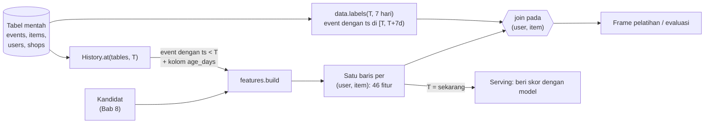
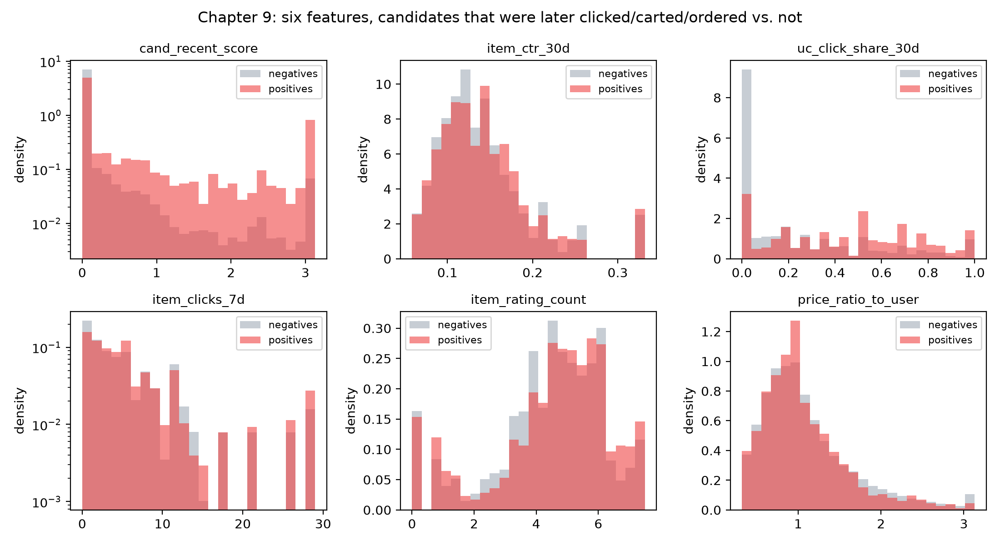
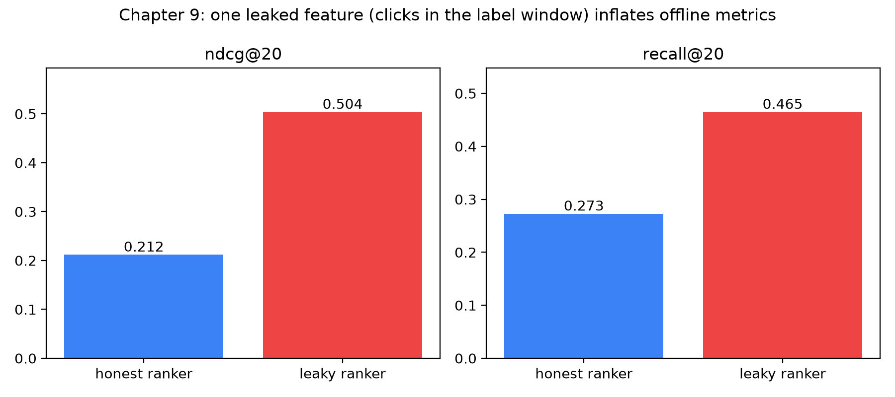

# Rekayasa fitur untuk pemeringkatan

Dewi bekerja di tim growth sebuah marketplace yang mirip Shopee. Senin pagi ia menunjukkan kepada manajernya sebuah model pemeringkatan (*ranking*) dengan NDCG offline 0.50, lebih dari dua kali lipat model sebelumnya. (*Offline* berarti model dinilai pada data historis yang tersimpan, bukan pada pembeli sungguhan. NDCG adalah skor 0 sampai 1 untuk seberapa cocok bagian atas daftar berperingkat dengan apa yang benar-benar dilakukan orang; makin tinggi makin baik.) Sang manajer senang dan menanyakan tanggal peluncuran. Kamis, model masuk A/B test 5% (eksperimen langsung: 5% pembeli memakai model baru, sisanya tetap memakai model lama), dan pada hari Jumat dasbor menunjukkan bahwa performanya tidak lebih baik dari model lama. Di beberapa segmen malah lebih buruk. Dewi menghabiskan akhir pekan membaca *pipeline* fitur barisnya demi baris, dan pukul 2 dini hari Minggu ia menemukannya: salah satu kolom, "jumlah klik pada item ini minggu ini", dihitung dari seluruh minggu *termasuk hari-hari yang seharusnya diprediksi oleh model*. Model itu tidak belajar merekomendasikan. Ia belajar membaca lembar jawaban.

Cerita seperti ini, dalam satu bentuk atau lainnya, terjadi di hampir setiap perusahaan yang membangun sistem rekomendasi. Penyebabnya, fitur (*feature*) adalah tempat sistem pemeringkatan bersentuhan dengan dunia nyata, dan dunia nyata punya sumbu waktu yang tidak dimiliki sebuah *spreadsheet*. Di Bab 8 kita membangun mesin yang mengusulkan beberapa ratus item yang masuk akal untuk setiap pengguna. Di bab ini kita mengubah setiap pasangan (pengguna, item) tersebut menjadi sebaris angka yang bisa dipelajari oleh model pemeringkatan. Cara Anda membangun angka-angka itu lebih penting daripada model mana yang Anda beri makan dengannya.

Sebelum mulai, berikut kosakata bab ini dalam satu tempat. Setiap istilah dijelaskan penuh nanti; tabel ini hanya peta.

| Istilah | Arti sederhana |
|---|---|
| **Fitur** (*feature*) | Satu angka yang menggambarkan sebuah pasangan (pengguna, item), misalnya "berapa kali pengguna ini mengklik item ini minggu lalu". |
| **Baris fitur** (*feature row*) | Semua fitur satu pasangan, berdampingan. Model membaca satu baris per kandidat. |
| **Label** | Jawaban yang ingin diprediksi model: apakah pengguna mengklik, memasukkan ke keranjang, atau memesan item itu *sesudahnya*? |
| **Cutoff** (ditulis $T$) | Saat kita membekukan waktu. Fitur hanya boleh memakai apa yang terjadi sebelumnya; label berasal dari sesudahnya. |
| **Kebocoran** (*leakage*) | Fitur yang diam-diam memuat informasi dari setelah cutoff, sehingga model "menyontek". |
| **Jendela** (*window*) | "3 hari terakhir", "30 hari terakhir": kita hanya menghitung peristiwa dalam rentang itu sebelum cutoff. |
| **Pelicinan** (*smoothing*) | Menarik rasio yang bertumpu pada bukti sangat sedikit kembali ke rata-rata. |
| **Fitur silang** (*cross feature*) | Fitur tentang *sepasang* hal, seperti pengguna ini × item ini, bukan tentang satu hal saja. |
| **Nilai sentinel** | Angka ekstrem yang sengaja dipilih (misalnya 9999) yang berarti "ini tidak pernah terjadi". |

**Yang akan Anda pelajari**

- Mengapa sebuah fitur hanya valid jika dihitung *per* waktu pemotongan (*cutoff*), dan bagaimana `History.at` menegakkan aturan itu untuk seluruh basis kode.
- Delapan kelompok fitur yang dipakai di repo ini (total 46 fitur), kegunaan tiap kelompok, dan kelompok mana yang membawa personalisasi dibanding kualitas.
- Bagaimana jendela waktu (3 / 7 / 14 / 30 hari) dan pelicinan Bayesian (*Bayesian smoothing*) mengubah hitungan mentah menjadi rasio yang stabil.
- Bagaimana fitur silang (*cross feature*) seperti pengguna × item, pengguna × kategori, dan pengguna × toko dibangun dengan beberapa panggilan `groupby`.
- Bagaimana membaca satu baris fitur lengkap untuk kandidat nyata, dan membandingkan contoh positif dengan negatif.
- Bagaimana menulis tes kebocoran (*leakage*) otomatis, dan seberapa besar kerusakannya jika Anda benar-benar bocor (NDCG offline 0.50 versus 0.21 yang jujur).

## Intuisi: fitur adalah catatan briefing

Bayangkan Anda adalah *personal shopper* yang disewa untuk memilih sepuluh produk bagi seorang pelanggan. Sebelum mulai, seorang asisten menyerahkan catatan briefing satu halaman untuk setiap produk kandidat. Catatan itu berisi hal-hal seperti: "Pelanggan ini melihat produk persis ini tiga kali minggu lalu", "produk ini 40% lebih murah daripada produk sejenis", "toko ini membalas pesan dalam waktu satu jam", "kategori ini mencakup 31% dari yang dijelajahi pelanggan bulan ini". Anda tidak melihat log mentah jutaan klik. Anda melihat catatannya. Jika catatannya bagus, *shopper* yang biasa-biasa saja pun akan memilih dengan baik. Jika catatannya buruk, *shopper* tercerdas sedunia pun hanya menebak.

Model pemeringkatan adalah *shopper* itu, dan baris fitur adalah catatan briefing-nya. Pohon yang di-*boost* dengan gradien (Bab 10) pandai menggabungkan beberapa lusin angka yang informatif, tetapi tidak bisa mengarang informasi yang tidak ada di dalam baris. Inilah sebabnya para praktisi berkata bahwa modelnya bagian yang mudah, dan fiturnya tempat kerja sebenarnya.

Ada satu aturan lagi untuk catatan briefing, dan inilah aturan yang dilanggar Dewi: **catatan hanya boleh berisi apa yang diketahui pada saat keputusan dibuat**. Seorang *personal shopper* pada hari Selasa tidak bisa diberi tahu apa yang akan dibeli pelanggan pada hari Rabu. Dalam bahasa *machine learning*, fitur untuk sebuah contoh pelatihan harus dihitung pada waktu pemotongan $T$ (saat kita membekukan waktu), hanya dengan peristiwa yang cap waktunya sebelum $T$ (benar-benar sebelum), sedangkan label berasal dari peristiwa pada atau setelah $T$. Kita menyebut properti ini *kebenaran pada titik waktu* (*point-in-time correctness*): setiap fitur dihitung "per" cutoff, persis seperti yang bisa dihitung pada saat itu. Pelanggarannya disebut kebocoran data (*leakage*): informasi dari masa depan merembes ke dalam catatan.

Berikut contoh kecil dengan pembeli Sari. Anggap kita membekukan waktu pada hari ke-53:

| Hari | Yang dilakukan Sari | Boleh dipakai fitur? |
|---|---|---|
| 1–52 | Mengklik tiga merek makanan kucing, memasukkan satu ke keranjang | Ya, karena sebelum cutoff |
| *53 = cutoff $T$* | *kita bekukan waktu di sini* | |
| 55 | **Memesan sekantong makanan kucing 2 kg** | **Tidak**: ini label, jawaban yang ingin kita prediksi |

Fitur seperti "klik makanan kucing Sari dalam 30 hari terakhir, dihitung dari hari ke-53" boleh. Fitur seperti "pesanan makanan kucing Sari minggu ini" akan menyertakan hari ke-55. Fitur itu memberi tahu model jawabannya, dan model tampak hebat secara offline tetapi tak berguna di dunia nyata, karena pada hari Selasa sungguhan tak seorang pun tahu pesanan hari Rabu.


## Algoritma: dari peristiwa mentah ke baris fitur

### Langkah 0: tetapkan cutoff dan bagi dunia menjadi dua

Misalkan $T$ adalah cap waktu pemotongan. Segala yang boleh dipakai sistem adalah *riwayat* (*history*) $H_T$:

$$H_T = \{\, e \in \text{events} : e.\text{ts} < T \,\} \ \cup\ \{\, i \in \text{items} : i.\text{listed\_at} \le T \,\}$$

Dengan kata lain: riwayat $H_T$ adalah "setiap peristiwa yang cap waktunya (`ts`) sebelum $T$, ditambah setiap item yang terdaftar di katalog pada atau sebelum $T$". Simbol $\in$ berarti "salah satu dari", dan $\cup$ berarti "digabung dengan". Tak ada yang setelah $T$ di dalam himpunan itu.

Label berasal dari jendela masa depan $[T, T + 7\text{ hari})$. Kurung siku berarti "termasuk $T$" dan kurung bulat berarti "sampai tetapi tidak termasuk $T + 7$ hari". Kode yang sama dipakai saat pelatihan (dengan $T$ di masa lalu, sehingga masa depan dapat diamati dan kita bisa memberi label) dan saat penyajian (*serving*) (dengan $T$ = sekarang, sehingga masa depan kosong). *Serving* berarti menjawab permintaan pembeli sungguhan secara langsung. Kesimetrisan ini adalah keputusan desain terpenting dalam *pipeline* fitur. Jika pelatihan dan *serving* berbagi satu jalur kode, satu kelas bug yang dikenal sebagai *training/serving skew* tidak mungkin terjadi. *Skew* berarti model dilatih dengan angka yang dihitung dengan satu cara, lalu diberi angka yang dihitung dengan cara lain saat berjalan langsung, seperti berlatih ujian dengan satu kunci jawaban tetapi mengikuti ujian sungguhan dengan kunci yang berbeda.



*Gambar: Fitur dihitung dari masa lalu cutoff, label dari masa depannya; saat serving, bagian masa depan itu kosong.*

### Langkah 1: tambahkan umur pada setiap peristiwa

Alih-alih menyimpan cap waktu absolut, `History.at` menghitung di muka `age_days = (T - ts) / 1 hari` untuk setiap peristiwa yang lolos: berapa hari sebelum cutoff peristiwa itu terjadi. Peristiwa 2 hari sebelum cutoff berumur 2; yang 12 jam sebelumnya berumur 0.5. Sebuah jendela lalu menjadi filter sederhana: "klik dalam 7 hari terakhir" adalah `age_days < 7`. Kolom umur ini juga membuat mustahil menulis fitur yang bergantung pada jam dinding saat ini, karena satu-satunya jam adalah $T$. (Jika fitur memakai tanggal hari ini, baris pelatihan yang sama akan berubah nilainya setiap hari Anda menjalankannya ulang.)

### Langkah 2: agregasi di atas jendela

*Mengagregasi* berarti meringkas banyak peristiwa menjadi satu angka, biasanya dengan menghitung. *Hitungan berjendela* hanya menghitung peristiwa dalam rentang waktu terbaru. Misalnya, "berapa kali item ini diklik dalam 7 hari terakhir?" adalah satu hitungan berjendela. Secara formal, untuk sebuah entitas $e$ (pengguna, item, atau pasangan) dan jenis peristiwa $t$ (klik, keranjang, pesanan…), dengan jendela $w$ hari:

$$n_{e,t}(w) = \bigl|\{\, \text{events of type } t \text{ for } e \text{ with age} < w \,\}\bigr|.$$

Garis tegak $|\cdot|$ hanya berarti "berapa banyak anggota himpunan ini".

Kita memakai beberapa jendela karena masing-masing menjawab pertanyaan yang berbeda. Jendela 3 hari berkata "apa yang sedang ramai sekarang", jendela 30 hari berkata "apa yang stabil bagus", dan rasio keduanya menunjukkan apakah sesuatu sedang menghangat atau mendingin. Bayangkan sebuah restoran: 20 pelanggan per hari selama setahun berarti stabil bagus; 5 pelanggan per hari bulan lalu tetapi 20 per hari minggu ini berarti sedang menghangat. Fitur *trend* di repo adalah

$$\text{trend} = \frac{n_{\text{click}}(3)/3 + 0.1}{n_{\text{click}}(14)/14 + 0.1}.$$

Kedua suku adalah *laju klik per hari*: klik dibagi jumlah hari dalam jendela. Nilai di atas 1 berarti tiga hari terakhir rata-rata lebih ramai daripada dua minggu terakhir. Ambil item dengan 6 klik dalam 3 hari terakhir dan 14 klik dalam 14 hari terakhir. Laju terbarunya $6/3 = 2$ per hari, laju dua minggunya $14/14 = 1$ per hari, sehingga trennya $(2 + 0.1)/(1 + 0.1) \approx 1.91$: menghangat. Item dengan 1 klik dalam 3 hari terakhir dan 14 dalam 14 hari menghasilkan $(0.33 + 0.1)/(1 + 0.1) \approx 0.39$: mendingin. Konstanta $+0.1$ adalah bilangan kecil yang mencegah pembagian dengan nol (item tanpa klik sama sekali mendapat $0.1/0.1 = 1$, "tidak berubah", bukan galat) dan menjaga hitungan yang sangat kecil agar tidak menghasilkan rasio yang konyol.

### Langkah 3: haluskan rasio

*Pelicinan* (*smoothing*) berarti menarik rasio yang bertumpu pada data sangat sedikit kembali ke rata-rata keseluruhan, supaya satu kejadian beruntung tidak bisa memalsukan seorang bintang. *Click-through rate* (CTR, porsi tayangan sebuah item yang berujung klik) mentah adalah $\text{clicks}/\text{impressions}$. Sebuah *impression* (tayangan) adalah satu kali item ditampilkan kepada pengguna. Item yang ditampilkan sekali dan diklik sekali punya CTR 100%, yang tidak masuk akal. Bayangkan pemain basket yang memasukkan tembakan pertama dan satu-satunya: Anda tidak percaya ia tak pernah meleset. Anda menebak "sekitar rata-rata" sampai ia melakukan banyak tembakan, lalu makin lama makin mempercayai catatannya sendiri.

Itulah resep Bayesian (dinamai menurut ahli statistik yang merumuskan cara memperbarui tebakan awal dengan bukti). *Prior* $p_0$ adalah tebakan awal, di sini rata-rata CTR global. Kita anggap setiap item memulai dengan $s$ tayangan khayalan pada laju rata-rata itu, lalu biarkan data nyata berangsur mengambil alih:

$$\widehat{\text{CTR}} = \frac{\text{clicks} + s \cdot p_0}{\text{impressions} + s}.$$

Topi pada CTR berarti "perkiraan". $s$ adalah jumlah tayangan khayalan yang kita tambahkan; $p_0$ adalah laju rata-rata yang dibawanya. Dengan $s = 50$ dan CTR global $p_0 = 0.14$, 50 tayangan khayalan pertama menyumbang $50 \times 0.14 = 7$ klik khayalan. Ambil dua item:

| Item | Klik | Tayangan | CTR mentah | CTR yang dihaluskan |
|---|---|---|---|---|
| A (baru, beruntung) | 1 | 1 | 1.000 | $(1 + 7)/(1 + 50) = 0.157$ |
| B (mapan) | 30 | 100 | 0.300 | $(30 + 7)/(100 + 50) = 0.247$ |

Item baru ditarik hampir sepenuhnya kembali ke rata-rata, sementara item mapan mempertahankan sebagian besar keunggulannya. Parameter $s$ adalah "kekuatan keyakinan" pada prior: makin besar nilainya, makin banyak bukti yang dibutuhkan sebelum data milik item itu sendiri menang. Tanpa pelicinan, sebuah *ranker* akan menaruh setiap item yang kebetulan mendapat satu klik di puncak daftar. Gagasan yang sama muncul di Bab 3 untuk rating.

### Langkah 4: bangun fitur silang

Fitur item menggambarkan item untuk semua orang, dan fitur pengguna menggambarkan pengguna untuk semua item. Tak satu pun menyatakan apakah *pengguna ini* akan menyukai *item ini*. Informasi itu ada di *fitur silang* (*cross feature*; namanya dari "menyilangkan" dua kolom, seperti baris dan kolom tabel yang bertemu di satu sel), yaitu agregat atas sepasang kunci. Sari menjelajahi makanan kucing adalah fakta pengguna; "Whiskas 2 kg populer" adalah fakta item; "Sari mengklik Whiskas 2 kg tiga kali" adalah fitur silang, dan itulah yang memprediksi langkah berikutnya.

- **pengguna × item**: seberapa sering pengguna ini mengklik, memasukkan ke keranjang, atau memesan item persis ini? Berapa jam lalu? Berapa kali item itu ditampilkan kepadanya lalu diabaikan?
- **pengguna × kategori**: berapa porsi klik terbaru pengguna ini yang jatuh pada kategori item ini? Berapa pesanan yang ia buat di sana, dan berapa hari lalu?
- **pengguna × toko**: apakah pengguna ini pernah membeli dari penjual ini?
- **level harga pengguna × harga item**: apakah item ini murah atau mahal *bagi pengguna ini*?

Fitur silang adalah tempat personalisasi terjadi. Sebagian besar daya prediksi mentah dalam sebuah *ranker* marketplace berasal dari kombinasi "pengguna ini punya riwayat dengan sesuatu yang dekat dengan item ini". Tanpanya, setiap pengguna akan mendapat daftar yang sama, diurutkan menurut kualitas umum.

### Langkah 5: tangani nilai yang hilang secara sengaja

Pasangan yang tidak pernah berinteraksi tidak punya baris di tabel agregat, sehingga *join* (langkah yang menempelkan agregat ke daftar kandidat) menghasilkan nilai yang hilang (*missing*). Nilai yang hilang bisa berarti dua hal berbeda: "nol" (tidak ada klik) atau "tidak diketahui atau tidak pernah" (belum pernah memesan, sehingga jumlah hari sejak pesanan terakhir tidak ada). Repo ini memilih per fitur. Hitungan menjadi 0. Fitur keterkinian (*recency*), yang nilai 0-nya berarti "baru saja", diberi nilai sentinel yang besar: 9999 jam untuk "tidak pernah disentuh" atau 999 hari untuk "tidak pernah memesan". Model pohon belajar dengan mengajukan pertanyaan ya/tidak tentang sebuah fitur, misalnya "apakah sejak pesanan terakhir kurang dari 30 hari?". Dengan sentinel 999, jawaban "tidak" dengan bersih berarti "sudah lama atau tidak pernah", sedangkan 0 palsu akan keliru berkata "baru saja memesan". Pohon membelah pada ambang batas, sehingga sentinel yang jauh dari nilai nyata memisahkan kedua kasus dengan bersih.

::: fact
**Apakah fitur teratas mendominasi model pemeringkatan?** Dalam studi prediksi klik di Facebook yang banyak dikutip, para penulis mem-*boost* pohon atas ratusan fitur dan menemukan bahwa 10 fitur teratas bertanggung jawab atas sekitar separuh dari total kepentingan fitur, sedangkan 300 fitur terakhir menyumbang kurang dari 1%. Mereka juga menemukan bahwa fitur *historis* (seperti klik kumulatif pada sebuah iklan) memiliki daya jelas yang jauh lebih besar daripada fitur kontekstual: 10 fitur teratas semuanya historis. Fitur kontekstual terutama penting untuk *cold start*.

Sumber: He et al., ADKDD (KDD workshop), 2014
:::

## Penelusuran kode

### Penjaga gerbang: `History.at`

Seluruh logika titik-waktu proyek ini berada dalam satu *class method*. Bacalah dengan cermat, karena setiap fitur dalam sistem bergantung padanya.

```include
path: recommender/recsys/data.py
symbol: History.at
```

Telusuri baris demi baris:

1. `ev["ts"] < cutoff` menyimpan peristiwa yang benar-benar *sebelum* cutoff. Pertidaksamaannya ketat, dan itu penting: peristiwa bercap tepat $T$ termasuk jendela label, bukan riwayat. Fungsi label memakai `ts >= cutoff`, sehingga setiap peristiwa jatuh tepat di satu sisi.
2. `age_days` dihitung terhadap cutoff, tidak pernah terhadap `now()`.
3. Pencarian (*search*) mendapat perlakuan yang sama, karena kueri pencarian sama berharganya sebagai sinyal perilaku seperti klik.
4. Katalog difilter dengan `listed_at <= cutoff`. Item yang baru didaftarkan Selasa depan tidak ada bagi model yang berdiri pada hari Jumat. Ini versi katalog dari aturan yang sama, dan inilah sebabnya produk yang benar-benar baru tidak bisa muncul dalam kandidat pelatihan sebelum peluncurannya.
5. `in_stock` bernilai benar jika item tidak punya waktu kehabisan stok *atau* kehabisan stok terjadi setelah cutoff, dan waktu kehabisan stok di masa depan dibuang, sehingga model tidak bisa belajar "item ini akan habis dalam dua hari". Harga, rating, dan jumlah rating ditampilkan sebagaimana adanya *saat ini*; dalam data simulasi ini nilainya tidak pernah berubah, sehingga laboratorium tetap jujur. Katalog sungguhan berubah, itulah sebabnya produksi menyimpan *snapshot* (lihat bagian jebakan).

Dataclass `History` bersifat *frozen* dan tidak ada kode lain yang membaca tabel `events` mentah, jadi fungsi fitur yang menerima `History` tidak dapat melihat masa depan. Satu-satunya kode yang menengok ke depan adalah `data.labels`: ia memilih peristiwa di $[T, T+7d)$, memetakan click / add_to_cart / order ke label bertingkat 1 / 2 / 3 lewat `schema.LABEL_GAIN`, dan menyimpan nilai maksimum per (pengguna, item).
### Blok bangunan

Dua pembantu kecil di `features.py` melakukan sebagian besar agregasi. `_count` memfilter satu jenis peristiwa, opsional ke sebuah jendela dengan `age_days < max_age`, lalu mengelompokkan berdasarkan daftar kunci apa pun (pengguna, item, atau pasangan); `groupby` adalah operasi pandas "kumpulkan baris berkunci sama lalu hitung", seperti memilah struk ke dalam satu tumpukan per pelanggan. `_smoothed` adalah rumus Langkah 3 pada seluruh kolom: `num` adalah klik, `den` tayangan, `prior` adalah $p_0$, `strength` adalah $s$. Fitur pengguna (`user_features`) memakai pembantu yang sama: empat penghitung berjendela, CTR yang dihaluskan dengan kekuatan 20, serta keterkinian dan umur akun yang diukur terhadap cutoff, tidak pernah terhadap jam dinding.
### Fitur item

```include
path: recommender/recsys/features.py
symbol: item_features
```

Blok pertama penugasan menyalin atribut katalog statis ke kolom fitur. `item_rating_count` melewati `np.log1p`, yang menghitung $\log(1 + x)$ dan merapatkan angka besar, karena hitungan berekor berat (sedikit item punya hitungan sangat besar, kebanyakan kecil, dan 5 versus 50 rating lebih bermakna daripada 5,005 versus 5,050). `item_price_vs_category` membagi dengan median kategori (harga tengah ketika semua harga diurutkan) sehingga sarung ponsel dan laptop dibandingkan pada "murah atau premium untuk ukurannya": 0.60 berarti item berharga 60% dari harga lazim kategorinya. Blok tengah mendeklarasikan sepuluh penghitung sebagai tripel `(name, event_type, window)`; nama berawalan garis bawah adalah masukan sementara untuk rasio yang dihaluskan (kekuatan 50 untuk CTR, 20 untuk konversi (CVR, pesanan per klik), 10 untuk retur, lebih rendah untuk peristiwa yang lebih jarang). Setelah itu datang rumus *trend* dari Langkah 2 dan *join* dengan kualitas toko.
### Fitur silang

Tiga fungsi membangun fitur silang. Tampilannya berbeda tetapi berbagi satu pola: *gabungkan peristiwa ke kunci kedua, lalu kelompokkan berdasarkan pasangan*.

```include
path: recommender/recsys/features.py
symbol: user_item_features
```

`user_item_features` menghitung klik, keranjang, pesanan, dan tayangan per pasangan. `ui_ignored_impressions` adalah berapa kali pasangan itu ditampilkan *hanya jika pengguna tidak pernah mengkliknya*, yaitu sinyal kejenuhan: item yang ditampilkan sepuluh kali tanpa klik kemungkinan besar tidak menarik. `ui_hours_since_last` hanya memakai aksi positif (klik, keranjang, pesanan) dan mengubah hari menjadi jam; ia mengukur *keterkinian* (*recency*), seberapa lama lalu interaksi terakhir. `ui_max_dwell_sec` adalah lama tinggal terpanjang di halaman produk (*dwell time*): pengguna yang menghabiskan tujuh menit di halaman produk memberi tahu kita lebih banyak daripada yang pergi setelah dua detik.

Blok pengguna × kategori menghitung *porsi* klik (`transform("sum")` membagi dengan total pengguna, sehingga pengklik berat dan ringan dapat dibandingkan: 3 dari 10 klik dan 30 dari 100 klik sama-sama porsi 30%), ditambah pencarian yang dipetakan ke kategori dan keterkinian pesanan. Blok pengguna × toko memakai pola yang sama. `user_price_level` adalah median dari `price / category_median_price` atas klik pengguna, yaitu seberapa mahal barang yang diklik pengguna ini dibandingkan norma kategorinya; membagi rasio milik item dengannya menghasilkan `price_ratio_to_user`, sehingga 0.62 berarti item itu berharga 62% dari yang biasa dibayar pengguna ini relatif terhadap norma kategori. Rasio seperti ini berguna karena menghilangkan satuan: ia berkata "murah bagi pembeli ini", entah itemnya seharga 20,000 atau 2,000,000 rupiah.

### Menyatukan semuanya: `build`

```include
path: recommender/recsys/features.py
symbol: build
```

`build` menerima *frame* kandidat dari Bab 8 (`user_id`, `item_id`, lima skor sumber kandidat) dan melakukan *left join*: kandidat dipertahankan, fitur ditempelkan. Dua detail mudah terlewat. `assert` di akhir menjamin kolom keluaran sama dengan `schema.FEATURE_NAMES` dengan urutan yang sama, sehingga fitur tidak bisa ditambahkan ke kode lalu terlupa di skema, atau sebaliknya. Dan kamus `fill` dan `zero` yang eksplisit adalah tempat kebijakan nilai hilang pada Langkah 5 dituliskan di satu tempat. Karena fungsi yang sama berjalan offline dan di dalam layanan gRPC, model melihat semantik kolom yang identik di keduanya.

### Delapan kelompok fitur

Skema mendaftarkan setiap fitur dengan nama, kelompok, dan deskripsi. Kelompok beserta ukurannya:

| Kelompok | Jumlah | Yang digambarkan | Contoh fitur |
|---|---|---|---|
| `candidate` | 5 | Retriever mana yang mengusulkan item dan seberapa kuat | `cand_recent_score`, `cand_covisit_score`, `cand_n_sources` |
| `user` | 8 | Tingkat aktivitas dan profil pengguna | `user_clicks_30d`, `user_ctr_30d`, `user_days_since_active` |
| `item` | 15 | Harga, kualitas, popularitas, kesegaran, tren | `item_ctr_30d`, `item_cvr_30d`, `item_trend`, `item_age_days` |
| `shop` | 4 | Keandalan penjual | `shop_rating`, `shop_is_mall`, `shop_cancel_rate` |
| `user_item` | 7 | Riwayat pengguna ini dengan item persis ini | `ui_clicks`, `ui_hours_since_last`, `ui_max_dwell_sec`, `price_ratio_to_user` |
| `user_category` | 4 | Hubungan pengguna dengan kategori item | `uc_click_share_30d`, `uc_days_since_order` |
| `user_shop` | 2 | Hubungan pengguna dengan penjual | `us_clicks`, `us_orders` |
| `context` | 1 | Konteks permintaan atau pasangan | `same_city` |

Jumlahnya genap 46. Perhatikan proporsinya. Lima belas fitur menggambarkan item saja, dan itulah kelompok terbesar. Tetapi kelompok `user_item` (7), `user_category` (4), `user_shop` (2), dan `context` (1) bersama-sama memuat 14 fitur tingkat pasangan. Keempat belas fitur itulah yang membuat dua pengguna melihat daftar yang berbeda. Kelompok lainnya terutama mengukur *kualitas*: seberapa bagus item, toko, atau keaktifan umum pengguna, sama bagi semua orang yang melihat item itu.

::: fact
**Kebocoran punya definisi formal.** Kaufman, Rosset, dan Perlich memberi kebocoran sebuah pernyataan yang presisi dalam *data mining*: kebocoran adalah masuknya informasi tentang target yang seharusnya tidak tersedia secara sah bagi model pada saat prediksi. Mereka mengkatalogkan cara kebocoran menyelinap, lewat fitur yang menjadi proksi label, lewat cara sebuah *data set* disampel, dan lewat waktu, serta memakai *data set* kompetisi untuk menunjukkan seberapa sering hal itu menentukan pemenang dan pecundang.

Sumber: Kaufman et al., ACM Transactions on Knowledge Discovery from Data, 2012
:::

### Tes kebocoran

Disiplin itu baik, tetapi tes otomatis lebih baik. Repo ini menyertakan tes yang menulis ulang masa depan dan memeriksa bahwa tidak ada yang berubah pada fitur.

```include
path: recommender/tests/test_point_in_time.py
symbol: _build
```

Pembantu ini membangun seluruh *frame* fitur pada suatu cutoff, termasuk kandidat, dan mengurutkannya agar urutan baris tidak menyebabkan kegagalan palsu.

```include
path: recommender/tests/test_point_in_time.py
symbol: test_features_ignore_events_after_cutoff
```

Tes berjalan dalam empat langkah. Ia membangun fitur pada hari ke-30 simulasi. Lalu ia mengutak-atik masa depan: *setiap* peristiwa setelah cutoff menjadi pesanan item 0, dan setiap pencarian sesudahnya menjadi kueri "diapers". Kemudian ia membangun ulang, dan `assert_frame_equal` menuntut kedua *frame* identik, sel demi sel. Jika sebuah fitur baru membaca satu peristiwa masa depan saja, hasil yang diutak-atik akan berbeda dan tes gagal. Tes ini sengaja dibuat brutal. Kebocoran yang halus, misalnya jendela 30 hari yang tanpa sengaja merentang ke depan lewat `abs(age_days)`, akan menghasilkan perbedaan kecil di segelintir sel, dan tetap akan tertangkap.

## Jalankan

Skrip pendamping `ch09_features.py` membangun *frame*, mencetak satu baris fitur lengkap, membandingkan contoh positif dan negatif, lalu menjalankan eksperimen kebocoran. Dari direktori `book/`:

```bash
uv run python code/ch09_features.py
```

Pertama, *frame*-nya. *Frame* pelatihan memakai cutoff satu minggu lebih awal daripada *frame* evaluasi, dengan label dari tujuh hari berikutnya pada masing-masing, meniru *pipeline* pelatihan yang sebenarnya.

```output
file: results/ch09_features.txt
lines: 2-5
```

Sekitar 78,800 baris pelatihan dan 98,400 baris evaluasi berasal dari masing-masing 781 dan 947 pengguna. Tingkat positifnya sedikit di atas 1.7%: dari setiap 100 baris kandidat, kurang dari 2 yang diikuti klik, keranjang, atau pesanan. Itu lazim, karena pada sebagian besar kandidat, pengguna tidak melakukan apa-apa dalam seminggu ke depan. Kita akan kembali ke ketidakseimbangan kelas ini (negatif jauh lebih banyak daripada positif) di Bab 10.

Sekarang satu baris kandidat dengan seluruh 46 fitur: kandidat dengan skor heuristik terbaik untuk pengguna 42, diringkas di sini menjadi kelompok kandidat dan pengguna (baris lengkapnya ada di berkas hasil).

```output
file: results/ch09_features.txt
lines: 7-24
```

## Hasil: membaca satu baris fitur

Bacalah baris itu seperti detektif. Kandidatnya adalah item 2381, dan catatan briefing berkata: pengguna telah berinteraksi langsung dengannya (`cand_recent_score` bernilai 11.63, skor besar dari aksi terbaru pengguna sendiri, di mana aksi yang lebih baru berbobot lebih), item itu diusulkan oleh keempat retriever (`cand_n_sources` = 4) dan menempati nomor 1 dalam daftar *trending* global (`cand_global_pop_rank` = 0, peringkat dihitung mulai dari 0). Pengguna aktif (45 klik dalam 30 hari, 14 pesanan) dan terakhir terlihat 1.3 hari lalu. Item itu murah untuk kategorinya (`item_price_vs_category` = 0.60), punya rating terbaik (5.0) dengan $e^{5.673} - 1 \approx 290$ rating (tabel menyimpan $\log(1+\text{jumlah})$, jadi kita membalikkannya dengan $e^x - 1$), dan sedang populer sekarang (29 klik dalam tujuh hari). Fitur silang menceritakan kisah personalnya: enam klik, enam penambahan ke keranjang, dan lima pesanan pada item persis ini, dan 31% klik kategori pengguna jatuh pada kategori ini.


### Apakah contoh positif tampak berbeda dari negatif?

Sebuah fitur hanya berguna jika distribusinya berbeda antara kandidat yang kemudian dilibati dan yang tidak. Skrip mencetak rata-rata dan median untuk enam fitur representatif.

```output
file: results/ch09_features.txt
lines: 65-74
```



`cand_recent_score` memisahkan kedua kelas dengan tajam (rata-rata 0.847 untuk positif versus 0.099; aksi terbaru pengguna sendiri adalah prediktor terkuat), dan `uc_click_share_30d` melakukan hal yang sama secara personal (0.447 versus 0.245; contoh negatif menumpuk di nol). `item_ctr_30d` (0.144 versus 0.141), `item_rating_count` (4.555 versus 4.414), dan `price_ratio_to_user` (1.073 versus 1.118) nyaris tidak berbeda, dan `item_clicks_7d` hanya sedikit lebih tinggi (5.893 versus 5.204). Fitur yang tampak lemah masih bisa membantu pohon dalam interaksi dengan fitur lain, jadi jangan pernah menghapus fitur hanya berdasarkan histogram.

### Seperti apa bentuk kebocoran

Sekarang eksperimen yang menjelaskan akhir pekan Dewi. Skrip menambahkan *satu* kolom ekstra, `leaky_future_clicks`, yang menghitung klik pengguna pada item di dalam jendela label. Berikut baris persis yang menciptakan kebocoran itu:

```include
path: book/code/ch09_features.py
symbol: label_window_clicks
```

Kelihatannya polos: sebuah `groupby` biasa yang satu-satunya unsur tak lazim adalah filter waktu `ts >= start`, kebalikan dari yang ditegakkan `History.at`. *Ranker* LightGBM yang sama dilatih dua kali, dengan 46 fitur jujur dan dengan 47 (fitur jujur ditambah kebocoran), lalu keduanya dievaluasi pada *frame* yang sama.

```output
file: results/ch09_features.txt
lines: 76-84
```



Angkanya dramatis. NDCG@20 (skor kualitas peringkat pada 20 teratas) melonjak dari 0.2116 ke 0.5035, faktor 2.38, dan recall@20 (porsi hal yang benar-benar dilibati pengguna yang muncul di 20 teratas) dari 0.2725 ke 0.4645. Kolom bocor itu mengambil 88.5% dari seluruh *gain* dalam model, menempati peringkat pertama dari 47 fitur. (*Gain* adalah seberapa besar sebuah fitur membantu pohon model mengurangi kesalahannya, dijumlahkan atas semua pembelahan; fitur dengan 88.5% *gain* mengerjakan hampir seluruh pekerjaan.) Perhatikan kolom recall untuk *ranker* yang bocor: recall@10, @20, dan @50 semuanya sekitar 0.464, sehingga pada dasarnya setiap contoh positif yang terjangkau sudah ditemukan dalam sepuluh posisi pertama. Sebuah *ranker* hanya bisa menyusun ulang kandidat yang diberikan kepadanya, jadi dataran ini adalah batas atas *recall* kandidat yang kita bahas di Bab 8: contoh positif di luar batas itu tidak pernah diusulkan oleh retriever mana pun. Model yang memegang jawaban langsung menabrak batas atas tersebut.

Peningkatan 2.4× dari satu kolom seharusnya membuat Anda curiga, bukan senang. Tanda bahaya: satu fitur baru mengambil sebagian besar *gain*; metrik offline melonjak jauh melebihi perubahan sebelumnya mana pun; *recall* jenuh pada batas atas kandidat pada $K$ yang kecil; atau kepentingan terkonsentrasi pada fitur yang menggambarkan hasil (`total_orders`, apa pun yang dihitung `all_time` atas seluruh tabel).
## Jebakan dan cara produksi menanganinya

**1. Men-*snapshot* atribut yang berubah lambat.** Di repo ini katalog adalah satu tabel, dan perubahan harga atau rating akan menimpa riwayat. Sistem sungguhan membutuhkan *join titik-waktu* (*point-in-time join*): nilai yang berlaku pada $T$. *Feature store* (Bab 14) mencatat setiap nilai fitur dengan cap waktu peristiwa dan menerapkan "*as-of join*" yang memilih nilai terbaru yang tidak melewati $T$. Tanpanya, rating sebuah item pada saat pelatihan menyertakan ulasan yang ditulis *karena* orang membelinya setelah cutoff. Itulah kebocoran yang akan ditemukan Dewi berikutnya.

**2. Agregat yang berdekatan dengan label.** "Total pesanan item ini" atas seluruh tabel adalah kebocoran klasik, karena menyertakan pesanan yang sedang Anda coba prediksi. Jebakan yang sama bersembunyi dalam rasio, dalam "tanggal pembelian terakhir", dan dalam `max` atau `min` apa pun atas kolom tak terbatas. Filter `age_days < w` di dalam `_count` adalah pengamannya: setiap agregat berjendela dihitung hanya atas `History`.

**3. *Training/serving skew*.** Pertahanan terbaik adalah satu jalur kode: `features.build` melayani pelatihan, evaluasi, dan layanan gRPC langsung. Sistem dengan *pipeline* batch dan online terpisah membutuhkan tes paritas yang menjalankan keduanya pada masukan yang sama, karena perbedaan pembulatan, zona waktu, atau aturan nilai hilang diam-diam menurunkan kualitas model.

**4. *Feature creep*.** Setiap fitur adalah dependensi yang memakan waktu *serving* dan bisa rusak ketika sumbernya berubah. Tambahkan satu kelompok, jalankan ablasi (Bab 10), dan buang kelompok yang tidak membantu.

::: fact
**Dependensi data adalah utang teknis.** Dalam "Hidden Technical Debt in Machine Learning Systems", Sculley dan rekan-rekannya menguraikan dependensi data yang *tidak stabil* (*unstable*) dan *kurang dimanfaatkan* (*underutilized*): sinyal masukan yang perilakunya berubah seiring waktu, atau yang memberi manfaat pemodelan tambahan sangat kecil namun membuat sistem rentan terhadap perubahan di hulu. Mereka menyarankan mendeteksi dependensi yang kurang dimanfaatkan dengan evaluasi *leave-one-feature-out* yang menyeluruh dan rutin, persis seperti ablasi kelompok yang kita jalankan di Bab 10.

Sumber: Sculley et al., NeurIPS, 2015
:::

**5. Biaya saat *serving*.** Kode bab ini menghitung ulang setiap tabel fitur pada setiap permintaan `Recommend`, itulah sebabnya satu permintaan memakan waktu kira-kira satu detik (diukur di Bab 13). Produksi menghitung di muka bagian yang berat (statistik item oleh *streaming job*, fitur pengguna di penyimpanan *key-value*) dan hanya menghitung fitur pasangan yang murah seperti `same_city` pada saat permintaan. *Definisi*-nya tetap identik.

## Ringkasan

- Sebuah fitur valid hanya jika dihitung dari peristiwa yang benar-benar sebelum cutoff $T$; label berasal dari $[T, T+7d)$. Melanggar ini adalah kebocoran.
- `History.at` adalah satu-satunya gerbang: ia memfilter peristiwa, pencarian, dan katalog berdasarkan cutoff, menambahkan `age_days`, dan menyembunyikan kehabisan stok di masa depan. Semua kode fitur hanya membaca sebuah `History`.
- Jendela (3/7/14/30 hari) memisahkan "ramai sekarang" dari "stabil bagus"; fitur *trend* membandingkan laju per hari dan memakai konstanta kecil agar tetap stabil.
- Pelicinan, $(\text{num} + s\,p_0)/(\text{den} + s)$, menjaga rasio dari nilai ekstrem ketika data tipis; $s$ adalah seberapa banyak bukti yang Anda tuntut.
- Ke-46 fitur terbagi dalam delapan kelompok: candidate, user, item, shop, user_item, user_category, user_shop, dan context. Ke-14 fitur silang tingkat pasangan membawa personalisasi.
- Nilai hilang adalah keputusan desain: hitungan menjadi 0, fitur keterkinian mendapat nilai sentinel (9999 jam, 999 hari) yang bisa dibelah oleh pohon.
- Satu kolom bocor mengambil 88.5% *gain* model dan menaikkan NDCG@20 offline dari 0.2116 ke 0.5035; hasil sebagus itu dari satu fitur adalah tanda peringatan, bukan keberhasilan.
- Otomatiskan pengamannya: tes yang menulis ulang masa depan dan menuntut fitur identik menangkap kebocoran sebelum sampai ke dasbor.

## Kuis

**Q9.1** Apa yang disyaratkan oleh kebenaran titik-waktu (*point-in-time correctness*) pada sebuah fitur yang dipakai untuk melatih *ranker*?

A. Fitur harus dinormalisasi ke rata-rata nol dan varians satu.
B. Fitur harus dihitung hanya dari informasi yang tersedia sebelum waktu cutoff contoh pelatihan.
C. Fitur harus dihitung dari jumlah peristiwa yang sama untuk setiap pengguna.
D. Fitur harus dihitung ulang setiap jam di produksi.

**Q9.2** Pada `History.at`, mengapa filter `ev["ts"] < cutoff` bersifat ketat dan bukan `<=`?

A. Karena cap waktu *floating-point* tidak bisa dibandingkan dengan `<=`.
B. Karena peristiwa tepat pada cutoff termasuk jendela label `[cutoff, cutoff + days)`, sehingga setiap peristiwa dipakai tepat di satu sisi.
C. Karena basis data menyimpan cap waktu dengan resolusi satu detik.
D. Karena tayangan (*impression*) tidak dicatat tepat pada cutoff.

**Q9.3** Sebuah item ditampilkan sekali dan diklik sekali sehingga CTR mentahnya 100%. Pernyataan mana tentang CTR yang dihaluskan $(\text{clicks} + s\,p_0)/(\text{impressions} + s)$ yang benar?

A. Tetap 100% karena item itu tidak punya contoh negatif.
B. Bergeser mendekati rata-rata global $p_0$, dan menjauh darinya hanya seiring item mengumpulkan lebih banyak tayangan.
C. Menjadi tepat nol sampai item itu memiliki setidaknya $s$ tayangan.
D. Tidak lagi bergantung pada klik milik item itu sendiri.

**Q9.4** Dalam satu atau dua kalimat: mengapa kode memakai sentinel seperti 9999 untuk `ui_hours_since_last` dan bukan 0 ketika pengguna tidak pernah menyentuh item?

**Q9.5** Jelaskan perbedaan antara fitur item, fitur pengguna, dan fitur silang, dan sebutkan satu contoh masing-masing dari bab ini. Jenis mana yang membawa sebagian besar personalisasi?

**Q9.6** Bacalah tes di bawah (disertakan lebih awal di bab ini sebagai `test_features_ignore_events_after_cutoff`). Misalkan seseorang menambahkan fitur `item_orders_all_time` yang menghitung pesanan per item dari variabel tingkat modul yang menyimpan tabel peristiwa lengkap tanpa filter, bukan dari `hist.events`. Apakah tes akan gagal, dan mengapa? Apa persisnya dalam tes yang membuat kegagalan itu terlihat?

```python
ev.loc[future, ["event_type", "item_id"]] = ["order", 0]
pd.testing.assert_frame_equal(before, _build(tampered, cutoff))
```

**Q9.7** Sebuah item punya 3 klik dan 10 tayangan. CTR global adalah 0.10 dan kekuatan pelicinan $s = 20$. Hitung CTR yang dihaluskan, dan berikan CTR mentah sebagai pembanding.

**Q9.8** Sebuah item mendapat 6 klik dalam 3 hari terakhir dan 14 klik dalam 14 hari terakhir. Dengan rumus repo dan konstanta 0.1, hitung `item_trend`. Apakah item itu sedang menghangat atau mendingin?

**Q9.9** *Praktik langsung.* Di `book/code/ch09_features.py`, ubah jendela pada `label_window_clicks` dari `pd.Timedelta(days=7)` menjadi `pd.Timedelta(days=1)` (hanya untuk fitur bocor, bukan label), lalu jalankan skrip lagi. Sebelum menjalankan, prediksikan apa yang akan terjadi pada NDCG@20 *ranker* yang bocor dan pada porsi *gain* yang diambil oleh `leaky_future_clicks`. Apa yang Anda amati, dan apa yang ditunjukkannya tentang seberapa banyak masa depan yang perlu bocor dalam sebuah fitur sebelum metrik offline tidak lagi dapat dipercaya?
