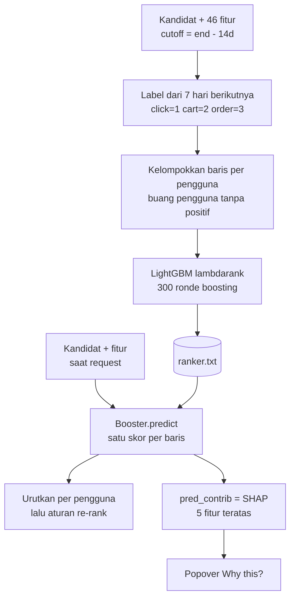
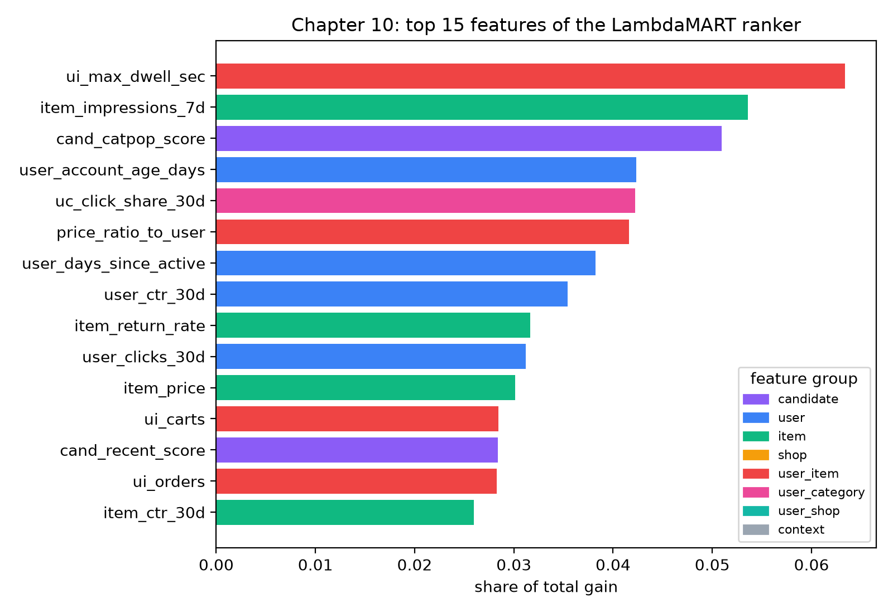
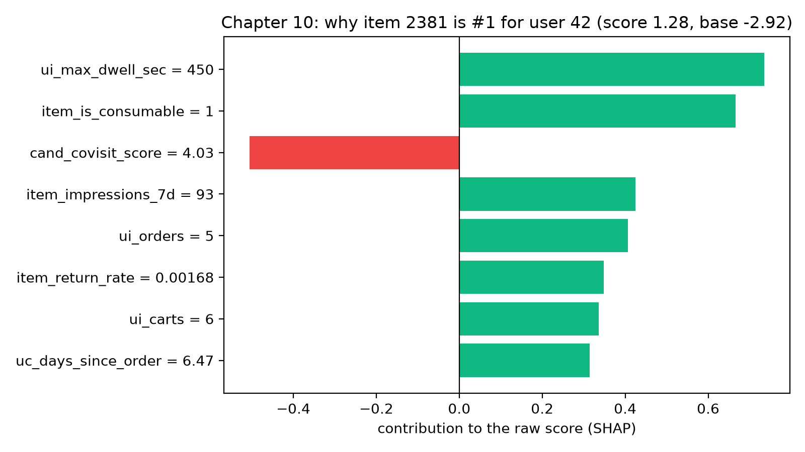
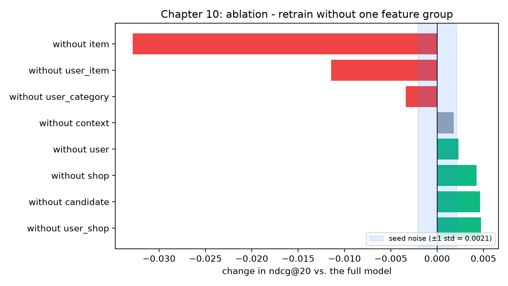

# Learning to rank

Dina adalah *ranking engineer* di tim sebuah marketplace. Senin pagi ia membuka tiket yang berbunyi: "Home feed aneh. Kita menampilkan ketel di urutan pertama kepada pengguna yang baru kemarin membeli ketel, dan casing ponsel di slot 9 untuk orang yang seminggu penuh menatap casing ponsel." Tidak ada yang salah dengan tahap retrieval. Pembangkit kandidat (*candidate generator*) dari bab-bab sebelumnya sudah bekerja dengan baik: produk yang tepat memang ada di suatu tempat dalam kumpulan sekitar seratus kandidat untuk pengguna itu. Masalahnya ada pada *urutan*. Kumpulan itu tiba dalam urutan sesuai retriever mana pun yang kebetulan menemukan item lebih dulu, padahal halaman hanya punya ruang untuk beberapa slot teratas bagi setiap pengguna.

Solusi sementara timnya adalah rumus tulisan tangan yang masih ada di repo sebagai `pipeline.heuristic_score`: menormalkan tiga skor retriever per pengguna lalu menjumlahkannya. Bab ini mengganti jalan pintas itu dengan algoritma pembelajaran: 46 fitur (*feature*) per pasangan `(user, item)` (Bab 9), label bertingkat (*graded labels*) dari tujuh hari berikutnya, dan sebuah model yang menaruh item terbaik di urutan pertama. Di akhir bab, Anda akan membuka model di balik *popover* "Why this?" pada aplikasi.

**Apa yang akan Anda pelajari**

- Tiga keluarga tujuan pelatihan *learning-to-rank* (pointwise, pairwise, listwise) dan kapan masing-masing masuk akal.
- Cara kerja *gradient-boosted decision tree* dari prinsip dasar, dengan contoh kecil satu *split* dan satu putaran residual.
- Apa yang ditambahkan LambdaMART di atas *boosting*: gradien *lambda* dan *delta* pertukaran NDCG.
- Bagaimana `ranker.train` milik repo mengonfigurasi LightGBM, termasuk label bertingkat dan tabel `label_gain`.
- Cara membaca *feature importance*, kontribusi SHAP, dan ablasi kelompok fitur, serta cara agar tidak tertipu oleh derau *seed*.
- Hasil yang jujur: pada dataset simulasi kecil ini, model pointwise biasa mendapat skor *sedikit lebih tinggi* daripada LambdaMART, dan mengapa hal itu terjadi.

## Intuisi: mengurutkan berdasarkan skor yang dipelajari seseorang

Bayangkan seorang perekrut yang menyusun daftar pendek kandidat. Perekrut junior mengikuti daftar periksa yang bersifat aditif (heuristic blend kita); perekrut senior punya naluri non-aditif yang dipelajari dari ribuan perekrutan. Learning to rank mengekstrak penilaian itu dari hasil-hasil historis. Dua pertanyaan dapat dipelajari dari riwayat yang sama: "seberapa besar peluang kandidat ini diterima?" (sebuah probabilitas) dan "di antara dua orang ini, siapa yang didahulukan?" (sebuah urutan). Perekrut dengan lima slot wawancara hanya memerlukan yang kedua. Literatur ranking memiliki tiga keluarga:

| Keluarga | Model dilatih untuk… | Loss melihat | Contoh |
|---|---|---|---|
| **Pointwise** | memprediksi label setiap baris secara terpisah | satu baris | regresi logistik, `objective="binary"` |
| **Pairwise** | menaruh item yang lebih relevan di atas item yang kurang relevan | pasangan baris dari pengguna yang sama | RankNet, Ranking SVM |
| **Listwise** | langsung memperbaiki metrik tingkat daftar seperti NDCG | seluruh daftar untuk satu pengguna | LambdaMART, `objective="lambdarank"` |

Karena NDCG@20 (Bab 2) adalah metrik tingkat daftar yang mendiskon slot-slot bawah, metode listwise seharusnya menjadi pilihan yang alami. Praktiknya ternyata tidak serapi itu.

Alur keseluruhan tahap ini di repo tampak seperti berikut.



*Gambar: bagaimana ranker dilatih secara offline dan dipakai saat serving, termasuk jalur penjelasan SHAP.*

## Algoritma

Kita akan menyusun bagian-bagiannya secara berurutan: pertama *gradient boosting* biasa, lalu *lambda* yang mengubahnya menjadi ranker, lalu label bertingkat yang memberi tahu model apa arti "bagus".

### Langkah 1: regression tree dan satu split

*Decision tree* mengubah satu baris fitur menjadi angka dengan mengajukan serangkaian pertanyaan ya/tidak. Pohon *regresi* menyimpan sebuah angka di setiap daun. Melatihnya berarti memilih, di setiap simpul, pertanyaan (fitur dan ambang) yang membuat baris-baris di tiap sisi sesama mirip sebisa mungkin. "Mirip" diukur dengan jumlah kuadrat galat (*sum of squared errors*, SSE) di sekitar rerata tiap sisi.

Ambil set pelatihan mainan berisi enam baris kandidat untuk satu fitur, `ui_max_dwell_sec` (waktu terlama pengguna bertahan di halaman item ini), beserta label bertingkatnya.

(detik dwell, label) = (0, 0), (0, 0), (5, 0), (30, 1), (60, 2), (90, 3), satu baris masing-masing, bernomor 1 sampai 6.

Boosting dimulai dari prediksi konstan, yaitu rerata label: $F_0 = (0+0+0+1+2+3)/6 = 1.0$. **Residual** setiap baris adalah sisa yang belum terjelaskan, $r_i = y_i - F_0$, yang menghasilkan $-1, -1, -1, 0, 1, 2$. Jumlah kuadratnya adalah $1+1+1+0+1+4 = 8$.

Sekarang kita coba kandidat split pada waktu dwell dan menilai masing-masing dari seberapa besar SSE yang dihilangkan. Untuk split menjadi himpunan kiri $L$ dan kanan $R$ dengan residual $r$,

$$\text{SSE}(S) = \sum_{i\in S}\bigl(r_i - \bar r_S\bigr)^2, \qquad \text{gain} = \text{SSE}(\text{all}) - \text{SSE}(L) - \text{SSE}(R).$$

| split | baris kiri | baris kanan | SSE(L) | SSE(R) | gain |
|---|---|---|---|---|---|
| dwell ≤ 2.5 | 1, 2 | 3–6 | 0 | 5.0 | 3.0 |
| dwell ≤ 17.5 | 1–3 | 4–6 | 0 | 2.0 | 6.0 |
| **dwell ≤ 45** | 1–4 | 5, 6 | 0.75 | 0.5 | **6.75** |
| dwell ≤ 75 | 1–5 | 6 | 3.2 | 0 | 4.8 |

Split pemenangnya adalah `dwell ≤ 45`. Nilai daun adalah rerata residual di tiap sisi: $-0.75$ di kiri, $+1.5$ di kanan. Pohon seperti ini adalah "weak learner": satu pertanyaan, dua angka, dan jelas keliru untuk baris 4 dan 5 secara individual. Itu tidak masalah. Boosting tidak memerlukan satu pohon yang hebat; ia memerlukan ratusan pohon biasa-biasa saja yang masing-masing memperbaiki sebagian galat sebelumnya.

Kolom *gain* juga menjadi asal **feature importance** nanti: setiap kali sebuah fitur dipilih untuk split, gain split itu dikreditkan kepadanya. Menjumlahkan kredit itu atas semua split dari semua pohon lalu membaginya dengan total menghasilkan "porsi dari total gain" yang akan Anda lihat pada hasil.

### Langkah 2: boosting = pencocokan residual berulang

Aturan pembaruannya sederhana. Dengan laju pembelajaran (*learning rate*) $\eta$ (LightGBM menyebutnya `learning_rate`), prediksi setiap baris digeser sebagian jarak menuju nilai daun pohonnya:

$$F_m(x) = F_{m-1}(x) + \eta\, h_m(x).$$

Ambil $\eta = 0.5$ untuk contoh satu ronde. Baris 1–4 jatuh ke kiri dan bergeser sebesar $0.5 \times (-0.75) = -0.375$, dari $1.0$ menjadi $0.625$. Baris 5 dan 6 bergeser sebesar $0.5 \times 1.5 = +0.75$, menjadi $1.75$. Residual barunya adalah:

Baris 1-3 kini punya residual -0.625, baris 4 punya +0.375, baris 5 punya +0.25 dan baris 6 punya +1.25. Total galat kuadrat turun dari 8 menjadi $3\times 0.3906 + 0.1406 + 0.0625 + 1.5625 \approx 2.94$. Pohon berikutnya dilatih pada residual baru ini, dan seterusnya. Setelah 300 ronde dengan $\eta$ kecil, model telah mengambil 300 langkah koreksi kecil.

Lalu mengapa disebut "gradient" boosting? Untuk galat kuadrat, residual $y - F$ persis sama dengan gradien negatif dari $\tfrac12 (y-F)^2$ terhadap prediksi $F$. Wawasan Friedman adalah bahwa Anda dapat memasukkan loss *apa pun* yang dapat diturunkan, lalu mencocokkan setiap pohon baru dengan gradien negatif loss itu. Ganti galat kuadrat dengan log-loss dan Anda mendapat pengklasifikasi; ganti dengan loss ranking dan Anda mendapat ranker.

::: fact
**Boosting adalah gradient descent dalam ruang fungsi.** Makalah Jerome Friedman tahun 2001, "Greedy function approximation: A gradient boosting machine", membingkai boosting sebagai gradient descent bertahap pada loss apa pun yang dapat diturunkan, dengan setiap pohon baru dicocokkan ke gradien negatif loss pada prediksi saat ini. Satu gagasan itulah yang membuat pustaka yang sama dapat melatih regressor, classifier, dan ranker hanya dengan mengganti objektifnya.

Sumber: Friedman, Annals of Statistics, 2001
:::

### Langkah 3: dari galat per baris ke kualitas per daftar

Objektif pointwise (misalnya log-loss pada "apakah baris ini diklik atau lebih?") memperlakukan setiap baris sebagai contoh yang independen. Ia dengan senang hati menghabiskan kapasitas model untuk menebak probabilitas item ke-95 dengan tepat. Padahal halaman Dina hanya menampilkan 20 posisi teratas, dan NDCG mendiskon posisi-posisi akhirnya dengan kuat.

Ingat dari Bab 2, dengan relevansi bertingkat $rel_i$ pada posisi $i$:

$$\text{DCG@}K = \sum_{i=1}^{K} \frac{2^{rel_i}-1}{\log_2(i+1)}, \qquad \text{NDCG@}K = \frac{\text{DCG@}K}{\text{IDCG@}K},$$

dengan IDCG adalah DCG dari urutan yang sempurna. Pembilang $2^{rel}-1$ adalah **gain**: relevansi 0, 1, 2, 3 menghasilkan gain 0, 1, 3, 7. Satu order bernilai tujuh klik. Penyebutnya adalah **discount**: posisi 1 berbobot $1$, posisi 2 berbobot $0.631$, posisi 3 berbobot $0.5$, dan seterusnya.

NDCG bergantung pada *urutan terurut*, yang tidak dapat diturunkan, sehingga kita tidak bisa mengambil gradiennya. Trik LambdaRank (Burges, 2010) bersifat pragmatis: *lewati loss, definisikan gradiennya secara langsung*.

### Langkah 4: lambda dan pertukaran NDCG

Mulailah dengan loss pairwise, seperti pada RankNet. Untuk dua item $i$ dan $j$ dari pengguna yang sama, dengan $i$ lebih relevan, skor model saat ini adalah $s_i$ dan $s_j$. Probabilitas yang diberikan model untuk "$i$ berada di atas $j$" adalah fungsi logistik dari selisih skor, dan loss pairwise mendorong $s_i - s_j$ membesar. Gradiennya terhadap $s_i$ adalah

$$\lambda_{ij} = \frac{-\sigma}{1 + e^{\sigma (s_i - s_j)}}.$$

Ketika $i$ sudah jauh di atas $j$, penyebutnya sangat besar dan dorongannya lenyap. Ketika $i$ keliru berada di bawah $j$, $s_i - s_j$ negatif, penyebutnya mendekati 1, dan dorongannya mendekati maksimum $\sigma$. Sejauh ini ini hanyalah logika pairwise biasa: semua pasangan yang salah urutan sama mendesaknya.

Langkah LambdaRank adalah **mengalikannya dengan perubahan NDCG yang akan terjadi bila kedua item ditukar**:

$$\lambda_{ij} = \frac{-\sigma}{1 + e^{\sigma (s_i - s_j)}}\; \bigl|\Delta \text{NDCG}_{ij}\bigr|.$$

Menukar item pada posisi $p_i$ dan $p_j$ mengubah DCG sebesar $(g_i - g_j)\,(d_{p_i} - d_{p_j})$ dalam nilai mutlak, dengan $g$ adalah gain dan $d_p = 1/\log_2(p+1)$ adalah discount. Membaginya dengan IDCG menghasilkan $|\Delta\text{NDCG}|$. Pasangan yang salah urutan *dan* berada di puncak daftar dengan selisih gain besar mendapat lambda besar. Pasangan yang salah urutan di posisi 80 dan 81, atau yang gain-nya sama, nyaris tidak mendapat apa-apa. Begitulah algoritma "memperhatikan" puncak daftar tanpa pernah menurunkan NDCG.

Lambda setiap baris dijumlahkan atas semua pasangannya, bertanda positif untuk anggota yang lebih relevan dan negatif untuk yang kurang relevan. Lambda ini menggantikan gradien negatif ketika mencocokkan pohon berikutnya: itulah **LambdaMART** (**MART**, *multiple additive regression trees*, adalah nama lama untuk gradient-boosted tree).

### Contoh hitung delta pertukaran

Ambil tiga kandidat untuk satu pengguna, saat ini berurutan $A, B, C$ dengan label bertingkat 0, 3, 1. Gain-nya adalah $0, 7, 1$.

- $\text{DCG} = 0\cdot 1 + 7\cdot 0.631 + 1\cdot 0.5 = 4.917$.
- Urutan ideal adalah $B, C, A$, sehingga $\text{IDCG} = 7\cdot 1 + 1\cdot 0.631 = 7.631$.
- $\text{NDCG} = 4.917/7.631 = 0.644$.

Menukar $A$ dan $B$ (posisi 1, 2) mengubah NDCG sebesar $7\times(1-0.631)/7.631 = 0.339$; menukar $A$ dan $C$ (posisi 1, 3) hanya sebesar $1\times 0.5/7.631 = 0.066$. Kesalahan pertama, item yang tak pernah diklik berada di atas item tingkat order, lima kali lebih penting. Sekarang anggaplah skor mentah model adalah $s_A = 2.0$ dan $s_B = 1.0$ dengan $\sigma = 1$. Untuk pasangan "$B$ seharusnya di atas $A$", $s_B - s_A = -1$, sehingga faktor logistiknya $1/(1+e^{-1}) = 0.731$. Besar lambda untuk pasangan itu adalah $0.731 \times 0.339 = 0.248$: dorongan ke atas yang tegas pada $B$ dan dorongan ke bawah yang sama besar pada $A$. Untuk pasangan $(C, A)$ dengan faktor logistik yang sama, besarnya hanya $0.731\times 0.066=0.048$. Karena itu pohon berikutnya akan mencurahkan sebagian besar upaya split-nya pada fitur yang membedakan $B$ dari $A$.

::: fact
**LambdaMART memenangi Yahoo! Learning to Rank Challenge.** Sistem yang memenangi Track 1 dari Yahoo! Learning to Rank Challenge (2010) adalah ensemble model gradien-lambda, yang dibangun di atas boosted tree yang dilatih dengan gradien ala LambdaRank. Makalah tinjauan Chris Burges sebelumnya, "From RankNet to LambdaRank to LambdaMART", adalah rujukan standar tentang bagaimana ketiga algoritma itu saling terkait.

Sumber: Burges et al., Proceedings of the Learning to Rank Challenge (PMLR), 2011
:::

### Langkah 5: label bertingkat

Di repo ini label bukan sekadar 0 atau 1. `schema.LABEL_GAIN` menyatakan bahwa klik bernilai 1, add-to-cart bernilai 2, dan order bernilai 3. Jika pengguna melakukan beberapa hal pada item yang sama dalam jendela label, `data.labels` menyimpan yang *terkuat*. Ini penting dalam dua hal:

1. Model diberi imbalan karena menaruh item yang dipesan pengguna di atas item yang hanya diklik.
2. Parameter `label_gain=[0, 1, 3, 7]` di LightGBM mengubah label bilangan bulat menjadi gain $2^{rel}-1$ yang dipakai dalam NDCG. Tabel bawaan LightGBM kebetulan sama, yaitu $2^{rel}-1$ untuk label-label ini, tetapi menuliskannya secara eksplisit di `PARAMS` menjaga agar objektif dan evaluator offline tidak diam-diam menyimpang; artinya objektif yang dioptimalkan dan metrik yang dilaporkan adalah fungsi yang sama.

Pengguna tanpa positif dalam jendela tidak membawa informasi urutan (semua $|\Delta\text{NDCG}|$ mereka bernilai 0), sehingga `ranker.train` membuangnya.

## Penjelasan kode

### Ranker itu sendiri

Seluruh konfigurasi LambdaMART berada di kamus `PARAMS` di bagian atas `recommender/recsys/ranker.py` (ditambah konstanta `NUM_ROUNDS`):

| Parameter | Nilai | Peran |
|---|---|---|
| `objective` | `lambdarank` | gradien lambda (Langkah 4) |
| `learning_rate` | 0.05 | ukuran langkah $\eta$ |
| `num_leaves` | 31 | batas ukuran pohon |
| `min_data_in_leaf` | 50 | jumlah baris minimum per daun |
| `bagging_fraction` / `bagging_freq` | 0.8 / 1 | sampel baris 80% yang baru untuk tiap pohon |
| `feature_fraction` | 0.8 | sampel kolom 80% per pohon |
| `label_gain` | `[0, 1, 3, 7]` | gain untuk label 0..3 |
| `lambdarank_truncation_level` | 20 | fokus pada 20 teratas |
| `NUM_ROUNDS` | 300 | jumlah pohon |


Langkah kecil dengan banyak ronde menggeneralisasi lebih baik daripada sedikit langkah besar. LightGBM menumbuhkan pohon secara *leaf-wise*, sehingga `num_leaves` (bukan kedalaman) yang mengendalikan kompleksitas, dan `min_data_in_leaf` mencegah sebuah daun menghafal satu pengguna. Bagging dan pengambilan sampel fitur menyuntikkan keacakan, itulah sebabnya `seed` mengubah hasil (lihat ablasi). Pemotongan pada 20 sesuai dengan `K = 20`: pasangan yang jauh di dalam daftar memiliki $|\Delta\text{NDCG}|$ yang dapat diabaikan.

::: fact
**LightGBM cepat karena mengerjakan lebih sedikit per split.** Makalah LightGBM memperkenalkan Gradient-based One-Side Sampling, yang melewati sebagian besar baris bergradien kecil saat memperkirakan gain split, dan Exclusive Feature Bundling, yang menggabungkan fitur jarang yang hampir tidak pernah bernilai bukan-nol secara bersamaan. Pada dataset publik yang diuji penulisnya, ini mempercepat pelatihan gradient-boosted tree konvensional hingga lebih dari 20 kali dengan akurasi yang nyaris sama.

Sumber: Ke et al., NeurIPS, 2017
:::

Pelatihan hanya memerlukan delapan baris. Bacalah fungsi ini pelan-pelan: strukturnya menyandikan semua yang diinginkan LightGBM dari data ranking.

```include
path: recommender/recsys/ranker.py
symbol: train
```

Ada tiga hal yang perlu diperhatikan. Pertama, mask `has_pos` hanya menyimpan pengguna yang punya setidaknya satu positif dalam jendela label; sisanya dibuang. Kedua, `sort_values("user_id", kind="stable")` menempatkan baris-baris tiap pengguna berdampingan, karena argumen `group=` milik LightGBM adalah daftar *ukuran grup yang berurutan*, bukan id pengguna. Jika baris tidak berdampingan, batas grup akan diam-diam memotong pengguna yang salah dan model akan berlatih pada data sampah tanpa memunculkan galat apa pun. Ketiga, seed dapat disuntikkan: `train(frame, names, seed)` inilah yang memungkinkan ablasi melatih ulang model yang sama dengan seed acak berbeda.

### Melatih dan mengevaluasi dari ujung ke ujung

`pipeline.train_and_evaluate` menyatukan pemisahan data dari Bab 2, pembangun frame dari Bab 9, dan ranker di atas:

```include
path: recommender/recsys/pipeline.py
symbol: train_and_evaluate
```

Telusuri secara berurutan. Kedua cutoff berada 14 dan 7 hari sebelum `end`. Frame pelatihan dibangun per `end - 14d`, dan labelnya berasal dari 7 hari berikutnya. Frame evaluasi dibangun per `end - 7d`, dengan label dari 7 hari terakhir; model tidak pernah melihatnya. Ranker dilatih hanya pada frame pertama, dan dinilai pada frame kedua.

Kamus `results` membandingkan empat metode pada frame evaluasi yang sama, memakai fungsi `evaluate.metrics` yang sama. "global popular" adalah baseline Bab 3. "heuristic blend" adalah rumus tulisan tangan Dina. "lightgbm ranker" adalah yang baru saja kita latih. "lightgbm + rerank" menerapkan aturan bisnis dari Bab 11 di atasnya. Tanpa baris-baris ini dalam tabel yang sama, model ML tidak punya tolok ukur, dan sebuah model bisa saja dirilis padahal tidak lebih baik daripada blend bila tak seorang pun memeriksanya.

Service, di `recommender/recsys/service.py`, memanggil mesin `retrain` yang sama menurut jadwal timer dan lewat tombol admin, sehingga yang Anda baca di sini adalah kode yang benar-benar berjalan di produksi untuk repo ini.

### Menjelaskan skor dengan SHAP

Model boosted adalah jumlah dari 300 pohon. Satu prediksi melewati semuanya, sehingga membaca pohon secara langsung tidak ada harapan. Nilai **SHAP** (Lundberg dan Lee, 2017) mengatasi ini dengan gagasan dari teori permainan kooperatif: perlakukan fitur sebagai pemain dalam permainan yang hadiahnya adalah skor model. Nilai Shapley sebuah fitur adalah rerata kontribusi marginalnya atas semua urutan kemungkinan penambahan fitur. Untuk satu baris, kontribusi semua fitur ditambah skor dasar (*base score*) berjumlah *persis* sama dengan keluaran mentah model.

Menghitung nilai Shapley secara naif memerlukan himpunan bagian fitur dalam jumlah eksponensial. Untuk ensemble pohon ada algoritma eksak yang cepat, dan LightGBM mengimplementasikannya di balik satu flag, `pred_contrib=True`. Repo membungkusnya:

```include
path: recommender/recsys/ranker.py
symbol: contributions
```

`model.predict(x, pred_contrib=True)` mengembalikan matriks dengan satu kolom per fitur ditambah satu kolom terakhir yang memuat **bias**, yaitu keluaran rerata model ketika ia tidak tahu apa-apa tentang baris tersebut. Irisan `[:, :-1]` membuang kolom terakhir itu, sehingga yang tersisa adalah kontribusi murni per fitur. Untuk setiap baris kita lalu mengurutkan fitur berdasarkan $|\text{contribution}|$ dan menyimpan `top` teratas sebagai triplet `(name, value, contribution)`. Service gRPC memanggil ini di `recommend_rpc` dan menaruh lima teratas di setiap respons; API Rust meneruskannya tanpa diubah, dan `WhyThis.vue` menggambarkannya sebagai batang.

::: fact
**SHAP eksak untuk pohon berjalan dalam waktu polinomial.** Makalah TreeExplainer menyajikan algoritma waktu polinomial pertama untuk menghitung penjelasan optimal berbasis teori permainan bagi model berbasis pohon seperti random forest dan gradient-boosted tree. Sebelumnya, nilai Shapley eksak memerlukan pencacahan himpunan bagian fitur yang jumlahnya eksponensial, sehingga tidak praktis untuk model dengan puluhan fitur dan ratusan pohon.

Sumber: Lundberg et al., Nature Machine Intelligence, 2020
:::

## Jalankan

Skrip pendamping melatih tiga ranker pada frame kandidat yang persis sama, menjalankan pemeriksaan empat seed, mencetak importance dan rincian SHAP, serta menjalankan ablasi kelompok. Dari direktori `book/`:

```bash
uv run python code/ch10_ltr.py
```

Skrip membangun frame pelatihan (cutoff 14 hari sebelum akhir) dan frame evaluasi (7 hari sebelum akhir) satu kali, lalu memakainya kembali untuk setiap model. Blok pertama membandingkan ketiga urutan.

```output
file: results/ch10_ltr.txt
lines: 1-9
```

Bacalah tabel dari atas ke bawah. Heuristic blend mencapai ndcg@20 sebesar 0.1674. Kedua model terlatih mencapai 0.2146 (pointwise) dan 0.2116 (LambdaMART): sekitar 26–28% lebih tinggi, dari kandidat dan label yang sama. Baris terakhir, 0.4645, adalah *batas atas recall kandidat* (*candidate recall ceiling*), yaitu fraksi positif sebenarnya milik pengguna yang memang ada dalam kumpulan kandidat. Recall@20 dari ranker mana pun dibatasi olehnya. Recall@20 LambdaMART sebesar 0.2725 adalah 59% dari yang dapat dicapai oleh pengurutan ulang oracle atas kumpulan yang sama.

## Hasil

### Pointwise versus LambdaMART: perbandingan yang jujur

Blok kedua keluaran adalah yang dilewatkan banyak tutorial ranking. Sebuah LightGBM pointwise (`objective="binary"`, label = "apakah ada aksi positif?") dilatih pada baris yang sama dengan hyperparameter yang sama, dan kedua model dilatih ulang dengan empat seed acak berbeda.

```output
file: results/ch10_ltr.txt
lines: 11-20
```

Model pointwise unggul pada setiap seed. Rerata ndcg@20 adalah 0.2147 berbanding 0.2125, selisih 0.0022, dan simpangan baku antar seed adalah 0.0014 untuk pointwise dan 0.0021 untuk LambdaMART. Selisih itu dengan demikian sekitar satu simpangan baku seed: tandanya konsisten pada keempat seed, tetapi kecil. Pointwise juga unggul pada recall@5 (0.1577 berbanding 0.1503) dan recall@10 (0.2176 berbanding 0.2015). Coverage@20 LambdaMART, yaitu porsi katalog yang muncul di 20 teratas seseorang, adalah yang terendah dari ketiganya (0.4245, dibandingkan 0.4777 untuk pointwise dan 0.5682 untuk heuristic blend).

Ini bertentangan dengan prinsip bahwa objektif listwise cocok untuk metrik tingkat daftar. Alasan yang masuk akal:

1. **Sedikit positif per daftar.** Sekitar seratus kandidat dan segelintir positif menghasilkan sedikit pasangan yang informatif; label pointwise biner adalah sinyal yang lebih sederhana yang langsung dipelajari pohon.
2. **Batas atas yang rendah.** Dengan recall kandidat 0.4645, ruang untuk keuntungan dari ranking kecil, sehingga dua ranker yang baik berakhir berdekatan.
3. **Label bertingkat yang berderau.** Order jarang terjadi dan bergantung pada suasana hati dan stok; `label_gain` memperkuat derau persis itu bagi LambdaMART.

Semua ini tidak menjadikan LambdaMART pilihan yang salah. Selisihnya sekitar satu simpangan baku seed, pada dataset yang jauh lebih kecil daripada hasil-hasil yang dipublikasikan, dan Anda tidak akan meluncurkan produk berdasarkan itu. Yang tak terbantahkan adalah selisih terhadap heuristic blend: kedua model terlatih mengalahkannya sekitar 0.045 ndcg@20. Repo mempertahankan `lambdarank` karena ia semestinya meningkat seiring data dan menangani label bertingkat; jika A/B test Anda berkata lain, `objective="binary"` adalah perubahan satu baris. Pelajarannya ada pada prosesnya: *simpan baseline sederhana di dalam tabel dan jalankan ulang dengan beberapa seed sebelum menyatakan pemenang.*

### Apa yang dipelajari model? Feature importance

Pertanyaan paling sederhana untuk model boosted adalah fitur mana yang paling banyak ia pakai. LightGBM dapat melaporkan total gain per fitur (jumlah gain split dari Langkah 1). `ranker.importance` menormalkan gain menjadi porsi yang berjumlah satu.

`ranker.importance` menormalkan total gain per fitur menjadi porsi yang berjumlah satu. Grafik menampilkan 15 fitur teratas; keluaran memberikan porsi gain per kelompok.

```output
file: results/ch10_ltr.txt
lines: 39-48
```



Importance-nya *tersebar*: fitur teratas, `ui_max_dwell_sec`, hanya memiliki 6.3% gain. Menurut kelompok, fitur **item** memimpin (0.309), lalu user-item (0.198), user (0.189) dan candidate (0.134); **context** mendapat 0.004. Satu peringatan: gain importance menggambarkan bagaimana pohon dibangun, bukan seberapa besar model akan menderita tanpa suatu fitur; fitur yang berkorelasi berbagi kredit, dan fitur dengan banyak nilai berbeda mendapat lebih banyak kesempatan split. Ablasi memperlihatkan ketidaksesuaian itu.

### Why this? Satu prediksi di bawah mikroskop

Importance merata-ratakan seluruh prediksi; SHAP menjelaskan satu prediksi. Skrip menilai 106 kandidat untuk pengguna 42 dan mencetak kontribusi item teratas (id 2381):

```output
file: results/ch10_ltr.txt
lines: 50-63
```

Skor mentahnya 1.277 dan bias (baseline untuk kandidat yang biasa-biasa saja) adalah -2.917; baris-baris terakhir mengonfirmasi sifat aditif: kontribusi ditambah bias sama dengan skor model. Delapan kontribusi terbesar berjumlah sekitar +2.73, sehingga 38 fitur lainnya menambahkan sisa +1.47.



Membaca grafik sebagai cerita: pengguna 42 bertahan pada item ini selama 450 detik (+0.735), item ini adalah barang habis pakai (+0.666), memiliki banyak impresi baru-baru ini (+0.425), dan pengguna memesannya lima kali serta memasukkannya ke keranjang enam kali (+0.407, +0.336). Satu batang negatif ini sangat instruktif: `cand_covisit_score` = 4.03 *menurunkan* skor sebesar 0.505, karena item yang ditemukan hanya lewat co-visitation adalah taruhan yang lebih lemah daripada bukti langsung dari pengguna ini. Jumlah skor retriever tulisan tangan tidak dapat mengungkapkan hal itu.

Popover "Why this?" pada aplikasi (`WhyThis.vue`, tangkapan layar di Bab 13) menampilkan kontribusi ini untuk model yang hidup; baris sumbernya berasal dari `pipeline.source_of`.

### Ablasi: kelompok fitur mana yang penting, dan dibandingkan dengan apa?

Importance bertanya tentang model yang sudah dilatih. **Ablasi** (*ablation*) mengajukan pertanyaan kontrafaktual: andaikan kita tidak pernah memiliki fitur-fitur ini, apakah modelnya akan lebih buruk? Anda menjawabnya dengan melatih ulang. `pipeline.group_ablation` menghapus satu kelompok fitur pada satu waktu, melatih ulang dengan pengaturan yang sama, dan melaporkan perubahan tiap metrik terhadap model penuh.

`pipeline.group_ablation` melatih ulang tanpa tiap kelompok fitur, dan juga melatih ulang model *penuh* dengan seed 1, 2 dan 3. Simpangan baku mereka adalah **noise floor** (batas derau): delta yang lebih kecil darinya tidak memberi tahu apa-apa, karena seed lain dapat membalik tandanya.

```output
file: results/ch10_ltr.txt
lines: 66-75
```



Derau seed pada ndcg@20 adalah 0.0021 (pita berarsir). Bandingkan perubahan ndcg@20 tiap baris dengan pita itu:

- **tanpa item: −0.0328.** Lima belas kali derau. Kelompok item (harga, popularitas, CTR, tingkat retur, stok, dan seterusnya) adalah bukti paling berharga, dan tidak ada kelompok lain yang dapat menggantikannya.
- **tanpa user_item: −0.0114.** Sekitar lima kali derau. Apa yang dilakukan pengguna ini pada item ini penting, dan kelompok lain tidak menggantikannya.
- **tanpa user_category: −0.0034.** Melampaui pita derau pada ndcg, dan jelas melampauinya pada recall@20 (−0.0159 berbanding derau 0.0021), sehingga kita menghitungnya sebagai kontribusi yang nyata, meski lebih kecil.
- **context, user, shop, candidate, user_shop:** delta antara +0.0018 dan +0.0047. Nilai-nilai ini *positif*, artinya model tanpa kelompok-kelompok ini mendapat skor *lebih tinggi*, dan semuanya berada dalam kisaran sekitar dua simpangan baku derau dari nol. Pembacaan yang jujur adalah "tidak ada bukti bahwa mereka membantu pada data ini", bukan "menghapusnya memperbaiki model".

Bandingkan dengan gain importance: kelompok candidate memiliki 13.4% gain dan kelompok user 18.9%, namun menghapus salah satunya tidak merugikan, karena fitur yang berkorelasi (bukti user-item menggemakan skor retriever) mengambil alih. Gain importance tidak pernah mengungkapkan hal itu.

## Jebakan dan praktik produksi

- **Kebocoran (*leakage*).** Sebuah fitur bocor menaikkan ndcg@20 offline dari 0.2116 yang jujur menjadi 0.5035 di Bab 9. Bangun fitur per cutoff lewat `History.at` dan pertahankan `tests/test_point_in_time.py`.
- **Batas grup.** `group=` milik LightGBM adalah daftar ukuran berurutan; baris yang tidak terurut berjalan tanpa peringatan dan melatih sampah. Urutkan dulu, seperti yang dilakukan `ranker.train`.
- **Skor tidak punya skala.** Jangan menerapkan ambang pada skor LambdaMART atau mencampurnya dengan probabilitas; gunakan model pointwise atau kalibrasi bila probabilitas diperlukan.
- **Desain label adalah desain produk.** Tabel click 1 / cart 2 / order 3 adalah opini bisnis; tim produksi sering melatih beberapa *head* terpisah lalu menggabungkannya (Bab 14).
- **Retrain sebagai deploy.** Service melatih ulang setiap enam jam dan dari tombol admin; tolak menukar dengan model yang lebih buruk daripada baseline heuristik.
- **Penjelasan bukan sebab-akibat.** Batang SHAP hanya menyatakan bahwa sebuah nilai mendorong skor naik relatif terhadap baseline, tidak lebih.

## Ringkasan

- Learning to rank mengubah kumpulan kandidat dan fiturnya menjadi sebuah urutan. Metode pointwise memprediksi label tiap baris, metode pairwise mengurutkan pasangan, metode listwise menargetkan metrik daftar seperti NDCG.
- Gradient boosting membangun model sebagai jumlah pohon kecil, masing-masing dicocokkan dengan residual (gradien negatif) ensemble saat ini; gain sebuah split adalah SSE yang dihilangkannya.
- LambdaMART mengganti gradien NDCG yang tak dapat dipakai dengan *lambda*: dorongan logistik pairwise yang diskalakan oleh perubahan NDCG $|\Delta\text{NDCG}|$ yang akan terjadi bila pasangan ditukar, sehingga kesalahan di dekat puncak dengan selisih gain besar mendominasi.
- `ranker.PARAMS` milik repo memakai `lambdarank`, 300 ronde dengan learning rate 0.05, `label_gain=[0, 1, 3, 7]` untuk label bertingkat click/cart/order, dan pemotongan pada 20. Baris harus dikelompokkan berdampingan per pengguna, dan pengguna tanpa positif dibuang.
- Kedua ranker terlatih mengalahkan heuristic blend dengan selisih lebar (ndcg@20 0.2146 dan 0.2116 dibandingkan 0.1674), tetapi di sini model pointwise sedikit mengungguli LambdaMART pada keempat seed, dengan selisih sekitar satu simpangan baku seed. Objektif yang sadar daftar baru terbayar dengan lebih banyak data per query.
- Gain importance tersebar (fitur teratas hanya 6.3%); ia memberi tahu bagaimana pohon dibangun, bukan apa yang dibutuhkan model.
- SHAP memberikan penjelasan per prediksi yang eksak dan aditif (kontribusi ditambah bias sama dengan skor) dan menggerakkan popover "Why this?" pada aplikasi lewat `ranker.contributions`.
- Ablasi kelompok fitur menjawab pertanyaan kontrafaktual, tetapi hanya delta yang lebih besar dari derau seed yang dihitung: di sini hanya kelompok item, user–item, dan user–category yang melampauinya.

## Kuis

**Q10.1** Pernyataan mana yang paling tepat membedakan learning to rank pointwise, pairwise, dan listwise?

A. Pointwise memakai pohon, pairwise memakai jaringan saraf, listwise memakai model linear.
B. Loss pointwise menilai setiap baris sendiri-sendiri, loss pairwise membandingkan dua item dari query yang sama, loss listwise melihat seluruh daftar terurut.
C. Metode pointwise memerlukan label bertingkat; metode pairwise dan listwise memerlukan label biner.
D. Metode pointwise dilatih secara online, yang lain secara offline.

**Q10.2** Pada gradient boosting dengan galat kuadrat, apa yang berusaha diprediksi oleh setiap pohon baru?

A. Label asli setiap baris.
B. Rerata label seluruh set pelatihan.
C. Residual ensemble saat ini, yaitu gradien negatif dari loss.
D. Fitur dengan gain tertinggi.

**Q10.3** Pada LambdaMART, mengapa setiap dorongan pairwise dikalikan dengan $|\Delta\text{NDCG}|$?

A. Agar loss dapat diturunkan.
B. Agar skor dapat dibandingkan antar pengguna.
C. Untuk mempercepat pelatihan dengan melewati pasangan.
D. Agar kesalahan urutan yang akan mengubah NDCG banyak (di dekat puncak, dengan selisih gain besar) dihitung lebih berat daripada yang hanya mengubahnya sedikit.

**Q10.4** `ranker.train` mengurutkan frame berdasarkan `user_id` dengan sort stabil sebelum membangun dataset LightGBM. Mengapa baris-baris satu pengguna harus berdampingan, dan apa yang salah jika tidak?

**Q10.5** Pada hasil kita, LightGBM pointwise mendapat skor ndcg@20 sedikit lebih tinggi daripada LambdaMART. Berikan dua alasan yang masuk akal, dan sebutkan bukti apa yang akan membuat Anda mengganti objektif produksi.

**Q10.6** Baca kode ini dari `recommender/recsys/ranker.py`:

```include
path: recommender/recsys/ranker.py
symbol: contributions
```

Mengapa fungsi ini mengiris matriks prediksi dengan `[:, :-1]`? Apa yang terjadi pada "penjelasan" jika irisan itu terlupa, dengan asumsi daftar kemudian diurutkan menurut $|\text{contribution}|$ untuk setiap baris?

**Q10.7** Kandidat seorang pengguna diberi peringkat dengan label bertingkat $1, 0, 3$ pada posisi 1, 2, 3 (gain $2^{rel}-1 = 1, 0, 7$). Dengan $d_p = 1/\log_2(p+1)$, hitung $|\Delta\text{NDCG}|$ untuk menukar item pada posisi 1 dan 3. Berikan tiga desimal.

**Q10.8** Untuk item yang dijelaskan dalam bab ini, skor model adalah 1.277 dan bias adalah −2.917. Kedelapan kontribusi yang ditampilkan berjumlah sekitar +2.726. Berapa kontribusi gabungan dari fitur-fitur sisanya?

**Q10.9** Sebuah ablasi melaporkan "tanpa user_category: −0.0034 ndcg@20" dan derau seed adalah ±0.0021 (satu simpangan baku). Kesimpulan mana yang paling didukung?

A. Menghapus kelompok itu berdampak pasti sebesar tepat −0.0034.
B. Kelompok itu tidak berguna karena efeknya di bawah 0.01.
C. Efeknya lebih besar daripada satu simpangan baku derau, sehingga ada bukti ringan bahwa kelompok itu membantu; memeriksa recall@20 atau lebih banyak seed akan memperkuat kesimpulan.
D. Hasilnya tidak bermakna karena delta-nya negatif.

**Q10.10** *Praktik langsung.* Di `book/code/ch10_ltr.py`, tepat sebelum baris `model = ranker.train(train)`, tambahkan `ranker.PARAMS["label_gain"] = [0, 1, 1, 1]` agar sebuah order bernilai tidak lebih dari sebuah klik, lalu jalankan ulang skrip. Amati `ndcg@20` dan `order_recall@20` untuk LambdaMART pada tabel pertama dan bandingkan dengan nilai di bab ini, dengan memakai simpangan baku seed (0.0021) sebagai tolok ukur apakah perubahan apa pun nyata. Kembalikan perubahan itu setelahnya.
