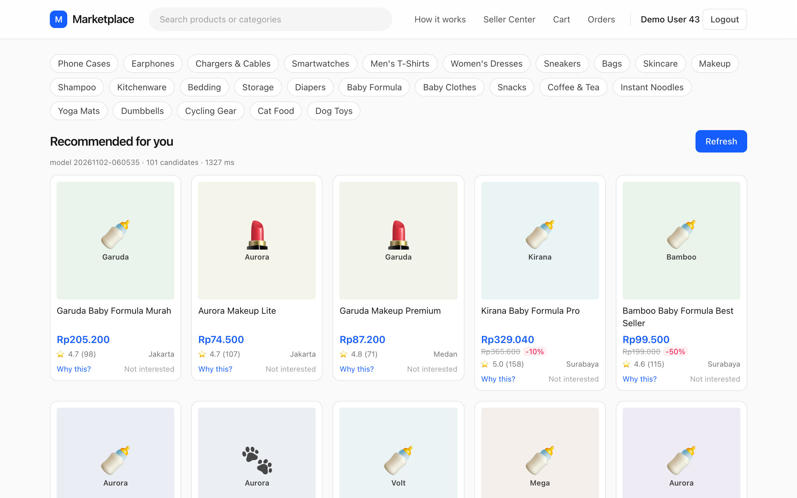
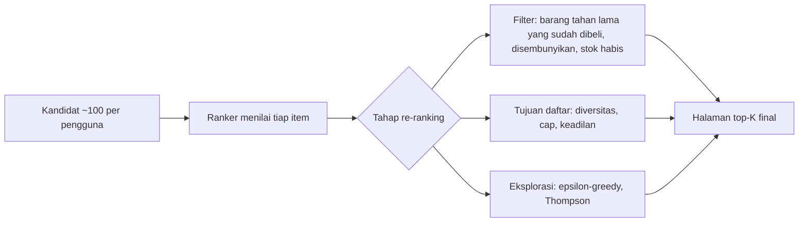
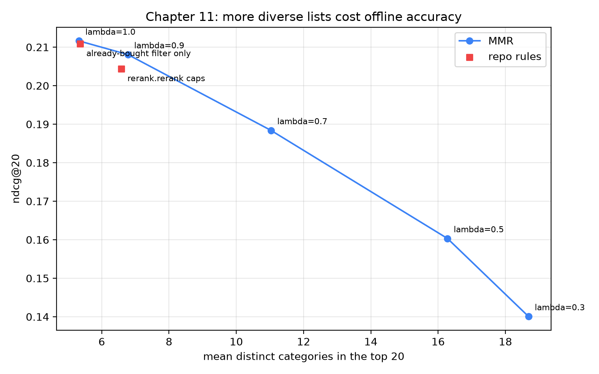

# Re-ranking, diversitas, dan aturan bisnis

## Halaman yang isinya susu formula semua

Bayangkan Anda membuka beranda aplikasi marketplace besar pada Selasa malam. Minggu lalu Anda membeli sebungkus popok dan mengeklik tiga kaleng susu formula untuk membandingkan harga. Sistem rekomendasi Anda tergolong bagus: pemeringkat (*ranker*) berbasis gradient boosting dari bab sebelumnya, dilatih dengan puluhan ribu contoh, dengan NDCG offline yang sehat. Ia membaca riwayat Anda dan menyimpulkan, dengan benar, bahwa Anda orang tua baru. Maka layar pertama berisi susu formula, susu formula, susu formula, botol bayi, susu formula lagi, dan satu lipstik yang nyasar di posisi lima.

Tidak ada yang *salah* dengan tiap kartu; masing-masing adalah taruhan yang masuk akal. Tetapi *halamannya* buruk. Kalau Anda ingin menjelajah, tidak ada yang bisa dijelajahi, dan kalau kemarin Anda membeli kulkas, halaman itu mungkin menawarkan tiga kulkas lagi. Ranker Anda menilai item satu per satu, dan ia tidak tahu bahwa dua puluh taruhan bagus yang mirip tidak bernilai dua puluh kali lipat satu taruhan.

Inilah tugas tahap terakhir pipeline: **re-ranking** (pemeringkatan ulang). Tahap ini menerima daftar yang sudah diberi skor lalu memperbaiki properti yang hanya ada pada level *seluruh daftar*: keragaman, keadilan antarpenjual, item yang tidak boleh muncul lagi, item yang wajib ditampilkan bisnis, dan sedikit keacakan yang disengaja agar sistem terus belajar. Kita akan melihat re-ranker di repo (beberapa baris pandas), lalu Maximal Marginal Relevance (MMR), mengukur berapa harga diversitas dalam akurasi offline, dan menutup dengan epsilon-greedy serta Thompson sampling.



### Yang akan Anda pelajari

- Mengapa model yang menilai item secara independen menghasilkan daftar yang buruk sebagai daftar, dan apa itu tujuan "level daftar" (*list-level objectives*).
- Bagaimana Maximal Marginal Relevance menyeimbangkan relevansi terhadap redundansi, lengkap dengan rumus dan contoh hitungan tangan.
- Bagaimana `rerank.rerank` di repo mengimplementasikan filter sudah-dibeli dan batas (*cap*) per kategori serta per toko dalam lima baris pandas.
- Berapa banyak akurasi offline yang dikorbankan tiap aturan ini pada data kita, memakai angka nyata dari skrip pendamping.
- Bagaimana keadilan bagi penjual, item bersponsor, dan dorongan (*boost*) manual masuk ke tahap re-ranking tanpa merusak ranker.
- Bagaimana epsilon-greedy dan Thompson sampling memilih item yang dieksplorasi, dengan contoh hitungan distribusi Beta.

## Intuisi: menata etalase toko, bukan memilih produk terbaik

Pikirkan cara pemilik toko menata etalase. Ia tidak mengurutkan stok berdasarkan margin keuntungan lalu memajang dua belas item teratas berjajar. Kalau dua belas produk terlaris semuanya sepatu lari, etalase itu berkata "kami jual sepatu lari", dan pejalan kaki yang butuh jaket akan lewat begitu saja. Ia memilih *himpunan* item yang bersama-sama menyampaikan sesuatu: sepatu, jaket, tas, hadiah. Setiap item di etalase sedikit lebih buruk daripada item terbaik yang bisa ia pilih untuk slot itu, tetapi *etalasenya* lebih baik, karena item-itemnya saling melengkapi, bukan saling menggandakan.

Beranda rekomendasi adalah sebuah etalase. Ranker di Bab 10 adalah pemilik toko yang mengurutkan berdasarkan margin. Ia menjawab "seberapa besar kemungkinan pengguna ini berinteraksi dengan item ini?" untuk tiap item secara independen, dan independensi itulah masalahnya: setelah Anda menampilkan satu kaleng susu formula, probabilitas bahwa kaleng kedua berguna tidak sama dengan probabilitas awalnya. Ekonom menyebutnya *diminishing marginal utility* (utilitas marjinal yang menurun); dalam information retrieval disebut *redundansi*.

Ada tiga keluarga logika re-ranking dan kita akan bertemu semuanya:

1. **Filter** membuang item yang tidak boleh muncul (sudah dibeli, disembunyikan, stok habis).
2. **Tujuan level daftar** seperti diversitas: nilai sebuah item bergantung pada apa yang sudah ada di halaman.
3. **Eksplorasi**: kadang sebuah item ditaruh di halaman karena sistem *belum yakin* tentangnya, bukan karena ia taruhan terbaik.



*Gambar: Re-ranking adalah tahap terakhir. Ia menerima kandidat yang sudah diberi skor dan menghasilkan halaman; ia tidak pernah melatih ulang model.*

## Algoritmanya

### Filter: aturan sudah-dibeli

Aturan paling sederhana adalah *filter sudah-dibeli* (*already-bought filter*). Kita membuang item jika pengguna pernah memesannya dan kategorinya bukan barang habis pakai (*consumable*). Orang yang bulan lalu membeli kulkas tidak perlu melihat kulkas yang sama lagi; orang yang bulan lalu membeli kopi sangat mungkin perlu. Di simulator (dan di skema pada Bab 1) setiap kategori memiliki flag `is_consumable`, yang di tabel fitur muncul sebagai `item_is_consumable`, dan fitur riwayat `ui_orders` menghitung berapa kali pengguna ini memesan item ini. Aturannya:

$$\text{drop}(u, i) \iff \text{ui\_orders}(u,i) > 0 \ \wedge\ \text{item\_is\_consumable}(i) = 0 .$$

Item yang disembunyikan (pengguna menekan "Not interested") dan item yang stoknya habis dibuang lebih awal, di `candidates.generate`, yang lebih murah karena kita tidak menghitung fitur untuk baris yang tidak akan pernah ditampilkan.

### Cap: diversitas ala kadarnya

Aturan kedua membatasi berapa banyak item dari satu kategori dan satu toko yang boleh muncul. Urutkan item pengguna berdasarkan skor. Beri nomor $0, 1, 2, \dots$ pada item tiap kategori menurut urutan skor, dan lakukan hal yang sama untuk tiap toko. Pertahankan sebuah item hanya jika posisinya dalam kategori di bawah $C_{\text{cat}}$ dan posisinya dalam toko di bawah $C_{\text{shop}}$. Di repo $C_{\text{cat}} = 8$ dan $C_{\text{shop}} = 4$. Lalu ambil $K$ item pertama yang lolos.

Cap itu kasar tetapi ampuh. Ia memberi jaminan keras (tidak ada halaman yang memuat lebih dari empat item dari satu toko) dengan harga sama sekali tidak peka terhadap seberapa *mirip* item-itemnya. Dua casing ponsel dari dua toko berbeda, keduanya di kategori "Phone Cases", bagi manusia nyaris kembar, namun cap mengizinkan delapan di antaranya.

### Maximal Marginal Relevance

MMR, diusulkan oleh Carbonell dan Goldstein untuk mengurutkan ulang hasil pencarian dan ringkasan, adalah jawaban klasik untuk "bagaimana menghukum kemiripan terhadap apa yang sudah ada di halaman?". Algoritmanya serakah (*greedy*). Mulai dari daftar kosong $S$. Pada tiap langkah pilih item $i$ dari kandidat tersisa $R$ yang memaksimalkan

$$\text{MMR}(i) = \lambda \cdot \text{rel}(i) - (1-\lambda) \cdot \max_{j \in S} \text{sim}(i, j),$$

dengan $\text{rel}(i)$ adalah relevansi (di sini, skor ranker yang diskalakan ke $[0, 1]$ per pengguna) dan $\text{sim}(i,j) \in [0,1]$ mengukur seberapa mirip dua item. Parameter $\lambda \in [0,1]$ adalah kenop pengatur. Pada $\lambda = 1$ suku kedua lenyap dan MMR mereproduksi peringkat asli. Pada $\lambda = 0$ relevansi diabaikan dan Anda mendapat daftar yang tersebar maksimal. Untuk pilihan pertama himpunan $S$ kosong, sehingga penalti nol menurut konvensi, dan item peringkat teratas selalu muncul pertama.

Algoritma dalam langkah bernomor:

1. Skalakan skor tiap pengguna ke $[0,1]$: $\text{rel}(i) = (s_i - s_{\min}) / (s_{\max} - s_{\min})$.
2. Hitung lebih dulu matriks kemiripan berpasangan untuk kandidat pengguna ini. Di skrip pendamping kita, $\text{sim} = 1$ untuk kategori yang sama, $0.5$ untuk kategori induk yang sama, dan $0$ selain itu.
3. Untuk setiap kandidat tersisa, simpan kemiripan terbesar terhadap item mana pun yang sudah terpilih.
4. Ulangi $K$ kali: hitung skor MMR setiap item tersisa, pilih argmax-nya, tandai sebagai terambil, dan perbarui nilai maksimum berjalan dari kemiripan.

Biayanya $O(K \cdot n)$ per pengguna setelah matriks kemiripan ada, dan membangun matriks itu $O(n^2)$. Dengan $n \approx 100$ kandidat, itu beberapa ribu operasi; sepele.

#### Contoh hitungan dengan empat item

Ambil $\lambda = 0.7$ dan empat kandidat dengan relevansi ternormalisasi dan kategori:

| item | rel | kategori |
|---|---|---|
| A | 1.0 | Phones |
| B | 0.9 | Phones |
| C | 0.6 | Shoes |
| D | 0.5 | Beauty |

Item pada kategori yang sama memiliki kemiripan 1; semua pasangan lain kemiripannya 0 (kita abaikan level induk di sini demi kesederhanaan).

- **Pilihan 1.** Belum ada yang terpilih. Skornya $0.7 \times$ rel: A = 0.70, B = 0.63, C = 0.42, D = 0.35. Kita pilih **A**.
- **Pilihan 2.** B adalah Phone, jadi kemiripannya dengan A adalah 1: $0.7 \times 0.9 - 0.3 \times 1 = 0.33$. C: $0.7 \times 0.6 - 0.3 \times 0 = 0.42$. D: $0.35$. Kita pilih **C**, meskipun B jauh lebih relevan.
- **Pilihan 3.** B masih memiliki kemiripan 1 dengan A (maksimum atas himpunan terpilih $\{A, C\}$): 0.33. D memiliki kemiripan 0 dengan keduanya: 0.35. Kita pilih **D**.
- **Pilihan 4.** Tinggal B.

Urutan akhirnya A, C, D, B. B, kembaran Phones itu, turun dari tempat kedua ke terakhir. Dengan $\lambda = 0.9$ suku penaltinya $0.1$, sehingga B akan mendapat $0.81 - 0.10 = 0.71$ melawan $0.54$ milik C, dan B tetap di tempat kedua. Inilah seluruh cerita parameter itu: $\lambda$ menentukan seberapa besar selisih relevansi yang masih bisa "dimaafkan" bagi sebuah duplikat.

### Eksplorasi: memberi kesempatan pada item yang belum pasti

Semua yang di atas mengasumsikan skor ranker benar, padahal ranker hanya tahu apa yang pernah dilihatnya. Item yang tidak pernah ditampilkan tidak punya klik, sehingga model memberinya skor rendah, sehingga ia tidak pernah ditampilkan: sebuah *feedback loop* (lingkaran umpan balik) yang kita pelajari di Bab 12. Obat buku teksnya adalah kerangka **multi-armed bandit**: tiap item adalah sebuah "lengan" dengan probabilitas klik yang tidak diketahui, dan setiap impresi sekaligus mendatangkan reward dan mengajari kita tentang lengan itu.

**Epsilon-greedy** adalah kebijakan paling sederhana: dengan probabilitas $1-\varepsilon$ tampilkan item terbaik menurut model, selain itu tampilkan item acak dari sebuah kolam. Dengan $\varepsilon = 0.1$ pada halaman 20 slot, rata-rata dua slot bersifat eksploratif. Implementasinya sepele dan boros: slot acak sama mungkin memilih item dengan 50 impresi dan klik rate buruk seperti item dengan 2 impresi dan potensi yang belum diketahui.

**Thompson sampling** lebih cerdas soal *di mana* bereksplorasi. Untuk setiap item, pertahankan distribusi probabilitas atas klik rate $\theta$-nya. Dengan prior Beta dan umpan balik klik/tidak-klik, ini bersifat konjugat: setelah $c$ klik dan $n-c$ non-klik, dimulai dari prior seragam $\text{Beta}(1,1)$,

$$\theta \mid \text{data} \sim \text{Beta}(1 + c,\ 1 + n - c), \qquad \mathbb{E}[\theta] = \frac{1+c}{2+n}, \qquad \text{Var}[\theta] = \frac{ab}{(a+b)^2(a+b+1)} .$$

Untuk memilih apa yang ditampilkan, *tarik satu sampel acak dari distribusi Beta tiap item dan urutkan berdasarkan hasil tarikan*. Item dengan banyak bukti memiliki distribusi sempit; item dengan sedikit bukti memiliki distribusi lebar dan kadang menarik angka tinggi, yang memberinya sebuah impresi. Seiring bukti terkumpul, eksplorasi padam dengan sendirinya, tanpa $\varepsilon$ yang harus disetel.

#### Contoh Thompson yang dihitung

Tiga item, prior seragam:

| item | impresi | klik | posterior | rerata | simpangan baku |
|---|---|---|---|---|---|
| A (mapan) | 10 | 3 | Beta(4, 8) | 0.333 | 0.131 |
| B (tampil dua kali, tanpa klik) | 2 | 0 | Beta(1, 3) | 0.250 | 0.194 |
| C (baru sama sekali) | 0 | 0 | Beta(1, 1) | 0.500 | 0.289 |

Rerata-nya adalah $4/12$, $1/4$, dan $1/2$. Variansnya mengikuti rumus: untuk A, $ab/((a+b)^2(a+b+1)) = 32/(144 \times 13) \approx 0.0171$, sehingga simpangan bakunya sekitar $0.131$; untuk B adalah $3/(16 \times 5) = 0.0375$ (simpangan baku $0.194$); untuk C adalah $1/(4 \times 3) = 0.0833$ (simpangan baku $0.289$).

Misalkan satu ronde sampling menghasilkan tarikan (ilustratif) A = 0.31, B = 0.18, C = 0.77. Urutannya C, A, B: pendatang baru yang belum dikenal tampil pertama. Jika C kemudian mendapat 1 klik dari 1 impresi, ia menjadi Beta(2, 1) dengan rerata $0.667$; jika ia mendapat nol klik dalam 5 impresi, ia menjadi Beta(1, 6), rerata $0.143$, dan jarang menang tarikan lagi. Sistem bereksplorasi persis sebanyak ketidakpastiannya.

::: fact
**Maximal Marginal Relevance adalah gagasan tahun 1998 yang melampaui tugas aslinya.** MMR diperkenalkan oleh Carbonell dan Goldstein di SIGIR 1998 untuk mengurutkan ulang dokumen hasil pencarian dan untuk membuat ringkasan, dengan menggabungkan suku relevansi terhadap kueri dan suku kebaruan yang menghukum kemiripan terhadap dokumen yang sudah dipilih. Rumus greedy yang sama sampai kini masih menjadi titik awal baku untuk mendiversifikasi slate rekomendasi.

Sumber: Carbonell et al., SIGIR, 1998
:::

::: fact
**Diversitas bisa menurunkan akurasi rata-rata namun tetap meningkatkan kepuasan.** Ziegler dan rekan-rekan memperkenalkan "topic diversification" dan metrik intra-list similarity untuk daftar rekomendasi. Mereka melaporkan bahwa, meskipun merugikan akurasi rata-rata, metode itu meningkatkan kepuasan pengguna, yang mereka uji dalam studi daring dengan lebih dari 2,100 subjek, terutama untuk daftar yang dihasilkan oleh collaborative filtering berbasis item.

Sumber: Ziegler et al., WWW, 2005
:::

::: fact
**Thompson sampling lebih tua daripada komputer, dan mengejutkan kuatnya.** William R. Thompson menjelaskan gagasan memilih di antara perlakuan secara proporsional terhadap probabilitas posterior bahwa perlakuan itu yang terbaik dalam makalah Biometrika tahun 1933. Pada 2011, Chapelle dan Li melaporkan bahwa pada iklan display dan rekomendasi artikel berita, metode ini sangat kompetitif dibanding metode bandit lain, dan berargumen bahwa ia seharusnya menjadi baseline standar.

Sumber: Chapelle et al., NeurIPS, 2011
:::

## Penelusuran kode

### Re-ranker di repo

Re-ranker produksi di repo ini adalah seluruh file `recommender/recsys/rerank.py`. Berikut satu-satunya fungsinya.

```include
path: recommender/recsys/rerank.py
symbol: rerank
```

Bacalah baris demi baris. `scored` memiliki satu baris per kandidat `(user_id, item_id)` dengan `score` dari ranker ditambah kolom-kolom yang dibutuhkan aturan. Pernyataan pertama membangun mask boolean `bought_durable`; yang kedua membuang baris-baris itu dan mengurutkan berdasarkan pengguna lalu skor menurun, yang diandalkan oleh baris-baris berikutnya.

Lalu datang triknya. `groupby(["user_id", "category_id"]).cumcount()` menomori baris di dalam tiap grup menurut urutan saat ini, mulai dari nol. Karena frame sudah terurut berdasarkan skor, nomor itu persis berarti "berapa banyak item berskor lebih tinggi dari kategori ini yang sudah dimiliki pengguna ini". Hal yang sama dilakukan per toko. Sebuah baris lolos bila kedua penghitung berada di bawah batasnya (`MAX_PER_CATEGORY = 8`, `MAX_PER_SHOP = 4`, didefinisikan di awal modul). Terakhir `groupby("user_id").head(k)` memotong daftar tiap pengguna menjadi $k$ item. Fungsi ini sepenuhnya tervektorisasi, dan itu penting: saat evaluasi training ia berjalan untuk ribuan pengguna sekaligus, dan di RPC `Recommend` langsung ia berjalan pada frame satu pengguna.

### Skrip pendamping MMR

Skrip pendamping `book/code/ch11_rerank.py` mengimplementasikan MMR di atas skor LambdaMART dari Bab 10 (ia melatih ulang ranker yang sama melalui helper bersama yang kecil, sehingga angkanya sebanding dengan bab sebelumnya). Pertama, fungsi kemiripan.

```include
path: book/code/ch11_rerank.py
symbol: similarity
```

Fungsi ini mem-broadcast array kategori dan kategori induk menjadi matriks $n \times n$ dengan `cat[:, None] == cat[None, :]`; `np.where` bersarang memberi 1 untuk kategori yang sama, 0.5 untuk induk yang sama, selain itu 0. Nilai parsial untuk induk itu penting karena "Dog Toys" dan "Cat Food" adalah kategori berbeda tetapi sama-sama Pets, dan halaman penuh item Pets tetap repetitif.

Sekarang loop greedy-nya sendiri.

```include
path: book/code/ch11_rerank.py
symbol: mmr
```

Telusuri berurutan. Skor dinormalisasi ke $[0,1]$ per pengguna (`1e-9` menjaga dari skor yang semuanya sama). `max_sim` menyimpan, untuk tiap kandidat, kemiripan terbesar terhadap apa pun yang sudah dipilih; nol berarti "himpunan kosong, tanpa penalti". Di dalam loop, `mmr_score` persis $\lambda \cdot \text{rel} - (1-\lambda) \cdot \text{max\_sim}$, dengan item yang sudah terambil diset ke $-\infty$. Setelah memilih `j`, satu baris matriks kemiripan memperbarui maksimum berjalan dengan `np.maximum(max_sim, sim[j])`, itulah yang menjaga algoritma tetap murah.

Loop mengembalikan hanya `user_id`, `item_id`, dan `category_id` menurut urutan terpilih, format yang diharapkan `common.evaluate`. Sebuah helper, `diversity`, menghitung kategori berbeda di 20 teratas tiap pengguna dan merata-ratakannya atas pengguna; inilah *intra-list diversity* yang digambarkan di bawah.

Fungsi `main` mengulang $\lambda \in \{1.0, 0.9, 0.7, 0.5, 0.3\}$, lalu mengevaluasi dua varian lagi: `rerank.rerank` milik repo, dan filter sudah-dibeli saja, sehingga kita bisa melihat aturan mana yang menelan biaya berapa.

## Jalankan

Dari direktori `book/`:

```bash
uv run python code/ch11_rerank.py
```

Skrip mencetak tabel untuk semua metode. Berikut hasil yang ditangkap: blok pertama menampilkan lima pengaturan MMR dan aturan repo.

```output
file: results/ch11_rerank.txt
lines: 7-14
```

Dan ringkasan dari skrip itu sendiri tentang efek tiap $\lambda$, relatif terhadap ranker yang tidak dimodifikasi:

```output
file: results/ch11_rerank.txt
lines: 16-21
```

## Hasil: berapa harga diversitas?

Mulai dari baris pertama. `MMR lambda=1.0` adalah peringkat LambdaMART tanpa diubah (dengan $\lambda = 1$ penalti dikalikan nol): ndcg@20 sebesar 0.2116 dan recall@20 sebesar 0.2725. Top 20 berisi rata-rata 5.33 kategori berbeda. Itulah baseline kita: kira-kira lima jenis produk berbeda pada halaman 20 kartu. Tidak buruk, tetapi belum etalase.



Grafik itu memplot tabel yang sama. Bergerak menyusuri garis MMR dari kiri atas berarti bergerak dari "relevansi murni" ke "variasi murni". Membaca angkanya:

- **$\lambda = 0.9$**: ndcg turun dari 0.2116 ke 0.2081, perubahan $-0.0035$, kerugian relatif di bawah 2%. Kategori berbeda naik dari 5.33 ke 6.78, kenaikan 1.45. Ini jauh nilai tukar terbaik di kurva: satu setengah kategori tambahan dengan harga sepertiga poin NDCG.
- **$\lambda = 0.7$**: ndcg turun $0.0232$ menjadi 0.1884, sementara halaman kini mencakup 11.03 kategori: 5.71 lebih banyak daripada baseline. Sedikit lebih dari dua kategori tambahan untuk setiap $0.01$ ndcg yang hilang, dan kurva mulai menukik.
- **$\lambda = 0.5$ dan $0.3$**: ndcg adalah 0.1603 dan 0.1401, dan jumlah kategori berbeda mencapai 16.28 dan 18.69. Halaman 20 kartu dengan 18.69 kategori hampir seluruhnya kategori unik. Kita telah merelakan kira-kira seperempat dan sepertiga ndcg ranker untuk mendapatkannya.

Ujung dalamnya instruktif. `recall@5` turun dari 0.1503 pada $\lambda = 1.0$ menjadi 0.0927 pada $\lambda = 0.3$, karena MMR menurunkan item kuat yang mirip dengan yang sudah ditempatkan, sehingga *puncak* daftar paling menderita. Namun `recall@50` nyaris tidak bergerak, dari 0.3824 ke 0.3580: item yang sama masih ada di daftar, hanya lebih rendah. Re-ranking mengubah urutan dan seleksi dari kolam yang tetap; ia tidak pernah menciptakan kandidat bagus yang baru.

Coverage menceritakan kisah terkait: coverage@20 turun dari 0.4245 ke 0.3129 seiring $\lambda$ menurun. MMR mendiversifikasi *kategori di dalam satu daftar pengguna*, dan untuk itu ia menyelam ke item terbaik tiap kategori, yang merupakan item populer yang sama bagi semua orang. Halaman jadi lebih bervariasi, namun sistem menampilkan irisan katalog yang lebih sempit. Diversitas per daftar dan coverage tingkat sistem adalah tujuan berbeda yang membutuhkan alat berbeda, misalnya batas eksposur per item.

### Aturan bawaan repo

Sekarang dua kotak merah di grafik. `already-bought filter only` mendapat ndcg@20 sebesar 0.2109 dibanding 0.2116, kerugian 0.0007, jauh lebih kecil daripada langkah MMR mana pun, dengan rata-rata 5.36 kategori: nyaris gratis secara offline. `rerank.rerank caps` (filter ditambah 8 per kategori dan 4 per toko) menghasilkan 0.2044 dan 6.58 kategori berbeda. MMR pada $\lambda = 0.9$ sedikit lebih baik (0.2081 dengan 6.78 kategori), karena ia menurunkan item berdasarkan kemiripannya dengan sisa halaman, sedangkan cap hanya bereaksi setelah hitungan melewati ambang.

Ada perbedaan yang lebih tajam pada `recall@50`: 0.2956 untuk cap dibanding 0.3789 untuk filter saja. `rerank` membuang item tanpa menggantinya, sehingga ketika kolam kandidat pengguna terkonsentrasi di beberapa kategori, daftar yang tersisa bisa lebih pendek dari 50 (dugaan terkuat kami; tidak kami instrumentasi). Cap yang ketat karena itu membutuhkan variasi yang cukup dari candidate generator di hulu.

Satu peringatan: label offline berasal dari pengguna yang melihat apa pun yang ditampilkan oleh sistem *lama*. Label itu tidak bisa memberi imbalan pada variasi yang tidak pernah dilihat pengguna, dan kebosanan jangka panjang akibat halaman monoton tidak tampak dalam jendela tujuh hari. Ziegler dan rekan-rekan membutuhkan studi daring untuk menunjukkan manfaatnya, dan Anda pun begitu. Perlakukan kurva offline sebagai *daftar harga* dan A/B test (Bab 14) sebagai tempat memutuskan berapa yang mau dibayar.

## Melampaui diversitas: aturan bisnis di re-ranker

### Keadilan bagi penjual

Marketplace itu dua sisi: pembeli menginginkan relevansi, penjual ingin terlihat. Ranker yang dilatih pada engagement memberi toko mapan lebih banyak impresi, maka lebih banyak ulasan: lingkaran yang kaya makin kaya yang bisa mematikan penjual baru yang bagus. Cap per toko adalah aturan keadilan yang kasar. Pendekatan yang lebih berprinsip bekerja dengan *eksposur*: karena perhatian menurun tajam menurut peringkat (Bab 12), slot 15 bukanlah slot 1. Singh dan Joachims memformalkan batasan atas eksposur yang diterima item atau kelompok relatif terhadap merit mereka, dan memberikan algoritma yang memaksimalkan utilitas pengguna dengan batasan itu. Dalam praktik, marketplace mengimplementasikan versi sederhana, seperti slot minimum bagi penjual baru atau anggaran eksposur harian per toko.

### Iklan, boost, dan slot bersponsor

Hampir setiap marketplace menjual penempatan iklan. Aturan desainnya: **jangan mengotori ranker dengan uang iklan.** Iklan disisipkan *setelah* ranker, di posisi tetap (katakanlah slot 3, 8, dan 13), dipilih oleh lelang terpisah yang menimbang tawaran dan prediksi klik rate, dan diberi label "Sponsored". Boost kampanye ("semua item sale 9.9 mendapat $+0.05$") juga sebaiknya menjadi suku yang terlihat di re-ranker dengan tanggal mulai dan selesai, bukan perubahan pada data training; kalau tidak, pelatihan ulang berikutnya memperlakukan impresi hasil boost sebagai bukti organik dan menanamkan kampanye itu ke dalam model.

### Eksplorasi di re-ranker

Dalam praktik, jalankan pipeline seperti biasa, lalu tukar item pada sebagian $\varepsilon$ dari *slot* (bukan pengguna) dengan kandidat yang kurang terekspos, sebaiknya di separuh bawah halaman; untuk Thompson sampling, simpan hitungan klik dan impresi per item di feature store dan campurkan satu tarikan Beta per kandidat ke dalam skor. Bagaimanapun caranya, **catat slot mana yang eksploratif dan dengan probabilitas berapa**; kalau tidak, datanya tetap bias seperti sebelumnya dan tidak bisa dikoreksi (inverse propensity weighting, Bab 12).

## Jebakan dan praktik produksi

**Normalisasikan relevansi sebelum MMR.** Rumus mencampur skor dengan kemiripan di $[0,1]$, tetapi skor LightGBM tidak terbatas dan berbeda tiap pengguna. Tanpa penskalaan ulang (kita memakai min-max per pengguna), $\lambda$ bermakna lain untuk setiap pengguna.

**Jangan menyetel $\lambda$ hanya secara offline.** Kurva di atas adalah daftar harga, bukan resep. Mulailah dengan ringan (0.9 kita memberi sebagian besar keuntungan awal), A/B test pada metrik level sesi (pesanan per pengguna, tingkat retur), dan geser kenopnya dari sana.

**Urutan operasi penting.** Filter dulu, diversitas berikutnya, penyisipan iklan terakhir; sisihkan slot eksplorasi *sebelum* cap, kalau tidak sebuah cap bisa diam-diam membuang item yang dieksplorasi.

**Cap bisa memperpendek halaman, dan re-ranking tidak dapat memperbaiki kolam yang buruk.** Putuskan apakah akan backfill, melonggarkan cap, atau menerima halaman pendek (repo menerimanya). Kalau semua isi kolam adalah susu formula, MMR hanya memilih susu formula yang paling tidak mirip, jadi tegakkan diversitas di hulu juga, misalnya dengan retriever terpisah per klaster minat.

## Ringkasan

- Ranker menilai item secara independen, sehingga daftar dengan skor terbaik bisa repetitif; re-ranking mengoptimalkan seluruh daftar.
- Filter (barang tahan lama yang sudah dibeli, disembunyikan, stok habis) nyaris tidak berbiaya secara offline: 0.2109 versus 0.2116 ndcg@20.
- Cap memberi jaminan keras tetapi buta terhadap kemiripan; di sini cap menelan akurasi lebih banyak daripada MMR ringan untuk variasi yang serupa.
- MMR memilih secara greedy dengan $\lambda \cdot \text{rel} - (1-\lambda) \cdot \max \text{sim}$; $\lambda = 0.9$ menambah sekitar 1.45 kategori dengan harga $-0.0035$ ndcg, sementara nilai yang lebih rendah kehilangan akurasi dengan cepat. Setel $\lambda$ lewat A/B test.
- Simpan aturan keadilan, slot iklan, dan boost di re-ranker, di luar model, agar bisa diaudit dan dimatikan.
- Epsilon-greedy mengeksplorasi dengan laju tetap; Thompson sampling mengeksplorasi sebanding dengan ketidakpastian. Catat slot mana yang eksploratif.

## Kuis

**Q11.1** Pada MMR dengan $\lambda = 1$, apa yang dikembalikan algoritma?

A. Daftar dengan diversitas maksimal, mengabaikan relevansi.
B. Urutan relevansi asli, karena penalti kemiripan dikalikan nol.
C. Kebalikan dari urutan asli.
D. Permutasi acak.

**Q11.2** Mengapa `rerank.rerank` mengecualikan kategori consumable dari filter sudah-dibeli?

A. Consumable lebih murah, sehingga bisnis tidak peduli.
B. Consumable tidak dapat disembunyikan oleh pengguna.
C. Membeli consumable lagi (kopi, popok) adalah pembelian ulang yang normal dan diinginkan, tidak seperti barang tahan lama seperti kulkas.
D. Consumable tidak memiliki `shop_id`.

**Q11.3** Apa keunggulan utama Thompson sampling dibanding epsilon-greedy?

A. Ia tidak memerlukan pencatatan impresi.
B. Ia tidak pernah menampilkan item teratas model.
C. Ia mengeksplorasi sebanding dengan ketidakpastian, sehingga item buruk yang sudah terukur dengan baik berhenti ditampilkan dan item baru mendapat kesempatan tanpa $\varepsilon$ tetap.
D. Ia dijamin memaksimalkan NDCG offline.

**Q11.4** Jelaskan dalam dua atau tiga kalimat mengapa aturan bisnis seperti slot bersponsor dan boost kampanye sebaiknya diterapkan di re-ranker dan bukan sebagai fitur tambahan atau perubahan label pada data training ranker.

**Q11.5** Pada hasil, `recall@50` untuk `rerank.rerank caps` jauh lebih rendah daripada untuk filter sudah-dibeli saja, sementara `recall@5` nyaris sama. Berikan penjelasan yang paling mungkin.

**Q11.6** Baca fungsi `rerank` yang disertakan di bab ini. Seorang pengguna memiliki 30 kandidat berskor, semuanya dari kategori yang sama, berasal dari 10 toko berbeda (masing-masing 3 item), dan tidak satu pun adalah barang tahan lama yang sudah dibeli. Dengan `MAX_PER_CATEGORY = 8`, `MAX_PER_SHOP = 4` dan $k = 20$, berapa item yang dikembalikan fungsi untuk pengguna ini, dan aturan mana yang bertanggung jawab?

**Q11.7** Gunakan MMR dengan $\lambda = 0.5$ pada tiga item dengan relevansi ternormalisasi 0.9 (kategori X), 0.8 (kategori X), dan 0.5 (kategori Y). Kemiripan adalah 1 untuk kategori yang sama dan 0 selain itu. Berikan urutan akhir, dengan menunjukkan skor MMR pada tiap langkah.

**Q11.8** Sebuah item dimulai dengan prior seragam Beta(1, 1) lalu menerima 20 impresi dan 5 klik. Apa distribusi posteriornya, rerata klik rate-nya, dan simpangan bakunya (tiga desimal)? Bandingkan simpangan baku itu dengan item baru (tanpa impresi) dan jelaskan artinya bagi Thompson sampling.

**Q11.9** Pernyataan mana yang paling sesuai dengan hasil terukur di bab ini?

A. MMR dengan $\lambda = 0.9$ menelan sekitar 0.0035 ndcg@20 dan menambah sekitar 1.45 kategori berbeda; $\lambda = 0.3$ menelan sekitar 0.0715 ndcg@20.
B. MMR pada setiap $\lambda$ menaikkan coverage@20 di atas baseline.
C. Filter sudah-dibeli saja menelan sekitar 0.05 ndcg@20.
D. Cap menurunkan jumlah kategori berbeda di bawah baseline.

**Q11.10** Hands-on: salin `book/code/ch11_rerank.py` ke file sementara dan ubah `similarity` sehingga berbagi kategori induk memberi 0.0 alih-alih 0.5 (hanya kategori yang persis sama yang dianggap mirip). Jalankan dan bandingkan ndcg@20 dan `distinct_categories@20` pada $\lambda = 0.5$ dengan tabel di bab ini. Nyatakan apa yang Anda harapkan teramati (petunjuk: bagaimana penalti berubah untuk item di kategori bersaudara?) dan apakah hasilnya sesuai.
