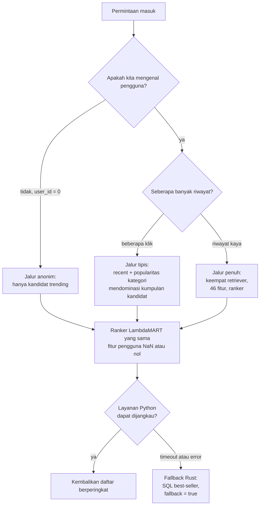
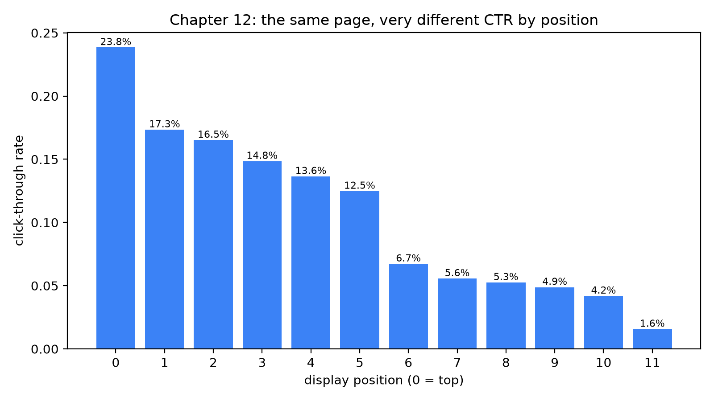
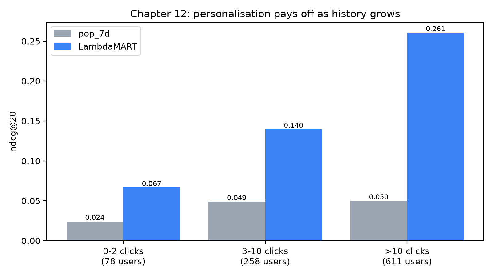

# Cold start, konteks, dan bias

Pukul 00:01 pada malam sale 12.12. Hanya dalam satu menit, puluhan ribu orang yang belum pernah membuka marketplace ini mengetuk ikon aplikasi, karena seorang teman mengirim tautan flash deal. Bagi sistem rekomendasi, para pengunjung ini adalah hantu: tanpa klik, tanpa pencarian, tanpa riwayat. Pada saat yang sama, tiga ratus penjual menayangkan produk baru yang belum pernah ditampilkan kepada siapa pun, sehingga tidak ada yang pernah mengkliknya. Di latar belakang, seorang data scientist menatap dashboard dengan bingung: item di posisi teratas setiap beranda memiliki *click-through rate* lebih dari sepuluh kali lipat dibandingkan item di slot terakhir, dan tim tidak bisa menentukan seberapa besar selisih itu berasal dari "item teratas memang lebih bagus" dan seberapa besar dari "item teratas memang berada di atas".

Tiga masalah bersembunyi dalam cerita itu, dan bab ini membahasnya satu per satu:

- **Cold start**: model ditanya tentang pengguna atau item yang tidak memiliki data perilaku sama sekali.
- **Konteks (*context*)**: jawaban yang tepat bergantung pada *kapan* dan *di mana* permintaan terjadi, bukan hanya pada *siapa* yang meminta.
- **Bias**: klik yang kita gunakan untuk melatih model dihasilkan oleh sistem yang justru ingin kita perbaiki, sehingga klik itu menggambarkan keinginan pengguna secara terdistorsi.

Yang akan Anda pelajari:

- Tiga jenis cold start (pengguna baru, item baru, sistem baru) dan tangga *fallback* yang praktis untuk masing-masing.
- Bagaimana repositori ini menurunkan kualitas secara anggun (*graceful degradation*): dari ranker yang dipersonalisasi, ke item *trending* untuk pengguna anonim, hingga query SQL biasa ketika layanan Python mati.
- Apa itu bias posisi (*position bias*), bagaimana melihatnya di log impresi, dan bagaimana *inverse propensity weighting* mengoreksinya.
- Bagaimana *feedback loop* mengubah keunggulan popularitas yang kecil menjadi besar, dan cara termurah untuk melawannya.
- Mengapa konteks saat permintaan (jam, perangkat, *surface*) *bukan* fitur dari ranker mingguan di buku ini, dan seperti apa model pendamping *real-time*-nya.
- Cara mengukur semuanya: kualitas ranker per kelompok keaktifan pengguna, dan seberapa sering item baru mencapai 20 teratas.

### Istilah yang dipakai di bab ini

Beberapa istilah muncul berkali-kali di bawah. Berikut artinya dalam bahasa sehari-hari, dengan pembeli Sari dan pencarian casing ponselnya sebagai contoh.

| Istilah | Arti sederhana | Contoh kecil |
|---|---|---|
| **Impresi (*impression*)** | Satu kali sebuah item ditampilkan di layar. | Aplikasi menampilkan satu casing ponsel kepada Sari: 1 impresi. |
| **Click-through rate (CTR)** | Jumlah klik dibagi jumlah impresi. | Ditampilkan 10 kali, diklik 3 kali: CTR $= 3/10 = 0.3$. |
| **Kandidat / retriever** | Langkah pertama yang murah memilih beberapa ratus item yang *mungkin* cocok (kandidat); setiap aturan pemilihnya disebut retriever. | "Casing ponsel yang baru dilihat Sari" adalah satu retriever. |
| **Ranker** | Model yang mengurutkan kandidat itu, dari yang terbaik. | Ia menaruh casing yang paling mungkin diinginkan Sari di slot 0. |
| **LambdaMART** | Jenis ranker yang dipakai buku ini: banyak pohon keputusan kecil yang dilatih agar pandai mengurutkan daftar (bab 10). | Hanya namanya yang baru; anggap saja sebagai "ranker". |
| **Posisi (*position*)** | Slot tempat item ditampilkan, dihitung dari 0 di paling atas. | Posisi 0 adalah kartu pertama; posisi 11 adalah kartu kedua belas. |
| ***Surface*** | Layar atau area aplikasi yang menampilkan item. | Beranda, halaman produk, hasil pencarian. |

## Intuisi: kolega baru, menu restoran, dan eskalator

Bayangkan Anda orang pertama yang menyapa pelanggan di sebuah toko buku. Seorang asing masuk. Anda tidak tahu apa pun tentangnya. Apa yang Anda lakukan? Anda tidak diam. Anda menunjuk meja buku terlaris, karena buku terlaris adalah tebakan terbaik untuk orang yang tidak dikenal. Setelah orang itu mengambil dua buku masak, Anda mengantarnya ke rak masakan. Sepuluh menit kemudian Anda sudah merekomendasikan penulis tertentu. Cold start persis seperti tangga ini: *mulailah dari apa yang berlaku untuk semua orang, lalu menyempit seiring bukti bertambah.* Sistem rekomendasi yang melewatkan tangga ini akan diam saja (halaman kosong) atau berpura-pura mengenal orang yang belum pernah ia temui.

Item baru adalah bayangan cerminnya: pelayan yang hanya merekomendasikan hidangan yang sudah dipesan orang lain tidak akan pernah mempromosikan hidangan baru yang luar biasa, sehingga hidangan itu tidak pernah dipesan. Seseorang harus "menghabiskan" satu rekomendasi untuk sesuatu yang belum terbukti (masalah eksplorasi di bab 11).

Bias posisi punya analogi yang bersih: rak supermarket. Produk di setinggi mata lebih laku daripada produk di dekat lantai, bahkan jika posisinya ditukar. Tinggi rak mengubah berapa banyak orang yang *melihat* produk, bukan seberapa bagus produk itu. Jika Anda menilai produk hanya dari penjualan, Anda akan "belajar" bahwa produk setinggi mata lebih baik, lalu menaruhnya lagi di setinggi mata. Lingkaran yang membenarkan dirinya sendiri itu adalah **feedback loop** (keluaran sistem menjadi masukan berikutnya, dan kebiasaannya makin menguat), dan kita akan melihatnya dua kali di bab ini, sekali untuk posisi dan sekali untuk popularitas.



*Gambar: tangga cold start. Ranker yang sama melayani setiap pengguna; yang berubah adalah seberapa banyak bukti yang dapat disumbangkan oleh generator kandidat dan fitur, dan jaring pengaman di luar menangkap kegagalan layanan.*

## Algoritma: tangga, propensity, dan loop

Bagian ini terdiri dari empat bagian. Pertama kita lihat di mana cold start menggigit dalam pipeline yang sudah kita bangun. Lalu kita bahas bias posisi dan *inverse propensity weighting* dengan contoh kecil. Kemudian kita memodelkan feedback loop, dan terakhir kita menentukan di mana konteks seharusnya berada.

### Di mana cold start menggigit

Cold start berarti *model tidak punya data perilaku tentang hal yang sedang ditanyakan kepadanya*. Ada tiga jenisnya:

| Jenis | Siapa atau apa yang baru | Contoh |
|---|---|---|
| **Pengguna baru** | Orang yang belum punya klik. | Sari memasang aplikasi malam ini setelah menerima tautan flash deal dari teman. |
| **Item baru** | Produk tanpa tayangan, klik, atau pesanan. | Casing ponsel yang ditayangkan penjual satu jam lalu. |
| **Sistem baru** | Seluruh layanan belum punya data. | Hari peluncuran, ketika belum ada yang mengklik apa pun. |

Tanpa rencana, masing-masing menghasilkan halaman kosong atau tebakan yang terlalu percaya diri tentang orang yang belum pernah dikenal sistem. Sisa bab ini adalah rencananya.

Telusuri pipeline dari bab 8–10 dan tanyakan di setiap tahap: *apa yang terjadi jika tidak ada data?*

1. **Pembangkitan kandidat (*candidate generation*).** Keempat retriever adalah `recent` (item yang pernah dilihat pengguna), `covisit` (item yang dilihat bersama item-item itu), `catpop` (item populer di kategori yang disukai pengguna), dan `global_trending`. Untuk pengguna tanpa riwayat, tiga yang pertama tidak mengembalikan apa-apa. `global_trending` tidak bergantung pada pengguna, sehingga *setiap* pengguna, termasuk yang benar-benar baru, menerima setidaknya item yang sedang trending secara global. Itulah anak tangga pertama, dan sudah tertanam di `candidates.generate`.
2. **Fitur.** *Fitur (feature)* adalah satu angka yang dibaca ranker tentang pengguna atau item, misalnya "klik dalam 30 hari terakhir". Fitur tingkat pengguna dibangun dengan menjumlahkan (mengagregasi) event. Pengguna tanpa event tidak memiliki baris dalam penjumlahan itu. Kode lebih dulu mendaftar *setiap* pengguna, lalu menempelkan hasil penjumlahan dengan **left join** (pertahankan setiap baris di sisi kiri, meski tidak ada pasangannya di sisi kanan), sehingga pengguna tanpa pasangan mendapat sel kosong, disebut nilai hilang (*missing value*, `NaN`, "bukan angka"). Builder mengisi sel kosong itu dengan **sentinel** eksplisit (nilai pengganti yang sengaja dipilih): penghitung menjadi $0$, dan "hari sejak aktif" menjadi konstanta besar (`NEVER_DAYS = 999`). Untuk sisanya, LightGBM (pustaka pohon di balik ranker) menerima nilai hilang secara native: di setiap pemisahan (*split*) pohon ia belajar ke cabang mana sel kosong harus pergi.
3. **Pemeringkatan (*ranking*).** Ranker adalah satu model untuk semua orang. Ia sudah melihat contoh latih dengan riwayat tipis maupun kosong, sehingga ia belajar apa yang harus dilakukan ketika `user_clicks_30d` bernilai nol: bersandar pada fitur tingkat item seperti CTR dan tingkat konversi yang dihaluskan.
**Item baru** adalah kasus yang lebih sulit, karena sinyal kuat yang biasa semuanya bersifat perilaku. Produk yang ditayangkan satu jam lalu tidak punya klik, pesanan, maupun co-visit, dan CTR tingkat itemnya adalah prior hasil *Bayesian smoothing*. Rumus pemulusan dari bab 3 adalah alat yang tepat: dengan laju prior $p_0$ dan kekuatan prior $s$,

$$\hat{p} = \frac{x + p_0\, s}{n + s}$$

dengan $x$ adalah jumlah klik dan $n$ jumlah impresi. Dengan $x = 0$ dan $n = 0$ estimasinya adalah $p_0$, rata-rata katalog, bukan nol. Item baru dengan demikian diperlakukan sebagai "rata-rata sampai terbukti sebaliknya", bukan "buruk karena tidak ada yang mengkliknya". Tanpa pemulusan, item baru akan memiliki CTR $0/0$ (tidak terdefinisi) atau $0$ (sangat rendah tanpa harapan). Ranker juga menerima `item_age_days`, sehingga ia dapat mempelajari efek kesegaran secara eksplisit.

Berikut angka untuk kasus kecil. Misalkan CTR rata-rata katalog adalah $p_0 = 0.05$ dan kekuatan prior $s = 20$, yang dapat dibaca sebagai "anggap ada 20 impresi imajiner pada laju rata-rata". Casing ponsel baru dengan $x = 0$, $n = 0$ mendapat $(0 + 0.05 \times 20)/(0 + 20) = 0.05$, yaitu rata-rata. Casing lama dengan 2 klik dari 10 impresi mendapat $(2 + 1)/(10 + 20) = 0.10$: bukti nyatanya menariknya di atas rata-rata, tetapi tidak sampai ke $2/10 = 0.20$ mentah. Makin banyak impresi yang dikumpulkan sebuah item, makin kecil pengaruh impresi imajiner itu.

### Bias posisi dan inverse propensity weighting

Bias posisi berarti *sebuah item mendapat lebih banyak klik hanya karena ditampilkan lebih tinggi di halaman, bukan karena lebih bagus*. Misalkan casing ponsel A berada di slot 0 dan casing ponsel B, yang sama bagusnya, berada di slot 5 (di bawah lipatan layar, tempat Sari harus menggulir). A mengumpulkan lebih banyak klik. Jika kita melatih ranker pada klik tanpa mengoreksinya, ia belajar "A lebih bagus" dan menaruhnya lagi di slot 0. Model itu menghargai penempatannya sendiri sebelumnya. Untuk mengoreksinya kita perlu cara *memisahkan* "apakah dilihat?" dari "apakah disukai?".

Sekarang model standarnya. Pengguna mengklik item hanya jika dua hal terjadi: mereka *memeriksanya* (benar-benar melihatnya) dan mereka *menyukainya*. **Hipotesis pemeriksaan (*examination hypothesis*)** klasik menuliskannya sebagai perkalian, dan perkalian tepat karena keduanya harus terpenuhi, seperti butuh lampu hijau sekaligus jalan yang kosong:

$$P(\text{click} = 1 \mid \text{item } i, \text{position } k) = \underbrace{\theta_k}_{\text{examination}} \cdot \underbrace{r_i}_{\text{relevance}}$$

Di sini $\theta_k \in [0,1]$ adalah probabilitas bahwa pengguna bahkan melihat posisi $k$ (**propensity** posisi itu) dan $r_i$ adalah seberapa besar pengguna menyukai item $i$ jika mereka melihatnya. Kita ingin mempelajari $r_i$, tetapi log hanya berisi klik, yang mencampurkan $\theta_k$ dan $r_i$. Melatih ranker langsung pada klik mengajarkannya untuk menaruh *item yang ditampilkan tinggi* di atas, dan itu sirkular.

Coba dengan Sari: jika ia melihat slot 5 separuh waktu ($\theta_5 = 0.5$) dan menyukai sebuah casing dengan probabilitas $r = 0.4$, ia mengkliknya dengan probabilitas $0.5 \times 0.4 = 0.2$. Casing yang sama disukainya di slot 0 ($\theta_0 = 1.0$) mendapat $1.0 \times 0.4 = 0.4$. Kualitas item sama, klik dua kali lipat, murni karena posisi.

Gagasan **inverse propensity weighting** (IPW) dalam satu kalimat: *hitung klik di posisi yang jarang dilihat sebagai lebih dari satu klik, karena klik itu lebih sulit didapat.* Perbaikannya hanya satu baris: bobot setiap klik dengan $1/\theta_k$, kebalikan (invers) dari propensity. Klik di slot yang hanya dilihat 25% waktu dihitung sebagai 4 klik. "Secara ekspektasi" berarti "dirata-rata dari sangat banyak pengulangan"; rata-ratanya,

$$\mathbb{E}\!\left[\frac{c}{\theta_k}\right] = \frac{\theta_k\, r_i}{\theta_k} = r_i ,$$

Baca rumusnya dari kiri ke kanan: $c$ bernilai 1 jika item diklik dan 0 jika tidak, kita bagi dengan peluang $\theta_k$ bahwa item itu dilihat, dan rata-rata hasilnya adalah $r_i$. Posisi saling meniadakan, dan itulah intinya. Jadi laju klik berbobot adalah estimasi relevansi yang tak bias (*unbiased*, tidak condong terlalu tinggi atau terlalu rendah secara sistematis) terlepas dari di mana item ditampilkan. Berikut contoh hitung dengan angka mainan. Misalkan propensity-nya adalah $\theta_0 = 1.0$, $\theta_1 = 0.5$, $\theta_2 = 0.25$. Item A ditampilkan 100 kali di posisi 0 dan mendapat 20 klik. Item B ditampilkan 100 kali di posisi 2 dan mendapat 10 klik.

1. CTR mentah: A adalah $20/100 = 0.20$, B adalah $10/100 = 0.10$. Klik mentah mengatakan A dua kali lebih baik.
2. Bobot setiap klik: setiap klik pada A bernilai $1/1.0 = 1$, setiap klik pada B bernilai $1/0.25 = 4$.
3. Klik berbobot: A adalah $20 \times 1 = 20$, B adalah $10 \times 4 = 40$.
4. Relevansi yang sudah dikoreksi: A adalah $20/100 = 0.20$, B adalah $40/100 = 0.40$.

Setelah koreksi, B dua kali lebih relevan daripada A. Klik mentah justru terbalik, karena B "dihukum" akibat ditampilkan di slot ketiga.

IPW punya harga: **variansi (*variance*)**, yaitu seberapa labil estimasi dari satu kumpulan data ke kumpulan berikutnya. Satu klik di posisi dengan $\theta_k = 0.02$ dihitung $50$ kali, sehingga satu klik yang kebetulan bisa mendominasi set latih. Dalam praktik kita melakukan **clipping** pada bobot, artinya membatasinya pada nilai maksimum: $w = \min(1/\theta_k, M)$ dengan $M$ sekitar 10–50. Clipping menerima sedikit **bias** (kesalahan sistematis kecil) demi variansi yang jauh lebih kecil.

Masalah yang lebih sulit adalah mengestimasi $\theta_k$. Jalan pintas yang menggoda adalah membacanya dari tabel CTR per posisi: $\hat\theta_k \propto \text{CTR}_k / \text{CTR}_0$. Dengan kata lain: jika posisi 1 mendapat separuh CTR posisi 0, tebak bahwa orang melihat posisi 1 separuh kali lebih jarang (misalnya CTR 0.20 dan 0.10 memberi $\hat\theta_1 = 0.5$). Itu hanya berhasil jika item dengan *kualitas yang sama* muncul di setiap posisi. Dalam sistem yang di-log, ranker sengaja menaruh tebakan terbaiknya di atas, sehingga tabel itu **mencampuradukkan (*confound*)** pemeriksaan dengan relevansi: kedua efek terjalin dan kita tidak bisa tahu mana yang menghasilkan selisihnya. Estimasi propensity yang jujur membutuhkan **pengacakan (*randomisation*)**: pada sebagian kecil lalu lintas, tukar dua item bersebelahan atau acak sebagian kecil halaman, sehingga kualitas tidak lagi bergantung pada posisi, lalu bandingkan. Alternatif yang lebih murah adalah memperlakukan posisi sebagai **fitur model** saat pelatihan (sehingga model dapat menisbahkan sebagian setiap klik ke posisi) lalu menetapkannya ke satu nilai tetap saat *serving*, yang disarankan oleh latihan 3 di `recommender/README.md`.

### Feedback loop

Bias posisi adalah feedback loop *lokal*; yang *global* bekerja di tingkat katalog. Katakanlah beranda menampilkan item A, yang memiliki 10 klik lebih banyak daripada item B minggu ini. Ranker, yang dilatih pada klik, memberi A skor lebih tinggi. A lebih sering ditampilkan, mengumpulkan lebih banyak klik, dan memperlebar selisih. Model mainan membuat dinamikanya konkret. Misalkan porsi tampil setiap item pada minggu $t+1$ sebanding dengan kliknya pada minggu $t$, dan klik sebanding dengan porsi tampil dikali relevansi sebenarnya $r$. Maka

$$s_i^{(t+1)} = \frac{s_i^{(t)}\, r_i}{\sum_j s_j^{(t)}\, r_j}.$$

Ambil $r_A = 0.12$, $r_B = 0.10$ dan awal 50/50. Dengan kata lain: $s_i$ adalah porsi tampil item $i$, dan $r_i$ adalah peluang satu tampilan mendapat klik. Minggu 1: A memperoleh $0.5 \times 0.12 = 0.06$, B memperoleh $0.5 \times 0.10 = 0.05$, total $0.11$, sehingga $s_A = 0.06/0.11 = 0.545$. Minggu 2 mengulang dengan porsi baru: A memperoleh $0.545 \times 0.12 \approx 0.0655$, B memperoleh $0.455 \times 0.10 = 0.0455$, total $0.111$, sehingga $s_A = 0.590$. Item yang sedikit lebih baik terus menambah porsi. Lebih buruk lagi, item C dengan $r_C = 0.30$ yang bagus tetapi berporsi awal $s_C = 0$ tetap 0 selamanya, karena rumus mengalikan dengan $s_C$, sehingga tidak pernah ditemukan. Loop ini memperkuat apa yang sudah diyakini sistem; ia tidak mempertanyakannya.

Chaney dkk. (RecSys 2018, konferensi riset sistem rekomendasi) menunjukkan lewat simulasi bahwa melatih pada data dari item yang sudah direkomendasikan membuat perilaku semua orang makin seragam tanpa menambah nilai bagi pengguna. Penawarnya:

- **Eksplorasi**: sengaja menampilkan beberapa item yang sedikit diketahui model, untuk mengumpulkan bukti. Kerangka klasiknya adalah **multi-armed bandit** (dinamai dari sederet mesin slot, tiap "lengan" adalah satu item): Anda harus menyeimbangkan *eksploitasi* item yang sejauh ini tampak terbaik dengan *eksplorasi* lengan yang hampir belum dicoba. Aturan paling sederhana, epsilon-greedy, adalah "sebagian besar waktu tampilkan item yang tampak terbaik; dengan probabilitas $\epsilon$, misalnya 1 slot dari 20, tampilkan item acak atau baru". Ini masalah eksplorasi dari bab 11; repositori ini tidak mengimplementasikannya, jadi anggap sebagai teknik yang dapat ditambahkan.
- **Diversitas**: hindari memenuhi seluruh daftar dengan salinan nyaris sama dari satu item.
- **Mencatat impresi beserta posisinya**, sehingga model berikutnya dapat mengoreksi bias posisi seperti di atas.

### Di mana konteks seharusnya berada?

**Konteks (*context*)** berarti *keadaan dari satu permintaan tertentu*: jam, hari dalam minggu, perangkat, dan surface. Sari yang mencari casing ponsel pukul 23:00 di ponselnya sambil berbaring mungkin menginginkan hal berbeda daripada Sari saat makan siang di laptop; orang yang sama, saat yang berbeda. Mengapa ranker dari bab 9–10 mengabaikannya? Ranker memprediksi hasil 7 hari per pengguna, sehingga jam permintaan identik untuk semua kandidat milik satu pengguna dan tidak ada label per permintaan untuk dipelajari (`recommender/README.md`, "What's deliberately simplified").

Dalam bab ini, konteks saat permintaan berarti: jam, hari dalam minggu, perangkat, *surface* masuk (bagian aplikasi tempat kunjungan dimulai). Repositori ini mencatat semuanya (tabel `sessions` menyimpan `surface` dan `device_os`; `events` memiliki `ts`, `position`, dan `surface`), namun ranker LightGBM dari bab 9–10 **tidak** menggunakannya sebagai fitur. Itu disengaja, dan `recommender/README.md` menjelaskan alasannya di bagian "What's deliberately simplified".

Tempat yang tepat untuk konteks adalah **model kedua yang real-time** yang dilatih pada log impresi: setiap baris adalah satu item yang ditampilkan, labelnya adalah apakah item itu diklik, dan fiturnya mencakup jam, surface, perangkat, dan *posisi saat item ditampilkan*. Model itu me-*re-score* beberapa lusin item yang sudah dipilih oleh ranker mingguan. **Fitur sesi (*session features*)** real-time termasuk dalam lapisan yang sama: "kategori yang diklik dalam 30 menit terakhir", "kueri pencarian terakhir", "item yang dimasukkan ke keranjang pada sesi ini". Retriever `recent` dan `Store.refresh()` sudah memberi repositori ini sedikit gambaran, karena klik yang dikirim dua detik lalu mengubah respons berikutnya; tetapi ranker itu sendiri hanya dilatih ulang secara berkala.

Untuk membayangkan kedua lapisan itu, pikirkan seorang asisten toko. Ranker mingguan adalah asisten yang tahu apa yang biasanya Anda sukai dan pagi-pagi mengambil dua puluh barang dari gudang. Model real-time adalah asisten yang sama yang melirik Anda di konter ("sudah malam, Anda memegang ponsel, Anda baru melihat casing") dan menyusun ulang kedua puluh barang itu di tempat. *Label* adalah jawaban benar yang dipelajari model, di sini "apakah item yang ditampilkan ini diklik?".

::: fact
**Pengguna melihat dua hasil teratas hampir sama sering, tetapi mengklik yang pertama jauh lebih sering.** Joachims dan rekan-rekannya melacak mata mahasiswa yang mencari di web dan menemukan bahwa abstrak di peringkat 1 dan 2 dilihat dengan frekuensi yang hampir sama, namun pengguna mengklik tautan pertama jauh lebih sering daripada yang kedua. Dalam eksperimen lanjutan di mana dua hasil teratas ditukar tanpa sepengetahuan pengguna, pengguna tetap sangat cenderung mengklik apa pun yang ada di posisi pertama, bahkan ketika hasil kedua dinilai lebih relevan. Para penulis menyebutnya *trust bias* dan menyimpulkan bahwa klik "informative but biased" (informatif tetapi bias).
Sumber: Joachims et al., SIGIR, 2005
:::

::: fact
**Heuristik ternyata sangat sulit dikalahkan ketika Anda tidak tahu apa-apa.** Schein dan rekan-rekannya membandingkan model probabilistik untuk masalah cold start, yaitu merekomendasikan item yang belum pernah dinilai siapa pun, dengan "heuristic recommender" yang sepele. Pada tugas umpan balik implisit, sekadar mengurutkan pengguna berdasarkan banyaknya film yang telah mereka nilai memberikan performa global yang hampir sama dengan *aspect model* mereka, sehingga para penulis berargumen bahwa baseline heuristik semacam itu selalu perlu disertakan dalam evaluasi jenis ini.
Sumber: Schein et al., SIGIR, 2002
:::

## Penelusuran kode

Kita akan mengikuti tangga yang sama dengan pipeline: bagaimana retriever menghadapi riwayat yang hilang, bagaimana fitur menutup celah, bagaimana halaman produk menangani item tanpa co-view, dan terakhir apa yang dilakukan API Rust ketika seluruh layanan Python menghilang.

### Kandidat untuk semua orang

Mulai dari satu-satunya retriever yang sama sekali tidak membutuhkan pengguna:

```include
path: recommender/recsys/candidates.py
symbol: global_trending
```

`global_trending` mengambil interaksi berbobot tiga hari terakhir (event klik, keranjang, dan pesanan, masing-masing dengan bobotnya sendiri), mempertahankan item yang tersedia stoknya, dan mengembalikan `N_GLOBAL` teratas. Fungsi ini tidak menerima argumen pengguna. Satu fakta itu adalah seluruh cerita pengguna anonim: fungsi ini menghasilkan kandidat yang sama untuk semua orang.

Setiap id pengguna di `generate` di-**cross-join** dengan frame trending (setiap pengguna dipasangkan dengan setiap item trending), sehingga tidak ada pengguna yang memiliki nol kandidat dan ranker tidak pernah menerima grup kosong. Skor sumber yang hilang menjadi $0.0$ dan peringkat trending yang hilang menjadi $999$. Semua kandidat pengguna cold memiliki `cand_n_sources` (berapa banyak retriever yang mengusulkan item ini) sama dengan 1, pola yang dipelajari ranker untuk dikenali sebagai "kita hampir tidak tahu apa-apa tentang orang ini".

### Fitur yang toleran terhadap kekosongan

Di `features.user_features` setiap pengguna memiliki baris (dimulai dari tabel `users` penuh), penggabungan hitungan berupa left join, dan `fillna` mengubah hitungan yang hilang menjadi nol. `_smoothed`, rumus $\hat{p} = (x + p_0 s)/(n + s)$, dipanggil di `user_features` sebagai `_smoothed(u["user_clicks_30d"], u["_impr_30d"], global_ctr, 20)`: pengguna baru mendapat tepat `global_ctr`, dan $s = 20$ bertindak seperti dua puluh impresi imajiner pada laju rata-rata.

Setelah join, `user_days_since_active` untuk pengguna tanpa event diisi dengan `NEVER_DAYS = 999`. Ini sentinel yang lebih baik daripada nol, karena nol berarti "baru saja aktif", kebalikan dari kenyataan. Fitur item mengikuti filosofi yang sama di `item_features`: hitungan menjadi nol, laju dihaluskan ke rata-rata katalog, dan `item_age_days` dihitung langsung dari `listed_at`, yang ada bahkan untuk item yang belum pernah dilihat siapa pun.

### Halaman produk tanpa co-view

Strip "Similar items" di halaman produk menghadapi versi masalah ini untuk setiap produk yang baru ditayangkan:

```include
path: recommender/recsys/pipeline.py
symbol: similar_items
```

Ini adalah tangga dua anak tangga dalam sekitar dua puluh baris. Pertama ia meminta matriks co-visitation untuk item yang dilihat bersama `item_id`. Item baru tidak punya baris di sana, sehingga `co` kosong. Lalu ia mengisi slot yang tersisa dengan item tersedia dari *kategori yang sama*, diurutkan berdasarkan popularitas tujuh hari, dan melabelinya `same_category`. Perhatikan `.fillna(0.0)`: item tanpa popularitas sama sekali tetap boleh muncul, di peringkat terakhir. Kolom `source` digunakan UI untuk memberi tahu pengguna (dan Anda) anak tangga mana yang menjawab.

### Jaring pengaman: ketika Python mati

Anak tangga terakhir sama sekali tidak ada di Python. **Fallback** adalah rencana cadangan yang mengambil alih ketika rencana utama gagal, seperti ban serep. API Rust memperlakukan recommender sebagai dependensi opsional, sehingga layanan Python yang mati tidak berarti situs yang mati. Pertama, fallback SQL:

```include
path: backend/src/recommender.rs
region: fallback
```

Fungsi ini menerima `category_id` opsional (dipakai oleh "Similar items") dan `exclude_id` opsional, lalu mengurutkan item aktif yang tersedia stoknya berdasarkan jumlah event `order` dalam tujuh hari terakhir, memutus seri dengan `rating_count`, lalu dengan id agar keluarannya deterministik. Setiap baris mendapat `source: "trending"`, `score: 0.0`, dan vektor `contributions` kosong, melaporkan dengan jujur bahwa tidak ada yang dipersonalisasi. Sekarang rute yang memutuskan kapan menggunakannya:

```include
path: backend/src/recommender.rs
region: recommend_route
```

Tiga detail layak diperhatikan. **Timeout** adalah tenggat waktu setelah itu kita berhenti menunggu. Panggilan gRPC (cara cepat bagi satu program untuk memanggil fungsi di program lain) dibungkus dengan `tokio::time::timeout(Duration::from_secs(5), ...)`, sehingga layanan yang *lambat* diperlakukan sama seperti yang *mati*: pengguna tidak pernah dibiarkan menatap spinner lebih dari lima detik. `match` hanya memiliki satu cabang sukses; cabang *catch-all* `other` mencakup baik error gRPC maupun timeout yang habis, mencatat peringatan (membedakan error dari timeout), dan jatuh ke `fallback(&st.pool, k, None, None)`. Dan JSON yang dikembalikannya memiliki bentuk yang persis sama dengan jalur sukses, ditambah `"fallback": true` dan `"model_version": "fallback"`. Frontend tidak memerlukan jalur kode kedua; ia hanya perlu membaca flag itu dan menampilkan banner.

Banner kuning di beranda (tangkapan layar `fallback-banner.png`, ditampilkan dalam tur di bab 13) adalah satu-satunya hal yang perlu diubah frontend.

Tabel posisi di bawah ini ada hanya karena browser mencatat impresi *beserta posisinya* (`ProductGrid.vue`: `position` adalah indeks array, satu impresi per item per grid). Tanpa log itu Anda tidak dapat menghitung CTR maupun propensity.

## Jalankan

Skrip pendamping `book/code/ch12_coldstart_bias.py` menghitung tiga hal pada data simulasi yang sama dengan bab-bab lain: CTR per posisi tampil di atas log impresi, kualitas ranker per kelompok keaktifan pengguna, dan porsi item baru di 20 teratas setiap metode. Jalankan dari direktori `book/`:

```bash
uv run python code/ch12_coldstart_bias.py
```

Stdout-nya disimpan di `results/ch12_coldstart_bias.txt`. Kita membacanya bagian demi bagian. Pertama, tabel posisi:

```output
file: results/ch12_coldstart_bias.txt
lines: 4-18
```

Lalu kelompok keaktifan, yang membandingkan baseline popularitas `pop_7d` dari bab 3 dengan ranker LambdaMART dari bab 10:

```output
file: results/ch12_coldstart_bias.txt
lines: 21-32
```

Dan terakhir, eksposur item baru:

```output
file: results/ch12_coldstart_bias.txt
lines: 34-38
```

## Hasil

### Tabel posisi



*Gambar: click-through rate menurut posisi tampil. Setiap posisi memiliki jumlah impresi yang persis sama, sehingga batang-batangnya dapat dibandingkan langsung.*

Masing-masing dari dua belas posisi memiliki tepat 16,770 impresi, yang berarti penyebutnya sama dan tinggi batang adalah laju yang jujur. Posisi 0 memiliki CTR 0.2385 dan posisi 11 memiliki 0.0156, rasio 15.3 kali. Penurunannya tidak mulus. Dari posisi 0 ke posisi 1, CTR turun dari 0.2385 ke 0.1734; posisi 1 sampai 5 menurun perlahan dari 0.1734 ke 0.1248; lalu antara posisi 5 (0.1248) dan posisi 6 (0.0673) nilainya hampir separuh dalam satu langkah. Tebing itu konsisten dengan halaman yang enam item pertamanya terlihat tanpa menggulir. Joachims et al. mengamati patahan serupa di batas lipatan layar (*fold*) pada data eye-tracking mereka. Posisi 6 sampai 10 kemudian menurun perlahan, dan posisi 11 turun tajam lagi.

### Personalisasi membuahkan hasil seiring riwayat bertambah



*Gambar: ndcg@20 menurut kelompok jumlah klik sebelumnya. Baseline popularitas nyaris tidak bergerak terhadap riwayat pengguna; ranker naik tajam.*

Tabel kedua membagi 947 pengguna evaluasi (78 + 258 + 611) ke dalam *kelompok (bucket)* berdasarkan jumlah klik yang mereka miliki sebelum cutoff. Pengingat dua metrik: ndcg@20 menilai seberapa tinggi item yang benar berada di 20 teratas (makin tinggi makin baik, 1 sempurna), dan recall@20 adalah porsi item yang benar yang masuk ke 20 teratas. Lihat baris `pop_7d` terlebih dulu (yaitu "rekomendasikan apa pun yang populer dalam 7 hari terakhir"). ndcg@20-nya adalah 0.0241 untuk pengguna dengan 0–2 klik, 0.0489 untuk 3–10 klik, dan 0.0499 untuk lebih dari 10. Popularitas mengabaikan pengguna, sehingga riwayat tidak membantunya; recall@20-nya sama, 0.08, di ketiga kelompok (0.0795, 0.0785, 0.0785).

Baris LambdaMART naik tajam: ndcg@20 sebesar 0.0666, 0.1395, dan 0.2606. Untuk pengguna terberat, rasio terhadap `pop_7d` adalah 5.22x. Untuk kelompok paling dingin, 2.76x. Dua hal layak ditekankan.

Pertama, **ranker sudah mengalahkan popularitas bahkan untuk pengguna dengan paling banyak dua klik**. Alasan yang masuk akal (tidak kita isolasi di sini) adalah bahwa kandidat trending ditambah fitur tingkat item seperti CTR dan tingkat konversi yang dihaluskan menghasilkan model popularitas yang lebih baik daripada hitungan tujuh hari mentah. Rasio untuk kelompok 3–10 (2.86x) mirip dengan kelompok cold (2.76x); lonjakan besar baru terjadi di atas sepuluh klik, ketika retriever personal (`recent`, `covisit`, `catpop`) dan fitur pengguna-item mulai mendominasi kumpulan kandidat dan pemeringkatan.

### Tabel eksposur item baru

Tabel ketiga adalah yang paling tidak nyaman. Item yang ditayangkan kurang dari tujuh hari sebelum cutoff membentuk 2.16% dari katalog yang tersedia. Di antara *positif masa depan* (item yang benar-benar berinteraksi dengan pengguna selama pekan label), mereka membentuk 2.68%, sedikit lebih besar daripada porsinya di katalog, jadi pengguna memang menginginkan item segar. Apa yang ditampilkan metode-metode itu? `pop_7d` menaruh tepat 0.00% item baru di 20 teratasnya. LambdaMART menaruh 0.25%. Keduanya satu orde besaran di bawah 2.68% yang akan disambut pengguna.

Ini adalah feedback loop yang beraksi, tertangkap dalam satu tabel. Ranker tidak jahat: item baru memiliki fitur perilaku yang lemah, sehingga diberi skor rendah, sehingga tidak ditampilkan, sehingga tetap lemah. Model dengan ndcg offline lebih baik daripada baseline popularitas tetap bisa menjadi "warga" yang lebih buruk bagi para penjual. Ini pengingat bahwa metrik offline memberi penghargaan pada prediksi masa lalu. Metrik itu tidak menghargai *memberi kesempatan kepada masa depan*.

## Jebakan dan praktik di produksi

**Memperlakukan "pengguna baru" sebagai satu kasus.** Setidaknya ada tiga: pengunjung yang belum login, pengguna yang baru mendaftar dengan profil tetapi tanpa perilaku, dan pengguna yang kembali setelah pergi berbulan-bulan. Repositori ini menangani yang pertama dengan `user_id = 0`, yang sampai ke layanan melalui `Recommend` sebagai permintaan biasa dan mendapat kandidat trending. Yang kedua dapat memanfaatkan kolom `city`, `age_bucket`, dan `device_tier` yang sudah dikumpulkan formulir pendaftaran. Yang ketiga paling baik ditangani dengan fitur seperti `user_days_since_active` yang memperlihatkan jeda itu kepada model.

**Konteks di tempat yang salah.** Menambahkan "jam dalam sehari" ke ranker mingguan memberi Anda fitur yang konstan dalam setiap grup; paling baik ia diabaikan, paling buruk ia membuat pohon menyesuaikan diri dengan noise. Taruh konteks di lapisan real-time, yang memiliki baris dan label per impresi. README repositori menjelaskan versi produksi dari desain ini: ranker kedua yang real-time, dilatih pada log `impression`, yang dapat menggunakan jam, surface, dan posisi, ditempatkan setelah tumpukan selera jangka panjang.

## Ringkasan

- Cold start hadir dalam tiga jenis (pengguna baru, item baru, sistem baru); obatnya untuk masing-masing adalah *tangga* fallback yang menyempit dari global ke personal seiring bukti bertambah.
- Di sini `global_trending` menjamin setiap pengguna, termasuk `user_id = 0`, mendapat setidaknya sebagian kandidat, dan pemulusan serta sentinel eksplisit (`NEVER_DAYS`) menjaga fitur tetap bermakna bagi pengguna tanpa event.
- Jika layanan Python lambat atau mati, API Rust mengembalikan daftar best-seller SQL dengan `fallback: true` setelah timeout lima detik, dengan bentuk JSON yang sama seperti respons normal.
- Bias posisi terlihat di log impresi: CTR turun dari 0.2385 di posisi 0 menjadi 0.0156 di posisi 11, tetapi CTR mentah per posisi mencampurkan pemeriksaan dengan relevansi dan bukan kurva propensity.
- Inverse propensity weighting membagi setiap klik dengan probabilitas bahwa posisinya diperiksa; ia tak bias tetapi bervariansi tinggi, sehingga bobot di-clip dan propensity diestimasi dengan pengacakan.
- Ranker mengalahkan baseline popularitas di semua kelompok keaktifan, tetapi marginnya tumbuh dari 2.76x (0–2 klik) ke 5.22x (lebih dari 10 klik); kohort cold berukuran kecil, sehingga metriknya berisik.
- Item baru adalah 2.16% dari katalog dan 2.68% dari positif masa depan, tetapi hanya 0.25% dari 20 teratas LambdaMART: model yang lebih baik secara offline tetap dapat membuat katalog kelaparan, dan itu adalah feedback loop.
- Konteks saat permintaan seharusnya berada di model real-time tingkat impresi, bukan di ranker mingguan "7 hari ke depan".

## Kuis

**Q12.1** Pernyataan mana tentang `candidates.global_trending` yang benar?

A. Ia mengembalikan item yang dipersonalisasi dari sesi terbaru pengguna.
B. Ia tidak bergantung pada pengguna, sehingga menjamin setiap pengguna, termasuk `user_id = 0`, mendapat sebagian kandidat.
C. Ia hanya dipanggil ketika layanan Python mati.
D. Ia mengurutkan item berdasarkan diskon harganya.

**Q12.2** Item baru memiliki 0 impresi dan 0 klik. CTR yang dihaluskan di `features._smoothed` dihitung sebagai $(x + p_0 s)/(n + s)$. Apa yang dilihat model sebagai CTR item ini?

A. 0, karena tidak ada yang mengkliknya.
B. Tidak terdefinisi, yang membuat builder crash.
C. Prior $p_0$, yaitu CTR rata-rata katalog.
D. 1, karena item baru diberi dorongan.

**Q12.3** Mengapa "jam dalam sehari" *bukan* fitur di ranker LightGBM buku ini?

A. Jam dalam sehari tidak memiliki daya prediksi di sistem e-commerce mana pun.
B. LightGBM tidak dapat menangani fitur numerik yang berputar kembali pada 24.
C. Ranker memprediksi hasil 7 hari per pengguna, sehingga jam permintaan sama untuk semua kandidat milik satu pengguna dan tidak ada label per permintaan untuk dipelajari.
D. Tabel `events` tidak menyimpan timestamp.

**Q12.4** Dengan kata-kata Anda sendiri, jelaskan bagaimana feedback loop popularitas terbentuk pada recommender yang dilatih dengan klik, dan sebutkan dua teknik yang mengurangi efeknya.

**Q12.5** Rute Rust `recommendations` beralih ke SQL setelah timeout 5 detik *dan* ketika panggilan gRPC mengembalikan error. Mengapa masuk akal memperlakukan respons yang lambat sama seperti yang gagal? Dua field apa dalam JSON yang memberi tahu frontend bahwa fallback digunakan?

**Q12.6** Baca fungsi `fallback` yang disertakan. Item P memiliki 0 event `order` dalam tujuh hari terakhir dan `rating_count = 500`. Item Q memiliki 1 event `order` dalam tujuh hari terakhir dan `rating_count = 5`. Keduanya aktif dan tersedia stoknya. Mana yang peringkatnya lebih tinggi, dan mengapa query berakhir dengan `i.id`?

**Q12.7** Propensity mainan adalah $\theta_0 = 0.8$ dan $\theta_3 = 0.2$. Item A ditampilkan 200 kali di posisi 0 dan menerima 40 klik. Item B ditampilkan 200 kali di posisi 3 dan menerima 20 klik. Hitung CTR mentah dan estimasi relevansi hasil koreksi IPW untuk masing-masing item, dan sebutkan item mana yang lebih relevan.

**Q12.8** *Praktik langsung.* Buka `book/code/ch12_coldstart_bias.py` dan ubah `BUCKETS` sehingga juga memuat kelompok nol klik, misalnya `("0 clicks", 0, 0)` di urutan pertama (dan atur kelompok berikutnya mulai dari 1). Jalankan ulang skripnya. Apa yang Anda perkirakan akan teramati tentang jumlah pengguna di kelompok baru, tentang rasio `LambdaMART / pop_7d`, dan tentang seberapa besar Anda mempercayai rasio itu? Laporkan apa yang sebenarnya Anda lihat.

**Q12.9** Mengapa praktisi melakukan *clipping* pada bobot inverse propensity, misalnya pada $w = \min(1/\theta_k, 20)$?

A. Karena propensity bisa negatif.
B. Untuk mengurangi variansi: klik di posisi berpropensity sangat rendah jika tidak di-clip akan dihitung seperti puluhan klik dan mendominasi pelatihan, dengan bayaran bias yang kecil.
C. Agar bobot berjumlah satu.
D. Karena LightGBM menolak bobot di atas 20.
