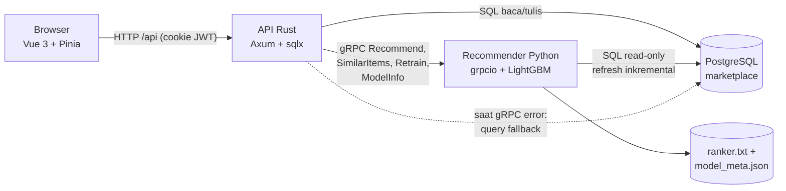
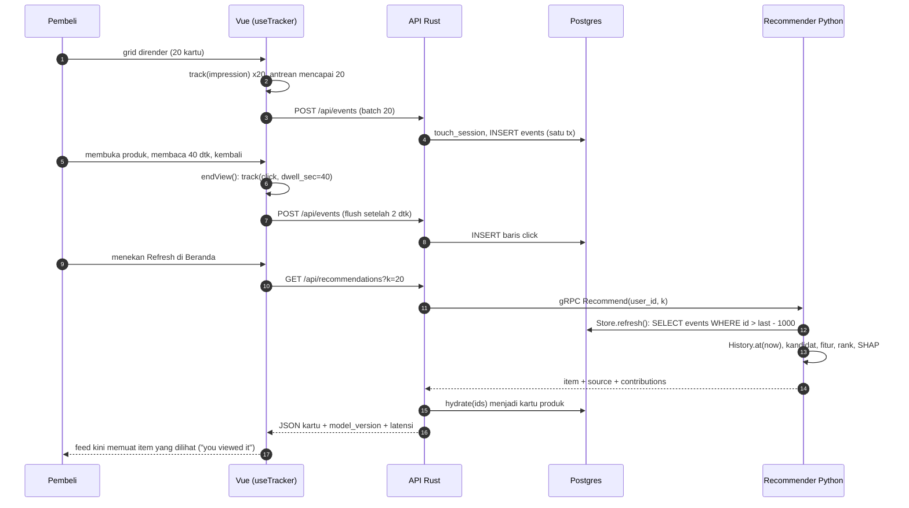
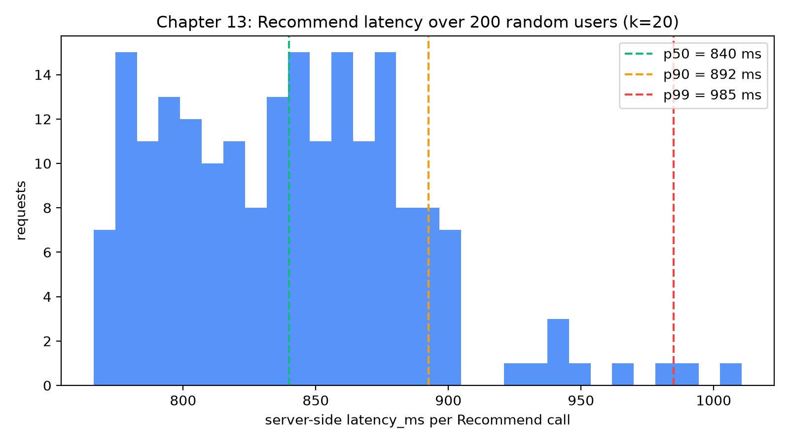
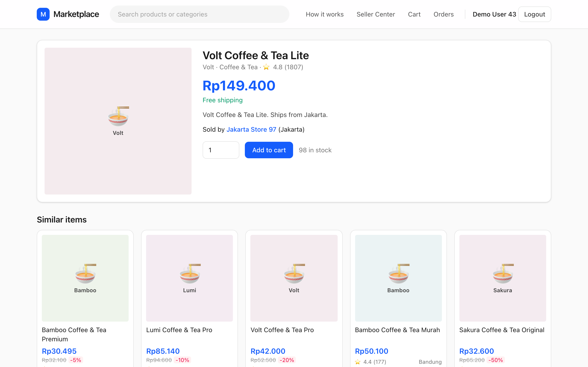
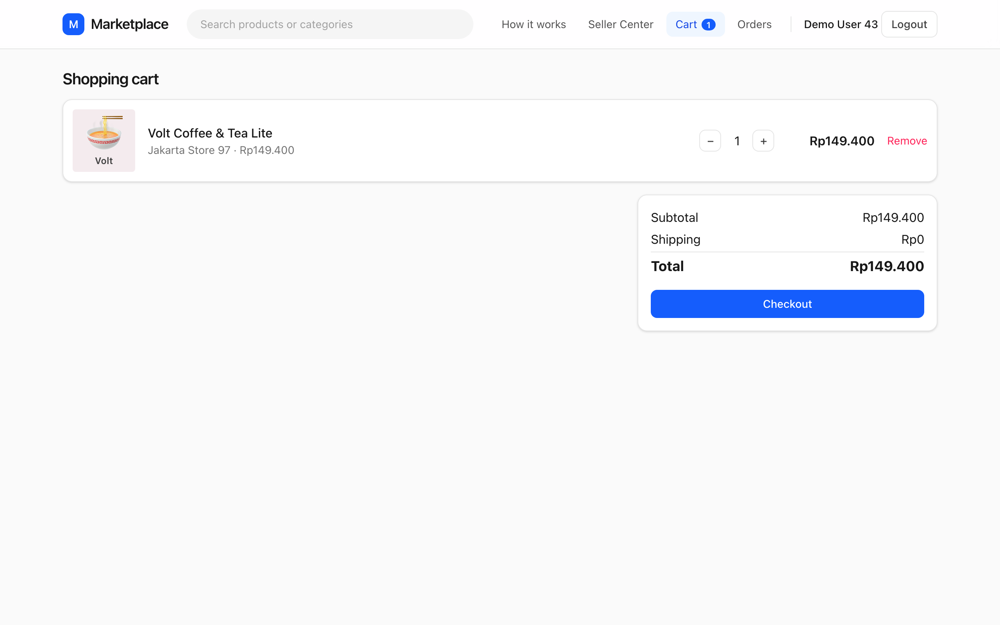
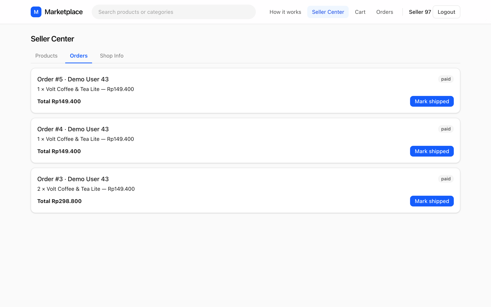
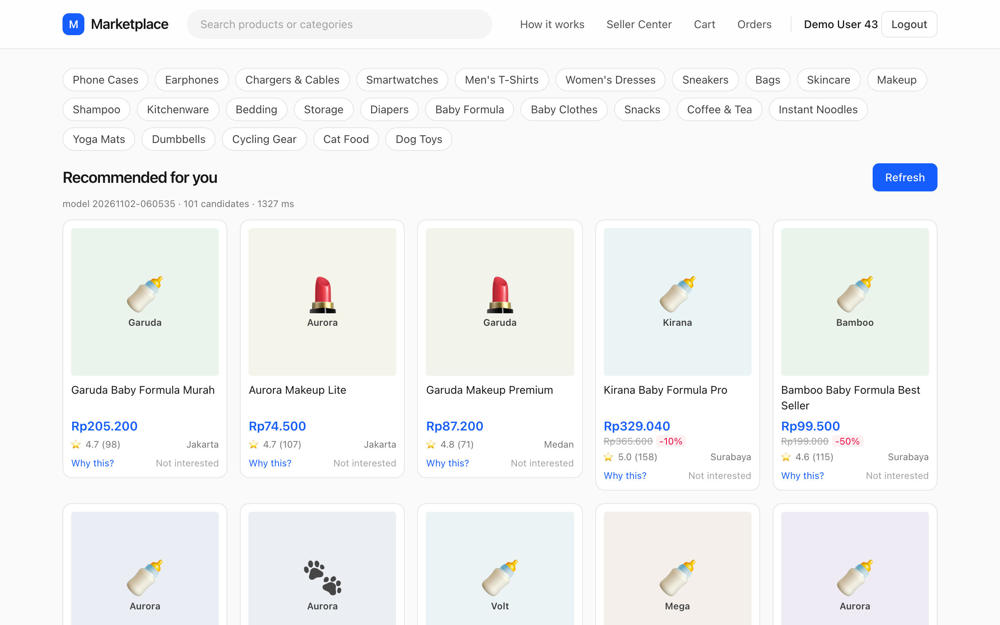
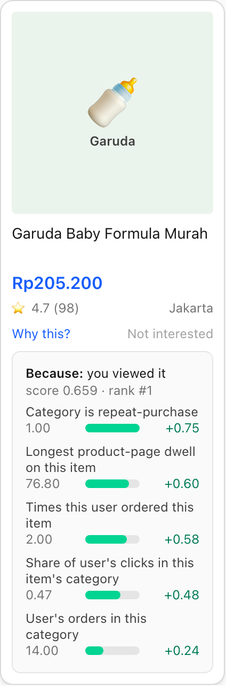
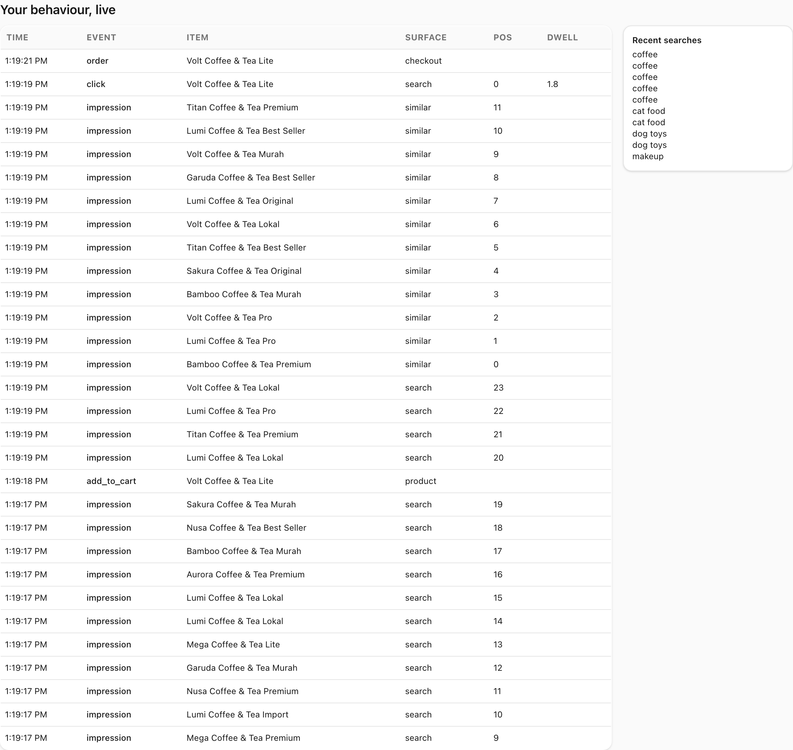
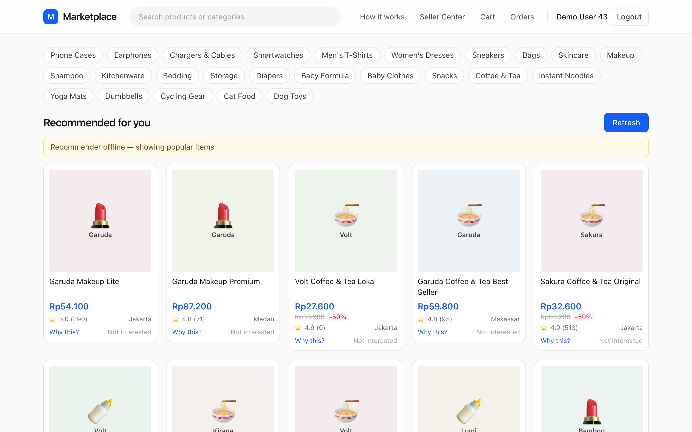

# Membangun sistemnya

Selasa malam, beberapa menit setelah gajian, Dewi membuka aplikasi marketplace di ponselnya. Ia mengetuk listing makanan kucing, menggulir foto-fotonya, memutuskan harganya agak mahal, lalu menekan tombol kembali. Ia tidak membeli apa pun. Ia tidak menekan "suka" pada apa pun. Ia bahkan tidak mengetik satu kata pun. Namun, jika tiga puluh detik kemudian ia kembali ke halaman beranda, feed-nya seharusnya sudah tampak sedikit berbeda: lebih banyak perlengkapan hewan peliharaan, lebih sedikit casing ponsel. Halaman yang baru saja ia tinggalkan harus mengubah apa yang diyakini sistem tentang dirinya.

**Yang akan Anda pelajari**

- Bagaimana empat proses (Vue, Rust/Axum, PostgreSQL, Python gRPC) membagi tanggung jawab, dan mengapa recommender hanya *membaca* database.
- Perjalanan satu klik, dari sebuah impresi hingga rekomendasi yang berubah, dengan kode di setiap lompatan.
- Bagaimana impresi, klik, dan dwell (lama berada di halaman) ditangkap, dan mengapa urutan dua *listener* `pagehide` menentukan apakah sebuah klik tercatat.
- Bagaimana sesi diturunkan, bagaimana recommender menyegarkan salinan database di memori, serta bagaimana hidrasi (*hydration*), *fallback*, dan pelatihan ulang bekerja.
- Bagaimana satu berkas `.proto` menghasilkan kedua sisi, dan berapa latensi *end-to-end*-nya (kita mengukur dan memprofilnya).

## Intuisi: restoran dengan buku besar

Bayangkan restoran yang sibuk. Para pelayan mencatat pesanan, mengantar piring, dan menulis aktivitas setiap meja ke dalam sebuah buku besar (*ledger*): siapa yang duduk, apa yang mereka lihat di menu, apa yang mereka pesan. Dapur punya seorang koki yang sangat pandai menyarankan hidangan yang tepat, tetapi koki itu tidak pernah berbicara dengan pelanggan dan tidak pernah menulis di buku besar. Setiap kali pelayan bertanya, "apa yang sebaiknya kita sarankan untuk meja dua belas?", koki melirik buku besar, berpikir, lalu menjawab dengan daftar pendek. Jika koki sedang sakit, pelayan tetap memegang kartu cetak berisi lima hidangan terlaris minggu ini dan menyerahkannya ke meja itu. Tidak ada yang pulang dengan lapar.

Itulah persis arsitektur ini. **Buku besar** adalah PostgreSQL. **Para pelayan** adalah API Rust, satu-satunya penulis: ia mendaftarkan pengguna, menangani aksi keranjang dan *checkout*, serta menambahkan event perilaku. **Koki** adalah layanan recommender Python, yang membaca buku besar lewat koneksi *read-only* dan mengembalikan saran berperingkat melalui gRPC. **Menu** yang dilihat pelanggan adalah *single-page application* Vue. **Kartu cetak** adalah query *fallback* di dalam API Rust.

Pembagian ini disengaja, dengan tiga alasan.

1. **Satu penulis berarti satu set aturan.** Stok tidak pernah negatif, sebuah pesanan hanya bergerak `paid → shipped → completed`, dan klien tidak dapat memalsukan event `order`, semuanya di satu tempat.
2. **Recommender boleh salah atau mati tanpa menjatuhkan toko.** Ia berada di balik batas jaringan dengan *timeout* dan tidak memegang koneksi yang bisa menulis: di `recsys/db.py`, `connect(read_only=True)` menyetel `default_transaction_read_only=on`, sehingga `INSERT` yang tidak disengaja akan gagal dengan keras lewat `ReadOnlySqlTransaction`.
3. **Setiap sisi memakai alat yang tepat.** Rust untuk API konkuren dengan pengecekan tipe dan transaksi; Python untuk pandas, LightGBM, dan kode riset.


*Gambar: Empat proses. Rust adalah satu-satunya penulis; Python membaca Postgres lewat koneksi read-only dan dipanggil melalui gRPC.*

## Algoritma: perjalanan satu klik

"Algoritma" bab ini adalah sebuah protokol: urutan langkah yang mengubah aksi pengguna menjadi peringkat yang berubah. Mari kita tuliskan dulu sebagai diagram urutan (*sequence diagram*), lalu menelusurinya langkah demi langkah.


*Gambar: Satu klik, dari ujung ke ujung. Paruh pertama mencatat impresi dan klik beserta dwell time-nya; paruh kedua membacanya kembali menjadi feed baru.*

Langkah-langkah bernomor:

1. **Render dan amati.** `ProductGrid.vue` memanggil `track` dengan `impression` satu kali per item per grid, dengan indeksnya sebagai `position` dan nama surface sebagai konteks.
2. **Antre dan flush.** `useTracker.ts` melakukan flush pada 20 event yang mengantre atau 2 detik setelah event pertama, dengan satu `POST /api/events`.
3. **Validasi dan simpan.** `post_events` hanya menerima `impression`, `click`, dan `hide`, paling banyak 100 per batch, dan memasukkannya dalam satu transaksi dengan `session_id` pengguna saat ini.
4. **Dwell menjadi klik.** Ketika pembeli meninggalkan halaman produk, `Product.vue` mengirim satu `click` yang membawa `dwell_sec`, sinyal implisit terkuat: `ui_max_dwell_sec` adalah fitur teratas berdasarkan *gain* pada halaman model.
5. **Bertanya.** Halaman beranda memanggil `GET /api/recommendations`; Rust memanggil layanan Python dengan *timeout* 5 detik.
6. **Refresh.** `Recommend` pertama-tama memanggil `Store.refresh()`, yang hanya membaca event yang lebih baru daripada yang sudah dilihatnya.
7. **Jalankan Bab 8-11.** `History.at(now)`, kandidat, `features.build`, penilaian LightGBM, `rerank.rerank`, SHAP untuk item yang lolos.
8. **Hidrasi dan respons.** gRPC mengembalikan id, skor, source, dan contributions; Rust mengambil kartunya dalam satu query.

### Contoh hitungan dengan angka sederhana

Seberapa cepat peringkat berubah setelah sebuah klik? Misalkan $T_\text{flush}$ adalah jeda flush di klien, $T_\text{refresh}$ *throttle* refresh milik recommender, dan $L$ waktu permintaan rekomendasi itu sendiri. Pada kasus terburuk, baris baru tiba tepat setelah recommender melakukan refresh, sehingga

$$T_\text{stale} \le T_\text{flush} + T_\text{refresh} + L.$$

Dalam basis kode ini, `FLUSH_MS = 2000` di `useTracker.ts` dan `MIN_REFRESH_SEC = 1.0` di `db.py`. Tambahkan median waktu permintaan yang diukur nanti di bab ini, sekitar 0.84 dtk, dan kasus terburuknya sekitar $2 + 1 + 0.84 = 3.84$ detik antara "pembeli menekan kembali" dan "pembeli melihat feed yang sudah mengetahuinya". Bagi pembeli tipikal yang menekan Refresh beberapa detik setelah kembali, item baru itu sudah ada di feed. Itulah keputusan "rekomendasi dihitung saat diminta" dari rencana proyek yang membuahkan hasil: tidak ada batch malam hari di antara perilaku dan dampaknya.

::: fact
**Mengapa loop ini tidak bisa diserahkan kepada sebuah notebook.** Dalam "Hidden Technical Debt in Machine Learning Systems", Sculley et al. mengamati bahwa hanya sebagian kecil dari sistem ML dunia nyata adalah kode ML itu sendiri; infrastruktur di sekelilingnya untuk pengumpulan data, *serving*, dan *monitoring* itu "vast and complex" (luas dan kompleks). Di repositori ini proporsi yang sama terlihat: model ranking berada dalam segelintir berkas Python, sedangkan pengumpulan, penyimpanan, dan pengantaran input serta outputnya mencakup frontend, API, skema, dan kontrak RPC.

Sumber: Sculley et al., NeurIPS, 2015
:::

## Penelusuran kode, bagian 1: menangkap perilaku di browser

### Tracker

`track()` pertama-tama memeriksa `if (!useAuth().user) return`: pengunjung anonim tidak menghasilkan event (server juga menjawab `204` tanpa menyimpan), sehingga pengunjung baru hanya mendapat item *trending*, jalur *cold start* di Bab 12. Lalu datang kebijakan *batching*: kirim pada `FLUSH_AT = 20`, kalau tidak, mulai *timer* 2 detik. `flush()` sengaja menelan error jaringan: pelacakan bersifat *best-effort*. Bagian bawah region menangani kepergian dari halaman, ketika browser dapat membatalkan panggilan `fetch` yang sedang berjalan; `navigator.sendBeacon` mengantrekan POST kecil yang dikirim browser setelah halaman hilang. Himpunan `pageHideHooks` membawa cerita sebuah bug, di bawah.

```include
path: frontend/src/composables/useTracker.ts
region: tracker
```

### Impresi

Impresi berarti "item ini dirender untuk pengguna ini pada posisi ini di surface ini". Ia adalah penyebut dari setiap *click-through rate* di Bab 9 (`item_impressions_7d`, `user_ctr_30d`) dan bahan mentah untuk analisis bias posisi di Bab 12. Tanpa impresi yang tercatat, Anda hanya bisa mengatakan apa yang diklik orang, tidak pernah apa yang mereka abaikan.

```include
path: frontend/src/components/ProductGrid.vue
region: impressions
```

Himpunan `seen` menjamin satu impresi per id item per instans grid; tanpanya, render ulang atau "Refresh" yang tumpang tindih akan menggelembungkan penyebut setiap CTR. *Watcher*-nya dikunci pada daftar id yang digabung karena Vue membuat array baru pada setiap pengambilan data. Dan `position` adalah indeks render, yang dibutuhkan Bab 12 untuk bias posisi. Catatan: sebuah item dihitung terlihat saat *dirender*, bukan saat digulir ke dalam pandangan; produksi memakai `IntersectionObserver`.

### Dwell time dan bug urutan `pagehide`

Setiap event klik membawa `dwell_sec`, dan ia dibuat di halaman produk. Idenya sederhana: catat `performance.now()` saat produk dimuat, dan ketika pembeli pergi, kirim satu `click` dengan jumlah detik yang berlalu, posisi asal klik, dan surface asalnya. Dua hal terakhir itu berpindah lewat URL (`/products/:id?src=search&pos=3`), dan begitulah halaman produk tahu bagaimana ia dicapai.

```include
path: frontend/src/views/Product.vue
region: dwell
```

`beginView()` dan `endView()` mengapit sebuah "tayangan" (*view*). Penjaga `clickSent` menjamin tepat satu klik per tayangan produk, meskipun `endView` dihubungkan ke empat jalan keluar yang berbeda:

- `onBeforeRouteLeave`: pembeli berpindah ke halaman lain di aplikasi.
- `onBeforeRouteUpdate`: pembeli berpindah dari satu produk ke produk lain, saat Vue Router *memakai ulang* instans komponen yang sama. Tanpa *hook* ini, dwell produk pertama tidak akan pernah tercatat.
- `onPageHide(endView)`: tab ditutup atau halaman dimuat ulang.
- `onUnmounted`: jaring pengaman terakhir.

Versi pertama halaman produk mendaftarkan *listener* `pagehide`-nya sendiri untuk mencatat klik. *Listener* milik tracker, yang menguras antrean ke `sendBeacon`, didaftarkan lebih dulu sehingga berjalan lebih dulu: ia mengosongkan antrean dan mengirim beacon, baru kemudian halaman produk mengantrekan kliknya. Klik itu terlewat dari flush terakhir dan hilang tanpa suara. Gejalanya halus: klik tercatat saat berpindah di dalam aplikasi, tetapi tidak pernah saat menutup tab.

Perbaikannya adalah registri *hook* di region tracker: sebuah view memanggil `onPageHide(fn)`, dan satu-satunya *listener* `pagehide` milik tracker menjalankan setiap hook (yang mengantrekan event-nya) *lalu* mengirim beacon. Pelajaran umum untuk desain *flush-on-exit* apa pun: beri flusher satu *listener* keluar dan biarkan produsen mendaftar kepadanya.

::: fact
**`pagehide` bukan jaminan.** Dokumentasi MDN untuk `navigator.sendBeacon()` menjelaskan bahwa event keluar lawas (`unload`, `beforeunload`, dan `pagehide`) tidak andal, terutama di seluler: jika pengguna berpindah aplikasi lalu kemudian mematikan browser, tidak satu pun terpicu. MDN menyarankan mengirim analitik pada event `visibilitychange` sebagai gantinya, dan mencatat bahwa muatan beacon dibatasi sekitar 64 KiB. Tracker kita memakai `pagehide`, yang sederhana dan cukup baik untuk mendemonstrasikan desainnya; tracker produksi juga akan melakukan flush ketika `document.visibilityState` menjadi `hidden`.

Sumber: Mozilla Contributors, MDN Web Docs, 2026
:::

## Penelusuran kode, bagian 2: server mencatatnya

### Tabel events

Semua yang diketahui recommender tentang perilaku berasal dari satu tabel *append-only*, `events` di `backend/migrations/0001_init.sql`: `ts`, `user_id`, `session_id`, `item_id`, `event_type`, `position`, `dwell_sec`, `price_paid`, `surface`.

```include
path: backend/migrations/0001_init.sql
region: events_table
```

Skemanya adalah kontrak antara "apa yang dapat diamati aplikasi web" dan "apa yang dapat dipelajari model".

Dibandingkan dengan skema simulator di Bab 1, data nyata menambahkan `surface` dan *foreign key* yang mencegah klien menulis event tentang item yang tidak ada. `CHECK` pada `event_type` adalah garis pertahanan terakhir, dan dua indeks melayani riwayat per pengguna dan agregat per item. Tidak ada `UPDATE` di mana pun: log bersifat *append-only*, dan sebuah pengembalian barang adalah event `return` yang baru.

### Dari batch menjadi baris: `post_events`

```include
path: backend/src/events.rs
region: post_events
```

`MaybeUser` tidak pernah gagal, sehingga permintaan anonim mendapat `204`, yang memang diharapkan sebuah beacon. Pemeriksaan `matches!` menegakkan apa yang boleh diklaim browser: impresi, klik, dan *hide* adalah pengamatan atas layar pembeli sendiri. `add_to_cart` dan `order` adalah akibat dari aksi sisi server yang terautentikasi, sehingga API membuatnya sendiri; jika pembeli bisa memposting event `order`, ia bisa melatih recommender untuk menyukai item apa pun.

Satu panggilan `touch_session` menentukan sesi untuk seluruh batch; pelanggaran *foreign key* menjadi `400 unknown item`; dan `tx.commit()` membuat batch terlihat secara atomik, sehingga recommender tidak pernah melihat separuh batch.

### Sesi: `touch_session`

Sesi adalah rangkaian aktivitas yang dipisahkan dari rangkaian berikutnya oleh jeda diam. Tabel `sessions` milik simulator memiliki struktur itu sejak awal; aplikasi nyata harus *menurunkannya*.

```include
path: backend/src/sessions.rs
region: touch_session
```

Satu `UPDATE ... WHERE id = (SELECT ... LIMIT 1) RETURNING id` menemukan sesi terbaru yang terlihat dalam 30 menit, memperbarui `last_seen_at`, dan mengembalikan id-nya; kalau tidak, sesi baru dimasukkan. Dua permintaan konkuren secara teori bisa sama-sama memasukkan satu sesi; kita menerimanya, karena itu hanya sedikit mengencerkan co-visitation. Setiap event sisi server (batch klien, `add_to_cart`, `order`) melewati fungsi ini, karena matriks co-visitation bergantung pada `session_id` yang valid.

### Checkout: sinyal terkuat

Ini contoh terbaik mengapa satu penulis itu menguntungkan. Dalam satu transaksi, handler memuat keranjang, mengunci baris item dengan `SELECT ... FOR UPDATE ORDER BY id` (urutan deterministik mencegah *deadlock*), menolak baris yang tidak aktif atau stoknya kurang dengan `409`, mengelompokkan baris per toko menjadi satu pesanan per penjual, menyimpan `unit_price` pada harga akhir setelah diskon, mengurangi stok dan menyetel `out_of_stock_at` saat mencapai nol, menulis satu event `order` per baris lewat `touch_session`, lalu mengosongkan keranjang. Dua konsekuensi yang relevan bagi recommender: `Recommend` berikutnya berhenti mengusulkan produk yang sudah habis karena `History.at` membaca `out_of_stock_at`, dan setiap event `order` bersesuaian dengan baris pesanan yang nyata dan sudah dibayar.

```include
path: backend/src/cart.rs
region: checkout
```

## Penelusuran kode, bagian 3: recommender membacanya kembali

### Menjaga salinan di memori tetap segar: `Store`

Recommender membutuhkan seluruh riwayat event sebagai DataFrame karena pipeline dari bab-bab sebelumnya (`History.at`, `candidates.generate`, `features.build`) ditulis untuk tabel pandas. Membaca ulang 277,000 baris dari Postgres pada setiap permintaan akan lambat. Maka `Store` menyimpan tabel di memori dan menyegarkannya secara inkremental.

```include
path: recommender/recsys/db.py
symbol: Store.refresh
```

`refresh()` melakukan tiga hal. Ia mengambil kunci (*lock*), sehingga *thread* gRPC yang konkuren tidak mengeluarkan refresh yang tumpang tindih. Ia menerapkan *throttle*: jika refresh terakhir kurang dari `MIN_REFRESH_SEC` (satu detik) yang lalu, ia langsung kembali, sehingga beban database dibatasi sekitar satu refresh per detik berapa pun jumlah permintaan yang datang. Dan ia mencoba ulang satu kali saat `OperationalError` setelah melepas koneksi, yang memang Anda inginkan setelah Postgres dimulai ulang.

Empat tabel kecil (categories, shops, items, users) dimuat ulang seluruhnya karena berubah di tempat. Events dan searches diambil dengan `WHERE id > last_id - 1000`. *Overlap* itu penting karena id `BIGSERIAL` ditetapkan saat *insert* tetapi baris baru terlihat saat *commit*: jika transaksi Y meng-*commit* event 501 sebelum X meng-*commit* event 500, query naif `id > 501` tidak akan pernah mengambil 500. Membaca ulang 1000 id terakhir dan menghapus duplikat di `_merge` (yang juga mengurutkan berdasarkan `ts`, seperti yang diasumsikan `History.at`) menoleransi *commit* yang tidak berurutan. Semua pembacaan memakai koneksi read-only.

### RPC `Recommend`

```include
path: recommender/recsys/service.py
region: recommend_rpc
```

Metode ini menyegarkan store, membatasi `k` ke 1..50, dan mengambil referensi ke model dan versi saat ini *sebelum* pekerjaan apa pun, yang membuat *hot-swap* aman. Lalu ia memanggil `pipeline.recommend`, fungsi yang sama dengan yang dipakai CLI offline: evaluasi offline dan *serving* online berbagi satu jalur kode, pertahanan terbaik terhadap *training/serving skew*. `source_of` melabeli setiap baris dengan retriever terkuatnya (atau `trending`), `ranker.contributions` menambahkan lima nilai SHAP teratas, dan satu baris log INFO mencatat pengguna, `k`, kandidat, dan latensi. Pengguna anonim (`user_id = 0`) tidak butuh cabang khusus: tanpa riwayat berarti kandidat *trending* dan fitur pengguna NaN, yang bisa ditangani LightGBM.

### Pelatihan ulang tanpa *downtime*

Input ranker bergeser seiring item bermunculan dan selera berubah, sehingga layanan melatih ulang dengan dua pemicu: *thread* latar belakang setiap `RECSYS_RETRAIN_INTERVAL_SEC` (enam jam secara bawaan) dan panggilan gRPC `Retrain` khusus admin di balik tombol pada halaman "How it works".

```include
path: recommender/recsys/service.py
symbol: retrain
```

`retrain` tingkat modul dipakai bersama oleh layanan dan CLI. Ia melatih pada *snapshot* store dengan `end=now`, sehingga jendela label bergeser mengikuti jam, mengubah tabel evaluasi menjadi kunci datar seperti `lightgbm_ranker/ndcg@20`, dan menulis `ranker.txt` serta `model_meta.json`.

Metodenya menambahkan dua pengaman. `retrain_lock.acquire(blocking=False)` membuat permintaan konkuren kedua gagal seketika (`ABORTED`, yang oleh Rust dipetakan ke `409`). Dan pertukaran `self.model, self.meta = model, meta` adalah dua penugasan referensi: panggilan `Recommend` yang sedang berjalan tetap memakai *booster* lama dan selesai secara konsisten, panggilan baru melihat yang baru, tanpa *lock* pada jalur baca.

## Penelusuran kode, bagian 4: sisi Rust dari jembatannya

### Rute rekomendasi

```include
path: backend/src/recommender.rs
region: recommend_route
```

Handler membaca pengguna opsional, membatasi `k`, dan membangun permintaan. Kanal `connect_lazy()` di `main.rs` membuat API dapat start meskipun Python mati. Panggilan dibungkus dalam `tokio::time::timeout` 5 detik; jika berhasil, hasilnya dihidrasi dan dikembalikan dengan `"fallback": false`, sedangkan error gRPC atau *timeout* apa pun dicatat di log dan dijawab dari query fallback dengan `"model_version": "fallback"`, yang diubah frontend menjadi banner kuning. Menurun lebih baik daripada mati.

### Hidrasi

gRPC mengembalikan id dan skor; browser membutuhkan judul dan harga.

```include
path: backend/src/recommender.rs
region: hydrate
```

Satu query SQL dengan `id = ANY($1)` membangun peta id-ke-kartu, dan kode menelusuri daftar recommender *menurut urutan recommender*, melewati id yang sementara itu hilang. Kartu yang kurang dari `k` lebih baik daripada menggagalkan seluruh feed.

### Fallback

```include
path: backend/src/recommender.rs
region: fallback
```

Kartu cetak dari restoran kita: item aktif yang stoknya ada, diurutkan menurut event `order` dalam tujuh hari terakhir, lalu jumlah rating. Ia melabeli setiap baris `source: "trending"`, skor 0, tanpa contributions, sehingga frontend tidak membutuhkan jalur terpisah. Ia sengaja tidak dipersonalisasi: pengalaman menurun yang sama untuk semua orang tidak bisa salah dengan cara yang mengejutkan dan spesifik pengguna.

## Kontrak antarbahasa: satu `.proto`, dua generator kode

API Rust dan layanan Python hanya berbagi sebuah skema, satu berkas pendek:

```include
path: proto/recommender.proto
```

Bagian-bagiannya terpetakan langsung ke produk:

- `Recommend` dan `SimilarItems` mengembalikan `RecommendResponse` dengan `items`, `model_version`, `candidates_considered`, dan `latency_ms`, angka-angka pada keterangan abu-abu di bawah "Recommended for you".
- `RecommendedItem.contributions` membawa lima kontribusi SHAP teratas per item: bahan mentah "Why this?".
- `Retrain` dan `ModelInfo` menyuplai halaman "How it works".
- Yang melintasi batas adalah ID, bukan objek, dan respons membawa versi model sehingga perilaku apa pun dapat dikaitkan dengan model penyebabnya.

::: fact
**Nomor field adalah format *wire*.** Dalam Protocol Buffers, setiap field diidentifikasi di *wire* oleh nomornya, bukan namanya. Panduan bahasanya menyatakan bahwa nomor tidak boleh diubah setelah tipe pesan dipakai, bahwa nomor field 1 sampai 15 membutuhkan satu byte untuk di-*encode* sedangkan 16 sampai 2047 membutuhkan dua, dan bahwa nomor field yang dihapus sebaiknya dicadangkan (*reserved*) agar tidak pernah dipakai ulang. Di `recommender.proto`, field yang paling sering terisi seperti `item_id` dan `score` karena itu berada di nomor rendah.

Sumber: Google, Protocol Buffers Language Guide (proto 3), 2026
:::

### Menghasilkan kode di kedua sisi

Rust menghasilkan kliennya pada saat *build*:

```include
path: backend/build.rs
```

`build_server(false)` hanya menghasilkan separuh klien, `rerun-if-changed` membangun ulang saat proto berubah, dan `tonic::include_proto!("recommender.v1")` menarik item bertipe seperti `pb::RecommendRequest`. Salah ketik nama field adalah error kompilasi, bukan kejutan saat runtime.

Python menghasilkan stub-nya dengan satu perintah, dibungkus sebagai subperintah CLI agar tidak ada yang perlu mengingat flag-nya:

```bash
cd recommender && uv run recsys gen-proto
```

`grpc_tools.protoc` dengan `-I recsys/pb=../proto` membuat impor hasil generate terbaca `from recsys.pb import recommender_pb2`. Stub-nya di-*commit*, jadi menjalankan layanan tidak membutuhkan langkah codegen; harganya adalah harus ingat meregenerasi setelah mengubah proto, kompromi yang wajar untuk repositori pengajaran.

## Jalankan

Skrip `ch13_latency.py` memanggil layanan gRPC yang *sedang berjalan* secara langsung (melewati Rust dan browser) dengan `Recommend`, `k = 20`, untuk 200 pengguna acak dengan *seed* tetap; panggilan pertama adalah pemanasan dan tidak dihitung.

```bash
# terminal A
cd recommender && uv run recsys serve
# terminal B (dari root repo)
cd book && uv run python code/ch13_latency.py
```

```output
file: results/ch13_latency.txt
```

"server latency_ms" adalah pengukuran milik layanan itu sendiri; "client wall ms" menambahkan serialisasi dan lompatan *loopback*. Selisihnya sekitar satu milidetik, sehingga pada dasarnya seluruh waktu berada di dalam recommender. Setiap permintaan menilai antara 30 dan 129 kandidat dan mengembalikan tepat 20 item.

Ke mana 840 ms itu pergi? Skrip kedua, `ch13_profile.py`, berjalan offline pada data simulasi melalui jalur `pipeline.recommend` yang persis sama, mengukur waktu setiap tahap untuk tiga pengguna dengan riwayat yang sangat berbeda (median dari 7 kali jalan). Ia tidak membutuhkan layanan yang berjalan:

```bash
cd book && uv run python tools/run_all.py --only ch13_profile
```

```output
file: results/ch13_profile.txt
```

Tabel per pengguna menunjukkan total 668 sampai 674 ms untuk pengguna dengan 4, 22, dan 133 interaksi. `History.at` memakan 8 sampai 9 ms, `generate` 213 sampai 215 ms, dan `features` 437 sampai 443 ms; `score`, `rerank`, dan `shap` bersama-sama hanya beberapa milidetik. Bagian kedua membedah `features.build`. Ada dua jenis pekerjaan di dalamnya. Pekerjaan tingkat item, yang sama untuk setiap pengguna, adalah `item_features` (122 ms) ditambah `covisitation_matrix` (23 ms, di dalam `generate`): total 144 ms. Bagian yang lebih besar adalah agregasi sisi pengguna: `user_features` (57 ms), `user_item_features` (152 ms), `user_category_features` (57 ms), `user_shop_features` (26 ms), dan `user_price_level` (11 ms) masing-masing mengagregasi event *semua pengguna*, padahal hanya satu pengguna yang meminta, dan baru sesudahnya barisnya digabungkan ke kandidat pengguna itu. Jumlahnya 303 ms. Modelnya adalah bagian yang murah.

## Hasil

### Latensi



Histogram menunjukkan badan yang rapat antara sekitar 770 dan 900 ms, serta ekor pendek yang mencapai sekitar 1,010 ms. Mediannya 839.9 ms, persentil ke-90 892.5 ms, dan ke-99 985.0 ms. Ada dua pengamatan penting.

Pertama, **latensi nyaris tidak bergantung pada pengguna**. Profil menjelaskannya: `generate` plus `features.build` memakan rata-rata 97% dari permintaan, jumlah kandidat 95 sampai 112 apa pun riwayatnya, dan pekerjaan di dalamnya dihitung ulang pada setiap panggilan: *frame* tingkat item dan, yang lebih mahal, agregasi sisi pengguna atas event seluruh pengguna. Penilaian, *re-ranking*, dan SHAP bersama-sama memakan sekitar sepuluh milidetik.

Kedua, **0.84 dtk cukup untuk demo dan terlalu lambat untuk beranda sungguhan**. Bahkan panggilan teramati yang paling lambat (1,010.6 ms) hanya memakai sekitar seperlima dari anggaran 5 detik, tetapi pembeli akan merasakannya. Profil menunjukkan bahwa perbaikannya punya dua bagian. Meng-*cache* *frame* tingkat item (matriks co-visitation dan fitur item) selama sekitar 30 detik akan menghilangkan 144 ms pekerjaan tingkat item; statistik item lalu tertinggal hingga 30 dtk sementara klik *milik pembeli sendiri* tetap langsung. Namun itu saja menyisakan 303 ms yang lebih besar: agregasi sisi pengguna juga harus dibatasi pada event pengguna yang meminta *sebelum* diagregasi, bukan mengagregasi semua pengguna lalu menggabungkan. *Cache* saja tidak memperbaiki latensi.

### Tur screenshot

Screenshot berasal dari aplikasi yang berjalan, diambil dengan Playwright. Halaman lainnya mengikuti pola yang sama: login menyetel JWT dalam cookie `httpOnly`; pencarian adalah SQL `ILIKE` biasa yang menulis baris `searches`; halaman produk memuat `/products/:id/similar` secara terpisah, sehingga recommender yang gagal tidak pernah memblokirnya; keranjang, checkout, dan pesanan menjalankan sisi penulis; dan produk yang baru ditayangkan di Seller Center adalah kasus *cold start* dari Bab 12.







**Beranda yang dipersonalisasi.** Setelah login sebagai `user43`, "Recommended for you" menampilkan keterangan berisi versi model, jumlah kandidat, dan latensi, dan setiap kartu memiliki "Why this?" dan "Not interested" (yang mencatat event `hide`). Pengunjung anonim mendapat "Popular now" dari `user_id = 0`, tanpa pelacakan.



**Why this?** Panel menampilkan "Because: you viewed it", skor dan peringkat, serta lima fitur dengan kontribusi bertandanya. Namanya berasal dari `schema.FEATURES` melalui `ModelInfo`; batangnya adalah nilai SHAP yang dihitung di dalam `recommend_rpc`. Jika sebuah kartu muncul karena alasan yang tidak masuk akal, panel itu memberi tahu fitur mana yang perlu diselidiki.






**Halaman model.** "How it works" menampilkan tabel event langsung (baris yang sama dengan yang dibaca recommender), lalu bagian model: versi, events yang dimuat, tabel metrik untuk keempat metode, *candidate recall*, dan fitur teratas berdasarkan gain, dengan `ui_max_dwell_sec` di urutan pertama. Admin juga mendapat tombol "Retrain now"; setelah pelatihan ulang, versi, metrik, dan jumlah baris latih sedikit berbeda meskipun tidak ada kode yang berubah, karena setiap *cutoff* relatif terhadap `now` dan jendela label bergeser mengikuti jam.


**Mode menurun.** Dengan recommender dihentikan, banner kuning menggantikan keterangan model, kartu berasal dari query fallback, dan panel "Why this?" kosong karena item *trending* tidak punya contributions. Pengguna sedikit dirugikan; tidak ada yang terkunci di luar.



## Jebakan dan praktik produksi

**Waktu event versus waktu server.** `events.ts` bernilai bawaan `now()` milik database: *timestamp* dari klien akan membiarkan jam ponsel yang melenceng menulis event dari masa depan. Biayanya, batch yang terlambat di-*flush* diberi cap waktu flush, tidak relevan untuk jendela 2 detik tetapi relevan untuk aplikasi *offline-first*.

**Training/serving skew.** Layanan memanggil `pipeline.recommend` dan job pelatihan memanggil `pipeline.train_and_evaluate`; keduanya memakai `History.at` dan `features.build`. Satu implementasi per fitur, bukan dua; sebuah *feature store* (Bab 14) mengindustrialisasi hal ini.

**Anggaran latensi.** Pada skala besar Anda tidak punya 840 ms; setiap tahap mendapat sepotong dari beberapa ratus milidetik. Ukur persentil, temukan biaya tetapnya, *cache* apa yang bisa di-*cache*, dan jaga pekerjaan yang dipersonalisasi tetap kecil.

## Ringkasan

- Marketplace ini memiliki empat proses: frontend Vue, API Rust/Axum yang menjadi satu-satunya penulis, PostgreSQL sebagai buku besar bersama, dan recommender gRPC Python yang membaca Postgres lewat koneksi read-only.
- Sebuah klik menjadi peringkat yang berubah melalui impresi yang diantrekan dan di-flush oleh `useTracker`, `post_events` dan `touch_session` yang menulis baris dengan id sesi, `Store.refresh` yang membacanya secara inkremental, dan `Recommend` yang menjalankan seluruh pipeline saat diminta. *Staleness* kasus terburuk adalah jeda flush ditambah *throttle* refresh ditambah waktu permintaan.
- Event saat keluar membutuhkan satu flusher yang berurutan: registri *hook* `onPageHide` memperbaiki bug ketika sebuah klik diantrekan setelah beacon sudah terkirim.
- Recommender tetap segar dengan refresh inkremental yang aman terhadap *overlap* (`id > last - 1000`, lalu hapus duplikat) karena id *auto-increment* ditetapkan saat insert tetapi terlihat saat commit.
- Satu berkas `.proto` adalah kontraknya; Rust menghasilkan klien di `build.rs`, Python menghasilkan stub dengan `recsys gen-proto`, dan respons membawa versi model, jumlah kandidat, dan latensi untuk observabilitas.
- Pelatihan ulang bersifat periodik dan sesuai permintaan, dijaga oleh *lock* non-blocking dan di-*hot-swap* dengan menugaskan dua referensi, sehingga *serving* tidak pernah berhenti.
- API Rust menghidrasi id menjadi kartu menurut urutan recommender dan beralih ke query *trending* nonpersonal saat error atau *timeout*, sehingga gangguan recommender menurunkan halaman alih-alih merusaknya.
- Diukur di mesin ini, `Recommend` memakan sekitar 840 ms pada median dan 985 ms pada persentil ke-99, hampir tidak bergantung pada pengguna. Profil tahap mengaitkan 97% darinya dengan pembuatan kandidat dan pembangunan fitur: 144 ms pekerjaan tingkat item yang bisa diserap *cache* ber-TTL pendek, dan 303 ms agregasi sisi pengguna atas semua pengguna yang hanya bisa dihilangkan dengan menyaring event ke pengguna yang meminta.

## Kuis

**Q13.1** Mengapa recommender Python membuka koneksi databasenya dengan `default_transaction_read_only=on`?

A. Ini membuat query `SELECT` lebih cepat dengan melewati lock.
B. Ini menjamin bahwa bug di recommender tidak dapat mengubah data aplikasi; setiap penulisan gagal dengan error.
C. Ini memungkinkan Postgres memakai ulang koneksi yang sama untuk API Rust.
D. Ini diwajibkan oleh protokol gRPC.

**Q13.2** Himpunan tipe event mana yang diterima `POST /api/events` dari browser, dan mengapa `order` tidak termasuk di dalamnya?

A. `impression`, `click`, `hide`; `order` adalah akibat dari aksi sisi server (checkout) dan tidak boleh dapat dipalsukan dari klien.
B. `impression`, `click`, `order`; `hide` diturunkan di server.
C. Keenam tipe; constraint `CHECK` database adalah satu-satunya perlindungan.
D. Hanya `click`; impresi dihitung oleh server dari pemuatan halaman.

**Q13.3** Pada bug `pagehide`, apa persisnya yang salah pada versi pertama halaman produk?

A. Panggilan `fetch` mengalami *timeout* setelah 2 detik.
B. *Listener* `pagehide` milik halaman produk berjalan setelah *listener* tracker sudah menguras antrean ke beacon, sehingga klik tidak pernah terkirim.
C. `sendBeacon` tidak dapat mengirim JSON.
D. Vue Router melepas (*unmount*) komponen sebelum `pagehide` terpicu.

**Q13.4** Jelaskan dalam dua atau tiga kalimat mengapa `Store._refresh` membaca ulang 1000 id event terakhir alih-alih melakukan query `id > last_event_id`. Apa yang akan salah tanpa *overlap* itu?

**Q13.5** `Recommend` diawali dengan `model, version = self.model, self.meta["version"]` dan `retrain` diakhiri dengan `self.model, self.meta = model, meta`. Jelaskan bagaimana kedua baris ini memungkinkan layanan menukar model saat ada lalu lintas tanpa lock pada jalur permintaan.

**Q13.6** (Membaca kode.) Baca `touch_session` di `backend/src/sessions.rs`. Seorang pembeli memicu event pada pukul 10:00, 10:20, dan 11:05 pada hari yang sama, tanpa aktivitas lain. Berapa sesi yang dibuat, dan berapa `last_seen_at` sesi pertama di akhir hari? Jelaskan berdasarkan aturan 30 menit di SQL tersebut.

**Q13.7** (Numerik.) Rute Rust menghentikan panggilan gRPC dengan *timeout* setelah 5 detik. Berdasarkan hasil di bab ini, berapa fraksi anggaran itu yang dipakai oleh panggilan sisi server teramati yang paling lambat (1,010.6 ms), dan berapa *staleness* kasus terburuk $T_\text{stale} = T_\text{flush} + T_\text{refresh} + L$ jika $T_\text{flush} = 2$ dtk, $T_\text{refresh} = 1$ dtk, dan $L$ adalah latensi server p99 teramati sebesar 985.0 ms? Berikan kedua jawaban.

**Q13.8** Apa yang dikembalikan fallback ketika recommender tidak tersedia, dan mengapa ia melabeli setiap item dengan `source: "trending"`, skor 0, dan contributions kosong?

**Q13.9** Anda mengganti nama sebuah field di `recommender.proto` dengan mengubah nomornya dari `3` menjadi `7` dan membangun ulang hanya API Rust. Layanan Python masih berjalan dengan stub hasil generate yang lama. Apa hasil yang paling mungkin, dan mengapa panduan menyatakan nomor field tidak boleh diubah setelah dipakai?

A. Tidak terjadi apa-apa; format *wire* memakai nama field.
B. Kedua sisi berselisih tentang byte mana yang berarti field mana, sehingga data hilang atau salah dibaca tanpa suara.
C. Rust akan menolak untuk dikompilasi.
D. gRPC akan menegosiasikan nomor baru secara otomatis.

**Q13.10** (Praktik langsung.) Buka `book/code/ch13_latency.py` dan ubah `k=20` pada pemanasan maupun loop pengukuran menjadi `k=5`, lalu lagi menjadi `k=50`, jalankan ulang skrip terhadap layanan yang aktif setiap kali. Catat `p50` dan baris "candidates scored per request". Apa yang Anda harapkan teramati tentang latensi dan jumlah kandidat, dan apa yang ditunjukkannya tentang ke mana waktu terpakai?
