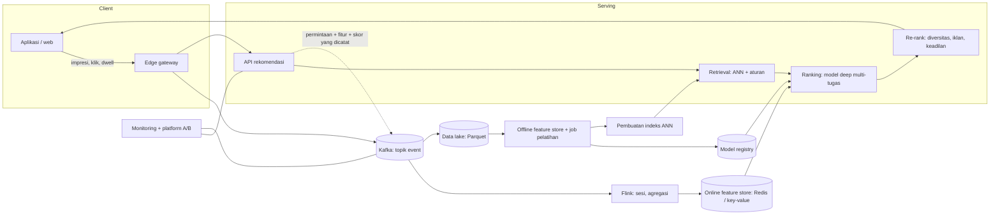
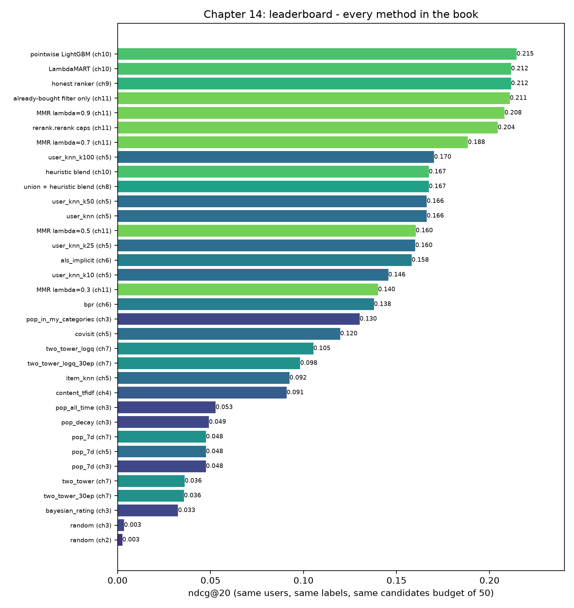

# Dari prototipe ke skala Shopee

Pukul 12:00 pada 9.9, dan flash sale baru saja dibuka. Dalam hitungan detik, jumlah orang di marketplace melonjak berkali-kali lipat dari puncak jam makan siang biasa. Setiap orang mendarat di beranda (*home feed*), dan setiap beranda harus berbeda. Pemeringkat (*ranker*) yang Anda latih di Bab 10 hanyalah beberapa ratus kilobyte pohon keputusan. Ia dibangun dari satu tabel Postgres, dan butuh sekitar 840 milidetik untuk menjawab satu permintaan di laptop. Tidak ada yang salah dengannya. Ukurannya pas untuk sebuah buku dan akhir pekan belajar, dan bentuknya hampir sama dengan sistem produksi. Tetapi ia tidak pernah dirancang untuk bertahan melewati siang itu.

Ada hal lain yang sama pentingnya. Flash sale tidak hanya membebani server. Ia mengubah datanya. Pembeli yang biasanya menjelajahi sepatu tiba-tiba memburu penanak nasi diskon. Model yang dilatih minggu lalu belum pernah melihat kerumunan flash sale, dan fitur-fiturnya masih mengatakan bahwa barang populer kemarin tetap yang terpopuler. Skala bukan hanya soal *throughput*. Skala juga soal kesegaran data, soal mengukur apakah sebuah perubahan benar-benar membantu, dan soal menjaga banyak tim, banyak tujuan, dan banyak model tetap jujur pada saat yang sama.

Bab penutup ini adalah sebuah peta. Kita tidak akan membangun klaster Kafka atau melatih transformer. Sebagai gantinya, kita menelusuri satu per satu komponen yang ditambahkan perusahaan seukuran Shopee di sekeliling inti yang sudah Anda pahami, dan menyebutkan dengan tepat masalah apa yang diselesaikan tiap komponen. Untuk setiap komponen, kita tunjuk bagian repositori ini yang akan digantikan atau diperluasnya. Di akhir bab, Anda seharusnya bisa membaca diagram arsitektur marketplace besar dan mengenali setiap kotaknya sebagai versi yang lebih besar dan lebih kokoh dari sesuatu yang sudah pernah Anda jalankan.

**Yang akan Anda pelajari**

- Bagaimana log *streaming* (Kafka) dan pemrosesan aliran (Flink) mengubah tabel `events` yang bersifat *batch* menjadi fitur waktu nyata, dan mengapa hal itu mengubah arti "segar".
- Untuk apa *feature store* digunakan, dan bagaimana ia mencegah *training/serving skew*.
- Mengapa pencarian tetangga terdekat hampiran (*approximate nearest neighbour*, ANN) tak terhindarkan pada miliaran item, dan cara memperkirakan biaya memorinya.
- Bagaimana pemeringkat Wide & Deep, DCN, DIN, dan MMoE multi-tugas berbeda dari pemeringkat *gradient-boosted* di repositori ini, dan kapan mereka sepadan dengan biayanya.
- Cara menggabungkan beberapa tujuan (GMV, iklan, keadilan bagi penjual) menjadi satu skor tanpa menyembunyikan trade-off-nya.
- Cara menjalankan uji A/B, termasuk uji-z dua proporsi lengkap dan perhitungan ukuran sampel yang dikerjakan manual.
- Apa yang perlu dipantau setelah sistem live, cara menganggarkan latensi, dan daftar periksa konkret tentang apa yang dibangun berikutnya di repositori ini.

## Intuisi: pasar malam dan jaringan supermarket

Bayangkan sebuah lapak pasar malam yang menjual pisang goreng. Pemiliknya mengenal setiap pelanggan tetap. Ia melihat siapa yang datang, mengingat pesanan minggu lalu, menyesuaikan gula ketika cuaca berubah, dan memutuskan di tempat apa yang akan direkomendasikan. Itulah prototipe kita. Semuanya muat dalam satu kepala, yaitu satu database Postgres dan satu proses Python. Pemilik bisa mencoba ide baru saat makan siang dan tahu pada makan malam apakah ide itu berhasil.

Sekarang bayangkan jaringan supermarket nasional: ratusan toko melaporkan penjualan lewat aliran pesan, tim data memelihara satu definisi bersama tentang "pelanggan setia", beberapa tim menjalankan promosi, dan bagian keuangan berkeras agar eksperimen diukur sebelum promosi diluncurkan secara nasional. Jaringan itu tidak membutuhkan pemilik yang lebih pintar. Ia membutuhkan *infrastruktur untuk menyepakati fakta, memindahkannya dengan cepat, dan mengukur perubahan*.

Itulah seluruh perbedaan antara repositori kita dan marketplace produksi. Gagasan-gagasannya (kandidat, fitur, pemeringkatan, pemeringkatan ulang) tetap utuh. Yang berlipat ganda adalah pipa-pipa di sekelilingnya. Sepanjang sisa bab ini kita akan terus mengajukan tiga pertanyaan yang sama pada setiap komponen baru:

1. Batasan prototipe mana yang dihilangkannya: kecepatan, kesegaran, skala, ketepatan, atau kemampuan bereksperimen?
2. Mode kegagalan baru apa yang dibawanya?
3. File mana di repositori ini yang akan digantikannya?

## Algoritma: pipeline yang sama, diperluas skalanya

Sebelum masuk ke rincian, berikut gambaran utuhnya. Pipeline multi-tahap dari Bab 8 (ambil, peringkatkan, peringkatkan ulang) tidak berubah. Yang berubah adalah setiap panah dalam diagram menjadi layanan jaringan dengan latensi, kapasitas, dan pemilik masing-masing.



*Gambar: Arsitektur ala Shopee. Garis putus-putus adalah yang terpenting: serving mencatat apa yang ditampilkannya, beserta fitur dan skor yang digunakannya.*

Baca diagram dari kiri ke kanan. Perilaku mengalir dari aplikasi ke antrean pesan. Dari sana ada dua jalur. Jalur cepat (Flink ke *online feature store*) menjaga fitur tetap segar hingga hitungan detik. Jalur lambat (*data lake* ke job pelatihan) menghasilkan model dan indeks ANN setiap beberapa jam atau hari. *Serving* membaca dari keduanya: model dan indeks terbaru dari jalur lambat, fitur pengguna terbaru dari jalur cepat. Dan yang krusial, *serving* menulis balik *exposure log*, yaitu apa yang ditampilkannya, sehingga pelatihan berikutnya tahu apa yang benar-benar dilihat pengguna.

Di prototipe, lingkaran yang sama ada tetapi diciutkan menjadi satu mesin. `useTracker.ts` adalah klien, rute Rust `POST /api/events` adalah *edge gateway*, tabel Postgres `events` adalah Kafka sekaligus *data lake*, `db.Store.refresh` adalah konsumen aliran, `pipeline.train_and_evaluate` adalah job pelatihan, dan RPC `Recommend` adalah lapisan *serving*. Ketika sebuah pertanyaan dimulai dengan "bagaimana kita menskalakan ini?", petakan dulu pertanyaan itu ke daftar ini.

### Log streaming dan fitur waktu nyata

Di prototipe, Rust menyisipkan satu baris per *event* ke Postgres, dan layanan Python melakukan *polling* untuk baris yang lebih baru dari id terakhir yang dilihatnya. Ini sederhana dan benar, dan berfungsi untuk beberapa ratus ribu baris. Pada skala besar, ia rusak dengan tiga cara:

- **Throughput penulisan.** Satu primary Postgres tidak akan sanggup menyerap jutaan *insert* per detik, dan penulisan *event* bersaing dengan pesanan dan keranjang.
- **Fan-out.** *Event* yang sama dibutuhkan banyak konsumen: pipeline fitur, sistem iklan, deteksi fraud, *data warehouse* analitik. Melakukan *polling* pada tabel menjadikan setiap konsumen pembaca database produksi.
- **Replay.** Ketika ditemukan bug pada definisi fitur, Anda perlu memproses ulang *event* bulan lalu. Tabel yang sekaligus menjadi sistem pencatatan utama (*system of record*) adalah tempat yang buruk untuk itu.

Jawaban standarnya adalah *message broker* berbasis log seperti Apache Kafka. Produser menambahkan *event* ke *topic*, yang dibagi menjadi *partition*. Setiap *consumer group* melacak *offset*-nya sendiri. Mempartisi berdasarkan `user_id` menjamin bahwa semua *event* seorang pengguna tiba berurutan di konsumen yang sama, persis yang dibutuhkan logika sesi. Karena log disimpan selama beberapa hari, konsumen baru dapat mulai dari awal, dan bug yang sudah diperbaiki dapat dijalankan ulang atas *event* lama.

Pemroses aliran seperti Apache Flink kemudian menghitung fitur secara inkremental. Ambil fitur `user_clicks_30d` dari Bab 9. Dalam SQL ia adalah `COUNT` atas sebuah jendela. Dalam sistem *streaming* ia menjadi operator berstatus: simpan *state* kecil per pengguna, tambah satu untuk setiap klik, kurangi klik yang baru saja keluar dari jendela 30 hari, lalu tulis nilai barunya ke *online store*. Bentuk umumnya adalah *event masuk, state diperbarui, fitur keluar*:

$$
s_u^{(t+1)} = f\bigl(s_u^{(t)},\, e_{t+1}\bigr), \qquad x_u^{(t+1)} = g\bigl(s_u^{(t+1)}\bigr)
$$

Di sini $s_u$ adalah *state* pengguna $u$, $e$ adalah *event* baru, $f$ memperbarui *state*, dan $g$ mengubah *state* menjadi nilai fitur $x_u$. Skor peluruhan seperti peluruhan eksponensial pada Bab 3 sangat cocok dalam bentuk ini, karena dapat diperbarui dalam waktu konstan: $s \leftarrow s \cdot 2^{-\Delta t / h} + w$, dengan $h$ adalah waktu paruh dan $w$ bobot *event*.

*Streaming* menambah kerumitan: *event* yang terlambat dan tidak berurutan membutuhkan jendela berbasis *event-time* dan *watermark*, *restart* tidak boleh menghitung ganda, dan menghitung fitur sekali di Flink dan sekali lagi secara *batch* mengundang *skew* yang dibahas berikutnya.

### Feature store dan training/serving skew

Ingat demo kebocoran data (*leakage*) di Bab 9. Fitur yang mengintip masa depan membuat ndcg@20 *offline* tampak 0.5035 dan bukan 0.2116, dan model itu tidak berguna saat live. *Training/serving skew* adalah saudara yang lebih halus dari *leakage*: fiturnya sah di kedua tempat, tetapi dihitung secara berbeda. Contoh umum: pelatihan membaca `user_ctr_30d` dari job SQL yang mengecualikan trafik bot, sementara *serving* menghitungnya di kode aplikasi yang tidak mengecualikan. Model mempelajari hubungan dari satu distribusi lalu ditanyai dengan distribusi lain. Metrik *offline* tetap sangat bagus. Metrik *online* diam-diam melorot.

*Feature store* menyerang masalah ini dengan menjadikan definisi fitur sebagai satu artefak ber-versi dengan dua materialisasi:

- **offline store** (file kolumnar atau *warehouse*) yang dapat menjawab "berapa nilai fitur ini untuk pengguna $u$ *pada waktu* $t$?" untuk jutaan baris pelatihan; dan
- **online store** (penyimpanan *key-value* berlatensi rendah) yang menjawab "berapa nilainya sekarang?" dalam satu milidetik.

Definisi yang sama memberi makan keduanya, sehingga angkanya selaras dari rancangannya. Separuh *offline* adalah tempat ketepatan titik-waktu (*point-in-time correctness*) berada. Ia melakukan "*as-of join*" yang dilakukan `data.History.at` di repositori ini: untuk setiap baris pelatihan dengan stempel waktu $t$, ambil nilai fitur terbaru dengan stempel waktu $\le t$, tidak pernah yang lebih baru. Dalam arti ini, gagasannya persis sama dengan Bab 9. *Feature store* hanya meng-industrialisasikannya.

Pertahanan kedua terhadap *skew* adalah *mencatat fitur yang disajikan*. Alih-alih menghitung ulang fitur historis untuk pelatihan, lapisan *serving* menulis vektor fitur yang benar-benar digunakannya, bersama posisi item dan skor model, ke *exposure log* (garis putus-putus di diagram). Pelatihan kemudian belajar dari persis apa yang disajikan. Ini memakan penyimpanan, tetapi menghapus satu kelas bug sepenuhnya, dan memberi Anda *propensity* yang dibutuhkan untuk koreksi bias posisi pada Bab 12.

### ANN pada miliaran item

Bab 7 menunjukkan indeks IVF yang memeriksa klaster vektor item. Pada 2,311 item yang tersedia, *brute force* membutuhkan 0.140 ms per kueri, dan indeks lebih lama dibangun daripada manfaatnya. Pada seratus juta atau satu miliar item, gambarannya berbalik. Ambil perkiraan memori kasar. Satu miliar item, masing-masing vektor 64 dimensi berisi *float* 4-byte:

$$
10^9 \times 64 \times 4\ \text{bytes} = 2.56 \times 10^{11}\ \text{bytes} = 256\ \text{GB}.
$$

Itu tidak muat dengan nyaman di satu mesin, dan memindainya per permintaan mustahil. Karena itu sistem produksi melakukan tiga hal sekaligus.

Pertama, **shard** indeksnya. Setiap *shard* menyimpan sebagian katalog, dan kueri disebar ke semua *shard*, yang masing-masing mengembalikan hasil teratas lokalnya untuk digabungkan. Kedua, **kompres** vektornya. *Product quantisation* memecah vektor menjadi sub-vektor dan mengganti masing-masing dengan id *codeword* terdekatnya. Vektor 256-byte bisa menjadi 16 byte, menyusutkan indeks yang sama menjadi $10^9 \times 16 = 16$ GB. Ketiga, gunakan **indeks graf atau berklaster** (HNSW, IVF-PQ, atau ScaNN dari Google) agar setiap kueri hanya menyentuh sebagian kecil vektor. Trade-off-nya persis seperti pada tabel Bab 7, di mana memeriksa 4 dari 32 klaster mempertahankan recall@20 pada 0.975 dari *brute force* sambil memindai 12.5% item. Pada skala besar Anda mengatur kenop yang sama, hanya dengan target latensi yang lebih ketat dan katalog yang jauh lebih besar.

Indeks dibangun ulang, bukan disunting, dan *item tower* harus dijalankan ulang untuk seluruh katalog setiap kali model berubah, sehingga versi model dan indeks dirilis sebagai satu pasangan.

::: fact
**Graph embedding skala web.** PinSage milik Pinterest menggabungkan *random walk* dengan konvolusi graf untuk mempelajari *embedding* pin. Ia dilatih pada graf dengan 3 miliar simpul (pin dan *board*) dan 18 miliar sisi, yang oleh para penulisnya disebut sebagai penerapan *graph embedding* mendalam terbesar pada saat publikasi.

Sumber: Ying et al., KDD, 2018
:::

### Pemeringkat deep

Pohon *gradient-boosted* adalah pemeringkat yang sangat baik untuk beberapa lusin hingga beberapa ratus fitur padat, dan papan peringkat di akhir bab ini menunjukkan sejauh mana mereka bisa melangkah pada data simulasi kita. Di marketplace besar, masukan pemeringkat terlihat berbeda: miliaran id jarang (*sparse*) (pengguna, item, toko, kueri), urutan perilaku yang panjang, dan beberapa hasil yang diprediksi sekaligus. Pohon kurang cocok untuk ini, karena pohon tidak bisa mempelajari *embedding* untuk id yang hanya muncul sebulan sekali. Pemeringkat neural bisa. Berikut empat keluarga yang paling sering Anda dengar.

**Wide & Deep.** Tim Google Play mengamati dua kebutuhan yang saling melengkapi. *Memorisasi*: mempelajari bahwa pasangan tertentu, seperti "memasang aplikasi A dan ditampilkan aplikasi B", sangat prediktif. *Generalisasi*: menangani pasangan yang belum pernah muncul bersamaan, melalui *embedding*. Wide & Deep melatih keduanya bersama-sama. Bagian "wide" adalah model linear atas fitur silang (*cross-product*) yang jarang. Bagian "deep" adalah MLP atas *embedding*. Keluarannya dijumlahkan menjadi satu logit:

$$
P(y=1 \mid \mathbf{x}) = \sigma\bigl(\mathbf{w}_{\text{wide}}^{\top}[\mathbf{x}, \phi(\mathbf{x})] + \mathbf{w}_{\text{deep}}^{\top} a^{(L)} + b\bigr)
$$

dengan $\phi(\mathbf{x})$ adalah transformasi *cross-product* dan $a^{(L)}$ adalah lapisan tersembunyi terakhir dari MLP. Di repositori kita, fitur silang buatan tangan dari Bab 9 (`uc_click_share_30d`, `price_ratio_to_user`) berperan sebagai bagian wide, dibuat oleh seorang *engineer* dan diberikan ke pohon. Pada **DCN** (Deep & Cross Network), persilangannya dipelajari: lapisan silang eksplisit mengalikan fitur masukan satu sama lain, lapis demi lapis, sehingga Anda tidak perlu lagi menulis tangan setiap interaksi.

**DIN.** Deep Interest Network milik Alibaba berangkat dari pengamatan tentang e-commerce. Riwayat pengguna memuat banyak minat, dan hanya sebagian yang relevan untuk item yang sedang dinilai. Memampatkan seluruh riwayat menjadi satu vektor tetap membuang kapasitas. DIN menambahkan *local activation unit*: item-item dalam riwayat pengguna diberi bobot menurut relevansinya terhadap item *kandidat*, sehingga pengguna yang sama mendapat vektor minat yang berbeda ketika kandidatnya casing ponsel dibandingkan penggorengan. Dalam pseudo-rumus:

$$
\mathbf{v}_u(a) = \sum_{j=1}^{H} w_j(a)\,\mathbf{e}_j, \qquad w_j(a) = \text{MLP}\bigl(\mathbf{e}_j,\ \mathbf{e}_a,\ \mathbf{e}_j \odot \mathbf{e}_a\bigr)
$$

Di sini $\mathbf{e}_j$ adalah *embedding* dari $H$ item lampau pengguna dan $\mathbf{e}_a$ adalah *embedding* kandidat. Bandingkan dengan *user tower* di Bab 7, yang merata-ratakan 20 item terakhir dengan bobot sama. DIN adalah gagasan yang sama, dengan bobot yang dipelajari dan bergantung pada kandidat. Model urutan berbasis Transformer, yang kini lazim, menggeneralisasikannya lebih jauh dengan *self-attention*.

**MMoE multi-tugas.** Marketplace peduli pada setidaknya tiga hasil: klik, tambah-ke-keranjang, dan pesanan. Di repositori ini kita memerasnya menjadi satu label (klik bernilai 1, keranjang 2, pesanan 3) dan melatih satu model LambdaMART. Itu murah, tetapi mengunci trade-off-nya dan hanya memberi model satu target yang berisik. Jaringan multi-tugas memprediksi setiap hasil dengan *head*-nya sendiri dan berbagi lapisan bawah. Versi naifnya, satu *trunk* bersama, menderita ketika tugas-tugas bertentangan: apa yang membuat pengguna mengklik (gambar yang menarik) berbeda dari apa yang membuatnya membeli. Rancangan *Multi-gate Mixture-of-Experts* mempertahankan beberapa sub-jaringan "ahli" (*expert*) bersama dan memberi setiap tugas gerbang (*gate*) sendiri yang memutuskan cara mencampurnya:

$$
y_k = h_k\Bigl(\sum_{i=1}^{n} g_k(\mathbf{x})_i \, f_i(\mathbf{x})\Bigr), \qquad g_k(\mathbf{x}) = \text{softmax}(W_{g_k}\,\mathbf{x})
$$

untuk tugas $k$, jaringan ahli $f_i$, *head* tugas $h_k$, dan gerbang per-tugas $g_k$. Jika klik dan pesanan berkaitan erat, gerbang mereka akan memilih ahli yang mirip. Jika bertentangan, gerbang akan mengkhususkan diri. Karena pesanan jarang dibandingkan klik (corong pada Bab 1), *head* `order` yang jarang juga diuntungkan oleh representasi yang dipelajari *head* `click` yang padat. Skor produksi kemudian menggabungkan semua *head*, yang membawa kita ke topik berikutnya.

::: fact
**Atensi pada riwayat pengguna.** Deep Interest Network (DIN) milik Alibaba mengganti vektor pengguna berpanjang tetap dari resep Embedding-and-MLP standar dengan *local activation unit* yang memberi bobot pada perilaku lampau pengguna menurut relevansinya terhadap iklan kandidat. Ia dilatih pada dataset produksi Alibaba berisi lebih dari 2 miliar sampel dan diterapkan di sistem iklan *display* online Alibaba, melayani trafik utama.

Sumber: Zhou et al., KDD, 2018
:::

::: fact
**Wide & Deep di toko aplikasi.** Makalah Wide & Deep dari Google melatih bersama model linear (memorisasi) dan jaringan deep (generalisasi), dan mengevaluasinya di Google Play, toko aplikasi komersial dengan lebih dari satu miliar pengguna aktif dan lebih dari satu juta aplikasi. Eksperimen online menunjukkan bahwa ia meningkatkan akuisisi aplikasi secara signifikan dibandingkan model wide-saja dan deep-saja.

Sumber: Cheng et al., DLRS Workshop, 2016
:::

### Pemeringkatan multi-tujuan: GMV, iklan, dan penjual

Setelah pemeringkat mengeluarkan $\hat{p}_{\text{click}}$, $\hat{p}_{\text{cart}}$, dan $\hat{p}_{\text{order}}$ secara terpisah, seseorang harus memutuskan cara memadukannya. Bentuk paling sederhana adalah jumlah berbobot, sering dengan suku bisnis untuk margin atau penempatan bersponsor:

$$
\text{score}(u, i) = \Bigl(w_1\,\hat{p}_{\text{click}} + w_2\,\hat{p}_{\text{cart}} + w_3\,\hat{p}_{\text{order}}\Bigr)\cdot \bigl(1 + \beta_{\text{boost}}(i)\bigr) + \lambda_{\text{ads}}\,\text{bid}(i)\,\hat{p}_{\text{click}}
$$

Bobot-bobot ini tidak dipelajari dari klik. Mereka adalah kebijakan. Menaikkan $w_3$ mengutamakan GMV (*gross merchandise value*), dan menaikkan $\lambda_{\text{ads}}$ mengutamakan pendapatan iklan. *Boost* $\beta_{\text{boost}}(i)$ menyandikan aturan kampanye, seperti subsidi tingkat toko untuk merek mall selama sale. Ini adalah struktur yang sama dengan aturan *re-ranking* di Bab 11, yang dinaikkan dari "batasan dalam fungsi Python" menjadi bagian formal dari tujuan, dan sistem produksi yang baik bersikap eksplisit tentangnya. Semua orang dapat membaca bobotnya, memperdebatkannya, dan melihatnya di konfigurasi eksperimen. Bahayanya adalah keterkaitan tersembunyi: pemeringkat yang dilatih untuk memprediksi pesanan lalu dibobot ulang berdasarkan margin bisa mengejar barang mahal yang jarang terkonversi.

Keadilan bagi penjual masuk dengan dua cara. Sebagai **batasan**, ia seperti batas 4 item per toko di `rerank.rerank` pada repositori. Sebagai **tujuan**, Anda memberi penjual baru atau kecil sejumlah eksposur yang terkendali, karena marketplace yang hanya menampilkan toko-toko lama akan membuat sisi pasokannya sendiri kelaparan. Ini adalah gagasan eksplorasi dari Bab 11 dan Bab 12, diterapkan pada penjual alih-alih item. Apa pun pilihan Anda, *ukur secara terpisah*. Lacak metrik sisi penjual (porsi eksposur ke toko berusia di bawah 30 hari, konsentrasi antar toko) di samping metrik sisi pembeli dalam setiap eksperimen, dan perlakukan penurunan di salah satunya sebagai biaya.

::: fact
**Multi-task learning untuk rekomendasi.** Makalah MMoE mengadaptasi struktur Mixture-of-Experts ke pembelajaran multi-tugas dengan membagi sub-model ahli di semua tugas sambil memberi setiap tugas jaringan gerbangnya sendiri. Para penulis menunjukkan bahwa ia berkinerja lebih baik daripada baseline ketika tugas-tugasnya kurang berkaitan, dan memperlihatkan peningkatan pada sistem rekomendasi konten skala besar di Google.

Sumber: Ma et al., KDD, 2018
:::

### Uji A/B, lengkap dengan aritmetikanya

Setiap angka di papan peringkat di bawah adalah *offline*. Angka itu dihitung dari log tentang apa yang dilakukan pengguna di bawah sistem sebelumnya. Metrik *offline* memeringkatkan model kandidat dengan murah, tetapi tidak dapat memastikan apakah sebuah model membantu pengguna sungguhan, karena alasan dari Bab 2 dan 12: data log mencerminkan pilihan sistem lama, bias posisi sudah tertanam, dan metrik kita mengabaikan diversitas dan pendapatan. Penentu akhirnya adalah **uji A/B**: tetapkan pengguna secara acak ke kontrol (sistem saat ini) atau perlakuan (sistem baru), tunggu, lalu bandingkan metrik bisnis.

Mekanismenya mengikuti resep tetap:

1. Pilih *metrik utama* (misalnya konversi pesanan per pengguna) dan *metrik pengaman* (*guardrail*: latensi, eksposur sisi penjual, tingkat retur) sebelum peluncuran.
2. Hitung ukuran sampel yang dibutuhkan dari efek terkecil yang Anda pedulikan.
3. Acak **per pengguna**, dengan *hash* yang stabil, agar satu pengguna selalu melihat satu varian.
4. Periksa penugasannya sendiri. Jika Anda berniat membagi 50/50 dan mengamati 50.6/49.4 pada jutaan pengguna, ada yang rusak (*sample ratio mismatch*), dan hasilnya tidak bisa dipercaya.
5. Jalankan selama siklus mingguan penuh, lalu uji selisihnya.

Berikut contoh lengkap yang dikerjakan. **Semua angka di bawah ini hipotetis**, dibuat untuk menunjukkan cara kerjanya. Angka-angka itu bukan keluaran skrip repositori ini.

Misalkan setiap varian menerima $n = 100{,}000$ pengguna. Pada kontrol, 8,000 pengguna membuat pesanan, sehingga $\hat{p}_C = 0.0800$. Pada perlakuan, 8,240 pengguna, sehingga $\hat{p}_T = 0.0824$. Peningkatan absolut yang teramati adalah $0.0824 - 0.0800 = 0.0024$, peningkatan relatif 3%. Apakah ini nyata atau hanya derau?

Uji-z dua proporsi dimulai dari hipotesis nol bahwa kedua varian memiliki laju dasar yang sama. Di bawah hipotesis itu, estimasi terbaik untuk laju bersama adalah proporsi gabungan (*pooled*):

$$
\hat{p} = \frac{x_C + x_T}{n_C + n_T} = \frac{8000 + 8240}{200000} = 0.0812
$$

Galat baku selisih, di bawah hipotesis nol, adalah

$$
\text{SE} = \sqrt{\hat{p}(1-\hat{p})\left(\frac{1}{n_C}+\frac{1}{n_T}\right)} = \sqrt{0.0812 \times 0.9188 \times \frac{2}{100000}} \approx 0.001222
$$

Statistik uji menghitung berapa galat baku jarak selisih yang teramati dari nol:

$$
z = \frac{\hat{p}_T - \hat{p}_C}{\text{SE}} = \frac{0.0024}{0.001222} \approx 1.965
$$

Untuk uji dua sisi, nilai-p adalah $2\,(1 - \Phi(1.965)) \approx 0.0494$, dengan $\Phi$ adalah CDF normal baku. Pada $\alpha = 0.05$ yang lazim, ini baru saja melewati ambang. Selang kepercayaan 95% untuk selisihnya (memakai galat baku tanpa *pooling*, juga sekitar 0.001222) kira-kira $[0.000006,\ 0.004794]$: ia nyaris tidak mengecualikan nol, sehingga peningkatan sebenarnya bisa berada di mana saja dari nyaris tidak ada hingga 6% relatif. Itulah pembacaan yang jujur. "Signifikan" di sini berarti "kita tidak bisa dengan nyaman menyingkirkan nol", bukan "peningkatannya 3%". Jika Anda mengintip dasbor setiap hari dan berhenti pada kali pertama $p < 0.05$, laju positif palsu Anda yang sebenarnya akan jauh lebih tinggi dari 5%. Tingkat signifikansi mengasumsikan satu kali pengamatan yang direncanakan sebelumnya.

Berapa pengguna yang kita butuhkan? Untuk efek absolut target $\delta$ pada signifikansi $\alpha$ dan daya (*power*) $1 - \beta$, ukuran sampel per varian kira-kira

$$
n \approx \frac{2\,(z_{\alpha/2} + z_{\beta})^2\; p(1-p)}{\delta^2}
$$

Dengan $p = 0.08$, $\delta = 0.0024$, $z_{\alpha/2} = 1.96$, dan $z_{\beta} = 0.8416$ (daya 80%):

$$
n \approx \frac{2 \times (2.8016)^2 \times 0.08 \times 0.92}{0.0024^2} = \frac{2 \times 7.849 \times 0.0736}{0.00000576} \approx 200{,}600
$$

Jadi sekitar 200,600 pengguna per varian, kira-kira dua kali lipat dari yang kita jalankan. Uji hipotetis kita *kurang bertenaga* (*underpowered*) untuk peningkatan relatif 3%, itulah sebabnya hasilnya mendarat di batas. Karena $n$ yang dibutuhkan tumbuh sebesar $1/\delta^2$, menjadikan efek yang ingin dideteksi setengahnya berarti melipatempatkan trafik yang dibutuhkan. Inilah sebabnya perusahaan besar terobsesi pada teknik pengurangan varians, dan mengapa menguji banyak penyesuaian kecil sekaligus membutuhkan kehati-hatian.

### Monitoring dan drift

Rekomender yang sudah dideploy bisa gagal secara diam-diam. Layanan tetap mengembalikan 200 OK dengan dua puluh item yang diformat sempurna, sementara kualitasnya merosot. Penyebab yang umum:

- **Data drift:** masukan berubah, misalnya versi aplikasi baru berhenti mengirim `dwell_sec`.
- **Concept drift:** hubungan fitur-hasil berubah setelah hari libur.
- **Feedback loop:** model hanya belajar tentang item yang pernah ditampilkannya (Bab 12).
- **Pipeline rusak:** aliran yang terlambat, fitur yang basi, indeks yang tidak dibangun ulang.

Masing-masing punya monitor. Untuk *data drift*, bandingkan distribusi tiap fitur pada satu jam terakhir dengan distribusi pelatihan menggunakan statistik sederhana seperti *population stability index* atau uji Kolmogorov–Smirnov, dan beri peringatan ketika porsi nilai yang hilang berubah. Untuk model, perhatikan distribusi skor prediksi, karena pergeseran mendadak adalah proksi murah untuk masukan yang rusak. Untuk hasil, lacak CTR dan konversi online menurut posisi dan menurut kelompok aktivitas pengguna, seperti yang dilakukan Bab 12 secara *offline*, dan bandingkan dengan **holdout** kecil: beberapa persen pengguna yang selalu menerima baseline sederhana. *Holdout* adalah penggaris jujur Anda, karena ia memberi tahu apakah seluruh rekomender masih mengalahkan popularitas, yang menurut papan peringkat kita selisihnya setidaknya 4x (pop_7d meraih 0.048, pemeringkat 0.215). Terakhir, pantau *kesegaran* itu sendiri: usia *event* terbaru yang terlihat oleh pemeringkat, dan usia indeks. Di repositori ini, padanan peringatan kesegaran adalah membandingkan `max(ts)` di tabel `events` dengan *event* terbaru yang dilihat `Store.refresh`.

### Anggaran latensi

Sebuah permintaan adalah rantai panggilan, sehingga anggaran halaman (katakanlah 300 ms pada p99) dibagi ke seluruh tahap: gateway dan autentikasi, pengambilan fitur pengguna, *retrieval*, perakitan fitur, *ranking*, *re-ranking*, hidrasi, dan jaringan. Tiga prinsip membuat anggaran berjalan. Pertama, **ekor mendominasi**: halaman yang menyebar ke sepuluh layanan selambat layanan yang paling lambat, sehingga p99 lebih penting daripada median. Hasil kita sendiri menunjukkannya pada skala kecil: p50 server 839.9 ms, p99 985.0 ms, maksimum 1010.6 ms. Kedua, **menurun secara anggun alih-alih gagal**: setiap tahap membutuhkan tenggat dan *fallback* yang lebih murah, itulah sebabnya `GET /api/recommendations` mengembalikan daftar popularitas dengan `fallback: true` setelah *timeout* 5 detik. Ketiga, **simpan di *cache* apa yang dibagi**: statistik tingkat item berubah lambat dan dapat dihitung sekali untuk semua pengguna.

## Panduan kode: pseudo-code untuk bagian yang belum ada

Tidak ada kode repositori yang disertakan di sini, karena tidak satu pun komponen ini sudah ada di repositori. Sketsa di bawah adalah pseudo-code: perpaduan bisnis dari bagian multi-tujuan. Bandingkan alur *serving*-nya dengan `RecommenderService.Recommend`: bentuknya sama, ditambah *retriever* berbasis *user tower*, pencarian *feature store* secara *batch*, beberapa *head* tugas, dan *exposure log* yang ditulis di akhir.

```python
# Pseudo-code: blending task heads into one score.
def final_score(p, cands, w=(1.0, 2.0, 3.0), ads_weight=0.0):
    base  = w[0]*p["click"] + w[1]*p["cart"] + w[2]*p["order"]
    boost = np.array([c.campaign_boost for c in cands])   # e.g. 0.1 in a sale
    ads   = ads_weight * np.array([c.bid for c in cands]) * p["click"]
    return base * (1.0 + boost) + ads
```

Bobot `(1.0, 2.0, 3.0)` menggemakan skema label buku ini (klik 1, keranjang 2, pesanan 3) tetapi kini *eksplisit dan dapat disetel*.

## Jalankan: papan peringkat buku

Gambar bab ini mengumpulkan setiap metode yang dievaluasi dalam buku ini pada pengguna simulasi yang sama, label yang sama, dan jendela evaluasi 7 hari yang sama. Hasilkan ulang gambar itu, beserta perbandingan utama yang diringkasnya, dengan:

```bash
cd book
uv run python tools/make_figures.py ch14
```

Gambar itu membaca `results/*.json` dari setiap skrip pendamping. Tiga baris teratasnya berasal dari perbandingan di Bab 10, yang terlihat seperti ini:

```output
file: results/ch10_ltr.txt
lines: 2-9
```

*Heuristic blend*, model *pointwise*, dan LambdaMART semuanya mengurutkan kandidat yang *sama*, yang batas atas recall-nya adalah 0.4645. Batas atas itulah sebabnya bahkan pemeringkat terbaik hanya mencapai recall@20 yang sederhana.

## Hasil: membaca papan peringkat



Grafik ini menceritakan kisah seluruh buku dalam satu gambar, dan sebaiknya dibaca dari bawah ke atas.

**Baseline acak dan rating-saja** (0.003 dan 0.033) adalah lantainya. Rating rata-rata Bayesian saja, tanpa gagasan tentang apa yang sebenarnya dibeli orang, hanya sedikit di atas peluang acak. Keluarga popularitas mendarat di sekitar 0.048 hingga 0.053. Popularitas jendela 7 hari, popularitas sepanjang waktu, dan versi dengan peluruhan nyaris tak bisa dibedakan, yang merupakan hasil jujur seperti yang dilaporkan Bab 3.

**Model konten dan kolaboratif** naik ke rentang 0.09 hingga 0.17. Pemfilteran konten TF-IDF mencapai 0.091, item-kNN 0.092, ALS 0.158, dan user-kNN dengan 100 tetangga 0.170. Keluarga *retriever* personal ini kira-kira melipattigakan baseline popularitas. Perhatikan bahwa *retriever* ko-visitasi sederhana (0.120) sudah lebih kuat daripada model two-tower terbaik (0.105), dan bahwa model two-tower baru sampai di sana setelah koreksi logQ dari Bab 7: lari tanpa koreksi menghasilkan 0.036. Model neural tidak otomatis lebih baik. Ia membutuhkan fungsi *loss* yang tepat, dan pada 2,495 item ia hanya punya sedikit ruang untuk bersinar.

**Sistem multi-tahap** menempati bagian atas grafik. *Heuristic blend* atas gabungan sumber kandidat mendapat 0.167. Pemeringkat terlatih atas kandidat yang sama mencapai 0.212 (LambdaMART) dan 0.215 (LightGBM pointwise). Pemeringkat jujur bebas-*leakage* dari Bab 9 (0.212) berada di tingkat yang sama, sementara kembarannya yang bocor dari bab yang sama mendapat 0.5035, itulah sebabnya ia sengaja tidak ada di peringkat: ia adalah bug, bukan metode. Urutan batang hijau mengingatkan dua pelajaran sebelumnya: selisih antara dua tujuan pemeringkat itu sekitar satu simpangan baku antar-*seed* (Bab 10), dan baris-baris MMR dengan $\lambda$ di bawah 1 *kehilangan* ndcg sebagai ganti diversitas (Bab 11).

Dua peringatan berlaku untuk setiap kesimpulan dari grafik ini. Pertama, datanya simulasi, dan model preferensi tersembunyinya lebih sederhana daripada dunia nyata. *Urutan* metode lebih bisa dipindahkan daripada nilai absolutnya. Kedua, ini adalah angka *offline* pada satu pembagian mingguan. Angka-angka ini membenarkan untuk mencoba sebuah metode dalam uji A/B sungguhan. Mereka tidak pernah menggantikan uji tersebut.


Tangkapan layar di atas adalah panel "The model" pada `/how-it-works`: versi model, jumlah *event* yang dimuat, dan fitur teratas menurut porsi *gain*. Pada skala besar ia menjadi *model registry* dengan riwayat antar versi.

## Jebakan dan cara produksi menanganinya

**Menambah skala sebelum perlu.** Menyalin arsitektur perusahaan besar untuk masalah kecil menambah beban operasional dan gangguan baru. Jika *event* Anda muat dalam satu database dan model dilatih ulang dalam hitungan menit, rancangan prototipe sudah benar; migrasilah ketika ada hambatan konkret.

**Model deep tanpa baseline yang kuat.** Pertahankan pemeringkat pohon *boosted* sebagai tolok ukur dan *fallback*; rilis model deep hanya jika ia menang secara online dengan selisih cukup untuk membenarkan biayanya.

### Apa yang dibangun berikutnya di repositori ini

Jika Anda ingin melanjutkan proyek ini, berikut daftar periksa berprioritas. Setiap butir cukup kecil untuk dikerjakan dalam satu akhir pekan dan mengajarkan satu gagasan dari bab ini.

1. **Cache frame tingkat item.** Median 840 ms di Bab 13 mengisyaratkan bahwa sebagian besar permintaan dihabiskan untuk menghitung ulang statistik tingkat item bagi setiap pengguna. Simpan itu di *cache* dengan TTL singkat, kuncikan pada waktu *cache*, dan ukur lagi. Harapkan peningkatan tunggal terbesar dengan kode paling sedikit.
2. **Catat eksposur.** Buat `Recommend` menulis satu baris per item yang ditampilkan (id permintaan, versi model, peringkat, skor, fitur). Latih pada eksposur alih-alih merekonstruksinya, dan gunakan untuk pembobotan *propensity*.
3. **Tambahkan holdout dan kerangka A/B mini.** *Hash* `user_id` menjadi *bucket*; kirim 5% ke *fallback* popularitas; catat *bucket* pada setiap *event*; bangun halaman yang menerapkan uji-z dari bab ini pada konversi pesanan.
4. **Pecah label menjadi beberapa head.** Latih model klik, keranjang, dan pesanan terpisah (tiga model LightGBM sudah cukup), ekspos bobot campuran di konfigurasi, dan bandingkan dengan label bertingkat tunggal.
5. **Ganti poller dengan antrean.** Minta Rust menerbitkan *event* ke *broker*, dan minta `Store` mengonsumsi darinya. Pertahankan Postgres sebagai *system of record*. Ini langkah jujur terkecil menuju arsitektur *streaming*.
6. **Tambahkan monitor drift.** Implementasikan pemeriksaan *drift* (misalnya *population stability index*) untuk 15 fitur teratas menurut kepentingan dan tampilkan di halaman `/how-it-works`.
7. **Tambahkan retriever two-tower sebagai sumber kelima.** Gunakan indeks item dari Bab 7 dengan koreksi logQ, dan periksa dengan skrip Bab 8 bahwa ia menaikkan recall gabungan sebelum Anda membayarnya dalam latensi.
8. **Lindungi penjual baru.** Tambahkan batas bawah eksposur untuk toko yang terdaftar dalam 7 hari terakhir dan ukur biayanya dalam ndcg, seperti yang dilakukan Bab 11 untuk diversitas.

::: tip
Kerjakan daftar periksa secara berurutan. Butir 1 sampai 3 memberi Anda perangkat *pengukuran* (kecepatan, log, eksperimen). Tanpa itu Anda tidak bisa tahu apakah butir 4 sampai 8 membantu.
:::

::: fact
**Pelatihan waktu nyata di produksi.** Sistem Monolith milik ByteDance berargumen bahwa kerangka kerja serbaguna memisahkan pelatihan *batch* dari *serving* sehingga tidak dapat belajar dari umpan balik pelanggan secara waktu nyata. Ia memperkenalkan tabel *embedding* tanpa tabrakan (dengan *embedding* yang dapat kedaluwarsa dan penyaringan frekuensi untuk membatasi memori) dan arsitektur pelatihan online, dan telah diterapkan di BytePlus Recommend.

Sumber: Liu et al., arXiv, 2022
:::

## Ringkasan

- Menskalakan rekomender mempertahankan pipeline (ambil, peringkatkan, peringkatkan ulang) dan mengganti setiap panah dengan layanan: *event* melewati log seperti Kafka, dan job *streaming* menjaga fitur tetap segar.
- *Feature store* mendefinisikan setiap fitur sekali, dengan materialisasi *as-of* offline untuk pelatihan dan materialisasi online untuk *serving*, yang mencegah *training/serving skew*. Mencatat fitur yang disajikan adalah pertahanan kedua.
- Pada satu miliar item Anda melakukan *shard*, kompresi (*product quantisation*), dan memakai indeks ANN; indeks float32 64 dimensi berukuran 256 GB sebelum kompresi, sehingga aritmetika memori menentukan rancangan.
- Pemeringkat deep menambahkan apa yang tidak bisa dilakukan pohon: *embedding* untuk id jarang (Wide & Deep, DCN), atensi sadar-kandidat atas riwayat (DIN), dan beberapa *head* untuk klik, keranjang, dan pesanan (MMoE).
- Memadukan *head* menjadi satu skor adalah keputusan kebijakan: buat bobot, suku iklan, dan aturan keadilan penjual eksplisit dan ukur secara terpisah.
- Uji A/B membutuhkan metrik yang dideklarasikan sebelumnya, ukuran sampel yang dihitung di muka, pemeriksaan rasio sampel, dan satu kali pengamatan terencana. Contoh yang dikerjakan menunjukkan bagaimana $z \approx 1.965$ hipotetis hanya signifikan secara marginal, dan mengapa sekitar 200,600 pengguna per varian dibutuhkan.
- Pantau *drift* fitur, distribusi skor, hasil menurut posisi dan aktivitas, serta kesegaran, terhadap sebuah *holdout*. Anggarkan latensi berdasarkan p99, beri setiap tahap tenggat dan *fallback*.
- Papan peringkat menyatakan temuan buku ini secara *offline*: *retrieval* personal mengalahkan popularitas, dan pemeringkat terlatih atas kandidat multi-sumber mengalahkan semua yang lain. Eksperimen langsung menentukan apakah peningkatannya nyata.

## Kuis

**Q14.1** *Training/serving skew* paling langsung muncul ketika:

A. Set pelatihan lebih besar daripada set *serving*.
B. Sebuah fitur dihitung dengan kode atau filter yang berbeda pada saat pelatihan dan pada saat *serving*.
C. Model dilatih ulang terlalu sering.
D. Indeks ANN mengembalikan hasil hampiran.

**Q14.2** Apa yang dilakukan *local activation unit* pada DIN?

A. Ia memampatkan seluruh riwayat pengguna menjadi satu vektor berpanjang tetap tanpa memandang kandidat.
B. Ia memberi bobot pada perilaku lampau pengguna menurut relevansinya terhadap item kandidat spesifik yang sedang dinilai.
C. Ia memilih sumber *retrieval* mana yang dipakai untuk tiap pengguna.
D. Ia menghilangkan bias posisi dari label pelatihan.

**Q14.3** Pada model *multi-gate mixture-of-experts* (MMoE), apa tujuan adanya gerbang terpisah per tugas?

A. Agar setiap tugas (klik, keranjang, pesanan) dapat memilih kombinasi berbobot sendiri dari para ahli bersama.
B. Untuk melatih setiap tugas pada dataset yang berbeda.
C. Untuk menjamin semua tugas memiliki *loss* yang sama.
D. Untuk men-*cache* prediksi antar tugas.

**Q14.4** Pada hasil latensi di Bab 13, p50 server adalah 839.9 ms dan p99 adalah 985.0 ms. Mengapa tim produksi menganggarkan berdasarkan p99 dan bukan p50, dan apa yang dilakukan repositori ini ketika sebuah permintaan terlalu lambat?

**Q14.5** Jelaskan mengapa posisi yang lebih baik pada papan peringkat *offline* saja tidak membenarkan perilisan sebuah model. Gunakan pemeringkat bocor (ndcg@20 0.5035 dibandingkan 0.2116 untuk yang jujur) sebagai salah satu contoh, dan sebutkan satu alasan lain.

**Q14.6** Sebuah uji A/B hipotetis mengirim 50,000 pengguna ke setiap varian. Kontrol memiliki 5,000 pesanan dan perlakuan memiliki 5,150. Hitung proporsi gabungan, galat baku, statistik z, dan putuskan pada $\alpha = 0.05$ (dua sisi) apakah peningkatannya signifikan. (Nilai-p dua sisi untuk $z = 1.57$ sekitar 0.116.)

**Q14.7** Sebuah katalog memiliki 2 miliar item. Setiap vektor item memiliki 128 dimensi yang disimpan sebagai *float* presisi-setengah 2-byte. Berapa GB yang dibutuhkan indeks mentahnya? Jika *product quantisation* memampatkan tiap vektor menjadi 32 byte, berapa GB indeks terkompresnya?

**Q14.8** Baca sketsa `final_score` dalam bab ini, dengan `w=(1.0, 2.0, 3.0)`, `ads_weight=0.0`. Sebuah item memiliki `p_click = 0.2`, `p_cart = 0.05`, `p_order = 0.01`, dan `campaign_boost = 0.1`. Berapa skor akhirnya? Berapa skornya jika *campaign boost* bernilai 0?

**Q14.9** Anda merencanakan uji A/B 50/50 dan, setelah sehari, mengamati 50.6% pengguna di kontrol dan 49.4% di perlakuan, dari beberapa juta pengguna. Apa yang ditunjukkan hal ini, dan apakah Anda harus membaca hasil konversinya?

A. Itu derau yang wajar; baca hasilnya.
B. Itu *sample ratio mismatch*, menandakan bug pada pengacakan atau pencatatan; selidiki sebelum memercayai hasil apa pun.
C. Itu membuktikan bahwa perlakuan mengurangi trafik.
D. Itu berarti ukuran sampel terlalu kecil.

**Q14.10** *Praktik langsung.* Buka `book/code/ch11_rerank.py` dan tambahkan `0.8` ke daftar `LAMBDAS` (di antara 0.9 dan 0.7). Jalankan dari `book/` dengan `uv run python code/ch11_rerank.py`. Nyatakan apa yang Anda harapkan untuk ndcg@20 dan jumlah kategori berbeda pada baris baru relatif terhadap baris 0.9 dan 0.7, lalu periksa, dan katakan apakah hal ini mendukung klaim dalam bab ini bahwa diversitas harus dibayar dengan relevansi.
