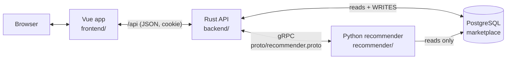
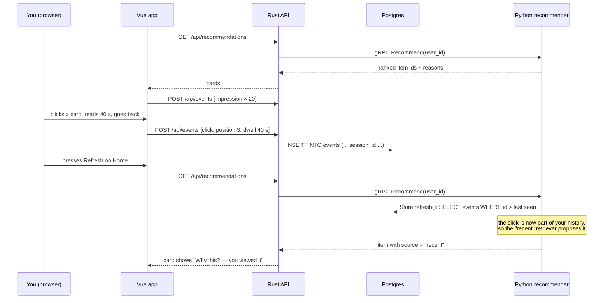

# How this marketplace recommends products — a hands-on guide

This repo is a small but complete online marketplace (think a tiny Shopee) whose
home page is driven by a real multi-stage recommender. Everything the
recommender does is visible: every card has a **"Why this?"** panel, the
**How it works** page shows your own clicks arriving live, and the model's
metrics and feature importances are one click away.

This guide explains how to run it and, step by step, how the recommendations
are made. No machine-learning background is assumed.

---

## 1. Run it

### Prerequisites

| Tool | Used for | Check |
|---|---|---|
| PostgreSQL at `localhost:5432`, user `postgres`, password `postgres` | the app database | `psql -h localhost -U postgres -c 'select 1'` |
| Rust (cargo) | the API server (`backend/`) | `cargo --version` |
| Node.js + npm | the web UI (`frontend/`) | `node --version` |
| uv | the Python recommender (`recommender/`) | `uv --version` |
| protoc | compiling `proto/recommender.proto` for Rust | `protoc --version` |

### One-time setup

```sh
PGPASSWORD=postgres createdb -h localhost -U postgres marketplace
cp backend/.env.example backend/.env
(cd backend && cargo run -- migrate)               # creates the tables
(cd recommender && uv sync && uv run recsys seed-db --yes)   # 60 days of simulated shoppers, ending now
(cd frontend && npm i)
```

`seed-db` fills the database with a simulated marketplace: 1,500 shoppers,
150 shops, 2,500 products and about 276,000 logged events, shifted in time so
the last simulated day is *today*. That is why recommendations work the moment
you log in.

### Start the three services (three terminals)

```sh
cd recommender && uv run recsys serve     # Python gRPC recommender  -> 127.0.0.1:50051
cd backend && cargo run                   # Rust API                 -> 127.0.0.1:8080
cd frontend && npm run dev                # Vue web app              -> http://localhost:5173
```

Open <http://localhost:5173>. The first `recsys serve` trains a model if none
exists yet (a few seconds).

### Demo logins (password for all: `password`)

| Who | Email | Notes |
|---|---|---|
| Shopper | `user43@demo.test` | has a rich history; any `user1`…`user1500` works |
| Seller | `seller1@demo.test` | owns shop 1; any `seller1`…`seller150` works |
| Admin | `admin@demo.test` | can press **Retrain now** on the How it works page |

---

## 2. The big picture



Who owns what:

- **Rust writes, Python reads and thinks.** Every piece of user behaviour —
  impressions, clicks, add-to-carts, orders, searches — is written to Postgres
  by the Rust API. The Python recommender connects with a *read-only*
  connection (`recsys/db.py`, `connect(read_only=True)`), so it physically
  cannot change shop data.
- **Recommendations are computed on request.** When the home page asks for
  recommendations, Rust calls the Python service over gRPC; Python looks at the
  latest data, scores candidates with its model, and answers in well under a
  second. Rust then fills in product details (title, price, shop) from
  Postgres and sends cards to the browser.
- **Training happens in the background.** The model that scores items is
  retrained every 6 hours (and on demand by an admin), on the same database.
- **If Python is down, the shop still works.** Rust falls back to "best sellers
  of the last 7 days" and the home page shows a yellow banner.

---

## 3. The life of one click



1. The grid on the home page reports an **impression** for every card it shows
   (`frontend/src/components/ProductGrid.vue`).
2. When you open a product, the page starts a timer. When you leave, it sends
   one **click** with the card's position, where you came from (`home_feed`,
   `search`, `similar`, …) and how long you stayed — the **dwell time**
   (`frontend/src/views/Product.vue`).
3. Events are batched in the browser and sent every 2 seconds
   (`frontend/src/composables/useTracker.ts`) to `POST /api/events`.
4. Rust attaches them to your current **session** (`backend/src/sessions.rs`,
   `touch_session`) and inserts rows into the `events` table.
5. On the next recommendation request, the Python service's `Store.refresh()`
   (`recommender/recsys/db.py`) reads only events newer than the last ones it
   saw. Your click is now history, and the pipeline below picks it up.

---

## 4. What gets logged and why

| Event | Emitted by | When | What it teaches the model |
|---|---|---|---|
| `impression` | browser | a card is rendered in a grid | "was shown"; needed to compute click-through rates and to notice items you keep ignoring |
| `click` | browser | you leave a product page you opened | interest; position and dwell time say *how much* |
| `hide` | browser | "Not interested" on a home card | strong negative: the item is never shown to you again |
| `add_to_cart` | server (Rust) | `POST /api/cart` | strong interest (weight 3 vs. a click's 1) |
| `order` | server (Rust) | checkout, one per line | strongest signal (weight 5); also "don't recommend the fridge you just bought" |
| `return` | (simulated only) | product returned | a quality warning for the item |

The browser may only send `impression`, `click` and `hide`. Carts and orders
are written by the server at the moment they really happen, so nobody can
fake a purchase signal from the browser.

**Searches** are stored in their own table (`searches`) whenever a logged-in
user searches. A search for "cat food" counts as interest in the *Cat Food*
category, even before you click anything.

**Sessions** group events that happen close together. The rule
(`touch_session`): if your last activity was less than 30 minutes ago, the
event joins that session; otherwise a new session starts. Sessions matter
because "people who viewed X also viewed Y" is computed *within* sessions.

---

## 5. Inside the recommender, step by step

All of this lives in `recommender/recsys/`. The request path is
`service.py → Recommend` → `pipeline.recommend`.

### Step 0 — freeze the world at a moment: `History.at`

`data.History.at(tables, cutoff)` returns everything known *before* `cutoff`:
events, searches, items already listed, which are in stock. When serving,
`cutoff` is "now". When training, it is a moment in the past, and the labels
come from what happened after it. Using one function for both is what keeps
training honest (see *leakage* in the glossary).

### Step 1 — candidates: four cheap retrievers (`candidates.py`, `generate`)

There are 2,500 products; scoring each one carefully for every request would
be wasteful. Four simple retrievers each propose items for a different
reason, and their union (~100 items) moves on:

| Retriever | Function | Everyday analogy |
|---|---|---|
| **recent** | `recent` | A shop assistant who remembers what you picked up last time. Your clicks, carts and orders, each fading with a 7-day half-life. |
| **co-visitation** | `covisit` + `covisitation_matrix` | "Customers who looked at this also looked at…". Items that appear in the same sessions as your recent items. |
| **category popular** | `catpop` + `category_affinity` | A friend who knows you like coffee and points at the bestsellers in the coffee aisle. Your favourite categories come from clicks *and* searches. |
| **trending** | `global_trending` | The "hot this week" shelf at the entrance. Works even for someone with no history. |

Hard filters apply here: out-of-stock items and items you hid are removed.

### Step 2 — features: 46 numbers per candidate (`features.py`, `build`)

For every (you, item) candidate the pipeline computes 46 numbers in 8 groups.
Run `cd recommender && uv run recsys schema` to list them all, or read
`recommender/recsys/schema.py`.

| Group | Count | Examples |
|---|---|---|
| candidate | 5 | which retriever proposed it, how strongly |
| user | 8 | your clicks in 7/30 days, how long since you were active |
| item | 15 | price vs. its category, smoothed click-through rate, rating, trend |
| shop | 4 | seller rating, Mall badge, cancellation rate |
| user_item | 7 | how often *you* clicked *this* item, longest dwell, price vs. your usual |
| user_category | 4 | your share of clicks in this category, days since you last bought in it |
| user_shop | 2 | your clicks/orders at this seller |
| context | 1 | ships from your city |

### Step 3 — ranking with LightGBM (`ranker.py`)

A *model* turns those 46 numbers into one score. It is a LightGBM
"LambdaMART" ranker: hundreds of small decision trees, each one answering
questions like "is `ui_max_dwell_sec` above 30?", whose answers are added up.
It was trained to put items you would actually click, cart or order at the top
of *your* list.

### Step 4 — re-ranking: page-level rules (`rerank.py`)

The model scores items one at a time; it does not see the page. Two rules fix
that: never recommend a durable item you already bought (a second fridge),
and at most 8 items per category and 4 per shop in the list. The top *k* that
survive are returned.

---

## 6. Reading "Why this?"

Each card on the home page has a **Why this?** toggle showing three things:

- **Source** — which retriever found the item, in plain words: *you viewed it*
  (recent), *viewed together with your items* (co-visitation), *popular in a
  category you like*, or *trending now*. When several retrievers found it, the
  strongest one is shown (`pipeline.source_of`).
- **Score and rank** — the model's raw score (only the order matters, not the
  absolute value) and the position in your list.
- **Contributions** — the five features that moved the score the most, with a
  green bar (pushed it up) or red bar (pushed it down). These are SHAP values,
  computed exactly for tree models by LightGBM (`ranker.contributions`).
  Contributions plus a constant baseline add up to the score.

Worked example. Suppose a cat-food card shows:

| Feature | Value | Contribution |
|---|---|---|
| `ui_max_dwell_sec` | 40.00 | +0.85 |
| `uc_click_share_30d` | 0.35 | +0.42 |
| `item_impressions_7d` | 74.00 | +0.30 |
| `ui_ignored_impressions` | 0.00 | +0.05 |
| `price_ratio_to_user` | 1.98 | −0.30 |

Read it as: "You stayed 40 seconds on this exact product (strong push up);
35% of your recent clicks were in this category; the item is being shown a lot
platform-wide; but it is about twice your usual price level in that category,
which pulls it down a bit." Each feature's plain-English description is shown
next to its name in the app.

---

## 7. Training and evaluation

### The time split

```
start ............................ end-14d ...... end-7d ...... end (= now)
|------- history for TRAIN rows ------|-- labels --|
|---------------- history for EVAL rows -----------|-- labels --|
|---------------------- history for SERVING ---------------------|-> recommend
```

- **Training rows**: candidates and features as of `end − 14 days`; the label
  for each row is what that user did with that item in the following 7 days.
- **Evaluation rows**: the same, one week later. The model never saw this week.
- **Labels** are graded: nothing = 0, click = 1, add-to-cart = 2, order = 3.

The split is by *time*, never random: a random split would let the model learn
from Tuesday's events to predict Monday's — something production never allows.

### Reading the metrics

`uv run recsys retrain` (and the How it works page) shows a table like:

| method | recall@20 | order_recall@20 | ndcg@20 |
|---|---|---|---|
| global popular | 0.08 | 0.11 | 0.05 |
| heuristic blend | 0.25 | 0.40 | 0.17 |
| lightgbm ranker | 0.28 | 0.43 | 0.21 |
| lightgbm + rerank | 0.26 | 0.41 | 0.21 |

- **recall@20**: of the items a user really interacted with next week, what
  share appeared in our top 20?
- **order_recall@20**: the same, counting only items they *bought*.
- **ndcg@20**: rewards putting the right items *high* in the list, and orders
  more than clicks. 1.0 would be perfect.
- **global popular** is "show everyone the bestsellers"; **heuristic blend**
  adds up the retriever scores by hand; **lightgbm ranker** is the model;
  **lightgbm + rerank** adds the page rules.

**Candidate recall** (≈ 0.47) is the ceiling: the share of next week's items
that were among the candidates at all. No ranker can recommend what retrieval
never proposed — improving retrieval raises the ceiling.

**Why the rerank row is slightly lower.** Diversity caps and the
"already bought" rule cost a little offline accuracy. Offline metrics cannot
measure boredom: a page of 20 phone cases scores well offline and badly with
real people. Production teams decide such trade-offs with online A/B tests.

### Retraining

- Periodic: `recsys serve` retrains every 6 hours
  (`RECSYS_RETRAIN_INTERVAL_SEC`, 0 disables). The new model is swapped in
  without a restart; running requests keep the old one.
- On demand: log in as `admin@demo.test`, open How it works, press
  **Retrain now** (or `POST /api/admin/retrain`). The command line equivalent
  is `cd recommender && uv run recsys retrain` (the running service picks the
  new file up on restart).
- Model files: `recommender/artifacts/ranker.txt` and `model_meta.json`
  (version, metrics, feature importance).

Between retrains the *model* stays the same, but its *inputs* are live: your
clicks change your candidates and features on the very next request.

---

## 8. The gRPC contract

`proto/recommender.proto` is the single description of how Rust and Python
talk. It defines four calls:

| RPC | Called by | Returns |
|---|---|---|
| `Recommend(user_id, k, surface)` | `GET /api/recommendations` | ranked items with `source`, `score`, `rank` and top-5 `contributions` |
| `SimilarItems(item_id, k, user_id)` | `GET /api/products/:id/similar` | co-visited items, then popular items of the same category |
| `Retrain()` | `POST /api/admin/retrain` | new version + metrics |
| `ModelInfo()` | `GET /api/recsys/info` | version, metrics, all 46 features with group, description and importance |

Both sides generate code from that one file:

- **Rust**: `backend/build.rs` runs `tonic-prost-build` during `cargo build`;
  `backend/src/recommender.rs` includes the result as `pb::…`.
- **Python**: `cd recommender && uv run recsys gen-proto` writes
  `recsys/pb/recommender_pb2.py` and `recommender_pb2_grpc.py` (committed, so
  nothing needs generating to run).

Change a message in the `.proto`, regenerate both sides, and the compiler (on
the Rust side) tells you every place to update.

**Fallback.** Rust gives the Python service 5 seconds. If it is down or slow,
`GET /api/recommendations` returns the 7-day best sellers with
`"fallback": true`, and the home page shows *"Recommender offline — showing
popular items"*. Try it: stop `recsys serve`, refresh Home, start it again.

---

## 9. Experiments to try

1. **Teach it a new interest.** Log in as `user43@demo.test`. Search for
   "cat food", open three Cat Food products and stay on each for 10+ seconds.
   Go Home and press **Refresh**. The products appear with
   *"you viewed it"*; open **Why this?** and look for `ui_max_dwell_sec` and
   `uc_click_share_30d`. Then watch your events on **How it works**.
2. **Say "Not interested".** Press it on a home card. The card disappears and
   never comes back after Refresh: `hide` events are a hard filter in
   `candidates.generate`.
3. **Cold start.** Log in as `seller1@demo.test`, open **Seller Center** and
   create a product. Search for its title: it is there. It will not be in
   anybody's home feed yet — no one has interacted with it, so no retriever
   proposes it. Click it a few times as a shopper (it now enters *your*
   "recent" list) and watch it spread through co-visitation as others do.
4. **Retrain and compare.** As `admin@demo.test`, note the metrics on How it
   works, press **Retrain now**, compare. The numbers move a little because
   "now" has moved and your new events are included.
5. **Break it.** Stop the Python service and refresh Home: the fallback banner.
   Start it again and the personal feed is back.
6. **Anonymous.** Log out: Home says *Popular now*. With no history, only the
   trending retriever has anything to offer.

---

## 10. Glossary

| Term | Meaning |
|---|---|
| **Candidate** | An item proposed by a retriever for a user; only candidates get scored by the model. |
| **Feature** | One number describing a (user, item) pair at a moment in time, e.g. "user's clicks in this category in 30 days". |
| **Label** | What actually happened after the cutoff (0 nothing, 1 click, 2 cart, 3 order); the model learns to predict it. |
| **Cutoff** | The moment features are computed "as of"; only events before it may be used. |
| **Leakage** | Accidentally using information from after the cutoff. Makes offline metrics look great and production bad. Guarded by `recommender/tests/test_point_in_time.py`. |
| **Recall@K** | Share of a user's real future items that appear in the top K. |
| **NDCG** | Normalised discounted cumulative gain: a 0–1 score that rewards right items placed high, with orders worth more than clicks. |
| **SHAP** | A way to split one prediction into per-feature contributions that add up to the score. Shown in "Why this?". |
| **Cold start** | A new user or item with no history; personal retrievers have nothing to work with, so popularity takes over. |
| **Co-visitation** | Counting how often two items are interacted with in the same session; the basis of "viewed together with your items". |
| **Impression** | The item was shown on screen. |
| **Dwell time** | Seconds spent on a product page; longer usually means more interest. |
| **Session** | A burst of activity; a gap of 30 minutes starts a new one. |
| **Fallback** | What the API serves when the recommender is unavailable: recent best sellers. |
