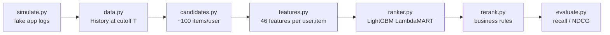

# Marketplace recommender — learning prototype

A small, end-to-end recommender for a Shopee-style marketplace. It uses synthetic data and runs in about 30 seconds on a laptop.
Each stage is one readable file, so you can follow the data from a raw click log to a ranked homepage.



## Quick start

```bash
uv sync
uv run recsys schema              # print raw tables + every feature with its meaning
uv run recsys simulate            # 60 days of fake marketplace activity -> data/*.csv
uv run recsys train --ablation    # train, compare against baselines, measure each feature group
uv run recsys recommend 42        # a user's history + their top 10 recommendations, with reasons
uv run pytest                     # leakage guard
```

The CSVs in `data/` are ordinary tables. Open `events.csv` to see exactly what the model learns from.

## The schema (`recsys/schema.py`)

There are two layers, and the code enforces both:

| Layer | What | Examples |
|---|---|---|
| **Raw tables** | Facts the app logs or the catalog stores. No aggregates. | `events` (impression/click/add_to_cart/order/hide/return), `searches`, `sessions`, `items`, `shops`, `users`, `categories` |
| **Features** | Numbers computed *as of a cutoff time* for one (user, item) pair | `item_ctr_30d`, `ui_hours_since_last`, `uc_click_share_30d`, `price_ratio_to_user`, `same_city` |

Feature groups map to the variables you would collect in a real marketplace:

| Group | Answers | Examples |
|---|---|---|
| candidate | Which retriever found it, and how confident was it? | recent / co-visitation / category-popular / trending scores |
| user | Who is asking? | activity, CTR, account age, device tier |
| item | Is it a good product right now? | price, discount, rating, 7-day clicks/orders, smoothed CTR/CVR, trend, return rate, freshness |
| shop | Is the seller trustworthy? | rating, Mall badge, cancel rate |
| user_item | What is this user's history with *this* item? | clicks, carts, orders, hours since last touch, ignored impressions, dwell |
| user_category | How much does this user like this category? | click share, **searches mapped to category**, days since last order (re-purchase cycle) |
| user_shop | Is this a loyal customer of the shop? | clicks, orders |
| context | Delivery fit | same city |

## Concepts the code demonstrates

**Point-in-time correctness (`data.History`).** Features at time T may only use events before T.
`tests/test_point_in_time.py` rewrites every event after T and asserts the features don't change.
If someone adds a feature that peeks at the future, this test fails.

**Time-based split (`pipeline.py`).** The model trains on "what users did on days 46–53, given days 0–46" and is evaluated on "days 53–60, given days 0–53". A random split would leak future behaviour into training.

**Two-stage retrieval → ranking.** Candidate generation cheaply narrows 2,500 items to about 100 per user. It optimises *recall*, because an item it misses can never be recommended. The ranker then orders those candidates precisely.

**Implicit feedback with graded labels.** Actions are labelled click = 1, cart = 2, order = 3, and LambdaMART is trained with gains 1/3/7. An order is worth much more than a click.

**Smoothing.** An item with 1 click out of 1 impression does not have a 100% CTR. Rates are shrunk toward the global mean until enough data accumulates.

**Negative signals.** Hidden items are filtered out. Return rate is a feature. Durable items the user already bought are dropped in re-ranking, while consumables are kept because re-buying them is expected.

## Results (default seed)

| Method | recall@20 | order_recall@20 | ndcg@20 |
|---|---|---|---|
| global popular | 0.078 | 0.109 | 0.046 |
| heuristic blend of retriever scores | 0.253 | 0.398 | 0.167 |
| LightGBM ranker | 0.273 | 0.421 | **0.212** |
| LightGBM + re-rank | 0.251 | 0.396 | 0.204 |

Candidate recall is 0.465. That is the ceiling for any ranker: about half of what users engage with next week is never retrieved. Improving retrieval is usually the biggest lever.

The ablation table (`--ablation`) retrains the model without each feature group. It also prints **seed noise**: the spread you get from just changing the random seed. Treat any difference smaller than the seed noise as no evidence either way. With the default data, **item**, **user×item**, and **user×category** features clearly matter. The others sit within noise in this simulator.

**Why re-ranking lowers the offline numbers.** Diversity caps (at most 8 items per category and 4 per shop in the top 20) push out some items the user would have clicked. The offline metric can only reward "more of what you already like". It cannot see that a page full of baby formula bores users over time. This is a real industry problem: diversity and novelty are judged with online A/B tests, not offline recall.

## What's deliberately simplified

- **Request-time context** (hour of day, surface, device) is logged in `sessions` but is not a ranker feature. This ranker predicts "next 7 days" per user, so the context is the same for every candidate in a group. Production systems add a second, real-time ranker trained on the `impression` log. That model can use hour, surface, and position.
- **Catalog fields are a snapshot.** `rating_avg` and `rating_count` are read as of the end of the data, a mild leakage. A real system stores daily snapshots.
- **Query understanding** is a substring match of category names (`History.searched_categories`). Real systems use a trained query classifier.
- **No embeddings.** Users and items have hidden taste vectors in the simulator, which the co-visitation retriever only approximates. A two-tower model or matrix factorisation is the natural next retriever.

## Exercises

1. Add a two-tower or ALS retriever to `candidates.py` and watch candidate recall and the final metrics change.
2. Add a `wishlist` event to the simulator and a `ui_wishlisted` feature. Does the ablation say it helps?
3. Train a real-time CTR model on impressions, with hour, surface, and position as features. Use position as a feature during training and set it to 0 at serving time to remove position bias.
4. Make the simulator users get bored when they see many items from one category in a row, then check whether re-ranking starts to win offline.

## Files

| File | Role |
|---|---|
| `recsys/schema.py` | Raw table and feature definitions (single source of truth) |
| `recsys/simulate.py` | Synthetic marketplace with hidden ground truth |
| `recsys/data.py` | CSV I/O, `History.at(cutoff)`, labels |
| `recsys/candidates.py` | Recent, co-visitation, category-popular, and trending retrievers |
| `recsys/features.py` | Point-in-time feature builder |
| `recsys/ranker.py` | LightGBM LambdaMART |
| `recsys/rerank.py` | Durable-purchase filter and diversity caps |
| `recsys/evaluate.py` | recall@K, order_recall@K, NDCG@K, candidate recall |
| `recsys/pipeline.py` | Time split, baselines, ablation, serving |
| `recsys/cli.py` | `recsys` command |
